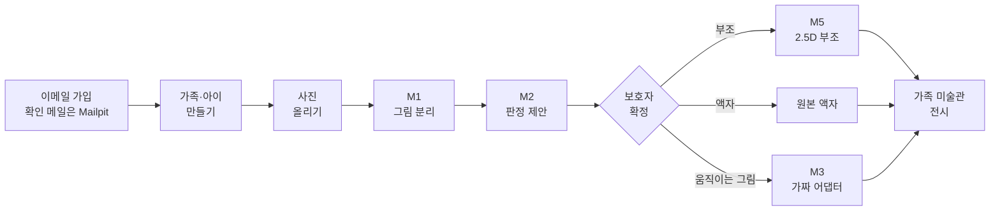
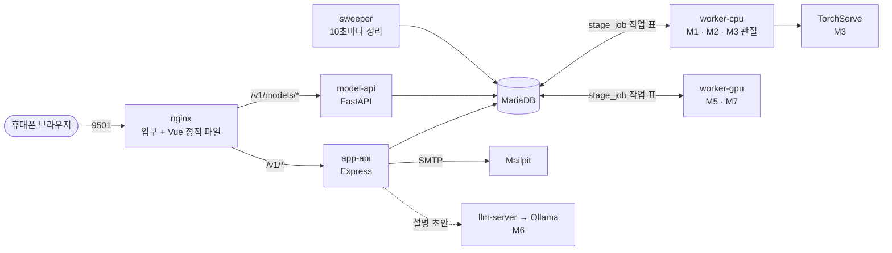
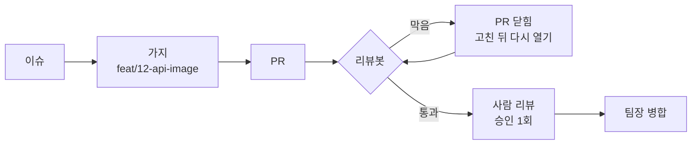

<div align="center">

# 우리 아이 미술관

**아이 그림 사진 한 장을, 가족 미술관에 걸리는 작품으로.**

모델 서빙 서비스를 Docker Compose로 다시 짓고 배포하는 3인 팀 작업


[배경지식](#1부-배경지식-이미-만들어진-서비스) · [지금 할 일](#2부-지금-해야-할-일) · [수행 가이드라인](#3부-수행-가이드라인) · [날짜별 가이드](#날짜별-수행-가이드) · [막히면](#막히면)

</div>

**이 README는 세 부분입니다.** ① [배경지식](#1부-배경지식-이미-만들어진-서비스): 이미 만들어진 서비스가 어떻게 되어 있고 어떻게 작동하는가 → ② [지금 할 일](#2부-지금-해야-할-일): 이번 5일의 목표·상태·역할·이슈 → ③ [수행 가이드라인](#3부-수행-가이드라인): 날짜별로 무엇을, 어떤 명령으로, 무엇이 되면 끝인가

---

## 1부. 배경지식: 이미 만들어진 서비스

이번 서비스는 두 덩어리로 이루어집니다. **모델 서빙**(app-api · 작업 큐 · 워커 · 모델 · DB)은 지난 모델 서빙 팀 작업(2026-09-30 판)을 그대로 쓰고, **화면**은 브라우저 3D 미술관(`web/src/app/world/`)으로 바꿉니다. 1부는 이 두 덩어리가 지금 어떻게 되어 있고 어떻게 작동하는지 설명합니다. 이번 작업의 개발 몫은 3D 화면이 모델 서빙 API를 쓰게 잇는 것이고(2부), 나머지는 전체를 컨테이너로 감싸는 것입니다.

### 무엇을 하나

보호자가 아이 그림을 휴대폰으로 찍어 올립니다. 서버가 그림을 종이에서 떼어 내고, 무슨 그림인지 보고, 결과물을 권합니다. 보호자가 고르고 승인하면 가족 미술관에 걸리고, 이웃 가족을 초대해 서로의 미술관을 볼 수 있습니다.

| 결과물 | 언제 | 만드는 모델 |
|---|---|---|
| 움직이는 그림 | 사람 그림이고 관절이 맞을 때 | M3 Animated Drawings(이번 5일은 가짜 어댑터) |
| 2.5D 입체 부조 | 그림을 종이에서 떼어 낼 수 있을 때 | M1 BiRefNet(분리) + M5 Depth Anything V2(깊이) |
| 원본 액자 | 떼어 내기 어렵거나 보호자가 고를 때 | 모델 없음 |

**약속은 하나입니다. 어떤 사진을 올려도 결과가 돌아옵니다.** 사진을 올리는 순간 원본 액자를 먼저 겁니다. 모델이 실패하면 한 단계씩 낮춘 결과를 돌려주고(움직임 → 부조 → 액자), 낮췄다는 사실을 숨기지 않습니다.

모델은 새로 학습하지 않았습니다. 아이 그림 데이터가 없고, 아이 사진을 학습에 쓰는 것 자체가 개인정보 문제이기 때문입니다. 대신 공개 사전학습 모델을 골라 이어 붙였습니다. 고른 기준은 상업 이용 라이선스, 크기와 메모리, 우리 장비에서 실행되는지입니다.

### 지키는 원칙

| 원칙 | 내용 |
|---|---|
| 승인 전 비전시 | 보호자가 승인하지 않은 결과는 어디에도 전시하지 않는다 |
| 원본 불변 | 원본 사진을 덮어쓰지 않는다 |
| 결과는 늘 돌아온다 | 품질이 모자라면 한 단계 낮춘 결과를 돌려주고, 낮춘 사실을 숨기지 않는다 |
| 원인 분리 | 보호자 선택·모델 낮춤·보호자 전환·인프라 실패·결과 미도달을 섞지 않는다 |
| 제안은 제안까지 | 판정은 제안만 하고 보호자가 확정한다. 점수를 보이지 않는다 |
| 최소 수집 | 아이는 별칭만 받는다. 아이 사진은 외부 API로 보내지 않는다 |

### 한 바퀴



<details>
<summary><b>단계별로 어디서 무엇이 일어나나(15단계)</b></summary>

| # | 어디서 | 무엇이 | 작품 상태 | 코드 |
|---|---|---|---|---|
| 1 | 휴대폰 | 사진 고르기 → 방향·자르기 → 줄여서 전송 | | `web/src/app/upload/` |
| 2 | nginx | 21MB 넘으면 바로 413, 아니면 app-api로 | | `ops/p1/nginx.conf` |
| 3 | app-api | 세션 확인 → 파일 받기 → 이미지 검사(HEIC 포함) | | `api/src/modules/artworks/routes.ts` |
| 4 | app-api | 원본 저장(덮어쓰기 불가) | | `api/src/storage/LocalFsDriver.ts` |
| 5 | app-api | **한 트랜잭션**: 작품 행, 원본 기록, 원본 액자 걸기, 이야기 자동 채우기, 판정 작업 등록 | `judging` | `intakeTx` |
| 6 | 화면 | 미술관에 원본 액자가 이미 보인다. 상세 화면에는 진행 표시 | | `v_job_progress` |
| 7 | worker-cpu | 분리 작업 점유 → M1 마스크·컷아웃 → 판정 작업 열기 | | `serving/workers/stages/split.py` |
| 8 | worker-cpu | M2 종류 → M3 관절 → M4 기하 규칙 → 권유 기록 | `awaiting_confirm` | `serving/workers/stages/judge.py` |
| 9 | 화면 | 권유를 보여 주고 보호자가 고른다 | | `/app/artworks/:id/confirm` |
| 10 | app-api | 고른 종류로 작업 등록 | `processing` | `api/src/modules/artworks/` |
| 11 | 워커 | 움직임 렌더 또는 부조 또는 액자. 실패하면 한 단계 낮춤 | | `serving/workers/stages/results.py`, `chain.py` |
| 12 | 화면 | 결과를 보고 정한다 | `awaiting_review` | `/app/artworks/:id/review` |
| 13 | app-api | 좋아요 / 한 단계 낮추기 / 액자로 두기 / 다시 찍기 | `approved` | `api/src/modules/artworks/decision.ts` |
| 14 | 화면 | 미술관에 걸린 결과. 이웃도 볼 수 있다 | | `/app/museum/:childId`, `v_gallery` |
| 15 | sweeper | 죽은 작업 되살리기, 지우기 요청 처리, 만료 정리 | | `api/src/sweeper/` |

표의 화면 주소(`/app/artworks/...` 등)는 지난 판 평면 화면입니다. 이번에는 같은 API를 3D 미술관이 부릅니다.

작품 상태는 DB가 허용하는 8개뿐입니다: `received` `judging` `awaiting_confirm` `processing` `awaiting_review` `approved` `failed` `deleting`.

</details>

### 서비스 구조

지금(팀 서버) 구성입니다. 컨테이너로 옮길 구성은 [아래](#컨테이너-구성)에 있습니다.



**구조를 이해하는 세 가지**
1. **API 서버는 모델을 직접 부르지 않습니다.** 움직이는 그림 생성이 사람 그림 17~43초, 큰 사진 62~431초 걸렸습니다(팀 서버 측정, 2026-09-30, 표본 적음). 요청 연결을 그동안 붙잡지 않도록, 추론은 Python 워커가 따로 합니다.
2. **API와 워커는 DB 표 하나(`stage_job`)로 이어집니다.** 사진을 받는 트랜잭션 안에서 작품 기록과 작업 등록을 한 번에 커밋합니다. 그래서 "작품은 생겼는데 작업이 없는" 상태가 생기지 않습니다. 워커는 `SELECT … FOR UPDATE SKIP LOCKED`로 다른 워커가 잡은 행을 건너뛰고 하나를 점유합니다. 점유는 60초이고 20초마다 연장합니다. 워커가 죽으면 sweeper가 그 작업을 다시 대기로 돌립니다.
3. **입구 하나만 밖에 엽니다.** nginx 9501만 열고, 나머지는 모두 127.0.0.1에서만 듣습니다.

### 이미 만들어진 것: 부분별로 어떻게 되어 있고 어떻게 작동하나

작업을 시작하기 전에 이 절을 먼저 읽습니다. 지금 코드는 팀 서버(맥) 한 대에서 pm2로 띄우도록 맞춰져 있습니다. 컨테이너로 옮길 때 각 부분에서 무엇을 봐야 하는지도 함께 적었습니다.

#### 1. 화면: 3D 미술관 `web/src/app/world/` (Vue 3.5 · three.js 0.170)
- **무엇:** 브라우저에서 도는 3D 미술관입니다. 광장 → 미술관 로비 → 회랑 → 나이별 전시실을 캐릭터로 걸어 다니고, 아이 그림이 두께 있는 입체 작품으로 걸립니다. 작품을 누르면 주제별 애니메이션(행동 7종·소리 11종)이 나옵니다.
- **어떻게 뜨나:**
  - 개발: `cd web && npm ci && npm run dev` → `http://127.0.0.1:9501/app/world`. 개발 서버가 `/v1/*`를 app-api(9521)로 넘깁니다(`web/vite.config.ts`).
  - 배포본: `npm run build:world` → `web/dist-world/`. 미술관 전용 라우터만 들어가고, 한 번 받으면 오프라인에서도 열리는 서비스 워커(`web/public/sw.js`)가 들어 있습니다. 화면 전용 서버 프로세스는 없고 nginx가 이 파일을 내줍니다.
- **어떻게 작동하나(지금):**
  - `engine.ts`가 렌더러·카메라·캐릭터 이동·작품 배치를 묶고, Vue 화면(`WorldView.vue` 등)은 데이터를 넘기고 콜백을 받습니다.
  - 공간은 `museum.ts`(로비·회랑·전시실, 작품 자리), `spatialLayout.ts`, `cathedral.ts`, `outdoor.ts`가 만듭니다.
  - 사진을 올리면 `store.ts`의 `processImage`가 원본·화면용 사본을 만들고, `cutout.ts`의 `removeBackground()`가 **브라우저 규칙**으로 배경을 지웁니다. 조명 펴기 → 종이색 찾기 → 가장자리부터 칠하기 → 잡티 지우기 순서이고, 실패하면 사각형 판으로 대체합니다. 그다음 `buildRelief()`가 윤곽을 따서 두께 있는 입체를 만듭니다.
  - 작품·방·설정·캐릭터는 **브라우저 IndexedDB**(`store.ts`)에 저장합니다. 백업 zip(`backup.ts`)으로 내보낼 수 있습니다.
  - **서버를 전혀 부르지 않습니다.** 로그인도 없고, 기기 안의 가족 프로필로 씁니다.
- **이번에 바꿀 것:**
  - 작품 부분(가입·아이·올리기·상태·확정·결정·목록)이 app-api를 쓰게 잇습니다. 서버 모델이 만든 M1 컷아웃(`cutoutUrl`)으로 입체를 다시 만듭니다. 교체 자리는 미리 나눠 두었습니다(`cutout.ts` 2행).
  - 개인정보 안내(`WorldPrivacy.vue` 20행, "사진을 이 기기 밖으로 보내지 않아요")를 바꿉니다.
  - 자세한 대응표는 [2부 이번 개발 몫](#이번-개발-몫-3d-화면--api-연결)에 있습니다.
- **같은 폴더의 다른 화면:** `web/`에는 지난 판의 평면 화면(`/app/...`, `/ops/...`)도 들어 있습니다. 운영 화면(`/ops`)은 참고만 하고, 평면 보호자 화면은 쓰지 않습니다.
- **옮길 때:** 빌드 단계(node, `npm run build:world`)와 실행 단계(nginx)를 나눕니다. 실행 이미지에는 `dist-world/`만 들어갑니다.

#### 2. 입구 nginx `ops/p1/nginx.conf`
- **무엇:** 바깥에서 들어오는 문은 이것 하나입니다(9501).
- **어떻게 작동하나:** 주소에 따라 보냅니다.

  | 주소 | 가는 곳 |
  |---|---|
  | `/` | 화면 정적 파일. 없는 경로는 `index.html`로 보내 화면 라우터가 처리한다 |
  | `/v1/*` `/live` `/ready` | app-api(127.0.0.1:9521) |
  | `/v1/models/*` | model-api(127.0.0.1:9541), 외부 API |
  | `/internal/*` `/model-api/*` | 404로 막음 |

  - 21MB 넘는 업로드는 nginx가 바로 413으로 거절합니다.
  - 접속 기록은 남기지 않습니다(개인정보).
- **옮길 때:** `127.0.0.1:9521` 같은 주소를 compose 서비스 이름(`app-api:9521`)으로 바꿉니다. 정적 파일 경로(`root`)도 이미지 안 경로로 바꿉니다.

#### 3. 앱 서버 `api/` (Node 22 · Express 4 · TypeScript)
- **무엇:** 가입·로그인·가족·아이·작품·결정·이웃·파일·운영의 모든 API(경로 69개)입니다.
- **어떻게 뜨나:** `npm run build`로 `dist/`를 만들고 `node dist/src/server.js`로 띄웁니다. 기동 순서는 이렇습니다(`src/server.ts`).
  1. 환경 변수 읽기. `SESSION_SECRET`·`AUTH_HMAC_SECRET`이 없으면 바로 멈춥니다.
  2. DB 연결 풀 만들기
  3. 파일 저장소 준비(`STORAGE_ROOT`)
  4. 라우터 조립
  5. **`127.0.0.1`의 `APP_PORT`(9521)에서만 듣기**. 이 주소는 코드에 고정돼 있습니다.
- **어떻게 작동하나:**
  - **DB:** SQL을 직접 씁니다(mysql2, ORM 없음).
  - **사진 올리기:** 작품 행·원본 기록·원본 액자 걸기·판정 작업 등록을 **한 트랜잭션**으로 커밋합니다(`modules/artworks/routes.ts`의 `intakeTx`). 모델은 부르지 않습니다.
  - **로그인:** 쿠키에는 무작위 세션 ID를, DB(`app_session`)에는 그 해시만 둡니다. 비밀번호는 argon2id로 저장합니다.
  - **오류:** 모두 `application/problem+json` 형식으로 돌려주고, 화면은 그 안의 `code`로 문구를 고릅니다.
  - **파일:** `STORAGE_ROOT` 아래 `family/{작품}/{종류}/{uuid}`로 저장하고, 원본은 덮어쓰지 않습니다.
  - **메일:** `MAIL_SMTP_URL`(Mailpit)으로 보냅니다. `MAIL_ENABLED`를 끄면 이메일 가입도 꺼집니다.
- **옮길 때:**
  - 고정 주소 `127.0.0.1`을 설정 값으로 바꿉니다(`api/src/server.ts` 14행).
  - 입구가 다른 컨테이너가 되면 프록시 신뢰 범위(`api/src/app.ts` 24행)도 바꿔야 합니다. 그대로 두면 요청 한도가 모든 사용자에게 한 IP로 걸립니다.
  - `STORAGE_ROOT`는 볼륨으로 붙입니다.

#### 4. 정리 프로세스 `api/src/sweeper/`
- **무엇:** app-api와 같은 코드에서 따로 뜨는 두 번째 Node 프로세스입니다(`node dist/src/sweeper/main.js`).
- **어떻게 작동하나:** 10초마다 차례로 아래를 합니다. 이게 없으면 워커가 죽었을 때 작업이 영원히 "처리 중"으로 남습니다.
  1. 점유 시간이 지난 작업(워커가 죽은 것)을 다시 대기로 돌립니다.
  2. 지우기 요청된 작품의 파일과 행을 실제로 지웁니다.
  3. 만료된 세션·토큰·임시 파일을 정리합니다.
- **옮길 때:** app-api 이미지를 그대로 쓰고 실행 명령만 바꿉니다. 작품 파일 볼륨을 같이 붙입니다.

#### 5. DB `db/`, `design/uri_gallery_ddl.sql` (MariaDB 12)
- **무엇:** 표 39개와 뷰 16개입니다. 작품·작업·판정·결과·모델 버전·평가·외부 키·이웃이 모두 여기 있습니다.
- **어떻게 만들어지나:** `api`의 `npm run db:migrate`가 `db/migrations/0001_sd03_baseline.sql`을 순서대로 넣고 `schema_migration`에 체크섬을 기록합니다. 같은 파일은 다시 실행해도 안전합니다.
- **어떻게 작동하나:** 규칙의 상당 부분을 DB가 지킵니다.
  - CHECK 제약: 작품 상태 8개만 허용, 승인됐으면 승인 시각 필수, 라이선스 미확인 모델은 활성 불가 등
  - 뷰: 미술관에 보일 작품(`v_gallery`), 지금 유효한 결과(`v_current_result`), 지표(`v_metrics_*`)를 화면과 지표가 같은 규칙으로 읽습니다.
- **옮길 때:** MariaDB 공식 이미지를 쓰고 자료는 볼륨에 둡니다. 스키마를 언제 넣을지(초기화 스크립트 또는 `db:migrate` 한 번)를 정합니다(이슈 #11). 접속 정보는 `DB_HOST`·`DB_PORT`·`DB_USER`·`DB_PASSWORD`·`DB_NAME`입니다.

#### 6. 작업 큐 `stage_job` 표 + 워커 `serving/workers/` (Python 3.11)
- **무엇:** 무거운 모델 일을 하는 Python 프로세스입니다. 무리(group)별로 하나씩 뜹니다: `python -m workers.main --group cpu_vision`(M1·M2·M3 관절), `--group gpu`(M5·M7).
- **어떻게 작동하나:** `runner.py`가 아래를 반복합니다.
  1. `stage_job`에서 자기 무리의 대기 작업 하나를 `FOR UPDATE SKIP LOCKED`로 잡습니다. 다른 워커가 잡은 행은 건너뜁니다.
  2. 점유는 60초이고, 20초마다 연장하며 취소 여부를 확인합니다.
  3. 단계별 코드(`stages/split.py`·`judge.py`·`results.py`)가 어댑터(`serving/adapters/`)를 불러 모델을 돌립니다.
  4. 결과를 분류합니다. 정상이면 다음 단계를 엽니다. 품질 미달이면 한 단계 낮춥니다(`chain.py`). 인프라 오류면 최대 3번까지 다시 시도합니다.
  5. 결과 파일을 `STORAGE_ROOT`에 쓰고 커밋합니다.
  - 워커는 모델 적재 상태를 `UAM_RUN_DIR/model_state/{워커}.json`에 씁니다. model-api가 이 파일을 읽어 "모델 준비됨"을 알립니다.
  - `UAM_FAKE_MODELS=1`이면 모든 모델이 가짜 어댑터(`adapters/fake.py`)로 바뀌어, 모델 없이도 같은 흐름이 돕니다. `M3,M7`처럼 적으면 그 모델만 가짜가 됩니다.
- **옮길 때:**
  - `worker-cpu`만 띄웁니다. `GPU_ENABLED=false`로 두면 M5도 CPU 워커가 맡습니다.
  - 작품 파일 볼륨과 상태 폴더(`UAM_RUN_DIR`) 볼륨을 model-api와 함께 붙입니다.
  - 가중치는 읽기 전용 볼륨으로 붙입니다.
  - 잠금 파일은 CPU 종류에 맞춰 고릅니다(`serving/README.md`).

#### 7. 모델 API `serving/model_api/` (FastAPI · uvicorn)
- **무엇:** 모델 상태를 알려 주고 외부 이용자에게 모델 기능을 여는 Python 웹 서버입니다(`python -m model_api.main`, 9541).
- **어떻게 작동하나:**
  - **내부:** `/internal/ready`·`/internal/models`로 상태 폴더를 읽어 모델별 준비 상태를 답합니다. 운영 화면은 app-api(`MODEL_API_INTERNAL_URL`)를 거쳐 이 값을 봅니다.
  - **외부:** `/v1/models/*`는 `X-API-Key`를 확인하고 요청을 `external_job`과 `stage_job`으로 넣습니다. 그러면 같은 워커가 처리합니다.
  - 모델을 직접 들고 있지 않습니다. 모델은 워커 안에 있습니다.
- **옮길 때:** `127.0.0.1` 고정 주소를 설정 값으로 바꿉니다(`serving/model_api/main.py` 8행). 워커와 같은 이미지를 쓰고 실행 명령만 바꿉니다.

#### 8. 이번에 띄우지 않는 것
| 무엇 | 지금 | 이번 5일 |
|---|---|---|
| worker-gpu | 맥 Apple GPU(MPS)로 M5·M7 | 띄우지 않음. 컨테이너는 Apple GPU를 못 쓴다 |
| TorchServe(M3 움직임) | conda·Java·OSMesa, 맥 전용 환경 목록 | 띄우지 않음. `UAM_FAKE_MODELS=M3,M7` |
| llm-server + Ollama(M6 설명) | `CAPTION_ENABLED=false`로 꺼져 있음 | 띄우지 않음 |
| 카카오 로그인 | 키가 있어야 켜짐 | 쓰지 않음. 이메일 가입 + Mailpit |

#### 9. 환경 변수(`.env.example`)
지금은 pm2 설정(`ops/p1/ecosystem.config.cjs`)이 `.env`를 읽어 모든 프로세스에 넣습니다. 앱이 스스로 `.env`를 읽지 않습니다. compose에서는 `env_file`이 이 일을 합니다.

| 묶음 | 변수 |
|---|---|
| DB | `DB_HOST` `DB_PORT` `DB_USER` `DB_PASSWORD` `DB_NAME` |
| 앱 | `APP_PORT` `SESSION_SECRET` `AUTH_HMAC_SECRET` `SECURE_COOKIES` `STORAGE_ROOT` `APP_BASE_URL` `FILES_ACCEL` |
| 메일 | `MAIL_ENABLED` `MAIL_SMTP_URL` `MAIL_FROM` |
| 모델 | `MODEL_API_INTERNAL_URL` `GPU_ENABLED` `UAM_FAKE_MODELS` `MODEL_MANIFEST` `TORCHSERVE_URL` |
| 설명 | `CAPTION_ENABLED` `LLM_SERVER_URL` `OLLAMA_URL` `OLLAMA_CHAT_MODEL` |

주소 값(`127.0.0.1:…`)은 컨테이너에서는 서비스 이름으로 바꿉니다. 비밀 값은 저장소에 올리지 않습니다.

<details>
<summary><b>모델과 팀 서버 실측</b></summary>

| ID | 모델 | 하는 일 | 실행 방식 | 팀 서버 실측(Apple M1 Ultra, 2026-09-28~29) |
|---|---|---|---|---|
| M1 | BiRefNet | 그림을 종이에서 분리 | 워커 안 PyTorch | CPU 9~10초/장, 메모리 8.5GB |
| M2 | OpenCLIP ViT-B-32(제로샷) | 무슨 그림인지 제안 | 워커 안 PyTorch | 0.03초/장 |
| M3 | Meta Animated Drawings | 관절 찾기, 움직임 렌더 | TorchServe(Java·conda·OSMesa) | 관절 7.2~9.1초, 렌더 59~108초 |
| M4 | 규칙 | 팔다리 길이·대칭·몸통 비율 | 순수 Python | |
| M5 | Depth Anything V2 Small | 깊이 → 부조 | 워커 안 PyTorch | 0.16초/장 |
| M6 | Qwen3-4B-Instruct(4bit) | 설명 초안 | Ollama | 0.3~0.5초/건 |
| M7 | TripoSR | 3D 조각(나중 범위) | 워커 안 | |

- 모델 목록과 출처·버전·SHA-256은 `models/manifest.yaml`에 있습니다. 가중치는 저장소에 없고, M1·M2·M5는 Hugging Face 공개 저장소에서 받습니다(합계 약 1.1GB).
- **권유 규칙**(`serving/rules/m4_geometry.py`): 분리 실패 → 액자 / 사람 그림 + 관절 기하 통과 → 움직임 / 분리 성공 → 부조 / 그 밖 → 액자. 판정은 보호자가 확정하는 "제안"입니다. 모델을 처음 재현했을 때 집 그림이 사람 점수 0.946(사람 그림은 0.997)으로 잡혔기 때문입니다.
- **잠금 파일**(`serving/`): `requirements.lock`(가짜 모델만), `requirements-models.lock`(맥·arm64 리눅스), `requirements-models-linux-x86_64.lock`(x86_64 리눅스 CPU 전용).

</details>

<details>
<summary><b>운영 기능(모델을 운영하는 화면)</b></summary>

| 기능 | 화면 | 하는 일 |
|---|---|---|
| 상태와 지표 | `/ops/status` | 모델별 준비 상태, 처리 시간, 낮춤률, 원인 분류, 결과 미도달 |
| 모델 평가·승격·롤백 | `/ops/models` | 평가 묶음을 후보 버전으로 돌리고, 기준을 넘으면 활성으로 올리고, 문제가 생기면 되돌린다. 라이선스 확인과 매니페스트가 없으면 활성이 될 수 없다(DB 제약) |
| API 활용 메뉴 | `/ops/api-guide` | 외부 모델 기능(분리·종류·관절·부조·설명)의 키 발급, 가이드, 시험 호출 |

</details>

### 처리 규칙

이 서비스의 핵심입니다. 실패를 두 종류로 나눕니다.

| 구분 | 무엇 | 처리 |
|---|---|---|
| 품질 미달 | 모델이 결과를 냈지만 기준 미달 | 재시도 없이 한 단계 낮춤: 움직임 → 부조 → 액자 |
| 인프라 장애 | 시간 초과·엔진 다운·저장소·DB·모델 준비 안 됨 | 같은 단계를 첫 시도 포함 최대 3번. 다 쓰면 "결과 미도달" |

- **원본 먼저 전시.** 올리는 순간 원본 액자를 걸고, AI 결과는 보호자가 확인해야 바꿔 겁니다. 결과까지 기다리게 하는 안(빈 화면)과 결과를 자동으로 바꿔 거는 안(원치 않는 결과가 걸림)은 버렸습니다.
- **기반 장애는 낮추지 않습니다.** 모델 탓이 아닌데 결과를 낮추면 "모델이 못한 것"과 "서버가 죽은 것"이 지표에서 섞입니다.
- **원인 5분류.** 보호자 선택·모델 낮춤·보호자 전환·인프라 실패·결과 미도달을 따로 셉니다. 결과를 받지 못한 작품은 "첫 결과 승인율"의 분모에서 뺍니다.
- **확인한 것.** 임시 MariaDB와 가짜 모델로 인프라 장애 5종 × 결과 단계 2개, 10건을 넣었습니다. 모두 3번 시도 뒤 결과 미도달로 처리됐고, 낮춤으로 잘못 센 것은 0건이었습니다(2026-09-28, `docs/B/B_통합시험.md`).

**개인정보.** 아이는 별칭만 받습니다. 아이 사진은 외부 API로 보내지 않습니다. 파일 키는 의미 없는 UUID이고 원본은 덮어쓰지 않습니다. 로그는 허용된 필드만 남깁니다. 세션은 DB에 세션 ID의 해시만 저장합니다.

### 저장소 지도

| 폴더 | 무엇 |
|---|---|
| `web/` | 화면(Vue). 보호자 `/app`, 운영 `/ops` |
| `api/` | 앱 서버(Express). 모듈별 경로, sweeper, 시험 |
| `serving/` | 모델 서버(FastAPI), 워커, 어댑터, 규칙, 설명 서버, 시험 |
| `contracts/` | OpenAPI와 단계 작업·LLM 계약 |
| `design/` | 설계서(SD_01~04), 유스케이스 16개, DDL, 마스터플랜 |
| `models/` | 모델 목록(`manifest.yaml`). 가중치는 넣지 않는다 |
| `ops/` | 기본 서버 구성(`server/`), 실제 팀 서버 구성(`p1/`), 점검 스크립트 |
| `docs/` | 공통 문서(팀 가이드·역할), 담당별 기록, 참고 |
| `.specify/` | 명세(spec), 계획(plan), 작업 목록(tasks) |
| `.github/` | PR 양식, CODEOWNERS, 리뷰봇 |

### 아직 하지 않은 것

모델 정확도 평가(평가 묶음이 그림 9장이라 끝나지 않음), 서버 응답 시간 p95, 실제 가족의 사용은 아직 하지 않았습니다. Docker 배포는 이번 5일 동안 합니다.

---

## 2부. 지금 해야 할 일

### 이번 목표(5일)

> `docker compose up -d` 한 명령으로 서비스가 뜨고, **3D 미술관**에서 가입 → 사진 올리기 → 서버 모델이 분리·판정·결과 → 보호자 확정 → 입체 작품 전시까지 한 바퀴가 된다.

핵심 흐름만 만듭니다. 모니터링·GPU·레지스트리·장애 리허설처럼 한 바퀴에 필요 없는 일은 하지 않습니다([마스터플랜 10절](design/PLAN_3인디벨롭_컨테이너협업_우리아이미술관.md)).

### 지금 상태

2026-10-29 기준입니다.

| 항목 | 상태 |
|---|---|
| 모델 서빙 | 있음. 지난 모델 서빙 팀 작업(2026-09-30 판)이다. 팀 서버(맥)에서 pm2로 프로세스 8개를 띄워 돌렸다 |
| 3D 화면 | 있음. 기기 안에서만 돈다. 서버 연결 코드는 0줄이다 |
| 리눅스에서 돌기 | 확인함. 리눅스 컨테이너(arm64·x86_64)에서 서빙·api 시험이 통과하고 웹이 빌드된다. x86_64용 CPU 전용 모델 잠금을 더했다 |
| Dockerfile · compose | **0개. 이번 5일 동안 팀이 직접 만든다** |
| 배포 | 이번 5일 밖. 나중에 따로 연결한다(3D 화면은 Vercel 같은 정적 호스팅, 서버는 컨테이너를 돌리는 곳) |

### 컨테이너 구성

설계 PR(이슈 #8)에서 확정할 초안입니다(마스터플랜 3-2).


| 지금(pm2·맥) | compose 서비스 | 바뀌는 점 |
|---|---|---|
| nginx + 정적 파일 | `web` | 빌드 단계 node(`npm run build:world`) → 실행 단계 nginx. 3D 미술관을 내준다 |
| app-api, sweeper | `app-api` `sweeper`(같은 이미지) | 127.0.0.1 고정 주소를 설정 값으로, 서비스 이름으로 부르기 |
| MariaDB | `db` + 볼륨 | 스키마 넣는 방법 정하기 |
| model-api, worker-cpu | `model-api` `worker-cpu`(같은 이미지) | CPU 종류별 잠금 파일을 빌드 인자로 고르기 |
| Mailpit | `mailpit` | 그대로. 메일을 끄면 이메일 가입도 꺼지므로 남긴다 |
| worker-gpu, TorchServe, 설명 서버 | 띄우지 않음 | M3·M7은 가짜 어댑터, 모든 모델은 CPU |
| `.env` → pm2 | `env_file` | 비밀 값은 저장소 밖 |

- 바깥 포트는 9501과 8025 둘입니다.
- 볼륨은 4개입니다: DB 자료, 작품 파일, 작업자 상태 폴더, 모델 가중치(읽기 전용).
- 맥(arm64) 컨테이너는 Apple GPU를 쓸 수 없고, 팀원 둘은 Windows(x86_64)입니다. 그래서 CPU로 도는 구성을 기준으로 합니다.

### 팀

| 사람 | 역할 | 맡는 폴더 |
|---|---|---|
| 이제민 [@wpalswpa](https://github.com/wpalswpa) | 모델 서빙 · compose로 묶기 | `serving/`, `compose.yaml` |
| 최호준 [@zozu001](https://github.com/zozu001) | 입구 · 3D 화면(로그인·확정·결정 창) · 처음부터 띄워 보기 | `web/`, 입구 nginx, `.gitattributes` |
| 신지현 [@tlswlgus960-prog](https://github.com/tlswlgus960-prog) | 팀장 · 앱 · 데이터 · 3D 화면 서버 연결 층 · 병합 | `api/`, `db/`, `web/src/app/world/`의 연결 층 |

### 이번 개발 몫: 3D 화면 ↔ API 연결

`store.ts`(기기 저장) 옆에 서버를 쓰는 층을 하나 두고, 작품 관련 부분만 서버로 바꿉니다(마스터플랜 3-3).

| 3D 화면 지금(기기) | 바꿀 것(app-api) |
|---|---|
| 가족·아이를 기기 안 계정으로 만든다(`Account`) | 이메일 가입·로그인(`/v1/auth/signup`·`/v1/auth/login`, 확인 메일은 Mailpit), 아이 등록·선택(`/v1/children`) |
| 사진을 기기에서 처리한다(`processImage` → 브라우저 배경 지우기) | `POST /v1/artworks`로 올린다. 서버 규칙대로 원본 액자가 바로 걸린다 |
| 입체를 바로 만든다 | `GET /v1/artworks/{id}`로 상태를 본다. 컷아웃(`cutoutUrl`)이 오면 그 그림으로 입체를 다시 만든다(`buildRelief`는 그대로) |
| (없음) | 권유 확정 `POST /v1/artworks/{id}/confirm`, 결과 결정 `POST /v1/artworks/{id}/decision`: 3D 화면 안의 작은 창 두 개 |
| 작품 목록(`listArtworks`) | `GET /v1/gallery`·`GET /v1/artworks`, 파일은 `/v1/files/{token}` |
| 방 배치·설정·캐릭터·놀이·백업 | 그대로 기기에(이번 범위 밖) |

- 서버에 닿지 않으면 화면에 알리고 다시 시도하게 합니다. 기기 판으로 몰래 바꾸지 않습니다.
- 응답 타입은 OpenAPI에서 생성한 타입(`npm run gen:api` → `web/src/api/types.gen.ts`)을 씁니다.
- 서비스 워커가 `/v1/`을 캐시하지 않는지 확인합니다.

### 1일차 이슈

| # | 이슈 | 담당 |
|---|---|---|
| 6 | 각자 환경 확인(Docker, 저장소 받기, push) | 셋 다 |
| 7 | 배포 서버 정하기(나중으로 미룸) | 신지현 |
| 8 | 설계 PR(compose 구성 확정) | 이제민 |
| 9 | M1·M2·M5를 리눅스 컨테이너 CPU로 재기 | 이제민 |
| 10 | `.gitattributes`, WSL에서 `npm run build:world` | 최호준 |
| 11 | MariaDB 컨테이너에 스키마 넣기, 설정 값 목록, 3D 화면 ↔ API 대응표 확정 | 신지현 |

2일차부터는 3부 날짜별 가이드를 보고 각자 이슈를 만들어 진행합니다.

### 하지 않을 것

CI 옮기기와 이미지 자동 빌드, 레지스트리, 태그별 되돌리기, 모니터링, 장애 리허설, 백업 스크립트, 보안 점검표, GPU, 움직이는 그림(M3)·3D 조각(M7)·설명(M6)의 실제 실행, 카카오 로그인, 서비스 기능 바꾸기. 시간이 남아도 다시 넣지 않고 발표 준비에 씁니다.

---

## 3부. 수행 가이드라인

아래 순서대로 따라가면 끝나는 조건에 닿도록 짰습니다.

### 시작하기

```bash
# Windows는 WSL 안에서 받는다(.gitattributes가 생기기 전에는 셸 스크립트 줄바꿈이 깨진다)
git clone https://github.com/kids-gallery/uri-gallery.git
cd uri-gallery
cp .env.example .env        # 값은 팀 채널에서 받는다. 저장소에 올리지 않는다
```

`docker compose up -d`로 띄우는 방법은 3일차에 compose가 생기면 여기에 적습니다(최호준). 그 전까지는 각 폴더의 시험을 돌릴 수 있습니다.

| 폴더 | 시험 |
|---|---|
| `api/` | `npm ci && npm test` |
| `web/` | `npm ci && npm run build` |
| `serving/` | `pip install -r requirements.lock && pytest` (가짜 모델, 임시 MariaDB를 스스로 띄움) |
| 리뷰봇 | `python3 .github/review-bot/test_review.py` |

### 일하는 법



1. **이슈 먼저.** 이슈 하나 = 가지 하나 = PR 하나.
2. **가지 이름**은 `종류/이슈번호-설명`, **커밋**은 `종류: 설명 (#이슈번호)`입니다. 종류는 feat · fix · docs · refactor · test · chore이고, 가지에는 `feature`도 됩니다.
3. **PR 양식을 채웁니다.** 특히 "확인한 것"에는 실제로 돌린 명령과 결과(숫자)를 적습니다.
4. **리뷰봇이 먼저 봅니다.** 핸드북 규칙과 계획서 범위를 13가지로 검사하고, Claude가 바뀐 내용을 비판적으로 읽습니다. 막히면 PR이 닫히고, 무엇을 어떻게 고칠지 댓글로 남깁니다. 본문만 고치면 바로 다시 검사해서 통과하면 다시 열립니다. 코드를 고쳤으면 커밋을 올린 뒤 다시 엽니다. **봇은 승인하지 않습니다.** 통과하면 사람 리뷰 차례입니다([마스터플랜 4-1](design/PLAN_3인디벨롭_컨테이너협업_우리아이미술관.md)).
5. **사람 리뷰**에서 "왜 이렇게 했는가"를 배운 원칙으로 설명합니다. 설명하지 못하면 병합하지 않습니다.
6. **설계서 먼저.** 코드를 바꾸면 설계서를 먼저 고치거나, PR 본문 "설계서" 칸에 근거 절을 적습니다.
7. `.env`, 비밀 값, 모델 가중치는 저장소에 넣지 않습니다.

<details>
<summary><b>리뷰봇 규칙 13가지</b></summary>

이슈 연결 · PR 양식 · 확인 근거(명령이나 숫자) · 가지 이름 · 커밋 메시지 · 비밀 값 · 금지 파일(`.env`, 키, 가중치, 5MB 넘는 파일) · 설계서 먼저 · 범위 밖(모니터링·GPU·레지스트리 등) · 크기(600줄) · Dockerfile 기본(판 번호 고정, `.dockerignore`) · 리뷰봇 자체 수정 · 남의 폴더(경고만).

규칙 값은 `.github/review-bot/rules.json`에 있습니다. 범위·크기·리뷰봇 수정 규칙과 AI의 막음 지적은, 작성자가 아닌 사람이 `리뷰봇-예외` 라벨을 붙이고 본문에 `예외 이유:`를 적으면 경고로 바뀝니다. 비밀 값·금지 파일·이슈 연결·양식 규칙은 예외가 없습니다.

</details>

협업 규칙의 정본은 팀 핸드북 [kids-gallery/team-handbook](https://github.com/kids-gallery/team-handbook)입니다.

### 날짜별 수행 가이드

날마다 같은 순서로 일합니다. 아침 10분 동안 그날 쓰는 교안 주제를 같이 다시 보고([팀 가이드](docs/공통/컨테이너배포_팀가이드.md) 3절), 각자 이슈 → 가지 → PR로 작업한 뒤, 저녁에 "그날 끝 확인"을 함께 봅니다.

#### 1일차: 바탕 확인과 설계 PR

| 누가 | 할 일 | 이슈 |
|---|---|---|
| 셋 다 | Docker·저장소·push가 되는지 확인하고 결과를 댓글로 남긴다 | #6 |
| 이제민(셋이 같이 답) | 설계 PR: 아래 질문 6개에 답하고 compose 구성을 확정한다 | #8 |
| 이제민 | M1·M2·M5를 리눅스 컨테이너 CPU로 한 장씩 돌려 시간·메모리 재기 | #9 |
| 최호준 | `.gitattributes`(LF 고정), WSL에서 `npm run build:world`, 3D 화면을 개발 서버로 띄워 써 보기 | #10 |
| 신지현 | MariaDB 컨테이너에 스키마 넣어 보기, 설정 값 목록, 3D 화면 ↔ API 대응표 확정 | #11 |

```bash
docker run hello-world          # Docker가 도는지
docker version                  # Server 판 확인
uname -m                        # x86_64 또는 arm64
free -h                         # 메모리
# 지금 서비스를 손으로 깔아 보며 무엇이 필요한지 적는다(이미지 설계의 출발점)
docker run -it --rm -v "$PWD":/src python:3.11-slim bash
```

**설계 PR이 답할 질문**(마스터플랜 3-4)
1. 서비스를 몇 개로 나누는가. 같은 코드를 쓰는 둘(app-api·sweeper, model-api·worker-cpu)은 이미지 하나를 나눠 쓰는가.
2. 기반 이미지와 판 번호는 무엇인가. 무엇을 `.dockerignore`에 넣는가.
3. CPU 종류(맥 arm64, Windows x86_64)에 따라 잠금 파일을 어떻게 고르는가.
4. 볼륨 4개를 누가 어떻게 붙이는가. 모델 가중치는 어디서 받아 어디에 두는가.
5. 고정 주소(127.0.0.1)를 어떻게 설정 값으로 바꾸고 서비스 이름으로 부르는가. `.env`로 넘길 값은 무엇인가.
6. 서비스마다 "준비됨"을 무엇으로 판단하는가. DB 스키마는 언제 넣는가.

**끝 확인:** 이슈 #6에 셋의 결과가 있고, 설계 PR이 올라와 있습니다.

#### 2일차: 서비스별 이미지

오전에 설계 PR을 리뷰·병합한 뒤 각자 자기 이미지를 만듭니다.

| 누가 | 이미지 | 먼저 고칠 코드(설계서 먼저) |
|---|---|---|
| 이제민 | serving(가짜 모델, `requirements.lock`) → model-api·worker-cpu가 함께 씀 | model-api 바인딩 주소를 설정 값으로(`serving/model_api/main.py` 8행) |
| 최호준 | web: 빌드 단계 `node:22`(`npm run build:world`) → 실행 단계 nginx. 그리고 3D 화면 로그인 창 | 없음 |
| 신지현 | api: app-api·sweeper가 함께 씀. 그리고 3D 화면 서버 연결 층(올리기·상태·목록) | app-api 바인딩 주소(`api/src/server.ts` 14행), 프록시 신뢰 범위(`api/src/app.ts` 24행) |

**Dockerfile을 쓸 때 지킬 것**(리뷰봇도 일부를 검사합니다)
- 기반 이미지는 판 번호를 적습니다(`node:22-slim`처럼 쓰고, `latest`나 판 번호 없이 쓰지 않습니다).
- 의존성 파일(`package*.json`, `requirements*.lock`)을 먼저 복사해 설치하고, 소스는 그 뒤에 복사합니다. 그래야 소스만 바꿨을 때 설치 층을 다시 쓰지 않습니다.
- Dockerfile과 같은 폴더(또는 저장소 맨 위)에 `.dockerignore`를 두고 `node_modules`, `.env`, 모델 가중치, 시험 결과물을 뺍니다.
- 비밀 값은 이미지에 넣지 않습니다. 실행할 때 `--env-file`로 넘깁니다.

```bash
docker build -t uam-api ./api
docker image ls                                  # 크기를 PR '확인한 것'에 적는다
docker run --rm --env-file .env -p 9521:9521 uam-api
curl -i http://localhost:9521/live               # 바인딩 주소를 바꾼 뒤에야 바깥에서 닿는다
# 소스 한 줄만 바꾸고 다시 빌드해, 설치 층이 재사용되는지(시간이 줄었는지) 본다
time docker build -t uam-api ./api
```

**끝 확인:** 각자 이미지가 빌드되고 혼자 뜹니다. PR에 이미지 크기와 빌드 시간이 있습니다.

#### 3일차: compose로 묶기

이제민이 저장소 맨 위 `compose.yaml`에 7개 서비스를 묶고, 둘은 자기 서비스 부분을 채웁니다. 같은 날 최호준은 3D 화면의 확정·결정 창을, 신지현은 서버 컷아웃으로 입체를 다시 만드는 부분을 붙입니다.

| 넣을 것 | 내용 |
|---|---|
| 서비스 | `web` `app-api` `sweeper` `db` `mailpit` `model-api` `worker-cpu` |
| 바깥 포트 | `web` 9501, `mailpit` 8025만 연다. 나머지는 서비스 이름으로 부른다 |
| 볼륨 | DB 자료, 작품 파일(app-api·sweeper·model-api·worker-cpu), 작업자 상태 폴더(model-api·worker-cpu), 모델 가중치(읽기 전용) |
| 설정 | `env_file: .env`. 주소 값은 서비스 이름으로(`DB_HOST=db`, `MAIL_SMTP_URL=smtp://mailpit:1025`, `MODEL_API_INTERNAL_URL=http://model-api:9541`) |
| 기동 순서 | `db`에 healthcheck, app-api·model-api·worker-cpu는 `depends_on: db: condition: service_healthy` |
| 재시작 | 모든 서비스 `restart: unless-stopped` |
| 가짜 모델 | `UAM_FAKE_MODELS=1`, `GPU_ENABLED=false`, `CAPTION_ENABLED=false` |

```bash
docker compose config            # 문법과 합쳐진 설정 확인
docker compose up -d --build
docker compose ps                # 모두 running·healthy인지
docker compose logs -f app-api   # 막히면 서비스별 로그
# 브라우저: http://localhost:9501 에서 가입 → 메일은 http://localhost:8025 에서 확인 링크를 누른다
docker compose down              # 볼륨은 남는다. 다시 up 해서 작품이 남는지 본다
```

**끝 확인:** 저녁에 셋이 같은 `compose.yaml`을 받아 각자 PC에서 띄우고, 가짜 모델로 3D 미술관에서 가입 → 사진 → 확정 → 입체 전시 한 바퀴가 됩니다.

#### 4일차: 실제 모델과 다듬기

| 누가 | 할 일 |
|---|---|
| 이제민 | 실제 모델 3개. `models/manifest.yaml`의 `source`·`revision` 그대로 가중치를 받아 `MODEL_ROOT` 볼륨(읽기 전용)에 둔다. `UAM_FAKE_MODELS=M3,M7`. 모델 묶음 이미지는 CPU 종류에 맞는 잠금 파일로. Docker Desktop 메모리를 넉넉히(M1 추론 중 8.5GB) |
| 최호준 | 깨끗한 PC에서 README만 보고 처음부터 띄워 보기. 막힌 곳을 README "시작하기"에 고친다 |
| 신지현 | 개인정보 문구, 서버에 닿지 않을 때 화면, `docker compose down` 뒤 `up`에도 가족 작품이 남는지 확인 |
| 함께 | 저녁에 기능 동결, 시연이 실패할 때를 대비한 예비 영상 |

```bash
docker stats                     # 모델 컨테이너 메모리
docker compose exec worker-cpu ls /models    # 가중치가 보이는지(경로는 설계 PR에서 정한 값)
```

**끝 확인:** 맥에서 실제 모델로 3D 미술관 한 바퀴가 됩니다. 남길 수치 세 가지(이미지 크기, 기동부터 준비까지 시간, 모델별 한 장 처리 시간·메모리)가 표에 있습니다.

#### 5일차: 발표

오전에 리허설을 2번 합니다. 발표 순서는 이렇습니다(10분, 마스터플랜 6절).
1. 문제: 지금은 한 서버에 손으로 맞춘 프로세스 8개
2. 설계: 서비스 7개, 바깥 포트 2개, 볼륨 4개, 뺀 것과 이유
3. 구현: 각자 만든 이미지와 고친 코드, 잰 수치
4. 시연: `docker compose up -d` → 가입 → 사진 → 결과 → 전시
5. 한계와 다음

### 끝나는 조건(마스터플랜 8절)

- 설계 PR이 구현 PR보다 먼저 병합돼 있다.
- 깨끗한 PC에서 `docker compose up -d` 뒤 가짜 모델로 한 바퀴가 된다.
- 맥에서 실제 모델 3개로 한 바퀴가 된다.
- `docker compose down` 뒤 다시 `up` 해도 가족 작품이 남는다.
- 저장소에 `.env`·비밀 값·모델 가중치가 0건이다.
- 발표를 마쳤고, 수치와 각자 작업 기록이 있다.

### 막히면

30분 안에 팀 채널에 묻습니다. 물을 때는 명령, 결과(오류 문구), 이미 해 본 것을 함께 붙입니다. 자주 걸릴 곳은 이렇습니다.

| 증상 | 먼저 볼 곳 |
|---|---|
| 셸 스크립트가 `^M`·`bad interpreter`로 깨진다 | Windows 폴더에 받아 줄바꿈이 CRLF가 됨. WSL 안에서 다시 받거나 `.gitattributes`(#10) |
| 다른 컨테이너에서 app-api·model-api에 연결이 안 된다 | 바인딩 주소가 아직 `127.0.0.1`로 고정돼 있음(2일차 코드 수정) |
| 가입 화면에 이메일 가입이 없다 | `MAIL_ENABLED`가 꺼져 있음. Mailpit을 띄우고 켠다 |
| api가 뜨자마자 죽는다 | `SESSION_SECRET`·`AUTH_HMAC_SECRET` 없음, 또는 DB가 준비되기 전에 뜸(`depends_on` 조건) |
| 모델 설치가 맥과 Windows에서 다르게 된다 | CPU 종류별 잠금 파일(`serving/README.md`) |
| 워커가 메모리 부족으로 죽는다 | M1 추론 중 8.5GB. 가짜 모델로 돌리거나 Docker 메모리를 늘린다 |
| 로그인했는데 다시 로그인 화면이 뜬다 | 로컬 `http://`에서는 `SECURE_COOKIES=false`가 필요할 수 있음(`.env.example` 13행) |
| 3D 화면이 서버 대신 예전처럼 기기에서만 처리한다 | 연결 층이 아직 `store.ts`의 기기 처리를 부름(2부 대응표) |
| 작업이 계속 "처리 중"이다 | sweeper가 떠 있는지, 워커 로그(`docker compose logs worker-cpu`) |

### 문서 지도

처음이면 위에서부터 읽습니다.

| 순서 | 문서 | 무엇이 있나 |
|---|---|---|
| 1 | [마스터플랜](design/PLAN_3인디벨롭_컨테이너협업_우리아이미술관.md) | 5일 목표 · compose 구성 · 역할 · 날짜별 할 일 · 리뷰봇 · 하지 않을 것 |
| 2 | [팀 가이드](docs/공통/컨테이너배포_팀가이드.md) | Linux · Git · Docker 교안의 어디를 이 작업에 쓰는가 |
| 2-1 | [코드 설명](docs/공통/코드설명.md) | 작품 한 점이 함수들을 거쳐 가는 순서 · 상태 · 작업 큐 · 실패 처리 · 3D 화면 연결 지점 |
| 3 | [아키텍처 설계서 SD_04](design/SD_04_아키텍처설계서_우리아이미술관.md) | 서비스 구조와 배치 |
| 4 | [DB 설계서 SD_03](design/SD_03_데이터베이스설계서_우리아이미술관.md) | 표 · 뷰 · 상태 |
| 5 | [작업 큐 계약](contracts/stage-job.md) | app-api와 작업자가 주고받는 규칙 |
| 6 | [서빙 안내](serving/README.md) | 모델 설치 · CPU 종류별 잠금 파일 |
| 참고 | [유스케이스](design/UC_ALL_우리아이미술관_통합명세.md) · [프로세스 SD_01](design/SD_01_프로세스설계서_우리아이미술관.md) · [화면 SD_02](design/SD_02_UIUX설계서_우리아이미술관.md) · [배포 절차](ops/server/DEPLOY.md) | 기능 정의와 운영 |
