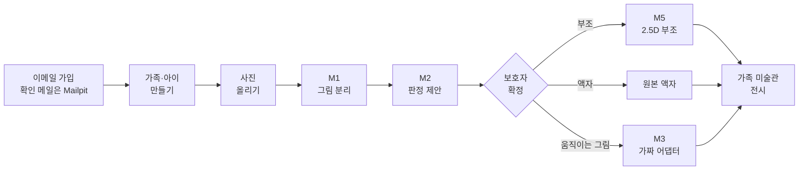
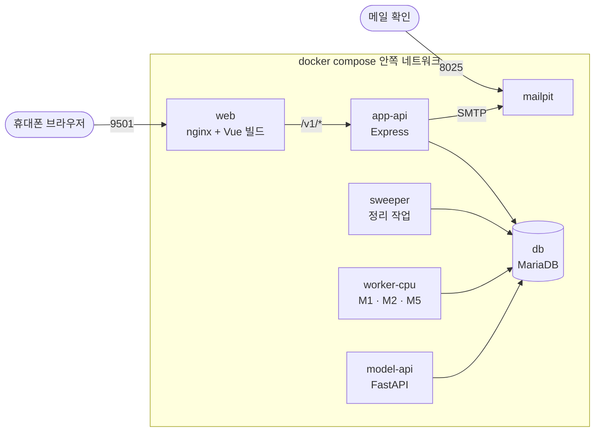
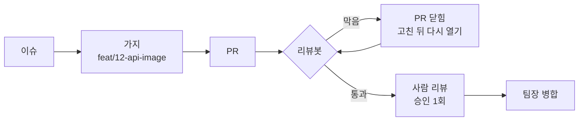

<div align="center">

# 우리 아이 미술관

**아이 그림 사진 한 장을, 가족 미술관에 걸리는 작품으로.**

모델 서빙 서비스를 Docker Compose로 다시 짓고 배포하는 3인 팀 작업


[한 바퀴](#한-바퀴) · [구성](#컨테이너-구성) · [지금 상태](#지금-상태) · [팀](#팀) · [일하는 법](#일하는-법) · [문서](#문서-지도)

</div>

---

## 무엇을 하나

보호자가 아이 그림을 휴대폰으로 찍어 올립니다. 서버가 그림을 종이에서 떼어 내고, 무슨 그림인지 보고, 결과물을 권합니다. 보호자가 고르고 승인하면 가족 미술관에 걸립니다.

| 결과물 | 언제 | 만드는 모델 |
|---|---|---|
| 2.5D 입체 부조 | 그림을 종이에서 떼어 낼 수 있을 때 | M1 BiRefNet(분리) + M5 Depth Anything V2(깊이) |
| 원본 액자 | 떼어 내기 어렵거나 보호자가 고를 때 | 모델 없음 |
| 움직이는 그림 | 사람 그림이고 관절이 맞을 때 | M3 Animated Drawings(이번 5일은 가짜 어댑터) |

모델이 실패해도 보호자는 늘 무언가를 봅니다. 사진을 올리는 순간 원본 액자를 먼저 걸고, 만들기에 실패하면 한 단계씩 낮춥니다(움직임 → 부조 → 액자).

## 이번 목표(5일)

> `docker compose up -d` 한 명령으로 서비스가 뜨고, 가입부터 전시까지 한 바퀴가 된다. 같은 방법으로 배포 서버에서도 뜬다.

핵심 흐름만 만듭니다. 모니터링·GPU·레지스트리·장애 리허설처럼 한 바퀴에 필요 없는 일은 하지 않습니다([마스터플랜 10절](design/PLAN_3인디벨롭_컨테이너협업_우리아이미술관.md)).

## 한 바퀴



## 컨테이너 구성

설계 PR에서 확정할 초안입니다(마스터플랜 3-2).



- app-api와 작업자는 직접 부르지 않습니다. app-api가 DB의 작업 표(`stage_job`)에 작업을 넣고, 작업자가 `FOR UPDATE SKIP LOCKED`로 가져갑니다. 작품 기록과 작업 등록이 한 트랜잭션에 들어가서, 한쪽만 남는 일이 없습니다.
- 바깥에 여는 포트는 9501과 8025 둘입니다. 나머지는 서비스 이름으로 서로 부릅니다.
- 볼륨 4개: DB 자료, 작품 파일, 작업자 상태 폴더, 모델 가중치(읽기 전용).

| 층 | 기술 | 폴더 |
|---|---|---|
| 화면 | Vue 3.5 · Vite 8 · vue-router · Pinia · TypeScript | `web/` |
| 앱 서버 | Node 22 · Express 4 · mysql2 · zod · argon2 · sharp | `api/` |
| 모델 서버 | Python 3.11 · FastAPI · uvicorn · PyMySQL | `serving/` |
| 모델 | PyTorch(CPU) · transformers · open_clip | `serving/adapters/` |
| 데이터 | MariaDB 12(표 39개 · 뷰 16개) | `design/uri_gallery_ddl.sql` |
| 약속 | OpenAPI 3(앱 API 경로 69개) | `contracts/` |

## 지금 상태

2026-10-29 기준입니다.

| 항목 | 상태 |
|---|---|
| 서비스 코드 | 있음. 지난 모델 서빙 과정에서 1조가 만든 팀 판(2026-09-30)이고, 팀 서버(맥)에서 pm2로 프로세스 8개를 띄워 돌렸다 |
| 리눅스에서 돌기 | 확인함. 리눅스 컨테이너(arm64·x86_64)에서 서빙·api 시험이 통과하고 웹이 빌드된다. x86_64용 CPU 전용 모델 잠금을 더했다 |
| Dockerfile · compose | **0개. 이번 5일 동안 팀이 직접 만든다** |
| 배포 서버 | 1일차에 정한다 |

## 팀

| 사람 | 역할 | 맡는 폴더 |
|---|---|---|
| 이제민 [@wpalswpa](https://github.com/wpalswpa) | 모델 서빙 · compose로 묶기 · 배포 | `serving/`, `compose.yaml` |
| 최호준 [@zozu001](https://github.com/zozu001) | 입구 · 화면 · 처음부터 띄워 보기 | `web/`, 입구 nginx, `.gitattributes` |
| 신지현 [@tlswlgus960-prog](https://github.com/tlswlgus960-prog) | 팀장 · 앱 · 데이터 · 병합 | `api/`, `db/`, `contracts/` |

| 날 | 할 일 | 그날 끝 확인 |
|---|---|---|
| 1일차 | 환경 확인, 설계 PR 쓰기 시작 | 설계 PR이 올라와 있다 |
| 2일차 | 서비스별 이미지 | 각자 이미지가 빌드되고 혼자 뜬다 |
| 3일차 | compose로 묶기 | 가짜 모델로 세 PC 모두 한 바퀴 |
| 4일차 | 실제 모델 · 배포 서버 | 맥에서 실제 모델로, 배포 서버에서 한 바퀴 |
| 5일차 | 발표 | 시연 |

## 일하는 법



1. **이슈 먼저.** 이슈 하나 = 가지 하나 = PR 하나.
2. **가지 이름** `종류/이슈번호-설명`, **커밋** `종류: 설명 (#이슈번호)`. 종류는 feat · fix · docs · refactor · test · chore.
3. **PR 양식을 채운다.** 특히 "확인한 것"에는 실제로 돌린 명령과 결과(숫자)를 적는다.
4. **리뷰봇**이 먼저 봅니다. 핸드북 규칙과 계획서 범위를 검사하고, AI가 바뀐 내용을 비판적으로 읽습니다. 막히면 PR이 닫히고, 무엇을 어떻게 고칠지 댓글로 남깁니다. 고친 뒤 다시 열면 다시 검사합니다. AI 검토는 Claude API를 쓰고, 저장소 비밀에 키가 있어야 켜집니다. **봇은 승인하지 않습니다.** 통과하면 사람 리뷰 차례입니다([마스터플랜 4-1](design/PLAN_3인디벨롭_컨테이너협업_우리아이미술관.md)).
5. **사람 리뷰**에서 "왜 이렇게 했는가"를 배운 원칙으로 설명합니다. 설명하지 못하면 병합하지 않습니다.
6. **설계서 먼저.** 코드를 바꾸면 설계서를 먼저 고칩니다.
7. `.env`, 비밀 값, 모델 가중치는 저장소에 넣지 않습니다.

협업 규칙의 정본은 팀 핸드북 [kids-gallery/team-handbook](https://github.com/kids-gallery/team-handbook)입니다.

## 시작하기

```bash
git clone https://github.com/kids-gallery/uri-gallery.git
cd uri-gallery
cp .env.example .env        # 값은 팀 채널에서 받는다. 저장소에 올리지 않는다
```

`docker compose up -d`로 띄우는 방법은 3일차에 compose가 생기면 여기에 적습니다(최호준). 그 전까지는 각 폴더의 시험을 돌릴 수 있습니다.

| 폴더 | 시험 |
|---|---|
| `api/` | `npm ci && npm test` |
| `web/` | `npm ci && npm run build` |
| `serving/` | `pip install -r requirements.lock && pytest` (가짜 모델) |
| 리뷰봇 | `python3 .github/review-bot/test_review.py` |

## 문서 지도

처음이면 위에서부터 읽습니다.

| 순서 | 문서 | 무엇이 있나 |
|---|---|---|
| 1 | [마스터플랜](design/PLAN_3인디벨롭_컨테이너협업_우리아이미술관.md) | 5일 목표 · compose 구성 · 역할 · 날짜별 할 일 · 리뷰봇 · 하지 않을 것 |
| 2 | [팀 가이드](docs/공통/컨테이너배포_팀가이드.md) | Linux · Git · Docker 교안의 어디를 이 작업에 쓰는가 |
| 3 | [아키텍처 설계서 SD_04](design/SD_04_아키텍처설계서_우리아이미술관.md) | 서비스 구조와 배치 |
| 4 | [DB 설계서 SD_03](design/SD_03_데이터베이스설계서_우리아이미술관.md) | 표 · 뷰 · 상태 |
| 5 | [작업 큐 계약](contracts/stage-job.md) | app-api와 작업자가 주고받는 규칙 |
| 6 | [서빙 안내](serving/README.md) | 모델 설치 · CPU 종류별 잠금 파일 |
| 참고 | [유스케이스](design/UC_ALL_우리아이미술관_통합명세.md) · [프로세스 SD_01](design/SD_01_프로세스설계서_우리아이미술관.md) · [화면 SD_02](design/SD_02_UIUX설계서_우리아이미술관.md) | 기능 정의 |

## 지키는 원칙

| 원칙 | 내용 |
|---|---|
| 승인 전 비전시 | 보호자가 승인하지 않은 결과는 어디에도 전시하지 않는다 |
| 원본 불변 | 원본 사진을 덮어쓰지 않는다 |
| 결과는 늘 돌아온다 | 품질이 모자라면 한 단계 낮춘 결과를 돌려주고, 낮춘 사실을 숨기지 않는다 |
| 제안은 제안까지 | 판정은 제안만 하고 보호자가 확정한다 |
| 최소 수집 | 아이는 별칭만 받는다. 아이 사진은 외부 API로 보내지 않는다 |
