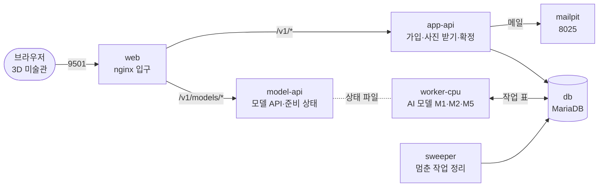

<div align="center">

# 우리 아이 미술관

**아이 그림 사진 한 장을, 가족 미술관에 걸리는 작품으로.**


</div>

보호자가 아이 그림을 찍어 올리면, 서버 AI가 그림을 종이에서 떼어 내고 입체 작품으로 만들어 브라우저 3D 미술관에 겁니다. 이번 5일(10-30 금 ~ 11-05 목 발표) 동안 이 서비스를 **Docker Compose 한 명령으로 뜨게** 만들고, 3D 화면을 서버에 잇습니다.

> **목표:** `docker compose up -d` → 3D 미술관에서 가입 → 사진 올리기 → AI가 분리·판정·입체 → 보호자 확정 → 전시까지 한 바퀴

**읽는 법.** 이 README는 프로젝트 전체를 한 장에 요약했습니다. 각 주제의 `→` 링크를 누르면 그 주제의 자세한 설명으로 바로 갑니다. 1부는 이미 만들어진 서비스, 2부는 이번 5일 동안 할 일입니다.

---

## 1부. 이미 만들어진 서비스

### 무엇을 하나

| 결과물 | 언제 | 만드는 모델 |
|---|---|---|
| 2.5D 입체 부조 | 그림을 종이에서 떼어 낼 수 있을 때 | M1 BiRefNet(분리) + M5 Depth Anything V2(깊이) |
| 원본 액자 | 떼어 내기 어렵거나 보호자가 고를 때 | 모델 없음 |
| 움직이는 그림 | 사람 그림이고 관절이 맞을 때 | M3 Animated Drawings(이번 5일은 가짜 어댑터) |

- **약속: 접수된 사진(JPG·PNG·HEIC, 20MB 이하)은 바로 원본 액자로 걸립니다.** AI 결과가 품질 기준에 못 미치면 한 단계 낮춘 결과를 돌려주고, 서버 장애면 다시 시도한 뒤 단계별로 처리합니다([처리 규칙](#처리-규칙이-서비스의-핵심)).
- 모델은 새로 학습하지 않았습니다. 아이 그림 데이터가 없고 아이 사진 학습은 개인정보 문제라, 상업 이용이 되는 공개 모델을 이어 붙였습니다.
- → [자세히: 무엇을 하나](docs/공통/서비스_구조와_코드.md#what)

### 지키는 원칙

AI 결과는 보호자 승인 뒤 전시(원본 액자는 접수 즉시) · 원본 불변 · 결과는 늘 돌아온다 · 원인 분리 · 제안은 제안까지(점수 비공개) · 최소 수집(아이는 별칭만, 사진은 외부 API로 보내지 않음) → [자세히](docs/공통/서비스_구조와_코드.md#principles)

### 서비스 구조



1. **앱 서버는 AI를 직접 부르지 않습니다.** 추론이 수십 초~수 분 걸려서, 사진을 받으면 DB의 작업 표(`stage_job`)에 일을 적고 바로 답합니다. worker가 그 표에서 일을 가져가 따로 추론합니다.
2. **API와 worker는 DB 표 하나로 이어집니다.** 작품 기록과 작업 등록을 한 트랜잭션으로 커밋해서 "작품은 있는데 작업이 없는" 상태가 생기지 않습니다. worker가 죽으면 sweeper가 그 작업을 되살립니다.
3. **밖에 여는 문은 둘뿐입니다.** 화면 입구(9501)와 메일 확인(8025). 나머지는 서비스 이름으로 서로 부릅니다.

→ [자세히: 서비스 구조](docs/공통/서비스_구조와_코드.md#structure)

### 사진 한 장의 흐름

① 올리기 → 원본 액자가 바로 걸림(`judging`) → ② M1이 그림을 떼어 냄 → ③ M2가 어울리는 결과를 권함(`awaiting_confirm`) → ④ 보호자가 고름(`processing`) → ⑤ M5가 입체를 만듦(`awaiting_review`) → ⑥ 보호자가 확인하면 전시(`approved`)

괄호는 DB 안의 작품 처리 상태(`artwork.status`)입니다. 화면 API의 `state`와는 다릅니다(`judging`·`awaiting_confirm` 동안 `state`는 `exhibited`, [2-7](docs/공통/서비스_구조와_코드.md#code-2)).

→ [자세히: 단계별 15단계와 코드 위치](docs/공통/서비스_구조와_코드.md#steps)

### 부분별로 무엇인가

| 부분 | 한 줄 | 자세히 |
|---|---|---|
| 3D 미술관 `web/src/app/world/` | 광장·로비·나이별 전시실을 걸어 다니는 브라우저 3D 화면. 지금은 서버 없이 기기 안에서만 돈다 | [→](docs/공통/서비스_구조와_코드.md#part-web) |
| 입구 nginx | 화면과 API로 들어오는 입구(9501). 화면 파일과 API로 나눠 보낸다 | [→](docs/공통/서비스_구조와_코드.md#part-nginx) |
| 앱 서버 `api/` | 가입·가족·아이·작품·결정·파일 등 API 69개(Express) | [→](docs/공통/서비스_구조와_코드.md#part-api) |
| sweeper | 같은 코드에서 따로 뜨는 정리 프로세스. 10초마다 이어받기·삭제·정리 | [→](docs/공통/서비스_구조와_코드.md#part-sweeper) |
| DB `db/` | MariaDB 표 39개·뷰 16개. 작품·작업·판정·결과·모델 버전 | [→](docs/공통/서비스_구조와_코드.md#part-db) |
| 작업 큐 + worker `serving/workers/` | 작업 표에서 일을 가져가 AI 모델을 돌리는 Python 프로세스 | [→](docs/공통/서비스_구조와_코드.md#part-worker) |
| model-api `serving/model_api/` | 모델 상태를 알리고 외부에 모델 기능을 여는 Python 서버(9541) | [→](docs/공통/서비스_구조와_코드.md#part-modelapi) |
| 이번에 안 띄우는 것 | GPU worker, TorchServe(M3), 설명 서버(M6) | [→](docs/공통/서비스_구조와_코드.md#part-notrun) |
| 환경 변수 | `.env.example`의 값과 뜻 | [→](docs/공통/서비스_구조와_코드.md#part-env) |

### 처리 규칙(이 서비스의 핵심)

| 실패 종류 | 무엇 | 처리 |
|---|---|---|
| 품질 미달 | 모델이 결과를 냈지만 기준 미달 | 재시도 없이 한 단계 낮춤: 움직임 → 부조 → 액자 |
| 인프라 장애 | 시간 초과·엔진 다운·DB·모델 준비 안 됨 | 같은 단계를 최대 3번. 다 쓰면 단계마다 다름: 분리 → 마스크 없이 판정 계속 · 판정 → 보호자 직접 확정 대기 · 결과 생성 → "결과 미도달"([계약 4.3](contracts/stage-job.md)) |

원본을 먼저 전시하고, AI 결과는 보호자가 확인해야 바꿔 겁니다. 서버 장애를 "모델 탓"으로 낮추지 않아서 원인이 지표에서 섞이지 않습니다. → [자세히](docs/공통/서비스_구조와_코드.md#rules)

### 코드 따라 읽기

| 주제 | 한 줄 | 자세히 |
|---|---|---|
| 전체 그림 | 프로세스는 서로 부르지 않고 DB로 이어진다 | [→](docs/공통/서비스_구조와_코드.md#code-1) |
| 작품 한 점의 일생 | 올리기 → 분리 → 판정 → 확정 → 결과 → 결정 → 화면, 함수와 줄 번호 | [→](docs/공통/서비스_구조와_코드.md#code-2) |
| 상태 두 가지 | 작품 상태와 작업 상태는 따로 움직이고 DB 제약이 막는다 | [→](docs/공통/서비스_구조와_코드.md#code-3) |
| 작업 큐가 버티는 방법 | 점유·연장·죽은 작업 되살리기 | [→](docs/공통/서비스_구조와_코드.md#code-4) |
| 실패 두 종류 | 어댑터 결과 하나를 작업 상태 하나로 바꾸는 곳 | [→](docs/공통/서비스_구조와_코드.md#code-5) |
| 앱 서버의 공통 틀 | 요청 경로, 로그인과 가족, DB 다루기 | [→](docs/공통/서비스_구조와_코드.md#code-6) |
| worker의 공통 틀 | 모델마다 어댑터 하나 | [→](docs/공통/서비스_구조와_코드.md#code-7) |
| 3D 화면 | 지금 기기 안에서 하는 일과 서버로 바꿀 자리 | [→](docs/공통/서비스_구조와_코드.md#code-8) |
| 몫별로 먼저 읽을 곳 | 역할마다 먼저 열 파일 | [→](docs/공통/서비스_구조와_코드.md#code-9) |
| 코드로 직접 확인하기 | 시험·조회 명령 | [→](docs/공통/서비스_구조와_코드.md#code-10) |

---

## 2부. 이번 5일 동안 할 일

### 지금 상태

2026-11-03 `main` 기준입니다.

| 된 것 | 아직 안 된 것 |
|---|---|
| compose 상시 서비스 7개와 db-migrate. 맥에서 가짜 모델로 한 바퀴 | 세 PC 같은 커밋 한 바퀴(#41), Windows 화면 |
| 3D 화면 ↔ 서버: 가입·로그인·아이·올리기·상태·확정·결정·전시 | 실제 휴대폰 사진으로 한 바퀴, 휴대폰 성능 |
| 실제 모델 M1·M2·M5를 겹쳐 켜기. 맥에서 한 바퀴(worker `memory.peak` 8.35GiB) | M3 실제 실행(가짜 어댑터라 움직이는 그림은 재생되지 않음) |
| 자동 시험(웹, API, 서빙) | 모델 정확도 평가, 실제 사용자 검증, 배포(이번 5일 밖) |

### 팀

| 사람 | 맡는 일 | 폴더 |
|---|---|---|
| 최호준 | A 모델 서빙 · compose로 묶기 | `serving/` `models/` `compose.yaml` |
| 신지현(팀장) | B 프론트엔드: 3D 미술관 화면 디자인·인터페이스 전반, 입구, 처음부터 띄워 보기 | `web/` 입구 nginx |
| 이제민 | C 앱 · 데이터 · 3D 화면 서버 연결 · 설계 PR · 병합 | `api/` `db/` `contracts/` |

맥은 이제민 한 대, 나머지는 Windows(WSL)입니다. → [마스터플랜 4절](design/PLAN_3인디벨롭_컨테이너협업_우리아이미술관.md)

### 만들 것

- **컨테이너 구성:** 상시 서비스 7개(web·app-api·sweeper·db·mailpit·model-api·worker-cpu) + 스키마를 한 번 넣는 db-migrate. 볼륨 4개, 비밀 값은 `secrets/`. → [자세히](docs/공통/수행가이드.md#container)
- **3D 화면 ↔ API 연결:** 기기 저장 대신 가입·아이·올리기·상태·확정·결정·전시를 서버로. 서버에 닿지 않으면 알리고 다시 시도. → [자세히](docs/공통/수행가이드.md#connect)
- **하지 않을 것:** 모니터링·GPU·레지스트리·배포·M3/M6/M7 실제 실행·3D 새 기능. → [자세히](docs/공통/수행가이드.md#notdo)

### 할 일 보는 곳

[**내 이슈**(첫 이슈부터)](https://github.com/kids-gallery/uri-gallery/issues?q=is%3Aissue%20is%3Aopen%20assignee%3A%40me%20sort%3Acreated-asc) · [날짜별 마일스톤](https://github.com/kids-gallery/uri-gallery/milestones) · [프로젝트 보드](https://github.com/orgs/kids-gallery/projects/2) · [이슈 35개와 순서](docs/공통/이슈설계_컨테이너협업.md)

| 날 | 핵심 | 그날 끝 확인 | 명령·지킬 것 |
|---|---|---|---|
| 1일차 10-30(금) | 환경 확인, 측정, 설계 PR | 설계 PR이 올라와 있다 | [→](docs/공통/수행가이드.md#day1) |
| 2일차 11-02(월) | 설계 PR 병합, 각자 이미지, 연결 층·첫 화면 창 | 각자 이미지가 혼자 뜬다 | [→](docs/공통/수행가이드.md#day2) |
| 3일차 11-03(화) | compose로 묶기, 나머지 화면 창 | 세 PC에서 가짜 모델로 한 바퀴 | [→](docs/공통/수행가이드.md#day3) |
| 4일차 11-04(수) | 실제 모델, 다듬기, 저녁 기능 동결 | 맥에서 실제 모델로 한 바퀴, 수치표 | [→](docs/공통/수행가이드.md#day4) |
| 5일차 11-05(목) | 리허설 2회, 발표 | 발표 | [→](docs/공통/수행가이드.md#day5) |

**끝나는 조건:** 설계 PR 먼저 병합 · 깨끗한 PC에서 한 명령으로 한 바퀴 · 맥에서 실제 모델로 한 바퀴 · `down` 뒤 `up`에도 작품이 남음 · 저장소에 비밀 값·가중치 0건 · 발표와 수치·작업 기록 → [자세히](docs/공통/수행가이드.md#done)

### 일하는 법

1. 이슈 하나 = 가지 하나 = PR 하나. 가지는 `종류/이슈번호-설명`, 커밋은 `종류: 설명 (#이슈번호)`
2. 설계서(`design/`)를 먼저 고치고 구현합니다.
3. 이슈와 PR은 양식([작업](.github/ISSUE_TEMPLATE/작업.md) · [문제](.github/ISSUE_TEMPLATE/문제.md) · [PR](.github/pull_request_template.md))대로 쓰고, PR 본문에 `Closes #이슈번호`를 적습니다.
4. 리뷰어가 확인 목록을 보고 승인하면 이제민이 병합하고, 이슈는 저절로 닫힙니다. → [마스터플랜 4-1](design/PLAN_3인디벨롭_컨테이너협업_우리아이미술관.md)
5. `.env`, 비밀 값 파일(`secrets/`), 모델 가중치는 저장소에 올리지 않습니다.

### 시작하기

```bash
git clone https://github.com/kids-gallery/uri-gallery.git   # Windows는 WSL 안에서
cd uri-gallery
cd web && npm ci && npm run dev     # 3D 미술관: http://127.0.0.1:9501/app/world
```

`docker compose up -d`는 3일차에 compose가 생기면 여기에 적습니다. 폴더별 시험은 `api/`에서 `npm test`, `serving/`에서 `pytest`입니다.

**막히면** 30분 안에 팀 채널에 명령·오류 문구·해 본 것을 붙여 묻습니다. 자주 걸리는 곳: Windows 줄바꿈 깨짐(WSL에서 받기), 컨테이너끼리 연결 안 됨(바인딩 주소), 로그인 유지 안 됨(`SECURE_COOKIES=false`). → [증상별 표](docs/공통/수행가이드.md#stuck)

### 실제 모델과 카카오 켜기

**실제 모델(맥, 컨테이너 메모리 10GiB 이상).** 가중치를 `models/hf`에 둡니다. `models/manifest.yaml`의 `source`·`revision`이 받을 판입니다. 이미지가 남아 있으면 옛 코드로 뜨므로 `--build`를 붙입니다.

```bash
docker compose stop worker-cpu    # 가짜 모델로 돌던 스택을 바꿀 때만
docker compose -f compose.yaml -f compose.real.yaml up -d --build
```

맥에서 포트와 이미지 이름만 바꿔 돌려 봤습니다. Windows는 재지 않았습니다. 처음 분리는 약 24초, 메모리가 빠듯하면 60초 제한에 걸려 액자로 낮아집니다.

**카카오 로그인.** 저장소 폴더의 `.env`(Git 제외)에 값을 넣고, 카카오 콘솔 Redirect URI에 여는 주소를 등록한 뒤 `http://localhost:9501`로 엽니다. 값이 없으면 카카오 버튼 없이 이메일 가입 화면이 나옵니다.

```text
KAKAO_REST_API_KEY=...
KAKAO_CLIENT_SECRET=...
콘솔 등록: http://localhost:9501/v1/auth/kakao/callback
```

맥에서 실제 카카오 계정으로 로그인해 봤습니다(#93). 다른 PC·IP로 열려면 그 주소를 등록하고 `APP_BASE_URL`을 맞춰야 하며, 재지 않았습니다. 콘솔 오류 `KOE006`은 주소 미등록, `KOE010`은 시크릿 불일치입니다.

저장소 폴더에 pm2용 옛 `.env`가 있으면 compose 값을 덮어쓰니 옮겨 두고 필요한 값만 넣습니다.

---

## 문서 지도

| 순서 | 문서 | 무엇 |
|---|---|---|
| 1 | [마스터플랜](design/PLAN_3인디벨롭_컨테이너협업_우리아이미술관.md) | 5일 목표 · compose 구성 · 역할 · 날짜별 할 일 · PR 검토 · 하지 않을 것(정본) |
| 2 | [이슈 목록](docs/공통/이슈설계_컨테이너협업.md) | 이슈 35개와 순서, 이슈 보는 법·닫는 법 |
| 3 | [수행 가이드](docs/공통/수행가이드.md) | 컨테이너 구성 · 3D 연결 몫 · 날마다 쓰는 명령 · 막히면 |
| 4 | [서비스 구조와 코드](docs/공통/서비스_구조와_코드.md) | 1부의 자세한 판: 부분별 작동, 15단계, 함수 단위 코드 설명 |
| 5 | [팀 가이드](docs/공통/컨테이너배포_팀가이드.md) | 수업 교안의 어디를 이 작업에 쓰나 |
| 참고 | [SD_04 아키텍처](design/SD_04_아키텍처설계서_우리아이미술관.md) · [SD_03 DB](design/SD_03_데이터베이스설계서_우리아이미술관.md) · [작업 큐 계약](contracts/stage-job.md) · [서빙 안내](serving/README.md) | 구조·표·규칙 |

## 폴더

| 폴더 | 무엇 |
|---|---|
| `web/` | 화면(Vue). 3D 미술관은 `web/src/app/world/` |
| `api/` | 앱 서버(Express), sweeper |
| `serving/` | AI 모델 서버(FastAPI), worker |
| `contracts/` | API·작업 큐 계약 |
| `design/` | 설계서, 마스터플랜 |
| `models/` | 모델 목록(가중치는 넣지 않음) |
| `ops/` | 서버 구성 |
| `docs/` | 팀원이 읽을 문서(`공통/`), 지난 기록(`기록/`), 프로그램·AI가 읽는 파일(`_claude/`) |
