# SD_01 프로세스 설계서 — 가족 그림 미술관 (P0)
**가족 그림 미술관 · 유스케이스를 하나의 시간축으로 · IPO · 게이트 · 인계 계약 · BPMN 2.0 대응 PlantUML**

---

> **문서 식별**: `design/SD_01_프로세스설계서_가족그림미술관.md`
> **작성일**: 2026-09-28
> **입력**: `design/UC_ALL_가족그림미술관_통합명세.md`. UC_00 개요와 UC1~UC9 본문을 모두 담고, 시퀀스 분기 오류 9건을 고친 정본 후보다. 개별 파일 `UC_00`~`UC_09` 대신 이 통합본을 읽었다. 통합본 §9.1에 따르면 본문과 업무규칙 ID는 개별 파일과 같고, 시퀀스는 통합본이 맞다.
> **원천**: `.specify/features/가족-그림-미술관/spec.md`(v1.0 Draft). UC가 답하지 않는 제약과 수치를 확인하는 데 썼다.
> **생성 프롬프트**: `분석설계 프롬프트 - 프로세스.md`
> **표기**: `P` = 프로세스 · `G` = 게이트 · `H` = 인계 계약 · `A`/`E` = 해당 UC의 대체흐름/예외흐름 · `BR` = 업무규칙(UC_ALL §8) · `[추론]` = 원천에 직접 없는 설계 판단

---

## 목차

1. [범위·설계 원칙](#1-범위설계-원칙)
2. [프로세스 지도 (L0)](#2-프로세스-지도-l0)
3. [P0 작품 처리 (상시)](#3-p0-작품-처리-상시)
4. [P1 아이 등록](#4-p1-아이-등록)
5. [P2 작품 접수](#5-p2-작품-접수)
6. [P3 결과 확인과 이야기 기록](#6-p3-결과-확인과-이야기-기록)
7. [P4 가족 전시 감상](#7-p4-가족-전시-감상)
8. [P5 작품 또는 아이 삭제](#8-p5-작품-또는-아이-삭제)
9. [P6 서비스 상태와 지표 확인](#9-p6-서비스-상태와-지표-확인)
10. [P7 엔진 재현과 평가](#10-p7-엔진-재현과-평가)
11. [프로세스 간 인계 계약](#11-프로세스-간-인계-계약)
12. [게이트 맵](#12-게이트-맵)
13. [원천 추적성](#13-원천-추적성)
14. [미해결·확인 필요](#14-미해결확인-필요)

---

## 1. 범위·설계 원칙

### 1-1 왜 유스케이스만으로는 부족한가

유스케이스는 **액터의 목표** 단위로 잘려 있다. 보호자가 실제로 겪는 것은 하나의 시간축이다. "사진을 올렸다 → 몇 분 뒤 목록에 확인 대기가 떴다 → 액자로 걸고 이야기를 적었다 → 저녁에 아이와 전시를 봤다." 이 문서는 그 시간축을 복원한다.

| UC가 답하지 않는 것 | 프로세스가 답하는 것 | 이 문서의 위치 |
|---|---|---|
| UC3 한 개 안에 보호자 행위(1·6·7단계)와 백그라운드 처리(2~5단계)가 섞여 있다. 누가 언제 움직이는가 | 처리는 보호자와 무관하게 도는 상시 프로세스 **P0**로 떼어 낸다. 보호자의 상태 확인은 **P3** 첫 단계가 된다 | §1-3, §3, §6 |
| 사진을 올린 뒤 보호자는 어디에 있는가 | P2가 "접수 완료"에서 끝나고, 처리 대기를 사이에 둔 뒤 P3로 **다시 들어온다**. 비동기 경계다 | §2 |
| UC4(승인)와 UC5(이야기)는 어느 쪽이 먼저인가 | 한 프로세스(P3) 안에서 순서가 자유롭다. 두 갈래는 **전시 게이트 G8** 하나로 모인다 | §6, §12 |
| "다시 찍기"를 누른 뒤 무엇이 이어지는가 | P3에서 P2로 돌아가는 루프다(EXT2). 이전 건은 닫히고 새 작품·새 작업이 생긴다 | §2, H5 |
| 처리 중에 삭제가 들어오면 두 흐름은 어떻게 만나는가 | P5가 P0에 취소 신호를 보내고, 멈춤이 확인될 때까지 파일 삭제를 미룬다 | §8, H6, G10 |
| 운영 지표의 숫자는 어디서 쌓이는가 | P0·P3·P5가 남긴 집계 필드가 P6로 넘어간다 | H7 |
| 평가를 마친 엔진 버전은 어떻게 운영에 들어가는가 | P7의 채택 기록이 P0로 넘어간다. 다만 **채택되지 않은 버전을 막는 게이트는 UC에 없다** | H8, §14 |

### 1-2 도출 원칙

1. **UC를 발명하지 않는다.** 프로세스는 UC를 묶거나 배치만 바꾼다. 유일하게 UC를 나눈 곳은 UC3이다. UC3을 P0와 P3로 나눈 근거는 §1-3에 문장으로 적었다.
2. **IPO 행마다 출처가 있다.** 모든 IPO 단계의 `근거` 열은 UC의 기본흐름 단계나 A·E 번호를 가리킨다. 시퀀스 메시지 번호(`1.`~`n.`)는 UC_ALL에서 기본흐름 단계와 1:1이므로, 기본흐름 단계를 가리키면 메시지도 가리키는 셈이다.
3. **게이트는 `alt` 중에서 "중단·차단"으로 끝나는 것만이다.** 품질 미달 → 원본 액자(UC3 A2)처럼 결과를 바꿔 계속 가는 분기는 게이트가 아니라 프로세스 안의 분기다. 게이트에는 반드시 해제 주체가 있다.
4. **사용자 말로 이름 붙인다.** "UC4 실행"이 아니라 "결과 확인과 이야기 기록"이다.
5. **없는 수치를 만들지 않는다.** 원천에 있는 수치만 썼다. 원천 수치: 시간 상한 10분, 재시도 3회, 미리보기 p95 3분/30초, JPEG·PNG·HEIC 20MB, 동시 사용자 10명 이하. 점유 시간·정리 주기·동시 처리 상한처럼 원천이 "나중에 정한다"고 한 값은 §14에 남겼다.

### 1-3 UC → 프로세스 매핑

| 프로세스 | 명칭 | 성격 | 포함 UC | 주 사용자 |
|:--:|---|---|---|---|
| **P0** | 작품 처리 | 상시 배치 (보호자 응대 밖) | UC3 기본흐름 2~5 · A1~A4 · E1~E6 | 처리 담당(시스템) |
| **P1** | 아이 등록 | 본류 · 선행 1회 | UC1 · INC1 | 보호자 |
| **P2** | 작품 접수 | 본류 | UC2 · INC1 · EXT2 진입 | 보호자 |
| **P3** | 결과 확인과 이야기 기록 | 본류 | UC3 기본흐름 1·6·7 · A5 · UC4 · UC5 · INC1 · EXT2 출발 | 보호자 |
| **P4** | 가족 전시 감상 | 본류 · 반복 | UC6 · INC1 | 보호자 (아이와 함께) |
| **P5** | 작품 또는 아이 삭제 | 병행 · 언제든 | UC7 · EXT1 · INC1 | 보호자 |
| **P6** | 서비스 상태와 지표 확인 | 병행 · 운영 | UC8 | 서비스 운영자 |
| **P7** | 엔진 재현과 평가 | 병행 · 운영 전 필수 | UC9 | 평가 담당 팀원 |

**여러 UC를 한 프로세스로 묶은 근거**

- **P3 = UC3(보호자 부분) + UC4 + UC5.** 네 가지 근거가 있다.
  - UC3 기본흐름 7은 "결과 확인 화면(UC4)으로 연결한다"로 끝난다.
  - UC4 기본흐름 5는 "이야기가 비어 있으면 … UC5로 연결한다"이다.
  - UC5 범위·개요는 "UC4와 순서가 바뀌어도 된다"고 적었다.
  - 두 UC는 같은 전시 조건 BR-EXH-01을 공유한다.

  원천 spec Success Criteria(UC4 특별 요구사항)는 부모 조작 시간을 "처리 대기를 빼고 올리기·확인·이야기 입력까지 3분"이라는 한 덩어리로 잰다. 그래서 확인과 이야기 입력은 보호자가 한 번 앉아서 끝내는 일로 보았다.
- **INC1은 독립 프로세스로 두지 않았다.** UC_00 §3에서 UC1~UC7이 INC1을 «include»로 **항상** 포함한다. 그래서 INC1은 각 보호자 프로세스의 첫 단계에 게이트 **G0**로 넣었다.

**분리한 근거**

- **UC3 → P0 + P3.** UC3 UML 노트는 "처리 자체는 시스템이 수행한다. 하지만 이 UC가 달성하는 액터 목표는 보호자의 진행 확인"이라고 적었다. 여기에 두 근거가 더 있다.
  - UC3 A5는 보호자가 화면을 떠나 있어도 처리는 계속된다고 적었다.
  - UC2 범위·개요는 "접수 완료 뒤의 처리는 백그라운드에서 진행"된다고 적었다.

  처리 담당 lifeline(UC3 시퀀스 2~5)은 보호자 메시지 없이 스스로 돈다. 그래서 이 부분을 상시 프로세스 P0로 뗐다. 보호자 행위인 1·6·7단계는 P3에 남겼다.
- **P2와 P3.** 사이에 처리 대기가 있다. UC2 기본흐름 7은 "화면을 떠나거나 계속 머문다"로 끝난다. 미리보기 시간 목표는 p95 3분이다. 보호자가 한 자리에서 이어서 한다고 볼 수 없다.
- **P1.** 아이당 1회다(UC1 사용빈도). 작품마다 반복하는 P2~P4와 주기가 다르다.
- **P5.** UC7 상위 프로세스가 "모든 작품 상태에서 언제든(접수됨·처리 중·확인 대기·실패·전시됨)"이라고 적었다. 본류의 어느 한 지점에 넣을 수 없다.
- **P6·P7.** 액터가 다르다(서비스 운영자, 평가 담당 팀원). UC8 상위 프로세스는 "운영 감시(가족 흐름 UC2~UC7과 병행)"이다. UC9 상위 프로세스는 "엔진 재현 → 평가 → 버전 채택 → 운영 처리(UC3)"이다.
- **EXT1·EXT2.** «extend»는 조건부 호출이라 프로세스 사이의 인계로 두었다. EXT1은 H6(P5 → P0 취소 신호)이고, EXT2는 H5(P3 → P2 재접수)다.

### 1-4 BPMN 2.0 - PlantUML 표기 대응표

PlantUML은 BPMN 도형을 직접 그리지 않는다. 이 문서의 도면은 BPMN 2.0의 의미를 activity 문법으로 옮긴 것이다. 아래 표로 읽는다.

| BPMN 2.0 요소 | PlantUML 구문 | 규약 |
|---|---|---|
| Pool · Lane | `\|레인명\|` · `\|#E3F0E3\|레인명\|` | 레인 = 수행 주체(액터·시스템·외부기관). 한 도면 3~5개 |
| Start Event | `start` | 도면당 **1개** |
| Task | `:작업명;` | 동사로 끝낸다. 명사 나열 금지 |
| Sub-Process | `partition "P1 요청 접수" { … }` | L0 지도에서 프로세스 덩어리를 표현할 때 |
| Exclusive Gateway (XOR) | `if (조건) then (분기) … else (분기) … endif` | 2갈래 |
| Exclusive Gateway 3갈래 이상 | `switch (판정) case (…) … endswitch` | 게이트 판정에 권장 |
| Parallel Gateway (AND) | `fork` / `fork again` / `end fork` | 동시 수행 |
| Inclusive 분기 | `split` / `split again` / `end split` | |
| Loop Activity | `repeat … repeat while (조건) is (예) not (아니오)` | 보완·재시도 |
| End Event | `stop` | 정상 종료 |
| Terminate End Event | `kill` | **게이트 차단 종료에 쓴다** — 정상 종료와 시각적으로 구분된다 |
| Error Boundary Event | 게이트 분기 → 담당 레인 전환 → `#FFD9D9:중단 사유  E1;` → `kill` | 예외흐름 ID를 작업명에 **병기** |
| Data Object | `note right: 산출물 - intake_snapshot v1` | 인계물 표기 |
| Text Annotation | `note` | |

이 문서만의 추가 규약:
- 보류형 게이트(G10)는 `#FFF2CC`로 칠한다. 막되 스스로 풀리는 대기라서 `kill`로 끝내지 않는다.
- 레인 색은 다음과 같다. 보호자·운영자·팀원은 기본색이다. 서비스·처리 담당은 `#E3F0E3`, 원본-결과 저장소는 `#DDE8F5`, 애니메이션 엔진은 `#F5E6D3`이다.

---

## 2. 프로세스 지도 (L0)

지도는 두 장이다. 첫 장은 작품 한 점이 올라와 전시되기까지의 **본류**다. 둘째 장은 본류와 따로 도는 **병행 프로세스** 세 개다.

### 2-1 본류 — 올리기에서 전시까지

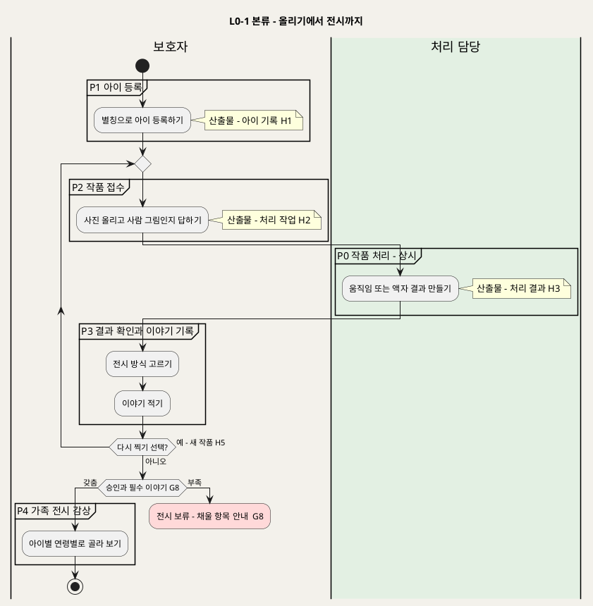

**[「L0-1 본류 - 올리기에서 전시까지」 PlantUML 뷰어로 열기](https://plantuml.sumzip.com/plantuml/svg/eNqNk81u2lAQhfd-ilHYwCJSCK3UpItGbaAsuugruI0TLIiNwFEWJRIQV7JiKpGkNG4LCCQSmopIJnYpSDyRZ3iHjsH8dVF1YdnX99yZb87M3ctrYk47Oc4I-bSsZMWceAzvxPfpo5x6ohy8UjNqDkKJWCIaf7miyKfEA_VUVo7gUMzkJUGTtYwEb7Y2o4DOEG8t2ASyenjX84Y23VRJrwO1dDLr3qhC3aJQQMedWENqVgvClEDgwBxFVhXYeBsFqunUcAGv-9hubMAHAWAXHZ1GD1QfY7u-LpjULM7znEWKqkmQk49S2i5Q2aZBHXtjH2YmZxXLIRkVzoSclJVEjc-sZt4Gal5OrgymvSTDmmXm3FTuUVef1-S0OHgPmxXwfg_xbkyNIRcFaP5akvyD5dHiIH4iuvkIyW0Wn_FTCMVjia14rBDso-miOSr8Bbi1AJypONx5iX1dkn4vUrdETR3QquLFZy69zTaD92h7zhiwW8Hrzv8yBoeSsTnjStvWuWJz7eRrje3wv9hwqo05VWD7EnE6CYD2PZkNYDfx1l0Q7S6PUasU_J53C05TMg9aGM2OH4HsT1Od3pqcN15EQM5DmCxjaooxNyr5NOKXyTs1HU2DrE5EkA95eTEKQCc8HIa1wvv6WQS0lKRA2LO_0IAPrBf7BDy7SO1-MNO8qnIXlvVNh43HFejGxtaIv_yR9Zwf2OAOOO6iKoC8pmYFie8QFzXwY_q5QonE_s7-zsIoxw2uVF-nb0PmfcCf99xYA8suMK0fLC1nMoKkHMiHwh6_-Eb_Ab2P6Zo=)** — 클릭 시 브라우저로 연결됩니다.

### 2-2 병행 — 삭제, 운영, 엔진 검증

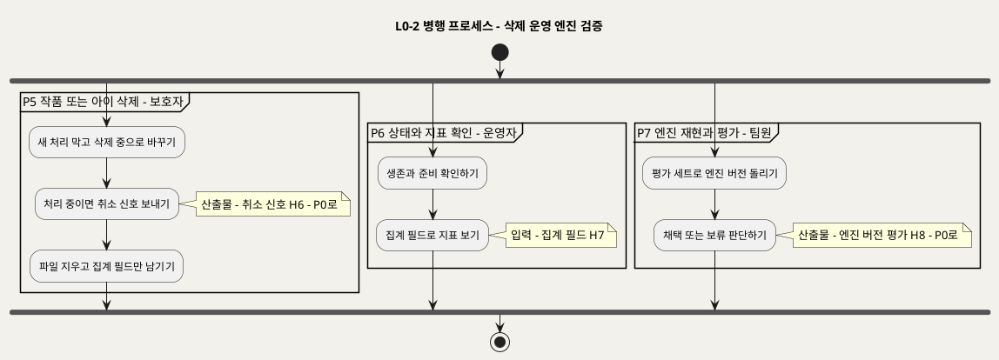

**[「L0-2 병행 프로세스 - 삭제 운영 엔진 검증」 PlantUML 뷰어로 열기](https://plantuml.sumzip.com/plantuml/svg/eNp9k1Fr01AUx9_zKQ7zuTAVN5kvQ3H0wYd9hWi7LrRLRpLhgwyy9iprF1ir7cxmUjLolgoVYhs0QvED5Z77HTxJ05mK-hTu5Zzf__8_52bbMGXdPDpoSEZdUQ9lXT6Al_Krek3XjtTKM62h6XBv5-HO_edPCxXGvlzRXitqDfbkhlGVTMVsVOHFeukB8FlPXLRB9Bm_dpHF2BlBCbD5BX0X8CpC5wTwYx8DBsnUwltPyhxIe5pelwCITzBFU2Ft9xHgsCfenwJ3urzTBxww9KIlq0RSkXBiHHbX4A21Amxh6xRw6vDbCfCgncz8O-FRD905OQIe9pOfcRKHT_KWRXla4EX8M-G_j_GdDXjmEzzV4M3orlzVzCroSm3f3CJ0iN9cPpmn-Vaayht0tbtOcgsNYdvozQEDC6_CzFXQS2YMxIDxDy4PbODNMWnkMsfZMECuyYr6x0g2AFsnouXipZXiRM8FcTlAL049ZMNdHYeH11EyI-mRxX-wvFYMnEL-FSs0oBxLwf-eeviW-zepXLERypv_N765XDoOJ8JhqSdx3k5Ci0jCtvDTb9f5Pb0d0YkzR4tOPmXo0-fcpoUVAnxlouUt30i6rxuHkF1-Ni4G_efmVuC5dvlxYYHHUlWtQPY-DVM7lLbpSD_ML0genjk=)** — 클릭 시 브라우저로 연결됩니다.

**지도 읽기**

- 보호자는 P1을 한 번 하고, 그 뒤로는 작품마다 P2 → (P0 대기) → P3 → P4를 반복한다.
- P3에서 "다시 찍기"를 고르면 P2로 돌아간다. 이때 이전 건은 닫히고 새 작품이 생긴다.
- P4에 걸리려면 전시 게이트 G8을 통과해야 한다. 조건은 두 가지다. 보호자가 승인했고, 제목·제작일·제작 당시 연령이 채워져 있어야 한다.
- P5·P6·P7은 본류와 따로 돈다. 본류와 만나는 곳은 세 군데다.
  - P5 → P0: 취소 신호(H6)
  - P0·P3·P5 → P6: 집계 필드(H7)
  - P7 → P0: 엔진 버전 평가(H8)

---

## 3. P0 작품 처리 (상시)

보호자가 화면에 없어도 도는 백그라운드 프로세스다. 입력은 P2가 대기열에 올린 처리 작업(H2)이고, 출력은 P3가 받는 처리 결과(H3)다. 이 프로세스의 핵심은 결과를 네 가지로 나누고 **서로 섞지 않는 것**이다(UC3 범위·개요 표). 네 가지는 움직이는 작품, 정상 액자, 품질 대체 액자, 실패다.

### 3-1 단계별 IPO

| # | 단계 | Input | Process | Output | 근거 |
|:--:|---|---|---|---|---|
| 0.1 | 작업 점유 | 대기열의 처리 작업(H2) | 동시 처리 상한을 확인하고 작품 하나를 점유한다. 다른 담당과 중복 처리하지 않는다. 앞 담당이 멈췄으면 점유 시간 만료 뒤 이어받고 시도 횟수를 1 올린다. 상태를 "처리 중"으로 바꾼다 | 점유된 작업 | UC3 기본흐름 2 · A3 · A4 · BR-PRC-05 · BR-PRC-07 |
| 0.2 | 경로 분기 | 작업의 경로 값 | 경로가 "원본 액자"면 엔진을 부르지 않고 원본으로 액자 결과를 만든다. 대체 분류는 "사람 그림 아님"이다. 엔진이 멈춰 있어도 이 경로는 진행된다 | 액자 결과 | UC3 A1 · BR-PRC-01 · BR-INT-05 |
| 0.3 | 엔진 처리 | 원본(움직임 경로) | 애니메이션 엔진에 검출·관절 추정·리깅·렌더를 요청한다. 작업당 시간 상한은 기본 10분이다. 엔진은 내부 네트워크로 격리되어 있다 | 엔진 응답 | UC3 기본흐름 3 · BR-PRC-06 · BR-ENG-01 |
| 0.4 | 결과 판정 | 엔진 응답 | 응답에 따라 세 갈래로 나눈다. 판정에 검출 점수는 쓰지 않고 기록만 한다. 원본은 어느 갈래에서도 건드리지 않는다. 아래 표 참고 | 움직이는 결과 / 품질 대체 액자 / 실패 | UC3 기본흐름 4 · A2 · E1~E4 · BR-PRC-02 · BR-PRC-03 · BR-PRC-04 · BR-APR-03 · BR-INT-04 · **G5** |
| 0.5 | 취소 확인 | P5의 취소 신호(H6) | 처리를 멈추고, 그 뒤로 결과 파일을 만들지 않는다. 멈춤을 P5에 알린다 | 취소 응답 | UC3 E5 · UC7 A2(EXT1) · BR-DEL-01 |
| 0.6 | 기록과 정리 | 판정 결과, 단계별 시간, 시도 횟수 | 작업 기록을 갱신하고, 임시 파일을 지우고, 상태를 "확인 대기"(재시도 소진 건은 "실패")로 바꾼다. 기록 장애도 재시도 규칙을 따른다 | 처리 결과(H3) | UC3 기본흐름 5 · E4 · BR-PRC-08 · BR-ENG-02 |
| 0.7 | 임시 파일 주기 정리 | 비정상 종료로 남은 임시 파일 | 정리 주기마다 지운다 | 정리 기록 | UC3 E6 · BR-PRC-08 |

**0.4 결과 판정의 세 갈래**

| 엔진 응답 | 처리 | 기록 |
|---|---|---|
| 정상 | 처음 만든 결과 하나만 저장한다 | 결과 종류 = 움직임 |
| 품질 미달 (인물 미검출, 관절·렌더 결과 없음) | 재시도 없이 원본 액자로 대체한다 | 대체 분류 = 품질 미달 |
| 인프라 장애 (엔진 다운, 시간 초과, 저장소 장애) | 간격을 늘려 가며 최대 3회까지 시도한다. 다 쓰면 **G5**로 "실패"가 된다 | 오류 분류 기록. 품질 미달로 바꾸지 않는다 |

**0.6 작업 기록에 남기는 항목**: 결과 종류, 대체 분류 또는 오류 분류, 진단 이유 코드, 검출 점수(기록용), 단계별 시간, 시도 횟수, 엔진 버전

### 3-2 프로세스 다이어그램

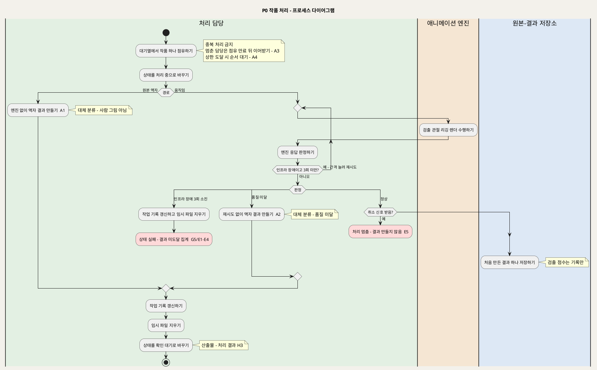

**[「P0 작품 처리 - 프로세스 다이어그램」 PlantUML 뷰어로 열기](https://plantuml.sumzip.com/plantuml/svg/eNqFlE9PGmEQxu_7KSbhIgdTLdJUPFRboD32A3ihirIRwcAaLxxQV7N1tylYkK0CWVMUTUhKAXVNbD_QvrPfofPuviA2Wm_8mZ3nN888O_N5JZFTNtfTUn5Nzmwkcol1-JRYWlvNZTczy--y6WwOAvFQfDr2dqwin0osZ7fkzCqsJNL5pKTISjoJH6cAm2X3UAPsmey8A5PgVlR2WkfVxoMWML2FjQEeDZwbmzUvpEIgFopPxUIFUc70AdNvC5KHJEWYUXTsLtYGWCuhWh_2dqsm2zEBrRLWLfpCNXNSJqskISevppQIYKvM-ldDBsfWsF1czLBLDa9NoYGNomgArG2wHwawwxb4cKx7Qi2JfSG0mMHdbbdaB_ZVZXoHUCcKrc5hfDheNSNFeNVunZ3dDUUJAet3NDmwbsX5Y3uM8gpMOL3f9GsQlFQyAxN4UmJ9G7B6is1SUAKIYK2CbRWwtk8w4g9wel2nf-eRfmtxVViYnqPq8aGJB3sDYNcqOzMJC3c6rGkAd_qcsKrEb0pJ2hVXLWJ7G5sqV8wlN5IJhT4AFALxcOxVlNZRtZiuscsKN2SPrPagCl5RxOkV8boOzqCIlgY0rHO7B8wy2JcKeWO6R5-HO_F7Pr5ir9Vw2EaZ6VfgGiW0qvcP-2SwlZLTHLph8yw1aJbmGQESmtO3IOQe0-5-2uTNmyDIeSo0NRrf6apO7xLYgcksWmyzQ6ujJQa5Z1TD7dDQbHEH8luyspSCCV-f_7KUyD-i6GvhvkHMQTFAs4y1PYpYl502SPMX6l4iCYzs5WlxDQN5h3YRj7sjVwLxeHQ2OityQ7FqucYFpxaLpnlE4Nplp68CvA-_iE1Pxmb8x9fkdHqESa8EtjXvGb0z4hLzPh-kl37L_0XpgcK9PVaV8H1Bnmy8uSBvgDtg2hT7E2zwlYigm5pfOTa7CAR_LVtjs3ts5BcxH1ALgFh4Tjwq5gZIZpblFZGvaDT2Oh4u-K_SpOiCVpEvbd8YJq1n8l5ec2soNTokvHY8tONmiLjzY6GZ7KAilk2dnsk3MfrJknzaJ8PCVSNPxmXstrjfq5RJcXn-uS0P7t9Ol5BZ546fAXEE_Yk_hOi2ZjekeUKik_8XwroaLQ==)** — 클릭 시 브라우저로 연결됩니다.

### 3-3 설계 주의

**원인 분리가 무너지면 운영 지표 전체가 거짓말을 한다.** 인프라 장애를 "품질 미달"로 뭉개는 경우를 생각해 보자. 엔진이 30분 멈춰 있는 동안 들어온 작품이 모두 조용히 액자로 바뀐다. 보호자는 "우리 아이 그림은 원래 안 움직이나 보다"라고 받아들인다. 운영자는 모델 품질 대체율이 오른 것만 보고 엔진을 의심한다. 반대로 품질 미달을 재시도하면 같은 실패를 세 번 기다리게 되어 미리보기 p95 목표(3분)를 스스로 깬다. 그래서 0.4의 세 갈래(정상 / 품질 미달 / 인프라 장애)는 SD_03에서 **서로 배타적인 분류 컬럼**이 되어야 한다. 대체 분류와 오류 분류가 동시에 채워지는 행이 생기면 설계 결함이다(UC3 A2 "오류 분류는 비운다").

**"처음 만든 결과"는 한 번만 저장된다.** 재시도나 이어받기로 결과 파일이 두 개 생기면 BR-APR-03을 어긴다. 이어받은 담당이 이미 결과 저장까지 끝난 작업을 다시 돌리지 않게 하려면, 점유 상태 전이를 원자적으로 만들어야 한다(SD_04 처리 모듈의 책임). 점유 시간 값 자체는 원천에 없다(§14).

---

## 4. P1 아이 등록

작품을 올리기 전에 한 번 하는 준비 프로세스다. 받는 정보는 **별칭 하나**뿐이다. 이 프로세스가 지켜야 할 것은 무엇을 받는지보다 **무엇을 받지 않는지**다. 실명, 생년월일, 출생연도는 받지 않는다.

### 4-1 단계별 IPO

| # | 단계 | Input | Process | Output | 근거 |
|:--:|---|---|---|---|---|
| 1.1 | 아이 관리 진입 | 보호자 세션 | 로그인과 가족 공간을 확인하고, 이 가족의 아이 목록을 불러온다 | 아이 목록 | UC1 기본흐름 1 · E4 · INC1 · BR-ACC-01 · **G0** |
| 1.2 | 등록 양식 제시 | "아이 추가" 선택 | 별칭 입력란 하나만 있는 양식을 보여 준다. 실명·생년월일·출생연도 입력란은 없다 | 등록 양식 | UC1 기본흐름 2 · BR-CHD-01 |
| 1.3 | 별칭 검사 | 입력한 별칭 | 빈 값인지, 같은 가족 안에 같은 별칭이 있는지 검사한다. 수정할 때도 같은 검사를 한다 | 검사 결과 | UC1 기본흐름 3 · E1 · E2 · A1 · BR-CHD-02 · **G2** |
| 1.4 | 아이 저장 | 검사를 통과한 별칭 | 별칭만 가족 공간에 저장한다. 실패하면 일부만 저장된 아이를 남기지 않는다 | 아이 기록 | UC1 기본흐름 4 · E3 · BR-CHD-01 · BR-PRV-01 · **G1** |
| 1.5 | 선택지 반영 | 아이 기록 | 목록을 갱신하고, 작품 올리기(P2)의 아이 선택지에 넣는다. 두 번째 아이도 같은 절차로 등록한다 | 갱신된 목록 · 아이 기록(H1) | UC1 기본흐름 5 · A2 · BR-CHD-03 |

프로세스 밖에서 들어오는 경로도 하나 있다. 등록된 아이가 없는 상태에서 P2를 열면 이 프로세스로 먼저 안내한다(UC1 A3).

### 4-2 프로세스 다이어그램

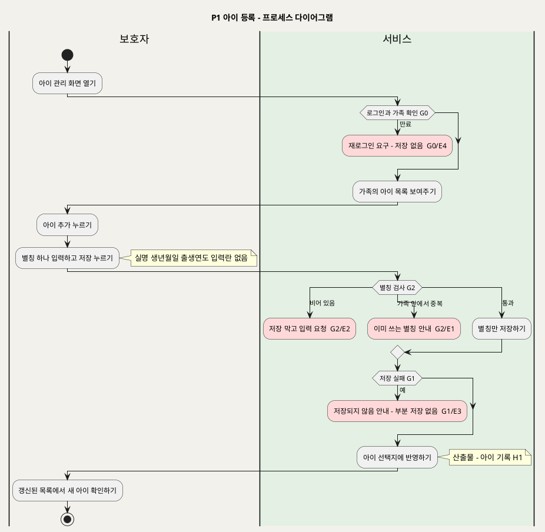

**[「P1 아이 등록 - 프로세스 다이어그램」 PlantUML 뷰어로 열기](https://plantuml.sumzip.com/plantuml/svg/eNptU99O2mAUv-9TnMSbcWEQ2I14YzaBXe4VOkRoRDC0xhsuOiyGAclYBKkbbTDiUINZleow4Yl6Tt9hp7Q1orvs1-_8zu_ftykrYkU52CsK8q5U2hcr4h58EbO7-Ur5oLT9sVwsV2AlnUjHUh9e3JAL4nb5UCrlYUcsyjlBkZRiDj7HgHoaGTbgyR2eG7AKblfD8wFpM2qOAFsj_kmntvN3huaVUMWp7eozMjtVYUFDSAbzjq3i7wm4Z128toH6tjOzNoTqSiqRXkslqqQN8EljyKog7cA73sCIZMyc6RwcS6XzOx7t8QFk1iKgFHIlvjRu40U7IgDLSW-tb60nyZw8TwL97DoPE2ZMQ5XMS955TEYbGCCaer_BU7tSsSjkStvSjpD0d5ChP-u9ufb0sh7qT-hi7tN9IS8URo9dHgZsaHjpi0riVKOnW3B7OtYY0Kzj8JI_nOkw5PLidqms5KAi5QtKEqg1wps60JGBdY1-dcmYM_6Av6lv4XctwEJTDdT810D5UFKyBfbHp-Hcq1SbQCYeEbKinONzvnfKxM0GIyzZF5Abf1tQXezybKT7W7YtHk3Fn23zkYJkqNegfocZAI1-4PRhCdOw8Q-HcWJhswsBJR7Amu1jxl5huscPHLoHEfjIMQe2eR56lnFmvsZFV8J4WyO3fQWZWFgP0htvxWFHpzG712t6XQh4rAI-qviovWlKLJpKvG5KGLs2dDmWscrKAS2d9K8hvaVEaxYHiJO518PgJcwsr1mfYst1cqw7ag2xMwiqFzp61AgH_QcQbpGV8r6wyaT4pf8DE70PYg==)** — 클릭 시 브라우저로 연결됩니다.

### 4-3 설계 주의

**입력란을 하나라도 더 두면 되돌리기 어렵다.** 화면에 "생일(선택)" 칸이 생기는 순간 두 가지 일이 벌어진다. 누군가는 그 칸을 채우고, 그 값은 백업과 로그로 퍼진다. 이 서비스는 나이를 아이 정보가 아니라 **작품마다 "제작 당시 연령"**으로 받는다(P3 3.5). 그래서 아이 테이블에는 연령·생일 계열 컬럼이 아예 없어야 한다. SD_02 화면과 SD_03 스키마 모두에서 "없음"을 확인 항목으로 둔다.

**별칭 중복 검사의 범위는 "같은 가족 안"이다.** 서비스 전체에서 유일하게 만들면 다른 가족이 쓰는 별칭이 있는지를 거절 메시지로 알 수 있다. 가족 간 정보 노출이 된다(BR-ACC-01). 유일성 제약은 (가족, 별칭) 조합에 건다.

---

## 5. P2 작품 접수

보호자가 사진을 올리고 "사람이나 캐릭터 그림인가요?"에 답하는 프로세스다. 핵심은 **내구 접수**다. 원본, 작품 기록, 작업 기록 세 가지가 **모두** 저장돼야만 "접수 완료"라고 답한다(BR-INT-02).

### 5-1 단계별 IPO

| # | 단계 | Input | Process | Output | 근거 |
|:--:|---|---|---|---|---|
| 2.1 | 올리기 진입 | 보호자 세션 · 아이 기록(H1) · (다시 찍기라면) 재접수 요청(H5) | 로그인과 가족 공간을 확인하고, 등록된 아이 목록을 보여 준다. 다시 찍기로 들어왔으면 이전 작품의 아이를 미리 고른다 | 아이 선택지 | UC2 기본흐름 1 · A2 · E7 · BR-ACC-01 · BR-CHD-03 · **G0** |
| 2.2 | 사진 검사 | 고른 아이 · 사진 | 형식(JPEG·PNG·HEIC), 용량(한 장 20MB 이하), 판독 가능 여부를 검사한다. 통과하면 미리보기를 보여 준다 | 미리보기 | UC2 기본흐름 2 · E1 · E2 · E3 · BR-INT-01 · **G3** |
| 2.3 | 경로 결정 | 사람·캐릭터 여부에 대한 답 | 사람·캐릭터 예시와 동물·사물·풍경 예시를 함께 보여 준다. "예"는 움직임 경로, "아니요"는 원본 액자 경로다. 답하지 않으면 올릴 수 없다 | 경로 값 | UC2 기본흐름 3 · A1 · E4 · BR-INT-05 · **G3** |
| 2.4 | 중복 요청 확인 | 요청 번호 | 같은 요청이 이미 접수됐는지 확인한다. 접수됐으면 새 작품을 만들지 않고 기존 결과를 돌려준다 | 신규 / 기존 판정 | UC2 기본흐름 4 · A4 · BR-INT-03 |
| 2.5 | 원본 저장 | 사진 | 원본·결과 저장소에 변형 없이 저장한다 | 원본 저장 위치 | UC2 기본흐름 5 · E5 · BR-INT-04 · **G4** |
| 2.6 | 기록 저장과 대기열 등록 | 원본 위치 · 요청 번호 · 아이 · 경로 | 작품 기록과 작업 기록(요청 번호·경로·상태 "접수됨")을 함께 저장하고 대기열에 올린다. 기록 저장에 실패하면 2.5에서 저장한 원본을 지운다. 동시 처리 상한에 도달해도 거절하지 않는다 | 처리 작업(H2) | UC2 기본흐름 6 · E6 · A3 · BR-INT-02 · BR-PRC-07 · BR-APR-03 · BR-PRV-01 · **G4** |
| 2.7 | 접수 완료 안내 | 처리 작업 | "접수 완료, 준비되면 확인할 수 있어요"를 보여 주고, 작품 목록에 "접수됨"으로 표시한다. 엔진 처리를 기다리지 않고 바로 답한다 | 접수 완료 화면 | UC2 기본흐름 7 · UC2 특별 요구사항(응답성) |

### 5-2 프로세스 다이어그램

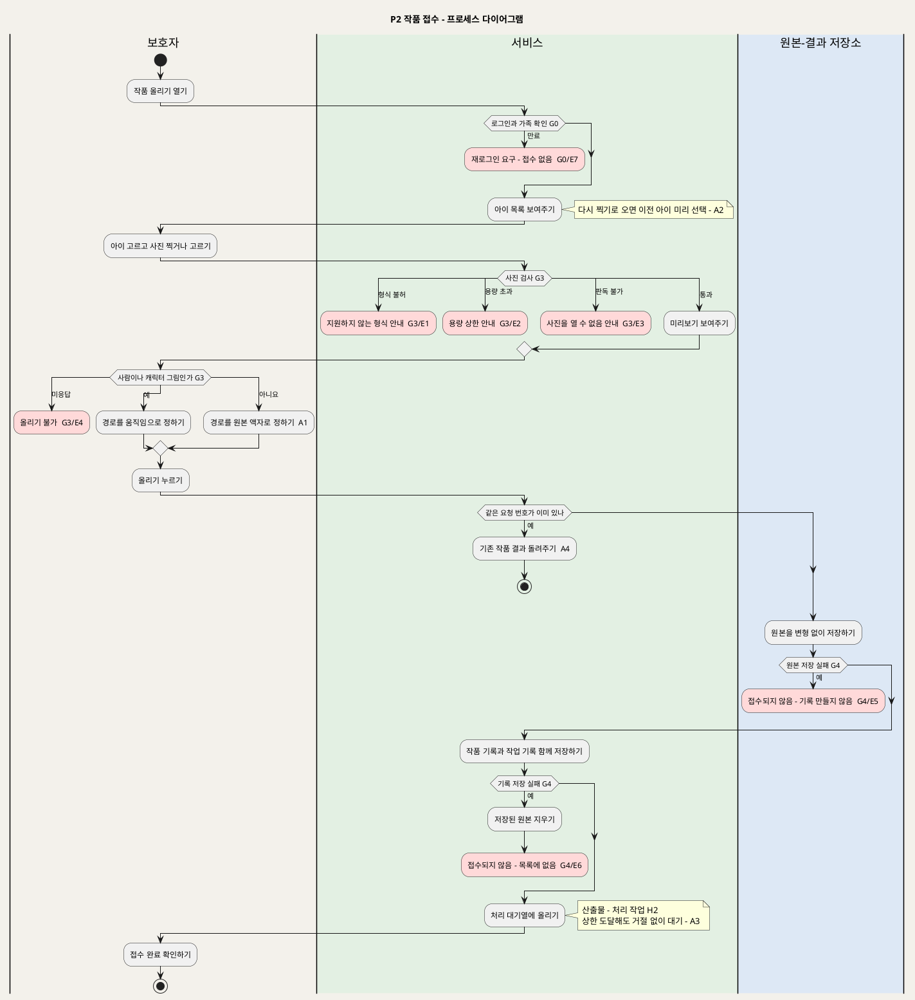

**[「P2 작품 접수 - 프로세스 다이어그램」 PlantUML 뷰어로 열기](https://plantuml.sumzip.com/plantuml/svg/eNqFVU1T2lAU3edX3Bk3unCsUvuBG20Fu-wP6IYqKiOCA-l0wyJqdFJJR2xNiQoURvzq4BghtrSlfyjv5j_0vpeEEvq1gQwv975zzj33MJuXEzn51Xpayq-lMhuJXGIdXiYW11Zy2VeZpafZdDYHI_FIfDL2ZOCN_GpiKfs6lVmB5UQ6n5TklJxOwvMpwNqB-04DrB-gZsI4uIcqa1RQ7eJeE1ixiVUbP9jOly6rXUoF1rFds4u1UkESMKRoUG-22HnL6VqAZZu-ZqTCSCwSvxeLFFCtsK8qtStIqWUYpe7UDatdp9MDx1KwcQvukUE_wMK9MZBXkxl66UJnp_qYBEQlPv94_jHd0-pXAh4fOnctQuvDxvIuVnWgBhOxhzNUtZZKp6VkZim1TAgNlUgA-3TFGlUgBlhu4WlPgMxk5STkUiurclSQLVYArbd0RHcRpya7soErUFchaHPTJaKAat3drhKCuamQKsFtTqfOzmz6BNxq4YUq2t5abMsMjv6mUf51Sl5chVG_zmkr9AQLkTFpMZFPwqhrGlgkHp81t6yFFLpQ8KTkGiY9ENo9tncI_stoaGzLJn0iE7HJvj5ePzy-Yh_fANoaDSTUzz_Y3nSNSqjF1FALVy-x_R0OieYZaiE4YFXlroCBSQ12iwx3273zkUQ9sUlebqzw5Gi4nlJhU_4Sj9V0GgQXHL-V2Pm1q1rAbXze496zlAFJ6RqsHrDiXQh739EeLw_s_WH1TDGDqNP-QZZhZz3AEwUvNrGmYqUnXFQ3aCYCs19iqKyokYV_KyyxDnnbaBCVUCXA3OQg40FsmvovM_GFc6wjrCp8Z7B9DaytkVicD1fnhu6r0SjMYPH6fLoWNuwgHZy2xbeV7eus3vQmQJiEFnk5u-FvWmFkfj72KD5d8JiM-1VYV7B2hrs63w5xwg3BOgqZ0_OD7b8T6MRRB2qIA8Bi09UvYeH-EM7-sEQOsFLgfe6xcRB7TKtCYfK-OXBCfSZi00M58Sf5gnTzGgkytQMs7wSdXePS-W7-Ab1__h_0Ue-clSr94dMOH1uizf_IeXmG5dKv9CNWD35Lv7bJ84rpCh9p2RYFgX3CAYhbFn6usFaPB6tX5tN9NvUi4-cA2yf3tlzDpgegRMO6FgzRu4NnYmQoE_2UPlIp1P2wD9QS_pklsPSP9hOWsZPT)** — 클릭 시 브라우저로 연결됩니다.

### 5-3 설계 주의

**G4가 새면 "유령 작품"과 "고아 원본"이 생긴다.** 두 가지 실패가 있다.
- 원본은 저장됐는데 기록 저장이 실패한 경우: 원본을 지우지 않으면 저장소에 주인 없는 아동 그림이 남는다. 삭제(P5)로도 찾을 수 없어서 영영 지워지지 않는다.
- 기록은 저장됐는데 원본이 없는 경우: 목록에 작품이 뜨지만 처리(P0)가 원본을 읽지 못한다. 이 건은 인프라 장애로 세 번 재시도한 뒤 실패로 끝나고, 결과 미도달 지표를 오염시킨다.

순서는 반드시 "원본 먼저 → 기록 → 실패 시 원본 제거"다(UC2 시퀀스 5·6단계). 원본 제거까지 실패하는 경우의 처리는 UC에 없다(§14).

**중복 전송 판정(2.4)은 원본 저장보다 앞에 있어야 한다.** 휴대폰 네트워크가 흔들려 같은 요청이 두 번 오면 원본이 두 번 저장될 수 있다. 두 번째 원본은 기록이 없는 고아가 된다. 그래서 요청 번호는 클라이언트가 올리기 전에 만들고, SD_03에서 작업 기록의 유일 키가 된다.

---

## 6. P3 결과 확인과 이야기 기록

보호자가 목록에서 확인 대기 작품을 열어 전시 방식을 고르고, 제목·제작일·제작 당시 연령·아이의 한마디를 적는 프로세스다. 승인(UC4)과 이야기(UC5)는 **어느 쪽을 먼저 해도 된다.** 두 갈래는 전시 게이트 **G8**에서 만난다. 보호자가 고르기 전에는 어떤 결과도 전시되지 않는다(BR-APR-01). 이 프로세스가 오인 움직임(집 그림에 관절이 붙는 경우)을 거르는 **유일한 관문**이다.

### 6-1 단계별 IPO

| # | 단계 | Input | Process | Output | 근거 |
|:--:|---|---|---|---|---|
| 3.1 | 진행 상태 확인 | 보호자 세션 · 처리 결과(H3) | 로그인과 가족을 확인하고 작품별 상태를 보여 준다(접수됨 / 처리 중 / 확인 대기 / 실패). 보호자가 없던 사이 바뀐 상태도 여기서 보인다 | 상태 목록 | UC3 기본흐름 1 · 6 · A5 · BR-ACC-01 · **G0** |
| 3.2 | 결과 열기 | 확인 대기 또는 실패 작품 | 결과 미리보기와 원본을 불러와 결과 종류별 선택지를 보여 준다. 삭제 중인 작품은 선택을 받지 않는다. 검출 점수는 선택지 노출에 쓰지 않는다 | 선택 화면 | UC3 기본흐름 7 · UC4 기본흐름 1 · E1 · E2 · E4 · E5 · BR-APR-02 · BR-PRC-04 · BR-EXH-04 · **G6** |
| 3.3 | 비교 재생 | 결과 미리보기 · 원본 | 고를 때만 재생하고 정지할 수 있다. 원본을 나란히 보여 준다 | — | UC4 기본흐름 2 |
| 3.4 | 전시 방식 선택 | 보호자 선택 | 선택을 결과 종류·처리 원인과 연결해 기록한다. 선택별 처리는 아래 표 참고 | 부모 선택 기록 · (다시 찍기) 재접수 요청(H5) | UC4 기본흐름 3 · A1~A4 · E3 · BR-APR-03 · BR-APR-04 · BR-APR-05 · BR-INT-04 · BR-OPS-02 · **G1** |
| 3.5 | 이야기 입력 | 제목 · 제작일 · 제작 당시 연령 · (선택) 한마디 | 두 가지를 검사한다. 제작일이 오늘 이후가 아닌지, 연령이 만 나이 정수 0~18인지. 입력은 **원문 그대로** 저장한다. 요약·교정·감정 태그를 붙이지 않는다. 일부만 채워도 저장은 한다. 삭제 중이거나 닫힌 작품은 입력을 받지 않는다 | 이야기 | UC5 기본흐름 1~4 · A3 · A4 · A5 · E1~E5 · BR-STY-01 · BR-STY-02 · BR-STY-03 · BR-STY-04 · BR-CHD-01 · BR-PRV-01 · **G7** · **G1** |
| 3.6 | 전시 전환 | 부모 선택 · 이야기 | 승인(좋아요 또는 액자로 걸기)과 필수 세 항목이 **모두** 있으면 상태를 "전시됨"으로 바꾼다. 하나라도 없으면 저장만 하고 무엇을 채우면 되는지 안내한다. 이미 전시된 작품의 이야기를 고치면 곧바로 반영한다 | 전시 작품(H4) | UC4 기본흐름 4 · 5 · A5 · UC5 기본흐름 5 · 6 · A1 · A2 · A5 · BR-EXH-01 · BR-APR-01 · **G8** |

**3.4 선택별 처리**

| 선택 | 처리 | 기록 |
|---|---|---|
| 좋아요 | 움직이는 결과로 전시한다 | 부모 선택 = 좋아요 |
| 액자로 걸기 (움직이는 결과였음) | 원본 액자로 전시한다 | 대체 분류 = 부모 선택 |
| 액자로 걸기 (원래 원본 액자였음) | 원본 액자로 전시한다 | 기존 대체 분류를 유지한다 |
| 액자로 걸기 (실패 건) | 원본 액자로 전시한다 | 오류 분류를 유지한다 |
| 다시 찍기 | 건을 "다시 찍기로 닫힘"으로 바꾼다. 파일은 삭제 규칙(P5 5.4~5.5)으로 정리하고 P2 재접수를 시작한다(EXT2) | 건 상태 = 다시 찍기로 닫힘 |

선택 기록 저장에 실패하면 전시 상태를 바꾸지 않는다(**G1**).

### 6-2 프로세스 다이어그램

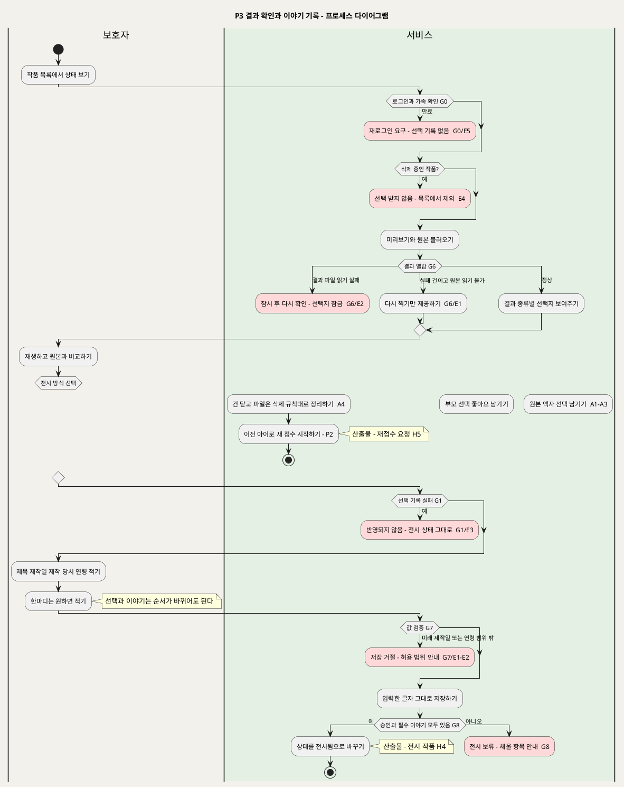

**[「P3 결과 확인과 이야기 기록 - 프로세스 다이어그램」 PlantUML 뷰어로 열기](https://plantuml.sumzip.com/plantuml/svg/eNp9VV1v2lgQffevuFJfmgeUpvSTPGy7W5I-9i-wCUlQKFRA1RceSHBXVvBqocLFSWyv05KGtERrAkmNxO4P8oz_w86916Yx2uxDFAvPzJk558z4WbWWq9Tevi4q1d1C6U2uknvNfs1t7G5Xym9Lm7-Ui-UKu7OWXlvJ_nwjorqT2yy_K5S22VauWM0rtUKtmGev0iy49ILxjIWHBto-f0J7gsYs8D1Gf3BisxQLuyqcWKj6eNBn0OrzkI-T4LsPzkCpw3gSmj467boiWlMy6HTCDxqDr-eUj702qhbD5l7YtBgFU9lVpX4nm167l03X6R1MVSpcVwpb7C7hUN2olcBr4Mko6o2t31titZ18iYLOdPisLymMBl178fTFU0IczjMZHnWDqyH1jaobNu14Duz9hrbOqM5y9uEqJe8WikUlX9osbAlo3L9Alxrtd0QRMcNPMSSaWgJPVgbvGM8aDI0DXjm1MLFr4aHPWPbBAlgG_vLhy1BSgYeUf9yGsc_gWoM_h2j2BUPVd4Xaxg67GwmEvQk4Olt_tKRs5Kr5-e-hrqPNVfubS4atfqgPksy42LJYeKwK5fijpDOmRwzguIGvETWPlrP3591KHFmSBaMJyR6M3bjbCJGaJpk4Yiaqj97vnPEznTMQjK9Cw-SBovjKalzVNcgRIi0e8NN7ODVhrN7oiyjC3hA_zwQjxJ4kJeE5rj02bY4yb47XI1cFV20J_oNNdFXeI3jn2LIjpJjRRP-8tf8yKW94NCEuv3E4yT7aRKF0T_Ddwukh6A2yI81vkM7x_M-FDzJ8eVwa0lDpSUQ1NYrsoGaSfBb3nUxIsVdCi1K5lmeVwvZOLUMoHl5bMJxx-WjuKO2oi5cX7OVDiq7Wym9ijj-1OMpRV6pz3YCvg3gn5u8Y7A8ITZAUpRknRCzvLBj5EROZWHTxLi4yT6XhVlLP0wmJblnwhZ2U5lpfuWXPwDPR3IO2mVizSMTopPA7JPmmOsvZ9MK2Jb3iWrSjYjWdjtgb8URyTkXFngfulH7cE3xkQsOCMw26XTjocmuRMnA-mb9PKCPmShxQkaTR3bRoQ8hyXWjodDfhD1rFtkVuu5WkwPtAh7mBX2y2_nh-9ehqOOaN3sFsCwjZNFx20aLK3sfE-rsNdE5JSQ9djZ_ynoZH53EwGhrsT4i3x7SaqRurHx0qdN6De0oskF4NLvwPrmXheL2EsgfT6G6H5Cxuy_mXhIwHHbKNo3EB158sqJ2RSsLpLJIW2gO0ZhyGWAv-8QXG_2xC5Af52Xn5IF6DfFH6WYWWRmc1yYu8A-MJHR1eYkTL4FPnF8IfMS9PFhh5Rv_o0_svcan4QQ==)** — 클릭 시 브라우저로 연결됩니다.

도면은 "선택 → 이야기" 순서로 그렸다. 반대 순서(이야기 먼저, UC5 A1)도 같은 G8로 모인다. 이야기를 먼저 저장하면 G8에서 "승인 없음"으로 보류되고, 뒤에 선택이 기록되는 순간 전시된다(UC4 A5).

### 6-3 설계 주의

**G8은 두 입력의 AND다. 어느 한쪽 화면에만 걸면 뚫린다.** 전시 전환을 "좋아요" 버튼 처리 코드에만 넣으면 문제가 생긴다. 이야기를 나중에 채운 작품이 영원히 전시되지 않는다. 반대로 이야기 저장 코드에만 넣으면 승인 없이 이야기만 채운 작품이 전시된다. BR-APR-01 위반이다. 그래서 G8은 화면 이벤트가 아니라 **작품 상태의 불변식**으로 둔다. SD_03에서 "상태 = 전시됨이면 부모 선택 ∈ {좋아요, 액자로 걸기} 그리고 제목·제작일·연령 NOT NULL"을 CHECK 제약으로 건다.

**액자 분류를 덮어쓰면 원인 분리가 사후에 깨진다.** 원래 원본 액자였던 작품에 "액자로 걸기"를 눌렀다고 해서 대체 분류를 "부모 선택"으로 바꾸면 안 된다. 그러면 P6의 비인물 액자율과 모델 품질 대체율이 줄고, 부모 선택 액자가 부풀려진다(UC4 A2의 [추론] 판단, BR-OPS-03). 실패 건에서 액자를 고를 때 무엇을 기록할지는 UC에 명시가 없다(§14 3번).

**다시 찍기는 수정이 아니라 새 작품이다.** 기존 작품의 원본을 새 사진으로 바꾸면 원본 불변(BR-INT-04)과 결과 재생성 금지(BR-APR-03)를 동시에 어긴다. 닫힌 건은 P5와 같은 방식으로 파일을 지우고 집계 필드만 남긴다(BR-APR-05). 그래서 첫 결과 승인율의 분모("다시 찍기" 건수)는 닫힌 건의 집계 필드에서 나온다.

---

## 7. P4 가족 전시 감상

가족이 승인된 작품만 모인 2D 전시에서 한 점씩 골라 보는 프로세스다. 이 프로세스의 규칙은 대부분 **하지 않는 것**이다. 자동 넘김, 자동 반복, 무한 피드, 필터, 발달 점수, 아이 간 비교를 두지 않는다(BR-EXH-03, BR-EXH-04).

### 7-1 단계별 IPO

| # | 단계 | Input | Process | Output | 근거 |
|:--:|---|---|---|---|---|
| 4.1 | 전시 진입 | 보호자 세션 | 로그인과 가족을 확인하고 이 가족의 아이 목록을 보여 준다. 로그인하지 않았으면 어떤 작품도 보여 주지 않는다 | 아이 목록 | UC6 기본흐름 1 · E2 · BR-ACC-01 · BR-ACC-02 · **G0** |
| 4.2 | 아이별 전시 목록 | 고른 아이 · 전시 작품(H4) | "전시됨" 작품만 모은다. 제작 당시 연령별로 묶고, 묶음 안은 제작일 순서로 정지 상태 목록을 만든다. 제목·제작일로도 찾을 수 있다. 전시 작품이 없으면 빈 전시와 올리기 안내를 보여 준다 | 연령 묶음 목록 | UC6 기본흐름 2 · A2 · A3 · A5 · BR-EXH-02 · BR-EXH-05 · BR-APR-01 |
| 4.3 | 작품 상세 | 고른 작품 | 접근을 판정하고 결과와 이야기를 보여 준다. 판정별 처리는 아래 표 참고 | 결과 · 이야기 | UC6 기본흐름 3 · A4 · E1 · E3 · E4 · E5 · BR-ACC-01 · BR-STY-03 · BR-STY-04 · **G0** |
| 4.4 | 재생과 원본 보기 | 결과 | 움직이는 작품은 고를 때만 재생하고 정지할 수 있다. 원본 액자는 재생 없이 같은 크기로 보여 주고 "실패"·"대체" 표시를 붙이지 않는다. 원본 사진도 볼 수 있다 | — | UC6 기본흐름 4 · 5 · A1 · BR-EXH-03 · BR-EXH-04 |
| 4.5 | 목록 복귀 | — | 재생을 멈추고 연령 묶음 목록으로 돌아간다. 다음 작품으로 저절로 넘어가지 않는다 | — | UC6 기본흐름 6 · BR-EXH-03 |

**4.3 접근 판정별 처리**

| 판정 | 처리 |
|---|---|
| 다른 가족의 작품이거나 승인 전 작품 | 접근을 거부하고 아무것도 노출하지 않는다 |
| 삭제된 작품 | "더 이상 없는 작품이에요"를 보여 준다 |
| 저장소 장애 | 이야기만 보여 주고, 파일은 불러올 수 없다고 안내한다 |
| 가족의 전시 작품 | 결과와 이야기를 보여 준다. 수정된 이야기는 다음 조회부터 보인다 |

### 7-2 프로세스 다이어그램

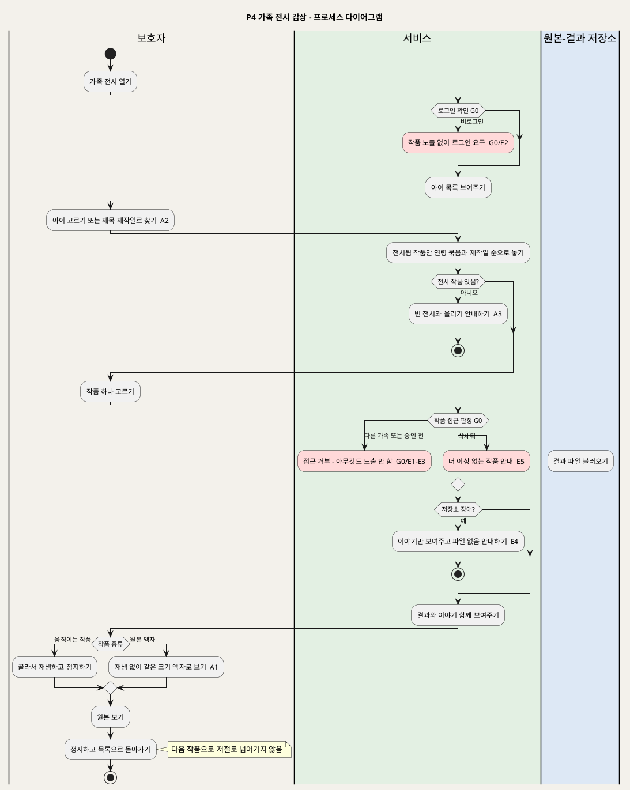

**[「P4 가족 전시 감상 - 프로세스 다이어그램」 PlantUML 뷰어로 열기](https://plantuml.sumzip.com/plantuml/svg/eNp9VFFP2lAUfu-vuIkv88FMRZMJD3MbsNf9BaYoRAQDNb70AbWaBrqIm511UlY2GGzpEhSGJSP7Qb2n_2Hn3tuCGLenpu253_nO933nrpfkVFHe381JpZ1sfi9VTO2St6mNne1iYT-_-aqQKxTJXDKSXEq8vFdRyqQ2CwfZ_DbZSuVKaUnOyrk0ebNCvF4ZmjcEbBWqdXyrwfEhWSD-hUqbdVBdqLQIrbbAGsDHgXfn0kZXUmh_4JsuNGqKxNlI0VkYuBx4bi8mKXOJSHIxEVFArdORiliKlN0iTxAaocByiX9lsMfrxXkiZ9J5_DVSJ3_nJYKjJONr8bUoNM799xqhJy4MWYNTZESmOPDpwvvlEAR6mliO4bmdbC4npfOb2S0pCobKq398p02LIHm4dODrWFC8N0tY6PVt2mYTEGrWaOUCx6rjYfZAGmCNsS-B3h9WQV4sPz5nVGhBa10iuNOOjrx71B4R6gzB0r3-eApJQKtDnSPT0w-cGlMqFFRMDw0Nzz0PtUK6tKqB2WJCRelIC_SHqzIB06HfHMYQDI0eDXzDFHQjTJ2SXNgL1JkVQPTBYnpkTnV4fMLSQVbeyCCNgJx97t2Nia_XwDaYo9JGqpRGR6st2nbDoIWKVkbcNludMVlAeDc9OixjCtmAzsC7PaZn6sR6g_HrCquXFhKRiduiHRz9ZHbVuveB6TtsiRHGbGN0OIGANBeHkMTqAxhBFyyTzFjAQJW5eDzxLLmqwHWN9t0F77YnrCxDow2nusLcCD76us7MpUONfnbQKS4mCi-0--eCTLAIexj21HKTU4iyYQyWYJaqaaL7dtiRb4j-wPzEygPzA5o8MCEiU9f7bf5nTzjDQL8vJ7RtTthdl6FziEhThTlbr9-l1hhnxI8OHFuMD1LFnECnLMihKjluH9cUeTexlRiVHwlX3utdgVUm_mGQbVbGl6Y_EPleik3WXkCJPzG2kGE77C0ug3DjznSMGlrOC_MFOU2K2e2MHBVXnx7MElQzc2yNn1NNditiVDoooFHBUomru44U8Ir-C84qECQ=)** — 클릭 시 브라우저로 연결됩니다.

### 7-3 설계 주의

**"전시됨만"은 목록 조회와 상세 조회 둘 다에 걸어야 한다.** 목록 쿼리에만 상태 조건을 걸면 작품 주소를 직접 입력해서 승인 전 작품을 볼 수 있다(UC6 E3, Scenario 10). 다른 가족 작품도 같은 방식으로 열린다(E1, Scenario 9). 그래서 G0는 가족 소속과 전시 상태를 **상세 조회에서 다시** 판정한다. 결과 파일 주소 역시 추측할 수 있는 경로면 안 된다. SD_04 저장소 모듈이 가족 확인을 거친 뒤에만 파일을 내준다.

**원본 액자에 표식을 다는 순간 서비스의 약속이 깨진다.** "움직이지 못함" 배지나 회색 테두리 같은 표식은 기술의 한계를 아이의 그림 탓으로 보이게 한다. 원천은 원본 액자를 "완성된 작품"으로 대한다고 명시했다(UC6 범위·개요, BR-EXH-04). 그래서 SD_02에서 움직이는 작품과 원본 액자는 같은 카드 컴포넌트를 쓰고, 재생 버튼만 있고 없고가 다르게 한다.

---

## 8. P5 작품 또는 아이 삭제

보호자가 작품 하나나 아이 한 명을 지우는 프로세스다. 아이를 지우면 그 아이의 모든 작품도 지운다. 아동의 그림과 사진에는 이름·유치원·얼굴이 담길 수 있어서 삭제는 **빠짐없이, 정해진 순서로** 해야 한다(BR-DEL-01).

1. 새 처리를 막는다.
2. 진행 중인 처리가 멈췄는지 확인한다.
3. 원본, 결과, 임시 파일을 지운다.
4. 작업 기록은 집계 필드만 남긴다.

### 8-1 단계별 IPO

| # | 단계 | Input | Process | Output | 근거 |
|:--:|---|---|---|---|---|
| 5.1 | 삭제 요청 | 삭제할 작품 또는 아이 | 로그인과 **보호자 권한**을 확인하고 "되돌릴 수 없어요" 확인 창을 보여 준다. 확인 창에서 취소하면 아무것도 바꾸지 않는다 | 확인 창 | UC7 기본흐름 1 · A3 · E3 · E4 · BR-ACC-01 · BR-ACC-04 · **G0** |
| 5.2 | 삭제 착수 | 삭제 확인 | 상태를 "삭제 중"으로 바꾸고, 전시와 목록에서 즉시 빼고, 새 처리 시작을 막는다. 이 전환이 실패하면 아무것도 바꾸지 않는다 | 삭제 중 작품 | UC7 기본흐름 2 · E5 · BR-DEL-01 · **G9** |
| 5.3 | 진행 처리 확인과 취소 | 작업 상태 | 처리 중이면 처리 담당에 취소 신호(H6)를 보내고 멈춤 확인을 기다린다. 응답이 없으면 점유 시간이 만료될 때까지 파일 삭제를 미루고 처리 재개를 막는다 | 멈춤 확인 | UC7 기본흐름 3 · A2 · E2 · EXT1 · BR-DEL-01 · **G10** |
| 5.4 | 파일 삭제 | 원본·결과·임시 파일 위치 | 원본, 결과, 임시 파일을 지운다. 일부가 실패하면 자동으로 다시 시도한다. 끝내 안 되면 "삭제 미완료"로 집계한다. 보호자 화면에서는 이미 사라진 상태를 유지한다 | 파일 없음 · (실패 시) 삭제 미완료 | UC7 기본흐름 4 · E1 · E6 · BR-DEL-03 · BR-DEL-04 · BR-PRC-08 · BR-APR-05 |
| 5.5 | 기록 익명화 | 작업 기록 · 작품 기록 | 작업 기록에서 작품·아이 연결, 저장 위치, 자유 입력을 지우고 **집계 필드만** 남긴다. 작품 기록은 지운다 | 집계 필드(H7) | UC7 기본흐름 5 · BR-DEL-02 · BR-PRV-01 · BR-APR-05 |
| 5.6 | 아이 삭제 전파 | 아이 | 그 아이의 모든 작품에 5.2~5.5를 반복한 뒤 아이 기록(별칭)을 지운다. 처리 중인 작품이 섞여 있으면 작품마다 취소를 확인한다 | 아이 기록 없음 | UC7 A1 · A2 |
| 5.7 | 완료 안내 | — | "삭제했어요"를 보여 준다 | 완료 화면 | UC7 기본흐름 6 |

5.4~5.5는 P3의 "다시 찍기로 닫힘" 건에도 똑같이 쓴다(BR-APR-05).

### 8-2 프로세스 다이어그램

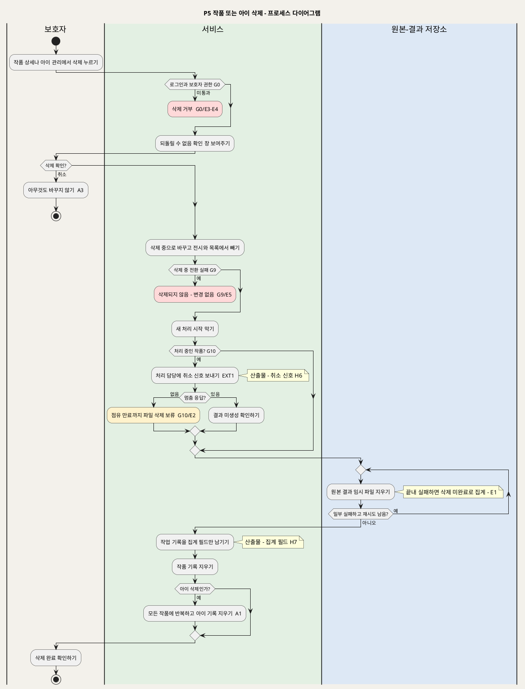

**[「P5 작품 또는 아이 삭제 - 프로세스 다이어그램」 PlantUML 뷰어로 열기](https://plantuml.sumzip.com/plantuml/svg/eNp1lE1T02AQx-_5FDvjRQ4MLxWVegCFFI8ePHitUiBDbZk2jpceKkSm0szYKkjQJFOHAsWpQ6AFw0z1A2U338F9nialVr1l5tmX__72n50v6umC_uplVimua7mNdCH9Ep6nX6yvFvKvcssL-Wy-ALdSidSU-mgooriWXs6_1nKrsJLOFjOKrunZDDyZAXLr4YcKoFXDnV2gPYOcLtDmd2rYMA7hroFfbTJ82mkCVpv8SJ-6wQ8f3ZZSwk43tHxyayVFilKSUTXaesM5uGnFBYNuGY_btF8jw46rY8XAo27gew-U0i01kZpUEyV-xmuDm5UUbQVuc2_uRY4fdHow6AbBlRnu2bA0OQb6WibHcWd-uH3JQWMK8PCpxdnF2WTUJjj38KoMHD2hJsbVOw84ZF3LZpVMbllbUZJYs_C9icc8dYX17m-TY0J4sMddgbyfoi3tt-mw11c6NLNQGDXpx8_FeuhHi7ZNISbJALDdDS628L0B6O0Gv3w6KTOXHa4H8DAh9BT1_Eak518o4lGoWSe7x1CiQkGnAdQwqGrTQRnw2yl-dSLGeN3XO6SRs0V0eMBTVpuh2YKl2YFgq_I3OiYTSRVIxplEObj4GSPi7Al1ZpQmbfH2LyxeNghZbh3w5N2NkuiF5xB0pVnmYGlqckRHMgrEaher1zwS9IlyzQbTFzvBza4EqD57OiVE5PJ6Bgra6pqeZIN5dGVju8ei_0x8fJdDpbNOK3TVBHLqWL282ZscTSiQLFLTCwtJatTIbvAYJh6awbUpkISmSU5vYGRWc2SBmGNCnRZiMvyLcTW3MqiWDC48aeIzn7YcMs4jy4R7lqTDORJgbILFRfV-aqZEX2rY8cejZGqUyT3icUpKIbORSesSlQyBOMQVdhgIPCnTZ0826CfA6zUtK6Q5PfFT9H0gNAgnuW1OlTbdbLFwpqIV-ysRdPmLrVytkNUcU4Zp4xuHl3FTC08HB0RMe2AwN-FZOqkHHYNXok79x-VunfbfAssVPnaMOCPkvh9tXoAQxq9ynv_uezgHHt8b3KR-2WEk0pHDB08cGq88N2pG_NbCj43IrsKM6FnYuYyxRRdupDz_2uzLaJ1DR2PwL0suIy6Qd2Cek_i8_wYAexz4)** — 클릭 시 브라우저로 연결됩니다.

### 8-3 설계 주의

**순서를 바꾸면 지운 파일이 되살아난다.** 처리 중인 작품의 파일을 먼저 지우고 취소를 나중에 보내는 경우를 생각해 보자. 그 사이 엔진이 렌더를 끝내고 결과 파일을 새로 쓴다. 기록은 이미 익명화되어서 그 파일은 **누구의 것인지 알 수 없는 아동 그림**으로 저장소에 남는다. 그래서 G10(멈춤 확인)은 5.4보다 반드시 앞에 있어야 한다. P0 쪽에도 대응하는 검사가 있어야 한다. 결과를 저장하기 직전에 취소 신호를 확인한다(P0 도면의 E5 분기). 두 쪽이 모두 있어야 경쟁 조건이 닫힌다.

**"보호자 화면에서는 사라짐"과 "실제로 사라짐"은 다르다.** 5.2에서 즉시 목록에서 빠지지만, 5.4가 끝내 실패하면 파일은 남아 있다. 이 차이는 P6의 "삭제 미완료" 집계로만 드러난다. **삭제 미완료 건을 누가 끝내는지는 UC에 없다**(§14 5번). 해제 주체가 없는 대기열이라서 SD_04 전에 정해야 한다. 백업 사본은 P0 범위 밖이다(BR-DEL-04).

---

## 9. P6 서비스 상태와 지표 확인

서비스 운영자가 **이미지를 보지 않고** 두 가지를 확인하는 프로세스다. 하나는 서비스가 살아 있고 받을 준비가 됐는지다. 다른 하나는 모델 품질 문제와 인프라 장애가 어떻게 나뉘어 일어나는지다. 가족 데이터를 바꾸지 않는다.

### 9-1 단계별 IPO

| # | 단계 | Input | Process | Output | 근거 |
|:--:|---|---|---|---|---|
| 6.1 | 생존 확인 | 운영자 접근 | 운영자 역할을 확인하고 서비스 프로세스가 응답하는지 보여 준다 | 생존 = 응답함 / 실패 | UC8 기본흐름 1 · E3 · E4 · BR-OPS-01 · **G11** |
| 6.2 | 준비 확인 | — | 원본 저장소, 기록 저장소, 처리 대기열을 쓸 수 있는지 확인한다. 엔진 가능 여부는 따로 확인한다 | 준비됨 / 준비 안 됨(구성요소) / 엔진 불가 | UC8 기본흐름 2 · A1 · A2 · BR-OPS-01 |
| 6.3 | 지표 계산 | 기간 · 집계 필드(H7) | 집계 필드만으로 지표 6종과 삭제 미완료 건수를 계산한다. 분모가 0이면 "해당 없음"이다. 기록 저장소 장애면 "지표를 계산할 수 없어요"를 보여 준다 | 지표 6종 · 삭제 미완료 수 | UC8 기본흐름 3 · A3 · A4 · E1 · BR-OPS-02 · BR-PRC-03 · BR-DEL-02 · BR-DEL-03 |
| 6.4 | 원인별 분해 | 집계 필드 | 네 가지를 서로 다른 항목으로 나눈다. 정상 액자(사람 그림 아님), 품질 미달 액자, 부모 선택 액자, 인프라 실패(오류 분류별)다 | 원인별 표 | UC8 기본흐름 4 · BR-OPS-03 |
| 6.5 | 결과 미도달 추적 | 미도달 건 | 요청 번호, 오류 분류, 시도 횟수, 단계별 시간, 엔진 버전만 보여 준다. 이미지·원본·이야기를 여는 경로는 없다 | 미도달 목록 | UC8 기본흐름 5 · E2 · BR-OPS-04 · BR-ACC-03 · BR-PRV-01 |

### 9-2 프로세스 다이어그램

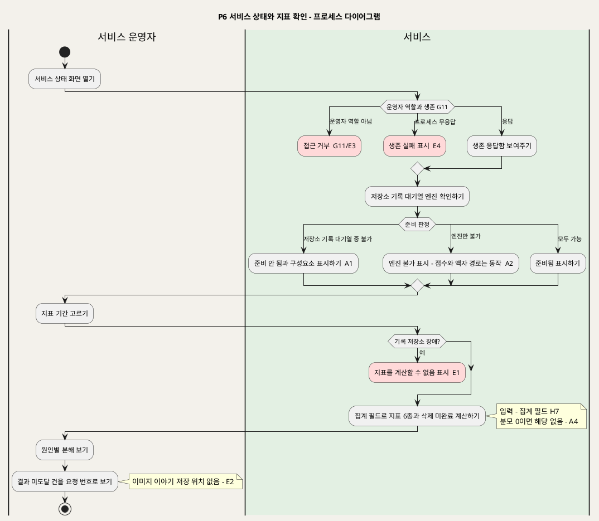

**[「P6 서비스 상태와 지표 확인 - 프로세스 다이어그램」 PlantUML 뷰어로 열기](https://plantuml.sumzip.com/plantuml/svg/eNp9lE9PGmEQxu_7KSbxogdTEWMjHqqt0B77AXqhirIRwcAaLx5WXQ0REiVl62IXslQItMEUYVVM7Bfamf0OnXeXv7b2xGaZed5nfu8zu5JRomllbychZbbl5G40Hd2Bz9H17a10ai-58S6VSKVhKhKMBMJvxyoy8ehGal9ObsFmNJGJSYqsJGLwcRFIM_FRo7Ma0PGhe2xSSQVqqG7BBLekU7kHs-AWNayapPVEGeZqVLbpq-089LDSlA7GFK5sMg6pcnEgeSal0HN11iziDxvo0nZ67WXpYCocjMyFgyMRbt2XlfU4TA_VuPrG1S2n-8QqZara8D4QmJHWo5nY31VAuoY5Y0YCphBZW1pbCpFVcB6ewLlt470KovlVOLjMBdtyItGXmRyxZVO5gLm7CRX_aMrV3HwTmA_lTIDwwjOhUeOww3vj6k3Ark2XLbp-8maPJTf8URmTpVKlTqd54H-wWgbMq_zElHiqIjW0_l24uuG1DhHVVKYGbv6CLH1I5D9itQLgfdZpq75Bv530LOBFU_B17lqk3dJVUbT7M_pnAqwGlgcHeJawkZ_Q8n36bwZ4ZoHZU9bwQqVXxS05nd8MGs-KgOclqhRYeH4gjD-bWOCStopn9TGHbG7CzDi7f8cv1I8wFzttDZyuhfWXEydvwnSf1Qie-NGtNzOgxGNJHtrITqTB08c6I-tqdNT2kpc1-LpOqZwfxSMwjAdbljeFsQJ3gMsp_WIyicGyLdL3Ey_hRzdkmYC_elTS8Do_1PcHT6aUGKTlrbgSYocnaNUF5HFN-PD6UxLvNYYJc7ypYt1c3cbc48DcLKwuvMjt2wXnDLviJjVuE5n1Dg45nbbwx8bwnDesxfvEW8Lp4bB0bgA7WdfoiYEGHRNW2QdP1FDFE-liAfqogUyNHo2Rt_A8fzxSu9IKA-Ov3B_17KiO)** — 클릭 시 브라우저로 연결됩니다.

### 9-3 설계 주의

**운영자가 "잠깐 이미지만 보면 원인을 알 텐데"라고 느끼는 지점이 가장 위험하다.** 미도달 건 상세에 원본 미리보기를 붙이는 건 한 줄짜리 편의 기능처럼 보인다. 하지만 그 순간 운영자 역할이 아동 그림을 보는 권한을 갖게 되고, BR-ACC-03과 원천 FR-9 수용기준 3을 어긴다. UC8 E2는 "운영 화면에는 그런 경로가 없다"고 적었다. 그래서 이것은 거부하는 게이트가 아니라 **경로를 아예 만들지 않는 구조**다(§12-2 "구조적 차단"). SD_04에서 운영 모듈은 원본-결과 저장소에 대한 의존 자체를 가지지 않아야 한다. 준비 확인(6.2)은 저장소의 "사용 가능 여부"만 묻는다.

**지표는 P0·P3·P5가 남긴 집계 필드의 품질을 넘지 못한다.** P0가 분류 컬럼을 섞어 쓰면 6.4의 네 항목이 서로 겹친다. P5가 익명화하면서 집계 필드까지 지우면 삭제된 작품이 지표에서 빠진다(§3-3, H7). 원천은 결과 미도달 0건만 목표로 두고, 비율 지표는 기준선으로만 쓴다(UC8 특별 요구사항).

---

## 10. P7 엔진 재현과 평가

평가 담당 팀원이 팀원이 직접 그린 평가 그림으로 엔진 버전을 검증하는 프로세스다. 핵심 엔진(Meta Animated Drawings)은 2025-09-03에, 모델 실행 구성요소(TorchServe)는 2025-08-07에 보관 처리됐다. 그래서 엔진은 조건부로 채택하고 언제든 교체할 수 있어야 한다(UC9 범위·개요). 운영 중인 가족 작품에는 영향을 주지 않는다.

### 10-1 단계별 IPO

| # | 단계 | Input | Process | Output | 근거 |
|:--:|---|---|---|---|---|
| 7.1 | 평가 그림 등록 | 그림 · 종류(사람/동물/사물) · 기대 경로 · 제작자 | 팀원이 직접 그렸는지 확인한다. 종류와 기대 경로가 모두 있는지 검사한다. 통과하면 평가 세트에 저장한다. 그림만 추가할 때는 여기서 끝난다 | 평가 세트 | UC9 기본흐름 1 · A2 · E1 · E2 · BR-ENG-04 · **G12** |
| 7.2 | 격리 확인과 버전 기록 | 평가할 엔진 버전 | 엔진의 외부 포트와 관리 기능이 닫혀 있는지 확인하고 엔진 버전을 기록한다. 새 환경에 설치했다면 빌드 시간·설치 크기·우회 사항도 기록한다 | 버전 기록 | UC9 기본흐름 2 · A3 · E5 · BR-ENG-01 · BR-ENG-02 · **G13** |
| 7.3 | 세트 실행 | 평가 세트 전체 | 그림마다 엔진에 보내 결과 경로, 검출 점수(기록용), 단계별 시간, 메모리를 기록한다. 한 그림이 시간 상한을 넘으면 "시간 초과"로 적고 다음 그림을 계속한다. 엔진이 멈추면 평가를 중단한다 | 그림별 결과 | UC9 기본흐름 2 · 3 · E3 · E4 · BR-PRC-06 · BR-ENG-03 · **G14** |
| 7.4 | 기대 경로와 비교 | 그림별 결과 | 기대 경로와 달라진 건의 목록을 만들고 오인 사례를 유형별로 분류해 제안한다. 검출 점수만으로 통과를 판정하지 않는다 | 달라진 건 목록 · 오인 분류안 | UC9 기본흐름 4 · BR-ENG-03 · BR-PRC-04 |
| 7.5 | 검토와 확정 | 분류안 | 팀원이 오인 사례 분류를 확정한다. 버전별 결과를 보관하고 이전 버전과 나란히 보여 준다 | 확정 분류 | UC9 기본흐름 5 |
| 7.6 | 채택 판단 | 확정 결과 | 팀원이 채택/보류를 판단하고 근거를 적는다. 예비 엔진 후보도 같은 세트와 절차로 평가한다. 교체해도 가족 흐름과 화면은 그대로여야 한다 | 엔진 버전 평가 기록(H8) | UC9 기본흐름 6 · A1 · BR-ENG-05 |

### 10-2 프로세스 다이어그램

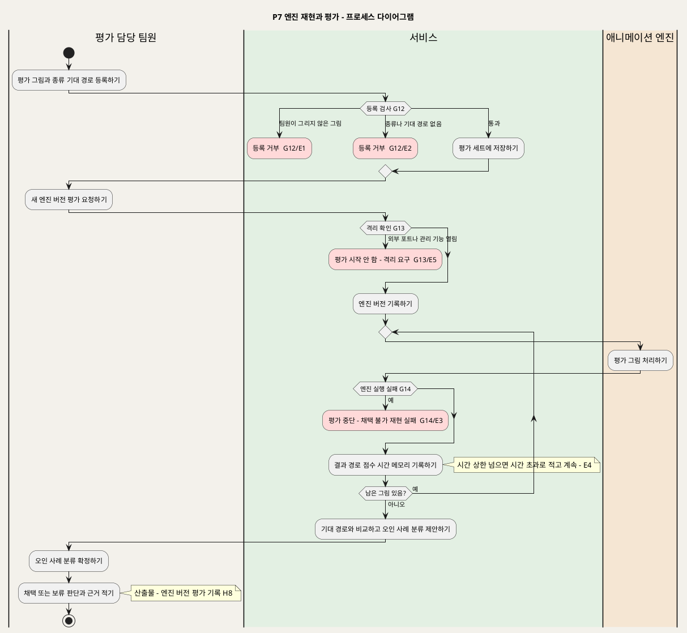

**[「P7 엔진 재현과 평가 - 프로세스 다이어그램」 PlantUML 뷰어로 열기](https://plantuml.sumzip.com/plantuml/svg/eNqFlN9P2lAUx9_7V5zEF3hYnKLbxIeZzbI97l_otEojgoEaX3hAraYCi5hRrRsQXHDCwhKEipiwf6j39H_YuS0Xf29PbW7P_Z7z_ZxzupDRlbS-uZ6QMmtackNJK-vwWVlaW02nNpPL71OJVBomYpHYlPzuTkQmriyntrTkKqwoiYwq6ZqeUOHTa8CTMl4YgLW2Zxtubwje4YHbycEL8MoGO6ugMcB8A1ihgVUHjx33esBqTSk7CmMFhxVuwCvm8HspK_m1SdHRRx77c8hF8cceO7fBHXRYkc67f0gZ2NdLdlb1LJuO56XshByJvZQjWTQq7MagpCS3pelLcQgFkXQvhztt-DA1HZaWlIwKoSAvVRbkauNFDtDKY1UkD0tANGKLc4tzUaFy2WH9HHCZSXlqngLWtERiJBgUynYe1oon-1gt_k9t-oGat39F7vktgYRwevkBnpQA6zmsnQv3anI5MPsc2SjumqJZrGtg3RCdwm9l7P7-F0ZtBUJut0V8wDu1sDqgaiNh0ONqkhyfDrgB77BNhfnGnRyP5P7z55TSeYBRpC1UsHZEtE3wrCbNyygDleNetTmQyKQ8OwZCBrUVcnHPAc9xOwFpdUNVdLqQnYjNyq8WyYNVZwWTtcp89vbskf_sHZ5BlwG7NuUWQlzhMQUAzkHMe6HhHR_4j2KTap0Z47BNbvax3cYRK3CbeGl4u1VgfdM_9vdG6HChSTky7wv4tgEC41Sx2-3wVRADVS-haXOKbod4tMrsV1Ngv0UCkEzpKqS11bgeFcG4u-1ZtD6GjZUhaznjc8ekBIH4tturg9szcP8L1SzPjODCVlyjvQ-xnebtjpAJk4b7bRi0TACAZ6U3yyD6aDfCUvTeNuApjeeN4V6VeJ2UiGL4VNFysjP61Df4smO9QsMxnsvnxvqpq3xK65a4GhXI7RLLl4H1HD-mWKKG-ESvh7SFvmkefo_YTgf7FdYe8sY9tTwBbvj4hn5dqQ1pgbpFv9a_hlfVOQ==)** — 클릭 시 브라우저로 연결됩니다.

### 10-3 설계 주의

**검출 점수로 합격선을 그으면 1차 시험의 실수를 그대로 제품에 넣는다.** 1차 시험에서 집 그림이 사람 점수 0.946(사람 그림 0.997)으로 잡혀 벽에 관절이 붙었다(UC9 특별 요구사항). "점수 0.9 이상이면 움직임"처럼 기준을 세우면 이 집 그림은 통과한다. P7의 판정 근거는 점수가 아니라 **기대 경로와의 차이(7.4)와 사람이 확정한 오인 분류(7.5)**다. P0의 품질 미달 임계값도 이 결과로 계획 단계에서 정한다. 원천은 그 수치를 아직 주지 않았다(§14 2번).

**P7의 결론이 P0로 가는 길이 UC에 없다.** UC9는 "채택/보류 판단과 근거를 엔진 버전에 연결해 기록"하는 데서 끝난다. 운영 처리(P0)가 "채택된 버전만 쓴다"는 검사는 어떤 UC의 `alt`에도 없다. 이 문서는 원천 없는 게이트를 만들지 않으므로 H8을 인계 계약으로만 두고 공백을 §14 4번에 올렸다. 이 공백이 남으면 보류 판정을 받은 버전이 배포 한 번으로 운영에 들어간다. 그러면 BR-ENG-03(버전 바뀌면 전체 재평가)은 기록 규칙일 뿐 통제가 되지 못한다.

---

## 11. 프로세스 간 인계 계약

프로세스 경계에서 넘어가는 산출물이다. 이 표의 산출물이 SD_03의 주요 엔티티 후보가 된다.

| ID | 경로 | 산출물 | 필수 포함 항목 | 포함 금지 | 만료·무효 조건 | 근거 |
|:--:|---|---|---|---|---|---|
| H1 | P1 → P2 | 아이 기록 | 가족 식별자, 아이 식별자, 별칭 | 실명, 생년월일, 출생연도 | 아이를 삭제하면(P5 5.6) 무효가 된다. P2 선택지에서 즉시 사라진다 | UC1 사후조건 · BR-CHD-01 · BR-CHD-03 |
| H2 | P2 → P0 | 처리 작업 (작품 기록 + 작업 기록 + 원본) | 요청 번호(유일), 작품 식별자, 아이 식별자, 경로(움직임/원본 액자), 상태 "접수됨", 원본 저장 위치 | 원본 변형본 | 세 부분 중 하나라도 없으면 **처음부터 없는 것**이다(G4). 삭제 중으로 바뀌면 새 처리 시작이 금지된다(P5 5.2) | UC2 사후조건 · BR-INT-02 · BR-INT-03 · BR-DEL-01 |
| H3 | P0 → P3 | 처리 결과 | 최종 처리 상태(확인 대기/실패), 결과 종류, 대체 분류 **또는** 오류 분류(동시 기입 금지), 진단 이유 코드, 검출 점수(기록용), 단계별 시간, 시도 횟수, 엔진 버전, 결과 파일 위치(처음 만든 것 1개) | 두 번째 결과 파일 | 만료되지 않는다(결과 재생성 금지). 삭제되거나 다시 찍기로 닫히면 무효가 된다 | UC3 사후조건 · BR-APR-03 · BR-ENG-02 · BR-PRC-04 |
| H4 | P3 → P4 | 전시 작품 | 상태 "전시됨", 부모 선택(좋아요/액자로 걸기), 전시 형태(움직임/원본 액자), 제목, 제작일, 제작 당시 연령, (선택) 한마디 원문 | 자동 생성·교정 문장, 발달 평가, 감정 태그 | 삭제 요청 즉시 무효가 된다(P5 5.2). 이야기를 고치면 무효가 아니라 즉시 갱신된다 | UC4·UC5 사후조건 · BR-EXH-01 · BR-STY-03 · BR-STY-04 |
| H5 | P3 → P2 | 재접수 요청 (EXT2) | 이전 작품의 아이 식별자, 이전 건 상태 "다시 찍기로 닫힘" | 이전 원본의 재사용 | 아이를 삭제하면 무효가 된다. 보호자가 새 사진을 올리지 않으면 요청은 버려지고, 이전 건은 닫힌 채 남는다(UC4 비고 Edge Cases) | UC2 A2 · UC4 A4 · BR-APR-03 · BR-APR-05 |
| H6 | P5 → P0 | 취소 신호 (EXT1) | 작품 식별자, 상태 "삭제 중" | — | P0의 멈춤 응답이나 점유 시간 만료로 닫힌다. 그 뒤 해당 작업은 재개되지 않는다 | UC7 A2 · E2 · UC3 E5 · BR-DEL-01 |
| H7 | P0 · P3 · P5 → P6 | 집계 필드 | 요청 번호, 경로, 결과 종류, 대체 분류, 오류 분류, 부모 선택, 단계별 시간, 시도 횟수, 엔진 버전, 삭제 미완료 여부 | 이미지, 저장 위치, 작품·아이 연결, 별칭, 제목, 한마디, 오류 원문 | 만료되지 않는다. 작품을 삭제해도 집계 필드는 남는다(BR-DEL-02) | UC7 사후조건 4 · UC8 사후조건 3 · BR-OPS-02 · BR-OPS-04 · BR-PRV-01 |
| H8 | P7 → P0 | 엔진 버전 평가 기록 | 엔진 버전, 평가 세트 실행 결과(그림별 경로·점수·시간·메모리), 달라진 건 목록, 확정 오인 분류, 채택/보류 판단과 근거 | 실제 아동 그림, 공개 이미지 | 엔진 버전이 바뀌면 이전 평가는 새 버전에 대한 근거가 되지 못한다. 전체를 다시 평가해야 한다(BR-ENG-03). **P0가 이 기록을 확인하는 게이트는 UC에 없다**(§14 4번) | UC9 사후조건 · BR-ENG-02 · BR-ENG-03 |

### 11-1 버전 참조 사슬

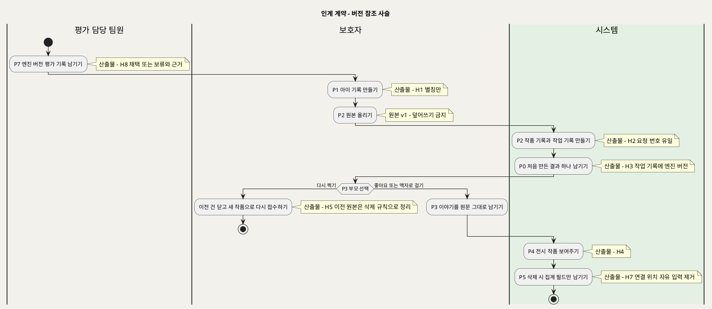

**[「인계 계약 - 버전 참조 사슬」 PlantUML 뷰어로 열기](https://plantuml.sumzip.com/plantuml/svg/eNqVVF1v0mAUvu-vOMlu2IXJkC0avFk0EC_5C1W-mjFYoNMbLggrCQKLIHR0s12KgixaTPnILEn9Q31P_4PnLaASs2UmJSXtOc95nvM8bw9LsliUT49zQulIyp-IRfEYXomvjzLFwmk--aKQKxRhJx6Jh2PP_6ooZcVk4a2Uz0BazJVSgizJuRSg4XhzBeiH6k94BGymoKkA2g4ObMCqhQ1LKPvv33l2BVhzwZpL8FsV_NguCwENIZp4Atjv4VjZNK-rPcdmAwNY9Yb-0fVMyBfkFBSlTFaOErSNtzqzXBr68ingVPHPqFhrs0YP2HzBRhpeEsgP15vaQpme-JqD1zQ2mggDqgoai98jxi3WHd4_IkygCi4nVEsIj4EUsLkDqFnsi_Vv6-rtmzBfyfl3vFhgl2ugiXUcV4TyTiwS34tFytjUsTH0a3p5hXrd8T_U17y8ucsfYL_2P0QJ5KqHswlts06SAXUTDZfQ9wBnGhqtFYoJ3szmE3xVY1XtQWuObNPBfnvbua01S2kIJSLAbivs6w2gYpI_uyBnU3kIseaQhFNKzglpVwCIkhvcem-6oJR88-Ym4Fl9vQ7UXTbQYdNkdrCuEeuAK8CdbA9gDboyA40KvZ-gqVModFxermHRVMlBAirJhRMhRdGGEH5q8oRc9TaBQnVAoni5N3U2nEkdn6C6fB0jN5hjOYTusFYlYPxnp6l8UkrfYfs-cVACaSv3aYnYt_Cze78b-9R6sJEUtI87_Cz6qsK6Opn8IE_54bMpCpQTirdGHNqUGLrVmDkiYjo_PsFqDkkDfTR-AeynTIU=)** — 클릭 시 브라우저로 연결됩니다.

**사슬 읽기**

이 사슬에는 **고쳐 쓰는 화살표가 하나도 없다.** 원본, 결과, 작업 기록은 모두 한 번 만들어지면 바뀌지 않는다. 바뀔 수 있는 것은 세 가지뿐이다.

- 부모 선택: P3에서 한 번 기록된다.
- 이야기: 언제든 고칠 수 있다(BR-STY-04).
- 상태: 정해진 전이만 한다.

"다시 찍기"도 이전 건을 고치지 않는다. 이전 건을 닫고 **새 사슬**을 시작한다. 작업 기록은 엔진 버전을 참조하므로, 어느 결과가 어느 버전에서 나왔는지 나중에도 따라갈 수 있다. H8과 운영 버전의 연결이 끊겨 있는 곳이 §14 4번이다.

---

## 12. 게이트 맵

게이트는 처리를 멈추거나 출력을 막는 지점이다. 게이트마다 다섯 가지를 모두 채웠다. 위치, 조건, 미통과 시 결과, 해제 주체, 근거다. **해제 주체가 비어 있는 게이트는 없다.**

| ID | 게이트 | 위치 | 통과 조건 | 미통과 시 결과 | 해제 주체 | 근거 UC · BR |
|:--:|---|---|---|---|---|---|
| **G0** | 가족 접근 | P1 1.1 · P2 2.1 · P3 3.1 · P4 4.1·4.3 · P5 5.1 | 로그인 상태이고, 대상이 요청자 가족의 것이다. P4 상세는 "전시됨" 상태여야 한다. P5는 보호자 역할이어야 한다 | 재로그인을 요구하거나 거부한다. 원본·결과·이야기를 **아무것도 노출하지 않는다.** 입력하던 내용은 저장하지 않는다 | 보호자 본인이 다시 로그인한다. 다른 가족 자료와 승인 전 작품은 그 작품의 가족 보호자만 열 수 있다 | INC1 · UC1 E4 · UC2 E7 · UC4 E5 · UC5 E5 · UC6 E1·E2·E3 · UC7 E3·E4 · BR-ACC-01~04 |
| **G1** | 기록 반영 원자성 | P1 1.4 · P3 3.4 · P3 3.5 | 기록 저장소 쓰기가 성공한다 | "저장되지 않았어요/반영되지 않았어요"를 보여 준다. 이전 값과 이전 상태를 유지한다. 일부만 반영되지 않는다. 로그에는 분류 코드만 남긴다 | 보호자가 다시 시도한다(저장소가 복구된 뒤) | UC1 E3 · UC4 E3 · UC5 E3 · BR-PRV-01 |
| **G2** | 별칭 검사 | P1 1.3 | 별칭이 비어 있지 않고, 같은 가족 안에서 겹치지 않는다 | 저장 버튼을 막거나 "이미 쓰는 별칭이에요"를 보여 준다 | 보호자가 다른 별칭을 입력한다 | UC1 E1 · E2 · BR-CHD-02 |
| **G3** | 사진 검사와 경로 응답 | P2 2.2 · 2.3 | 형식이 JPEG·PNG·HEIC이고, 20MB 이하이고, 이미지로 열린다. 사람·캐릭터 질문에 답했다 | 접수 전에 거절하고 사유(형식/용량/판독 불가)를 안내한다. 미응답이면 올리기 버튼이 막힌다 | 보호자가 다른 사진을 고르거나 질문에 답한다 | UC2 E1~E4 · BR-INT-01 · BR-INT-05 |
| **G4** | 내구 접수 | P2 2.5 · 2.6 | 원본, 작품 기록, 작업 기록이 **모두** 저장됐다 | 미접수로 처리한다. 먼저 저장된 원본까지 지운다. 목록에 작품이 나타나지 않는다 | 보호자가 다시 올린다(저장소가 복구된 뒤) | UC2 E5 · E6 · BR-INT-02 |
| **G5** | 재시도 소진 | P0 0.4 | 인프라 장애가 최대 3회 시도 안에 풀린다 | 상태 "실패"가 되고 결과 미도달로 집계한다. 보호자에게 "처리하지 못했어요"를 보여 준다. 품질 미달로 바꾸지 않는다 | 보호자가 P3에서 "액자로 걸기"(원본 액자로 전시) 또는 "다시 찍기"(새 작품)를 고른다 | UC3 E1~E4 · UC4 A3 · A4 · BR-PRC-03 |
| **G6** | 결과 열람 | P3 3.2 | 결과 미리보기와 원본을 읽을 수 있다 | 결과 파일을 못 읽으면 선택지를 전부 잠그고 상태를 확인 대기로 둔다(E2). 실패 건에서 원본을 못 읽으면 "액자로 걸기"를 잠그고 "다시 찍기"만 남긴다(E1) | 보호자가 나중에 다시 연다(E2). 보호자가 다시 찍는다(E1) | UC4 E1 · E2 · BR-APR-01 |
| **G7** | 이야기 값 검증 | P3 3.5 | 제작일이 오늘 이후가 아니고, 연령이 만 나이 정수 0~18이다 | 저장을 거절하고 허용 범위를 안내한다 | 보호자가 값을 고친다 | UC5 E1 · E2 · BR-STY-02 |
| **G8** | 전시 | P3 3.6 (P4 4.2·4.3에서 재확인) | 보호자 승인(좋아요 또는 액자로 걸기)과 필수 이야기(제목·제작일·제작 당시 연령)가 **모두** 있다 | 전시하지 않는다. 저장만 하고 "이야기를 채우면 전시돼요" 또는 "확인하면 전시돼요"를 보여 준다 | 보호자가 빠진 쪽을 채운다. 선택은 P3 3.4, 이야기는 P3 3.5에서 한다 | UC4 기본흐름 4·5 · UC5 A1 · A5 · UC6 E3 · BR-EXH-01 · BR-APR-01 |
| **G9** | 삭제 착수 | P5 5.2 | "삭제 중" 전환이 성공한다 | "삭제되지 않았어요"를 보여 주고 아무것도 바꾸지 않는다. 파일 삭제로 넘어가지 않는다 | 보호자가 삭제를 다시 요청한다 | UC7 E5 · BR-DEL-01 |
| **G10** | 처리 멈춤 확인 | P5 5.3 | 진행 중인 처리가 없다. 있었다면 멈춤 응답을 받았거나 점유 시간이 만료됐다 | 파일 삭제를 **보류**한다. 그동안 처리 재개를 막는다 | 처리 담당의 멈춤 응답. 응답이 없으면 점유 시간 만료(시스템 타이머) | UC7 A2 · E2 · UC3 E5 · BR-DEL-01 |
| **G11** | 운영자 역할 | P6 6.1 | 운영자 역할 계정이다 | 운영 화면 접근을 거부한다 | 운영자 역할 계정으로 접근한다. 역할 부여 방식은 미정이다(§14 9번) | UC8 E3 |
| **G12** | 평가 그림 등록 | P7 7.1 | 팀원이 직접 그린 그림이고, 종류와 기대 경로가 있다 | 등록을 거부한다 | 평가 담당 팀원이 조건을 채워 다시 등록한다 | UC9 E1 · E2 · BR-ENG-04 |
| **G13** | 엔진 격리 | P7 7.2 | 엔진의 외부 포트와 관리 기능이 닫혀 있다 | 평가를 시작하지 않고 격리 조치를 요구한다 | 평가 담당 팀원이 격리 조치를 확인한 뒤 다시 요청한다. 실제 조치를 누가 하는지는 UC에 없다(§14) | UC9 E5 · BR-ENG-01 |
| **G14** | 엔진 재현 | P7 7.3 | 엔진이 뜨고 평가 끝까지 실행된다 | 평가를 중단하고 실패 단계를 기록한다. 그 버전을 "채택 불가(재현 실패)"로 표시한다 | 평가 담당 팀원이 재설치·재현 기록(UC9 A3) 뒤 다시 평가한다 | UC9 E3 · A3 |

### 12-1 게이트 성격 분류

| 성격 | 게이트 | 하류 문서에서 되는 것 |
|---|---|---|
| **접근 통제** | G0, G11 | SD_02: 로그인 화면 이동, 빈 화면(노출 없음). SD_03: 가족 식별자 기반 행 단위 필터. SD_04: 인증·인가 공통모듈, 403/404 응답(존재 여부도 숨김) |
| **입력 검증** | G2, G3, G7, G12 | SD_02: 비활성 저장·올리기 버튼, 필드 옆 안내. SD_03: NOT NULL, CHECK(연령 0~18, 제작일 ≤ 오늘), UNIQUE(가족, 별칭). SD_04: 400/422 응답 |
| **원자성** | G1, G4, G9 | SD_03: 트랜잭션 경계, 보상 삭제(G4 원본 제거). SD_04: 저장소 모듈과 기록 모듈 사이의 보상 계약 |
| **업무 상태** | G5, G8 | SD_02: 상태 배지, "이야기를 채우면 전시돼요" 안내. SD_03: 상태 CHECK 제약(전시됨 ⇒ 승인 AND 필수 이야기), 분류 컬럼 배타 제약. SD_04: 409 응답 |
| **보류형(대기)** | G10 | SD_03: 작업의 취소 요청 플래그와 점유 만료 시각. SD_04: 삭제 모듈이 처리 모듈의 응답이나 타이머를 기다림 |
| **안전 전제** | G6, G13, G14 | SD_02: 선택지 잠금 표시. SD_04: 준비 확인과 격리 확인이 기능 호출보다 앞선다 |

### 12-2 게이트가 아닌 차단 (구분)

아래는 도면에 `kill`로 그렸지만 게이트 ID를 주지 않았다. 게이트의 요건(해제 주체가 있는 통제)에 맞지 않기 때문이다.

| 차단 | 위치 | 게이트가 아닌 이유 | 하류 처리 |
|---|---|---|---|
| 삭제 중·다시 찍기로 닫힌 작품의 입력 거부 | P3 3.2 · 3.5 (UC4 E4 · UC5 E4) | **종결 상태**다. 풀리면 안 된다. 해제 주체가 없는 것이 설계 의도다 | SD_03 상태 전이 규칙(종결 상태에서 나가는 전이 없음) |
| 삭제된 작품 상세 | P4 4.3 (UC6 E5) | 종결 상태 | 같음 |
| 운영자의 가족 이미지 열람 | P6 6.5 (UC8 E2) | **구조적 차단**이다. 거부 로직이 아니라 경로가 없다 | SD_04 운영 모듈이 저장소에 의존하지 않음 |
| 생존 실패 · 지표 계산 불가 · 전시 파일 불러오기 실패 | P6 6.1 · 6.3 · P4 4.3 (UC8 E4 · E1 · UC6 E4) | **장애 표시**다. 시스템이 거는 통제가 아니라 인프라 상태를 보여 주는 것이다. 복구 주체가 UC에 없다 | §14 6번 |
| 처리 취소(P0) | P0 (UC3 E5) | G10의 반대편이다. 해제 없이 종결된다 | H6 |

---

## 13. 원천 추적성

### 13-1 UC 커버리지

| UC | 프로세스 | IPO 단계 | 기본흐름 대응 |
|:--:|:--:|---|---|
| UC1 | P1 | 1.1~1.5 | 1→1.1 · 2→1.2 · 3→1.3 · 4→1.4 · 5→1.5 |
| UC2 | P2 | 2.1~2.7 | 1→2.1 · 2→2.2 · 3→2.3 · 4→2.4 · 5→2.5 · 6→2.6 · 7→2.7 |
| UC3 | P0 · P3 | 0.1~0.7 · 3.1~3.2 | 1→3.1 · 2→0.1 · 3→0.3 · 4→0.4 · 5→0.6 · 6→3.1 · 7→3.2 |
| UC4 | P3 | 3.2~3.4 · 3.6 | 1→3.2 · 2→3.3 · 3→3.4 · 4→3.6 · 5→3.6 |
| UC5 | P3 | 3.5~3.6 | 1~4→3.5 · 5~6→3.6 |
| UC6 | P4 | 4.1~4.5 | 1→4.1 · 2→4.2 · 3→4.3 · 4→4.4 · 5→4.4 · 6→4.5 |
| UC7 | P5 | 5.1~5.7 | 1→5.1 · 2→5.2 · 3→5.3 · 4→5.4 · 5→5.5 · 6→5.7 |
| UC8 | P6 | 6.1~6.5 | 1→6.1 · 2→6.2 · 3→6.3 · 4→6.4 · 5→6.5 |
| UC9 | P7 | 7.1~7.6 | 1→7.1 · 2→7.2·7.3 · 3→7.3 · 4→7.4 · 5→7.5 · 6→7.6 |
| INC1 | 전 보호자 프로세스 | 1.1 · 2.1 · 3.1 · 4.1 · 4.3 · 5.1 | G0 |
| EXT1 | P5 ↔ P0 | 5.3 ↔ 0.5 | H6 · G10 |
| EXT2 | P3 → P2 | 3.4 → 2.1 | H5 |

**미사상 UC 0건.** 기본흐름 53단계가 모두 IPO 단계로 갔다(UC_ALL §9.2의 합계와 같다). 대체흐름 37개와 예외흐름 47개도 각 IPO 행의 근거 열이나 §12-2에 모두 나온다.

### 13-2 업무규칙 부착 단계

| BR | 부착 단계 | BR | 부착 단계 |
|---|---|---|---|
| BR-CHD-01 | 1.2 · 1.4 · 3.5 | BR-STY-01 | 3.5 |
| BR-CHD-02 | 1.3 (G2) | BR-STY-02 | 3.5 (G7) |
| BR-CHD-03 | 1.5 · 2.1 | BR-STY-03 | 3.5 · 4.3 |
| BR-INT-01 | 2.2 (G3) | BR-STY-04 | 3.5 · 4.3 |
| BR-INT-02 | 2.5 · 2.6 (G4) | BR-EXH-01 | 3.6 (G8) |
| BR-INT-03 | 2.4 | BR-EXH-02 | 4.2 |
| BR-INT-04 | 2.5 · 0.4 · 3.4 | BR-EXH-03 | 4.4 · 4.5 |
| BR-INT-05 | 2.3 (G3) · 0.2 | BR-EXH-04 | 3.2 · 4.4 |
| BR-PRC-01 | 0.2 | BR-EXH-05 | 4.2 |
| BR-PRC-02 | 0.4 | BR-DEL-01 | 5.2 (G9) · 5.3 (G10) · 0.5 |
| BR-PRC-03 | 0.4 (G5) · 6.3 | BR-DEL-02 | 5.5 · 6.3 |
| BR-PRC-04 | 0.4 · 3.2 · 7.4 | BR-DEL-03 | 5.4 · 6.3 |
| BR-PRC-05 | 0.1 | BR-DEL-04 | 5.4 (범위 밖 표시) |
| BR-PRC-06 | 0.3 · 7.3 | BR-ACC-01 | 1.1 · 2.1 · 3.1 · 4.1 · 4.3 · 5.1 (G0) |
| BR-PRC-07 | 2.6 · 0.1 | BR-ACC-02 | 4.1 (G0) |
| BR-PRC-08 | 0.6 · 0.7 · 5.4 | BR-ACC-03 | 6.5 |
| BR-APR-01 | 3.2 · 3.6 (G8) · 4.2 | BR-ACC-04 | 5.1 (G0) |
| BR-APR-02 | 3.2 | BR-OPS-01 | 6.1 · 6.2 |
| BR-APR-03 | 0.4 · 2.6 · 3.4 | BR-OPS-02 | 3.4(원천) · 6.3 |
| BR-APR-04 | 3.4 | BR-OPS-03 | 6.4 |
| BR-APR-05 | 3.4 · 5.4 · 5.5 | BR-OPS-04 | 6.5 |
| BR-ENG-01 | 0.3 · 7.2 (G13) | BR-ENG-04 | 7.1 (G12) |
| BR-ENG-02 | 0.6 · 7.2 | BR-ENG-05 | 7.6 |
| BR-ENG-03 | 7.3 · 7.4 | BR-PRV-01 | 1.4 · 2.6 · 3.4 · 3.5 · 5.5 · 6.5 (전 단계 로그 규칙) |

업무규칙 48개가 모두 하나 이상의 IPO 단계에 붙었다.

### 13-3 도면 목록

| # | 도면 | 절 |
|:--:|---|---|
| 1 | L0-1 본류 | §2-1 |
| 2 | L0-2 병행 프로세스 | §2-2 |
| 3 | P0 작품 처리 | §3-2 |
| 4 | P1 아이 등록 | §4-2 |
| 5 | P2 작품 접수 | §5-2 |
| 6 | P3 결과 확인과 이야기 기록 | §6-2 |
| 7 | P4 가족 전시 감상 | §7-2 |
| 8 | P5 작품 또는 아이 삭제 | §8-2 |
| 9 | P6 서비스 상태와 지표 확인 | §9-2 |
| 10 | P7 엔진 재현과 평가 | §10-2 |
| 11 | 인계 계약 - 버전 참조 사슬 | §11-1 |

도면은 11개다. 기준(9~10개)보다 하나 많다. 프롬프트 규칙대로 L0를 본류와 병행으로 나눴기 때문이다.

**렌더 검증** — 도면 11개 모두 `plantuml.sumzip.com`에서 확인했다(2026-09-28). HTTP 200, image/svg+xml, Syntax Error 없음. URL 최대 1389자로 4096자 이하다. 링크를 복호한 소스가 코드블록과 글자까지 같다.

---

## 14. 미해결·확인 필요

영향이 큰 순서다. 이 문서는 아래 항목에 값을 지어 넣지 않았다.

| # | 항목 | 걸리는 곳 | 영향 |
|:--:|---|---|---|
| 1 | **가족 계정 모델**(spec FR-9 [NEEDS CLARIFICATION]) — 보호자 1계정 / 공동 보호자 초대 / 관리 보호자 + 감상 전용 가족 | G0 통과 조건 · P5 5.1 권한 · P4 감상 주체 | 높음. 공동 보호자면 초대·해제 프로세스가 새로 생기고, G0의 "보호자 역할" 판정이 바뀐다 |
| 2 | **품질 미달 판정 기준(임계값)과 엔진 채택 기준 수치** | P0 0.4 · P7 7.6 | 높음. P7 1차 평가 결과로 계획 단계에서 정한다. 검출 점수만으로 정하지 않는다(§10-3) |
| 3 | **실패 건에서 "액자로 걸기"를 고를 때의 분류 기록** — "부모 선택"을 추가할지, 오류 분류만 둘지 | P3 3.4 · H7 · P6 6.4 | 중간. 원인별 분해의 집계 방식이 바뀐다 |
| 4 | **채택되지 않은 엔진 버전의 운영 투입을 막는 게이트가 UC에 없다** | H8 → P0 | 높음. 설계 공백이다. UC9나 UC3에 "운영 처리는 채택된 버전만 쓴다"를 추가할지 `/speckit.clarify`로 정한다 |
| 5 | **"삭제 미완료" 건을 끝내는 주체가 없다** — P6는 집계만 한다 | P5 5.4 · P6 6.3 | 높음. 해제 주체 없는 대기열이다. 아동 파일이 남는 경로라서 운영 전에 반드시 정한다 |
| 6 | 인프라 장애 표시(생존 실패, 지표 계산 불가, 전시 파일 불러오기 실패)의 복구 주체와 외부 감시 수단 | P6 6.1 · 6.3 · P4 4.3 | 중간 |
| 7 | 동시 처리 상한 값(원천: "팀 서버 재현 시험 뒤 정한다") | P0 0.1 · P2 2.6 | 중간. 부하 시험 뒤 확정 |
| 8 | 처리 담당 점유 시간 · 임시 파일 정리 주기 · 삭제 자동 재시도 횟수와 간격 | P0 0.1 · 0.7 · P5 5.3 · 5.4 | 중간. plan 단계 설정값. G10 보류 시간도 점유 시간에 달려 있다 |
| 9 | 운영자 인증 방식과 역할 부여 방식 | G11 | 중간 |
| 10 | 보호자 계정·가족 공간 생성 절차 | P1 앞 단계 | 중간. 원천에 가입 흐름이 없어서 L0 본류가 P1에서 시작한다 |
| 11 | G4에서 "원본 제거"까지 실패하는 경우의 처리 | P2 2.6 | 중간. 고아 원본이 남는 경로다. P0 0.7 같은 주기 정리 대상에 넣을지 정한다 |
| 12 | G13 격리 조치의 실제 수행 주체(평가 담당 팀원인지 인프라 담당인지) | P7 7.2 | 낮음 |
| 13 | 처리 완료를 보호자에게 알리는지 여부. UC는 "다음에 목록을 열 때 보인다"(UC3 A5)만 적었다 | P0 → P3 경계 | 낮음. 알림을 넣으면 새 인계 계약이 생긴다 |
| 14 | 비기능 요구 중 원천에 없는 것: P3·P4 화면 응답시간, 동시 사용자 10명 이외의 처리량, 저장소 가용성 목표 | 전체 | 낮음. 지어내지 않았다. 원천에 있는 수치(미리보기 p95 3분/30초, 시간 상한 10분, 재시도 3회, 20MB)만 썼다 |
| 15 | 기술 스택 정본 — Intent-Specify(FastAPI·PostgreSQL)와 Intent-Plan(Vue·Node·MariaDB)이 다르다 | SD_03 · SD_04 | 높음. `/speckit.plan` 전에 정한다. 이 문서는 스택에 의존하지 않게 썼다 |

---

*가족 그림 미술관 P0 · SD_01 프로세스 설계서 · 2026-09-28 · 입력: UC_ALL 통합명세 · 원천: spec.md v1.0*
