# SD_01 프로세스 설계서 — 우리 아이 미술관 (P0 · P0.5 · P1)
**우리 아이 미술관 · 유스케이스를 하나의 시간축으로 · IPO · 게이트 · 인계 계약 · BPMN 2.0 대응 PlantUML**

---

> **문서 식별**: `design/SD_01_프로세스설계서_우리아이미술관.md`
> **작성일**: 2026-09-28
> **개정 2 (2026-09-28, 통합 결정 D17)**: 외부 모델 기능 엔드포인트 절충안을 반영했다. `segment`·`classify`·`pose`·`relief` 네 기능은 P0, `caption`과 외부 API 약관은 P0.5다. 호출자를 팀 밖 외부 클라이언트까지 넓힌다. 다만 팀 밖 클라이언트 키는 U12(한도·약관) 확정 뒤 발급하고, 그 전에는 팀·과정 내부 키만 발급한다(이제민 조건부 승인). 단 `pose`는 팀 내부 키 전용이다(보관 처리돼 보안 수정이 없는 M3(Animated Drawings·TorchServe)를 팀 밖 요청이 간접 호출하지 않도록, 외부 키는 403). 요청 한도는 예시값(U12, 확정 아님)이다. `classify`는 라이선스 확정 기록(A2) 뒤에 활성한다.
> **개정 3 (2026-09-28, 통합 결정 D18)**: 이용자 중복은 별칭이 아니라 **보호자 이메일 계정**으로 막는다. 따로 아이디를 만들지 않고 이메일로 로그인한다. UC13 "보호자 이메일로 가입한다"(P0, 확인 메일로 가입 완료)와 UC14 "이메일로 로그인 정보를 찾는다"(P0)를 새로 두었다. 별칭은 중복 검사를 하지 않는 표시용 이름이 되었다(BR-CHD-02 개정, BR-ACC-06~08 · FR-31 · FR-32 · U19 신설).
> **개정 4 (2026-09-29, 통합 결정 D20)**: 모델 점검(점검 API)을 P7의 곁가지 §10-4(7.8~7.10)로 더했다. 인계 계약 H17(점검 작업)·H18(점검 결과)과 게이트 **G30 점검 입력**을 새로 두었고, P7 "읽기 전용"에 점검 기록 예외를 적었다.
> **입력**: `design/UC_00_개요_우리아이미술관.md`(§2 주요 기능 · §3 목록 · §4 Actor · §5 L1 다이어그램)와 개별 유스케이스 `UC_01`~`UC_12` **12건 전부**(기본흐름 79단계 · 대체흐름 · 예외흐름 · 업무규칙 · Sequence Diagram). UC 문서 사이의 충돌은 `REF_재작성공통기준_우리아이미술관.md` §11 통합 결정(D1~D15)을 우선했다.
> **원천**: `Intent-Specify.md`(2026-09-28 기준안) · `.specify/features/우리-아이-미술관/spec.md` v2.0. UC가 답하지 않는 제약과 수치를 확인하는 데만 썼다.
> **생성 프롬프트**: `분석설계 프롬프트 - 프로세스.md`
> **기존 파일과의 관계**: 옛 UC(UC1~UC9, 엔진 1종) 기준 설계서는 삭제했다. 이 문서는 재작성된 UC1~UC15(모델 7종·서빙 3종, UC13~UC15는 D18·U1 확정으로 추가) 기준으로 새로 만든 설계서다.
> **표기**: `P` = 프로세스 · `G` = 게이트 · `H` = 인계 계약 · `A`/`E` = 해당 UC의 대체흐름/예외흐름 · `BF n` = 해당 UC의 기본흐름 n단계 · `BR` = 업무규칙(UC_00 §7.1) · `U` = 공통 미해결 번호 · `D` = 공통 기준 §11 통합 결정 · `[추론]` = 원천에 직접 없는 설계 판단
> **도면의 흐름 레이블**: 모든 도면에서 노드와 노드를 잇는 화살표에 **그 사이로 전달되는 것**(데이터·파일·객체 참조·요청·상태)을 레이블로 달았다. 인계 계약 ID(`H1`~`H16`)가 붙은 레이블은 프로세스 경계를 넘는 흐름이다. 규약은 §1-4 끝에 적었다.

---

## 목차

1. [범위·설계 원칙](#1-범위설계-원칙)
2. [프로세스 지도 (L0)](#2-프로세스-지도-l0)
3. [P0 단계 작업 처리 (상시)](#3-p0-단계-작업-처리-상시)
4. [P1 가입과 아이 등록](#4-p1-가입과-아이-등록)
5. [P2 작품 접수와 판정 제안 확정](#5-p2-작품-접수와-판정-제안-확정)
6. [P3 진행 확인·결과 결정·이야기 기록](#6-p3-진행-확인결과-결정이야기-기록)
7. [P4 작품 설명 초안 받기 (P0.5)](#7-p4-작품-설명-초안-받기-p05)
8. [P5 가족 전시 감상](#8-p5-가족-전시-감상)
9. [P6 작품 또는 아이 삭제](#9-p6-작품-또는-아이-삭제)
10. [P7 서비스 상태와 모델별 지표 확인](#10-p7-서비스-상태와-모델별-지표-확인)
11. [P8 모델 버전 평가와 승격·롤백](#11-p8-모델-버전-평가와-승격롤백)
12. [P9 API활용 메뉴 확인](#12-p9-api활용-메뉴-확인)
13. [P10 외부 모델 기능 호출 (P0 · caption P0.5)](#13-p10-외부-모델-기능-호출-p0--caption-p05)
14. [프로세스 간 인계 계약](#14-프로세스-간-인계-계약)
15. [게이트 맵](#15-게이트-맵)
16. [원천 추적성](#16-원천-추적성)
17. [미해결·확인 필요](#17-미해결확인-필요)

---

## 1. 범위·설계 원칙

### 1-1 왜 유스케이스만으로는 부족한가

유스케이스는 **액터의 목표** 단위로 잘려 있다. 보호자가 실제로 겪는 것은 하나의 시간축이다. "사진을 올렸다 → 잘라 낸 작품과 제안을 보고 2.5D로 골랐다 → 저녁에 목록을 열어 보니 확인 대기였다 → 좋아요를 누르고 이야기를 적었다 → 아이와 전시를 봤다." 그 사이 시스템에서는 모델 여러 개가 단계 작업으로 돌고, 운영자와 평가 담당은 전혀 다른 시간축에서 같은 모델을 본다. 이 문서는 그 시간축들을 복원한다.

| UC가 답하지 않는 것 | 프로세스가 답하는 것 | 이 문서의 위치 |
|---|---|---|
| UC2 안에 보호자 행위(올리기·확정)와 워커의 모델 처리(M1→M2→M3→M4)가 섞여 있고, UC3 안에도 보호자의 진행 확인과 워커의 결과 생성이 섞여 있다. 누가 언제 움직이는가 | 워커 쪽은 보호자와 무관하게 도는 상시 프로세스 **P0**로 뗀다. P0-1(분리·판정)과 P0-2(결과 생성)로 나눈다 | §1-3, §3 |
| 보호자는 사진을 올린 뒤 어디에 있는가 | P2는 "202 접수 완료"에서 한 번 끊기고, 판정 결과(H3)가 오면 확정으로 **다시 들어온다**. 확정 뒤에도 한 번 더 끊기고 P3로 들어온다. 비동기 경계가 두 곳이다 | §2, §5 |
| UC4(결정)와 UC5(이야기)는 어느 쪽이 먼저인가 | P3 한 프로세스 안에서 순서가 자유롭다. 두 갈래는 **전시 게이트 G12** 하나로 모인다 | §6, §15 |
| "낮춘 결과로 걸기"를 누르면 무엇이 도는가 | P3에서 P0-2로 되돌아가는 루프다(H6). 처음 결과는 보관하고 2.5D를 새로 만든 뒤 다시 확인 대기로 온다 | §2, §6, H6 |
| "다시 찍기"를 누른 뒤 무엇이 이어지는가 | P3 → P2 재접수(H7)와 P3 → P6 이전 작품 삭제(H8)가 **동시에** 생긴다 | §2, H7·H8 |
| 설명 초안(UC10)은 이야기(UC5)의 어디에 끼는가 | P3의 이야기 단계 끝의 확장점에서 P4로 넘어가는 선택 흐름이다. 전시 조건이 아니다 | §6, §7, H9 |
| 처리 중 삭제가 들어오면 두 흐름은 어떻게 만나는가 | P6이 P0에 취소 신호(H12)를 보내고, 멈춤이 확인될 때까지 파일 삭제를 **보류**한다(G19) | §9, H12 |
| 모델 버전은 어떻게 운영에 들어가는가 | P8의 승격 결과(활성 매니페스트 H14)가 P0·P9·P10으로 넘어간다. P0은 활성 버전만 쓴다 | §11, H14 |
| 운영 지표의 숫자는 어디서 쌓이는가 | P0·P2·P3·P4·P6·P10이 남긴 집계 필드(H13)가 P7로 넘어간다 | §10, H13 |
| 시험 호출(EXT3)과 외부 호출(UC12)은 같은 것인가 | P9가 평가 묶음 작품으로 P10을 부른다(H15). 계약은 같고 입력만 다르다 | §12, §13 |

### 1-2 도출 원칙

1. **UC를 발명하지 않는다.** 프로세스는 UC를 묶거나 배치만 바꾼다. UC를 나눈 곳은 UC2와 UC3 두 곳이다. 둘 다 시스템 lifeline이 보호자 메시지 없이 스스로 도는 구간을 P0로 떼어 냈다. 근거는 §1-3에 문장으로 적었다. P0의 단계는 모두 UC2·UC3·UC4·UC7 시퀀스의 워커 메시지에서 왔다.
2. **IPO 행마다 출처가 있다.** `근거` 열은 `UC2 BF4 · E7`처럼 UC 문서의 기본흐름 단계나 A·E 번호를 가리킨다. 모든 UC에서 기본흐름 단계와 시퀀스의 번호 붙은 메시지가 1:1이므로, 기본흐름 단계를 가리키면 메시지도 가리킨다.
3. **게이트는 `alt` 중 "처리 중단·출력 차단"으로 끝나는 것만이다.** 품질 미달 → 한 단계 낮춤(UC3 A3~A5)처럼 결과를 바꿔 계속 가는 분기는 게이트가 아니라 프로세스 안의 분기다. 게이트에는 반드시 해제 주체가 있다. 해제 주체가 없는 차단은 §15-2에 따로 모으고, 그중 설계 결함인 것은 §17에 올렸다.
4. **사용자 말로 이름 붙인다.** "UC4 실행"이 아니라 "진행 확인·결과 결정·이야기 기록"이다.
5. **없는 수치를 만들지 않는다.** 원천에 있는 수치만 썼다. 원천 수치: 인프라 재시도 첫 시도 포함 최대 3회, 움직임 렌더 시간 상한 10분, JPEG·PNG·HEIC 20MB 이하(기본값), 연령 0~18 정수, 설명 자동 재생성 2회([추론], U11), 접수→확인 대기 p95 3분·액자 경로 p95 30초(잠정), 조작 시간 3분(잠정), 20점 중 30초 안에 찾기(잠정). 다른 시간 상한·동시 처리 수·요청 한도·보관 상한은 §17에 남겼다.

### 1-3 UC → 프로세스 매핑

| 프로세스 | 명칭 | 성격 | 포함 UC | 주 사용자 |
|:--:|---|---|---|---|
| **P0** | 단계 작업 처리 (P0-1 분리와 판정 제안 · P0-2 결과 생성과 낮춤 체인) | 상시 배치 (보호자 응대 밖) | UC2 BF4~6의 시스템 행위 · A3 · A5 · A8 · E6 · E7 · UC3 BF3~5 · A1~A8 · A10 · E1~E7 · UC4 A1·E6의 2.5D 생성 · UC7 EXT1 수신 쪽 | 서빙 3종 워커(시스템) |
| **P1** | 아이 등록 | 본류 · 선행 | UC1 · INC1 | 보호자 |
| **P2** | 작품 접수와 판정 제안 확정 | 본류 | UC2(보호자 행위) · INC1 · EXT2 진입 | 보호자 |
| **P3** | 진행 확인·결과 결정·이야기 기록 | 본류 | UC3 BF1·2·6·7 · A9 · A11 · UC4 · UC5 · INC1 · EXT2 출발 · UC10 확장점 | 보호자 |
| **P4** | 작품 설명 초안 받기 | 본류 선택 · P0.5 | UC10 · INC1 | 보호자 (조건부 과정 제공 LLM) |
| **P5** | 가족 전시 감상 | 본류 · 반복 | UC6 · INC1 | 보호자 (아이와 함께) |
| **P6** | 작품 또는 아이 삭제 | 병행 · 언제든 | UC7 · EXT1 · INC1 · UC4 A6의 이전 작품 정리 | 보호자 |
| **P7** | 서비스 상태와 모델별 지표 확인 | 병행 · 운영 | UC8 · INC2 | 서비스 운영자 |
| **P8** | 모델 버전 평가와 승격·롤백 | 병행 · 운영 투입 전 필수 | UC9 · INC2 | 평가 담당 팀원 |
| **P9** | API활용 메뉴 확인 | 병행 · 연동·운영 | UC11 · INC2 · EXT3 | 연동 개발 팀원 · 서비스 운영자 |
| **P10** | 외부 모델 기능 호출 | 병행 · P0 (caption은 P0.5) | UC12 · INC3 · EXT3이 포함하는 호출 | 외부 클라이언트(연동 앱) |

**여러 UC를 한 프로세스로 묶은 근거**

- **P3 = UC3(보호자 부분) + UC4 + UC5.**
  - UC3 BF7은 "결과 미리보기와 함께 결과 확인 화면(UC4)으로 연결한다"로 끝난다.
  - UC4 BF5는 "비어 있으면 '이야기를 채우면 전시돼요'라고 안내하고 UC5로 연결한다"이다.
  - UC5 범위·개요의 상위 프로세스는 "결과 확인·승인(UC4) ↔ 이야기 기록(UC5)… UC4와 순서가 바뀌어도 된다"이다.
  - 두 UC는 같은 전시 조건 BR-EXH-01을 공유하고, UC4 특별 요구사항은 조작 시간을 "올리기·확인·이야기 입력까지 3분"이라는 한 덩어리로 잰다.
- **INC1·INC2·INC3은 독립 프로세스로 두지 않았다.** UC_00 §3에서 UC1~UC7·UC10은 INC1을, UC8·UC9·UC11은 INC2를, UC12는 INC3을 «include»로 **항상** 포함한다. 그래서 각각 해당 프로세스 첫 단계의 게이트 **G0·G1·G2**로 넣었다.
- **P0에 UC4 A1(낮춘 결과 새로 만들기)을 함께 넣었다.** UC4 UML 노트가 "A1의 2.5D 생성은 UC3과 같은 단계 작업 계약을 쓴다"고 적었다. 같은 큐·같은 응답 분류(BR-API-02)를 타므로 P0-2의 입력 H6으로만 구분한다.

**분리한 근거**

- **UC2 → P2 + P0-1.** UC2 A2는 "보호자가 화면을 닫아도 판정 단계 작업은 계속된다(BR-PRC-05)"고, 특별 요구사항은 "`POST /v1/artworks`는 모델 처리를 기다리지 않고 202로 돌려준다"고 적었다. 시퀀스 4~5의 `CPU 비전 워커` 메시지는 보호자 메시지 없이 돈다. 보호자 목표가 하나라 UC는 나누지 않았지만(UC2 UML 노트 "단일 UC 유지"), 수행 주체와 시간은 다르다.
- **UC3 → P3 + P0-2.** UC3 UML 노트는 "처리 자체는 시스템이 하지만 이 UC가 이루는 액터 목표는 보호자의 진행 확인"이라 적었고, BF3~5의 액터 열은 "—(보호자는 화면을 떠나 있어도 된다)"이다. A11도 보호자 부재 중 처리가 계속된다고 적었다.
- **P0를 P0-1과 P0-2로 나눴다.** 공통 기준 §5가 분리(M1)·판정(M2+M3+M4)과 움직임 렌더·깊이·부조·3D를 서로 다른 단계 작업으로 두었고, 둘 사이에 보호자 확정(UC2 BF7)이 끼어 있다. 판정 단계 소진은 "확정 대기"로, 결과 단계 소진은 "처리하지 못함"으로 끝나 종료 의미도 다르다(D1).
- **P4(UC10)를 P3에서 뗐다.** UC10은 UC5를 «extend»하는 조건부 행위다(UC_00 §3). 서빙군도 다르다(LLM 짧은 동기 요청, BR-SRV-01). UC5는 UC10 없이 완결되고(UC5 UML 노트), 설명은 전시 조건이 아니다(BR-EXH-01).
- **P2와 P3.** 사이에 결과 생성 대기가 있다. UC2 BF8은 "화면을 떠나거나 진행 화면(UC3)으로 간다"로 끝나고, 성능 목표도 p95 3분(잠정)이다. 한 자리에서 이어서 한다고 볼 수 없다.
- **P1.** UC1 사용빈도가 "아이당 등록 1회"다. 작품마다 반복하는 P2~P5와 주기가 다르다.
- **P6.** UC7 상위 프로세스가 "모든 작품 상태에서 언제든"이다. 본류의 한 지점에 넣을 수 없다.
- **P7·P8·P9·P10.** 액터가 다르다(서비스 운영자 · 평가 담당 팀원 · 연동 개발 팀원 · 외부 클라이언트). UC8 상위 프로세스는 "운영 감시(가족 흐름과 병행)", UC9는 "모델 재현·매니페스트 등록 → 평가·승격·롤백 → 운영 단계 작업", UC11은 "API 규격·호출 규칙·기동 절차 확인 → 연동 구현", UC12는 "(연동 앱) 모델 기능 호출"이다. P9와 P10은 EXT3(«include» UC12)로 이어지지만 주액터와 인증(INC2 대 INC3)이 달라 나눴다.
- **«extend» 3종과 UC10 → UC5 «extend»는 인계로 두었다.** EXT1은 H12(P6 → P0), EXT2는 H7(P3 → P2), EXT3은 H15(P9 → P10), UC10 확장점은 H9(P3 → P4)다.

### 1-4 BPMN 2.0 - PlantUML 표기 대응표

PlantUML은 BPMN 도형을 직접 그리지 않는다. 이 문서의 도면은 BPMN 2.0의 의미를 activity 문법으로 옮긴 것이다. 아래 표로 읽는다.

| BPMN 2.0 요소 | PlantUML 구문 | 규약 |
|---|---|---|
| Pool · Lane | `\|레인명\|` · `\|#E3F0E3\|레인명\|` | 레인 = 수행 주체(액터·시스템·외부기관). 한 도면 3~5개 |
| Start Event | `start` | 도면당 **1개** |
| Task | `:작업명;` | 동사로 끝낸다. 명사 나열 금지 |
| Sub-Process | `partition "P1 요청 접수" { … }` | L0 지도에서 프로세스 덩어리를 표현할 때 |
| Exclusive Gateway (XOR) | `if (조건) then (분기) … else (분기) … endif` | 2갈래 |
| Exclusive Gateway 3갈래 이상 | `switch (판정) case (…) … endswitch` | 게이트 판정에 권장 |
| Parallel Gateway (AND) | `fork` / `fork again` / `end fork` | 동시 수행 |
| Inclusive 분기 | `split` / `split again` / `end split` | |
| Loop Activity | `repeat … repeat while (조건) is (예) not (아니오)` | 보완·재시도 |
| End Event | `stop` | 정상 종료 |
| Terminate End Event | `kill` | **게이트 차단 종료에 쓴다** — 정상 종료와 시각적으로 구분된다 |
| Error Boundary Event | 게이트 분기 → 담당 레인 전환 → `#FFD9D9:중단 사유  E1;` → `kill` | 예외흐름 ID를 작업명에 **병기** |
| Data Object | `note right: 산출물 - intake_snapshot v1` | 인계물 표기 |
| Text Annotation | `note` | |

이 문서만의 추가 규약:

- **Sequence Flow 레이블 (흐름 전달물)** — `-> 전달물;` 로 화살표에 레이블을 단다. 레이블에는 그 화살표로 넘어가는 **데이터·파일·객체 참조·요청·상태 값**을 적는다(예: `-> 원본 파일;`, `-> H4 처리 단계 작업 - 확정값;`). 프로세스 경계를 넘는 흐름은 인계 계약 ID로 시작한다. 분기의 결과 값은 분기 레이블(`then (…)` · `case (…)` · `is (…)`)이 전달물을 겸한다. 한쪽 분기가 `kill`로 끝나는 게이트에서는 통과 흐름의 레이블을 `endif`/`endswitch` 뒤에 둔다(PlantUML이 병합점 없는 분기 끝 레이블을 그리지 않기 때문이다).
- 보류형 게이트(G19)는 `#FFF2CC`로 칠한다. 막되 스스로 풀리는 대기라서 `kill`로 끝내지 않는다.
- 레인 색: 보호자·운영자·팀원·외부 클라이언트는 기본색, API 서버·작업 DB-큐는 `#E3F0E3`, 원본-결과 저장소는 `#DDE8F5`, CPU 비전 워커(서빙 워커)는 `#F5E6D3`, GPU 워커는 `#EADCF2`, LLM 서버는 `#FCE4D6`.
- 분기 안에서 레인을 바꾸면 PlantUML이 병합 화살표를 끊어 그린다. 그래서 여러 서빙군으로 갈라지는 곳(P0-2 · P10)은 분기 전에 "서빙 워커" 레인으로 옮긴 뒤 작업명 앞에 `CPU -` · `GPU -` 를 붙여 서빙군을 적었다.

---

## 2. 프로세스 지도 (L0)

### 2-1 본류 — 아이 등록에서 가족 전시까지

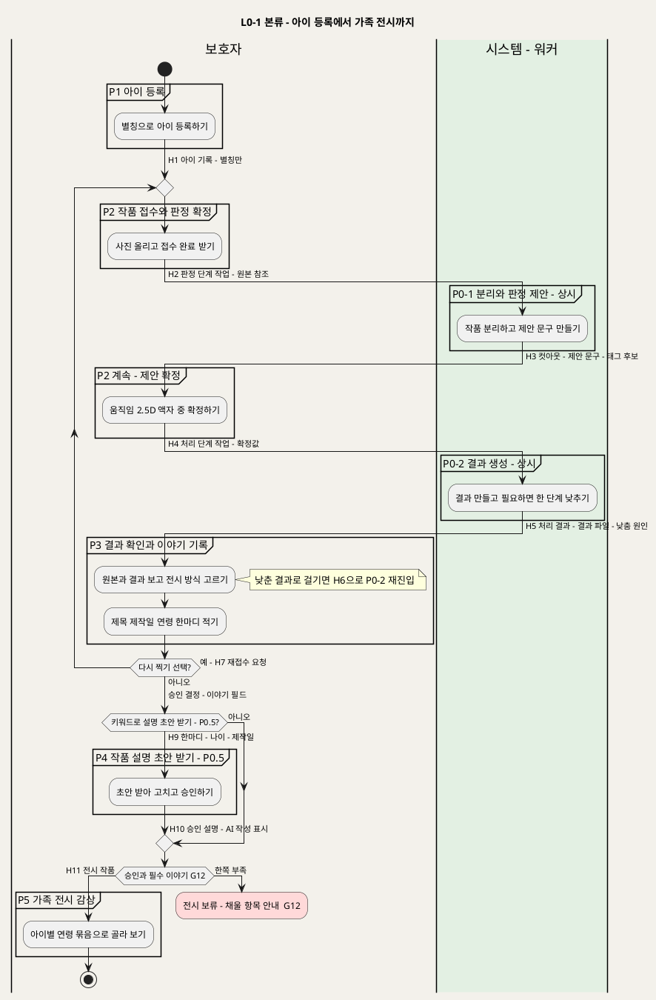

**[「L0-1 본류」 PlantUML 뷰어로 열기](https://plantuml.sumzip.com/plantuml/svg/eNqVVV1v2lgQffevGDUvyQNVCM2uEqS2203YrNSH_gW2IYkVChG46kOplA9nhQqVoMGNU2wEqluSiKwgdlOjZv-Q7_g_dO61zVe0K_UBgbl3Zs45c2b8uKikC8rLF1mpuCvn9tKF9Av4K_18d7uQf5nb_D2fzRdgLpVIxdefTNwo7qQ386_k3DZspbPFjKTISjYDTxdjcWC2yz7rEAPUVDQdYCcD1jHxtIaqAV5_HzsDwLaKFcMbVrG7L5WY7fi6i61aSRJgJKpBCeV8Du49i0_nuQevJYBVZqs4vELjlnWM6Qu-pntuPym9kWIPYWMUTf_RIaEKIlm3mpQKmb1MWqF0k_WWAFt1_32ZMNaxrOPZPvjVGrY18M80-goAEAQ87GFXBdR77EvPs9thAOCZyj5VgfWbAgfAG_pwLEtRIlY592yV18HTYy5Us0aiAfZd7IiI0tx6IrW4niiRSPjW8o8NcauK363SDFyh-I1KECaQYttArcxjjg4oxRhywCy4z4USqMVd1nO9rz0gXdiJNQM8Afj9G9execRzTgXEwD8yvG8u-E2V-ijQT_RzVlvijX-_G2eZ1bS5j90DbKmwdH95jXrXoSyAVj28GDV3jO0B4LVObO6IGgR4_fc_LSihvO579i2pZ6I6uCtjeBxqRRr6pM3HBoFjFw49GBEYdvgP3jRmEC9HiMM0seiHX62iyZ9FmMVtgab7_4omRsFE13QFatNB7ZaKhp6fEJfbjF-JCNhO4AA-jGTYC6yY1KE2--yEmAFyeSUDBXl7R1kNcOlhNB88b-DyGkR645dwFoV-2OKjga3jsHDbYJcXouXUHaKIp33WHnKlWLfMGg06OhipFEwlvNqRaaPMs4rFwWH_HWeEats_Mh8tgFyEedS5xTd-FeXC2fvYwOurBY6azjWVVcqoWwt8FeDbIQnEwfMJiU3IRN1jJ0ZSkrdg3j-0yBb0KPaKarHLY0CnLAwvBpoiny3eXyYIyk4mJ0AshI1dmSDEm6jzvRMb007O9O7BaNP8d51x80aHRIs3CYfB-Apad-civhgxDrPH4Lc_xXSQo_26QaImpQyt7imdMrlNeUsIEQQLZ5G5ubQjvf6IL0Xs2eU5q9doq38gw0Y6xOORpQJ-s7yXp98C9FSjARszFQub8VkObMJ6N2hWQ3959jkzA-uOCReV_F5IhlqAl__SiuMVOKK5VGptZW1lNXK57YRvpwHNLK0t7Up4UyuzQwc4N550V85mQzEe0xe9HX8A8kylTw==)** — 클릭 시 브라우저로 연결됩니다.

**읽는 법** — 보호자 레인과 시스템 레인을 오가는 화살표 레이블이 곧 인계 계약이다. P2는 두 번 들어온다(올리기, 확정). 사이에 P0-1이 돈다. P3에서 "다시 찍기"를 고르면 H7로 P2 처음으로 돌아간다. 전시로 가는 문은 G12 하나뿐이다. 설명 초안(P4)은 그 문 앞의 선택 경로이며 G12의 조건이 아니다.

### 2-2 병행 — 삭제, 운영, 모델 평가, API

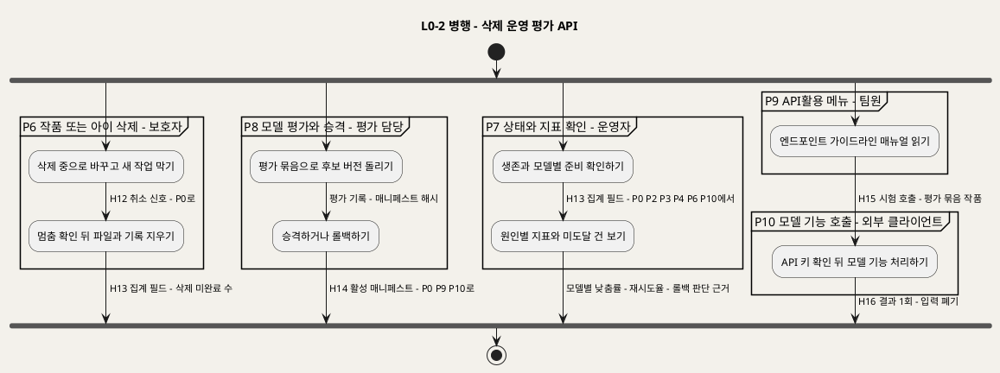

**[「L0-2 병행 프로세스」 PlantUML 뷰어로 열기](https://plantuml.sumzip.com/plantuml/svg/eNp9lN9uElEQxu95ikm9JiltrbZNTNXYaOIFr7BKW0kpNEDjhTGhdGv4p0CFstDdBiIVMKj82VCaoA-0M-cdnLMspaD1bndz5ptvfvOd3YxElXD0cD_giuz5gwdKWNmHV8rrvd1w6DDoexoKhMJwb2t5y_Psya0TkTeKL_TWH9yFHSUQ2XZF_dHANrxcdC8B9vPiLAluoPh3qupAFZO0IxDZpNWJwWPvC5fd0bUTCu-5AFiPi_2hICx4V4Eu8uI0AajlMFUAKqpkmBMhN0ubQhvSRW4B3nEpwPqkRz1P-ghrOmCnYP0eWv0q0HFCylHpBLCRtIadDbvE_Qiee5aArpr0IQOUrrIiS3sXuXp8Yh1bCRrUQZSLZAwBT_kxkyFjZPVHwDpYM4AaMap0HNH3Lkd2mb_nrb4KoqjiZ33KAH8OqaziF26Y0Dbs0UHZVfzBOQAPAb818ePQoUXlGFDq2uq1WMoBiGkT09c3ACZf2wMyMg4Dca4yKcCeSlUVMJvBr-3b8zs1ziiMtVHHdEJ80ihVFyluXjQpPYEx7i-KmtXtYFwDrNWx05Xvc8OvMDCd1O5fchIueNfA6xkzvnP6B7yzI3Gs22M3YiKvT3bgdlI0s_pjg2qm3MmYGTJ3qsfwWnWqph7vXI80tgTeZfCuAKePHVIpR-rN7Oc51rGFbTvSGK8Ssyqm22B1TZnIWQ5TLxj_wSnCy6p0f9FmolxHelMCtxlyqnKYboJ1NWK2_-GyJm-NhFtpAbYKmDRlHDIxtjelUSrwSCLbloMzdJkew-RPaIzsFPNSkiadjYCMX_Oru8_3QBclDeTtGui3wmbHyrmVG3O2PIuTtMokpS6n1VQe4iAG4si0u3Nb6enGK08DIj5zwWaFqKdxZP-RsVWweh25co-oZGyuJ1jlxtmcfXI76AP7txKJhg5cm_zK_7U_yCF01A==)** — 클릭 시 브라우저로 연결됩니다.

**읽는 법** — 네 갈래는 본류와 따로 돈다. 본류와 만나는 곳은 레이블에 적힌 인계물뿐이다. P6은 H12로 P0을 멈추고, P8은 H14로 P0·P9·P10이 쓸 모델 버전을 바꾸고, P7은 H13만 읽는다. P9 → P10(H15)은 P0부터 열린다(caption은 P0.5, D17).

---

## 3. P0 단계 작업 처리 (상시)

보호자 응대 밖에서 서빙 3종(CPU 비전 워커 · GPU 워커 · LLM 서버 중 앞의 둘)이 작업 DB·큐의 단계 작업을 점유해 처리한다. API 서버는 모델을 import하지 않고 어댑터와 작업 계약으로만 부른다(BR-MDL-02). 입력은 H2(판정 단계 작업) · H4(처리 단계 작업) · H6(낮춘 결과 요청) · H12(취소 신호)이고, 출력은 H3(판정 결과) · H5(처리 결과) · H13(집계 필드)다. 설명(M6) 단계는 동기 요청이라 P4에서 다룬다.

### 3-1 단계별 IPO

| # | 단계 | Input | Process | Output | 근거 |
|:--:|---|---|---|---|---|
| 0.1 | 판정 단계 작업 점유 | H2 판정 단계 작업(작품 ID · 단계 종류 · 원본 객체 참조) · 매니페스트 활성 버전 | CPU 비전 큐에서 한 워커만 점유하고 시도 횟수·시작 시각을 기록한다. 점유 만료 시 다른 워커가 이어받는다. 동시 처리 상한이면 거절하지 않고 대기한다. 활성 버전·라이선스 확인이 없는 모델은 부르지 않는다 | 점유된 판정 단계 작업 | UC2 BF4 · A8 · 시퀀스 "작업 할당" · BR-PRC-05 · BR-PRC-07 · BR-MDL-01 · BR-MDL-07 |
| 0.2 | 원본 읽기 | 원본 객체 참조 | 원본·결과 저장소에서 원본을 읽기 전용으로 가져온다 | 원본 이미지(워커 메모리) | UC2 BF4 "원본을 읽기만 하며" · UC3 BF3 · BR-INT-04 |
| 0.3 | 배경 분리(M1) | 원본 이미지 | M1으로 작품 마스크·컷아웃을 만든다. 품질 미달이면 분리 실패를 기록하고 제안을 "액자 권장"으로 둔다 | 작품 마스크 · 컷아웃 (또는 분리 실패 기록) | UC2 BF4 · E7 · BR-FBK-02 · BR-FBK-03 |
| 0.4 | 종류 판정·관절·기하 규칙(M2→M3→M4) | 컷아웃 | M2 제로샷으로 종류·태그를, M3로 관절 좌표를, M4로 팔다리 길이·좌우 대칭·몸통 비율을 판정한다. 엔진 사람 점수 단독으로 움직임을 제안하지 않는다. 얼굴 인식·학습 재사용에 쓰지 않는다 | 종류 후보 · 태그 후보 · 관절 좌표 · 기하 판정 · 점수(내부 기록) | UC2 BF5 · A5 · BR-SUG-01 · BR-SUG-04 · BR-PRV-02 |
| 0.5 | 제안 결정과 기록 | 0.3·0.4 결과 · 응답 분류 | 제안 규칙([추론] M2+M4 통과 → 움직임, 그 밖에 M1 성공 → 2.5D, M1 실패 → 액자)으로 문구를 만들고 점수는 내부 기록에만 둔다. 인프라 장애는 같은 단계를 최대 3회 시도하고, 소진되면 제안 없이 "확정 대기"로 두고 인프라 실패로만 센다(**G7**). 마스크·컷아웃을 저장소에 쓰고 상태를 "확정 대기"로 바꾼다 | **H3 판정 결과** · 상태 "확정 대기" | UC2 BF6 · E6 · BR-SUG-02 · BR-SUG-05 · BR-PRC-03 · D1 |
| 0.6 | 처리 단계 작업 점유 | H4 처리 단계 작업(확정값) 또는 H6 낮춘 결과 요청 · 원본·마스크·관절 참조 | 서빙군 큐(움직임 → CPU 비전 큐, 2.5D·3D → GPU 전용 큐)에서 점유한다. 이어받기·대기는 0.1과 같다. `삭제 중` 작품의 작업은 이어받지 않는다 | 점유된 처리 단계 작업 | UC3 BF3 · A6 · A7 · UC3 사전조건 (3)(4) · BR-PRC-05 · BR-PRC-07 · BR-DEL-05 |
| 0.7 | 확정값별 모델 실행 | 원본 · M1 마스크 · M3 관절(재사용) | 움직임: M3 리깅·렌더(시간 상한 10분) · 2.5D: M1 마스크 + M5 깊이(GPU가 없으면 CPU 비전 워커) · 3D(P1): M7 GLB · 액자: 모델 호출 없이 원본으로 합성 | 움직임 결과 / 2.5D 결과 / GLB / 액자 결과, 또는 quality_below | UC3 BF4 · A1 · A2 · A8 · A10 · UC4 A1 · BR-INT-05 · BR-PRC-01 · BR-PRC-06 · BR-SRV-01 · BR-SRV-02 · BR-SRV-03 · BR-MDL-02 · BR-MDL-06 |
| 0.8 | 응답 분류와 낮춤 | 어댑터 응답 | 응답을 작업 기록 분류로 1:1 옮긴다. 품질 미달이면 재시도하지 않고 낮춤 원인("움직임→2.5D" 등)을 기록한 뒤 한 단계 낮춘 단계 작업을 등록한다(마스크가 없으면 액자로 건너뜀). 결과 원인은 "모델 낮춤" | 낮춤 원인 · 낮춘 단계 작업 | UC3 A3 · A4 · A5 · A10 · UC3 §6.2 대응표 · UC4 E6(품질 미달 쪽) · BR-PRC-02 · BR-FBK-01 · BR-FBK-02 · BR-FBK-03 · BR-FBK-04 · BR-API-02 |
| 0.9 | 인프라 재시도 | 오류 분류(엔진 다운 · 시간 초과 · 저장소 · DB · 모델 미준비) | 낮춤으로 바꾸지 않고 간격을 늘려 같은 단계를 첫 시도 포함 최대 3회 시도한다. 소진되면 결과 단계는 "처리하지 못함" + 결과 미도달(**G9**). H6(낮춘 결과 요청)이 소진되면 처음 결과를 둔 채 "확인 대기"로 되돌리고 결과 미도달로 세지 않는다 | 오류 분류 · 시도 횟수 · (소진 시) 상태 "처리하지 못함" | UC3 E1~E5 · 예외 공통 규칙 · UC4 E6(인프라 쪽) · BR-PRC-03 · D1 |
| 0.10 | 결과 저장과 기록 | 결과 파일 · 응답 분류 | 처음 만든 결과만 저장소에 쓴다. 모델 ID·버전·상태·시도 횟수·처리 시간·분류를 갱신하고, 결과 종류와 결과 원인을 섞지 않고 남긴다. 기록이 안 된 결과는 "확인 대기"로 내보내지 않는다. 임시 파일을 지우고 상태를 "확인 대기"로 바꾼다 | **H5 처리 결과** · H13 집계 필드 | UC3 BF5 · E4 · BR-APR-03 · BR-PRC-04 · BR-PRC-08 · BR-MDL-01 |
| 0.11 | 취소 수신 | H12 취소 신호 | 결과를 쓰기 직전 작품이 `삭제 중`인지 다시 확인한다. 멈추고 결과를 쓰지 않으며 멈춤을 응답한다. 취소된 작업은 "취소"로 분류해 지표에서 뺀다 | 멈춤 확인 · 단계 작업 "취소" | UC3 E6 · UC7 A2 · 시퀀스 "취소 신호 · 결과 미생성" · BR-DEL-01 · BR-DEL-05 |
| 0.12 | 임시 파일 주기 정리 | 워커 비정상 종료로 남은 임시 파일 | 다음 정리 주기에 지운다 | 임시 파일 0 | UC3 E7 · BR-PRC-08 · spec FR-11 |

### 3-2 프로세스 다이어그램

**P0-1 분리와 판정 제안** — UC2 시퀀스 4~6의 `CPU 비전 워커` 부분

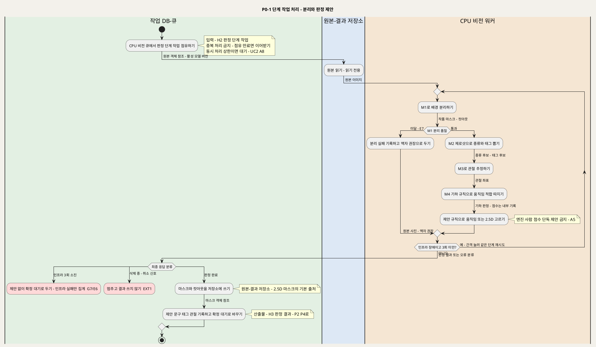

**[「P0-1 분리와 판정 제안」 PlantUML 뷰어로 열기](https://plantuml.sumzip.com/plantuml/svg/eNp1VU1TImcQvs-v6CovciBZYd0PrEp2VyC5WOUhW5UrUVRKFixgywsH1NGiZFJCAnFYBmrcYNAUqUz4ULZW84Pm7fkP6Z55R8S4N4bpfrr76efpeZUvJHKF9-_SSn47ldlJ5BLv4KfE2vZmLvs-s76cTWdzMBcPxxdib-5F5LcS69ndVGYTNhLpfFIppArpJKw-CS6AqFzYQxWwU8PTQ8CBLv7oQxDElUo_sFkCR6ui2QA0DWyUleJcLBx_EgsXZUL0TdDZqxYVty0lsrz6FsQnFU0V6G88raJq-AgPKplVNEynodsTa0nJZAtJyKU2twoKUMShMM-pie9Dj-ZySLcmhmO_XXtSxl6JEjxQED1N_K6JyxFge4S_jYTVoiqUJk6aWDH8NDzYcxoGhXCk0EoUQxhvl0Pw-oWSzKwDd6UEvwFsVcVwArbVxgFhWhM840inaaD6D4g_L8TPExADHnuJGIpGYy_ii0UvK2gPLHt4Q62VsHOOR1pRiUg8bN96JeUPSscPl0v3KnJvf09oNoaNL8aeRcPFexRjS8PP3aKSS-4kE8xcZGVBnBkgLMse3Mod-hQDMG6n5vxSJoLKeNx19njT-PkaGyq2DjgktQHzKwsyEygUe-UAFLaSGZinTkSFM2LPAxRK1WQYVrqOdkFbsMRZm8sNTcDGGXaqYF9pPLVx47ZVq8pOvF7kjPt97KncyP0UjkqSVGHeORoTf7LiSoiFSGB4cC1R8eOhONddpR4Y9jUt4rY2U8Z9D05LFcMRb82L8p6XJGyYkexRCc0y4FWdJDelzUXx333UnJrhZz3lmSkQ7GsDPzX9hlol7O1hh_ZjksAuQdQtWuEMmpcmxe3ptqyL4zqI_ZG4KkkuZR3Pel8qIvQqJ4a-WowCMS_OR3eVpq6KAJ7WmWZiW3Q0WZBtJU4OwS_g2-j1IrOfWU9tSGnB7laKDsY8tidOXRVtkjNttWGSPnnZYeeDBiyPnvZtAFJ5CtTLhGNbqj2g-Y91YXbpqYnt0tTKfbKiOFED3CZlNFRRKaPeDbD-JTPSO3JEesmbZNWd60tfPkW7qcLaFiGODdo9eagmKmOZFVDWEvmZQdzeyZZEDmtsLh6Pvoy-9DnH0yOakZzecK-QeyOmUnate8eI6wKiALBX4wnhu-dfx57xJrZT6bRfeP8vgub7xcnXF1SZMk1Hn9yvLi7LpEKm1r8ev7KEyCLHXBZiP_6w8ADYP9NNlU4fY0XuTM7euHM5ttXpLaIDzdBSMDNyefx4UdOu0KbYbd0VKxv5yqDD6t2Z6YGZOZpcxadW9Cf2uO_bUfpr5ob8n3Wrbv87eazbfYuqi_4NfzTCD9QThNUQrD4lAD7qnjroe5XdUV7RM31K_wOxi95x)** — 클릭 시 브라우저로 연결됩니다.

**P0-2 결과 생성과 낮춤 체인** — UC3 시퀀스 3~5와 UC4 A1의 2.5D 생성

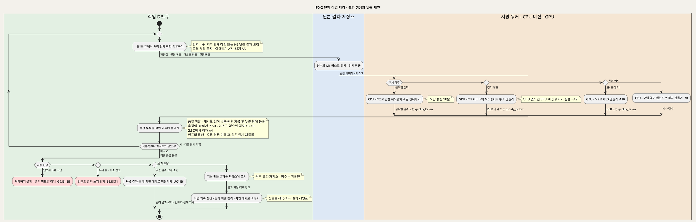

**[「P0-2 결과 생성과 낮춤 체인」 PlantUML 뷰어로 열기](https://plantuml.sumzip.com/plantuml/svg/eNqVVt9P21YUfvdfcSRe4CErIYSWRNoKJKEPQ-JhSHub0hEgIk1YElRNykNITZURV4SSFANxZKYwQpV2BgILKtsf5Hv8P-xcX9tJ2nTS3mzfc8_5vvPjO36ay8ez-e0XKSm3mUxvxbPxF_A8_vPmejaznV5dyKQyWRiLBWL-6PyARW4jvpp5mUyvw1o8lUtI-WQ-lYDlSd8UsErbvJEBmwd4tAt4rbI_OuAD89owbx4AX2koX_EnVvqIdy0y6KLWkwpj0UBsMhooOPci8z5rp1qQbHRSNrGViOclgBDKDXZ_bN4aQMd4VKV3N8ZngfUqNnSrrpo9I0w305l8ArLJ9Q3uBshql-nnhOvZ9Oj7TK2yvRo8mxFAVY_ASQ2vPwgfrQN2c-teN3tlvCiSR9S6-K7LjFOKDHOP6QtTivbzDF1LpFdtLPTo-xas4zrqddN4y--dVtlND9Do4ZnBb12Uca9l7XT6n8xuEfWy885ZFcYikeiTWLAgLvtckHoRm-f4WinYObPP-Pcl_6BX7W-Oyuc-oC7jyWVYAHPBaF32Z0_w8m6KwLFgdCZC9bILQvYKfmqR1cLyCrB7mZzRy-LyCkeQXINxN7u_77JzdQLyG4k0jONpES92sCkD0xX2pjZh5zXEffhgKcDOGh7lZgdLHcJn1btA6Tbvd507_RIPFjkEWGmYBgV8tWPVG-CfZHeybWOTc8M6-XKK_ct2PJXM__rT80Qq85J7TFBvc_AuXvN-jzIC7K5I-XfALgqwA5nF4yIsBUEYcw7CngwUdtgaCZY7waPX2Hhgl93BHIq8mkaR-LSsd79RqLkpl8fUN8HI_6UQiABhMY0dWPYPM3jMoS5-P9_HCTDnnwy70eyj_4jCyymapn6GzepQLdn7NnvTsylS_oQdJ0sRhfVQ0CdeTOdQcAyL8Umu2f03Wi94u2sHrHJLSZep09j5gzvR5JudaaQZgOpHehktDNZbGuMyUNezCtct3niVBtuXXfCubp1WSbccp2Cdyq5OOI3ODq_oQOiE126BiCNZduWGRtwrvkN5LgBzQfs6t3WVzjmbFn61nlWTmcYZnmNd52jVFpF2uA-CM41j1Ip9jet4-DxBEiILLzeSJOXjQ2xYSe0ngjcjK7WxrtLn7yYgmaPKq2VOp9JCTRkW0gnunAzqMquUCd6ExMt62yAhgKFKhSXeps6JpVRJFz2Z8IgGrBMFSNfwQub9NRaLRWYjsyEhwaQEXKnY-09Wvd1fObyU-zKvJl4ccGCwOPso6vdFg7z8m8lUSvp8SLD0AfUGF3ie07_aFJHmT7fU3mBUdlnGu5p5o3u74dDgALC-Z_dxdOZR9Mcf_F-NMmqxDJDjrHg6XRoHNcAr2V4Z1Hhip9jqUlXZvsI1kQddWZimwAMq3uxHaOjuhvIah0RFaTuNEpbEGLsB7aQNIrFn1GVrT5a7Z-ypOvxypELwlcXEUdCGLqtcTkR48i5QO7aWoiBBNA2N_hEGdl5oaJ7p_IpKY0-qTA3qXqP2ET8eX-bLqJn_9EZBLRl412CdB_5bEPT2ukDjg2W-jyQhQLl8Zkt6Ss_04_Qvvi61cw==)** — 클릭 시 브라우저로 연결됩니다.

### 3-3 설계 주의

**품질 미달과 인프라 장애를 한 루프 안에서 다르게 다뤄야 한다.** 도면의 루프는 하나지만 도는 이유가 둘이다. 품질 미달은 *다음 단계*(낮춘 단계 작업)로 돌고, 인프라 장애는 *같은 단계*로 돈다. 이 둘을 섞으면 "움직임 엔진이 다운돼서 액자로 걸렸다" 같은 거짓 낮춤이 생기고, 모델별 낮춤률(P7)이 오염되고, 보호자에게 "움직임이 어려워 액자로 바꿨어요"라는 틀린 문구가 나간다. SD_03은 단계 작업에 `낮춤 원인`과 `오류 분류`를 배타 컬럼으로, SD_04는 어댑터 응답의 `quality_below`를 오류 코드가 아닌 정상 응답으로 두어야 한다(UC3 §6.2).

**소진의 의미가 단계마다 다르다.** 판정 단계 소진은 작품을 끝내지 않고 "확정 대기"로 둔다(G7, D1). 결과 단계 소진만 "처리하지 못함 = 결과 미도달"이다(G9). 낮춘 결과 요청(H6) 소진은 이미 결과가 한 번 도달했으므로 미도달로 세지 않는다(UC4 E6). 이 세 경우를 한 상태 전이로 뭉치면 결과 미도달 수(목표 0)가 부풀거나 빠진다.

---

## 4. P1 가입과 아이 등록

### 4-1 단계별 IPO

| # | 단계 | Input | Process | Output | 근거 |
|:--:|---|---|---|---|---|
| 1.0 | 이메일 가입 | 이메일 · 비밀번호 | 서비스 전체에서 이메일 중복을 검사하고(대소문자 무시, **G26**) 계정(이메일·비밀번호 해시·확인 전)과 가족 공간 1개를 한 번에 저장한다(**G3**). 이미 가입된 주소면 계정을 만들지 않고 안내 메일만 보내며, 화면 응답은 새 가입과 같다(202, 가입 여부 비노출). 새 계정이면 확인 메일을 보내고, 링크 토큰이 유효하면(**G27**) "이메일 확인됨"으로 바꾸고 세션을 발급한다. 가입·재발송은 이메일별·IP별 요청 한도를 따른다. 실명·전화번호는 받지 않는다 | 세션 · 가족 공간 | UC13 BF1~6 · A1~A3 · E1~E8 · BR-ACC-06 · BR-ACC-07 · BR-ACC-08 · D18 |
| 1.1 | 아이 관리 열기 | 세션 | INC1로 로그인과 가족 공간을 확인하고(**G0**) 가족 ID는 세션에서 정한다. 이 가족의 아이 목록만 조회한다 | 별칭 목록 | UC1 BF1 · E4 · BR-ACC-01 · BR-ACC-02 |
| 1.2 | 등록 양식 제공 | "아이 추가" | 별칭 입력란 하나만 있는 양식을 보인다. 실명·생년월일·출생연도 입력란이 없다 | 별칭 양식 | UC1 BF2 · BR-CHD-01 |
| 1.3 | 별칭 입력·화면 검사 | 별칭 | 빈 값을 화면에서 먼저 막는다 | 별칭 | UC1 BF3 · E2 · A1(수정) · A2(추가 등록) |
| 1.4 | 서버 검사와 저장 | 별칭 · 세션의 가족 ID | 형식을 검사하고(**G4**, 별칭 중복은 검사하지 않음 — D18), 다른 가족 아이 ID면 존재를 숨기고 거절한다. 아이 ID를 발급하고 별칭과 가족 연결만 저장한다(**G3**). 같은 가족 안 같은 별칭이면 저장 뒤 안내한다(A5). 법정대리인 확인은 완료로 두지 않는다. 로그에는 요청 번호·분류 코드만 | **H1 아이 기록** | UC1 BF4 · A5 · E3 · E5 · BR-CHD-02(개정) · BR-PRV-01 · BR-PRV-03 |
| 1.5 | 목록 갱신 | H1 | 새 아이를 목록과 P2 아이 선택지에 반영한다. UC2에서 왔으면 UC2로 돌아간다 | 갱신된 목록 | UC1 BF5 · A3 · A4(공동 보호자도 같은 권한, U1 확정) |

### 4-2 프로세스 다이어그램

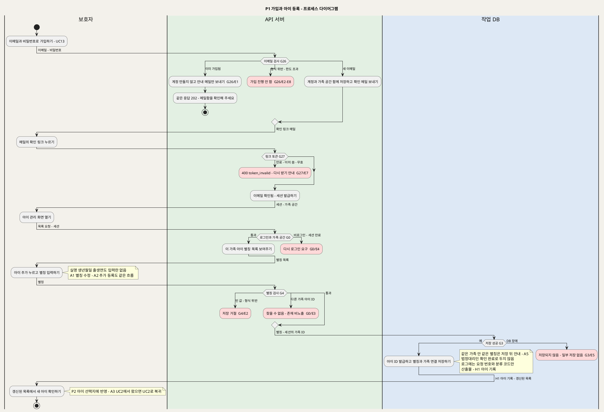

**[「P1 가입과 아이 등록」 PlantUML 뷰어로 열기](https://plantuml.sumzip.com/plantuml/svg/eNqFVk1PG0kQvc-vKIlLOCD8AZvESKtAbLPcuOx55QUDFo4dYWdz4WDIgBxsaU2w43EyYxkFAkSOMhhDjMLuD5qu-Q9bNdNtBoOyJ8R018d79V61nxWKqY3iqxdZrbCeyb1MbaRewJ-ppfXVjfyr3PLzfDa_AWPJaDKcmAvcKKyllvOvM7lVWEllC2mtmClm07AYBscuYXvHubgBbOho9UEcnItDCybArevi0ER9gHtHICpHdIjv-873gWifapviou8aA2zXNjWvIS1G5-KsjtYNJxPXurBLolemS5RFlnEbhjOwKffvz8PRGW3iVxgG0cdgzIy2OZaIJkOJ6Obs4gKgboqeTqVeZ4pLa_DoNszplXC7C_ORX8a1pVQh7Z99G8iKonY6rgHEnAsdOw0QJ1VxcIQnJUK751x06E9ZbBNoLxmdAuGiD9wl55xMhGe8cLuFFgVZ-6JyCZFQhNv1YtzGKVo6uK0GWgO30Qf8dMOcfahzYKGYfynbco0GVixAk0AaTG_DFH_rgP0y8cU9jiWT8afxpzG_ccAT3X3_lhukq6eym8hE4gnnXc9kswrum_ItiwGsPAVOdXgOzsWlY-ucxvlhAHYo_zGPgvD7fUsst-BntHRu2Sebp6RunWy5W115eeaOBmL-R7SM0ctlXRz7KR-caGYFHsmr7m7H3bIJ6ONxKK6lc3xQFZ-qRJacKdZLTHy37344DVI2FQpBMb-ezv2Ryf2VymaW-RYptmKCsD_yMOWcOflk4vGQQkKZWQlIVzZPquGiNMYdgzKYzuCtL11fs_73ibv0jvAh3eT0S-IzQWvVxRlpo9lXScSXM7YZ6QR7X4fFfkbSoUneo-buD3Y-pAhzdy-lmmJedf-acjbp4vqrqkzNYrNLavXHnWUtsQNVmQAB3hSCfCtuh3cJhnPZJXpDk4mpEXYZbLDyw0ThVZ26VXIhZcoY9nDnWLGfyxfTsJFZXStSDawciS9klDeW2NHxozc_vDLpf2zanre8WNEm4zZ30apSzGx4mLhs8EaYgNnIsLi3-jhS-t21auKzzjiAK99C-Z_1JEuo3TSlVpO4LlPqd-z-4DYIUuu7E5xzGztlInSKTD_ieGJfHA9GhrsQv5PF_pe3EmGU0Hmah31sd70tuzMgnvxpRUeSKwXd8b_EoxTBLpfVF-JMRTyeeJKc3sT2PjZ3ID7nK1ZCQf2cdArzUSVSNMq-QlXnAYsNBx9QOU3T6dmBvcVKALijBVAjG7JSVl_8fN769hsS747UPqDpT3vRotcgNYgqu5UFLZcYtnSSPj9gYr8mnw1fSKDU36yJvbrysf94YYuqXpGQif1_6uLAJAd5IbhtE_Giy6_db2E1OsJDsqMLQ535bozPkYKPsdG5rw9RM2678fbjjbgaApQjJ8onE9P33Tha2dtk51jpiJr5sEdHjwk0SR68p8fPpN6_UZvGYDGi7qDeccmbJyUKp5EbaGzxAKL0ayCiMrbqaN7wqqRvHu204b6XNO8dfUYI6HfPf4Y0sQ0=)** — 클릭 시 브라우저로 연결됩니다.

### 4-3 설계 주의

**가족 ID를 요청 본문에서 받으면 G0가 무너진다.** UC1 특별 요구사항은 "가족 ID는 요청 본문이 아니라 로그인 세션에서 정한다"([추론])고 적었다. 도면의 첫 흐름 레이블이 "목록 요청 - 세션"인 이유다. 또 별칭은 자유 입력이라 로그·지표 라벨에 남으면 안 된다(BR-PRV-01). 별칭은 P4 설명 생성 입력에도 넘어가지 않으므로 H1은 P4로 가는 흐름이 없다.

**이용자 중복의 최종 판정은 이메일 유일 제약이다(D18).** 두 사람이 거의 동시에 같은 이메일로 가입하면 화면 검사로는 막을 수 없다. 그래서 SD_03은 이메일을 소문자로 정규화한 값에 UNIQUE 제약을 건다. 계정과 가족 공간은 한 트랜잭션으로 만든다. 계정만 있고 가족 공간이 없으면 G0에서 막힌다. 반대로 별칭에는 UNIQUE 제약을 두지 않는다(BR-CHD-02 개정).

### 4-4 로그인 정보 찾기 (UC14 · 잊었을 때만)

본류가 아니라 잊었을 때만 끼어드는 흐름이라 P1 안의 곁가지로 두었다. 가입 여부를 드러내지 않는 것이 이 흐름의 핵심이다(BR-ACC-08).

| # | 단계 | Input | Process | Output | 근거 |
|:--:|---|---|---|---|---|
| 1.R1 | 찾기 요청 | 이메일 | 형식을 검사하고 이메일별·IP별 요청 한도를 확인한다(넘으면 메일 없이 같은 응답). 확인된 계정이 있으면 1회용 재설정 토큰(해시)을 만들고 이전 토큰을 무효로 한다. 확인 전 계정이면 확인 메일을 다시 보낸다 | 재설정 토큰 | UC14 BF1~2 · A1 · A2 · E1 · E6 · BR-ACC-08 |
| 1.R2 | 메일 발송 | 재설정 토큰 | 계정이 있을 때만 로그인 아이디(이메일)와 링크를 보낸다. 화면 응답은 계정 유무와 관계없이 같다 | 찾기 메일 | UC14 BF3 · A1 · E4 · BR-ACC-08 · BR-PRV-01 |
| 1.R3 | 비밀번호 재설정 | 토큰 · 새 비밀번호 | 토큰이 유효하면(**G27**) 비밀번호 해시와 `password_changed_at`을 바꾸고 토큰을 쓴 것으로 표시한다. 그보다 먼저 만든 세션은 현재 세션을 포함해 모두 무효다(이제민 결정 ⑥) | 새 비밀번호 | UC14 BF4~6 · E2 · E3 · E5 · BR-ACC-07 · BR-ACC-08 |

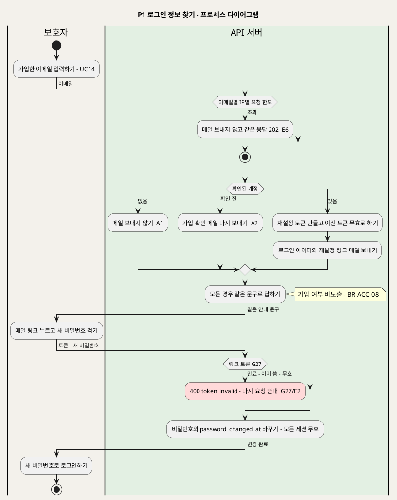

**[「P1 로그인 정보 찾기」 PlantUML 뷰어로 열기](https://plantuml.sumzip.com/plantuml/svg/eNp9VN9L21AUfs9fccAXfShrq2yzhaHWdvgmgz1L1sY2NCbSxPnSh3a7SrHCHCbTSls6VtGNjoU2ugycf1Duzf-wk-Sm_hjbSyA33znfd77v3CzphlgzdrYUQa_K6rZYE7fgjVislmvajlrKaYpWg5nCfCGVX7mH0CtiSduV1TJsioouCYZsKBKsp4B-7no_XdZzgQ0sOnGA2beea0MCfJPgR0ZcdjAE2h6ynsM-OQim_UuhjlD_1GX9o7oQChIynt1g_T3f6gIi6VeT9W4AD-jg3LdOo5avc6mFrJB4cYfICvWZ_HwhmZ-vL6-vASNdOiZ1Qd6E2SmGTgisrQdPdmay8XdADvqBzIFRkVTEOS1vcjMnAGQ4K2qj7xx20QBmHXiTAXh2h_XwrfeRtq8gnUwD5J9msUI3tG1BUkvypqDvykaxArN-x0I36FEXvAlBT-aEoqhLSHOyz3qH_6bBAWE5leXoqAt6SsKKyBvgp3E9etru8jZRfTquZ_1WzMb6I0aGqAT8_YHftIFeHNLjYTBXEMmATM9Hjn92iZlBZHg21HqXr0UCS02TdVDxtCm9aPrNETyYKSxGWyJPhAz9dkmP0cbxb3Zmx27SketdjQI6NDVmVDVDgppcrhgZ4EOzkxG9RvgvQvdcdt3FPVh5lVjO5RLJ58EuxOFYLWTmXbMPFmxqOJfaIvTcCed_3wr72g06biEa_W6GMrAtNyXxF-g_K8cJeOnL9LN4xwLLvxwGzdDBH8hjNvAlMjwIaaZQWF1cXcwsJJNgaFVJ3ZDVt6IilwJUFDPfXT5m0PxJPh1EVJUVhe9g5r7OIKZtUdd3tVppo1gR1bJU2hANoLbp3brRheLBBJd075TrCaenkwamBaxDUPcjNx8bEkYYr0kcZHgzllAW_mn-AMUEWM8=)** — 클릭 시 브라우저로 연결됩니다.

### 4-5 공동 보호자 초대·나가기·해제 (UC15 · U1 확정)

가족 공간을 여러 보호자가 같은 권한으로 쓴다. 차이는 해제 하나다(G29). 초대 수락은 초대받은 이메일로만 된다(G28).

| # | 단계 | Input | Process | Output | 근거 |
|:--:|---|---|---|---|---|
| 1.I1 | 초대 | 초대할 이메일 · 세션 | INC1(G0) 뒤 요청자가 만든 보호자이고 공동 보호자 자리(1명)가 비어 있는지 확인하고(**G29**, 부모 두 명까지), 초대 메일 요청 한도(예시: 같은 가족 하루 20건, 같은 이메일 하루 3건 [추론 — 확정 아님, U19])를 확인하고 1회용 초대 토큰(해시)을 만든다. 대기 중 초대는 `GET /v1/family/invites`로 본다. 같은 이메일의 이전 초대는 무효. 이미 이 가족 보호자면 만들지 않는다. 응답은 항상 202 | 초대 메일 | UC15 BF1~3 · A1 · A2 · E6~E8 · BR-ACC-08 · BR-ACC-09 |
| 1.I2 | 수락 | 초대 토큰 · 로그인 세션(없으면 UC13 A4로 가입) | 토큰 유효·이메일 일치·다른 가족 미소속을 확인하고(**G28**) 공동 보호자로 연결한다 | 공동 보호자 연결 | UC15 BF4~6 · A4 · E1~E3 · BR-ACC-09 |
| 1.I3 | 해제 | 대상 보호자 · 세션 | 요청자가 만든 보호자인지 확인하고(**G29**) 대상의 가족 연결을 끊고 그 계정의 세션을 즉시 모두 지운다(가족 소속은 요청마다 DB 확인). 올린 자료는 남는다 | 해제됨 | UC15 A3 · E4 · BR-ACC-09 |
| 1.I4 | 나가기 | 세션 | 만든 보호자가 아니면 가족 연결을 끊고 그 계정의 세션을 즉시 모두 지운다. 만든 보호자는 거절. 다시 로그인하면 P0 기본값 [추론]: 가족이 없는 계정은 새 가족 공간을 자동으로 만들지 않고, "받은 초대를 기다리거나 새 가족 공간을 만들 수 있어요" 화면에서 보호자가 고른다(U20) | 나감 | UC15 A5 · A6 · E5 · BR-ACC-09 |

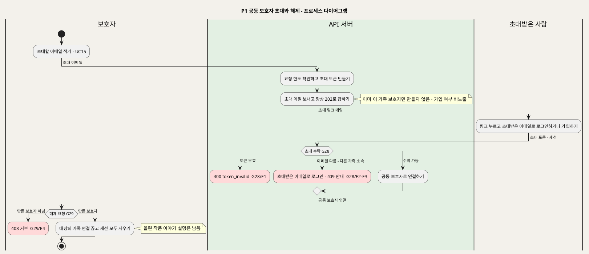

**[「P1 공동 보호자 초대와 해제」 PlantUML 뷰어로 열기](https://plantuml.sumzip.com/plantuml/svg/eNqNVF1P2mAUvu-vOIk3ekHkwyUDksVNwezOm10vnVRpqK2BOm-4oFgMQRbnZmd1lGCCggazqtV1iftDnLf_Ye9bWkCXJbtq05zzfJ1zulhS-aK6vSlxpYIob_FFfhM-8GuFjaKyLeeWFEkpwkw2kY1l3kxVlPJ8TtkR5Q1Y56WSwKmiKgmwGoPh3T0enADeOZ7pkvZnIE4dmxVyUgHPcEinBRHwjnQ8axHdJY0u4H6XWA755gx_utjuc-Vxa5nzpXGpEYRndIBW4uURsR6BdLSha1Owd0uxF2ku8iogmpSkufJMJpGNZhLl16tvgegtvNXLFO30iNxeUzUtPNDBOzGI5XqGObzrhBDeXsfTbMBeE792KUs6lAABOZWIVYd1eMY12dUgHo1TR9TLPUNiHbKiClAUN_Jqypf0w2UPGNoVcnYziQcvnYCH9Kh2o0GsJjXFyto1IMcDfKCsv3SsueShNWUTe5qnDWBsdfQZ7e_EojjVAbab1GtYVdfx3Jk4DMvCqHztZy06gSCLGxurZqAidDThDvKJABthzfxH0KUdUV3Lw2w4l7qJ1m9Yib-c49b4kgCzYcwDxzvtz3FA1yy7nFxOphaiUVCVgiC_F-WPvCTmgLXNZ2JpWlQQJSkAmGwDXSK80Kki9nLuhjGTvSbZ-zQN_R_-KcpCNElnUaczDpjjkUziOfnID2XCxjmjSD1ffYZKju3hrR1GKMi5USoszL8vxa9NP7kAcZ3mNLqbYG9X4sk5UPOCDLP-4nSmEQwd982nUSaATZNuEeuczyyMbQgSs_Ecw3fCDnZXI5Y5DtKXBqg1_CXyxw541cdDStqrkFPb9wfwZO3NAV7YQNqH3pc6C5sYj-xmid7FqxobAFb7dN9ZLOI6PXZli1uk7_Rf9Ae0KWvy)** — 클릭 시 브라우저로 연결됩니다.

---

### 4-x 카카오 로그인 (2026-09-30, 이제민 결정 D36)

P1의 가입(1.0)·확인(1.R1)·찾기(1.R2·1.R3)는 **카카오 로그인**으로 바뀐다: [카카오로 시작하기] → 카카오 인증 → 콜백에서 회원번호로 계정 찾기(없으면 가족 공간 + 만든 보호자, 한 트랜잭션) → 세션 → 처음이면 S1 아이 등록, 다시 오면 마지막 전시실. 메일 발송·확인 토큰 단계가 없다. 초대(1.I1·1.I2)는 초대 링크 복사 → 받은 사람이 링크에서 카카오 로그인 → 그 가족의 공동 보호자(G28·G29 그대로). 기존 이메일 흐름은 기존 계정·팀원용으로 남는다(메일 발송은 설정으로 꺼짐). 근거 research R-26, UC13 §0 · UC15 §0.

## 5. P2 작품 접수와 판정 제안 확정

### 5-1 단계별 IPO

| # | 단계 | Input | Process | Output | 근거 |
|:--:|---|---|---|---|---|
| 2.1 | 올리기 열기 | 세션 · H1 · (재접수면) H7 | INC1(**G0**) 뒤 아이 목록을 보인다. 아이가 없으면 P1로 안내한다. 다시 찍기로 왔으면 이전 작품의 아이를 미리 고른다 | 아이 목록 | UC2 BF1 · E8 · E9 · A7 · UC1 A3 · BR-APR-03 |
| 2.2 | 아이·사진 선택과 검사 | 아이 ID · 사진 파일 · (선택) 자르기 사각형 | 형식(JPEG·PNG·HEIC)·용량(20MB)·판독을 검사하고(**G5**) 미리보기를 보인다. 보호자가 사각형을 작품에 맞췄으면 **브라우저가 그 영역만 새 이미지로 만든다**(D32) — 그 이미지가 올릴 사진(원본)이 된다. 사각형을 바꾸지 않았거나 브라우저가 사진을 열지 못하면 고른 파일 그대로 | 미리보기 · 사진(자른 경우 자른 이미지) | UC2 BF2 · A10 · E1~E3 · BR-INT-01·04 · D32 |
| 2.3 | 내구 접수 | 사진 · 요청 번호 · 아이 ID | API 서버가 재검사·가족 확인 뒤 요청 번호 중복을 확인한다(같으면 기존 작품 반환). 원본을 변형 없이 저장하고 작품 기록·작업 기록을 함께 저장한다(**G6**). 판정 단계 작업을 CPU 비전 큐에 등록하고 202를 돌려준다 | **H2 판정 단계 작업** · 202 "접수 완료" · 상태 "판정 중" | UC2 BF3 · BF4(등록) · A6 · E4 · E5 · BR-INT-02 · BR-INT-03 · BR-INT-04 · BR-SRV-01 |
| 2.4 | 판정 대기 | 202 응답 | 보호자는 머물거나 떠난다. 판정은 P0-1에서 계속된다. 상한이면 "판정 중(대기)"로 보인다 | 진행 표시 | UC2 BF4·5(액터 행위) · A2 · A8 · BR-PRC-05 · BR-PRC-07 |
| 2.5 | 제안 보기 | **H3 판정 결과** | `GET /v1/artworks/{id}`로 컷아웃·제안 문구·선택지 3종을 보인다. 점수는 보이지 않는다. 제안 전이면 제안 없이 선택지를 보이고(제안값 "제안 전"), 판정 소진이면 "직접 골라 주세요"를 보인다(G7 해제 지점). 분리 실패면 원본과 "액자 권장"을 보인다 | 컷아웃 · 제안 문구 · 선택지 | UC2 BF6 · A2 · A3 · E6 · E7 · BR-SUG-02 · BR-SUG-05 |
| 2.6 | 확정 | 확정값(`animated`/`relief`/`frame`, P1 `sculpture`) | 확정할 수 있는 상태인지 검사한다(**G8**). 제안과 달라도 막지 않고 제안값·확정값·수정 여부를 기록한다(판정 수정률 원천). 3D는 노출 설정이 켜진 뒤에만 선택지에 있다(**G17**). 중복 확정은 첫 확정값 유지 | 확정값 · 수정 여부 | UC2 BF7 · A1 · A6 · A9 · E10 · BR-INT-05 · BR-SUG-03 · BR-SRV-02 · BR-DEL-05 · BR-OPS-02 · D10 · D14 |
| 2.7 | 처리 단계 작업 등록 | 확정값 | 확정 경로의 처리 단계 작업을 등록한다. 움직임 → CPU 비전 큐, 2.5D → GPU 전용 큐(없으면 CPU), 액자 → 모델 호출 없음(원인 "보호자 선택"). 상태 "처리 중" | **H4 처리 단계 작업** · 상태 "처리 중" | UC2 BF8 · A4 · BR-PRC-01 · BR-FBK-04 · BR-SRV-02 |

### 5-2 프로세스 다이어그램

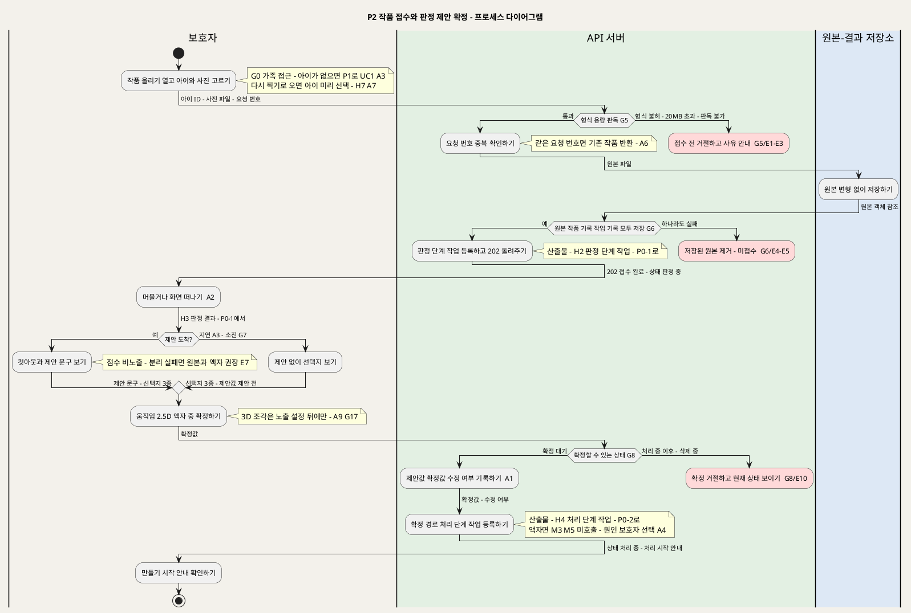

**[「P2 작품 접수와 판정 제안 확정」 PlantUML 뷰어로 열기](https://plantuml.sumzip.com/plantuml/svg/eNp9VttSIlcUfe-v2FW-ZB7IcJHxQlUyzHBxHqzyJR9AIiolA1PKVF54QG2tztAp0ZGhjUAgw0RNMZUWUDsV80N9dv9D9j7djWDMPJ5mX9ZZa-19eL5dymyV3r7OK9ubucKbzFbmNXyf-WFzfav4trD6spgvbsFMKpIKJV9MRGxvZFaLP-YK67CWyW9nlVKulM_CShiwfeQca4CdI9QMPK2Ao9ewU6cPTaxr4JzW-RQA50QV3SaqFr7rgaj2sDXCDyP71hLtC6UshiPHsLBdKysSnrLo1zX64ve-bZmAjZE97ADWVU6lRrjbx3MV6KP4NKKImFIolrKwlVvfKCkA6SDYZgW7V4zNvr0jDG4ufaViB9i8E5cjWAkRLPjuZQjiEcpiZNUmoPkzVeRf0OhxmJsK4k-L4ACqHWevRRWX5iA-p2QLq8C9lcA3fuCrBPdzETq6ji3Z_5cTHHwGMdDosjGlPJOMpILJSDm-8opKNsVALSu5NfjKMepYbVH4pfj1JyZUHO5DOvoEShvZAv18cG0P754Q2sWpioC9IzG8lpy3LKduSFIA7mlZJEpOsVWZRsL3o1Dsjnw1hWk4pwYhjj9TsiT3GJK40ZyGRj-Eg8svAEcaAWFxXYj0K5HLwGZSqcRCYmHRtQUpQDpdmdjRGBWrSMw0WUxN7I5Iq-jTZCiQjDDazVw-z4zm1iSdZzUxtDwKmbJEIjmfipbd7wF7YDIC7FSw_QkP9DIZx80QwwphlkKTHG6AT8l9Xdts4YB-Ni3sml9QxAv36JHWaPEJG_v-SfxxIY5qXidIP_PVQkOTUnlzIaoX9lD1c8X7K8r1SAkHwyAOddHp4ce7R7TDXRNvmqLPjC-F4dGCAVgJBtjSvm51Q-waonUnDimm2nP0i2l9GK2oNX1CaGxJKCpDTvfEo7s8Tc4GktH_qsOIfYlPVfFRZ5Pv7Th7zfEa6B3FpsZ7UVxYdAVqQrjIqifsPvGhQyeecoiHpT5LEb-CJ7F7MWzUSJaYq4m7YehiaF5--5Bu_PuWR_Fsz_WHG9q37Os-WWP0GLudGt9D_KWKfYt4Zg5uVDntkja5BSRJsmK9S9cB-0ZntZNzVIxdNdUn4O0JPK9ABH_bj3ma0BkbJu0bjjjQeUWk51zQbr5v2nH2PWJuMlWUa8gs2zz2-9O4xTyRaBwqeL6DbRXCX0cTPm6SxVvN_kxMUhGhuK5pmzu8Kjw2UO1Jtx33SANxzkrHFyAdmmO13FKE4EtLzWtHU892aWvi3YlvlvT8eLe574XQK4RqghO-3bgLV5DmavTFTcUbQPciZKCQx9N9eGA6ISbH0W1kD_6RW35gsNL_N5wP3UIHmB7H2cdLSNeGeRxlhiSfjbQcgeUozxiPhfQaWYuWNownxX9j4rOUOn5gPAO5rVhE8olzpsq35jMxxd8m59u_5eTudQwV232femrIbyIzl56nLRx8ZAe7kRNdA-NDtUk39fb4w0E_18X7nny6J6MePE_bpeIb5Tn1on8k_wJryX1q)** — 클릭 시 브라우저로 연결됩니다.

### 5-3 설계 주의

**G6(내구 접수)이 202보다 먼저다.** 원본·작품 기록·작업 기록 셋 중 하나라도 실패하면 먼저 저장된 원본까지 지워야 한다(UC2 E5). 순서를 바꿔 202를 먼저 돌려주면 목록에 없는 "접수 완료" 작품이 생기고, 그 원본은 삭제 절차(P6)가 찾을 수 없는 아동 이미지가 된다. SD_03은 원본 저장과 두 기록 저장을 하나의 보상 단위로, SD_04는 202 응답을 트랜잭션 커밋 뒤에 두어야 한다.

**확정은 제안을 기다리지 않는다.** 판정이 늦거나 소진돼도(A3·E6) 보호자는 확정할 수 있어야 한다. 이때 판정 단계 작업은 취소하지 않고 끝까지 돌려 M1 마스크·M3 관절을 P0-2가 재사용하게 한다(UC2 A3 [추론]). 제안 전 확정은 판정 수정률 분모에서 뺀다(D14).

---

### 5-x 올리기 한 번에 걸기 · 올리기 전 손보기 · 움직임 질문 (2026-09-30, D34 · D35 · D46 · D49)

| 단계 | 이름 | 입력 | 처리 | 출력 · 게이트 |
|---|---|---|---|---|
| 2.2a | 올리기 전 손보기(브라우저) | 사진 파일 | 종이 찾기(`detectPaper`) → 찾으면 네 모서리로 펴기(`warpQuad`), 보호자가 [모서리 고치기 · 돌리기](네 모서리 · 90°) 또는 [사진 전체 쓰기]. 촬영일(EXIF 날짜만)을 그린 날에 미리 채움 | 편 이미지(JPEG). 잘린 부분 · 위치 정보는 보내지 않음 |
| 2.2b | 설명 칸(브라우저) | 종류 · 제목 · 그린 날 · 나이 · 한마디 · 부모 감상 | 모두 선택. 화면이 미래 날짜 · 나이 범위를 먼저 검사 | 올리기 요청의 칸 |
| 2.3 | 접수 + 걸기(API, 한 트랜잭션) | 사진 · `making` · 이야기 칸 · `capturedOn` | 원본 저장 → 작품 · 작업 기록 → 원본 액자 결과를 만들어 `hung_result_id` → 비운 이야기 칸 자동 값 | 202. 칸 오류 422(G5) · 미래 날짜 422(G11) |
| 2.4 | 판정(워커, 뒤에서) | 작품 | M1 분리 · M2 제안 → `judgment.suggestion` | 걸린 채 확정 대기 |
| 2.5 | 움직임 질문(브라우저) | 작품 상세(`suggestion` · `choices` · `confirmedKind` · `making`) | 판정 제안 animated · 선택지 열림 · 미확정 · 그림이면 [예] · [아니오]. 판정 전이면 3초마다 최대 30초 | [예] → 2.6 · [아니오] → 이 기기에 기억, 끝 |
| 2.6 | 확정(API) | `POST …/confirm {kind: animated}` | 처음 확정 한 번만(두 번째 다른 값 409 G8). 움직임 렌더 작업 등록 | 처리 중 → 확인 대기 → UC4 [좋아요]면 `hung_result_id`를 움직임 결과로 바꿈 |

## 6. P3 진행 확인·결과 결정·이야기 기록

### 6-1 단계별 IPO

| # | 단계 | Input | Process | Output | 근거 |
|:--:|---|---|---|---|---|
| 3.1 | 작품 목록 열기 | 세션 | INC1(**G0**) 뒤 가족 작품만 상태·현재 단계와 함께 보인다. 확정 전 작품은 P2 확정 화면으로 안내한다 | 작품별 상태 목록 | UC3 BF1 · A9 · A11 · BR-ACC-01 |
| 3.2 | 진행 상세 보기 | 작품 ID · H5(진행 중이면 단계 작업 기록) | 단계별 진행(분리 완료 · 판정 완료 · 움직임 렌더 대기 등)과 낮춤 여부·원인을 보인다. 재시도 중이면 "다시 시도하는 중", 소진이면 "처리하지 못했어요"와 액자로 걸기를 보인다. 점수는 보이지 않는다 | 단계별 진행 · 낮춤 문구 | UC3 BF2 · BF6 · A6 · E1~E5(표시) · BR-FBK-03 |
| 3.3 | 확인 대기 작품 열기 | **H5 처리 결과** | 상태·결과 종류·낮춤 원인을 읽고, 저장소에서 원본과 결과 미리보기를 읽는다(**G10**). 삭제 중이면 결정을 받지 않는다 | 원본 · 결과 미리보기 | UC3 BF7 · UC4 BF1 · E1 · E2 · E4 · E5 · BR-INT-04 |
| 3.4 | 결과 비교와 선택지 | 원본 · 결과 · 낮춤 원인 | 원본과 결과를 나란히, 정지 상태로 보인다. 결과 종류별 선택지(좋아요 / 낮춘 결과로 걸기 / 액자로 걸기 / 다시 찍기)를 만든다. 재생·시차·회전은 누를 때만. 3D는 "뒷면은 AI가 추정했어요" | 선택지 · 재생 | UC4 BF2 · BF3 · A3 · A4 · A5 · A8 · BR-APR-02 · BR-EXH-03 · BR-EXH-04 · BR-EXH-06 · BR-PRC-04 · BR-FBK-03 |
| 3.5 | 결정 | 결정 코드(`like`/`use_lower`/`frame`/`retake`) | 상태·가족·중복을 확인하고 한 트랜잭션으로 기록한다(**G3**). 결정은 작품당 1회. `retake` → 이전 작품 `삭제 중`, H7·H8. `use_lower`(2.5D 없음) → 보호자 전환 기록, H6, 상태 "처리 중". 나머지 → 원인 규칙(전환 / 원인 유지 / 소진 뒤 액자는 원인 유지·승인율 분모 제외)대로 기록하고 "승인됨". 첫 결과 승인 이벤트를 남긴다 | 결정 · 원인 분류 · 상태 "승인됨" 또는 **H6 · H7 · H8** | UC4 BF4 · A1 · A2 · A5 · A6 · E3 · E7 · BR-APR-03 · BR-APR-04 · BR-APR-05 · BR-APR-06 · BR-FBK-04 · BR-OPS-02 · BR-DEL-05 · D2 · D11 · D14 |
| 3.6 | 이야기 쓰기 열기 | 작품 ID · 세션 | INC1(**G0**) 뒤 상태와 기존 이야기를 불러와 필수·선택을 구분한 화면을 준다. 삭제 중·대체된 작품은 입력을 받지 않는다 | 기존 이야기 필드 | UC5 BF1 · A1 · A8 · E4 · E5 · E6 · BR-DEL-05 |
| 3.7 | 이야기 입력 | 제목 · 제작일 · 제작 당시 연령 · 한마디(선택) | 한마디는 글자 그대로 받는다. 자동 요약·교정·감정 태그 없음. 한마디 칸과 AI 설명 칸은 따로다 | 이야기 값(원문) | UC5 BF2 · BF3 · A3 · A4 · BR-STY-01 · BR-STY-03 · BR-CHD-01 |
| 3.8 | 이야기 검증과 저장 | 이야기 값 | 제작일 ≤ 오늘, 연령 0~18 정수, 전시 중이면 필수 비우기 금지를 검사하고(**G11**), 원문 그대로 저장한다(**G3**). 설명 필드는 건드리지 않는다. 로그에 자유 입력 없음 | 이야기 필드 | UC5 BF4 · E1 · E2 · E3 · E7 · A5 · BR-STY-02 · BR-PRV-01 |
| 3.9 | 전시 전환 판정 | 승인 상태 · 이야기 필드 | 승인과 필수 이야기가 모두 있으면 "전시 중"(**G12**). 이미 전시 중이면 즉시 반영. 부족하면 저장만 하고 채울 항목을 안내한다 | **H11 전시 작품** | UC4 BF5 · A7 · UC5 BF5 · A1 · A2 · A5 · BR-EXH-01 · BR-APR-01 |
| 3.10 | 상세 복귀와 설명 확장점 | H11 · 이야기 필드 | 작품과 한마디를 먼저 보인다. P0.5에서 "키워드로 설명 초안 받기"를 고르면 P4로 넘긴다(한마디·연령·제작일만). 승인된 설명이 있으면 고정 유지 | **H9 설명 입력** | UC5 BF6 · A6 · A7 · BR-CAP-01 · BR-CAP-04 · BR-EXH-05 |

### 6-2 프로세스 다이어그램

P3는 한 자리에서 끝내는 일이지만 결정 쪽과 이야기 쪽의 순서가 자유로워서 도면을 둘로 나눴다. 두 도면은 G12에서 만난다.

**P3-1 진행 확인과 결과 결정** — UC3 BF1·2·6·7 + UC4

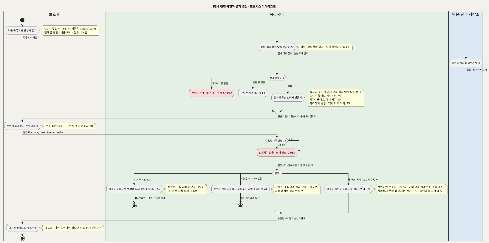

**[「P3-1 진행 확인과 결과 결정」 PlantUML 뷰어로 열기](https://plantuml.sumzip.com/plantuml/svg/eNp9Vl1PGmkUvp9fcRJv6gVbkfpJsiktoL3zYjfpRZMNq6MSKTSA8YYL1LFhhU3ASh1bIEODK7p2OwLimLr7g-Y98x_2vO_MAONHrxje93w855znPDPPM9lYOrv5NiFlNuLJd7F07C38HlveWEunNpMrL1OJVBrGooGoP_JixCKzHltJbcWTa7AaS2RkKRvPJmRYCvj8gKeK9fEPsI6rWDfM7i2YHd35Qa0KPrAOFdasoWLgfgtYsYX1Hn7smdcGa7SlHOv2LNXARjknCWTSPDYq1kEB2PkZa9Z5JCcD7m5TEMCjnmnoQSmZysqQjq-tZyWAhQkw9Tw2LwG1inl9y9MSIMqPmgJ2RKznYWmSoMCvLwMQmiM3VmybXYV1FTeHD9jOP9hvgVWpYbFG_1ErY0EFdqOwPQP7NUlOrgDPLfl-dgLDqzA3pAL31KCUG4sEohORQC609IoOa6yj5Kio3W1rt-b2Br_ssRPVzYWfy9Q6wPq_dwqbpwR7TDuh6ItTgB2V_XXhhqCEO19RqwG2KtRRdtYD85I6XoDIMw7NnYJex04PUDewqXOnz2XWNbzHHHM4HJmNTuXsa58LU8tj4wTfl3gB4mZkvuybQXBofAR6gJ33xM7ge8juke5ktuLZ5XV44qY96rFGCRb8E-PSciwjwxNPLnb-nefDemmcRjgWjYbnwnPzqGjWbh1P89QzzTQKDgOor6yUFxBrGr_lYZ9GJoPkuhFPJJwEDmhv6HlOViIB6n9SAHZaooG16YlHg4g_6PpqVZqucPCMV9BqgIrc2YeW6AGAh7tALcvj6TY2FAgIJn0pYlXBT4c2QdQBa6pN2hPwoBL-kz9Nef0etXQuPDlGjQBCz2xDQTarqgrs59-tapt7PRCXXKbIZbAW9GDPc0iGUdbsqKyRtxqF4aqxC8O8uhAb5DQr6JEFEoQL3K1b1R5wBnQ1vtM8P9PPsFgHOmEnvXurwwoKO6GE1RKfnB2DkgTCbJ-KPrjmG4P9Q64RzrKHZp3F4WeJ-IZM5psZ-bdEaktO0_MqKSE_S8vZ2Ib8CJfjq4LHPAQnTbNOMFVUt2EhMA7ZdTlJhFEuze7VuCQnOH3CLwCLLavUHmWz7cPKov1Y3SdG8gbZIsL6BdblTA48jQQGRKa-x1dHCvBbn4RPq8K6V45CYOdv95oyWMcqRGaCo-tHN4Od8ww58vqXSZfiw9qIH2IepOgDmR3Vpdotl1umqO7WhKa99CeF29FJVdkFV7TFGTEnrcIVl7iJna90KjT7TXJx9uE8ZDBNBhSWavdEoIAP-3AMmWzqnVupZ8t89jrh0fuBDLhc5MTjTfMUb97QdIia_TxXWMqDR3vAPlw6FqJq_w-rnr6754PKJ3x27bSNnAFDnbAtBZNpJXp5p_qHI90pd7j6vhE9aBREtFH3kXmLYPZryjv5_Rs6Y-W2O2r90PzPeETlRPMcJt7raWiSo6DLb4YXBYflviFtCQ8FHpUodtByarrv5nPQYo3s-go7b1PuGh4bPxQwt0Dubm-P6IU4Fng7LWvfuKtYRLrqrXjriBf4cBH4l4-evydW9CUlvkxEC2xXMnP7QcPhEXjb9ENu5gigVSrzXQzNSGK8zwk5fdj9D0v2QsY=)** — 클릭 시 브라우저로 연결됩니다.

**P3-2 이야기 기록과 전시 전환** — UC5 + UC4 BF5

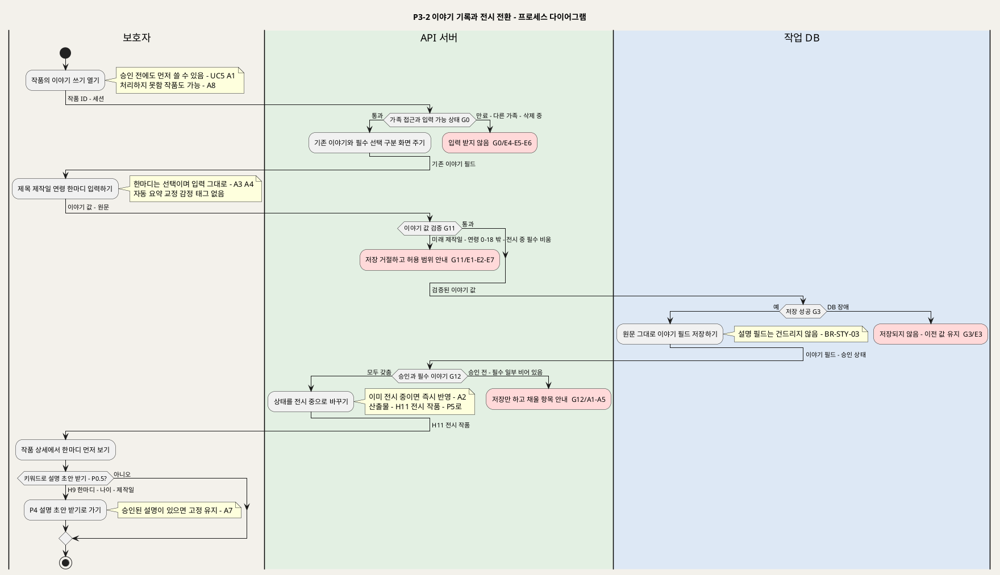

**[「P3-2 이야기 기록과 전시 전환」 PlantUML 뷰어로 열기](https://plantuml.sumzip.com/plantuml/svg/eNp9VV1PGmkUvp9fcRJv7MWsfMhWMdktlsHtndltLzbZG3ZFJVJolGZvuKA4NiySLLQggw5kTMGv2HRUtJhl9wfNe-Y_7DnDgCCkF2ZwOB_PeZ7nHJ7tpKPb6bevE9LOVjz5JrodfQ2_R__Y2thOvU2uPU8lUtswE_FHvMrySMTOZnQt9Wc8uQHr0cROTErH04kYrPplH2Cjg9We1TWB_sRxw7rpARoq7uv8sOsayGBXVHGso9rFQgvEfotzDjrW165onkkZcdOxtS42SxnJAScFsVm2P-SxoY1Ux4-m86h16LEkJVPpGGzHNzbTEgAW7rHRddrWSuJvFcRZD40s5dDLPFVpUrEiAXn1PAAhL2dca-Lk0q5qeJoFcfGPXT2DfldOt8ysKLQpPrQgxZJrwM0k-Qc3Al6E6SueZk9bkjIzij_iUfyZ0OoLeqmLazUjxddhlorg8RWBKltfew4rzT1htAfFcfedvavDiucJpDdjSZi1399S1BMCF6QJ8bjzMDzWs2BXVWcU1bB3G2DdXoo7Fex6RZxT4KeeQ0qMtIFZcVoUn3haYlq0u-ACIci5z2iQLK0yd5mJRMKL4cWgC0uYR8wFVgtMFeGaU-ZlJSAr3y9R8FY8kWAq4uvMw2N8DE581JfGtAxSL3FxTgToxBs2iICaKYx7CtbFaV5UKi4jpMKkpMMgUai4Q1M7cW4OaST3FLNkK5bJD6F5VrVJ6tcBDytY_Zc4KqFRpfGdB5FNKYThPc03ruqDg80PTNNRSVx2v6HseIJ1ncWTBqx4vY-VdOX4QjbXRmiQB0R4ZO8C8X7Ab9yNaZUHQot7FY-yY0IZWWzS4FcmGnkm7cYAu5bHw3MQ1xXUVRIvL3IdYCxzildWfLLydIp6DmBR0scn54HDYWUhEsgw0NoehJfdefuNUb2ybm5hxT-YE7W8Y9c-YSOKPDYG9CsMhAZ4kDpIZVviYs-NZLWtqw5_Orkc8aMMyz_Lv7z8Vfb4XVrDyyR3G6vGJEWipI2lMhxDdcRC3eCvaIg5xT9JzQRweXhbnHX9limcON7zwaYOa614fQPKxMWZKJcIygHetfrkOYVFuzfiAdR7TKMwK9Z_3WmU0SZ86Y4m8GrQQp78xS-EqaH2jvfC91sScybe6eKSffeT1ztM6p8yGVYD1Mrl9OGO8tEejNETd1nHjgcd95JOofy0CK4l8UrFwy7999nZ_qElfXMhrxwKTJI-gerxHelDJaL45tZKxPrIDXFPPSU4RLEUdq6FR0X2EHuxby_s5AkKXzlWhMb2fBf4ccTIPHC9yo4ySjwe41ocaUPXNKcRzc6uupvMowRX56e24NZ0eKeJ55DsrJ-Tx0WZVtKcJCQG-Vq5PiUJnw60IUPu51Ej1_SZ20mn3kjP6DP9mP8PZzEN5g==)** — 클릭 시 브라우저로 연결됩니다.

### 6-3 설계 주의

**결정 한 번에 원인이 둘 겹칠 수 있다.** "모델 낮춤으로 2.5D가 된 작품에 좋아요"는 원인 "모델 낮춤" 그대로다. "움직임에서 액자로 걸기"만 "보호자 전환"이다. "처리하지 못함 뒤 액자로 걸기"는 `frame`으로 남기되 원인은 "인프라 실패·결과 미도달" 그대로이고 승인율 분모에서 뺀다(D2). 결정을 원인 컬럼에 덮어쓰면 P7의 원인 5분류가 무너진다. SD_03은 `보호자 결정`과 `결과 원인`을 별도 컬럼으로 둬야 한다.

**"다시 찍기"는 두 개의 흐름을 만든다.** H7(새 접수)과 H8(이전 작품 삭제)은 독립이다. 보호자가 새 사진을 올리지 않고 나가도 이전 작품은 되살리지 않는다(UC4 A6). SD_02는 다시 찍기 확인 창에서 "이전 작품은 지워져요"를 알려야 한다 [추론].

---

### 6-x 올린 작품 고정 · 가족 댓글 7일 (2026-09-30, D46)

| 단계 | 이름 | 처리 | 출력 · 게이트 |
|---|---|---|---|
| 3.1 | 이야기 보기 | S6 읽기 전용. 저장 경로 `PUT …/story`는 409 `artwork_locked`(G11) | — |
| 3.2 | 댓글 목록 | 가족 확인 → 작품의 걸린 때(없으면 올린 때) + 7일 계산 | `{items, open, openUntil, days: 7}` |
| 3.3 | 댓글 쓰기 · 지우기 | 기한 안이면 500자 저장 · 자기 것만 지움 | 201 · 204. 빈칸 422 `comment_blank` · 남의 것 403 · 기한 지남 409 `comments_closed` |

## 7. P4 작품 설명 초안 받기 (P0.5)

### 7-1 단계별 IPO

| # | 단계 | Input | Process | Output | 근거 |
|:--:|---|---|---|---|---|
| 4.1 | 진입 검사 | **H9** · 작품 ID · 세션 | INC1(**G0**), 삭제 중 여부, 승인된 설명 여부(있으면 거절 — §15-2), M6 사용 조건(**G13**)을 확인한다. M2 태그 후보를 불러온다(없으면 키워드만) | 태그 후보 · "사진과 이름은 보내지 않아요" 안내 | UC10 BF1 · A5 · E3 · E4 · E5 · E7 · BR-CAP-04 · BR-MDL-07 · BR-DEL-05 · H3 |
| 4.2 | 키워드·태그 선택 | 키워드 · 태그 후보 | 고른 태그만 입력이 된다. 보낼 입력을 미리 보인다. 입력이 없으면 버튼을 막는다(**G14**) | 키워드 · 고른 태그 | UC10 BF2 · E6 · BR-CAP-06 |
| 4.3 | 입력 조립 | 키워드 · 태그 · 한마디 · 나이 · 제작일 | 허용 필드만 서버에서 다시 조립한다. 이미지·별칭·제목은 뺀다. 설명(M6) 단계 작업을 기록한다 | LLM 입력 | UC10 BF3 · BR-CAP-01 · BR-CHD-01 · BR-PRV-01 |
| 4.4 | 초안 생성 | LLM 입력 | LLM 서버(M6)에 짧은 동기 요청(또는 스트리밍 진행 표시). 과정 제공 LLM은 U3 조건 확인 뒤만. 미준비·시간 초과는 인프라 실패로 기록하고 보호자에게 템플릿/나중에/직접 쓰기를 고르게 한다(**G15**) | 초안 문장 | UC10 BF4 · A6 · E1 · BR-SRV-01 · BR-SRV-03 · BR-SRV-04 · BR-PRC-03 · BR-CAP-05 · BR-PRV-02 · D1 |
| 4.5 | 규칙 검사 | 초안 · 입력 | 입력에 없는 사건·감정·발달 상태를 검사한다(**G16**). 걸린 초안은 보이지도 저장하지도 않고 실패 분류만 남긴다. 자동 재생성 2회([추론]) 뒤에도 걸리면 템플릿 설명으로 낮추고 낮춤 원인을 기록한다 | 통과 초안 또는 템플릿 설명 | UC10 BF5 · A2 · E2 · BR-CAP-02 · BR-CAP-07 · BR-FBK-01 · BR-FBK-03 |
| 4.6 | 초안 저장과 표시 | 통과 초안 | 출처(LLM/템플릿)·검사 결과·생성 횟수와 함께 "승인 대기"로 저장하고 "AI 작성" 표시로 한마디와 다른 칸에 보인다 | AI 작성 초안 | UC10 BF6 · A1 · A3 · BR-CAP-03 · BR-STY-03 · D6 |
| 4.7 | 수정 | 수정본 | 수정본과 수정 여부를 저장한다. 출처는 LLM 유지 | 수정본 | UC10 BF7 · D6 |
| 4.8 | 승인·고정 | 승인 | 승인본을 고정하고 재생성을 잠근다. 전시 중이면 곧바로, 아니면 전시될 때 연결한다 | **H10 승인 설명** | UC10 BF8 · A4 · BR-CAP-04 · BR-EXH-01 · BR-EXH-05 |
| 4.9 | 결과 안내 | H10 | "설명이 전시에 붙었어요(AI 작성 표시)" 또는 "전시될 때 함께 보여요" | 안내 | UC10 BF9 |

### 7-2 프로세스 다이어그램

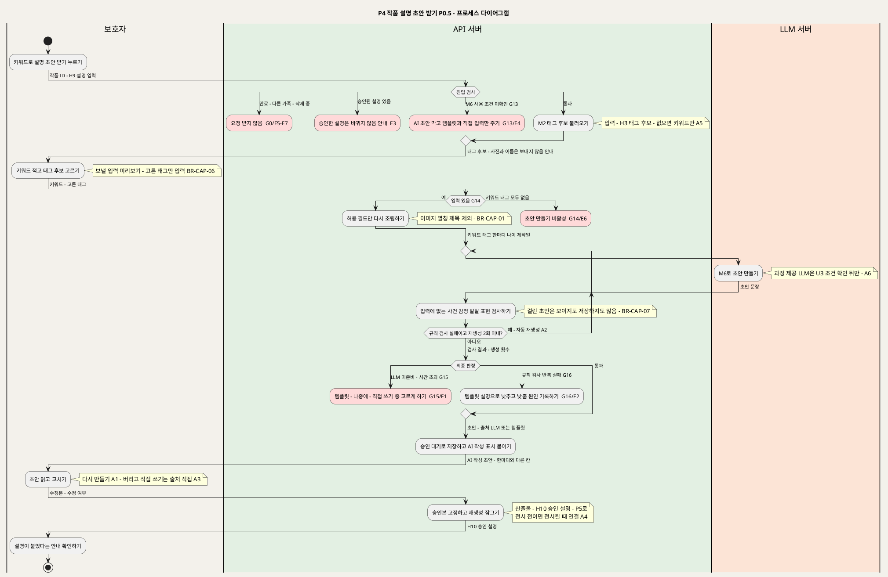

**[「P4 작품 설명 초안 받기」 PlantUML 뷰어로 열기](https://plantuml.sumzip.com/plantuml/svg/eNp1Vt9PGlkUfp-_4iS-1AdWEaWpJLulFVuTNjGb7Nu-sC0qKcVGaHzxgdKxmSpJoYUVdKC4RakN3Y4wWkxs9v-Ze-Z_2HPu3AFE-2CAmfPrft93vuvdTDa-kX35PKVlniXTL-Ib8efwV_zJs9WN9Zfpp_fXU-sbMLEYWgzG7o1EZNbiT9c3k-lVWImnMgktm8ymErA8C9goue8NQL0lvmwD2gZWDBDWgdO3YHn6lzkIgFvWxaGJeh93WiB2W1i38W_b-d4Xjc_alujZbrWPjeKWJifT5t18Cw8K4oNJWTcXFoYujmz6FtECv_ojLC1Qr4d3BhmNbdE8imhbE7HQ4nQstBVdXqJ3pujq1GkzmX2yBrewrVMcON0c5juT2pN4JgG3RLsgPhWoGM0qjvrgWDk8PKXfmP-KTRqpVZrUgEBaXLizcGce98vY_cqjYTsHWNnBegHgwfRUbC4Qux2hyGfJVErVxp0LrPdFcXiwhkHxV-rJELfih2A9R8XLIlcYqU9giLwNEAuNNXgcpjE7uH8CeGg5pzaIb323VqGK8CAYGu0TXRqg2n7r9JrgbptuuSCO_3N6l4DtV9gsKRQJEcBPlww9V5mKzY51dd-cURJXn388A-5rk9gF90AnckGcG-JjB6styRdAej2bgI3k6lp2XpVn3kJjWYT23hs0L8WJDUNB0BzROS2RfuoRyOxfS6PTt3V5hLotjnUJX88mtK7BF7mivqHuAJuvJCBXStMTX3SjR5C1L_2TENriuEPPGKuAl9NXhSSKXti93wP3o8uB6bA8waDvWMJPxJtcIR15dTz1ECezk5BdS6TpRdWQNLh7BovAregKN168XZNVIY5_uJXqTWwQYN_6DJPo6XjxlXAwxZcT_sBan6bzxw5qiZSkfTC5gkp8-SxKRUndmKh9pVF0S67whe7WyBROWVGzU7HwQFHEbnLlKi4-ERU6iSHKZRD5Kg0rB2uUsH4Z0TYSLxLxLNXYmli8H5tdCG89evR4ABnrMiztZGyOcQhIN9iscGGndwZUguXzR8hfJrVJ4n2LIQ1ANEz5bEGqbIekdBSRU9xAHE3h8YZ7EiOxU2a5cmHHKnJfYZlitwNuyXSrurKlm7lyTklolmqsNM7G2s6JdzrNn6NBKNP_7cl-yOBtBRhsriXJyG853028qKmOgLstt_CZyvEWYKODr-vM1Iy7X5Aiydu_TUIyI9XGK9coine1kcDozCQPS-9JfrsG7f4kE6qqO12L15PyvGh3_yMa1cjQlM9M_Gcb3AJD4psys8nibOVIOZy7azqWzufnWg-Cc6NqGzgZmzhJpVVixAMDU_tgsQTpsb_U3QJ4MLMa56ZiwTF_uwqPsKqC1OGhRAlhb-MGTZVvk3mR4kT-XzwvM5DyWwvwoMgaombisD7sGp6KzUTG7PSK0SmN0SnOTexWQSJSLbKIBq0jmro-QBRysoM51ALPwKZPG8Ool0z2A3FeY57VVTp8Peg2WDqs5fwbES_6Y96pwrH-g7vQH15Ur1ulZ0FDE4gGmaCuTpYplTZKj1wO76TqeTQkYTCqJAvRYz_yvtMqdcR57iduqQDhBB6rWVFIDNWKjSa5y7VpMW9Rf9FhpT4MToMCVt3bAVieI3T_TGNTl75KH7QZJzZ4D0SRCK_QuuxZpHeIzvLs18qMo6gufFvSsmcw3AyDd9l75uPbQSa7_kK7Swqhf-X-B2jHK8Q=)** — 클릭 시 브라우저로 연결됩니다.

### 7-3 설계 주의

**LLM 장애를 템플릿으로 조용히 바꾸면 안 된다.** 인프라 실패(G15)와 규칙 검사 반복 실패(G16)는 둘 다 템플릿에 닿을 수 있지만, 전자는 보호자가 고르고 후자는 시스템이 낮춘다. G15를 자동 템플릿으로 처리하면 설명→템플릿 낮춤률(P7)에 인프라 장애가 섞인다(UC10 E1). SD_04는 LLM 어댑터 응답을 `failed`와 `quality_below`로 분리하고, SD_02는 G15에서 선택지 세 개를 보여야 한다.

**걸린 초안은 한 글자도 새면 안 된다.** 스트리밍을 켜도 문장은 규칙 검사 뒤 한 번에 보인다(BR-CAP-07). SD_04는 스트리밍 토큰을 화면으로 흘려보내지 말고 진행 표시만 보내야 한다.

---

## 8. P5 가족 전시 감상

### 8-1 단계별 IPO

| # | 단계 | Input | Process | Output | 근거 |
|:--:|---|---|---|---|---|
| 5.1 | 전시 열기 | 세션 | INC1(**G0**) 뒤 아이 별칭 목록을 보인다. 외부 클라이언트 키는 거부 | 아이 목록 | UC6 BF1 · E2 · BR-ACC-02 · BR-API-06 |
| 5.2 | 아이 선택과 목록 | 아이 ID · **H11** · **H10** | `전시 중` 작품만(**G12** 재확인) 연령 묶음 → 제작일 순으로 고른다. 3D는 노출 설정이 켜질 때만(**G17**). 결과 종류를 같은 크기로 싣는다. 낮춤 원인은 싣지 않는다. 없으면 빈 전시와 올리기 안내 | 정지 상태 목록 · 읽기 전용 파일 주소 | UC6 BF2 · A6 · A7 · A8 · E1 · E3 · BR-EXH-02 · BR-EXH-04 · BR-EXH-07 · BR-APR-01 · BR-SRV-02 · D10 |
| 5.3 | 작품 표시 | 작품 ID · 파일 주소 | 결과 파일을 정지 상태로 읽고, 제목·제작일·연령·한마디를 먼저, 승인 설명은 "AI 작성" 표시로 따로 보인다. 저장소 장애면 이야기만 보인다. 주소로 연 조건 미충족·삭제된 작품은 비노출 | 결과 파일 · 이야기 · 설명 | UC6 BF3 · A5 · E4 · E5 · E7 · BR-EXH-05 · BR-STY-03 · BR-CAP-03 · BR-DEL-01 |
| 5.4 | 재생·시차·회전 | 결과 종류 | 움직임 재생 / 2.5D 시차 / 액자 그대로 / P1 3D 회전(뒷면 추정 표시·원본 함께). 누를 때만, 자동 넘김 없음. 표시 불가면 원본으로 | 재생 화면 | UC6 BF4 · A1 · A2 · A3 · E6 · BR-EXH-03 · BR-EXH-06 |
| 5.5 | 원본 보기 | 원본 참조 | 원본을 읽기 전용으로 보이고 결과로 돌아갈 수 있게 한다 | 원본 사진 | UC6 BF5 · A4 · BR-INT-04 |
| 5.6 | 목록 복귀 | — | 재생을 멈추고 연령 묶음 목록으로 돌아간다 | 목록 | UC6 BF6 · BR-EXH-03 |

### 8-2 프로세스 다이어그램

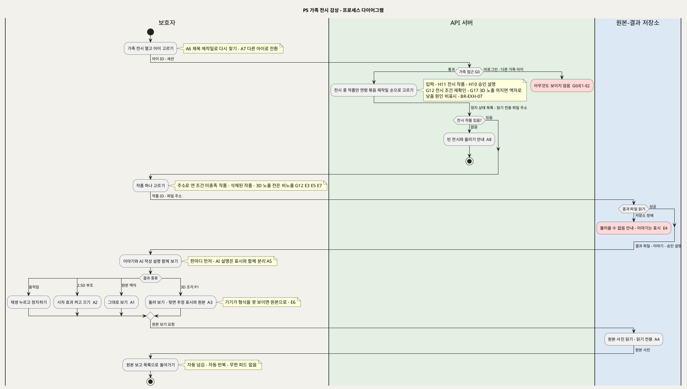

**[「P5 가족 전시 감상」 PlantUML 뷰어로 열기](https://plantuml.sumzip.com/plantuml/svg/eNqNVU1vGlcU3c-vuJI39oLWmBInILUhZUi8s7rqltrYRiYQAVE2LPgYW8hGsp1APHYGCi0UsEg7NmMMDe0PmvfmP_TeNzOAbUWqZAne8_0495zzLs8z2Wg6-_Z1Qsrsx5Nvounoa_glurW_m069TW7_mEqk0rAU8UW88ouFiMxedDv1Lp7chZ1oIhOTsvFsIgabfjD1PG9dA28q_FjD0ykvFcADVlVhLY0rY37UBnbc5nWDfzTMuzFr9KQcGxqWOuaN05wk0EiB-2X4uWEOm8BrCuYBfmUdwxzrQSmZysYgHd_dywYg9ATDNXbVpw_eOOP1KbYUzaiE_i9mIJLQOl2xztgpRzHYxrpQJc_3bouNMEYS2gM1KOWWZF9kVfblQpsbeKmxGyUnxXdgeQbyzLybwsvVFcjuxZKwbB3emsPpigQQcAdonwFCst6XWbeC4-isOQE2GPF6ZY4WeFnjmgC9MCLAfEg8ANY5YM0O4nvl9c4IErXF3Srwowmv43hKm10diJSX3rVZZEs3rw1MGFgXNQrz4H_XwRcGdjDmI2z995R386yPMbUWSoJwRA1W_JOP2sA_nVIWmyjWmUYFPfDiJ4_88yvP6jrGxZLbAq8UQ1fAMoZhPspsd3KId3kTXBNNS5FI-Fn4WQBv2MAwb0rsRAE0Bbmkm8fAIyIKGf5W9nrkNSJlP55ISNgtviNka9ZEYKlglVDyqz5r1UnB-j8kOo1-2QerUhEs_z7lh5WgUPA-fbxRxj4_uDLaxxVnFH5-KE4oKpuUHTr5BTZVB-yPgehTK7OiARB6Sggz2dQbB-GiwQNOM6umsqL6NTPbIIU3z3VXNPYXKtQX1Ll68-JnMv3pggXmUhLGep60ci7IB7IPZD_I64I2O0e4_QE7uaVwWH4a8edQcDYce8wbHT2NJfO80cEI5wXYt26uoHtGn3JtDm9n9LmJQB-15qLsbFRmvw6QR3wBKthEu2SSiAavTbEwO6qCYzqQv3tsgvtgFhLp--KbCD4QxI0jNUMbxApid2JRp575RSU3PhLJqmmsW2bVKrDeFAek7bLh5BHxNliq6hYZKWgVCPmlzLt4dmtvRiD_7YB11BVpKyq4-pTn3QJvKPYKaQx4qQ6srJBRaA0Ks6N_BCA7Ze0bP8o-wnel20nYV--BddkT5acaJbKCQmxAaC0460TiOi9dJNJKruTF4hQTY7TXjUZnkRP1Amx67YdwUmHNthuJ7_v9nVgcoypiXBjfaQMhX5Dksoe_RyXm05-OVKk1flzndVwAV1-cJSCKihrOfvSA_EQY2C7sAOCXVX7z-f94N-AOXhzwruLuiYcLA0LosnkXO_iheeYIiGGxeRyQyA4uNJzp8evGtXpyAUxRzQm5xj3rKhveEo8DA72FP5pT9kFzHoQk9slzpA9_q_8D3gkStg==)** — 클릭 시 브라우저로 연결됩니다.

### 8-3 설계 주의

**감상은 모델을 부르지 않는다.** P5에는 워커 레인이 없다. GPU 워커나 LLM 서버가 멈춰도 전시는 열려야 한다(UC6 특별 요구사항 [추론]). 저장소 장애(E4)는 게이트가 아닌 장애 표시다. 감상 중에 결과를 다시 만들면 "처음 만든 결과 보관"(BR-APR-03)을 깬다.

**전시 화면은 원인을 모른다.** 원본 액자는 보호자 선택·모델 낮춤·보호자 전환 무엇으로 됐든 같은 액자다(BR-EXH-04 · BR-EXH-07). SD_02는 전시 카드에 낮춤 배지를 두지 않고, SD_04의 전시 조회 API는 원인 필드를 돌려주지 않는다.

---

## 9. P6 작품 또는 아이 삭제

### 9-1 단계별 IPO

| # | 단계 | Input | Process | Output | 근거 |
|:--:|---|---|---|---|---|
| 6.1 | 삭제 요청과 권한 | 세션 · 작품 ID(아이 삭제면 아이 ID) · (다시 찍기면) **H8** | INC1과 보호자 권한을 확인한다(**G0**). 다른 가족·운영자·팀원·외부 키는 거부. 지워지는 항목을 안내한다 | 확인 창 | UC7 BF1 · A1 · A5 · E3 · E4 · BR-ACC-04 · BR-ACC-03 · BR-API-06 · BR-APR-05 |
| 6.2 | 삭제 확인 | 확인 / 취소 | 취소면 아무것도 바꾸지 않는다 | DELETE 요청 | UC7 BF2(액터) · A3 |
| 6.3 | 삭제 중 전환 | DELETE 요청 | 상태를 `삭제 중`으로 바꾸고(**G18**) 전시·목록에서 즉시 빼고 새 단계 작업을 막고 대기열 작업을 뺀다. 확정·결정·이야기·설명 요청은 거부한다. 202 | 202 삭제 접수 | UC7 BF2 · A4 · E5 · E6 · BR-DEL-01 · BR-DEL-05 |
| 6.4 | 실행 중 작업 종료 확인 | 작품의 단계 작업 목록 | 실행 중인 작업이 있으면 서빙군별로 취소를 보낸다(EXT1). 멈춤 확인이나 시간 상한까지 파일 삭제를 보류하고 재시도·이어받기를 막는다(**G19**). 늦게 온 결과는 버린다 | **H12 취소 신호** · 멈춤 확인 | UC7 BF3 · A2 · E2 · BR-DEL-01 · BR-PRC-05 · BR-PRC-06 · BR-SRV-03 |
| 6.5 | 파일 삭제 | 삭제 대상 목록 | 원본·마스크·깊이·중간·최종(GIF/MP4·부조·GLB)·임시 파일을 지운다. 일부 실패는 자동 재시도, 끝내 실패하면 "삭제 미완료"로 집계(식별 정보 없음) | 삭제 결과 | UC7 BF4 · E1 · BR-DEL-03 · BR-PRC-08 · BR-OPS-04 |
| 6.6 | 기록 정리 | 삭제 결과 | 작품 기록·설명 초안·승인본을 지우고 작업 기록에서 작품·아이 연결·저장 위치·자유 입력을 제거해 집계 필드만 남긴다. 아이 삭제면 작품마다 6.3~6.6 반복 후 별칭 삭제 | **H13 집계 필드** | UC7 BF5 · A1 · BR-DEL-02 · BR-CAP-04 · BR-PRV-01 |
| 6.7 | 완료 안내 | 삭제 상태 | "삭제했어요". 백업까지 지웠다고 표시하지 않는다 | 안내 | UC7 BF6 · E7 · BR-DEL-04 |

### 9-2 프로세스 다이어그램

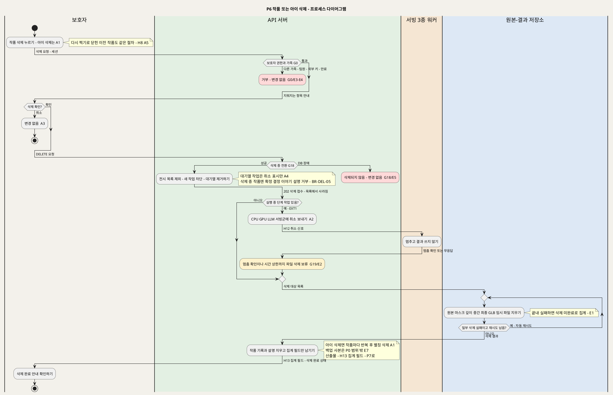

**[「P6 작품 또는 아이 삭제」 PlantUML 뷰어로 열기](https://plantuml.sumzip.com/plantuml/svg/eNp9VVFPGlkUfp9fcRNf6gMRpLaKyW5RBruJm5hNm-xDX9gVlUjBAE1feEAdzaxMU9iCDu0Mwd0xYlezo4DFLPuH5p75D3vOZQah7u6DmJl77jnf-b7vnHmWLyRyhTev01J-O5XZSeQSr9lPiZ-3N3PZN5n15Ww6m2NT8XA8JC-NReS3EuvZt6nMJttIpPNJqZAqpJNs7QmDZtX9VWVcr_CjGoO6AmaXwd4VtAwWYG5N4acGKH04shgvW3gIx13nS58321KRd7qu3odmpSgJUFLEy-bd56rCz7pO38ZME5mpVDS0KGWyhSTLpTa3ChGRvWwwsN_hBSyKL_5wmxqjki3Fw8nfK8yxG2CWGLRUsNuY-fk8i85JgW_8qvCxBjdXVBJhH-iLUnFKDseDcrgYXfsOXxr8RilKqQ32aISfObeaWzeczgCzl-D0mq0Ep1lhK5lhj9zDHr6flpJIG14pW_ys70chQVoJPlWoWKPPb0vM3bPwgZ9r_HdtWmKoRDy2EFuIONc2HeNRp-Tc_M3g5BBMjWGdGTkckB8vYux2Kp2Wkpn11Ibo5hwza_hLZLn1K_75AklU-V53cYJ5asTr3G3Uwex_O0IuHn3k8KUNhwJT5CsM0TBVzxeyO_fVY_Kq_EL2uPwfCn3OrSoKorgNna2E5n0AoFw7nZ4oiYekLjbBT00MNZAvYm1fJWXh5ACFb_My6cm1EjoATroUhry5dR2fCeKEXe6jxH1hCdEic6sG1kINWPTxq8w4QuEhOKkJplp15tzY9I8sVh-QT0Gx-OcDNlJr6YcAMhEIznkkxpYwyRnUW-Paep6u6CgWSnREpD4UOjQ_I889lHk2ODsybqsKqk5XBUtwUkGm8fCSmwM4rywOCS9b7vEvoh2ky-koI_6aKhYaiQ-6ipnkH1-EBP_Lay_ZCv6trn4v9LtrOD1kr-JzhoZCZxEFLDpLKBHa89CsfwzlFvqN3hen4nPyk1i4OMzCwvAb1kaj_mUVhbcuVLitOZ0WkUsDBR9sjxdPRcwsgizPr_7u4ZddMKu83BuW-RfDCcrjs8vLkYkEKB_f0xGj4dhIx_4ujfIdjQ6OpwbmYLSPsMkznbRYmJGxS28w6govq6Bb02PD513A6d7f9fSgKYjF5Pn4XBFHnnf6Ab_DVolMcagVpVxyJ5koCMOLENwEKq5Od_eSOXdHYgFaVYGyZxBxK6tkKDEaPlQc-4-2oGqYjL3dSqUJpjkgT_peQRtobUxITEPzkgyPu5HvtYcmSOV9C-CS4O8b9zHTNEYTXU-M1a6JPvDS4-Txi9HXgP_Zh4aCe42WM5xXyXvosNAYX0NC_mNd-B8Hsd5NQdxw2ryWqZFhVhexfRADjP1guGBjHOXkx-Si638dzlXcz4zbOu_0mPsJ-egocHflw4uGXmW4fS2mBaeq06elsRZk_KYGBgbbx0x-ShvDhluDXw7o4xIKT6LCd2tPkQFJDMjDQ18fwZQw474xubAjX4WIne5Z2d91Yhk_Qzvid_4fNt8hPw==)** — 클릭 시 브라우저로 연결됩니다.

### 9-3 설계 주의

**삭제는 서빙 3종 모두에 닿아야 한다.** 한 장의 사진이 CPU 비전(M1~M4)·GPU(M5·M7)·LLM(M6)에 흩어진 단계 작업을 남긴다. 취소를 한 서빙군에만 보내면, 멈추지 않은 워커가 G19 뒤에 결과를 써서 지운 원본의 파생물이 되살아난다. 그래서 0.11은 "결과를 쓰기 직전 `삭제 중` 재확인"을 워커 쪽 필수 동작으로 둔다(UC7 A2 [추론]).

**G19는 보류형이다.** 막되 스스로 풀린다(멈춤 응답 또는 시간 상한). 움직임 렌더 외 시간 상한이 미정(U6)이라 보류 시간의 상한도 아직 없다. 보류 중 대기는 인프라 실패로 세지 않는다(UC7 E2 [추론]).

---

## 10. P7 서비스 상태와 모델별 지표 확인

### 10-1 단계별 IPO

| # | 단계 | Input | Process | Output | 근거 |
|:--:|---|---|---|---|---|
| 7.1 | 운영 화면 로그인 | 팀원 세션 · 역할 | INC2로 운영자 역할을 확인한다(**G1**) | 운영 화면 | UC8 BF1 · E3 · BR-ACC-05 |
| 7.2 | 생존 확인 | `/live` | API 서버 프로세스 응답만 본다. 의존 구성요소는 보지 않는다 | 생존 | UC8 BF2 · E4 · BR-OPS-01 |
| 7.3 | 준비 확인 | `/ready` | DB·큐·저장소와 서빙군별 M1~M7 준비·활성 버전을 묻는다. 준비 안 됨 / 모델별 미준비 / GPU 없음(M5 CPU·M7 비노출) / 라이선스 확인 전 비활성 / 확인 불가를 구분한다 | 모델별 준비 상태 | UC8 BF3 · A1~A4 · E5 · BR-OPS-01 · BR-SRV-02 · BR-SRV-04 · BR-MDL-07 |
| 7.4 | 서비스 지표 | 기간 · **H13** | 집계 필드만으로 첫 결과 승인율·판정 수정률·설명 규칙 검사 실패율·결과 미도달 수·삭제 미완료 수를 계산한다. 분모 0이면 해당 없음 | 서비스 지표 | UC8 BF4 · A6 · A7 · E1 · BR-OPS-02 · BR-DEL-03 · D14 |
| 7.5 | 모델별 지표 | H13 | 모델 ID·버전별 낮춤률·처리 시간 p95·재시도율, 서빙 3종별 큐 적체, 외부 호출량·한도 초과. 라벨 규칙 위반 항목은 뺀다 | 모델별 지표 | UC8 BF5 · A5 · E6 · BR-OPS-04 · BR-SRV-01 · BR-API-05 |
| 7.6 | 원인별 분해 | H13 | 보호자 선택 · 모델 낮춤 · 보호자 전환 · 인프라 실패(분류별) · 결과 미도달을 따로 센다 | 원인 5분류 | UC8 BF6 · BR-OPS-03 · BR-FBK-04 |
| 7.7 | 미도달 추적 | 미도달 목록 요청 | 단계 작업 번호·모델 ID·버전·오류 분류·시도 횟수·처리 시간만 보인다. 가족 이미지·이야기로 가는 경로가 없다 | 미도달 목록 | UC8 BF7 · E2 · BR-ACC-03 · BR-PRV-01 |

### 10-2 프로세스 다이어그램

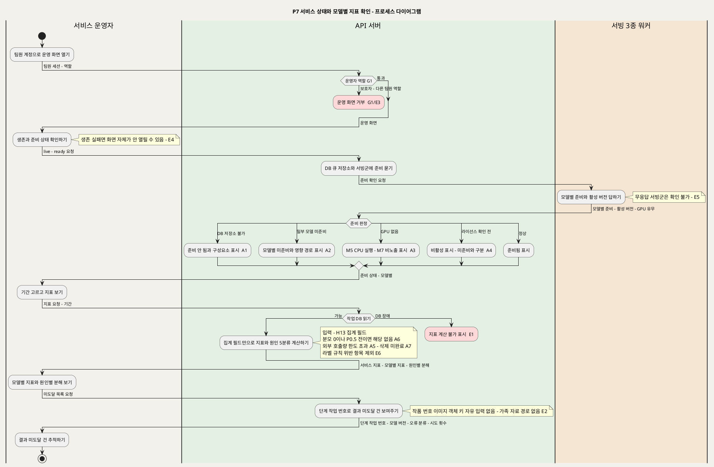

**[「P7 서비스 상태와 모델별 지표 확인」 PlantUML 뷰어로 열기](https://plantuml.sumzip.com/plantuml/svg/eNqFVl1TGlkQfZ9f0VV50Qc2GkKsQNVWTMTsPqTKl_0BRFEpCaSAbGqrfAAdLRLYWtwVgThDxg2saGkt4kjGivlDc3v-w3bP3OHDSPZx7r19uvuc0w1PsrlYJvfmVVLJbiRSr2OZ2Ct4GVveWMuk36RWnqWT6QzcWwwuzkafjrzIrsdW0m8TqTVYjSWzcSWXyCXjsDQHqGriWsX3LcDtgrOtYSMP4rQjfrfEpQp4nHf2NHAaVdQtCICzr4ojDVWLA0SphbqJB6b92RLNjrI5gvXBxHoBm5VNxS1XCTvlPB5WwL5U0aiidkMw8hWh74sTE7Bm2lY3ogR-BPmY8-zUKS3Wzp2qEVE270WDizPR4Ob80s9u5T11U0mswtQgn3wKz2enIbceT8GUs3tlX95MK3FqG6bEpenULX4Y4PpF2xokcwOnFSD2FhceLzwOj5dnX3RFPw-EfD8ajNCzjUQyqcRTK4lVLnnscWQCF2Hc1vHIpHoAW3m6l6RLgp1q3WUglc7FIZNYW8-FwYsALLWccofr8NlqVrBn2t08YLXI3Il_6LBYp4si6mVqL_qQ60omfo3TRyYeW_mNStnH3vkEHsMLT8EpEBFGHptt3C2zFdw2GvZVF2sVv2Zx9sUXSp5IfwzhF0PRRwtBj4QGBPHvHcDDMn5pUZoRd7nRnMZpkKkugOpAgxKUru6iQpyZqO_R5UhVet5PLvpFZoP6DnFlt7OweceSBOD50i-AmkGwExjJvk3kltfJXbLLcoW8O60sx9hJxNaAKZmczRP2hSVVRKXDUttXZ5SXyaGXNE5Y0gDmZyMSCPUbNpZXMIh_LQ_BBRt2MTh3VakXnIM22L2vPEYDyAc-pNtZbZd84KK8CMEzPiEPHbyjxl_MAQGJHQv7I9FBP1roNzzXqsHu9aU1ZEHXqqRRxgXGK6NeRV8ltIeD9mjctwsj1BArMjjC4-ORPGImORKBoYQTx4ksYndVWiqGaNNUGf6-oikfONQ78axJoF7I91ZJcw9rO8Dy6l_ptb9HSF_xvu31cbxHewycqir-0sRx2V9nbipXn8MKkxYiKkS77i69ra5vaYChqekDaGJ3hNGm2n6aDcIYtnvNIKcdmCFNxFYdlmZ-CLEc_MnroGqK0rVUG-YfeYgNiy3Fm66viY_v6JUm_iBqzSIbcj7EO3XrHA3NVa-hik8UO-elIzv2OmB_1pBGFzVVdOsUfy5OTygttWdBlLOQdG4jcrEyXzQLtzaoR77Xvz-hvuGis3ds0aHMXmjg2x-jgKTXnYq-SgRM9Mft2KE2w-BRsxAZRJMonVHWE3Gk_8_CFKUOayUdI3pFIpyNYPe6TPMQzb5w02DtDD_dfLvim3vOn0UZD6wraXJMs9TVacWDs9Vyt71m-E6RYpOZu3k8uuBbFlCuA3kbfeB2dEeJA1KHqxDrLTaq9Ct9l1y_OB8-0k_K5PG7q0_s76NR8M2ezaVfK09IX_rD8h8G8645)** — 클릭 시 브라우저로 연결됩니다.

### 10-3 설계 주의

**"미준비"와 "비활성"과 "GPU 없음"은 다른 상태다.** 셋을 모두 빨간색 "준비 안 됨"으로 뭉치면 운영자는 라이선스 확인 전이라 일부러 꺼 둔 M2를 장애로 오인해 켜려 할 수 있다(BR-MDL-07 위반). SD_03의 모델 준비 상태 코드는 최소 다섯 값(준비됨 · 미준비 · 비활성 · CPU 실행 · 비노출)이 필요하다.

**P7은 읽기 전용이다.** 지표는 H13 집계 필드로만 계산하고, 가족 데이터·매니페스트를 바꾸지 않는다(UC8 사후조건 (4)). 예외는 §10-4 모델 점검 하나다 — 점검 기록과 점검 작업만 쓰고, 둘 다 지표·결과 미도달에서 뺀다(BR-OPS-05). 그래서 "삭제 미완료"를 **보기만** 하고 끝내지는 못한다. 이 공백은 §17 1번이다.

### 10-4 모델 점검 (D20)

UC8 A8·E7과 UC9 A7의 "모델 하나를 평가 묶음 항목 한 장으로 돌려 본다"를 P7 안의 곁가지로 둔다. 7.1~7.7은 읽기 전용이고, 이 곁가지만 점검 기록(`model_check`)과 점검 작업을 쓴다.

| # | 단계 | Input | Process | Output | 근거 |
|:--:|---|---|---|---|---|
| 7.8 | 점검 요청 | 모델 ID · (선택) 버전 · (선택) 평가 묶음 항목 · 팀원 세션 | 운영자·평가 담당만 실행한다(**G1**). 규칙 모델 M4와 P0.5 전 M6은 대상이 아니다. 버전은 지정한 것(그 모델의 것, 폐기 아님) → 없으면 활성 → 없으면 가장 최근의 폐기 아닌 버전. 항목은 평가 묶음 항목이고 모델에 맞는 종류여야 한다(M7은 입체, 그 밖은 사진 항목, **G30**). 지정하지 않으면 서버가 고른다(M3는 사람 항목 우선). 같은 모델의 점검이 진행 중이면 받지 않는다. 점검 기록과 점검 작업(`origin='check'`, 우선순위 30)을 한 트랜잭션으로 등록한다 | **H17 점검 작업** · 202 점검 번호 | UC8 A8 · E7 · UC9 A7 · BR-OPS-05 · BR-MDL-04 · D20 ①③④⑥⑧ |
| 7.9 | 점검 실행 | H17 | 서빙군 워커가 보호자 작업 뒤, 평가 작업 앞에 점유한다. 그 모델의 어댑터만 한 번 돌린다(M3는 관절 추정까지, M5는 깊이 추정까지 [추론]). 재시도하지 않는다. 출력 형식을 확인하고(아래 표) 출력 파일은 워커 임시 영역에서 지운다. 처리 시간(적재 시간 제외)과 메모리 최대를 남긴다 | **H18 점검 결과** | UC8 A8 · BR-OPS-06 · BR-SRV-01 · BR-SRV-03 · BR-PRV-01 · D20 ② |
| 7.10 | 점검 결과 확인 | H18 · 상태 폴링 | 통과 / 실패(오류 분류 5종 · 출력 형식 불량)와 처리 시간·메모리만 보인다. 품질 점수는 없다. 요청 뒤 15분이 지나도 시작되지 않은 점검은 조회할 때 `failed`·`model_not_ready`로 닫고 작업을 취소한다 [추론]. 모델별 최근 결과는 7.3 준비 표시에 곁들인다(팀원 세션일 때만) | 점검 결과 · 모델별 마지막 점검 | UC8 A8 · UC9 A7 · BR-OPS-04 · BR-OPS-06 · D20 ③⑦ |

**출력 형식 확인** (`bad_output` 판정 기준 — 2026-09-29 A가 서빙 점검 실행기(T155)에서 확정. 모델이 제 품질 규칙으로 `quality_below`를 낸 경우는 출력 파일이 없어도 통과다 — 모델이 돌아 판정까지 했기 때문이다. 형식 확인은 `ok`일 때만 한다)

| 모델 | 점검에서 돌리는 것 | 통과로 보는 출력 |
|:--:|---|---|
| M1 | 배경 분리 | 마스크가 입력과 같은 크기이고 전경 화소(0이 아닌 값)가 있다 (`quality_below`도 통과) |
| M2 | 판정 분류(M2만, M3 관절 제외) | 제안 분류가 `m2_prompts.yaml` 종류 4개(person·animal·house·object) 가운데 하나다 |
| M3 | 관절 추정(렌더 제외) | 관절 JSON에 AD 골격 16개(root·hip·torso·neck·좌우 어깨·팔꿈치·손·엉덩이·무릎·발)가 모두 있고 좌표가 숫자 2개다. 사람 모양을 못 찾으면(관절 없음) 불량 |
| M5 | 깊이 추정(부조 합성 제외). M1을 거치지 않고 점검 그림 전체를 불투명 컷아웃으로 넣는다 | 깊이 맵이 입력과 같은 크기이고 값이 한 가지가 아니다 |
| M7 | 3D 생성 | GLB를 다시 읽을 수 있고 면이 하나 이상이다 (전용 환경의 `m7_run.py`가 다시 읽은 면 수를 알려 준다, T131) |
| M6 (P0.5) | 설명 입력 항목으로 초안 | 설명 문장이 비어 있지 않다(규칙 검사로 템플릿이 되어도 통과) |

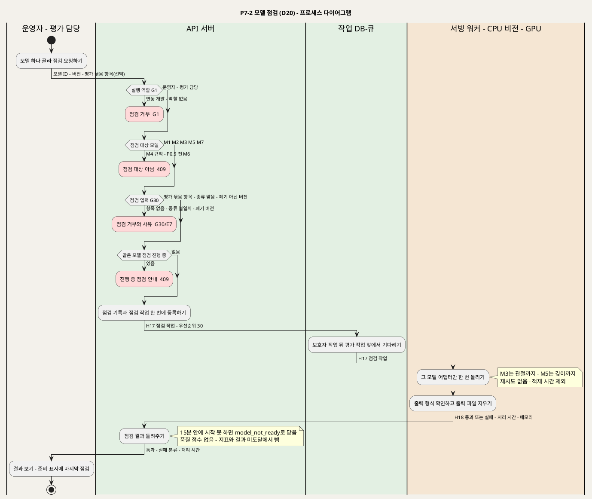

**[「P7-2 모델 점검」 PlantUML 뷰어로 열기](https://plantuml.sumzip.com/plantuml/svg/eNp9VU1v2mgQvvtXjNRLOLCFUJomSKt-ANkekLj0XLELSVAIVIRqtRIHJ3UqJ7gKaUMwWRu5u26dtFTrgpfCNr_I7_g_7LxgE5QNe309M88zzzwzfrhby1VrL3dKwu52sfwiV83twM-5X7Y3q5WX5fyTSqlShTvpWDqaejwXsbuVy1d-LZY3YSNX2i0ItWKtVIDsSngZ2KcL9mYEaDTdvghLyeVICMLgnUrsvYbSCI9MYA0TdQfPHPfbiHUvhDqeO6juYbfJI48PXVukGIc1xnVhQk9Y86t6LZXtq-AOLph-FWDg-Sn2v9And2QnhPCPAYWnSSrH-hIa0lzd3hB1hQp9YZ8ul1AyvFd6KCHU76Ri6UgqVn-UfQooaZRWF4obsIQN0zs7BGwTgAHr0RDUtgplel9EOSQUSBEKaNvsuAOurTFboyC_ArZfE35IAFI1nVxNrq75XbhfbTYUgSAS9HG7WCoJhXK-uDFlMY1hioiv9vz-AiaZKGSWIRODTBwyKwF85h643zQcdwg6G_khDlyFzP1bgP2i2JJYQwW4F1ldTAC7B8z4AOuxSIB-m6y82z8O2AcVmNXlz1yiJk1nCqL4Qwmo-klTZeZyhzLqVzhWr9ODvAXiYYcY7vdQM4BTvJtauaUT1-6gLt6wKVrSZMrmyWy-_pz8YXblm1ObZcxqtGS279wm4IzlyGbvdXdw7dzuCbYPSDWNWpOx3QT27iuFzHn5p-jKjWgS6Nwm46KsoSZBLDLnXj8k-Tjs7TXrtDYDx1NH3KX-F_bWDOzqv2CrS8Bk-Qm9hsk-9hZic6R0PHU_SUi0I2Qu_F3B7yZxepJ9Bmzs79p69hmB03bPZD5zmHLiSTazlKBdYMdKAFau1ApQLW5u1Ui5TIwdnYLriGjI7lhBS6SSmfjkcXxEl2P6SJHY7WFDY8fSnHkMWsoe0LNr07OhYWfExwAcgiYx1LiBPbWFDR28Tgv1EVd7QJvpf1IU5LfFEknmayUegPf6bz46pjY5E34XlAsO2FepiwCQDs7lKW_6Y2_BUZmZoW9PypEIhol_Xv1Xh2icDSVuK24Mqk8zID2_T47gpQM7lXyh9JwynlcLufxvdF7pAn0mFSjVeyujJfPhoazOiWOJ3onG1yRA_2tE6rFGz7cA-0e5Fov69nsOB-0SIb6aN7pO_O8FXwuwBg7fYco1RXIKcCbUFDe9RWxFZh36bkvQ1a-8EB4SE_ox_Qt2smdV)** — 클릭 시 브라우저로 연결됩니다.

**점검은 평가가 아니다.** 평가(P8)는 평가 묶음 전체로 품질을 채점해 승격 근거를 만들고, 점검은 한 장으로 "지금 결과를 내는가"만 본다. 그래서 점검 통과는 G21·G22 어디에도 조건으로 들어가지 않고(BR-OPS-06), 점검 기록은 평가 기록(`evaluation`)과 다른 테이블에 둔다. 라이선스 확인 전·후보 버전도 점검할 수 있는 이유가 이것이다 — 점검은 활성화가 아니다(BR-MDL-07은 활성화를 막는다).

**점검 작업이 보호자 작업으로 보이면 안 된다.** 워커가 `origin`으로 보호자 작업을 고르는 한, 점검 실행기가 없는 워커는 점검 작업을 보호자 작업으로 잡는다. 그래서 serving 점검 실행기가 배포되기 전에는 app-api가 점검 요청을 503으로 막는다(D20 ⑨).

---

### 10-5 판단보류 정책 (2026-09-30, API 서비스 점검표 F1~F4)

수업 점검표의 "판단보류 → review_queue.jsonl → 열람 → /feedback" 흐름에 대응하는 우리 정책이다. 새 경로·파일은 두지 않고 이미 있는 흐름과 DB 기록으로 대응한다(BR-PRV-01 — 입력 원문을 파일로 남기지 않는다).

| 항목 | 정책 |
|---|---|
| 판단보류가 되는 때 | 판정이 제안을 만들지 못함(`suggestion = none`, G7) · 단계 결과가 품질 기준 미달(`quality_below`) · 외부 API 결과 `outcome = quality_below` |
| 임계값·근거 | `serving/config/thresholds.yaml` — 분리 전경 2% 미만·98% 초과, 움직임 렌더 1KB 미만, 깊이 표준편차 0.5 미만. U5 확정 전에는 "명백한 실패만"(FR-15), 점수 하나로 판정하지 않는다(BR-SUG-04). T137 1차 측정 뒤 U5 값으로 바꾼다 |
| 행선지(review_queue 대응) | 사람 검토 = 보호자. S3에서 직접 고른다("제안을 준비하지 못했어요 - 직접 골라 주세요"), 품질 미달 결과는 낮춘 경로로 가서 결과 확인에서 다시 고른다. 기록: `stage_job`(done_downgraded·downgrade_cause) · `artwork_outcome`(result_cause·suggestion_at_confirm). 외부 API는 부르는 쪽의 사람 검토(계약 머리말 "판단보류") |
| 열람 정책 | 모델 담당(A)이 매일 한 번 S10 지표(제안 수정률·결과 원인)와 `external_job` quality_below 건수를 본다 `[추론 — 팀 확정 필요]` |
| 피드백(/feedback 대응) | 보호자 결정 `POST /v1/artworks/{id}/decision` — 좋아요 = 맞음, 다시 찍기·액자 = 틀림 → `artwork_outcome.first_decision` → 지표 `first_result_approval_rate`. 별도 /feedback 경로·jsonl은 두지 않는다 |
| 측정 | 모델 정식 승격(T137) 뒤 평가 묶음으로 판단보류 1건을 시연해 기록한다(F1). 지금은 D27 임시 활성이라 시연하지 않는다 |

## 11. P8 모델 버전 평가와 승격·롤백

### 11-1 단계별 IPO

| # | 단계 | Input | Process | Output | 근거 |
|:--:|---|---|---|---|---|
| 8.1 | 로그인·역할 | 팀원 세션 | INC2로 평가 담당 역할을 확인한다(**G1**) | 모델 관리 화면 | UC9 BF1 · E9 · BR-ACC-05 |
| 8.2 | 모델 목록 | `GET /v1/admin/models` | M1~M7 매니페스트(모델 ID·가중치 SHA-256·런타임·이미지 다이제스트·설정 해시·활성/롤백 후보)·구간·서빙군·라이선스 상태를 보인다 | 매니페스트 목록 | UC9 BF2 · BR-MDL-01 |
| 8.3 | 평가 요청과 착수 검사 | 후보 버전 · (항목 추가면) 평가 항목 | 평가 항목은 팀원 제작 작품·기대 경로가 있어야 등록된다(**G20**). 설치본과 매니페스트 해시 일치, 내부망 격리를 확인하고(**G21**) 그 모델의 평가 대상 항목별 작업을 등록한다(D51 — M3는 `person`만, M6은 `caption_input`만, 나머지는 사진 항목 전체. 0개면 `no_eval_items`) | 항목별 평가 작업 · 202 | UC9 BF3 · A6 · E1 · E2 · E3 · BR-MDL-04 · BR-MDL-06 · BR-SRV-04 · BR-ACC-03 |
| 8.4 | 항목별 평가 실행 | 평가 항목 · 후보 버전 | 서빙군별로 처리하고 결과 경로·점수(기록용)·처리 시간·메모리를 남긴다. M6은 템플릿 기준선과 비교, M7은 GPU 있을 때만, 예비 모델도 같은 절차. 인프라 3회 소진 항목은 "평가 미완료", 시간 상한 초과는 "시간 초과" | 평가 결과 | UC9 BF4 · A3 · A4 · A5 · E4 · BR-PRC-03 · BR-PRC-06 · BR-CAP-02 · BR-CAP-05 · BR-SRV-02 |
| 8.5 | 평가 보고서 | 평가 결과 · 활성 버전 기록 | 기대 경로 대비 불일치·오인 후보·시간·메모리를 활성 버전과 나란히 보인다 | 보고서 | UC9 BF5 · BR-PRC-04 · BR-SUG-04 |
| 8.6 | 판단 기록 | 오인 분류 · 통과 판단 · 근거 | 판단을 후보 매니페스트에 연결해 보관한다. 보류면 사유만 기록 | 평가 기록 | UC9 BF6 · A2 |
| 8.7 | 승격 | 승격 요청 | 전체 재평가 통과(미완료 항목 없음)·라이선스 확인·계약(응답 분류 1:1, 결과 종류) 일치를 확인하고(**G22**) 후보 → 활성, 직전 활성 → 롤백 후보. 새 단계 작업부터 적용 | **H14 활성 매니페스트** | UC9 BF7 · E5 · E6 · E7 · BR-MDL-03 · BR-MDL-05 · BR-MDL-07 · BR-API-02 · D5 |
| 8.8 | 롤백 | 롤백 요청 · P7 지표 | 직전 활성 후보를 재평가 없이 활성으로 되돌리고 사유를 남긴다. 실행 중 작업은 시작 버전으로 끝낸다. 롤백 후보가 없으면 거부(§15-2 벽) | H14 되돌린 매니페스트 | UC9 A1 · E8 · BR-MDL-03 · D5 |

### 11-2 프로세스 다이어그램

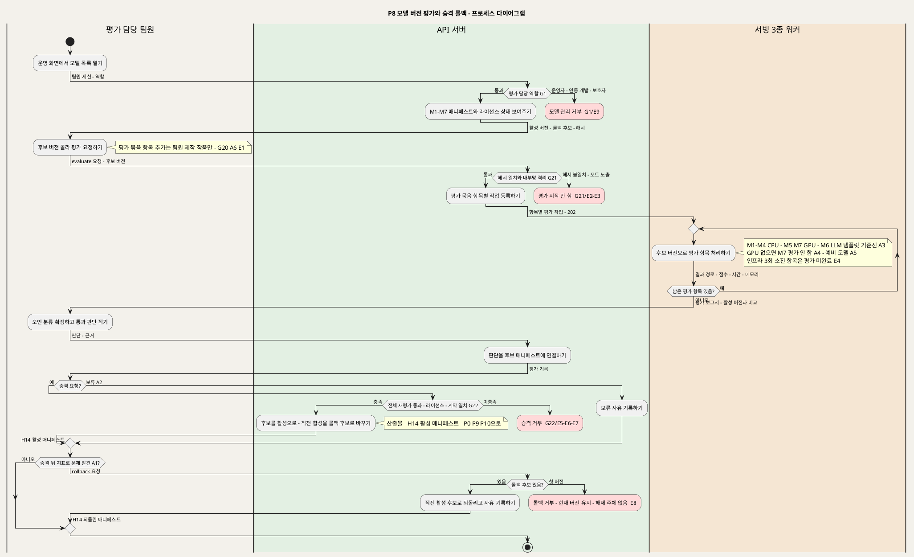

**[「P8 모델 버전 평가와 승격 롤백」 PlantUML 뷰어로 열기](https://plantuml.sumzip.com/plantuml/svg/eNqFVl9TGlcUf99PcWZ8kQdGATURZprQuNjOxBle-gFoRWUk4AA2LzygWR0itJIUyqqLgw0RSDfTFTYEp6T9Pnvvfoeee_cuQkbsg-Pe3Xvu-f0551yeZnOxTG7_RVLK7iZSe7FM7AX8GPtpdzuT3k9tPksn0xmYiwQiPvnbiR3Zndhm-mUitQ1bsWQ2LuUSuWQcoo-BfOiQX4ZAegptKmCfvraMAj0rAD25tXpdIFctYtyAF-yqQq40qgzpSQtIqUUbJv3dtD4PyWVHyjtx-N4kpVuwywV6UclLHKkUpOcmVQ_APquSrknrFapo47QfuuSqAbRuWkMjJHm_EbHAEh2pmJfWP9q1ZkjKz8mByKIcyIej3-NXDQHnpcQWzE-ndrbDus8DuZ14Cj8ff7L6I48EENzweTceAWm3SKlo_6oiEftkyLiSxojRUZqMG311YL9CgH2EqtN3Iw4sjprBvEOEXlY4LoOcnoFlaMTQcI37bXWI31iquUhkbXVtNShYWmaBXOtg3RhkUAAEtyCvhnDbbiKZlOKpzcQWZ36G8t64Tnhd6e0LBc9mDtRMWtJCs8QOio0i3up3kJYwFOh5lfZQGZWzSaVzccgktndyQXcD0Qe0UcYcH9ESoIMqviQn1bEdTY1evgH8s98WSbuMcNb9ixBeAdnHsMd_jiX3Y3iqk4ihnUTzkH2cFVC04FblZhyaqBJpNwDrj8m27r_PzPtwk77CINL6EZDfbrCwXMKOfSIVGRSdbAzlqY41AORoSAfapHOubiWHd62IKTrAsCzIfq8cuMe-MQQ31kHiBf-inwkQWZZX1gJ5Rv72DAL0jyOgF2X6dysvZeJ78ViO05qUjWoj7Dn3PNebnoqquMwA7szEBQAr8iV4Fv0BE28sAxb8uvO8As-fb4B9pNnVMrn-FzCctgpY9BAO8Ei2j9aPWdKuyQJdHoJ8eImVvVokt4rbvuFlHkkbQzYesNwC9nkZ6HGZthWBlzYK4xr7C7tNIe_KIC9hHCrHweMjymf1DLQW_31hlDFRs0KLfACUNMvg_dCtsrTXekjoBS93EjjE5slhZyKLK9Mlulx-4oFEFhtXLXpYLnyqKdj9VG15uGcCWN-0-k02lrzTXcgQIV3rU2V22-FZyB-rSiHvVQyv0WaNudNvglOuuLVCSh1kdHA35PgbL1ifRzgVZrRH0NlGG8q4m76aXfUKm0MonVsOd5xwiQ0wEzZrPTHinZZ94vYY0wotuRcRAI_DyuyZqLDuSu7w9E4PUmTXV2jti-ht7B3_OMegS69uPLx4RMmT9yOhvah6dL59wO8k5y2qMDUR2R5iVK1_hqIRJlshCPTQwJYmOoP1nW9p7Ou0gvgxugjRVYj6Fp28rDD5tGDVOgHTHQxCtPEs9_sX5GWvvOKVHzkg-FTg1Y1zgZf27PTuZOL8VQj7-WgTK3qoU60pjBxPMn7s_5tK3uJN1i7YbzSukz7ECY5yaVZPh7Dva7MRZCadTLKfEaIcQg-XwPTdNO41cShfCnenTJy0rqKSUxxEOmuUe6m6RtDen6Idp50QGIQT2LmqgiXp3n94HvIX1yZyx5ucFy0OOLwvQH78kFsuOGOWYRNjxAnN5tJ70lN8xh9m_wHlBvH1)** — 클릭 시 브라우저로 연결됩니다.

### 11-3 설계 주의

**평가 미완료는 승격 근거가 아니다.** 인프라 장애로 항목 몇 개가 "평가 미완료"면 그 평가는 "전체 재평가"가 아니다(UC9 E4 · D5). SD_03은 평가 기록에 항목 수와 완료 수를 두고, G22는 "완료 수 = 항목 수 AND 매니페스트 해시 일치"를 확인해야 한다. 점수는 통과 판단의 단독 근거가 아니다(집 그림 사람 점수 0.946 사례, BR-SUG-04).

**평가 입력에 가족 작품이 들어오면 안 된다.** 평가 묶음은 팀원이 만든 작품만이다(G20). 이 규칙이 P9 시험 호출(G23)에도 그대로 이어진다.

---

## 12. P9 API활용 메뉴 확인

### 12-1 단계별 IPO

| # | 단계 | Input | Process | Output | 근거 |
|:--:|---|---|---|---|---|
| 9.1 | 메뉴 열기 | 팀원 세션 | INC2로 운영자 또는 연동 개발 역할을 확인한다(**G1**). 보호자 화면에는 메뉴가 없다 | 3영역(엔드포인트·가이드라인·매뉴얼) | UC11 BF1 · E1 · BR-API-07 · BR-ACC-02 · BR-ACC-05 |
| 9.2 | 엔드포인트 목록 | `/openapi.json` | 네 묶음(보호자 앱·운영·관리·모델 기능)을 만든다. P0에서는 `caption`만 "P0.5 예정"이다(D17). 명세를 못 읽으면 마지막 확인 명세와 장애 대응 절을 보인다 | 엔드포인트 목록 | UC11 BF2 · A2 · E2 · BR-API-08 |
| 9.3 | 엔드포인트 상세 | 엔드포인트 | 스키마·가상 값 예시·오류 코드와 작업 기록 분류 대응표를 보인다. 가족 데이터를 예시에 쓰지 않는다 | 상세 | UC11 BF3 · BR-API-02 · BR-ACC-03 |
| 9.4 | 매니페스트 대조 | **H14** · `/ready` | M1~M7 매니페스트와 준비 상태를 읽고 명세·매니페스트·문서 버전을 대조한다. 불일치면 "문서 갱신 필요" 경고(차단 아님). GPU 없으면 M5 CPU·M7 비노출 | 모델별 버전·준비 상태 | UC11 BF4 · A3 · E3 · BR-MDL-01 · BR-OPS-01 · BR-API-08 |
| 9.5 | 가이드라인 | — | 서빙 3종·재시도와 낮춤 구분·시간 상한·외부 호출 조건·로그 금지·라이선스 주의 | 호출 규칙 | UC11 BF5 · BR-SRV-01 · BR-PRC-02 · BR-PRC-03 · BR-API-03~06 |
| 9.6 | 매뉴얼 | — | 가상환경+uvicorn 기동·런타임 내부망 기동·모델 경로·GPU 설정·교체(P8로)·장애 대응(P7로) | 기동·교체 절차 | UC11 BF6 · A4 · A5 · A6 · BR-API-01 · BR-SRV-04 · BR-MDL-03 · BR-MDL-06 |
| 9.7 | 시험 호출 (EXT3) | 평가 묶음 작품 · 시험 키 | 평가 묶음 작품과 활성 모델인지 확인하고(**G23**) P10 흐름으로 부른다. 결과는 화면에만, 가족 저장소에 쓰지 않는다 | **H15 시험 호출** → H16 응답 | UC11 A1 · E4 · E5 · E6 · BR-API-09 · BR-API-05 · BR-MDL-04 · BR-MDL-07 · D12 |

### 12-2 프로세스 다이어그램

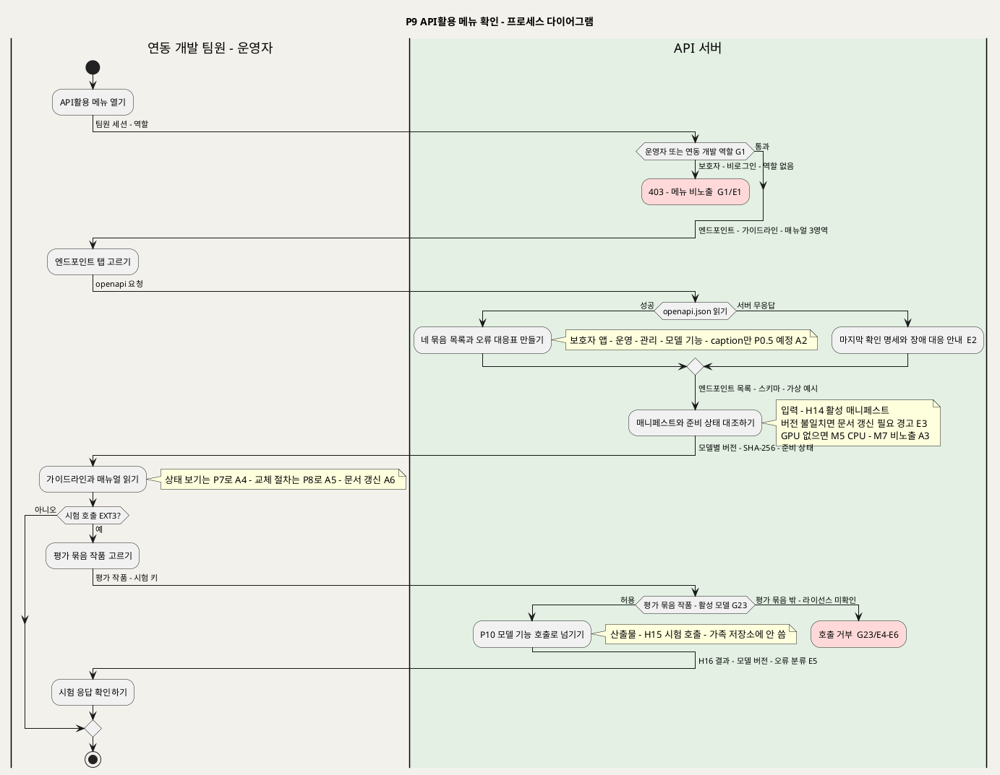

**[「P9 API활용 메뉴 확인」 PlantUML 뷰어로 열기](https://plantuml.sumzip.com/plantuml/svg/eNqNVU1vGlcU3c-vuFI29oLEGOPUILWhydjuIhJSW6lbGmN7agIIiLphQeyxNQa3thsw43RAWBrXH8LqYMaUSOQP8d77D7133oDBTdusgJn7cc65516e5QuJXOHN65SS39LS2UQu8Rp-TLza2shl3qTXnmdSmRw8Wg4tB9WvJyLym4m1zM9aegPWE6l8UilohVQS4ksQi38jTi3-_grYVZXtuyBOa7zRhwCIqs7OLK73edkGVrF5w-Un7vCvPmteKkVed9jhKQwdizkWiIMS__0Ik_h7l5tvefOoqHg4lcg_GvC6O-w7USXw5SiNeuyalF2_EbVWVCk-UkPLc2qoiMn41mK3elHR1mFmXB6YecTKVZiGIfNhJTgLhc1kGmbE3t2wO5hVksgZZljXFWafsgPAPhA7ZCPJ-pm8vscbB7MKoITLL5ZeLEUW5kIULaFT0m6f9yzAHk_UYBQDt7RUSkmm17R1YsTrVfbOEodtLCvKVHnolFA5fMgaA9mLXdhYjJ8MIERk6jfRz5Ez8rC02LmBYbfFzsdyZrLJdCKrYVaV3978h4x-4OOf8pk08MZHLDBSjOudYfeOFIgwHefe7qEgwK6v2FkDpQRu2uzcBIYIG8fi2EI2B-yd7UEASGcKSchpG5uFCNyrzWudMRdSxC2xP9okxPUl-6UPmMvK5_j7VSJb0DJprAjxucdh7GXwVg1i8_78JAXE5GJvVvFRXhj8osQu9kfOZde7ZKjTEvDmOcehSqyIwmDbLoA6H_33eUmihLZsi20bi_sj3HnrwalYUSVCA6wY4leTgsqylV1CcwCGiR3L63jmiJrpyXIvCuLlzV3WIrKrwQWgxdA78KAeRiFN3kKmPYOjaz6Y7ArN1-6jAAimwystEDUdxwzD24_oAVBDmLQS_94zsDWg8JdheI4PAvDy6YRvYyHi7s2J6MsJsK4-6hiAb1djgfnwIkkwyenzPPrA7GSYe7dLo03qERkL1nU9F1Qh_hTXEmILJPvdEb_Fe9EyuHPpvfvCexcm60yJEVuU16FiiboJ5Dqkqv7wXeirsa1Nw3OLONxHjCNb8-ax-M2Y3CIAOksyyH-LDP262zYFfHKrAAjAJ6sHxmOWdl-ZD43PU93Aw0jAEFo8OPdgIyQR4sx0spKPcHrN-LZDQe2B56kwTIsgzXvWQRVLtA57B7xOC2kAr5awllysadzMOSGFaYIu11ve-f-zL7dLYh0dR7_JsOOwXgmI2RN1IaAuSpTeZcQW3q55wq4GF9GxDtlivP1j440uS0-nDzXsaf3_nkPlfMryKPhnYLR8_uWo6bhh2GHWX_18IZNVnuF3_CP9G1zUyBE=)** — 클릭 시 브라우저로 연결됩니다.

### 12-3 설계 주의

**엔드포인트 탭은 손으로 쓰지 않는다.** `/openapi.json`에서 만들고 H14와 대조해야 문서와 실제 API·모델 버전이 어긋나지 않는다(BR-API-08). 버전 불일치(E3)는 UC가 경고로 정했으므로 게이트로 올리지 않았다. 대신 SD_04는 문서 번들에 대상 API 버전을 넣어 대조할 수 있게 해야 한다(UC11 A6 [추론]).

---

## 13. P10 외부 모델 기능 호출 (P0 · caption P0.5)

### 13-1 단계별 IPO

| # | 단계 | Input | Process | Output | 근거 |
|:--:|---|---|---|---|---|
| 10.1 | 인증과 한도 | API 키 · 요청 · (시험이면) H15 | INC3으로 키 유효성·기능 권한(`pose`는 팀 내부 키만, D17)·가족 경로 차단·요청 한도를 확인한다(**G2**). 실패 시 한도를 차감하지 않는다 | 요청 본문 · 한도 1건 차감 | UC12 BF1 · E1 · E2 · A7 · BR-API-01 · BR-API-03 · BR-API-04 · BR-API-06 |
| 10.2 | 크기·형식 검사 | 요청 본문 | 크기 상한 초과는 본문을 끝까지 읽지 않고 413, 판독 불가·형식 오류·caption에 이미지나 이름은 422(**G24**) | 검사된 입력 | UC12 BF2 · E3 · E4 · BR-API-04 · BR-INT-01 · BR-CAP-01 |
| 10.3 | 기능 매핑과 준비 확인 | 기능 이름 · H14 | 기능 → 모델·서빙군 매핑, 활성·라이선스·준비 확인(**G25**). 활성은 평가를 통과해 승격된 버전만이다. 3D(M7) 등 없는 기능은 404. P0에서는 `caption`도 아직 열리지 않았으므로 404다(D17) | 기능·모델·서빙군 | UC12 BF3 · E5 · E7 · BR-MDL-01 · BR-MDL-02 · BR-MDL-07 · BR-OPS-01 · D9 |
| 10.4 | 외부 작업 등록 | 검사된 입력 | 메타(기능·모델 버전·상태·키 식별자)만 기록하고 입력은 워커 임시 영역에만 둔다. 202 + 작업 ID. caption은 LLM 서버로 동기 처리 후 200 | 작업 ID 또는 설명 응답 | UC12 BF4 · A4 · A5 · BR-API-05 · D8 |
| 10.5 | 서빙군 처리 | 임시 입력 | segment(M1)·classify(M2, 점수 비노출)·pose(M3+M4, 렌더 없음)·relief(M1+M5, M1 미달이면 quality_below). 외부 작업은 보호자 단계 작업과 다른 대기열에서 낮은 우선순위로 처리하고, 서빙군별 외부 동시 처리는 예시값 1건이다(D17, U12). 상한이면 queued. 인프라 3회 소진·시간 초과는 failed | 결과 · 모델 버전 · 처리 시간 | UC12 BF5 · A1 · A2 · A3 · A6 · E5 · E6 · BR-SRV-01 · BR-SRV-02 · BR-SRV-04 · BR-PRC-03 · BR-PRC-06 · BR-PRC-07 · BR-SUG-02 · BR-SUG-04 · BR-FBK-02 · BR-CAP-02 |
| 10.6 | 상태 조회 | 작업 ID | `queued`/`running`/`done`/`failed`와 결과 분류·모델 ID·버전을 돌려준다. 판정은 제안이라는 안내를 붙인다 | 상태·분류 | UC12 BF6 · BR-API-02 |
| 10.7 | 결과 수령과 폐기 | 결과 요청 | 결과를 한 번 주고 입력·결과·임시 파일을 즉시 지운다. 재조회는 404. 집계 필드만 남긴다 | **H16 결과** · H13 | UC12 BF7 · E7 · BR-API-05 · BR-PRC-08 · BR-OPS-04 · BR-PRV-01 |

### 13-2 프로세스 다이어그램

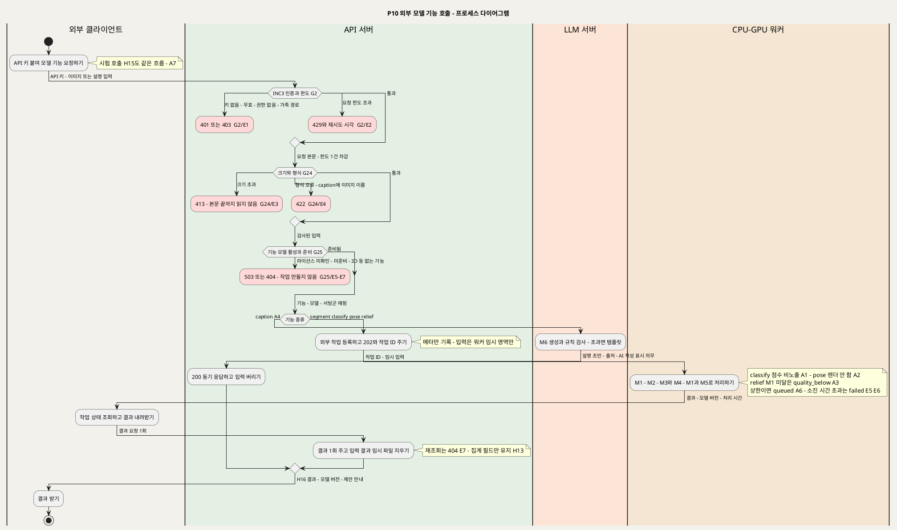

**[「P10 외부 모델 기능 호출」 PlantUML 뷰어로 열기](https://plantuml.sumzip.com/plantuml/svg/eNqNVl1PGmkUvudXnMQbvSDybZRkU1awmtTGm15vqA46EcECxjThAnQwRmiKURawMwZ3UWlDU0C0Y9Zm_8-87_yHPeedGfyIbfZCBea85znPx3vwRTYXz-S2NpKu7Lqc2oxn4hvwNr68vppJb6VWZtPJdAbG5vxz3tjvDyqya_GV9LacWoVEPJmVXDk5l5RgyesB3tTZTQHYlw77oIOh99jBOZgNnd-o4AbzWGFnKld0ftAGVm5zbcj_HBrfdXbaceXts2ZxyLQ78Ug3D_S8S4zomoksLYC5g-dumrzefQLBT4754KtZa-D7sCuVzkmQkVfXcjPAy6pZbzgzzHuD7KMCRq_JNYTSquxCwcEiUy73b-AguAHR2TedXyKTRpUdHANX2uxLCfhpibXOw678WMw_54n583SEKyobKDjntpxbXoPxhdezfuyg8wvNuLoDs6YS5EvfhGs5npVgnCB4fY9rFURi3aF50sEXxk0FK-8fGL0CP-uDMfiBkk24AG2Yi05Hp2cCHq8zVcDjB2w8GfOGsWBdTiZtCEsOB5oP93GQRz1807xZQDpdlEeUlFWjV7Sa-Z40M_euxXEptWJRJK1sBHals65O1lpQXqM_BN7rGL1qeCSIWeyiLQRoNmq8rCFKYCSGePbciF4_yWP1Z0XNuK2QH1z7If7UDkgm6jQZ8z8d2ELhjTY7b2CT5fhmTk6neL36wFh6daE8FsVnNwz8HwWMQYHvdFlVHaVCTsC4nUc7nWYT096nFPB2gd1SCoITkFuTUuiR-IRVO9g3SSh26pWWuB3fdLNZwxSRCDixddwN_iiwoz7FhAJgoT0kEcRIjNIRoCifHvJ6CdhlhR21H0sXnIwF3bGpEVmkJycENYuE26HhFhm_bRrXPWzUNmuHj8jyv0ootMPLVhsiAZorPzY3GwtEQ_lXrxZHNwVgZjEEfFezxTG-q_y2aStKaCIN7PMQzJJqHlfYxb80JMXOvofDfV7bp8oblQ_I48iCYKr0wTxUMc3obwPvVliM8MxlxRF8Hg-wj00RP-2Qla9pfVy1bDsBy9hFV-wTy5-stLohpXKwnIxns3LiPWym8eOMlJSlBFGdsReYo_hRn51pdk-fx2ddOPFoIQr87zvRGuDhsmKfj83dAnolLDjThH80DW0r_qnC_8HVcaoIfo0ir3_FUluYUWf3qMKOpTAhGAtF_fnZpTful0tv7FaWEV48seijX34acZFCs-glWxaDuHoA9UUdnNX6cF58A_dq8FaV7zeAMl0SuzZCnYVGrFVhH3CJomVmrQMRnzhpKYdYFHBW7hLHd1vxpJx7_8dbKZnehohfFPLdIq4XurCYiHdb0pa0ApEQEd3DnWAvL2fNUfITcTmJNbEgxELYAXMtpraUMgY9IjcKN_rMW3S1LKJ2NyHbz76RyGtLbxptFzU665knFdtrG4DtDFmrzXqfbN3uoe3d6cUjv8qnXU1lIi730XT6WD6blQrX8N1lgZ_0ngkVbXkxn7MUYlPE9vLQuFLQD4UdqZQ4rrZoPcx7_feLYN4b-oVeLZUcxR-kGv7597dDxJEim0tvul4gBv7b8R9nvCoj)** — 클릭 시 브라우저로 연결됩니다.

### 13-3 설계 주의

**외부 입력은 저장소에 닿지 않는다.** P10 도면에 원본-결과 저장소 레인이 없는 것이 설계 의도다(D8). SD_03에 외부 작업 테이블을 둘 때 이미지·텍스트 컬럼을 두지 않고, SD_04의 워커는 외부 작업의 결과를 가족 저장소 경로에 쓰지 못하게 경로를 분리해야 한다. 같은 워커가 보호자 작품과 외부 작업을 함께 처리하므로 동시 처리 몫도 나눠야 한다(UC12 특별 요구사항 [추론], U6).

**caption도 규칙 검사를 거친다.** 외부 caption은 P4와 같은 규칙 검사·템플릿 낮춤을 쓰고 "AI 작성" 표시 의무를 응답에 싣는다(UC12 A4). 과정 제공 LLM으로 외부 입력을 다시 넘기지 않는다(UC12 §3 [추론]).

---

## 14. 프로세스 간 인계 계약

프로세스 경계에서 넘어가는 산출물이다. 도면의 `H` 레이블과 같은 ID를 쓴다. 이 표의 산출물이 SD_03의 주요 엔티티 후보가 된다.

| ID | 경로 | 산출물 | 필수 포함 항목 | 포함 금지 | 만료·무효 조건 | 근거 |
|:--:|---|---|---|---|---|---|
| H1 | P1 → P2 | 아이 기록 | 가족 ID, 아이 ID, 별칭 | 실명, 생년월일, 출생연도, 법정대리인 확인 완료 표시 | 아이 삭제(P6 A1) 시 무효. P2 선택지에서 즉시 사라짐 | UC1 사후조건 · BR-CHD-01·02 · BR-PRV-03 |
| H2 | P2 → P0-1 | 판정 단계 작업 (작품 기록 + 작업 기록 + 원본) | 요청 번호(유일), 작품 ID, 아이 ID, 원본 객체 참조, 상태 "접수됨/판정 중", 단계 종류(분리·판정) | 원본 변형본 | 세 부분 중 하나라도 없으면 처음부터 없는 것(G6). `삭제 중`이면 점유 금지 | UC2 사후조건 (1) · BR-INT-02·03·04 · BR-DEL-05 |
| H3 | P0-1 → P2 · P4 | 판정 결과 | 마스크·컷아웃 객체 참조(또는 분리 실패), 제안 문구 코드, 제안값, 태그 후보, 관절 좌표, 단계 작업 기록(모델 ID·버전·시도·처리 시간·분류) | 점수의 화면 노출 | 만료 없음. 판정 소진이면 제안 없음(G7). 태그 후보는 P4에서 보호자가 골라야 입력이 됨 | UC2 사후조건 (2) · BR-SUG-01·02 · BR-CAP-06 |
| H4 | P2 → P0-2 | 처리 단계 작업 | 작품 ID, 확정값, 제안값, 수정 여부, 처리 경로(서빙군), 원본·마스크·관절 참조 | — | 첫 확정값만 유효(중복 확정 무시). `삭제 중`이면 취소 | UC2 사후조건 (3) · BR-INT-05 · BR-SUG-03 · BR-PRC-01 |
| H5 | P0-2 → P3 | 처리 결과 | 상태(확인 대기/처리하지 못함), 결과 종류, 결과 객체 참조(처음 만든 것 1개), 낮춤 원인 **또는** 오류 분류(동시 기입 금지), 결과 원인 분류, 모델 ID·버전, 시도 횟수, 처리 시간 | 두 번째 결과 파일, 점수의 화면 노출 | 재생성 금지라 만료 없음. 다시 찍기·삭제 시 무효 | UC3 사후조건 · BR-APR-03 · BR-FBK-04 · BR-API-02 |
| H6 | P3 → P0-2 | 낮춘 결과 요청 (`use_lower`) | 작품 ID, 원본·M1 마스크 참조, 깊이·부조 단계 작업, 결정 "보호자 전환(움직임→2.5D)" | 처음 결과의 삭제·덮어쓰기 | 인프라 소진 시 처음 결과로 되돌림(UC4 E6). 두 번째 확인은 첫 결과 승인율에 넣지 않음 | UC4 A1 · E6 · BR-APR-06 · D11 |
| H7 | P3 → P2 | 재접수 요청 (EXT2) | 이전 작품의 아이 ID | 이전 원본의 재사용 | 아이 삭제 시 무효. 새 사진을 올리지 않으면 버려지고 이전 작품은 되살아나지 않음 | UC2 A7 · UC4 A6 · BR-APR-03 |
| H8 | P3 → P6 | 이전 작품 삭제 | 이전 작품 ID, 결정 `retake`, 상태 `삭제 중` | — | 되돌릴 수 없음 | UC4 A6 · UC7 A5 · BR-APR-05 |
| H9 | P3 → P4 | 설명 입력 (확장점) | 작품 ID, 아이의 한마디(원문), 제작 당시 나이, 제작일 | 작품 이미지, 별칭, 제목 | 승인된 설명이 있으면 무효(E3). `삭제 중`이면 무효 | UC5 A6 · UC10 BF3 · BR-CAP-01 |
| H10 | P4 → P5 | 승인 설명 | 승인본, 출처(LLM/템플릿/직접), 규칙 검사 결과, 생성 횟수, 수정 여부, "AI 작성" 표시 여부 | 걸린 초안, 검사 전 문장 | 승인 후 고정(재생성 금지). 작품 삭제 시 무효. 내리기·교체 절차는 미정(U16) | UC10 사후조건 · BR-CAP-03·04·07 · D6 |
| H11 | P3 → P5 | 전시 작품 | 상태 "전시 중", 결정, 결과 종류, 결과 객체 참조, 제목, 제작일, 제작 당시 연령, (선택) 한마디 원문 | 낮춤 원인·결과 원인 분류, 자동 생성·교정 문장, 발달 평가, 감정 태그 | 삭제 요청 즉시 무효. 이야기 수정은 무효가 아니라 즉시 갱신 | UC4·UC5 사후조건 · BR-EXH-01·07 · BR-STY-03 |
| H12 | P6 → P0 | 취소 신호 (EXT1) | 작품 ID, 상태 `삭제 중`, 서빙군별 대상 단계 작업 | — | 멈춤 응답 또는 시간 상한으로 닫힘. 그 뒤 해당 작업은 재개·이어받기 없음 | UC7 A2 · E2 · UC3 E6 · BR-DEL-01·05 |
| H13 | P0 · P2 · P3 · P4 · P6 · P10 → P7 | 집계 필드 | 단계 종류, 모델 ID·버전, 서빙군, 상태, 시도 횟수, 처리 시간, 낮춤 원인·오류 분류, 결과 종류, 결과 원인, 수정 여부, 첫 결정, 삭제 미완료 여부, 엔드포인트별 호출·거부 수 | 이미지, 객체 키, 작품 번호, 작품·아이 연결, 별칭, 제목, 한마디, 키워드, 오류 원문 | 만료 없음. 삭제 뒤에도 남음. 취소된 작업은 지표에서 제외 | UC7 사후조건 (5) · UC8 사후조건 (3) · BR-DEL-02 · BR-OPS-02·04 · BR-PRV-01 · D4 |
| H14 | P8 → P0 · P9 · P10 (P7 표시) | 활성 모델 매니페스트 | 모델 ID, 활성 버전, 롤백 후보, 가중치 SHA-256, 런타임, 이미지 다이제스트, 설정 해시, 라이선스 확인 상태, 평가 기록 연결 | 가족 작품 이미지 | 승격·롤백 시 새 단계 작업부터 교체. 실행 중 작업은 시작 버전 유지. 해시 불일치면 평가·운영 불가 | UC9 사후조건 · BR-MDL-01·03·07 · D5 |
| H15 | P9 → P10 | 시험 호출 요청 (EXT3) | 기능 이름, 평가 묶음 작품(또는 설명 입력 세트), 시험 키 | 가족 작품, 실제 아동 사진, 공개 이미지 | P0부터 발생(caption은 P0.5부터, D17). 입력은 처리 뒤 보관하지 않음 | UC11 A1 · BR-API-09 · D12 |
| H17 | P7 7.8 → P0 워커 | 점검 작업 | 점검 번호, 모델 ID·버전, 평가 묶음 항목 참조, 서빙군, 단계 종류, `origin='check'`, 우선순위 30 | 가족 작품·아동 사진, 호출자가 올린 이미지 | 15분 안에 점유되지 않으면 `model_not_ready`로 닫힘. 폐기 버전·평가 묶음 밖 항목은 등록되지 않음(G30) | UC8 A8 · UC9 A7 · BR-OPS-05 · BR-MDL-04 · D20 |
| H18 | P0 워커 → P7 7.10 (7.3 표시) | 점검 결과 | 통과/실패, 결과 분류(`ok`·`quality_below`) 또는 실패 사유(오류 분류 5종·`bad_output`), 처리 시간, 메모리 최대, 끝난 시각 | 출력 파일·객체 키, 점수, 오류 원문 | 모델마다 최근 20건만 보관 [추론]. 지표·결과 미도달에 넣지 않음 | UC8 A8 · BR-OPS-05·06 · BR-PRV-01 · D20 |
| H16 | P10 → 외부 클라이언트 · P9 | 모델 기능 결과 | 결과(또는 quality_below·오류 분류), 모델 ID·버전, 처리 시간, 제안 안내(classify·pose), 출처·"AI 작성" 표시 의무(caption) | 점수, 가족 데이터 | 1회 수령 또는 보관 상한(U12 예시값 1시간, 확정 아님) 경과 시 삭제, 재조회 404 | UC12 사후조건 · BR-API-05 · D8 |

### 14-1 버전 참조 사슬

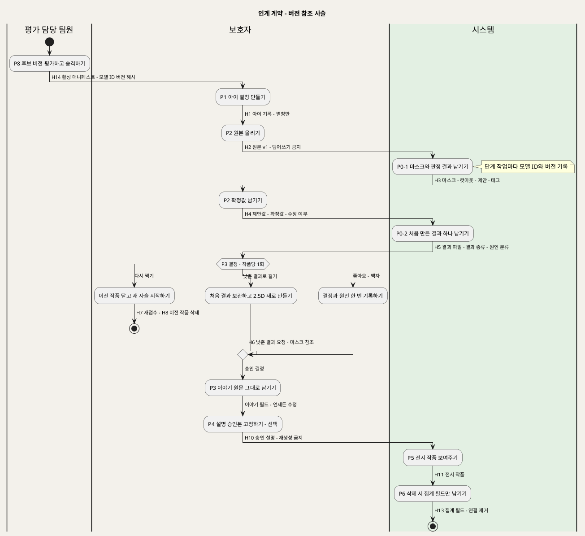

**[「인계 계약 - 버전 참조 사슬」 PlantUML 뷰어로 열기](https://plantuml.sumzip.com/plantuml/svg/eNp9VF1P2mAUvu-vOMlu9ILFijoDyWI2Ne7Ov8CUKRHBAM4bLhiUpAPc_KpWAQOOTeeqqUC0ZuwP9T39DzunLSBeeNGkfc_H85znfU7n0plIKrO9GZfSG7HEViQV2YSPkZWNtVRyO7H6PhlPpuDVYnBRXnj3JCO9HllN7sQSa_ApEk9HpUwsE48C1i27owA9qP2DAIi2gg0F0LSwaQLmDSwZUtb5_tU2cyDKXVF-BKeSw-peVnJpSKHlWXCqiuh0-8VetqPpdqcBWHq027_5wzLDUuAtLMlT4JzWULkDcdkSZdX5pmOp5ZQshr--ErsWfJgf9NK6WK6FpSz1d3QLzwk3tCwDagrWCZF4P95Qo4o4bA0R-mE6Ec0693XzKC1M1ZNA9EXHAtQN8csYlA3OP8tcsnuLx108NClOjVS8zBGNVwvBxYmFYJZIMelijelMBGSioPLBFwNPc6TQHjY0sNum3emByF9RDxcmkcxEIRVbW8-ESM0rlh7P9_GkSOWi3BrOz118CbwhXIbBIQwxxL8PPGe1wO-NGmoqvTiFmv1gPRdskiTXiJJtHjylwz2n_FoOBZ6kUU9V5ynwxBD3L8xOsrV1rFe8W2j0p6YrF3n9Odr0IFypYL1HKP43XhTFT51Rq3tkShD3Cn2PzpHeiWVW1mFsOchVzC3A8jkHKttSds4q49JKJB2FMdKSWJKNdwl5XAIIkR1cY7vppP0f15wF1fc48FAU830KwGTfULqBjX0SgpCWZmG0CeZvSDpOTmeSW33k_C3e6_5UolkD-84acPB06tui07W7_TWZfD09z3S44ombPR4zMNIV8OwI2zfs0YEbvIUN-yTwoszOODtigbQmiefie6K5HTyRHY3Q2qpvsf7w0cSqpzTfGO0vZ3qlvD1BVwWtx2vB-2JQ8MESlZxLfeS2h4mOpojDGrM5tkgztonnLu5IDlRa4rroY_EGkiQU9AhxldJwCnV_uSf6nPyqgHtLhTr_UV7e02myuuL6wndBp0vmxh-94Z9DHk1hejP-RYN7fLnPS-vNQxf13N9ycDSF2Z2YpB5vmX1HWa5X5khj-oH_B3wPIVo=)** — 클릭 시 브라우저로 연결됩니다.

**사슬 읽기** — 이 사슬에는 **고쳐 쓰는 화살표가 하나도 없다.** 원본, 마스크, 결과, 작업 기록, 승인 설명은 한 번 만들어지면 바뀌지 않는다. 바뀔 수 있는 것은 네 가지뿐이다.

- 결정: P3에서 작품당 한 번 기록된다(BR-APR-06).
- 이야기: 언제든 고칠 수 있다(UC5 A2).
- 상태: 정해진 전이만 한다(공통 기준 §5).
- 활성 매니페스트: P8에서 승격·롤백으로만 바뀐다. 모든 단계 작업이 모델 ID·버전을 기록하므로, 어느 결과가 어느 버전에서 나왔는지 나중에도 따라갈 수 있다.

"다시 찍기"도 이전 작품을 고치지 않는다. 이전 작품을 닫고 **새 사슬**을 시작한다. "낮춘 결과로 걸기"는 같은 사슬에 결과를 하나 **더** 붙일 뿐 처음 결과를 지우지 않는다(D11).

---

## 15. 게이트 맵

게이트는 처리를 멈추거나 출력을 막는 지점이다. 게이트마다 위치·조건·미통과 시 결과·해제 주체·근거 다섯 가지를 모두 채웠다. **해제 주체가 비어 있는 게이트는 없다.** 해제 주체가 없는 차단은 §15-2로 옮겼다.

| ID | 게이트 | 위치 | 통과 조건 | 미통과 시 결과 | 해제 주체 | 근거 UC · BR |
|:--:|---|---|---|---|---|---|
| **G0** | 가족 접근 (INC1) | 1.1 · 1.4 · 2.1 · 2.3 · 3.1 · 3.6 · 4.1 · 5.1 · 5.2 · 5.3 · 6.1 | 로그인 상태이고, 대상이 요청자 가족의 것이다. P6은 보호자 역할이어야 한다. 외부 API 키는 통과하지 못한다 | 재로그인 요구 또는 거부. 존재 여부도 알리지 않는다. 입력 중인 값은 저장하지 않는다 | 보호자 본인이 다시 로그인한다. 다른 가족 자료는 그 가족 보호자만 연다 | INC1 · UC1 E3·E4 · UC2 E8·E9 · UC4 E5 · UC5 E5·E6 · UC6 E1·E2 · UC7 E3·E4 · UC10 E5 · BR-ACC-01·02·04 · BR-API-06 |
| **G1** | 팀원 역할 (INC2) | 7.1 · 8.1 · 9.1 | 팀원 계정이고 해당 역할(운영자 / 평가 담당 / 운영자·연동 개발)이 있다 | 화면·기능을 거부한다(403). 보호자 화면에는 메뉴가 없다 | 해당 역할이 부여된 팀원이 다시 접근한다. 역할 부여 주체·방식은 미정(U8·U17) | INC2 · UC8 E3 · UC9 E9 · UC11 E1 · BR-ACC-05 · BR-API-07 |
| **G2** | API 키·요청 한도 (INC3) | 10.1 | 유효한 키(U12 확정 전에는 팀·과정 내부 키만 발급), 기능 권한(`pose`는 팀 내부 키만, D17), 가족 경로 아님, 한도 안 | 401 / 403 / 429(재시도 시각). 한도 미차감 | 외부 클라이언트가 유효한 키로(발급 주체 U12, 예시값: 서비스 운영자가 'API활용' 메뉴에서 발급) 또는 한도 창 뒤 다시 요청한다. 한도 예시값: 키당 분당 30건 · 키당 하루 1,000건 · 키당 동시 진행 작업 2건 | INC3 · UC12 E1·E2 · BR-API-03·04·06 |
| **G3** | 기록 반영 원자성 | 1.4 · 3.5 · 3.8 | 작업 DB 쓰기가 성공한다 | "저장되지 않았어요/반영되지 않았어요". 이전 값·상태 유지, 일부 반영 없음, 로그엔 분류 코드만 | 보호자가 다시 시도한다(DB 복구 뒤) | UC1 E5 · UC4 E3 · UC5 E3 · BR-PRV-01 |
| **G4** | 별칭 검사 | 1.3 · 1.4 | 비어 있지 않고 형식에 맞는다. 중복은 검사하지 않는다(D18) | 저장 버튼 비활성 | 보호자가 별칭을 고친다 | UC1 E2 · BR-CHD-01 · BR-CHD-02(개정) |
| **G5** | 사진 검사 | 2.2 · 2.3 | JPEG·PNG·HEIC, 20MB 이하, 이미지로 열림 | 접수 전 거절, 사유 안내 | 보호자가 다른 사진을 고른다 | UC2 E1~E3 · BR-INT-01 |
| **G6** | 내구 접수 | 2.3 | 원본·작품 기록·작업 기록이 **모두** 저장됐다 | 미접수. 먼저 저장된 원본까지 지운다. 판정 단계 작업 미등록 | 보호자가 다시 올린다(저장소·DB 복구 뒤) | UC2 E4·E5 · BR-INT-02 |
| **G7** | 판정 제안 도달 | 0.5 (해제 2.5) | 판정 단계 인프라 장애가 3회 시도 안에 풀린다 | 제안 없이 "확정 대기". "제안을 준비하지 못했어요. 직접 골라 주세요". 인프라 실패로만 집계 | 보호자가 P2 2.6에서 직접 확정한다 | UC2 E6 · BR-SUG-05 · BR-PRC-03 · D1 |
| **G8** | 확정 가능 상태 | 2.6 | 작품이 "확정 대기"(또는 판정 중 직접 확정)다 | 확정 거절, 현재 상태 표시 | 처리 뒤 전시 방식 변경은 보호자가 P3 3.5 결정으로 한다. `삭제 중`은 §15-2 종결 | UC2 E10 · BR-DEL-05 |
| **G9** | 결과 단계 재시도 소진 | 0.9 | 결과 단계(움직임 렌더·깊이·부조·3D) 인프라 장애가 3회 시도 안에 풀린다 | 상태 "처리하지 못함", 결과 미도달 +1. 품질 미달로 바꾸지 않는다 | 보호자가 P3 3.5에서 "액자로 걸기"(모델 없이 원본 액자) 또는 "다시 찍기"를 고른다 | UC3 E1~E5 · UC4 A5 · BR-PRC-03 · D1 · D2 |
| **G10** | 결과 열람 | 3.3 | 결과 미리보기와 원본을 읽을 수 있다 | 미리보기 실패: 선택지 잠금, 확인 대기 유지(E2). 원본 실패: 원본 비교·액자 잠금, 다시 찍기만(E1) | 보호자가 나중에 다시 연다(E2) / 다시 찍는다(E1) | UC4 E1·E2 · BR-APR-01 |
| **G11** | 이야기 값 검증 | 3.8 | 제작일 ≤ 오늘, 연령 0~18 정수, 전시 중이면 필수 항목 비움 없음 | 저장 거절, 허용 범위 안내, 입력값은 화면에 남김 | 보호자가 값을 고친다 | UC5 E1·E2·E7 · BR-STY-02 |
| **G12** | 전시 | 3.9 (5.2·5.3 재확인) | 보호자 승인(좋아요·액자·낮춘 결과)과 필수 이야기(제목·제작일·연령)가 **모두** 있다 | 전시하지 않는다. 저장만 하고 "이야기를 채우면 전시돼요"/"확인하면 전시돼요". 직접 주소로도 비노출 | 보호자가 빠진 쪽을 채운다(결정은 3.5, 이야기는 3.7~3.8) | UC4 BF4·5 · UC5 A1·A5 · UC6 E3 · BR-EXH-01 · BR-APR-01 |
| **G13** | 설명 모델 사용 조건 | 4.1 | M6(Qwen3) 라이선스, 과정 제공 LLM이면 그 조건이 확인되어 활성이다 | AI 초안 경로를 막고 템플릿·직접 입력만 준다. 외부 LLM API로 대신 보내지 않는다 | 조건 확인(U3·U4) 뒤 평가 담당 팀원이 P8에서 M6를 승격·활성화한다 | UC10 E4 · BR-MDL-07 · BR-CAP-05 |
| **G14** | 설명 입력 최소 | 4.2 | 키워드 또는 고른 태그가 하나 이상 있다 | "초안 만들기" 비활성, 입력 안내 | 보호자가 키워드를 적거나 태그를 고른다 | UC10 E6 |
| **G15** | LLM 초안 도달 | 4.4 | LLM 서버가 시간 상한 안에 응답한다(짧은 재시도 최대 3회) | AI 초안 없음. "지금은 AI 초안을 만들 수 없어요". 인프라 실패 기록, 설명→템플릿 낮춤률에 넣지 않음 | 보호자가 템플릿으로 받기 / 나중에 다시 / 직접 쓰기 중 고른다 | UC10 E1 · BR-PRC-03 · BR-FBK-04 · D1 |
| **G16** | 설명 규칙 검사 | 4.5 | 초안에 입력에 없는 사건·감정·발달 상태 표현이 없다 | 걸린 초안은 보이지도 저장하지도 않는다. 자동 재생성, 2회 뒤 템플릿으로 낮춤 | 시스템(M6 재생성·템플릿 낮춤), 최종적으로 보호자(템플릿 수정 또는 직접 쓰기) | UC10 A2·E2 · BR-CAP-02·07 · BR-FBK-01 |
| **G17** | 3D 노출 | 2.6 · 3.4 · 5.2 · 5.4 | 3D 노출 설정이 켜져 있다(기본 꺼짐) | 3D 선택지·결과·회전 보기 비노출. 3D 결과는 원본 액자로 보임. 직접 주소도 거부 | **서비스 운영자** — M7 활성 버전이 있을 때 운영 CLI `ops:feature enable sculpture_exposure`(D10 · D22 ⑨ · T132) | UC2 A9 · UC4 A8 · UC6 A3·E7 · BR-SRV-02 · D10 |
| **G18** | 삭제 착수 | 6.3 | `삭제 중` 전환이 성공한다 | "삭제되지 않았어요", 아무것도 바꾸지 않음, 파일 삭제로 가지 않음 | 보호자가 삭제를 다시 요청한다 | UC7 E5 · BR-DEL-01 |
| **G19** | 처리 멈춤 확인 (보류형) | 6.4 | 실행 중인 단계 작업이 없거나, 모든 서빙군이 멈춤을 응답했거나, 시간 상한이 지났다 | 파일 삭제를 **보류**한다. 그동안 재시도·이어받기 차단, 늦은 결과 폐기 | 서빙군의 멈춤 응답, 없으면 시간 상한 타이머(시스템) | UC7 A2·E2 · UC3 E6 · BR-DEL-01 · BR-PRC-06 |
| **G20** | 평가 항목 등록 | 8.3 | 팀원이 직접 만든 작품이고 종류·기대 경로가 있다 | 등록 거부 | 평가 담당 팀원이 조건을 채워 다시 등록한다 | UC9 E1 · BR-MDL-04 |
| **G21** | 평가 착수 | 8.3 | 설치본 해시가 매니페스트와 같고, 런타임 포트가 내부망 안이다 | 평가를 시작하지 않고 불일치·격리 조치를 보인다 | 평가 담당 팀원이 재설치·격리 조치 뒤 다시 요청한다(조치 실무 주체는 UC에 없음, §17) | UC9 E2·E3 · BR-MDL-01·06 · BR-SRV-04 |
| **G22** | 승격 | 8.7 | 해시 일치 전체 재평가 통과(미완료 없음), 라이선스 확인, 응답 분류·결과 종류 계약 일치 | 승격 거부, 활성 버전 유지 | 평가 담당 팀원이 재평가·라이선스 확인·어댑터 수정 뒤 다시 요청한다 | UC9 E5·E6·E7 · BR-MDL-03·05·07 · BR-API-02 · D5 |
| **G23** | 시험 호출 입력 | 9.7 | 평가 묶음 작품이고 대상 모델이 활성(라이선스 확인)이다 | 호출 거부, 분류 코드만 로그 | 팀원이 평가 묶음에서 다시 고른다. 모델은 P8 승격 뒤 | UC11 E4·E6 · BR-API-09 · BR-MDL-04·07 |
| **G24** | 요청 크기·형식 | 10.2 | 크기 상한 안, 판독 가능한 허용 형식, caption에 이미지·이름 없음 | 413 / 422, 작업 미생성 | 외부 클라이언트가 요청을 고쳐 다시 보낸다 | UC12 E3·E4 · BR-API-04 · BR-CAP-01 · BR-INT-01 |
| **G25** | 외부 기능 준비 | 10.3 | 기능이 현재 구간 목록에 있고(P0는 네 기능, `caption`은 P0.5부터), 모델이 승격된 활성 버전·라이선스 확인·서빙군 준비다 | 503(미준비·비활성) / 404(3D 등 없는 기능, P0의 `caption`), 작업 미생성 | 미준비는 서비스 운영자의 서빙군 복구, 비활성은 평가 담당 팀원의 P8 승격. `caption`은 P0.5 착수로 열린다. 3D 404는 §15-2 구조적 차단 | UC12 E5·E7 · BR-MDL-07 · BR-OPS-01 · D9 · D17 |
| **G26** | 이메일 검사 (가입) | 1.0 | 이메일이 형식에 맞고 서비스 전체에 없다(대소문자 무시). 비밀번호 규칙과 확인 값이 맞다. 이메일별·IP별 요청 한도 안이다 | 계정·가족 공간을 만들지 않음. 이미 가입된 주소면 화면은 새 가입과 같은 202이고 그 주소로 안내 메일만 보냄(가입 여부 비노출). 형식·규칙 위반은 화면 안내 | 보호자가 안내 메일을 보고 로그인하거나 UC14로 찾는다. 또는 다른 이메일·비밀번호를 입력한다 | UC13 E1~E4 · E8 · BR-ACC-06 · BR-ACC-07 · BR-ACC-08 · D18 · 이제민 결정 ④ |
| **G27** | 메일 링크 토큰 | 1.0 · 1.R3 | 토큰 해시가 있고, 유효 시간 안이며, 아직 쓰지 않았다 | 계정·비밀번호를 바꾸지 않음. 만료·사용·무효를 구분하지 않고 400 `token_invalid` + 다시 받기 안내 | 보호자가 메일을 다시 받는다(UC13 A1 · UC14 A4) | UC13 E7 · UC14 E2 · BR-ACC-08 · D18 |
| **G28** | 초대 수락 | 1.I2 | 초대 토큰이 유효하고(1회용·유효 시간), 로그인 계정 이메일이 초대받은 이메일과 같고, 그 계정이 다른 가족에 속하지 않는다 | 연결하지 않음. 400 `token_invalid` · 이메일 안내 · 409 `already_in_family` | 초대받은 사람이 올바른 이메일로 로그인하거나, 다른 가족에서 나오거나, 새 초대를 받는다 | UC15 E1~E3 · BR-ACC-09 · U1 확정 |
| **G30** | 점검 입력 (D20) | 7.8 | 입력이 평가 묶음 항목이고 대상 모델에 맞는 종류다(M7은 입체, M6은 설명 입력, 그 밖은 사진 항목). 대상 버전이 그 모델의 것이고 폐기되지 않았다. 활성·라이선스 확인은 조건이 아니다(점검은 활성화가 아님) | 점검 기록·작업을 만들지 않음. 422 `not_check_sample` / 409 `version_retired`·`no_check_sample`, 분류 코드만 로그 | 평가 담당 팀원이 맞는 평가 묶음 항목을 등록한다(G20, UC9 A6). 운영자는 다른 항목·버전을 고른다 | UC8 E7 · UC9 A7 · BR-OPS-05 · BR-MDL-04 · D20 |
| **G29** | 보호자 관리 권한 | 1.I1 · 1.I3 · 1.I4 | 초대·해제 요청자가 그 가족의 만든 보호자다. 초대는 공동 보호자 자리(1명)가 비어 있어야 한다. 나가기는 만든 보호자가 아니어야 한다 | 403(공동 보호자가 초대·해제 시도) · 409 `co_guardian_full`(보호자 두 명 찬 뒤 초대) · 409(만든 보호자가 나가기) | 만든 보호자가 해제한다. 만든 보호자의 탈퇴·이전은 U20 | UC15 E4 · E5 · BR-ACC-09 · spec FR-9 |

### 15-1 게이트 성격 분류

| 성격 | 게이트 | 하류 문서에서 되는 것 |
|---|---|---|
| **접근 통제** | G0, G1, G2 | SD_02: 로그인 이동, 빈 화면(노출 없음), 팀원 메뉴 비노출. SD_03: 가족 ID 기반 행 단위 필터, 역할 테이블, API 키·한도 카운터. SD_04: 인증·인가 공통모듈, 401/403/404/429 응답(존재 여부 숨김) |
| **입력 검증** | G4, G5, G11, G14, G20, G23, G24, G30 | SD_02: 비활성 버튼, 필드 옆 안내. SD_03: NOT NULL, CHECK(연령 0~18, 제작일 ≤ 오늘), UNIQUE(가족, 별칭), 평가 항목 제작자·기대 경로 NOT NULL. SD_04: 400/413/422 응답 |
| **원자성** | G3, G6, G18 | SD_03: 트랜잭션 경계, 보상 삭제(G6 원본 제거). SD_04: 저장소 모듈과 기록 모듈 사이 보상 계약, 202는 커밋 뒤 |
| **업무 상태** | G8, G12, G17 | SD_02: 상태 배지, "이야기를 채우면 전시돼요". SD_03: 상태 CHECK(전시 중 ⇒ 승인 AND 필수 이야기), 노출 설정 플래그. SD_04: 409 응답 |
| **인프라 소진** | G7, G9, G15 | SD_02: "처리하지 못했어요 + 액자로 걸기", "직접 골라 주세요", 템플릿/나중/직접 선택. SD_03: 오류 분류·시도 횟수 컬럼, 낮춤 원인과 배타. SD_04: 재시도 정책(최대 3회, 간격 증가) 공통모듈 |
| **품질 검사** | G16 | SD_03: 실패 분류만 저장(초안 원문 컬럼 없음). SD_04: M6 어댑터의 규칙 검사 코드, 스트리밍 비노출 |
| **보류형(대기)** | G19 | SD_03: 단계 작업의 취소 요청 플래그·취소 시각·시간 상한. SD_04: 삭제 모듈이 서빙군 응답이나 타이머를 기다림 |
| **안전 전제** | G10, G13, G21, G22, G25 | SD_02: 선택지 잠금, "비활성(라이선스 확인 전)" 표시. SD_03: 매니페스트 해시·라이선스 확인 컬럼, 평가 완료 수. SD_04: 준비·활성·격리 확인이 기능 호출보다 앞선다 |

### 15-2 게이트가 아닌 차단 (구분)

아래는 도면에 `kill`로 그렸지만 게이트 ID를 주지 않았다. 게이트의 요건(해제 주체가 있는 통제)에 맞지 않는다.

| 차단 | 위치 | 게이트가 아닌 이유 | 하류 처리 |
|---|---|---|---|
| `삭제 중`·다시 찍기로 닫힌 작품의 확정·결정·이야기·설명 거부 | 2.6 · 3.3 · 3.6 · 4.1 (UC2 E10 · UC4 E4 · UC5 E4 · UC10 E7) | **종결 상태**다. 풀리면 안 된다 | SD_03 상태 전이(`삭제 중`에서 나가는 전이 없음, D4) |
| 승인된 설명의 재생성 요청 | 4.1 (UC10 E3) | 의도된 **고정**이다(BR-CAP-04). 다만 내리기·교체 절차가 없다 | U16, §17 4번 |
| 워커의 취소 멈춤 | 0.11 (UC3 E6) | G19의 반대편이다. 해제 없이 종결된다 | H12 |
| 결정 중복 요청 | 3.5 (UC4 E7) | 차단이 아니라 **멱등** 응답이다(첫 결정 반환) | SD_04 멱등 키 |
| 운영자·팀원의 가족 이미지 열람 | 7.7 · 9.3 (UC8 E2 · BR-ACC-03) | **구조적 차단**이다. 거부 로직이 아니라 경로가 없다 | SD_04 운영 모듈이 가족 저장소에 의존하지 않음 |
| 외부 3D(M7) 요청 404 | 10.3 (UC12 E7 · D9) | 구조적 차단. 기능 자체가 외부에 없다 | SD_04 라우팅에 없음 |
| **롤백 후보 없음** | 8.8 (UC9 E8) | 롤백을 막지만 **해제 주체가 없다**("그다음 조치 자료 없음"). 게이트가 아니라 **벽**이다 | **설계 결함**, §17 2번 |
| 생존 실패 · 지표 계산 불가 · 전시 파일 불러오기 실패 · 명세 읽기 실패 | 7.2 · 7.4 · 5.3 · 9.2 (UC8 E4·E1 · UC6 E4 · UC11 E2) | **장애 표시**다. 시스템 통제가 아니라 인프라 상태를 보여 준다. 복구 주체는 UC에 없다 | §17 7번 |
| 문서 버전 불일치 | 9.4 (UC11 E3) | UC가 **경고**로 정했다. 막지 않으므로 게이트가 아니다 | SD_02 경고 배너 |

---

## 16. 원천 추적성

### 16-1 UC 커버리지 (기본흐름 → IPO)

| UC | 프로세스 | IPO 단계 | 기본흐름 대응 |
|:--:|:--:|---|---|
| UC13 | P1 | 1.0 | 1~6→1.0 (가입 한 단계로 묶음) |
| UC14 | P1 | 1.R1~1.R3 | 1~2→1.R1 · 3→1.R2 · 4~6→1.R3 |
| UC15 | P1 | 1.I1~1.I4 | 1~3→1.I1 · 4~6→1.I2 · A3→1.I3 · A5→1.I4 |
| UC1 | P1 | 1.1~1.5 | 1→1.1 · 2→1.2 · 3→1.3 · 4→1.4 · 5→1.5 |
| UC2 | P2 · P0-1 | 2.1~2.7 · 0.1~0.5 | 1→2.1 · 2→2.2 · 3→2.3 · 4→2.4(액터)·0.1~0.3(시스템) · 5→2.4(액터)·0.4 · 6→2.5·0.5 · 7→2.6 · 8→2.7 |
| UC3 | P3 · P0-2 | 3.1~3.3 · 0.6~0.10 | 1→3.1 · 2→3.2 · 3→0.6 · 4→0.7·0.8 · 5→0.10 · 6→3.2 · 7→3.3 |
| UC4 | P3 · P0-2 | 3.3~3.5 · 3.9 (A1 → 0.6~0.10) | 1→3.3 · 2→3.4 · 3→3.4 · 4→3.5 · 5→3.9 |
| UC5 | P3 | 3.6~3.10 | 1→3.6 · 2→3.7 · 3→3.7 · 4→3.8 · 5→3.9 · 6→3.10 |
| UC6 | P5 | 5.1~5.6 | 1→5.1 · 2→5.2 · 3→5.3 · 4→5.4 · 5→5.5 · 6→5.6 |
| UC7 | P6 · P0 | 6.1~6.7 · 0.11 | 1→6.1 · 2→6.2·6.3 · 3→6.4(·0.11) · 4→6.5 · 5→6.6 · 6→6.7 |
| UC8 | P7 | 7.1~7.7 · (7.8~7.10) | 1→7.1 · 2→7.2 · 3→7.3 · 4→7.4 · 5→7.5 · 6→7.6 · 7→7.7 · (A8→7.8~7.10 · E7→7.8 G30) |
| UC9 | P8 | 8.1~8.8 | 1→8.1 · 2→8.2 · 3→8.3 · 4→8.4 · 5→8.5 · 6→8.6 · 7→8.7 · (A1→8.8 · A7→7.8~7.10) |
| UC10 | P4 | 4.1~4.9 | 1→4.1 · 2→4.2 · 3→4.3 · 4→4.4 · 5→4.5 · 6→4.6 · 7→4.7 · 8→4.8 · 9→4.9 |
| UC11 | P9 | 9.1~9.7 | 1→9.1 · 2→9.2 · 3→9.3 · 4→9.4 · 5→9.5 · 6→9.6 · (A1·EXT3→9.7) |
| UC12 | P10 | 10.1~10.7 | 1→10.1 · 2→10.2 · 3→10.3 · 4→10.4 · 5→10.5 · 6→10.6 · 7→10.7 |

**미사상 UC 0건.** 기본흐름 79단계(UC_00 §7 실측 합계와 같다)가 모두 IPO 단계로 갔다. 대체흐름과 예외흐름은 각 IPO 행의 근거 열, 도면의 작업명·노트, §15 게이트, §15-2 중 하나 이상에 나온다. 흐름 유형별로 가장 많이 흩어진 UC3의 예외 E1~E7은 0.9(E1~E5) · 0.11(E6) · 0.12(E7)로 갔다.

### 16-2 UseCase Diagram 요소 커버리지

UC_00 §5 L1 UseCase Diagram과 개별 UC의 UseCase Diagram에 있는 기능적 요소를 하나씩 대조했다. 모두 프로세스·단계·게이트·인계 중 하나로 표현되어 있다.

**액터**

| 요소 | 표현된 곳 | 도면의 레인 |
|---|---|---|
| 보호자 | P1~P6 | L0-1 · P1~P6의 `보호자` |
| 서비스 운영자 | P7 · P9 (G25 해제 주체) | P7 `서비스 운영자` · P9 `연동 개발 팀원 - 운영자` |
| 평가 담당 팀원 | P8 (G13·G25 해제 주체) | P8 · 인계 사슬 `평가 담당 팀원` |
| 연동 개발 팀원 | P9 · 9.7 EXT3 | P9 |
| 외부 클라이언트(연동 앱, P0) | P10 · H16 | P10 `외부 클라이언트` |
| 원본·결과 저장소 «외부» (UC2·UC3·UC4·UC6·UC7·UC8 연관) | 0.2·0.5·0.10(UC2·UC3) · 3.3(UC4) · 5.3·5.5(UC6) · 6.5(UC7) · 7.3(UC8 준비 확인) | P0-1 · P0-2 · P2 · P3-1 · P5 · P6 `원본-결과 저장소`, P7은 준비 확인 대상 |
| 과정 제공 LLM «외부, 조건부» (UC10 연관) | 4.4 A6 · G13 · 8.4 A3 | P4 노트(U3 조건 확인 뒤만) |
| 이해관계자 아이·성장한 아이 | 액터 아님. P5 "아이와 함께" | — |
| 모델 M1~M7 (액터 아님, 내부 구성요소) | M1 0.3·10.5 · M2 0.4·10.5 · M3 0.4·0.7·10.5 · M4 0.4·10.5 · M5 0.7·10.5 · M6 4.4·4.5·8.4·10.4 · M7 0.7·5.4·8.4 | CPU 비전 워커 · GPU 워커 · LLM 서버 레인 |

**유스케이스와 관계**

| 요소 | 관계 | 표현된 곳 |
|---|---|---|
| UC1~UC15 | 주액터 연관 | §16-1 전부 |
| INC1 로그인·가족 접근 확인 | UC1~UC7·UC10 «include» | **G0** (P1~P6 각 첫 단계) |
| INC2 팀원 로그인·역할 확인 | UC8·UC9·UC11 «include» | **G1** (7.1 · 8.1 · 9.1) |
| INC3 API 키 인증·요청 한도 확인 | UC12 «include» | **G2** (10.1) |
| EXT1 실행 중 처리 취소 | UC7 «extend», 확장점 "삭제 대상에 처리 중인 단계 작업이 있음" | 6.4 · **H12** · **G19** · 0.11 |
| EXT2 다시 찍어 재접수 | UC2 ··> UC4 «extend», 확장점 "다시 찍기 선택" | 3.5 · **H7**(→2.1) · **H8**(→6.1) |
| EXT3 평가 작품으로 시험 호출 | UC11 «extend», UC12 «include», 확장점 "시험 호출 선택" | 9.7 · **H15** · **G23** · P10 A7 |
| 설명 초안 받기 | UC10 ··> UC5 «extend», 확장점 "키워드로 설명 초안 받기"(P0.5) | 3.10 · **H9** · P4 |
| UC 간 선후(노트) | UC1→UC2, UC2→UC3→UC4, UC4+UC5→UC6, UC9→UC3, UC11→UC8·UC9 | H1 · H4·H5 · G12·H11 · H14 · 9.6 A4·A5 |

**노트에 적힌 기능 조건**

| UseCase Diagram 노트 | 표현된 곳 |
|---|---|
| UC2 "판정은 제안까지만, 점수 비노출, 경로 = 보호자 확정값, 움직임 / 2.5D / 액자" | 0.4 · 0.5 · 2.5 · 2.6 · 2.7 |
| UC3 "확정 경로별 단계 작업을 서빙 3종에 보낸다, 품질 미달 = 한 단계 낮춤, 인프라 = 최대 3회" | 0.6~0.9 · G9 |
| UC4 "선행: 확인 대기 또는 처리하지 못함 / 후행: 승인 + 필수 이야기 = 전시 중" | 3.3 · G9 해제 · G12 |
| UC5 "필수 3항목, 한마디 입력 그대로, 한마디·AI 설명 필드 분리 / UC10에 넘기는 것과 넘기지 않는 것" | 3.7 · 3.8 · G11 · H9 포함 금지 |
| UC6 "아이별 > 연령 묶음 > 제작일, 재생·시차·회전은 고를 때만, 모델 호출 없음, P1 3D는 GPU 확인 전 비노출" | 5.2 · 5.4 · §8-3 · G17 |
| UC7 "DELETE 작품·아이, 평가 묶음·매니페스트는 대상 아님" | 6.1 · 6.6 A1 · H13 · H14(삭제 대상 아님) |
| UC8 "생존·준비 분리, 준비 = DB·저장소·큐 + M1~M7 모델별, GPU 없음 표시, 라벨에 식별 정보 없음" | 7.2 · 7.3 · 7.5 · H13 포함 금지 |
| UC8 "모델 점검(A8, D20): 평가 묶음 한 장으로 샘플 추론, 동작만 판정" | 7.8~7.10 · G30 · H17 · H18 |
| UC9 "매니페스트 항목, 평가 묶음 구성, 통과해야 승격, 직전 활성 후보로 롤백" | 8.2~8.8 · G20~G22 |
| UC10 "입력 5종, 이미지·이름 없음, LLM → 템플릿 → 직접 입력" | 4.3 · 4.5 · 4.6(A3) · G16 |
| UC11 "영역 3개, /openapi.json 생성, 매니페스트 표시, 팀원 전용" | 9.1~9.6 |
| UC12 "기능별 서빙군, 3D 외부 비공개, 입력 비보존, 가족 데이터 접근 불가" | 10.3~10.7 · G2 · G25 · §13-3 |

**주요 기능 F1~F21 (UC_00 §2)**

| F | 기능 | 프로세스·단계 |
|:--:|---|---|
| F1 | 아이 등록 | P1 |
| F2 | 내구 접수 | 2.3 · G6 |
| F3 | 배경·작품 분리 | 0.3 |
| F4 | 판정 제안과 보호자 확정 | 0.4 · 0.5 · 2.5 · 2.6 |
| F5 | 백그라운드 처리·상태 조회 | P0 · 3.1 · 3.2 |
| F6 | 결과 생성(움직임 / 2.5D / 액자 / P1 3D) | 0.7 |
| F7 | 낮춤 체인·원인 기록 | 0.8 · 0.9 · 3.5 |
| F8 | 서빙 3종 분리 | 0.1 · 0.6 · 0.7 · 4.4 · 7.5 |
| F9 | 결과 확인·승인 | 3.3~3.5 |
| F10 | 이야기 직접 입력 | 3.6~3.9 |
| F11 | 작품 설명 초안(P0.5) | P4 |
| F12 | 가족 전시 | P5 |
| F13 | 3D 조각(P1) | 0.7 · 5.4 · G17 |
| F14 | 가족 단위 접근 권한 | G0 · G1 · G2 |
| F15 | 삭제·실행 중 취소 | P6 · 0.11 |
| F16 | 생존·준비·모델별 지표 | P7 |
| F17 | 모델 재현·평가·승격 | P8 |
| F18 | API 서버·API활용 메뉴 | P9 · 9.6(가상환경+uvicorn) |
| F19 | 외부 모델 기능 엔드포인트(P0 · caption은 P0.5) | P10 |
| F20 | 사용 관찰 기록 | 없음 — UC_00 §8.2에서 UC로 전환되지 않았다(사람이 하는 검증 활동). 프로세스를 만들지 않았다 |
| F21 | 추적성 | 없음 — 프로젝트 관리 활동. 이 절(§16)이 FR → UC → P 구간을 잇는다 |

### 16-3 업무규칙 부착 단계

| BR | 부착 단계 | BR | 부착 단계 |
|---|---|---|---|
| BR-CHD-01 | 1.2 · 1.4 · 3.7 · 4.3 | BR-CAP-01 | 4.3 · 10.2 (G24) · H9 |
| BR-CHD-02 | 1.4 (G4, 개정 D18) | BR-CAP-02 | 4.5 (G16) · 8.4 · 10.5 |
| BR-INT-01 | 2.2 (G5) · 10.2 | BR-CAP-03 | 4.6 · 5.3 |
| BR-INT-02 | 2.3 (G6) | BR-CAP-04 | 4.1 · 4.8 · 3.10 · 6.6 |
| BR-INT-03 | 2.3 | BR-CAP-05 | 4.4 (G13) · 8.4 |
| BR-INT-04 | 0.2 · 2.3 · 3.3 · 5.5 | BR-CAP-06 | 4.2 |
| BR-INT-05 | 2.6 · 0.7 | BR-CAP-07 | 4.5 (G16) |
| BR-SUG-01 | 0.4 | BR-EXH-01 | 3.9 (G12) · 4.8 |
| BR-SUG-02 | 0.5 · 2.5 · 10.5 | BR-EXH-02 | 5.2 |
| BR-SUG-03 | 2.6 | BR-EXH-03 | 3.4 · 5.4 · 5.6 |
| BR-SUG-04 | 0.4 · 8.5 · 10.5 | BR-EXH-04 | 3.4 · 5.2 |
| BR-SUG-05 | 0.5 · 2.5 (G7) | BR-EXH-05 | 3.10 · 4.8 · 5.3 |
| BR-PRC-01 | 2.7 · 0.7 | BR-EXH-06 | 3.4 · 5.4 |
| BR-PRC-02 | 0.8 · 9.5 | BR-EXH-07 | 5.2 · H11 |
| BR-PRC-03 | 0.5 (G7) · 0.9 (G9) · 4.4 (G15) · 8.4 · 10.5 | BR-DEL-01 | 6.3 · 6.4 (G19) · 0.11 · 5.3 |
| BR-PRC-04 | 0.10 · 3.4 · 8.5 | BR-DEL-02 | 6.6 · H13 |
| BR-PRC-05 | 0.1 · 0.6 · 2.4 · 6.4 | BR-DEL-03 | 6.5 · 7.4 |
| BR-PRC-06 | 0.7 · 6.4 · 8.4 · 10.5 | BR-DEL-04 | 6.7 |
| BR-PRC-07 | 0.1 · 0.6 · 2.4 · 10.5 | BR-DEL-05 | 0.6 · 2.6 · 3.5 · 3.6 · 4.1 · 6.3 |
| BR-PRC-08 | 0.10 · 0.12 · 6.5 · 10.7 | BR-ACC-01 | G0 (1.1 · 1.4 · 2.1 · 3.1 · 3.6 · 4.1 · 5.1 · 6.1) |
| BR-FBK-01 | 0.8 · 4.5 | BR-ACC-02 | G0 · 9.1 |
| BR-FBK-02 | 0.3 · 0.8 · 10.5 | BR-ACC-03 | 6.1 · 7.7 · 8.3 · 9.3 |
| BR-FBK-03 | 0.3 · 0.8 · 3.2 · 3.4 · 4.5 | BR-ACC-04 | 6.1 (G0) |
| BR-FBK-04 | 0.8 · 2.7 · 3.5 · 4.4 · 7.6 | BR-ACC-05 | 7.1 · 8.1 · 9.1 (G1) |
| BR-APR-01 | 3.9 (G12) · 5.2 · 3.3 (G10) | BR-OPS-01 | 7.2 · 7.3 · 9.4 · 10.3 |
| BR-APR-02 | 3.4 | BR-OPS-02 | 2.6 · 3.5 · 7.4 |
| BR-APR-03 | 0.10 · 2.1 · 3.5 | BR-OPS-03 | 7.6 |
| BR-APR-04 | 3.5 | BR-OPS-04 | 6.5 · 7.5 · 10.7 |
| BR-APR-05 | 3.5 · 6.1 | BR-MDL-01 | 0.1 · 0.10 · 8.2 · 9.4 · 10.3 (G21) |
| BR-APR-06 | 3.5 · H6 | BR-MDL-02 | 0.7 · 10.3 |
| BR-OPS-05 | 7.8 (G30) · 7.9 · H17 · H18 | | |
| BR-OPS-06 | 7.9 · 7.10 | | |
| BR-STY-01 | 3.7 | BR-MDL-03 | 8.7 (G22) · 8.8 · 9.6 |
| BR-STY-02 | 3.8 (G11) | BR-MDL-04 | 8.3 (G20) · 9.7 (G23) · 7.8 (G30) |
| BR-STY-03 | 3.7 · 3.8 · 4.6 · 5.3 | BR-MDL-05 | 8.7 (G22) |
| BR-SRV-01 | 0.7 · 2.3 · 4.4 · 7.5 · 9.5 · 10.5 | BR-MDL-06 | 0.7 · 8.3 (G21) · 9.6 |
| BR-SRV-02 | 0.7 · 2.6 · 5.2 · 7.3 · 8.4 · 10.5 (G17) | BR-MDL-07 | 0.1 · 4.1 (G13) · 7.3 · 8.7 · 9.7 · 10.3 (G25) |
| BR-SRV-03 | 0.7 · 4.4 · 6.4 | BR-API-01 | 9.6 · 10.1 |
| BR-SRV-04 | 4.4 · 7.3 · 8.3 · 9.6 · 10.5 | BR-API-02 | 0.8 · 8.7 · 9.3 · 10.6 |
| BR-PRV-01 | 1.4 · 3.8 · 4.3 · 6.6 · 7.7 · 10.7 (전 단계 로그 규칙) | BR-API-03 | 9.5 · 10.1 (G2) |
| BR-PRV-02 | 0.4 · 4.4 | BR-API-04 | 10.1 (G2) · 10.2 (G24) |
| BR-PRV-03 | 1.4 | BR-API-05 | 7.5 · 9.7 · 10.4 · 10.7 |
| | | BR-API-06 | 5.1 · 6.1 · 10.1 (G2) |
| | | BR-API-07 | 9.1 (G1) |
| | | BR-API-08 | 9.2 · 9.4 |
| | | BR-API-09 | 9.7 (G23) |

업무규칙 86개(UC 문서 80 + 통합 시 추가 4 + D20 추가 2)가 모두 하나 이상의 IPO 단계에 붙었다.

### 16-4 도면 목록

| # | 도면 | 절 | 레인 |
|:--:|---|---|---|
| 1 | L0-1 본류 | §2-1 | 보호자 · 시스템-워커 |
| 2 | L0-2 병행 프로세스 | §2-2 | (fork 4갈래) |
| 3 | P0-1 분리와 판정 제안 | §3-2 | 작업 DB-큐 · 원본-결과 저장소 · CPU 비전 워커 |
| 4 | P0-2 결과 생성과 낮춤 체인 | §3-2 | 작업 DB-큐 · 원본-결과 저장소 · 서빙 워커 |
| 5 | P1 가입과 아이 등록 | §4-2 | 보호자 · API 서버 · 작업 DB |
| 6 | P2 작품 접수와 판정 제안 확정 | §5-2 | 보호자 · API 서버 · 원본-결과 저장소 |
| 7 | P3-1 진행 확인과 결과 결정 | §6-2 | 보호자 · API 서버 · 원본-결과 저장소 |
| 8 | P3-2 이야기 기록과 전시 전환 | §6-2 | 보호자 · API 서버 · 작업 DB |
| 9 | P4 작품 설명 초안 받기 | §7-2 | 보호자 · API 서버 · LLM 서버 |
| 10 | P5 가족 전시 감상 | §8-2 | 보호자 · API 서버 · 원본-결과 저장소 |
| 11 | P6 작품 또는 아이 삭제 | §9-2 | 보호자 · API 서버 · 서빙 3종 워커 · 원본-결과 저장소 |
| 12 | P7 서비스 상태와 모델별 지표 확인 | §10-2 | 서비스 운영자 · API 서버 · 서빙 3종 워커 |
| 13 | P8 모델 버전 평가와 승격 롤백 | §11-2 | 평가 담당 팀원 · API 서버 · 서빙 3종 워커 |
| 14 | P9 API활용 메뉴 확인 | §12-2 | 연동 개발 팀원-운영자 · API 서버 |
| 15 | P10 외부 모델 기능 호출 | §13-2 | 외부 클라이언트 · API 서버 · LLM 서버 · CPU-GPU 워커 |
| 16 | 인계 계약 - 버전 참조 사슬 | §14-1 | 평가 담당 팀원 · 보호자 · 시스템 |
| 17 | P7-2 모델 점검 (D20) | §10-4 | 운영자-평가 담당 · API 서버 · 작업 DB-큐 · 서빙 워커 |

도면은 17개다(D20으로 P7-2 모델 점검 1개 추가). 기준(9~10개)보다 많다. 이유는 셋이다. (1) 유스케이스가 12개로 옛 설계(9개)보다 많고, 프로세스도 11개(P0~P10)다. (2) P0와 P3는 한 도면에 넣으면 분기가 겹쳐 읽을 수 없고 URL도 길어져, 프롬프트 [금지] "한 도면에 우겨넣기"에 따라 둘씩 나눴다. (3) L0를 본류와 병행으로 나눴다.

**렌더 검증** — 도면 16개 모두 `plantuml.sumzip.com`에서 확인했다(2026-09-28). HTTP 200, image/svg+xml, SVG 안 `Syntax Error` 없음. URL 최대 1,761자로 4096자 이하다. 링크를 복호한 소스가 코드블록과 글자까지 같다. PNG로도 받아 흐름 레이블이 화살표마다 붙어 있는지 눈으로 확인했다.

---

## 17. 미해결·확인 필요

영향이 큰 순서다. 이 문서는 아래 항목에 값을 지어 넣지 않았다. 1~6번은 프로세스를 이어 붙이며 새로 드러난 설계 공백이고, 7번 이후는 공통 미해결(U)이 프로세스에 걸리는 곳이다.

| # | 항목 | 걸리는 곳 | 영향 |
|:--:|---|---|---|
| 1 | **"삭제 미완료" 건을 끝내는 주체가 없다** — P6은 자동 재시도 뒤 집계만 하고, P7은 보기만 한다(읽기 전용) | 6.5 · 7.4 · H13 | 높음. 해제 주체 없는 대기열이고 아동 파일이 남는 경로다. 운영 전에 누가 어떻게 끝내는지 UC7·UC8에 더할지 `/speckit.clarify`로 정한다 |
| 2 | **롤백 후보가 없을 때(첫 버전 문제) 조치가 없다** — UC9 E8 "그다음 조치(모델 비활성 등)는 자료 없음" | 8.8 · §15-2 | 높음. 문제가 있는 첫 버전을 운영에서 뺄 방법이 없다. "모델 비활성화"를 P8 단계로 둘지 정한다(비활성이면 P0은 인프라 재시도 → 결과 미도달로 간다) |
| 3 | ~~3D 노출 설정을 켜는 주체·절차가 UC에 없다~~ | G17 · 2.6 · 5.2 | **닫음**(2026-09-29 T132): 서비스 운영자가 운영 CLI로 켠다(D22 ⑨, 화면 없음). M7 활성 버전 없이는 켤 수 없고 끄기는 언제나 된다(REF D10) |
| 4 | 승인된 설명을 내리거나 교체하는 절차(U16) | 4.1 · §15-2 · H10 | 중간. 한마디를 고친 뒤 설명이 어긋나도 보호자는 되돌릴 수 없다 |
| 5 | 격리 조치(G21)와 서빙군 복구(G25·장애 표시)의 실무 주체 | G21 · G25 · §15-2 | 중간. UC9는 "격리 조치를 요구한다"까지만 적었다. 운영자 업무로 둘지 정한다 |
| 6 | 외부 작업과 보호자 작업의 워커 동시 처리 몫 | 10.5 · 0.1 · 0.6 | 중간. UC12 [추론]. 몫이 없으면 외부 호출이 보호자 p95를 밀어낸다(U6) |
| 7 | 장애 표시(생존 실패·지표 계산 불가·전시 파일 불러오기 실패·명세 읽기 실패)의 복구 주체와 외부 감시 수단 | 7.2 · 7.4 · 5.3 · 9.2 | 중간. UC8 E4 "외부 감시 수단은 자료 없음" |
| 8 | ~~U1 가족 계정 모델~~ → 확정: 공동 보호자 초대, 같은 권한(UC15 · §4-5 · G28 · G29로 반영). 남은 세부는 U20 | G0 · 1.5 A4 · 6.1 · P5 | 높음. 공동 보호자면 초대·해제 프로세스가 새로 생기고 G0의 "보호자 역할" 판정과 P6 권한이 바뀐다 |
| 9 | U5 모델별 품질 임계값과 승격 기준 | 0.3 · 0.5 · 0.8 · G22 | 높음. 낮춤 여부(0.8)와 승격(G22)을 가르는 값이 없다 |
| 10 | U6 모델별 시간 상한(움직임 렌더 10분 외)·동시 처리 수 | 0.7 · 4.4 · G19 · 10.5 | 중간. G19 보류의 끝과 G15의 시간 상한이 비어 있다 |
| 11 | U2 GPU 유무 · U4 라이선스(OpenCLIP·Qwen3·TRELLIS·AGPL 예비 모델) | 0.7 · G13 · G17 · G25 · 7.3 | 높음. OpenCLIP이 확인되지 않으면 0.4의 M2가 비활성이라 P2는 늘 G7 경로(제안 없이 확정)로 간다 |
| 12 | U3 과정 제공 LLM 조건 | 4.4 A6 · G13 | 중간 |
| 13 | U8 엔드포인트 이름·응답 형식·인증 방식, 화면 갱신(폴링/푸시) | 전 단계 · 2.4 · 3.2 | 중간. 비동기 경계 두 곳(P2↔P0-1, P2↔P3)을 화면이 어떻게 아는지가 여기서 정해진다 |
| 14 | U9 결과 파일 형식 · U10 제안 문구 · U11 규칙 검사 방식·재생성 상한 | 0.7 · 5.4 · 2.5 · 4.5 | 중간 |
| 15 | U12 API 키 발급 주체·한도·결과 보관 상한(현재 예시값, 확정 아님) | G2 · 10.7 · H16 | 중간. 발급 주체·한도는 P0 착수 전, 약관은 P0.5 착수 전(D17) |
| 16 | U13 법정대리인 동의 · U15 백업 사본 · U14 모델 파일 경로 · U17 메뉴 위치·권한 · U18 연동 오류 분류 | 1.4 · 6.7 · 9.6 · G1 · 10.2 | 낮음(P0 밖 또는 문서화 항목) |
| 17 | 비기능 요구: 원천에 없는 값은 만들지 않았다 — 판정 단계·설명 단계 응답 시간, 전시 조회 응답 시간, 동시 사용자 수(v2.0), 삭제 재시도 횟수·간격 | 2.4 · 4.4 · 5.2 · 6.5 | 중간. p95 3분/30초·조작 3분·찾기 30초는 v1.0 잠정값이라 v2.0 확인이 필요하다 |
| 18 | 모델 점검의 [추론] 값 — 시작 대기 15분 · 우선순위 30 · 모델당 보관 20건 | 7.8~7.10 · H17 · H18 | 낮음. 운영 뒤 조정. 출력 형식 판정 기준(§10-4 표)은 2026-09-29 A가 확정(T155) |

---

*우리 아이 미술관 P0 · P0.5 · P1 · SD_01 프로세스 설계서 · 2026-09-28 작성 · 입력: UC_00 · UC_01~UC_12 · 공통 기준 §11 · 원천: Intent-Specify.md (2026-09-28) · spec.md v2.0*
