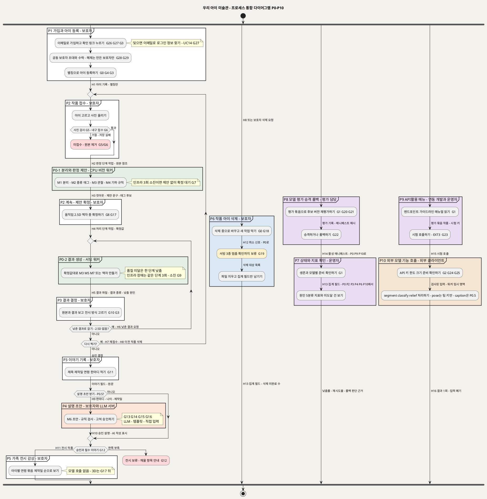

# SD_01 프로세스 통합 — 우리 아이 미술관 (P0 · P0.5 · P1)
**우리 아이 미술관 · 프로세스 P0~P10을 하나의 다이어그램으로 · BPMN 2.0 대응 PlantUML**

---

> **문서 식별**: `design/SD_01_프로세스통합.md`
> **작성일**: 2026-09-28
> **입력**: `design/SD_01_프로세스설계서_우리아이미술관.md`(이하 "설계서"). 프로세스 11개(P0~P10) · 게이트 30개(G0~G29) · 인계 계약 16개(H1~H16)를 한 도면에 모았다. 새 단계·게이트·인계는 만들지 않았다. 단계의 IPO·근거·예외 처리의 세부는 설계서의 각 절을 따른다.
> **표기**: `P` = 프로세스 · `G` = 게이트(설계서 §15) · `H` = 인계 계약(설계서 §14) · `EXT` = «extend» 유스케이스

---

## 1. 통합 프로세스 다이어그램

**[「프로세스 통합 다이어그램 P0-P10」 PlantUML 뷰어로 열기](https://plantuml.sumzip.com/plantuml/svg/eNqNWFtPW1cWfudXbHVewoM72MbmYmnaDBenUpF4aKU-9MWTGGLFMQg7qkajSAYOkYOdYhIcDBwj05oaIjNzwE5iVNL5P2fv8x_6rX05voS0jeIY7L3X5Vvf-tY6-TKbS6zlnjxOj2QfpTKribXEY_avxP1Hy2srTzIPZlbSK2vsb_Ph-eDcP_tOZB8mHqz8kMoss6VEOpscyaVy6SQThw7_pcVExRK1DuP_64pC3e3kWYB5exY_sYXVFdsN5j1761XOGS82cEy87rjvu_z4jC2OBRaDYyMynpGllbVHI4zBG0ynVjLss8Ugc528ON5y2ze-i1eX_KQG-7zd8apdcVz-DMHKP-w_uM7YNI7x8z1Ru4F_bcCrVN12nXkHFVHrMt5c99ZbjBcsftpxuw5j8VAUrwkWD8ekjcxKLsnWUssPc9NMHG8L-4afd9iAYbyQBZkT9QqCYcL5jWwF2LczwXGypqJx22_5zkEvXCY6BV7Ki4M8E4Uqr30grCodUbf59h5CK_FX9d5p_E7RTeI1pUKb5m1LXF9QSIhiABXKUmYzxuLjOpeneAX-we4FzVGcMACSHTigY2vJ1WQiJx30FyCE7He9lwXkuIto_wh2Al57aNcJV-AtNlqiaTFRbYEkcBzTJ1NL7I7-zr3K4ycWj5DtjY77tmV8xaOjLPcwmWF3wB4wYFRfToJ97I576Yh6AZdEHQU-ZaLY8Epn5gyj4GanZqemiZImdnFU5m2ql43bgCny93g05t94lEqnjYvMg9SS_Pmp_JcADDGvVEapQeIzt20RMGJ_q8-q0xUnOsN-CMcCQcbfWQCASq5tIARRoehnFr9l_NoSdRg8KolfG4B1Ljw_NhfuwbpgDOD8Airy0xY_rTJvk_hHH4UZOk6BsTBO9QUPmPveFtcHJrsBPte61Ju1Gxb2DktMPCuhDpLaHROX2H9GhaR2oYRLeaJVfGIIkTATv76nmh9tyjrIq7zVpRoGTHzekQXKxG5hFkAUz170bmpvf0Kxo7xorotji4U-j8yC0yeypRq7-rrfAuiY4ERsKOJxJq6qBORwDdVl13mpbvR1w3AxEfeVI_VosyasSwrfsvn1wSfLh6B960CSmhYVW4iwhQnGq2Vqep2F7P1GX5sM1g1tKJoF0lhebIkauFSxTSJ847_iXeP7TK-26AlRqZN11zmg0_qkrHlAV53Fp7Srp_qdUIqYFL1SCWKH0yZlxbyAdkfMh8PYLTiFzRW8_WlRZVmph_QFesNxKSB1SxSRpXMuijUjLLK-wTFfrE30qmrsh4cpDKY7MsaqticnwWVX6bNiDlG89MUoS2WhRVVqnntRNnAJw21PXF2MUhVwpmLxYkFUG6MjH7nCWEOUwnkBB4MmJ1CIli9A9yZphshm17K6cQH23-YBhRDb1zReFISxkWGEyVLlhlLqk_RPzkSMlzfnstXAeeLHvsPr18Qh3izwPZCwvq6RDfbNjZ4TD9G9srXetWTVpYxbDf5mi4aa7H7nSGG8OPZ55Auj38Bi1O_BqT6fxKQqKU2gF9nHUoGuHXDSlydJ6tdfL8gevLIo65m58dlon3ZGe7eUJJqJEyA6iXZZw6yE4za9jAfDeGGeBiN4Rb_PkENIxpbt7ZX4L_-n4CFJ9V0UdYvXT4c0B0TVhdRZBNjdr6TyQD28XRvMIa9qqg1QwEwhCbM0IZsSggsy9QoTD4YM0PzNGd8to-Nfoz17kAeDppEU7T6GOCL3pJNLc851ymJz_S-Ne046qsjEW-_QU_0kK9h6T6F-vh1eivkF5gS8vLN1W8JxeJa0CxrO-MuGD6lCCQQSbz5gKFLIKk0z7o1gtDtKqcSlJQ5hvXIh6V8pYMcgjodUKHrmK6RpAWWJ5UQqo3emSSPQfcubbFitDMM9GfXbWi1C-vAgirOzc5PzEb8vtb3GrgHK2XN_60rt2yyYAcWbz_3FLjgZ6xUW28D7M2g51p86PMjGg5WYwWQ-NDMzrQdUGPLN-HmBlFstwu41hkDegAXTU75pHRctquABsIPA6P1TTwXcxPIvA23u0mRRAkELK984Q7i63v4CGh48SMXRTrCiHVj85xItxLHBMvTDO-lzZec56Ept5V7hoeKkwR0axPpjXuzw4jUN4ruzM_Mhg7T5VnJUg62WEwbpUJrcUof8JSKItRuQh4I-LtpKT3GbDTSs92MVTznedldu8kWN_7QKkKxdOhA6HalvPRQawGccVbFJFIZtUlHZ4hTDo5KubT8qmDCb61i25ANFMw9FMY85APiwI6rrineDaND2ctKRk1ZiKru4kccqqm_3MOij28clpMhCDNMIKg3-I0SxXwbhDAJyQ2AR2l9BMRUfRUpbzA60roWx3OlTB42GWjD4aZ2SwAAt2jgt7DNCXJUbizQ2Gmj6DcD9A9JMsbuLXxGwh2DK-R5_LocN9ArPZK5jc8dWk_6TQO3vIVNvp0WYoBikkxA9EL12o54lG7ApXsNG7cMwYgOcM-IA90Xb28cGv9EwMOkPpAZq5ANs7rtvwkSTwee4CBs4PUwHGjcHXUijaRai6vap0deA-dZb78gMEDrlRfIemYvOmr11GqhRgHJY76Dg6_T89gmKhPCXnngjfuJqxvKyrWeiXBtoP8bvahAB7f0LnX42ufw4mcmx--lENpta-jfWq3QquaSXdR-P1ZVsktTYK-UpNFKaALufWKXMacOlnWMAqqhZ5IJ66VWxeDtlyTaoPpP_6ZDNrayOfIlfnzxO_w5fLDRb)** — 클릭 시 브라우저로 연결됩니다.

## 2. 읽는 법

- **네 갈래가 동시에 돈다** (BPMN Parallel Gateway, `fork`). 왼쪽 첫 갈래가 가족 본류(P1 → P2 → P0-1 → P2 → P0-2 → P3 → P4 → P5)이고, 나머지는 삭제(P6), 모델 평가·운영(P8 → P7), API 메뉴·외부 호출(P9 → P10)이다.
- **화살표 레이블은 전달물이다.** 노드 사이로 넘어가는 데이터·파일·객체 참조·요청을 적었다. `H`로 시작하는 레이블은 프로세스 경계를 넘는 인계 계약이다.
- **루프가 두 개다.**
  - 안쪽 루프: "낮춘 결과로 걸기"를 고르면 H6으로 P0-2를 다시 돈다.
  - 바깥쪽 루프: "다시 찍기"를 고르면 H7로 P2부터 새 작품을 받는다. 이때 H8로 이전 작품이 P6 삭제 갈래에 들어간다.
- **전시로 가는 문은 G12 하나다.** 설명 초안(P4, P0.5)은 그 앞의 선택 경로이며 전시 조건이 아니다.
- **차단 종료**는 빨간 작업(`#FFD9D9`) 뒤 `kill`이다. **보류형 게이트** G19는 노란색(`#FFF2CC`)이며 스스로 풀리는 대기라 끝나지 않는다.

## 3. 파티션 색 = 수행 주체

상세 도면(설계서)은 레인으로 수행 주체를 나눴다. 통합 도면은 병렬 갈래(`fork`) 안에서 레인을 바꾸면 PlantUML이 흐름을 끊어 그리므로, **파티션 색**으로 수행 주체를 구분했다. 파티션 이름 끝에도 주체를 적었다.

| 색 | 수행 주체 | 프로세스 |
|---|---|---|
| 흰색 `#FFFFFF` | 보호자 | P1 · P2 · P3 · P5 |
| 연녹색 `#E3F0E3` | 시스템 워커(CPU 비전 · GPU) | P0-1 · P0-2 |
| 살구색 `#FCE4D6` | 보호자 + LLM 서버 | P4 (P0.5) |
| 하늘색 `#DDE8F5` | 보호자 → 삭제 절차(원본-결과 저장소) | P6 |
| 연보라 `#EADCF2` | 팀원(평가 담당 · 서비스 운영자 · 연동 개발) | P7 · P8 · P9 |
| 연주황 `#F5E6D3` | 외부 클라이언트(연동 앱) | P10 (P0 · caption은 P0.5, D17) |

## 4. 갈래 사이의 인계 (도면에서 레이블로만 표시한 흐름)

병렬 갈래끼리는 화살표로 잇지 않았다. 잇는 순간 시간축이 하나로 묶여 "삭제는 전시 뒤에만 된다"처럼 틀리게 읽히기 때문이다. 대신 레이블에 목적지를 적었다.

| 인계 | 출발 → 도착 | 전달물 | 도면 위치 |
|:--:|---|---|---|
| H8 | P3 → P6 | 다시 찍기로 닫힌 이전 작품의 삭제 | 본류 "다시 찍기?" 레이블 · P6 입구 레이블 |
| H12 | P6 → P0 | 취소 신호(작품 ID, `삭제 중`, 서빙군별 대상 단계 작업) — EXT1 | P6 안 레이블 |
| H13 | P0 · P2 · P3 · P4 · P6 · P10 → P7 | 집계 필드(식별 정보 없음) | P6 출구 · P7 안 레이블 |
| H14 | P8 → P0 · P9 · P10 | 활성 모델 매니페스트 | P8 출구 레이블 |
| H15 | P9 → P10 | 시험 호출(평가 묶음 작품) — EXT3 | P9 출구 레이블 |
| H16 | P10 → 외부 클라이언트 · P9 | 모델 기능 결과 1회, 입력 폐기 | P10 출구 레이블 |

본류 안의 인계 H1~H7 · H9~H11은 화살표 레이블로 그대로 이어진다.

## 5. 프로세스와 게이트 색인

| 프로세스 | 명칭 | 포함 UC | 게이트 | 설계서 절 |
|:--:|---|---|---|:--:|
| P0-1 | 분리와 판정 제안 (상시) | UC2 시스템 행위 | G7 | §3 |
| P0-2 | 결과 생성과 낮춤 체인 (상시) | UC3 BF3~5 · UC4 A1 · EXT1 수신 | G9 | §3 |
| P1 | 가입과 아이 등록 | UC13 · UC14 · UC15 · UC1 · INC1 | G26 · G27 · G28 · G29 · G0 · G3 · G4 | §4 |
| P2 | 작품 접수와 판정 제안 확정 | UC2 · EXT2 진입 | G0 · G5 · G6 · G8 · G17 | §5 |
| P3 | 진행 확인·결과 결정·이야기 기록 | UC3 보호자 부분 · UC4 · UC5 | G0 · G3 · G10 · G11 · G12 | §6 |
| P4 | 작품 설명 초안 받기 (P0.5) | UC10 | G13 · G14 · G15 · G16 | §7 |
| P5 | 가족 전시 감상 | UC6 | G0 · G12 · G17 | §8 |
| P6 | 작품 또는 아이 삭제 | UC7 · EXT1 | G0 · G18 · G19 | §9 |
| P7 | 서비스 상태와 모델별 지표 확인 | UC8 · INC2 | G1 | §10 |
| P8 | 모델 버전 평가와 승격·롤백 | UC9 · INC2 | G1 · G20 · G21 · G22 | §11 |
| P9 | API활용 메뉴 확인 | UC11 · EXT3 | G1 · G23 | §12 |
| P10 | 외부 모델 기능 호출 (P0 · caption은 P0.5, D17) | UC12 · INC3 | G2 · G24 · G25 | §13 |

통합 도면에는 게이트 30개(G0~G29)가 모두 나온다. 도면에서는 작업명 끝에 게이트 ID만 붙이고, 각 게이트의 조건·미통과 결과·해제 주체는 설계서 §15에 있다.

## 6. 통합하면서 줄인 것

한 도면에 담으려고 단계 수를 줄였다. 줄인 내용은 모두 설계서의 상세 도면에 남아 있다.

- **P0-1의 M1 → M2 → M3 → M4, P0-2의 서빙군별 분기와 낮춤 체인**을 작업 하나와 노트 하나로 접었다. 상세는 설계서 §3-2.
- **예외흐름별 차단**(E1~E10)은 게이트 ID로만 표시했다. `kill`로 그린 것은 본류의 대표 차단 두 곳(G5/G6 미접수, G12 전시 보류)뿐이다.
- **P7이 P8 뒤에 붙은 것**은 "P7 지표가 롤백 판단 근거가 된다"(UC9 A1)는 관계를 보이려는 배치다. P7은 P8과 무관하게 언제든 돈다.

## 7. 렌더 검증

`plantuml.sumzip.com`에서 확인했다(2026-09-28). HTTP 200, `image/svg+xml`, SVG 안 `Syntax Error` 없음. URL은 2,629자로 4096자 이하다. 링크를 복호한 소스가 위 코드블록과 글자까지 같다. PNG로도 받아 레이블이 화살표마다 붙어 있는지 눈으로 확인했다.

---

*우리 아이 미술관 · SD_01 프로세스 통합 · 2026-09-28 · 입력: SD_01_프로세스설계서_우리아이미술관.md*
