# SD_02 UI/UX 설계서 — 우리 아이 미술관 (P0 · P0.5 · P1)
**우리 아이 미술관 · 프로세스를 조작 가능한 화면으로 · 설계 원칙 · 화면 지도 · 공통 컴포넌트 · 와이어프레임 · 게이트의 화면 표현**

---

> **문서 식별**: `design/SD_02_UIUX설계서_우리아이미술관.md`
> **작성일**: 2026-09-28
> **입력**: `design/SD_01_프로세스설계서_우리아이미술관.md`(개정 2, D17 반영본 — IPO · 게이트 맵 G0~G29 · 인계 계약 H1~H16) · `design/SD_01_프로세스통합.md` · `design/UC_00_개요_우리아이미술관.md` · `UC_01`~`UC_12` 전건(액터 · 기본흐름 · 대체·예외흐름 · 업무규칙 · UseCase Diagram) · 공통 기준 §11 통합 결정 D1~D17
> **원천**: `Intent-Specify.md` [가치제안] 경험 원칙 · [부정적 영향] · spec v2.1 성공 기준. 원칙 역산의 근거로만 썼다.
> **생성 프롬프트**: `분석설계 프롬프트 - UI_UX.md`
> **표기**: `S` = 화면 · `C` = 공통 컴포넌트 · `UX` = 설계 원칙(프롬프트의 `U1~UN`에 해당. 이 프로젝트에서 `U`는 공통 미해결 번호라 겹치지 않게 `UX`로 썼다) · `P`/`G`/`H` = SD_01의 프로세스/게이트/인계 · `BF n` = UC 기본흐름 n단계 · `A`/`E` = UC 대체/예외흐름 · `[추론]` = 원천에 직접 없는 설계 판단
> **와이어프레임 예시 값**: 별칭은 `하*`, 가족명은 `하*네`, 팀원 계정은 `jo*@su*.kr`처럼 가렸다. 날짜의 일은 `**`로 가렸다.
> **개정 (2026-09-28, 통합 결정 D18)**: 이용자 중복을 별칭이 아니라 보호자 이메일 계정으로 막게 되어 **S0 가입(이메일)**과 **S0b 로그인 정보 찾기** 화면을 추가하고(SD_01 1.0 · 1.R1~1.R3 · G26 · G27), S1의 별칭 중복 차단을 "같은 별칭 안내(저장은 유지)"로 바꿨다.
> **개정 (2026-09-28, main `1c460b0` 후속)**: 보호자는 부모 두 명까지(만든 보호자 1 + 공동 보호자 1)이고 초대는 만든 보호자만 한다. 그에 맞춰 **S1b 와이어프레임을 "두 명 찬 상태"로 다시 그렸고**, T107이 만들 **S1c 초대 수락**과 **S1d 가족 없음** 화면을 추가했다(UC15 BF4~6 · A4 · A6 · E1~E3 · E9 · G28 · G29 · U20).

---

## 목차

1. [설계 원칙](#1-설계-원칙)
2. [화면 지도와 내비게이션](#2-화면-지도와-내비게이션)
3. [공통 컴포넌트](#3-공통-컴포넌트)
4. [S1 아이 관리](#4-s1-아이-관리)
5. [S2 작품 올리기](#5-s2-작품-올리기)
6. [S3 판정 제안 확정](#6-s3-판정-제안-확정)
7. [S4 작품 목록과 진행 상세](#7-s4-작품-목록과-진행-상세)
8. [S5 결과 확인](#8-s5-결과-확인)
9. [S6 이야기 쓰기](#9-s6-이야기-쓰기)
10. [S7 설명 초안 받기 (P0.5)](#10-s7-설명-초안-받기-p05)
11. [S8 가족 전시](#11-s8-가족-전시)
12. [S9 삭제 확인과 진행](#12-s9-삭제-확인과-진행)
13. [S10 서비스 상태와 모델별 지표](#13-s10-서비스-상태와-모델별-지표)
14. [S11 모델 평가와 승격](#14-s11-모델-평가와-승격)
15. [S12 API활용 메뉴](#15-s12-api활용-메뉴)
16. [게이트 맵 → 화면 표현 사상](#16-게이트-맵--화면-표현-사상)
17. [상태 표현·접근성·오류 규약](#17-상태-표현접근성오류-규약)
18. [미해결·확인 필요](#18-미해결확인-필요)

---

## 1. 설계 원칙

원칙은 SD_01 게이트 맵과 업무규칙에서 역산했다. 원칙마다 근거와, 그 원칙이 어떤 컴포넌트로 굳었는지를 함께 적는다.

| # | 원칙 | 근거 | 컴포넌트로의 귀결 |
|:--:|---|---|---|
| UX1 | **전시로 가는 문은 하나이고, 그 문의 두 조건을 늘 보인다.** 승인 전·이야기 전에는 어디에도 걸리지 않는다 | G12 · BR-APR-01 · BR-EXH-01 · Intent [부정적 영향] 어색하거나 왜곡된 결과 | C1 진행 레일의 "전시 보류" 변형 · C8 전시 조건 체크 (S6 · S8) |
| UX2 | **제안은 제안까지.** 문구만 보이고 점수를 보이지 않으며, 선택지는 같은 무게로 놓는다 | BR-SUG-02 · BR-SUG-03 · BR-EXH-04 · Intent [부정적 영향] 판정의 강요 | S3 선택 카드(같은 크기, 기본 선택 없음) · 점수 필드가 없는 결과 표시(C5) |
| UX3 | **낮춘 사실은 숨기지 않되, 전시에는 들고 가지 않는다.** 원인 5분류를 섞지 않는다 | BR-FBK-03 · BR-FBK-04 · BR-EXH-07 · G9 · D2 · D3 | C6 낮춤 안내(S4 · S5 전용, S8에 없음) · G9와 모델 낮춤의 문구 분리 |
| UX4 | **원본을 곁에 두고, 누를 때만 움직인다.** 결과는 정지 상태로 먼저 보이고 원본과 나란히 놓인다 | BR-INT-04 · BR-EXH-03 · UC4 특별 요구사항 "결과 옆에 원본" · Intent [가치제안] 경험 원칙 | C5 원본-결과 비교 뷰(기본 정지, 재생·시차·회전 토글) |
| UX5 | **아이의 말과 AI 문장은 다른 칸이다.** 한마디는 입력 그대로, AI 설명은 "AI 작성" 표시와 함께 따로 | BR-STY-03 · BR-EXH-05 · BR-CAP-03 · D6 · Intent [부정적 영향] 기억의 재작성 | C7 이야기 카드(한마디 칸 · AI 작성 칸 분리) (S6 · S7 · S8) |
| UX6 | **막힌 자리는 사유 · 해제 주체 · 다음 행동을 함께 보인다.** 사라지는 알림으로 막지 않는다 | SD_01 §15 게이트 25개 · §15-2 · 프롬프트 사상 규칙 | C2 차단 블록(차단 · 보류 · 종결 변형) · C3 이유 달린 비활성 버튼 |
| UX7 | **기다리지 않아도 된다.** 올린 뒤 화면을 떠나도 처리는 계속되고, 돌아오면 어디까지 왔는지 보인다 | UC2 A2 · UC3 A11 · BR-PRC-05 · BR-PRC-07 · 202 접수(G6) | C1 진행 레일의 "대기" 변형 · C4 상태 배지 · S4를 진입 홈으로 |
| UX8 | **역할이 보는 것만 보인다.** 보호자 앱과 운영 화면을 가르고, 운영 화면에는 가족 이미지·이야기로 가는 경로 자체가 없다 | G0 · G1 · BR-ACC-01 · BR-ACC-03 · BR-ACC-05 · BR-OPS-04 · BR-PRV-01 | C9 셸 헤더(가족 / 역할 표시) · S10~S12에 이미지 영역 없음 · C10 모델 상태 칩 |

### 1-1 원칙이 배제한 흔한 선택

| 흔한 선택 | 배제 이유 |
|---|---|
| 판정 신뢰도 막대·점수 표시 | UX2. 집 그림이 사람 점수 0.946을 받았다(Intent [핵심 장벽]). 점수는 판정을 강요한다 |
| 제안된 선택지를 미리 선택해 두기 | UX2. "제안과 다른 선택을 막지 않는다"(BR-SUG-03)를 사실상 막는다. 판정 수정률도 오염된다 |
| 자동 재생 캐러셀·다음 작품 자동 넘김·무한 스크롤 피드 | UX4 · BR-EXH-03 "자동 넘김·자동 반복·무한 피드 없음" |
| 전시 카드에 "낮춘 결과" 배지 | UX3 · BR-EXH-04 "실패·대체 표시 없음" · D3 |
| 오류·차단을 토스트로 알리기 | UX6. 사라지는 것은 벽이 아니다(프롬프트 [금지]) |
| AI 설명을 한마디 칸에 미리 채워 주기 | UX5 · BR-STY-03 |
| 진행률 퍼센트 게이지 | 원천에 단계별 진행만 있고 비율이 없다(UC3 BF2). 지어낸 숫자가 된다 |
| 푸시 알림·채팅·좋아요 수·공유 | 상류 문서에 없는 기능이다(프롬프트 근거 규율 4) |
| 운영 대시보드의 작품 썸네일 미리보기 | UX8 · BR-ACC-03 · BR-OPS-04 |
| 삭제 되돌리기(undo) | UC7은 확인 창(A3)만 두고, 확인 뒤는 되돌릴 수 없다 |
| 결측 항목을 회색 자리표시로 채우기 | 프롬프트 [금지]. "아직 안 채움"(C8의 빈 체크)과 "채우면 안 됨"(C3 비활성 + 사유)을 구분한다 |
| API 키 발급·폐기 화면 | U12 예시값(서비스 운영자가 'API활용' 메뉴에서)은 확정 전이고 UC 단계에 없다. 화면을 만들지 않고 §18에 남겼다 |

---

## 2. 화면 지도와 내비게이션

### 2-1 화면 목록

| 화면 | 명칭 | 대응 프로세스 | 주 사용자 | 성격 |
|:--:|---|---|---|---|
| S0 | 가입(이메일) | P1 (1.0) | 보호자(가입 전) | 입력 · 1회 |
| S0b | 로그인 정보 찾기 | P1 (1.R1~1.R3) | 보호자(로그인 전) | 입력 · 드묾 |
| S1b | 가족 보호자 관리 | P1 (1.I1~1.I4) | 보호자(만든·공동) | 설정 · 드묾 |
| S1c | 초대 수락 | P1 (1.I2) | 초대받은 보호자 | 결정 · 1회 |
| S1d | 가족 없음 | P1 (1.I4 뒤 · U20) | 나가거나 해제된 보호자 | 선택 · 드묾 |
| S1 | 아이 관리 | P1 (1.1~1.5) · P6 진입(아이 삭제) | 보호자 | 설정 · 드묾 |
| S2 | 작품 올리기 | P2 (2.1~2.4) | 보호자 | 입력 · 비동기 경계 앞 |
| S3 | 판정 제안 확정 | P2 (2.5~2.7) · P0-1 결과(H3) 표시 | 보호자 | 결정 |
| S4 | 작품 목록과 진행 상세 (**진입 홈**) | P3 (3.1~3.2) · **P0 진행 표시**(0.1~0.10의 단계 작업 기록) | 보호자 | 허브 · 상태 조회 |
| S5 | 결과 확인 | P3 (3.3~3.5) · P0-2 결과(H5) 표시 | 보호자 | 결정 |
| S6 | 이야기 쓰기 | P3 (3.6~3.10) | 보호자 | 입력 |
| S7 | 설명 초안 받기 (P0.5) | P4 (4.1~4.9) | 보호자 | 입력 · 선택 경로(S6의 확장 패널) |
| S8 | 가족 전시 | P5 (5.1~5.6) | 보호자(아이와 함께) | 감상 · 읽기 전용 |
| S9 | 삭제 확인과 진행 | P6 (6.1~6.7) | 보호자 | 대화상자 · 비가역 |
| S10 | 서비스 상태와 모델별 지표 | P7 (7.1~7.7) | 서비스 운영자 | 운영 · 읽기 전용 |
| S11 | 모델 평가와 승격 | P8 (8.1~8.8) | 평가 담당 팀원 | 운영 · 결정 |
| S12 | API활용 메뉴 | P9 (9.1~9.7) · **P10 시험 호출**(H15 → H16) | 연동 개발 팀원 · 서비스 운영자 | 참조 · 시험 |

**누락 프로세스 0건.** 사람 화면이 없는 두 프로세스는 이렇게 사상했다.

- **P0(상시 워커)** — 보호자가 조작하지 않는다. 그 출력(단계 작업의 상태·시도 횟수·낮춤 원인·오류 분류)이 S4 진행 상세와 C1 진행 레일에 그대로 보인다. 판정 결과(H3)는 S3, 처리 결과(H5)는 S5에 보인다.
- **P10(외부 모델 기능 호출)** — 호출자가 사람이 아닌 외부 클라이언트다(UC12 액터 `<<시스템>>`). 화면 대신 응답 계약(SD_01 G2 · G24 · G25 · H16)이 인터페이스다. 팀 안에서 사람이 보는 곳은 S12의 시험 호출 패널이며, 거기서 같은 계약의 응답을 그대로 보인다.

**역할별 뷰** — 같은 프로세스에서 두 역할이 서로 다른 판단을 하는 곳은 없다. 운영 화면은 역할마다 **다른 화면**을 연다(S10 운영자 · S11 평가 담당 · S12 운영자와 연동 개발). S12는 두 역할이 같은 범위를 읽는다(UC11 UML 노트 [추론])라 한 벌만 그렸다. 보호자 계정 모델은 U1로 확정됐다(공동 보호자 초대, 같은 권한, 부모 두 명까지). 역할별로 화면을 나누지 않고 S1b에서 초대·해제 버튼만 만든 보호자에게 보인다(G29).

### 2-2 내비게이션 구조

전진은 실선에 통과 게이트 ID를, 되돌아가거나 대화상자·확장 패널을 여는 이동은 점선으로 그렸다.

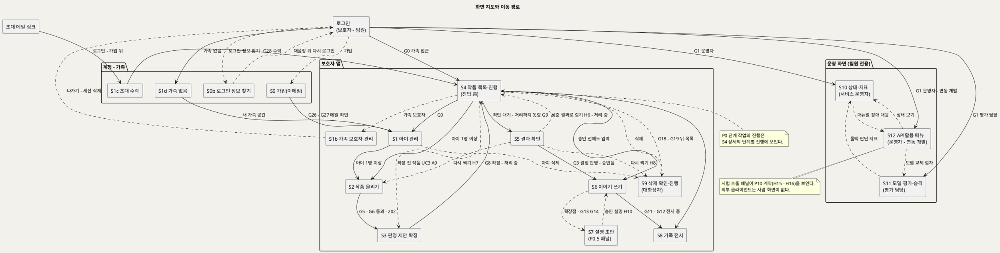

**[「화면 지도와 이동 경로」 PlantUML 뷰어로 열기](https://plantuml.sumzip.com/plantuml/svg/eNp1Vs9PG1cQvu9fMaIXOBh5bTA2hyo0akyktEVCvfViA6EoYEfgqIeqkh0WZH5EmBRjk3qRkZxiIlotYIhRTf-gfbP_Q2fee961l-ZgybvzvZlvZr6Zt082Cpn1wpu1VWPj1UrudWY9swbZzMKr5fX8m9zi0_xqfh2-ehZ_Zn77zQBi4-fMYv6XldwyvMysbiwZhZXC6hJ4J0fiogN4XhQHFp4UAe2OODgB9_pBnDUMY31poZDJLRNyhJ7dz120uz_lRsVNx6t38bQCEfD2i_hHZWwEMhvw4of08-8HD2GnLPaLIC6O0O6BOC95pUuJ_G7m-QvjNbHOLBPMvbGwWSVnrlPEs6sR-NUAGHAzH5WW061R5iedqYDz0TAwCz5RIJ_EFND51-06Gp8NHTAXQJPEcl3YDwpmLoRhi5obYG0b7X0NWzR-C7IIqoLV_8lhAvD00HtfBvHpQpzZETy3vOMdqib9odSoF2Wd1EQ4ODm0KHNwO0Xx56WOHQZl-wwDHkP4cOaxPh-sXxLKL1EshItTiyvcHmw2sFomnlV6Uth4CDtJynHcm54E2V0FmgyBEqwyrPYoIuDvjh84EcJNAVot8WmLG0SBqVJz0fFJYtMWlhbc_FToTNJvU9PCvYYCJUOgFODbvygbzTLoBMmAJgI3S1Q8HSA12GH80MF6qT81o0r6MtSHi7HHHTejQL68zQZFKHqHDe611RD3Fu62QPkKAplhKZsmKaUt3nXBO9ihrCK4e-9eX5AT9QxiryP27vvHH-khBjNzz72TBnHjARQ7HY7fj0rDhjVHzrrTEE6j7yZG-RpyjiES-Zq0CNOQjgZVPXQ_97R9fJzsUbKr2Rx6m6XXXxhEg85I1ya7jiWISTo21d8RqiUGe2BPyuc0SfWSxMAqFO9blHmLmhsEGCRMkzo9PKsGLxttXBjiFdHU2anBxiDlWFIvBIM9-nxxs9x37t7cuo5lEFymbGaDuP4EGvx6MA_xtk4YVj7V3-riVl1rcSgFLmraDCQyZDSVcUgEQ4BY6HS41Uw5aECUOKpHPqcXjSnHjqZ0s-Sjv2SOKXOcnU1yMxPgbd_yEohALBozyBKUNanXB3O6rtPaAWwd-iEmCaIEADSKukoS5lXrNEM0EP941TakUwZh5ZEEe43z2pHicOo8oHRq9568iErb981A9VYObK1CNx7Jaks0PxpklJikrJzJSVAV1QoZIphkqGz3lKZ6-hGbFXkgTr8JgwzSPhhObbFZmnBiLa1cSy1idN5xorNTvnFC6uRvvKvrbUqCBfeqK2GJR5WTZ-KajlzTVn-z__g0DjMpH5RiTkpt_Vipx0SSLIgArzreP5YKKKbNpMw7pUZSXmoGa1eNg0zxvEVrB497wHWqNrmraBNrsioUS1BvOfe2gtcUqVlGpz0Aicqx4zXKcyUXiGkO2MRZSzhXfEmJvTaoTWsYuXxhCbL5QiG_BvmXcrEBUJperQ48m3cNfZFwdnPkiL9Bqg-jsyZreNZMjKFtcUCW0V5rnE-fdMVdEbxSR9g9Vv9x19vtit0jqs6lON3X94IsV21bHlrKLQIzeUSHr_i5KJW-TXG5XVjbQpuWgbyK0C6Snb8Y6CqiLUEGhRQMVpBaZZCdH-gJ_aNvw_8ANcZ-aA==)** — 클릭 시 브라우저로 연결됩니다.

**읽는 법**

- **진입 홈은 S4다.** 로그인 뒤 G0를 통과하면 작품 목록이 먼저 열린다. 보호자는 올린 뒤 떠났다가(UX7) 여기로 돌아와 확정(S3)·결과 확인(S5)·이야기(S6)로 간다.
- **점선 셋이 되돌아가는 루프다.** 다시 찍기(S5 → S2, H7), 낮춘 결과로 걸기(S5 → S4, H6), 확정 전 작품(S4 → S3, UC3 A9).
- **계정·가족 화면(S0 · S0b · S1c · S1d)은 G0 앞에 있다.** 가족에 속하지 않은 계정은 S4 대신 S1d로 가고, 초대 메일 링크는 로그인(없으면 S0 가입) 뒤 S1c를 연다. S1b는 S4의 가족 메뉴에서 연다.
- **S9는 대화상자다.** S4 · S5 · S1 어디서든 열리고, 끝나면 S4로 돌아온다.
- **운영 화면은 보호자 앱과 연결선이 없다**(UX8). 운영 화면 셋 사이의 점선은 UC11 A4·A5와 UC9 A1이 적은 참조 이동이다.

### 2-3 진행 레일

보호자 앱의 작품 화면(S3 · S5 · S6 · S7 · S9) 맨 위에 **C1 진행 레일**을 고정한다. 레일의 단계는 공통 기준 §5 작품 상태 그대로다: `접수됨 → 판정 중 → 확정 대기 → 처리 중 → 확인 대기 → 승인됨 → 전시 중`, 종료 상태 `처리하지 못함` · `삭제 중`. 작품이 아직 없는 S1 · S2에서는 보호자 여정 단계(`아이 등록 > 작품 올리기 > 확정 > 결과 확인 > 이야기 > 전시`)를 쓴다. 운영 화면에는 작품 레일이 없고, 대신 생존·준비 요약 행(S10)을 고정한다.

레일 단계의 원천이 되는 상태 전이는 아래와 같다. 전이 라벨에 그 전이를 일으키는 화면과 게이트를 적었다.

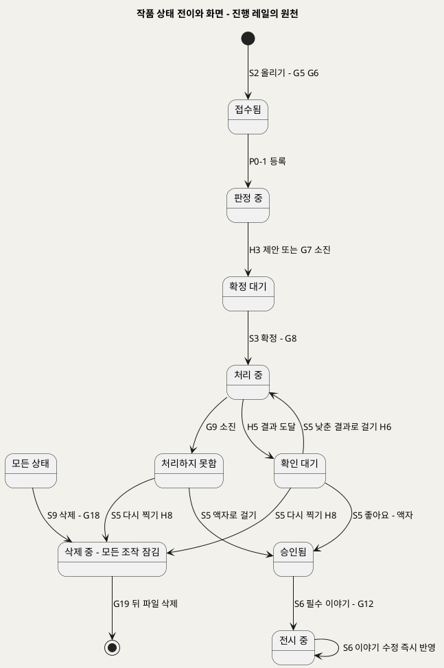

**[「작품 상태 전이와 화면」 PlantUML 뷰어로 열기](https://plantuml.sumzip.com/plantuml/svg/eNqFVM9vElEQvr-_YlJvJiRSAhYPTdVYejImnozxsApWUgoGtvFKW2JowXRpWbNUtlkMabFBs8XG0MhfxJv9H5z39qd0jYc9vJlvvvlm3vd2raYqVXVnu8RqW8Xye6WqbMNr5c3WZrWyU84_rpQqVbiznlpPPnkUQdTeKfnKh2J5E94qpVqBqUW1VAA86zjHTcD9XWe_D2g10LzGXh2cXpd_u4YE4EXD-XwA3GqiOUPTAPyi4aTPSINagCWnraGlAw47S6DUwD3SKcj3dJHn7fp8arsQGXEDPgonBj8fByzucYHFnC6ymNM4Fkc38KIO_PK3o48idG7cDQcVNG-rH_aVx0hf3PuOlszTJvjliJ9YgAOblkaLs-Y3dbdMokTZy7uvIJFYJaIONg2ujeABPF8GNMYkgJQSSy4NuQwLAQIebI3gz-4lksBPrvjAZGFcoiKLI-BGCkRXvQnc0PhhF3L3AT-26b7YX0ipx1-o0JPymISYFRam_B7-WkWPNMwn9vznDPhRg7fGC-jbi6WaXDYqIyCT-MMbEXDXkgb82kK9gaddYTN9gGdaTElUeRr43g_8ZXii-KAP86upgG5kWIyYuJ6yT1jJwrx7cZ4DBDoDDslrkuXpTegz7_6SyyxExdSEYCqVb-P8QJiM2wYauzET-u7xJmwNpSXtT3KulX_O9Z8yz8G-aeX7lm59-PQFo-82SdY7yiGpb5ATSOFsuttkFvjxkAzbpr-Bh2drhXKe_kZ_ABMba2s=)** — 클릭 시 브라우저로 연결됩니다.

---

## 3. 공통 컴포넌트

### 3-1 컴포넌트 목록

두 화면 이상에 나타나는 것만 뽑았다. 모든 컴포넌트는 대응하는 UC 단계가 있다.

| ID | 컴포넌트 | 용도 | 쓰는 화면 | 대응 UC 단계 | 근거 원칙 |
|:--:|---|---|---|---|---|
| C1 | 진행 레일 | 작품이 지금 어디이고 어디서 막혔는지 상시 표시 | S1~S7 · S9 | UC3 BF2·6 · UC2 BF4·6 · UC4 BF5 · UC5 BF5 | UX1 · UX6 · UX7 |
| C2 | 차단 블록 | 게이트 미통과의 사유 · 해제 주체 · 다음 행동 | S1~S12 | 각 UC 예외흐름(게이트 사상표 §16) | UX6 |
| C3 | 이유 달린 비활성 버튼 | 게이트가 막는 버튼. 라벨 뒤에 사유, hover·포커스에도 같은 문구 | S1~S12 | 각 UC 예외흐름 | UX6 |
| C4 | 상태 배지 | 작품 상태·단계 작업 상태 한 단어 표시 | S4 · S5 · S9 | UC3 BF1·2 · UC7 BF3 | UX7 · UX3 |
| C5 | 원본-결과 비교 뷰 | 원본과 결과를 나란히, 결과는 정지 먼저, 재생·시차·회전 토글 | S5 · S8 | UC4 BF1~3 · UC6 BF3~5 | UX4 · UX2 |
| C6 | 낮춤 안내 | "어느 단계에서 어디로" 낮췄는지 문구 | S4 · S5 | UC3 BF6 · A3~A5 · UC4 A3 | UX3 |
| C7 | 이야기 카드 | 제목·그린 날·나이·한마디(원문)와 AI 작성 칸을 분리 표시 | S6 · S7 · S8 | UC5 BF6 · UC10 BF6 · UC6 BF3 | UX5 |
| C8 | 전시 조건 체크 | G12의 두 조건(결과 확인 · 필수 이야기) 충족 여부 | S6 · S8(직접 주소) · C1 | UC4 BF5 · UC5 BF5 · UC6 E3 | UX1 |
| C9 | 셸 헤더 | 보호자 앱(가족 표시) / 운영 화면(역할·계정 표시) 구분 | S1~S12 | INC1 · INC2 (UC1 BF1 · UC8 BF1 · UC9 BF1 · UC11 BF1) | UX8 |
| C10 | 모델 상태 칩 | 모델별 준비됨 · 미준비 · 비활성(라이선스 확인 전) · CPU 실행 · 비노출 · 확인 불가 | S10 · S11 · S12 | UC8 BF3 · A1~A4 · E5 · UC9 BF2 · UC11 BF4 | UX8 · UX6 |

### 3-2 C1 진행 레일

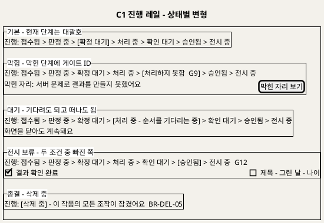

**[「C1 진행 레일 - 상태별 변형」 PlantUML 뷰어로 열기](https://plantuml.sumzip.com/plantuml/svg/eNqllE1rE1EUhvfzKw51KQGjuNCFlH6J4MqVMIwQbZHSNJEkXdVCTEdJk5EmbSZOZRJuNU3SGCFmBpxi_ENzzv0PnpuZaFMQiu5y7_l63vPeyWK-kMoVdrbTWn5rM_MqlUttw_PUi62XuexOZn05m87m4MbanbXk6pJW2CykN2A5CdQzZfMAUJSpNYEE0P4bue-iZwJ6RenYWj6VLmi7N7XdZwthMEIv4CTpmNQeAlb7oWdipQFoFUPflE6woEHc8j6QqFPZwVofHoC0aiRsoE6dD7o8sdVJVQUjg29o7GB3GIdVtBXEURWsXPA56kPCpKqrErU9hYS9A9l2GGn6w4qR6EMNwrFFLV9WAni0ci2qOairTHp0krZDvSLg4Ie0-wAP7xl_54MZE7VrXMqTTRfHvNdhQMLFU5cRR6E3wbMJZ1p43Jm1bpap6dPHBrwGfa4He-KrjcXaI9IEKF-qHRQdPOT2NSf0BGBTYMmJLvr_pF-_tAB-F2VX8TNrPK07VMZz0Li-ZcCJDTz3qcVY1S9kmwpQGfbuPR5OWHKkLC5htXg2NbdeAzodhd_8KQ1eCFYDNPj5_8ZeJdd_oxtz7Gx28jZP058asW-zUjox8bOlvAIDlLODc-XJ9wC7I8CSUPwlh99irO3TW65XGy195WzV-7IK_c-1oZJaLLldl0f8eTr8OPp4LNQq-C4KiXA8iV8LLD1JrKw-Tty6y5P2tMWNzDr_GfwCl1k8Iw==)** — 클릭 시 브라우저로 연결됩니다.

| 구분 | 내용 |
|---|---|
| 상태 | 기본(현재 단계를 대괄호로) · 막힘(막힌 단계에 게이트 ID와 "막힌 자리 보기") · 대기(순서 대기 중, "화면을 닫아도 계속돼요") · 전시 보류(G12의 빠진 조건을 C8로 펼침) · 종결(`삭제 중`, 모든 조작 잠김) |
| 변형 | 작품 레일(공통 기준 §5 상태 7단계 + 종료 2) · 여정 레일(작품이 없는 S1 · S2) |
| 동작 | "막힌 자리 보기"는 같은 화면의 C2로 스크롤·포커스 이동한다. 레일 단계 자체는 누를 수 없다 [추론 — 상태는 사용자가 건너뛸 수 없는 순서라서]. 상태는 화면을 열 때와 S4 새로고침 때 갱신한다(폴링·푸시는 U8) |
| 데이터 바인딩 | 작품 상태(2.3 · 0.5 · 2.7 · 0.10 · 3.5 · 3.9 · 6.3 Output) · 막힘 게이트 ID(0.9 · 0.5의 오류 분류와 시도 횟수) |

### 3-3 C2 차단 블록 · C3 이유 달린 비활성 버튼

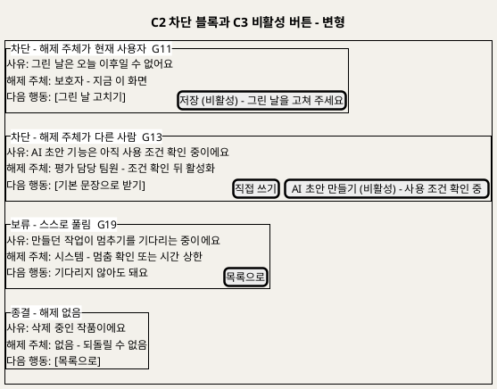

**[「C2 차단 블록과 C3 비활성 버튼 - 변형」 PlantUML 뷰어로 열기](https://plantuml.sumzip.com/plantuml/svg/eNqFlFFP2mAUhu_7K07czZaFC8bVuHIzc9lvMC5h0yxGlAXxyplUVhaELoBSqdqSshWQhSVVmq0k_UU95_sPO19RRMdc0hs-vnPe933OaRd3Cpl8YXcrq-xsbmx_zOQzW_Au837zQz63u722lMvm8vBoObWcfPVSKWwUsuuw9AzIu8DqBWDQxI4djUJYSgGONXFqkXYJeKWJSggJwJEqTEPZyWQLyt5TZe_twnVhAoThk2MBfQ_pyo88FYSpUXsIVBzS2YDadYDXyeSCAvGJ5aQh-h1gzwMsOmSrQKaLFRPI9sW5RnYIVOZfrS904tNZk8vuCKTZii_MQPZNAPXVKCjLWhCnTRz4fB2rLtk6iJNDrJ2mYeVWDaKRQ2MzCrxV-AQr5KjU7sLjadwn3HHWmxYXjOqxtBawm1Vl_-HsLI7dQCbFti6Dp2aDv3gD5JfJKAN7wEo3jm9o1D-4pgXU8aJLGcYgm9u4DY5GrfpcEKJ2OJH0sToGoat0HjO50wKPXJikY0Dz6LCREV8bMtEuWSF2LEDvfMqof0BOA-jYuzm5zYB9HY9dPr-H8F9RruHx_LBrynsVlx8pKI5U7IUS1_NZXBMB_Mrr0G5QqyTHjIMy_WpK190wpsjAe0OsNP8Di6oWi4mSJZdZ9nCnhMx6XF61Ik8D-nwgDOtvUFMpXjmeWYXHhjUNsBaynOSCPwb8Bk0I3qzJt1J05c2sCS-1rc8mpOLP-A9pPZApxVH5oRBxA5mgbmJNx54_fVlsfc5w73vaVxbXt9f4C_EHuO5gxQ==)** — 클릭 시 브라우저로 연결됩니다.

| 구분 | 내용 |
|---|---|
| 상태 | 차단(해제 주체 = 현재 사용자) · 차단(해제 주체 = 다른 사람) · 보류(G19, 스스로 풀림, 노란 테두리) · 종결(해제 없음, `삭제 중`) |
| 구성 | 제목 행 `막힘  G번호 - 요약  E번호` · 사유 · 해제 주체 · 다음 행동(버튼). 세 줄은 빠질 수 없다 |
| 변형 규칙 | 해제 주체가 현재 사용자면 **해제 행동 버튼**을 준다. 다른 사람이면 해제 버튼을 주지 않고 **대안 행동**만 준다(예: G13의 기본 문장·직접 쓰기). 요청 보내기 채널은 상류에 없어 만들지 않았다(§16 사상 규칙 ③) |
| C3 동작 | 비활성 버튼은 라벨에 `(비활성) - 사유`를 붙이고, hover·키보드 포커스에서 같은 사유를 말풍선으로 보인다. 누르면 아무 일도 없고 C2로 포커스를 옮긴다 [추론] |
| 금지 | 토스트·자동으로 사라지는 배너 · 회색 자리표시 |

### 3-4 C4 ~ C10

| ID | 상태 | 변형 | 동작 |
|:--:|---|---|---|
| C4 상태 배지 | 접수됨 · 판정 중 · 확정 대기 · 처리 중(대기 / 다시 시도 중) · 확인 대기 · 승인됨 · 전시 중 · 처리하지 못함 · 삭제 중 | 작품 배지(S4 목록) · 단계 작업 배지(S4 상세: 대기 / 진행 중 / 완료 / 다시 시도 중 / 처리하지 못함 / 취소) | 누르면 해당 작품의 다음 화면(확정 대기 → S3, 확인 대기·처리하지 못함 → S5)으로 간다 |
| C5 원본-결과 비교 뷰 | 정지(기본) · 재생 중 · 시차 켬 · 회전 중(P1) · 결과 못 읽음(G10) · 원본 못 읽음(E1) · 형식 표시 불가(UC6 E6) | 결과 종류별: 움직임(재생) · 2.5D(시차) · 액자(토글 없음) · 3D(회전 + "뒷면은 AI가 추정했어요") | 토글은 누를 때만 켜지고 다시 누르면 정지. 자동 반복·자동 넘김 없음. 원본 칸은 늘 보이거나(S5) 버튼으로 전환(S8) |
| C6 낮춤 안내 | 낮춤 없음(숨김) · 모델 낮춤 · 인프라 실패와 구분된 "처리하지 못함" 문구 | 움직임 → 2.5D · 2.5D → 액자 · 3D → 2.5D · 분리 실패 → 액자 · 설명 LLM → 템플릿(S7) | 읽기 전용. S8에는 두지 않는다(BR-EXH-07) |
| C7 이야기 카드 | 입력(S6) · 표시(S8) | 한마디 칸(원문, 표시 없음) · AI 작성 칸(출처 LLM·템플릿이면 "AI 작성", 직접이면 표시 없음, D6) · 승인 전 초안(S7에서만) | 한마디 칸과 AI 칸은 입력·저장·표시가 모두 따로다. 한 칸의 편집이 다른 칸을 바꾸지 않는다 |
| C8 전시 조건 체크 | 둘 다 충족 · 결과 확인 빠짐 · 이야기 빠짐 · 둘 다 빠짐 | 체크 두 줄 | 빠진 줄을 누르면 해당 화면(S5 또는 S6 필수 칸)으로 간다 |
| C9 셸 헤더 | 보호자(가족명 가림) · 팀원(역할 · 계정 가림) | 보호자 앱 헤더 · 운영 화면 헤더 | 운영 화면 헤더에는 보호자 앱으로 가는 링크가 없다. 역할에 없는 메뉴는 그리지 않는다(403 링크를 두지 않음) |
| C10 모델 상태 칩 | 준비됨 · 미준비 · 비활성(라이선스 확인 전) · 비활성(P0.5) · CPU 실행 · 비노출(P1) · 확인 불가 | 표 행(S10 · S11) · 인라인(S12) | "미준비"와 "비활성"과 "CPU 실행"은 모양과 문구를 모두 다르게 한다(§17) |

---

## 4. S1 아이 관리

### 4-1 와이어프레임

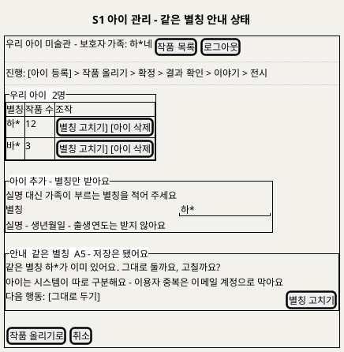

**[「S1 아이 관리 - 같은 별칭 안내 상태」 PlantUML 뷰어로 열기](https://plantuml.sumzip.com/plantuml/svg/eNqNU8Fu2kAQvfsrRuTWNkgk6iWHNm3V_ECPFZVoE1VRCFRATgTJCaYigBRo7RSIjYxKSomI6hSHGIkv8o7_oTNrg0jVQ-2LZ_zm7Xszs9v5QipXODpMK_mD_cynVC51CO9THw4-5rJHmd1X2XQ2B2s7mzuJ1y-Vwn4hvQdvEoCGhpYLvquKH2NYB9_poKWCmGg4u6G_VXHqApZPgrKp5FPpglJ8rBQBuw7Do2Lxy8OqTRRULyZu0Paw14Rj4lKxf7sFgdF-JLQBZd5irxV8qYK4Hom-leSM6Jv-vcdMl-UklJR4nPmHWnBxtkX46ISvtxL_DCICbI9JgO85lAo6BtoGffi_HX8yl7HlMdZy0ZiHILQ1rJsR_7vYQwOwIa4rMaW4tvB9vDyn2uag71CsgHRCcWJDKg-x_sTGWZtOSS7l4ukN2maSCoSjc8Hm_-FL9LK4KDvVqYOyp1wohg2iu-SfXT1G3FgfkGwQDRXrdtRs2aypKq5cUdOjQrQ0sn-CF0T5fY6aR_UsbWE1Jl2tPCvk6zR7S1RoODpacw6nJmXwmyPONXkEKRqq1MhaKGzhQO7NX9sEL54yg61i70qmm00SFbl5CGVJbJ780HbRNKohMg60LOSYtgZEq-3PGpR8EvbUDqPnrF52kPXR0LE2CCqm7IzucKF_NxZTLTCYkAXRmnRHvLI4aInJHcvg6pG07JMg20BzLo8cnkU2qX_1AVoNoD0V5x1a1VVhTTnef82c-7O8BsstpioJx_uf-LnB16CkbO9lduky_wEXjB-N)** — 클릭 시 브라우저로 연결됩니다.

### 4-2 영역별 설계

| 영역 | 내용 | 데이터 바인딩 | UX 의도 |
|---|---|---|---|
| 헤더 | 가족명(가림) · 작품 목록 · 로그아웃 | 1.1 Output 가족 ID(세션) | UX8 (C9) |
| 여정 레일 | "아이 등록" 단계 | — | UX7 (C1 여정 변형) |
| 우리 아이 목록 | 별칭 · 작품 수 · 별칭 고치기 · 아이 삭제 | 1.1 Output 별칭 목록 · 작품 수는 6.1의 "지워지는 항목" 안내와 같은 값 [추론] | UX8 — 다른 가족 아이는 목록에 없다 |
| 아이 추가 | 별칭 입력 하나, "실명 대신 가족이 부르는 별칭" 안내, 받지 않는 항목 명시 | 1.2 · 1.3 Input 별칭 | 최소 수집(BR-CHD-01). 받지 않는 칸을 아예 두지 않는다 |
| 안내·차단 블록 | 같은 별칭 안내(A5, 저장 유지) · G4 별칭 검사(E2 빈 값·형식) · G3 저장 실패(E5) | 1.4 Output 안내·거절 사유 코드 | UX6 (C2 · C3). 별칭 중복은 막지 않는다(D18) |

### 4-3 상호작용

| 조작 | 동작 | 근거 |
|---|---|---|
| 별칭 입력 | 빈 값이면 저장 버튼 비활성 | UC1 BF3 · E2 |
| 저장 | `POST /v1/children`. 같은 별칭이면 저장 뒤 안내 블록(A5)을 보인다 | UC1 BF4 · A5 |
| 별칭 고치기 | 같은 칸을 수정 모드로 열고 같은 검사 | UC1 A1 |
| 아이 삭제 | S9 대화상자(작품 수 안내) | UC7 A1 |
| 작품 올리기로 | S2로 이동. 아이가 없으면 버튼 비활성 "아이를 먼저 등록해 주세요" | UC1 A3 |

### 4-4 상태 전이

`목록` → (아이 추가) → `입력 중` → (저장) → `저장 중` → `목록(갱신)` · `입력 중` → (G4 미통과: 빈 값·형식) → `차단(G4)` → (별칭 고침) → `입력 중` · `저장 중` → (같은 별칭) → `목록(갱신) + 안내(A5)` · `저장 중` → (G3 실패) → `차단(G3)` → (다시 시도) → `저장 중` · 어느 상태든 (세션 만료, G0) → 로그인.

### 4-5 S0 가입(이메일) · S0b 로그인 정보 찾기 — 2026-09-28 추가(D18)

보호자가 처음 쓰는 화면이다. 이용자 중복은 여기서 **이메일**로 막는다(UC13 · SD_01 1.0 · G26 · G27). 따로 아이디를 만들지 않는다. 받는 것은 이메일과 비밀번호뿐이다.

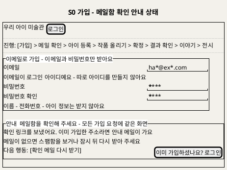

**[「S0 가입 - 메일함 확인 안내 상태」 PlantUML 뷰어로 열기](https://plantuml.sumzip.com/plantuml/svg/eNptU11r01AYvs-veKl3lRXFOy9mmbg_4OWoELeiY_2QtgNhFto1G7ErqFuytbMZGda1lcqyLmCE_qK87_kPvic5abbhuTp5v57nfc6TfL2h1xq75ZJW39mufNBrehne6ps772rV3crWy2qpWoNH68_Wn75a0xrbjVIRXj-B0GvRxQGsAE4tchbCnoAY2OQEQLaJ-z5Qpy06Q62ulxra3mNtD-jcw6sZpw1yfMDrgEw39FvwCTbwchj-Cbi5AE0tl5PFY0Ocfn4OGzFOAVYVUIKyuhx0coOXjvy--CaOTaD-jGHCwOOQrHVtvoRzL7y92-v4ZC_iInINOhoq4DcZTsVITCrdchmVY_CvgV4L56boBzjuAXrfJZlzK6NBWsmLZd7r2XzxYza3WS0Dn3v5iHyyuNoGLYv6Jk-SwlqepLBM4E9GHvfwZETjFoe7MSaPvMtHombVgfhkHpYoGf5fKcGuDLmya4iBpVpWErlZT7z1sWtFW98j0ozki18_tQU5hgIUNrf_WJARqAV_TfDETTTmGM1_09lXDgzIaYEEn_qSkuKL47ZozyIZmEHHpFOfm3IR4-tAzRH2MAI57CE_4dRP7JhqLuti2ZYhOjukYVzdHYleoGgzTHjj4X6fveVKj-DxCPBoFF2jN0_3kfM44_SAfYtfBmzdhHbshrSPbVeQrn_Au08HE8biWS9SXxRY1aaWL1a2-P_8Bz7cDK8=)** — 클릭 시 브라우저로 연결됩니다.

| 영역 | 내용 | 데이터 바인딩 | UX 의도 |
|---|---|---|---|
| 헤더 | 서비스 이름 · 로그인 링크 | — | 이미 계정이 있으면 바로 로그인(UC13 A2) |
| 여정 레일 | "가입 → 메일 확인"이 첫 단계 | — | UX7 (C1 여정 변형). 메일 확인까지 해야 끝난다는 것을 보인다 |
| 가입 양식 | 이메일 · 비밀번호 · 비밀번호 확인. "이메일이 로그인 아이디" 안내, 받지 않는 항목 명시 | 1.0 Input 이메일·비밀번호 | 최소 수집(BR-ACC-07). 아이디 칸을 두지 않는다 |
| 메일 확인 대기 | "메일함을 확인해 주세요" · [확인 메일 다시 받기] | 1.0 Output 발송 결과 | UC13 BF4 · A1 · E6 |
| 안내·차단 블록 | 메일함 확인 안내(새 가입·이미 가입 모두 같은 화면, E1·E4 비노출) · G26 형식(E2)·비밀번호(E3) · G27 링크 무효(E7, 400 `token_invalid`) · G3 저장 실패(E5) · E8 요청 한도 | 1.0 Output | UX6 (C2 · C3). 가입 여부를 화면에 드러내지 않는다(이제민 결정 ④) |

| 조작 | 동작 | 근거 |
|---|---|---|
| 가입 | 형식·일치를 먼저 검사하고 `POST /v1/auth/signup`(항상 202). 늘 "메일함을 확인해 주세요" 화면으로 간다. 이미 가입된 주소면 안내 메일만 간다 | UC13 BF2~4 · E1 · E4 |
| 확인 메일 다시 받기 | `POST /v1/auth/email/verify/resend`. 이전 링크는 무효. 재요청 간격 제한 | UC13 A1 · E8 |
| 메일 링크 | `POST /v1/auth/email/verify`. 유효하면(204) 세션을 받고 S1로 이동해 "이제 아이를 등록해 주세요"를 보인다. 만료·사용·무효면(400 `token_invalid`) G27 블록 | UC13 BF5~6 · E7 |

상태 전이: `입력 중` → (가입) → `저장 중` → `메일 확인 대기` → (링크) → `S1(가입 완료)` · `저장 중` → (이미 가입·동시 가입) → `메일 확인 대기`(같은 화면, 안내 메일) · `메일 확인 대기` → (링크 만료) → `차단(G27)` → (다시 받기) → `메일 확인 대기`.

**S0b 로그인 정보 찾기** — 로그인 화면의 "로그인 정보를 잊었어요"에서 들어온다(UC14).

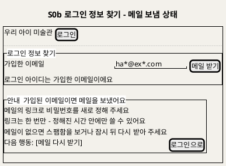

**[「S0b 로그인 정보 찾기 - 메일 보냄 상태」 PlantUML 뷰어로 열기](https://plantuml.sumzip.com/plantuml/svg/eNp1kt9KAlEQxu_PUwx2VyRFd11JUS_QZRhsJRX-C10hUEFzi62EonbNbA0jywShUy20gfRAO7Pv0BzTSqi92XPOnO-b33y7kayuZfRcMiGy8Z3UrpbRkrCubcS3MulcanMxnUhnYGJ5bnl2aUHoO3oiBisz64C3jv_mUdMDatn46gLJD9-TMA3YtajZBz7DigFUKQcVR2S1hC7yUyIP1JD40AOyDWq6gE8emS3fLUEBVr89o1AU4bDIr4X-aRMSAL4s0c1BYDvARsOmBQhta5OR2N5keCOdBH5CA-MhkrxmbZS1v2wHHGhZeGz9ZckLujyjhiWKiodsE_fdUXM8G7-JXRdGG-MrAZNqLqsV8KhSB-yUg3KPIQDfDZQlfDGDuof3fY7LVMc8bGDzsHd9MjzVHEYaplR8rMBOldP-ukkdTvrE8SW_bJOBVZEueDyzDnQzhPjFwN6Xh-T0FTEdt4OqF9iPQ2j_WeK-krXYEvC8DXjSHizlNcc1TsWVZhWC2hGeXs3_JP0tUIGPfVvV9NaJcpxFEYmlNvnH-wRMWHCv)** — 클릭 시 브라우저로 연결됩니다.

| 영역 | 내용 | 데이터 바인딩 | UX 의도 |
|---|---|---|---|
| 찾기 양식 | 이메일 입력 하나 · 메일 받기 | 1.R1 Input 이메일 | 입력은 하나만 받는다 |
| 안내 블록 | 가입 여부와 관계없이 같은 문구 | 1.R2 Output(화면에는 계정 유무 없음) | BR-ACC-08. 남의 가입 여부를 알아내는 데 쓰이지 않게 한다 |
| 재설정 화면 | 새 비밀번호 · 확인 · 저장. 만료면 G27 블록 | 1.R3 Input 토큰·새 비밀번호 | UC14 BF4~6 · E2 · E3 |

| 조작 | 동작 | 근거 |
|---|---|---|
| 메일 받기 | `POST /v1/auth/recovery`(항상 202). 응답 문구는 항상 같다. 이메일별·IP별 한도를 넘으면 메일만 보내지 않는다 | UC14 BF2~3 · A1 · A2 · E6 |
| 메일 링크 → 저장 | `POST /v1/auth/recovery/reset`. 링크 무효면 400 `token_invalid`. 성공(204)하면 현재 세션을 포함해 모든 세션이 끊기고, "이메일과 새 비밀번호로 로그인해 주세요"와 함께 로그인 화면으로 | UC14 BF4~6 · E2 · E3 · E5 |

상태 전이: `입력 중` → (메일 받기) → `메일 보냄 안내` → (링크) → `재설정 입력` → (저장) → `로그인 화면` · `재설정 입력` → (링크 만료) → `차단(G27)` → (다시 요청) → `입력 중`.


**S1b 가족 보호자 관리** — 공동 보호자 초대·해제·나가기(UC15, U1 확정). 보호자는 부모 두 명까지다(만든 보호자 + 공동 보호자 1명). 권한은 같고 **초대하기와 해제 버튼만 만든 보호자에게 보인다**(G29). 공동 보호자가 이미 있으면 초대하기는 이유 달린 비활성("보호자는 두 명까지예요")이다. 아래는 만든 보호자 화면의 **두 명 찬 상태**다.

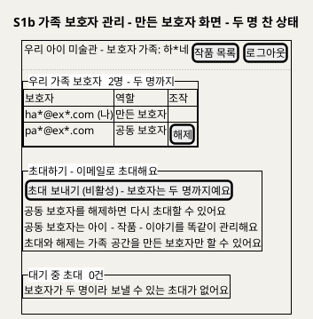

**[「S1b 가족 보호자 관리 - 만든 보호자 화면 - 두 명 찬 상태」 PlantUML 뷰어로 열기](https://plantuml.sumzip.com/plantuml/svg/eNptk19r2mAUxu_fT3GwN61jsm53u5KV9QvsUhykrWyl_imawsAKWc1GWIXVzaxJp6JgVxwdizRjFvKJck6-w84x0ekc3sT3nPN7nvO8Sbama1X9pFRUtaPD8rFW1Uqwp-0fvapWTsoHO5VipQobu092t58_U_qhXizAi-09CD2DhhPAOz9yptS_gNA38NstPAS8aeHnwVIlcjs49qXSvgD8_g7IuwVqvo2aXVXTirqqP1B1oCtP5sk2qecD_pySNWCmjC1Ip4nsU4hsJ43miE9y1G9HnywGj3HYy8sJDrvh76mQvjbz0FCZjKq_TCUCa8bhsXhauAvvW3RjpFR9Y0WYLn9E9kAehh4rKoDXWjpbeJPO7FdKsIlnzhYX13Y_hQy3Hi-18g53v_Cju9KUi2yfBt28avBPvPoWtgxeMpx6bI0TwXGHegFvBvOaT1edFMNz8YHw8MyXgU28NyO3S-Zkazk-_NBZXZIcixl5ZvxrCa8DiC2xB7k8PB_R-V_tAZDlAPUt-iI2_kdgseQu2X98RbNFyA7Yowig0w49VzridydeiVmxCrlG4kFYybWxTOgx1VyLmv_DurFZmgyTWGjUTtAAj8KJL-Etxpk_D0fS7gVxnsGcN9tnNiyddPl-IdBQ2UL5gL-fP8tb2Mo=)** — 클릭 시 브라우저로 연결됩니다.

| 영역 | 내용 | 데이터 바인딩 | UX 의도 |
|---|---|---|---|
| 보호자 목록 | 이메일(가림) · 역할 · 해제(만든 보호자 화면에만). "두 명까지" 표시 | 1.I1 · 1.I3 `GET /v1/family/members` | 같은 권한임을 먼저 보인다. 해제 버튼은 G29를 통과하는 사람에게만 |
| 초대하기 | 만든 보호자 화면에만 있다. 공동 보호자 자리가 비었으면 이메일 하나 · 초대 보내기 · 같은 권한 안내. 두 명 찼으면 C3 이유 달린 비활성("보호자는 두 명까지예요")과 "해제하면 다시 초대할 수 있어요" | 1.I1 Input · `GET /v1/family/members`의 공동 보호자 수 | 응답은 항상 "초대 메일을 보냈어요"(가입 여부 비노출). 누를 수 없는 이유를 버튼에 붙인다(UX6 · G29 · UC15 E9) |
| 대기 중 초대 | 초대 번호 · 초대 이메일(가림) · 만료 시각 · 취소. **대기 초대는 1건만**이고 새로 초대하면 이전 초대는 무효 | 1.I1 `GET /v1/family/invites` | UC15 A2 · E9 |
| 공동 보호자 화면 | 초대하기 영역과 해제 버튼이 없다. 해제 대신 [가족 공간에서 나가기] | 1.I4 | UC15 A1 · A5 · 만든 보호자에게는 나가기 버튼 없음(E5) |

| 조작 | 동작 | 근거 |
|---|---|---|
| 초대 보내기 | `POST /v1/family/invites`(항상 202). 초대 메일 요청 한도를 넘으면 메일만 보내지 않는다. 화면을 거쳐 오지 않은 요청은 서버가 막는다: 공동 보호자가 보내면 403 `invite_owner_only`, 두 명 찬 뒤면 409 `co_guardian_full`(C2 블록 "보호자는 두 명까지예요") | UC15 BF2~3 · A1 · E6 · E8 · E9 · G29 |
| 초대 수락(메일 링크) | 로그인(없으면 S0 가입, 이메일 미리 채움) 뒤 S1c에서 `POST /v1/family/invites/accept`. 성공하면 S4로 이동 | UC15 BF4~6 · A4 · E1~E3 → S1c |
| 해제 | 확인 창("해제하면 이 가족 자료를 볼 수 없게 돼요. 올린 작품은 남아요") 뒤 `DELETE /v1/family/members/{id}`. 대상 계정의 세션은 즉시 모두 지워진다. 해제 뒤 초대하기가 다시 활성이 된다 | UC15 A3 · G29 |
| 나가기 | 확인 창 뒤 `POST /v1/family/leave`. 세션이 모두 지워져 로그인 화면으로 간다. 다시 로그인하면 S1d로 간다 | UC15 A5 · A6 → S1d |

상태 전이(만든 보호자 화면): `보호자 1명` → (초대 보내기) → `대기 초대 1건` → (수락) → `두 명 찬 상태`(초대 비활성) → (해제) → `보호자 1명` · `대기 초대 1건` → (취소·만료) → `보호자 1명`.

**S1c 초대 수락** — 초대 메일의 링크에서 들어온다(UC15 BF4~6). 로그인하지 않았으면 먼저 로그인하고, 계정이 없으면 초대받은 이메일이 미리 채워진 S0 가입으로 간다(A4). 아래는 이미 다른 가족 공간에 속한 계정(E3)의 차단 상태다.

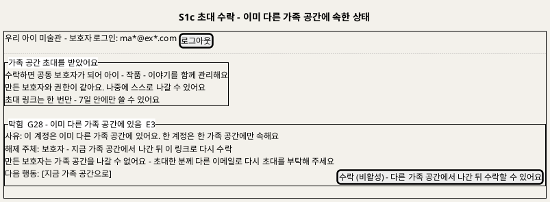

**[「S1c 초대 수락 - 이미 다른 가족 공간에 속한 상태」 PlantUML 뷰어로 열기](https://plantuml.sumzip.com/plantuml/svg/eNqNVN9r01AUfs9fcZgvOrEw96D0qSibf4CPo0Lsioz1h7QdCLWQrmFka8Vua7a0S0qGmXVQMFtjjVj_odxz_wfPvY10rX0Y5CG599zvfN93vptUuaKWKnv5nFLe3Sm8V0tqHt6qmd13peJeYftlMVcswYPN9c21jRdKZaeSy8LrtQxgYLCWBmhYzPkDTwCdgH0PgTU9dhVC5Gt4eQPR6Efk63jeBjz4xE0bsFHnDVspq7mKUn2sVAF7Pvs6BDR1AgBCQMONAo0A2SjgVoj9NnwEdmlHP0N0wiTk1dVU9sNqIlPM08ZWvEPHLxppqCmJhFJ9szLXPqbKribA_As0LTwLsNdZUSBmz02LXQeimn3uzvoSCLC2qP5Hj1T2j_mJMZWL5iQKfQHLzW_RbwuIN2nhpkAncDZosVN3hoddDaJxi2wQWJHfFai9TgLYvoXesXTpyKOHNIm1yDcEQeppTBkLwlPX2aDO60N21AFhKrs1qBeReobOhLgaBCUW8DRcAKgJc9jgkPctgFdPn99jbnTWaQFsrEu_9odou0mQAkY6uiY62n0gZPuEZDs7J78WqiVvkZVYsHhxKTdfJngbJO-EgpgPtCg0_kNAPXZPB3biSaqxXcLWpodNO577khkJS-cBHX1uFucHUy2iv5yFHMBYF_OPDRB2XHdoFHcbziI41jhdAjOQmvQwzgqVkc387JAimIStpdpsgZgWqY9v3UP2S-ddG_WbR-LCLPd_0Y848u58NNKUjZqSyha26UfwF_xmYhc=)** — 클릭 시 브라우저로 연결됩니다.

| 영역 | 내용 | 데이터 바인딩 | UX 의도 |
|---|---|---|---|
| 헤더 | 지금 로그인한 계정 이메일(가림) · 로그아웃 | `GET /v1/me` | 초대받은 이메일로 로그인했는지 스스로 확인하게 한다(E2) |
| 초대 안내 | 공동 보호자가 되면 무엇을 하는지 · 같은 권한 · 나가기 가능 · 1회용·유효 기간 | 초대 토큰(링크) | 수락 전에 결과를 안다. 아이 별칭·작품은 보이지 않는다(초대 메일과 같은 원칙) |
| 수락 | [수락하기] 하나. 차단이면 C3 이유 달린 비활성 | 1.I2 Input 토큰 | 결정은 한 번 누름으로 끝난다 |
| 안내·차단 블록 | E1 링크 무효(400 `token_invalid` — "초대 링크를 쓸 수 없어요. 초대한 분께 다시 요청해 주세요") · E2 이메일 다름("초대받은 이메일로 로그인해 주세요" + [로그아웃하고 다시 로그인]) · E3 다른 가족 소속(409 `already_in_family`. 만든 보호자면 나갈 수 없으니 다른 이메일로 다시 초대받으라는 안내 추가 [추론]) | 1.I2 Output | UX6 (C2 · C3). 만료·사용·취소를 구분하지 않는다(BR-ACC-08) |

| 조작 | 동작 | 근거 |
|---|---|---|
| 수락하기 | `POST /v1/family/invites/accept` {token}. 204면 "하*네 가족 공간에 합류했어요"와 함께 S4로 | UC15 BF5~6 · G28 |
| 로그아웃하고 다시 로그인 | 세션을 끝내고 로그인 화면으로. 로그인 뒤 같은 링크로 돌아온다 | UC15 E2 |
| 이메일로 가입(계정 없음) | S0으로, 초대받은 이메일을 미리 채운다. 가입하면 새 가족 공간 없이 이 가족에 합류하고 확인 메일은 생략한다 | UC15 A4 · UC13 A4 [추론] |
| 지금 가족 공간으로 | S4로 | UC15 E3 |

상태 전이: `링크 열림` → (로그인 안 됨) → `로그인 - 가입` → `수락 대기` → (수락) → `S4(합류 완료)` · `수락 대기` → (400) → `차단(E1)` · (이메일 다름) → `차단(E2)` → (다시 로그인) → `수락 대기` · (409) → `차단(E3)`.

**S1d 가족 없음** — 가족에서 나가거나 해제된 계정이 다시 로그인하면 S4 대신 이 화면이 열린다(UC15 A6 · U20 P0 기본값 [추론]). 새 가족 공간을 자동으로 만들지 않고 보호자가 고른다.

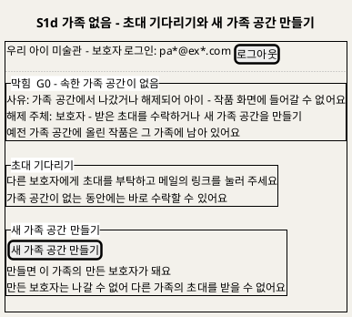

**[「S1d 가족 없음 - 초대 기다리기와 새 가족 공간 만들기」 PlantUML 뷰어로 열기](https://plantuml.sumzip.com/plantuml/svg/eNp9k81u00AQx-9-ilG5FRFRccspAlEegGNVJNNEqGo-qsSVkEIkJ7GqBYwIYLdOawdX9INKlnAbAz6EF9odvwOztkNMWpAvuzuzM7__f9aVjqa2tb1GXensbDd31bbagOfq1s6LdmuvWX3UqrfacGf9wfra44eKtq3Va_B0rQo81PHkCvBwHz0T7gFGTJg68DgUb0_FeUALHOuAQzZP5dPvPDRAXJji0ymFlY5a15TuXaULeBTSFUDbQC8C8S1G5vNIp7JiGiVOjJMRvAJx4vKfMXpxGXbV1Urt5Wppq9WgwEYeoevHw03oKaWS0n22Ii5eJxMH4Ml9ybf_LrHdv1lks0zAigKAgwBdv7yUcjhCwwUxcHho8auQFpDYEfquGDl4EM2ZqcHkQ_KRQTK2xGVE14BUUgIPGSBz0j4HER5Z1CkrAPhlhtdRuaCR9IbH6Om5m-JsJu8K71diO3nzG4aiV_SUZDgMfeOGCjoPxHmYY8oe5FieldIOvpIUCrMcsyctvGWq0iq5OYsX4FSAX5sFavFDT4Z9ST31QVxa6M3Qc4izn_SDNIGZ4nOQWmDEmSu3jUa8sUC8H6PNqEW6CS0a9h9X_MzbJeh_vzkJv_Gf-KYUl25oiCAhcodSeDr3F6IpQmyzDH45mLLKR1Oc_ty3Rc2CY3LwxtJT6dFXqTWr9HP-BvOeJdk=)** — 클릭 시 브라우저로 연결됩니다.

| 영역 | 내용 | 데이터 바인딩 | UX 의도 |
|---|---|---|---|
| 차단 블록 | G0 가족 없음. 사유 · 해제 주체 · 예전 작품은 남는다는 안내 | `GET /v1/me` `hasFamily=false` | UX6 (C2). 왜 작품이 안 보이는지 먼저 말한다 |
| 초대 기다리기 | 할 일 안내만(버튼 없음) | — | 초대 수락은 메일 링크(S1c)로만 한다 |
| 새 가족 공간 만들기 | 버튼 하나 · 만든 보호자가 된다는 것과 그 결과(나갈 수 없어 다른 가족 초대를 못 받음) | 1.0 Output 가족 공간 | 되돌리기 어려운 선택이라 결과를 버튼 옆에 적는다 [추론] |

| 조작 | 동작 | 근거 |
|---|---|---|
| 새 가족 공간 만들기 | `POST /v1/family`(201). 만든 보호자(owner)가 되고 S1 아이 관리로 가서 "이제 아이를 등록해 주세요"를 보인다. 이미 가족이 있으면 409 `already_in_family`(다른 탭에서 수락한 경우)라 S4로 보낸다 | UC15 A6 · U20 [추론] · T106 |
| 로그아웃 | 로그인 화면으로 | — |

상태 전이: `로그인` → (`hasFamily=false`) → `S1d` → (새 가족 공간 만들기) → `S1(만든 보호자)` · `S1d` → (초대 링크) → `S1c` → (수락) → `S4(공동 보호자)`.

---

## 5. S2 작품 올리기

### 5-1 와이어프레임

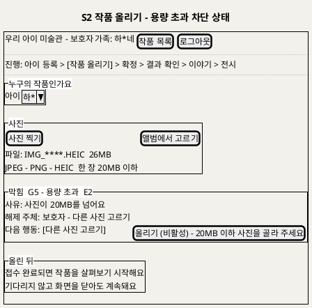

**[「S2 작품 올리기 - 용량 초과 차단 상태」 PlantUML 뷰어로 열기](https://plantuml.sumzip.com/plantuml/svg/eNptk1FP02AUhu_7K07wRjEuOqMXvTAEMiYmMyReks1MIYYwNjPGFSyZ0JjBhgOk2GGLXdhg0yV2o8aa9Bf1nP4Hz9nqJNEtWb5-53vPed7v7WY2StliaXM9p2ysrebfZovZdXiVfb32pljYzC_PFXKFItyafzj_IDGrlFZLuRV4EQc6PwqPq0BGHy_7gefAPaCzHn7ZA3KrwbUP5HSx1gXafRfumspGNldStu4qW3zKYQWQrpHlAn73qGoHboX1eO2Ghkfnh7ANgVOh1kCFUDemUWvzzlI0Eb_2sGWlZQdbZvDTk06fd9NQVmIx6X-lhad76mTAxwEfhycT_YQ4zZthUydb50UwdARani2Pn1lKui--eG1rVDOj_pkprGrBjz5ZRnQHLBDas5MpBf5M3YaMkGeUsihop89UUl4aL_lyDkYEYkvv4vCEPh2SZkJwbWPHlRIfDut1snwVFlLJl9P8iT1NLMwBxB-nZrn6bDGR5EtbfC6_40qom8zUgfj91Kw4YIQxAF7thecGQPLRPzFBIj7iZi7TVmHMJxakCXZ8QM2gU5ftCZHuks0zLnwauuqNwDi8Whs7XqT_64NFXCGrDhwKNpoqp_b_k-PLmLxOt_GXFjZN0gZ3uPsNRxNE0XbR8kc4mseE6ei6pYkDeNweObOPqMqqpoYXdTw0sOdOguMgdtzwg8tGZCanLBU9cstbwnrJ4yoc7D6j8gtywg1EibVvHDY2BEOj9wfY8EVW5u_MSn6Z_06_ASQpyrg=)** — 클릭 시 브라우저로 연결됩니다.

### 5-2 영역별 설계

| 영역 | 내용 | 데이터 바인딩 | UX 의도 |
|---|---|---|---|
| 여정 레일 | "작품 올리기" 단계 | — | UX7 |
| 아이 선택 | 드롭다운. 다시 찍기로 왔으면 이전 작품의 아이가 미리 선택 | 2.1 Output 아이 목록 · H7 아이 ID | UC2 A7 |
| 사진 | 찍기 · 앨범 · 파일 형식·용량 안내 · 미리보기 | 2.2 Input 사진 파일 · Output 미리보기 | 검사 기준을 먼저 보인다(BR-INT-01) |
| 차단 블록 | G5(형식 E1 · 용량 E2 · 판독 E3) · G6(원본·기록 저장 실패 E4 · E5) | 2.2 · 2.3 Output 거절 사유 | UX6 |
| 올린 뒤 안내 | "접수 완료되면 살펴보기 시작, 닫아도 계속" | 2.3 Output 202 · 상태 "판정 중" | UX7 |

### 5-3 상호작용

| 조작 | 동작 | 근거 |
|---|---|---|
| 사진 고르기 | 화면에서 형식·용량·판독을 먼저 검사, 통과하면 미리보기 | UC2 BF2 |
| 올리기 | `POST /v1/artworks`(요청 번호 포함). 버튼은 누르는 즉시 비활성(중복 전송 방지) | UC2 BF3 · A6 · BR-INT-03 |
| 접수 완료 | S3로 이동해 "살펴보는 중" 표시. 떠나도 S4에서 이어진다 | UC2 BF4 · A2 |
| G6 실패 | "접수되지 않았어요, 다시 올려 주세요". 목록에 작품이 생기지 않음 | UC2 E4 · E5 |

### 5-4 상태 전이

`빈 양식` → (사진 선택) → `검사 중` → `미리보기` 또는 `차단(G5)` · `미리보기` → (올리기) → `전송 중` → `접수 완료`(→ S3) 또는 `차단(G6)` → (다시 올리기) → `전송 중`.

---

## 6. S3 판정 제안 확정

### 6-1 와이어프레임

와이어프레임은 차단 상태(G7 — 제안 없음)를 그렸다. 정상 상태에서는 제안 칸에 "움직일 수 있을 것 같아요" 같은 문구가 보이고 차단 블록이 없다. 어느 상태에서도 선택지는 미리 선택되지 않는다.

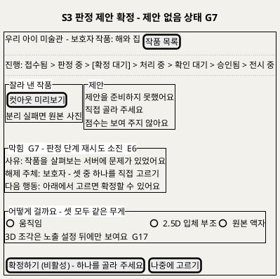

**[「S3 판정 제안 확정 - 제안 없음 상태 G7」 PlantUML 뷰어로 열기](https://plantuml.sumzip.com/plantuml/svg/eNpdU29L22AQf59Pcbg3ypjgZBP6Ysg29QPspTjopgyx6qj1lSvEGqWzYbZi2lSTkLK6VikstsFF9BPlLt9hd09iHcur55673O_P3TO_U8oXS7ubBW1nY33ra76Y34RP-c8bX4rbu1ur77YL20V4tji7OLPwViutlwpr8GEWErNOvgXkO2RVIWlbEr14jKl1RK4JdLCfHDiwNKft5Aslbe-5tgd0HuCvAZBlkBsC_o6o6sehzv_iKEzsiLw6fAPyGslpNQeJFVJbB-o1-HI5vQW8vsKOuwJlbXpaOvaMpPk9x9gNqtpY78ObMb1ug4PljB6aehwFK3xDQ1uRUGnJulGWleTxHcdpH_INqjmqMEPb-zhBno3uA2AlynhOaMDfMt3_EVkXByKL-7MgwVNJvDUUYq2bmH28CoEu6jjiBpUB8-eSMguU3srAtGF6JtdgfB3vjMSyqaez_PukWaVmSOdnaV1vn7VDPOoLLfr5QEY0zvl1MeX4TOyl1kCluQlZx8JVVZVZG0Nj73vi2cDj4mFkBmKtH48Y3xuwDXjCpyOT-QIsvBaOwt7xc5kNimklTH6EjCWQZDg4NKhVBxxErCYOGNirUuuJvQzYdxSrYZj7Zwd4lw5ryniWjRUbLx-ehPp4Kdby_1jryqbxAuBJOydrhZ7NiAyd1YnZ6QIklg9shqKQ4ivdfMbmfTw0Ib6J4juTExk6XvexUYc4aJPLvg9CLhLZkzDF89OFjmfw3CR-Of3qPXc-ZBk8bJ06QZZ4HLTVYVn88yyXdYI42Fc9DyO6ZflGV7l92mXq2DOzYQkTWJqZE56PW8xuyJpOyj60HTJupmRaY4v-X4IVeTecYyNlDmPr5PWUtfm1rVV--H8BADQzXA==)** — 클릭 시 브라우저로 연결됩니다.

### 6-2 영역별 설계

| 영역 | 내용 | 데이터 바인딩 | UX 의도 |
|---|---|---|---|
| 진행 레일 | 판정 중 → 확정 대기 | 0.5 Output 상태 | UX7 |
| 잘라 낸 작품 | 컷아웃 미리보기, 분리 실패면 원본과 "액자 권장" | H3 마스크·컷아웃 참조 (0.3 · 0.5 Output) | UX4 |
| 제안 | 제안 문구만. 점수 칸 없음. 판정 중이면 "살펴보는 중" | H3 제안 문구 코드 (0.5 Output) | UX2 |
| 차단 블록 | G7(판정 소진) · G8(확정할 수 없는 상태) | 0.5 Output 오류 분류 · 2.6 거절 | UX6 |
| 선택지 | 움직임 · 2.5D 입체 부조 · 원본 액자 — 같은 크기, 기본 선택 없음. 3D는 노출 설정 뒤(G17) | 2.6 Input 확정값 | UX2 · BR-SUG-03 |
| 행동 | 확정하기(선택 전 비활성) · 나중에 고르기 | 2.6 · 2.7 Output 처리 단계 작업(H4) | UX7 — 나중에 S4에서 이어 확정 |

### 6-3 상호작용

| 조작 | 동작 | 근거 |
|---|---|---|
| 제안 전 직접 고르기 | 제안을 기다리지 않고 선택·확정할 수 있다. 제안값은 "제안 전" | UC2 A3 · BR-SUG-05 |
| 선택 | 셋 중 하나. 제안과 달라도 경고 없음 | UC2 A1 · BR-SUG-03 |
| 확정하기 | `POST /v1/artworks/{id}/confirm`. 성공하면 "만들기 시작했어요"와 S4로 | UC2 BF7 · BF8 |
| 나중에 고르기 | S4로. 작품은 "확정 대기" 배지 | UC2 A2 |
| 액자 선택 | 추가 확인 없음. 원인 "보호자 선택"으로 기록된다(화면에는 원인 표시 없음) | UC2 A4 · UX3 |

### 6-4 상태 전이

`살펴보는 중`(판정 중) → (H3 도착) → `제안 있음` 또는 (G7) → `차단(G7) · 제안 없음` · 두 상태 모두 (선택) → `선택됨` → (확정) → `확정 중` → `처리 시작`(→ S4) 또는 `차단(G8)`. `살펴보는 중`에서도 (선택)이 가능하다(A3).

---

## 7. S4 작품 목록과 진행 상세

### 7-1 와이어프레임

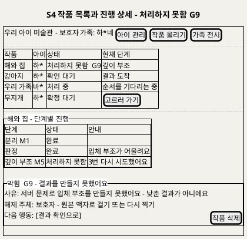

**[「S4 작품 목록과 진행 상세 - 처리하지 못함 G9」 PlantUML 뷰어로 열기](https://plantuml.sumzip.com/plantuml/svg/eNp1k0FvElEQx-_7KSb0pilJUz3IqdFYTz15bDBB25imFAzQEzRB-kxowZQqSxdccEmptAZ1CxuyRj7Rzux3cGZ3sZDYwyZv572Z_39-895GvpDKFQ4P0lp-fy_zLpVLHcDr1Jv9t7nsYWbnWTadzcHK5vrm2vOnWmGvkN6Fl4-Aeuf-pyrg9xvsd73JDGio_NYJ0PF7Ui6sAo0N_DbydYOGZT72x9ev4cUTLZ9KF7TiQ60I1LH5AJCuqOsA_nKpanlOmVNx4viGS70GlMCzy9S_TQAXeoBqwJHtKIPPcn4yiIRmyBhxxHPtIBhmAlmKamYSjrR4XCuuzI2X5sIlsewfm7zwDUW9EWDt2psoDVjToXaZOzuXTTYgh__TFvclTn-fBo1MWdbmbM_WRYKP_Uv22zp1XcB6mU1KytgWdHimyL7hlAhJ5LwEaDfvNIEG4oOqJikTr2bANbA24B08bcomF8CRw4KebS5rWvqd5rY3sfDKwa-BjsDSQjSvYgv9rkYUcKKiycYEXhhcZEZ6FSuOSE-VmNxak2Bb4WWdF3GhWG-IgYUo9T7QeE6KTQC1HOq4aA2o0xRyiyRh6_E92EuwjmO-grUBDxj4Y45-qxoUa3JTR9ITDk_8nhGMaDXiLexwWMfPg3mxeVJMZlAZkWklQCCPFRN1yTKxby67vr-GoKv8pKkRqQX96QprVbpohP0JZ4sLXs64YGLhuvOr-dLAicsJff4XVe_Wlbmh0ZApz3u1P3JQoPN_tw48HjxrJ3i24YUK7xmZM66w9EAqP1g4GbDZ2M3s8Jv_C59eOkM=)** — 클릭 시 브라우저로 연결됩니다.

### 7-2 영역별 설계

| 영역 | 내용 | 데이터 바인딩 | UX 의도 |
|---|---|---|---|
| 헤더 | 가족명 · 아이 관리 · 작품 올리기 · 가족 전시 | 3.1 세션 | UX8 |
| 작품 목록 | 작품 · 아이 · 상태 배지 · 현재 단계 | 3.1 Output 작품별 상태 목록 | UX7 (C4) |
| 단계별 진행 | 분리 · 판정 · 움직임 렌더 · 깊이 부조 · (P1) 3D의 상태와 안내 | **P0** 0.1 · 0.5 · 0.6 · 0.9 · 0.10 Output 단계 작업 기록(상태 · 시도 횟수 · 낮춤 원인 · 오류 분류) → 3.2 | UX7 · UX3 (C6) |
| 차단 블록 | G9 처리하지 못함 — 낮춘 결과가 아님을 명시 | 0.9 Output 상태 "처리하지 못함" · 마지막 오류 분류 | UX3 · UX6 |

### 7-3 상호작용

| 조작 | 동작 | 근거 |
|---|---|---|
| 목록 열기 | 가족 작품만, 상태와 현재 단계 | UC3 BF1 |
| 작품 누르기 | 확정 대기 → S3 · 확인 대기·처리하지 못함 → S5 · 처리 중 → 진행 상세 | UC3 BF2 · BF7 · A9 |
| 새로고침 | 상태 다시 읽기(갱신 방식 U8) | UC3 BF6 · A11 |
| 작품 삭제 | S9 대화상자 | UC7 BF1 |

### 7-4 상태 전이

`목록` → (작품 선택) → `진행 상세` · `진행 상세`의 표시 상태: `대기` / `진행 중` / `다시 시도 중`(재시도 중) / `낮춤 안내`(모델 낮춤) / `차단(G9)`(소진) / `확인 대기`(→ S5 버튼 활성). 목록에서 삭제된 작품은 즉시 사라진다(BR-DEL-01).

---

## 8. S5 결과 확인

### 8-1 와이어프레임

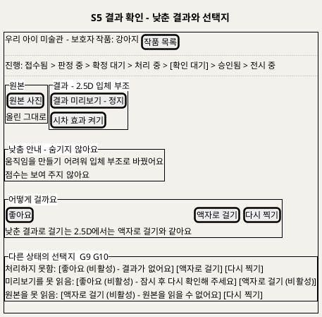

**[「S5 결과 확인 - 낮춘 결과와 선택지」 PlantUML 뷰어로 열기](https://plantuml.sumzip.com/plantuml/svg/eNp9VF1PE1EQfd9fMcEXjYGIhgf7YIgf8AN8bNakCjGEUkwpT9hkKaupdE2Kdsu23W22WmglRJfS4DbU-H_2zv0PztzdSEsI7UMzc2fOOXNm0sWtQiZf2N7Ialvra7l3mXxmA15n3qy_zW9u51aebWY383Bn6dHS_IunWmGtkF2FlwsQDYLofAyyYaMXwiyI0k-8cJI0NgxA05d7HvYMbSuTLWg797UdwGYgjk8BbRO9IYhfIZb9aGhw-_lQOiG2q_AesH0gv5RTEAU2V_YMyqXjJIiTH6Lj6VDU5uYYsGfK-qcUoH-AZUdU-_AEpFVF3wbsHnBA-igQlhGFAcU4cJQC9ZhO1MevOj_vjygR46BvYsVVpQnbzqsZbFXFeTijAX3ScQBYOiUdusqhcyqOA4h-hwQqOi4liySfOhPDZuHh3MJzmvEDDsiCCwM7QQKXVJAtJJEMYcWzJMMmC_SEseJi0AfZ7HMljl3WrTiKGnGoJXTJ37IoDbm33KcCdhDtffayWWMubBnY28U2bcEE0bPE1y5zYX0o_C62rGl1NAWIoBb97VMBITCAX2W792u8NzwkP7-Pp1g0JYcB65fRwILoLIxGVkKfxm-VuExXm7U7tHdm4SreAyVFpavMDz4nE07d11Uxa2BD8bCKpsvRdTi-xShoTOoicHFEe9vblXsues7VrQIsP4bl-QfKJXUq0nY4L04upd1PTWiHu2JkyoaL5tk9sjoWFgVkwuHH2Cj9ptlumGxi3-JozFSA3h_0rFvosO0zimzRAmPA-JalPVTLMMObBUzC6OoU-ITVHUzR3tLG7P-7VAf9lJ2pua8NWaTv4mpuhf5j_gHIxH2m)** — 클릭 시 브라우저로 연결됩니다.

### 8-2 영역별 설계

| 영역 | 내용 | 데이터 바인딩 | UX 의도 |
|---|---|---|---|
| 진행 레일 | 확인 대기 | H5 상태 | UX7 |
| 원본 · 결과 | 나란히, 결과는 정지. 결과 종류에 맞는 토글(재생·시차·회전) | 3.3 Output 원본 · 결과 미리보기 · H5 결과 종류 | UX4 (C5) |
| 낮춤 안내 | "어느 단계에서 어디로". 점수 없음 | H5 낮춤 원인 (0.8 Output) | UX3 (C6) |
| 선택지 | 결과 종류별: 움직임·3D = 좋아요 / 낮춘 결과로 걸기 / 액자로 걸기 / 다시 찍기 · 2.5D = 좋아요 / 액자 / 다시 찍기 · 액자 = 좋아요 / 다시 찍기 · 처리하지 못함 = 액자 / 다시 찍기 | 3.4 Output 선택지 · 3.5 Input 결정 코드 | UX2 · BR-APR-02 |
| 차단 블록 | G9(처리하지 못함) · G10(미리보기·원본 못 읽음) · G3(결정 저장 실패) | 0.9 · 3.3 · 3.5 Output | UX6 |

### 8-3 상호작용

| 조작 | 동작 | 근거 |
|---|---|---|
| 재생·시차·회전 | 누를 때만. 다시 누르면 정지 | UC4 BF3 · BR-EXH-03 |
| 좋아요 | `decision like`. 승인됨. 이야기가 비었으면 "이야기를 채우면 전시돼요"와 S6 | UC4 BF4 · BF5 |
| 낮춘 결과로 걸기 | 2.5D가 없으면 "입체 부조를 새로 만들어요" 안내 뒤 S4로(처리 중). 처음 결과는 보관 | UC4 A1 · H6 |
| 액자로 걸기 | 모델 없이 승인. 처리하지 못함에서도 가능 | UC4 A2 · A5 |
| 다시 찍기 | 확인 대화상자("이전 작품은 지워져요" [추론]) → 결정 기록 → S2(아이 미리 선택) + 이전 작품은 S9 절차 | UC4 A6 · H7 · H8 |
| 중복 누름 | 첫 결정만 반영, 이미 반영된 결정을 보여 줌 | UC4 E7 · BR-APR-06 |

### 8-4 상태 전이

`불러오는 중` → `확인 가능` 또는 `차단(G10)` · `확인 가능` → (결정) → `반영 중` → `승인됨`(→ S6 또는 전시) / `처리 중`(use_lower, → S4) / `닫힘`(retake, → S2) 또는 `차단(G3)`. `처리하지 못함` 진입이면 처음부터 `차단(G9)` 표시와 함께 액자·다시 찍기만 활성.

---

## 9. S6 이야기 쓰기

### 9-1 와이어프레임

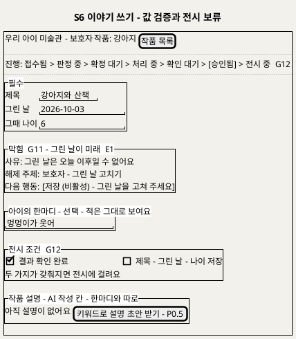

**[「S6 이야기 쓰기 - 값 검증과 전시 보류」 PlantUML 뷰어로 열기](https://plantuml.sumzip.com/plantuml/svg/eNptU0FLG2EQve-vGNJLS0lIlHrIQWyLlt4KvRQkhbRKEaOWGE9WWONaVt3SRLO6MdmwwWiqCN2Ypd2Av2hn9j90ZjdJY2kIJPN9b2bevHnf3GYpXyxtrRWUzdWV9c_5Yn4NPuQ_rn4qbmytL73cKGwU4dHC9EJm_oVSWikVluHtDJDtkXkf-C7QiSs_SQjcYwjuVLqyg_49kKPRUROw7-GlpWzmCyVl-6myDXTu4tUtkKlxCcCfPulO4Kmcz9DQ8qlVgS9ArWp4rGe5pinIrspni_Eh4M01tu0c7CiplBTsauHpQZYbVkm3sPIDZiE0KuSYQJ2qBHVTAjRU4TkLdGdFDMaXtv_3cpEOB3zAZXICjYcQKLzKTA1bvk-EzEm3Egowosl8mF1iTJXqKlDZpd4-AAgm-O3jlQtYdgQ3lZ6aSWbSyfQ0wATANBhgiSaMmYEHn4SyI12xexC2LGGSEbnHVYdCotzNZyJW5VtqOtkHGCZldfDQktWFDVafd6RzdPaVTj06r3FaaHo8D9DFPd152YmFTHaDoO_QwGK5OAOPOmQbwAvA7_Usq-eo1LqExzjQwnqTtN6Tf5hqUXq_EjXRfO6bi4eLDUG2xSya2NWxVuNU0pxwz5Y_zq6MIKUMFduRsejslvNl3gRef-MvFwhcnrOxxyP9R8DROttu0POijUry4rsc-9YV0w7dQHUNLwyxHORGG34gQXK0q3heEaJaYbOqvH5hELin9MvlAK-9oYnojAE9H52OaB3Tif1MWgdv9rnm89fiexYNaOBzPBZCHIU1l8eOlisu2x2mRSRGKxTGYblDDQNPmiLSsDR5Opn8cNxG_FLfpFPPRPYdZW55fYlf_h_hZRqS)** — 클릭 시 브라우저로 연결됩니다.

### 9-2 영역별 설계

| 영역 | 내용 | 데이터 바인딩 | UX 의도 |
|---|---|---|---|
| 진행 레일 | 승인됨 + G12 표시 | 3.9 Output | UX1 (C1 전시 보류) |
| 필수 | 제목 · 그린 날 · 그때 나이 | 3.6 Output 기존 이야기 · 3.7 Input | UX1 |
| 한마디 | 선택, 적은 그대로 | 3.7 Input 한마디 원문 | UX5 (C7) |
| 차단 블록 | G11(미래 날짜 E1 · 나이 범위 E2 · 전시 중 필수 비움 E7) · G3(저장 실패 E3) · 삭제 중 종결(E4) | 3.8 Output 거절 사유 | UX6 |
| 전시 조건 | 결과 확인 · 필수 이야기 두 줄 | 3.9 Output 승인 상태 · 이야기 필드 | UX1 (C8) |
| 작품 설명 | AI 작성 칸(한마디와 분리) · P0.5 확장점 버튼 · 승인 설명이 있으면 고정 표시 | 3.10 Output · H10 | UX5 |

### 9-3 상호작용

| 조작 | 동작 | 근거 |
|---|---|---|
| 입력 | 화면에서 날짜·나이 즉시 검사 | UC5 BF2 · E1 · E2 |
| 저장 | `PUT /v1/artworks/{id}/story`. 서버 재검사 | UC5 BF4 |
| 저장 뒤 | 승인됨 + 필수 충족이면 "전시에 걸렸어요", 아니면 C8에 빠진 줄 | UC5 BF5 · A1 · A5 |
| 한마디 지우기 | 비우고 저장하면 지움 | UC5 A4 |
| 키워드로 설명 초안 받기 | S7 패널 열기(P0.5, 승인 설명이 없을 때만) | UC5 A6 · UC10 BF1 |

### 9-4 상태 전이

`불러오는 중` → `편집` → (저장) → `저장 중` → `저장됨(전시 보류)` / `저장됨(전시 중)` 또는 `차단(G11)` · `차단(G3)`. `삭제 중` 작품이면 `종결`(입력 불가). `편집` → (설명 초안 받기) → S7 패널.

---

## 10. S7 설명 초안 받기 (P0.5)

### 10-1 와이어프레임

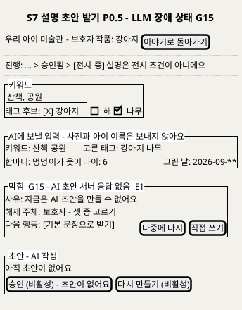

**[「S7 설명 초안 받기 - LLM 장애 상태 G15」 PlantUML 뷰어로 열기](https://plantuml.sumzip.com/plantuml/svg/eNplk29L23AQx5_nVRzuyebWUh06lgdDN3QIDgZ7MigddFOGWHXU-kiFWtMRbYftbGpt0xJZtdsoLLURI_QV5S7vYXdJ65SFBn693_35fu4uM5uZZDqztZZSNldX1r8k08k1-Jj8tPo5vbG1vvRqI7WRhgfzT-cn5l4qmZVMahnePQPS2vg7D-ToZOiAdsNzbXgbi05BBBYX3wC1zsmwgPb3_H0TXk9MKZvJVEbZfqxsA9VtvOgCGRo1HcA_LumW52Q5EvuOX3OpVYIdzlD2v-sqeLYhnp0s2-IcQMaAa-GZCXhU5BvPzvL_BOwq0agk72h-9UCFaDQKL4AOb6jpYuknn-NkaVQwgdrlhOQPCKiZhZH9zPZ6jkjirFjQ6aRE9cow74cxP9emRhGPzTEFYIxyNvXyT8DrX1GjBMNHrpjXu3bBb2hMo0L8feI-AiTANxw58Q3math1lF0pMLvAFaUFmBswfR6tc24J5bqM5PUHo37xixea6A5cHUlLxqHc1iuBgJFQFUKVI5E7fLDw3B1KvNvaoQ4ONkzs6FipqIC_vvGPy3GHgRr7VBXV7MkmFaYl3bWLFzabLBUmY5PTkdjzyPh4SIOdA79VAxk9U8wujFaFNBMvNaYoY-EK6OQrNYsAcxOiXFhNzsWKPFcXxNs4amqAHaZqA-m1IK7qMHAg2SGLx_djQJcs7N8OcfPyBRl3yO3wmrA7FtpSkpcEj055PrJMfRew68rOmoNgs4J9li2JC2-7HEyGAwtmYKTOHllloGNb3ELgIV_I2iqT1guQpL97txDOPeXxcD3hId5o_qnJIY9E9P--oZKg_rAL8rndCRMNu8rM8voSf8d_Ac87Cd0=)** — 클릭 시 브라우저로 연결됩니다.

### 10-2 영역별 설계

| 영역 | 내용 | 데이터 바인딩 | UX 의도 |
|---|---|---|---|
| 레일 | "설명은 전시 조건이 아니에요" | — | UX1 |
| 키워드 · 태그 후보 | 키워드 입력, M2 태그 후보 칩(고른 것만 입력) | 4.1 Output 태그 후보(H3) · 4.2 Input | BR-CAP-06 |
| 보낼 입력 미리보기 | 키워드 · 고른 태그 · 한마디 · 나이 · 그린 날. 사진·이름 제외 안내 | 4.3 Output LLM 입력 | UX5 · BR-CAP-01 |
| 차단 블록 | G13(사용 조건) · G14(입력 없음) · G15(LLM 장애) · 승인 설명 있음(종결, E3) | 4.1 · 4.2 · 4.4 Output | UX6 |
| 초안 | AI 작성 표시, 한마디와 다른 칸. 템플릿으로 낮췄으면 C6 문구 | 4.6 Output 초안 · 출처 · 검사 결과 · 생성 횟수 | UX5 · UX3 |
| 행동 | 초안 만들기 · 다시 만들기 · 버리고 직접 쓰기 · 승인 | 4.7 · 4.8 | UX6 |

### 10-3 상호작용

| 조작 | 동작 | 근거 |
|---|---|---|
| 초안 만들기 | 입력이 없으면 비활성(G14). 누르면 "쓰는 중" 진행 표시만(문장은 검사 뒤 한 번에) | UC10 BF3~5 · BR-CAP-07 |
| 규칙 검사 반복 실패 | "AI 초안이 입력에 없는 내용을 넣어 기본 문장으로 바꿨어요" + 템플릿 초안 | UC10 E2 · G16 |
| LLM 장애 | G15 블록, 기본 문장 / 나중에 / 직접 쓰기 중 선택 | UC10 E1 |
| 다시 만들기 | 승인 전만. 생성 횟수 증가 | UC10 A1 |
| 버리고 직접 쓰기 | 출처 "직접", AI 작성 표시 없음 | UC10 A3 · D6 |
| 승인 | 고정. 전시 중이면 곧바로, 아니면 "전시될 때 함께 보여요" | UC10 BF8 · A4 |

### 10-4 상태 전이

`입력` → (초안 만들기) → `쓰는 중` → `초안(LLM)` / `초안(템플릿)`(G16) / `차단(G15)` · `초안` → (수정) → `수정본` → (승인) → `고정` · `초안` → (버리고 직접) → `직접 입력` → (승인) → `고정`. 진입 시 G13이면 `AI 초안 차단 — 템플릿·직접만`, 승인 설명이 있으면 `고정`(재생성 불가).

---

## 11. S8 가족 전시

### 11-1 와이어프레임

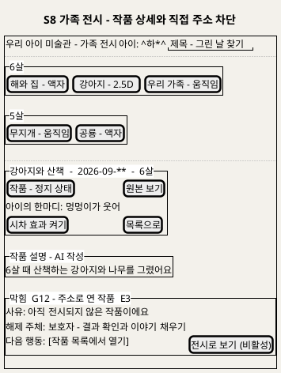

**[「S8 가족 전시 - 작품 상세와 직접 주소 차단」 PlantUML 뷰어로 열기](https://plantuml.sumzip.com/plantuml/svg/eNpVU11r2mAUvs-vOLibzaG0lpbNq-6jHbveZVFwaxmlVofaKyf4kQ5bHdNh2mjfSKRdtUVYrBnLQPaDck7-w84bo0PIRfJy3ufzZDtfSOUKJ8dpJX90mPmUyqWO4X3qw9HHXPYks_8qm87m4NHuxu76zkulcFhIH8C7Z-BaZRpMgEyVGgIiQP22970OVKuQ6lC3DDSskNkGup7RlyaQNcLGSMmn0gWl-FQpAvUsvB0DaSoZNuBPh-qma5cZaRX5czASh6Sn6eEkH4TIFHh_J0d_O3hrAVZNJvjrOhaEoKREo0oxGdqiqh1SAPY8zZ7raUuZ2oD6rQSj7LmWJqGHkjMW3XztHwayAg08f1WWRvpqQilJ1M0FKo5tvupaYmXIx53-wuvBfy5loWhJ6MupWjQ5BR6D2FpsK7L2PBIO-59L4UGkDGRqUiZn69XEXOZVC6cO4NRm0wkenodEhg6eJnBYx04nDnj3lR8-ZzssskYXto_bEFwHeL2RO50BzYTEkKgcKg4MEjMciMDvolb1Bu9PWcqLt7JpUidSoVQKqDUDM9wPnndgxSZWdU4Kf8z8rkyHJVCvM8fG4ZnX1wHerMekSX9RmBno0lqsE-xsSCKqjkmYcd_lsBKsBrZ0PxXtnIxycEFmcNmSDACyd1P4uA-8PpyVpztciNybB0ta97oaGY4fAt_TZnKBaKLyDvAbI2DjhowmeBdn-K0bXxYSxMQ8qhRrL-ILZLGDeS_wGP-oXldwWk9knCVl-yCzz__ZP7qO1w4=)** — 클릭 시 브라우저로 연결됩니다.

### 11-2 영역별 설계

| 영역 | 내용 | 데이터 바인딩 | UX 의도 |
|---|---|---|---|
| 헤더 | 아이 선택 · 제목·그린 날 찾기 | 5.1 Output 아이 목록 | UC6 A6 · A7 |
| 연령 묶음 | 나이별 묶음, 묶음 안 제작일 순, 결과 종류 같은 크기, 낮춤 배지 없음 | 5.2 Output 정지 상태 목록(H11) | UX1 · UX3 · BR-EXH-02 · BR-EXH-04 |
| 작품 상세 | 정지 결과 · 원본 보기 · 한마디 먼저 · 토글 | 5.3 · 5.4 · 5.5 Output | UX4 (C5) · UX5 (C7) |
| 작품 설명 | AI 작성 칸(승인된 것만) | H10 | UX5 |
| 차단 블록 | G12(직접 주소로 연 미전시 작품) · G17(3D 노출 전) · G0(다른 가족) | 5.2 · 5.3 Output | UX6 · UX1 |

### 11-3 상호작용

| 조작 | 동작 | 근거 |
|---|---|---|
| 아이 고르기 | 그 아이의 전시 중 작품만 | UC6 BF2 |
| 작품 고르기 | 정지 상태 결과 + 이야기 | UC6 BF3 |
| 재생·시차·회전 | 누를 때만 | UC6 BF4 · A1~A3 |
| 원본 보기 | 원본으로 전환, 다시 결과로 | UC6 BF5 · A4 |
| 목록으로 | 자동 넘김 없이 묶음 목록 | UC6 BF6 |
| 전시 작품 없음 | 빈 전시와 "작품 올리기" | UC6 A8 |

### 11-4 상태 전이

`목록` → (작품) → `상세(정지)` → (토글) → `재생 중` → (토글) → `상세(정지)` · `상세` ↔ `원본 보기` · 파일 못 읽음 → `장애 표시`(이야기만, 다시 불러오기) · 직접 주소 조건 미충족 → `차단(G12)` · 삭제됨 → `종결`("더 이상 없는 작품이에요").

---

## 12. S9 삭제 확인과 진행

### 12-1 와이어프레임

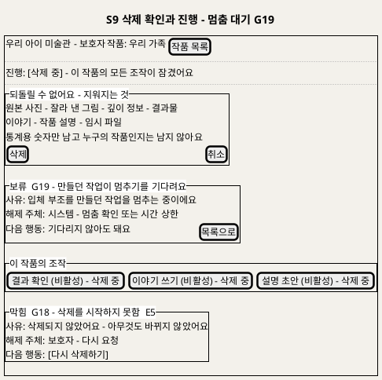

**[「S9 삭제 확인과 진행 - 멈춤 대기 G19」 PlantUML 뷰어로 열기](https://plantuml.sumzip.com/plantuml/svg/eNp9lF9P02AUxu_7KU7wRmMgIcZEuCIY8AN4SWYyhRjCADPGFZJM6EjZajZkhTLapYtlGzhi2QqU2E_Uc_odPO_bjolEb9b1PX_e5_yes81sFLL5wuZqTtlYWV77lM1nV-F99sPKx_z65tri6_Xceh6ezL-Yn5ybVQrLhdwSvJ0C2rkkx4L4xCA7iAYhUEeNj_ZhHPBcoxsXUC9GgQdvJqeUjWyuoGw9V7aAGh62e0CGSrYP-DMgzYn8oqga-LEZULMGn4GaB_E3bXqYHXlFal3x-UISALw4x5adgW1lYkI0lTdPczjRRO5BhjuKG5ICsk2u6eKhA9Ty-CwJOVE_pCOfGvW007sxrJlY1bHNYc0EOt5L49ytU6RTnT-xXIeovzumANBpDQcBo-ixBJHTNNEOAXcCiG4DbId8Ft2V5W2OwROK977HtLAXinrbJyMUlMZTpUCqixcl-a5ShfnqOtkiN967jgYqNc5Z2Q_GhB2dL-pGAwdQU6PrnhhyOG6Q6uQE_sa4y4J4o859UkgZifO2S3t6RtmWow98PDNBGCbs6Oh46OJX2ZOOS9IuYWyd5eJZCOJRcdFxua1kwRAshz1rlqjPuTfsmUx83ElNOwmF7JWgcFxL1MWGLx38HnITblaxqOzGJWu0VsnCAZo1WV6xIk8F2v0SGxbXsySydeB1wOrJ9FBkuzeigFW-vhoKU5lAsklkhdiyUg4P1ybZFzHgQuLcUMBTvFPjE4vUq2fCrT82T4C9N5YOPfH4f3biOfkaGdq_U1ObOvtxU9r06j4sMAtUrNowxah48Ss2ugBzLx9YkyTXzHsa5mi9mUzP572WfLw6FvW_sx7bM_rNjkvyvK-cR_3Lx04sDONSA8tkKmKibWVmaW2R_3t-A25tkRI=)** — 클릭 시 브라우저로 연결됩니다.

### 12-2 영역별 설계

| 영역 | 내용 | 데이터 바인딩 | UX 의도 |
|---|---|---|---|
| 진행 레일 | 종결 변형 `삭제 중` | 6.3 Output | UX6 |
| 확인 | 지워지는 것 목록, 남는 것(통계 숫자), 되돌릴 수 없음. 아이 삭제면 작품 수 | 6.1 Output 안내 | 비가역 행동의 확인(UC7 A3) |
| 보류 블록 | G19 멈춤 대기 — 기다리지 않아도 됨 | 6.4 Output 멈춤 확인 대기 | UX6 · UX7 |
| 잠긴 조작 | 결과 확인 · 이야기 · 설명 버튼 비활성 "삭제 중" | 6.3 Output 상태(BR-DEL-05) | UX6 |
| 차단 블록 | G18 삭제 착수 실패 · G0 권한 없음 | 6.3 · 6.1 Output | UX6 |

### 12-3 상호작용

| 조작 | 동작 | 근거 |
|---|---|---|
| 삭제 | `DELETE`. 즉시 목록·전시에서 사라짐, 202 | UC7 BF2 |
| 취소 | 아무것도 바뀌지 않음 | UC7 A3 |
| 목록으로 | 기다리지 않고 S4로. 삭제는 계속 | UC7 BF3 · BF4 |
| 다시 삭제하기 | G18 실패 뒤 재요청 | UC7 E5 |

### 12-4 상태 전이

`확인` → (삭제) → `착수 중` → `삭제 중` 또는 `차단(G18)` · `삭제 중` → (실행 중 작업 있음) → `보류(G19)` → (멈춤 확인·시간 상한) → `파일 삭제 중` → `삭제 완료`("삭제했어요"). 끝내 실패한 파일은 화면에 보이지 않고 "삭제 미완료"로 S10에만 집계된다(§18).

---

## 13. S10 서비스 상태와 모델별 지표

### 13-1 와이어프레임

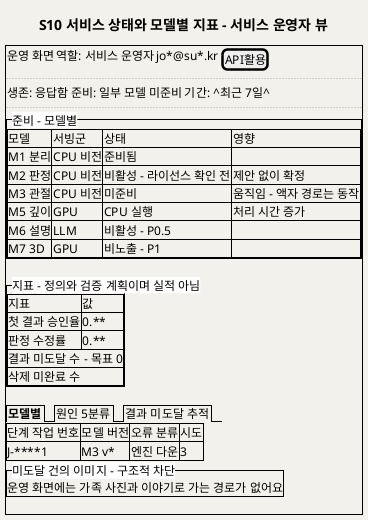

**[「S10 서비스 상태와 모델별 지표 - 서비스 운영자 뷰」 PlantUML 뷰어로 열기](https://plantuml.sumzip.com/plantuml/svg/eNptVF1PGkEUfd9fcaNvNFIosSZN09ja2rTRhKTpU1MTrKaxojSAfRGTta4NBY3QsLrQxSwpClhMVwTEhP6hnbv_ofcOX0YLD8zHmTP3nHuG6Vg8FI1vrIWV2OrK-udQNLQGi6EPqx-jkY31pZlIOBKF8dnArP_FMyW-Eg8vwxu_D1AzxbWGqTLgzra7Y2JeBXFWFfsdcakBVlQ3a8LETVihicY2HmdAXNlKLBSOK5v3lM3-Orj5nKg1IQF4dO7q1qP_nkzAp4hnOrbh8a5GafLuafCVmzexUHsPW4rXy2w7RSw16XQxK9ItV68yY1klJl7rivagShB_Or0NQjgd27EJsYAt07nqwhRBF_qUC2N92MRI35iyOT7gSfQqzTstm8fSDB4Y2-7hiQIw7wfR1sRpnRZngm-BRVnasCyR4RK9DHwA7l4GLf02kAasUrvgEopdLDZRs9gYN69jsQN9OstEPUn2fSOA3LJ0Zg2A01TRSt5hvaEff6pYIYdZJOolttpp_BUlU6RyIA7yeJxlqklwrlPMnoCXRNUjxHTZPfzOJA2DVWLaJC8BT4uOrfKph2RQWZztEmRubv6WnqDPOznQPwWB50Nqtma3g20OUdAvIVv05XYMs2WRfIOD5zRUug-cS80t7FOBomZzXWhtkxxNpA3ZsP5Barf9g-7Dxm86aDuXXcDUNRmJJrfC5_V4aLffCkwa9CNOrNFO_wz5Jw6Iu84YGY4as_sIyCj8ek4dkS7nNfFrT6J4S6q4D48Xn4yeC3cgw62c5KicMPDuLe0c69mS0UtXHX5lx1k82gXRSLoGB3GQ7MYgYUaZyYac1Boio-JeT3jow65SPL545KvLYUUj4jK9NpoHel6PrncummQ2sLkkqaKSYqdVx5ItTbarVNIYy775mvEowwGiHGDpghyp0xXSbkqw3qVHRwnjXQmSeaOJTPBhEws5adX08voS_Tf9A0hsbao=)** — 클릭 시 브라우저로 연결됩니다.

### 13-2 영역별 설계

| 영역 | 내용 | 데이터 바인딩 | UX 의도 |
|---|---|---|---|
| 헤더 | 역할 · 계정(가림) · API활용 | 7.1 Output | UX8 (C9) |
| 요약 행 | 생존 · 준비 · 기간 | 7.2 · 7.3 Output | 운영 화면의 고정 레일 |
| 준비 - 모델별 | 모델 · 서빙군 · 상태 칩 · 영향 경로 | 7.3 Output 모델별 준비·활성 버전 · H14 | UX8 (C10) |
| 지표 | 첫 결과 승인율 · 판정 수정률 · 결과 미도달(목표 0) · 삭제 미완료 · 설명 규칙 검사 실패율(P0.5) — "정의와 검증 계획이며 실적 아님" | 7.4 Output (H13) | BR-OPS-02 |
| 탭 | 모델별(낮춤률 · p95 · 재시도율 · 큐 적체 · 외부 호출량·한도 초과) · 원인 5분류 · 결과 미도달 추적(단계 작업 번호 기준) | 7.5 · 7.6 · 7.7 Output | UX3 · UX8 |
| 구조적 차단 안내 | 가족 이미지·이야기로 가는 경로 없음 | — (BR-ACC-03) | UX8 |

### 13-3 상호작용

| 조작 | 동작 | 근거 |
|---|---|---|
| 기간 선택 | 지표 다시 계산. 분모 0이면 "해당 없음" | UC8 BF4 · A6 |
| 탭 전환 | 모델별 · 원인 5분류 · 미도달 추적 | UC8 BF5~7 |
| 미도달 행 | 단계 작업 번호·모델 버전·오류 분류·시도만. 행을 눌러도 이미지 없음 | UC8 BF7 · E2 |
| API활용 | S12로 | UC11 A4 |

### 13-4 상태 전이

`역할 확인` → `운영 화면` 또는 `차단(G1)`(역할 없음, 화면 거부) · `운영 화면` → (지표 요청) → `지표 표시` 또는 `장애 표시`(작업 DB 장애 E1, 게이트 아님) · 준비 확인 무응답 서빙군은 칩 `확인 불가`(E5).

---

## 14. S11 모델 평가와 승격

### 14-1 와이어프레임

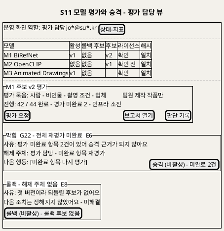

**[「S11 모델 평가와 승격 - 평가 담당 뷰」 PlantUML 뷰어로 열기](https://plantuml.sumzip.com/plantuml/svg/eNptVF1PGlEQfd9fMakvrQ00oGkanqxWmyb9SvtobLKt1FARDKztg5pg3RqFbdSGtaC7BKMpajFdcFMh4RftzP6Hzt1dELBv987eOXPOmQMTWUXOKCtLSSm7mEgtyxl5Cd7LHxYXMumV1PxUOpnOwMjM2ExkelJSEkoyDm8jEcCLM_zeAnd3x7FyVM4B5dtO8xxCQQmwYGOhDXhtSVk5qUir96VVoEObShvglot4bsMa0M9LV6_GhnrW4FN6dCK7MhpezPBlljY33E0jRLWcu2_MwboUDkurI10KawxnkNrgAx6fotUA90jFKwHfO6DZIdMmtUr5U1HXbSoYEsCLCEwm3sQ_vowrXP4c8ShtkamJW9SD1skUM4gR2iXREoVXy_HU1PNnr_tf37RFbtqoqg60jsHjVGJJVuLz8CQjf0mkFrK3xob_M9VX_O4O0w0kMTnfszuM23Wv_pchYkBf61jReBPYVhkG6x0-k10XztOx5TRsca98o6bnkZajoz2malBln8v77o9trGkMSzXVPdiJwXgUHsD4OFBZxROtb8N_WkEpKgDNlltU2WigLY1bGWA2eEiHRWpezolVMnfnqkqqwYJtp2V5RVfbw8IZ8BWPzTlWy1KxtuNWSgBPox54VRVsqVK_NRumHwoPWDQZfUnqfXf1S7w4hyjL5ggwxDYd2N20Otcdp2F5DXslzheQniddZcLCVk5JlYmedHj2cEZDt0f02HEvFk7FOtk_3C3HWPfwY_GgYASgngsBpbu8NT_Q9waGCAFdb_yYhwYZdiME04_6DaHmb8CmKhw0bbEeVoq7Gv6ygyx5G-LWA9uXHVDnpHD0MF9k83UxqJbrGVTyH_v8-JvTtMS6A15DCgZ-kz5HoWNdmoin5vlv5x-LqmX5)** — 클릭 시 브라우저로 연결됩니다.

### 14-2 영역별 설계

| 영역 | 내용 | 데이터 바인딩 | UX 의도 |
|---|---|---|---|
| 헤더 | 역할 평가 담당 | 8.1 Output | UX8 |
| 매니페스트 표 | 모델 · 활성 · 롤백 후보 · 후보 · 라이선스 · 해시 일치 (D16 채택 5종 + M7 P1) | 8.2 Output 매니페스트 | UX8 (C10) |
| 평가 진행 | 평가 묶음 구성(팀원 제작만) · 완료/전체 · 평가 미완료 수 | 8.3 · 8.4 Output | G20 · UX6 |
| 차단 블록 | G20 항목 등록 · G21 착수(해시·격리) · G22 승격(미완료·라이선스·계약) | 8.3 · 8.7 Output | UX6 |
| 롤백 | 직전 활성 후보로. 후보 없으면 비활성 + "해제 주체 없음" (벽, §18) | 8.8 Output | UX6 |

### 14-3 상호작용

| 조작 | 동작 | 근거 |
|---|---|---|
| 평가 요청 | 해시·격리 확인 뒤 항목별 작업 등록(202) | UC9 BF3 |
| 보고서 열기 | 불일치 · 오인 후보 · 시간 · 메모리를 활성 버전과 나란히 | UC9 BF5 |
| 판단 기록 | 오인 분류 · 통과 판단 · 근거 | UC9 BF6 · A2(보류) |
| 승격 | G22 통과 시에만 활성. 직전 활성은 롤백 후보로 | UC9 BF7 · D5 |
| 롤백 | S10 지표를 근거로. 재평가 없이 즉시 | UC9 A1 |

### 14-4 상태 전이

`목록` → (평가 요청) → `착수 검사` → `평가 중` 또는 `차단(G21)` · `평가 중` → `보고서` → (판단) → `판단 기록됨` → (승격) → `활성` 또는 `차단(G22)` · `활성` → (롤백) → `되돌림` 또는 `벽(E8)`.

---

## 15. S12 API활용 메뉴

### 15-1 와이어프레임

```plantuml
@startuml
skinparam backgroundColor #F3F1EB
title S12 API활용 메뉴 - 시험 호출 차단 상태
salt
{+
{ 운영 화면 | 역할: 연동 개발 | jo*@su*.kr | [상태-지표] | [모델 평가] }
..
{/ <b>엔드포인트 | 가이드라인 | 매뉴얼 }
..
{# 묶음 | 경로 | 구간
  보호자 앱 | /v1/artworks | P0
  운영 | /ready 모델별 | P0
  모델 기능 | /v1/models/segment | P0
  모델 기능 | /v1/models/pose | P0 팀 내부 키
  모델 기능 | /v1/models/caption | P0.5 예정
}
{ 문서 버전 v1 - 명세 v1 - 매니페스트 일치 | [openapi.json 다시 읽기] }
..
{^"시험 호출 - classify"
  입력: ^평가 묶음 작품 E-***^ | 키: 팀 시험 키 ****
}
{^"막힘  G25 - M2 비활성 - 라이선스 확인 전"
  사유: classify 모델이 아직 활성화되지 않았어요
  해제 주체: 평가 담당 - 라이선스 확인 뒤 승격
  다음 행동: [다른 기능 고르기] | [시험 호출 (비활성) - 모델 비활성]
}
{^"응답 - H16"
  결과 분류 - 모델 ID 버전 - 처리 시간 - 오류 분류 | 결과는 가족 저장소에 쓰지 않아요
}
}
@enduml
```

**[「S12 API활용 메뉴 - 시험 호출 차단 상태」 PlantUML 뷰어로 열기](https://plantuml.sumzip.com/plantuml/svg/eNqNVEtPGlEU3s-vONFNSyMWG7sgTWMf2rpoYtJlI8mo1KDIEAZtjJqgjo0wtr5ARjMQTKGIocmII4FE_9Ccc_9Dz-Vh46JNwwLued3zPS5jelJNJJeXooq-GInF1YS6BDPq7OJ8QluOzb3RoloCBieeTQTGXyvJSDIaho-BEXg1NSlObTqrAdaymHZhCMi0Rd4CYbWoaQM5F2heAG1vim1b0dVoUll7oqwBnblkbYI4zWLNhXWg_C-RKwX528H9U_AcGx2b4wuab0xf9vkXE3z41B0zRNWUOLSnZQQvL_BbC8R-2nNS07Ch-P3K2jC8mHlJ-Swe22K_ToWWyLS4mCuo4HIQC7cc5AhWy7w0ndz2GgcB600q7Mnixh2eyw28m7rnGAoAXrsSVPEAKHfFieGVwDBT9kVLLOp8nHrKNT1YnEyE1blV6K6H10a_oLev13IwU-kNWdLmwlF9WA_PL4Vjyf-ojGt6uFMGYi8FuOViMwViq_zvrlk1noxosU6jfxTI2qVSTtlgMbDeIsMGbBhUMmAlwCri5Q4Zrd5vZsncFd8typQlk8T0tS3JvhYPx9R4xL-g81w0y6w9Z-_49r4UoYGHfhiC2aiq65HPqwOSruIOlipBCHX167NPxUNxtAvjQz6fL8T3MLRgB2p_1lYZOOWTy4cGsJoWRQvg3cgoj_8wAtg2pCmNK7m7lNolo8S7s9tyUncG2bl8q042W66_UI87LmeBDapKd8op0qMHFnuOwxnKWXTi0lmWB4icSyUG_OOWGm4Q-hhMF832X67GozJQpu01alIrJozRipM0Wz7IXjbLWLnXzrsuYcXtUCmd_4DFR_cQH3e06mh-H5vu8kKFQzRvOP8-8Fzi9RqOd30L2DSwYv1pm3zbF57fbsPCn3VJM1tenq2yrO21rPdGYCbbeUvnV0xliooV-rpHeX4Wx849S4akaIM_Y-HYHP-r_AYpV0ES)** — 클릭 시 브라우저로 연결됩니다.

### 15-2 영역별 설계

| 영역 | 내용 | 데이터 바인딩 | UX 의도 |
|---|---|---|---|
| 헤더 | 역할(운영자 · 연동 개발) | 9.1 Output | UX8 |
| 탭 | 엔드포인트 · 가이드라인 · 매뉴얼 | 9.2 · 9.5 · 9.6 Output | BR-API-07 |
| 엔드포인트 표 | 묶음 · 경로 · 구간. P0 네 기능(`pose`는 팀 내부 키), `caption`은 "P0.5 예정"(D17) | 9.2 Output(`/openapi.json`) | BR-API-08 |
| 버전 대조 행 | 문서 · 명세 · 매니페스트 일치 여부, 불일치면 경고(차단 아님) | 9.4 Output · H14 | UC11 E3 |
| 시험 호출 | 평가 묶음 작품 선택 · 팀 시험 키 · 호출 | 9.7 Input · H15 | BR-API-09 |
| 차단 블록 | G23(평가 묶음 밖·라이선스 미확인) · G25(모델 비활성·미준비) · G24(크기·형식) · G2(키) | 9.7 · 10.1~10.3 Output | UX6 |
| 응답 | 결과 분류 · 모델 ID·버전 · 처리 시간 · 오류 분류. 가족 저장소에 쓰지 않음 | H16 (10.6 · 10.7 Output) | P10 계약의 사람 쪽 창 |

### 15-3 상호작용

| 조작 | 동작 | 근거 |
|---|---|---|
| 탭 전환 | 엔드포인트 · 가이드라인 · 매뉴얼 | UC11 BF2~6 |
| openapi.json 다시 읽기 | 서버 무응답이면 마지막 확인 명세와 시각 표시 | UC11 E2 |
| 시험 호출 | 평가 묶음 작품만 고를 수 있는 드롭다운(파일 업로드 칸 없음 [추론]) | UC11 A1 · E4 |
| 매뉴얼의 교체·상태 링크 | S11 · S10으로 | UC11 A4 · A5 |

### 15-4 상태 전이

`역할 확인` → `메뉴` 또는 `차단(G1)` · `엔드포인트` → (시험 호출) → `호출 가능` / `차단(G23·G25)` → (호출) → `대기(queued·running)` → `응답(done·failed)`. 명세 못 읽음 → `장애 표시(마지막 명세)`.

---

## 16. 게이트 맵 → 화면 표현 사상

SD_01 §15의 게이트 **26개 전건**이다. 모든 게이트가 하나 이상의 버튼을 비활성화한다.

| 게이트 | 화면 | UI 표현 | 비활성화 대상 | 해제 액션 |
|:--:|---|---|---|---|
| G0 가족 접근 | S1~S9 전부 | 세션 없음 → 로그인으로 이동. 다른 가족 자료 → "찾을 수 없어요"(존재 비노출) C2 | 해당 화면의 모든 조작 버튼(S9는 삭제) | 보호자: 다시 로그인 |
| G1 팀원 역할 | S10 · S11 · S12 | 역할 없는 메뉴는 헤더에 그리지 않음. 주소로 오면 C2 "이 화면을 볼 역할이 없어요" | 화면 전체 조작 | 역할을 가진 계정으로 다시 로그인(역할 부여 요청 채널 없음, §18) |
| G2 API 키·한도 | S12 시험 호출(사람 쪽 창) · P10 응답 | 401/403/429 응답을 C2로 표시. `pose`에 팀 밖 키면 403 | 시험 호출 버튼(키 없음) | 연동 개발: 유효한 시험 키로 다시 / 한도 창 뒤 |
| G3 기록 반영 | S1 · S5 · S6 | C2 "저장되지 않았어요/반영되지 않았어요", 입력값 유지 | 다음 단계 이동 버튼(작품 올리기로 · 이야기로 · 전시 보기) | 보호자: 다시 저장 |
| G4 별칭 검사 | S1 | C2 + C3 | 저장 | 보호자: 별칭 고치기 |
| G5 사진 검사 | S2 | C2(형식·용량·판독 사유) | 올리기 | 보호자: 다른 사진 고르기 |
| G6 내구 접수 | S2 | C2 "접수되지 않았어요" | S3로 가는 진행(접수 완료 화면이 뜨지 않음) · 올리기는 다시 활성 | 보호자: 다시 올리기 |
| G7 판정 제안 도달 | S3 · S4(배지) | 제안 칸을 "제안을 준비하지 못했어요"로, C2 | 확정하기(선택 전) | 보호자: 셋 중 직접 고르기 |
| G8 확정 가능 상태 | S3 | C2 "이미 만들기 시작했어요/삭제 중이에요" + 현재 상태 | 선택지 · 확정하기 | 보호자: S5에서 결정으로 바꾸기(삭제 중은 종결) |
| G9 결과 단계 소진 | S4 · S5 · C1 | 레일 막힘 변형 + C2 "서버 문제로 만들지 못했어요 - 낮춘 결과가 아니에요" | 좋아요 · 낮춘 결과로 걸기 | 보호자: 액자로 걸기 / 다시 찍기 |
| G10 결과 열람 | S5 | C5 칸 안 C2 | 미리보기 실패: 모든 결정 버튼 / 원본 실패: 액자로 걸기 | 보호자: 나중에 다시 열기 / 다시 찍기 |
| G11 이야기 값 | S6 | 필드 옆 사유 + C2 | 저장 | 보호자: 값 고치기 |
| G12 전시 | S6 · S8 · C1 · C8 | 레일 전시 보류 변형 + C8 빠진 줄. S8 직접 주소는 C2 | S8 "전시로 보기" · S6 "전시 보기" | 보호자: 빠진 쪽 채우기(S5 결정 · S6 필수) |
| G13 설명 모델 조건 | S7 · S6 | C2(해제 주체 = 평가 담당) | AI 초안 만들기 | 보호자 대안: 기본 문장으로 받기 · 직접 쓰기. 해제는 평가 담당의 P8 승격(요청 채널 없음) |
| G14 설명 입력 | S7 | C3 사유 "키워드를 하나 이상 적거나 골라 주세요" | 초안 만들기 | 보호자: 키워드·태그 입력 |
| G15 LLM 초안 도달 | S7 | C2 선택지 셋 | 승인 · 다시 만들기(초안 없음) | 보호자: 기본 문장 / 나중에 / 직접 쓰기 |
| G16 규칙 검사 | S7 | 걸린 초안은 보이지 않음. 반복 실패면 C6 "기본 문장으로 바꿨어요" | 걸린 초안의 승인(초안 자체가 표시되지 않음) | 시스템 재생성 → 보호자: 템플릿 고치기 / 직접 쓰기 |
| G17 3D 노출 | S3 · S5 · S8 | 3D 선택지·회전 토글을 그리지 않음. 직접 주소는 C2 | 3D 조각 선택지 · 돌려 보기 | 노출 설정을 켜는 팀원(주체 미정, §18). 보호자 쪽 요청 채널 없음 |
| G18 삭제 착수 | S9 | C2 "삭제되지 않았어요" | 목록으로 가기 전 "삭제 완료" 표시 없음 · 잠금 해제 없음 | 보호자: 다시 삭제하기 |
| G19 처리 멈춤 (보류형) | S9 · C1 | C2 보류 변형(노란 테두리) | 이 작품의 결과 확인 · 이야기 · 설명 버튼 | 시스템(멈춤 확인·시간 상한). 보호자는 기다리지 않아도 됨 |
| G20 평가 항목 등록 | S11 | C2 "팀원이 만든 작품만 등록할 수 있어요" | 항목 등록 | 평가 담당: 조건 채워 다시 등록 |
| G21 평가 착수 | S11 | C2 해시 불일치 항목 · 열린 포트 | 평가 요청 | 평가 담당: 재설치·격리 조치 뒤 다시 요청 |
| G22 승격 | S11 | C2 미완료 수 · 라이선스 · 계약 불일치 | 승격 | 평가 담당: 미완료 재평가 · 라이선스 확인 · 어댑터 수정 |
| G23 시험 호출 입력 | S12 | 드롭다운에 평가 묶음 작품만. 비활성 모델은 C2 | 시험 호출 | 연동 개발: 평가 묶음에서 다시 고르기 |
| G24 요청 크기·형식 | S12 응답 · P10 | 413/422를 C2로 | 시험 호출(형식 오류 입력) | 연동 개발: 입력 고치기 |
| G25 외부 기능 준비 | S12 · C10 | 모델 칩 비활성·미준비 + C2 | 해당 기능의 시험 호출 | 해제 주체가 타인: 평가 담당(승격) · 운영자(서빙군 복구). 연동 개발은 다른 기능 고르기 |

**사상 규칙**

1. **모든 게이트는 하나 이상의 버튼을 비활성화한다.** 위 표 "비활성화 대상"이 빈 행은 없다. 배너만 띄우고 진행되는 표현은 쓰지 않는다.
2. **비활성 버튼에는 이유가 붙는다.** 라벨 뒤 `(비활성) - 사유`와 hover·포커스 말풍선이 같은 문구다(C3).
3. **해제 주체가 현재 사용자가 아니면 해제 버튼을 두지 않는다.** 프롬프트는 이 경우 «요청 보내기»를 요구하지만, 이 프로젝트의 상류 문서(UC·SD_01)에는 보호자가 팀원에게, 팀원이 다른 팀원에게 요청을 보내는 기능이 없다. 기능을 지어내지 않으려고(근거 규율 4) **해제 주체를 C2에 이름으로 밝히고 현재 사용자가 할 수 있는 대안 행동만** 준다(G13 · G17 · G19 · G25 · G1). 요청 채널이 필요한지는 §18에 올렸다.
4. **두 화면에 걸치는 게이트는 문구를 같게 한다.** G9(S4 · S5): "서버 문제로 결과를 만들지 못했어요 - 낮춘 결과가 아니에요". G12(S6 · S8 · C1): "결과 확인과 제목·그린 날·나이가 갖춰지면 전시돼요". G7(S3 · S4): "제안을 준비하지 못했어요. 직접 골라 주세요". G19(S9 · C1): "만들던 작업이 멈추기를 기다리는 중이에요".
5. **게이트가 아닌 차단(SD_01 §15-2)은 게이트처럼 꾸미지 않는다.** 종결(`삭제 중`, 승인 설명 고정)은 C2 종결 변형, 구조적 차단(운영 화면의 가족 이미지, 외부 3D)은 경로를 그리지 않음, 장애 표시는 §17 전역 실패 규칙을 따른다. 롤백 후보 없음(E8)은 "해제 주체 없음"을 그대로 밝힌다.

---

## 17. 상태 표현·접근성·오류 규약

**상태 표현** — 색만으로 상태를 말하지 않는다. 모든 상태는 **문구 + 모양**으로 구분한다.

| 상태 | 문구 | 모양 [추론] |
|---|---|---|
| 차단 | "막힘 G번호" | 굵은 테두리 블록 |
| 보류 | "기다리는 중" | 점선 테두리 블록 |
| 종결 | "되돌릴 수 없어요" / "삭제 중" | 블록 + 모든 조작 잠금 |
| 낮춤 | "…로 바꿨어요" | 안내 블록(테두리 없음) |
| 준비됨 · 미준비 · 비활성 · CPU 실행 · 비노출 · 확인 불가 | 칩 문구 그대로 | 칩 모양을 서로 다르게(채움 · 빈 칸 · 사선 등) |

아이콘은 상태 문구를 대신하지 않는다. 이모지는 쓰지 않는다.

**접근성**

- 키보드만으로 모든 조작이 된다. 비활성 버튼도 포커스를 받아 사유를 읽힌다(C3).
- 차단 블록이 나타나면 스크린리더에 사유·해제 주체를 알리고(라이브 영역), 포커스를 블록 제목으로 옮긴다 [추론].
- 재생·시차·회전은 기본 꺼짐이고, 움직임 줄이기 설정이면 토글이 켜져도 정지 화면 + 원본을 먼저 보인다 [추론 — BR-EXH-03의 확장].
- 명암은 본문 대비 4.5:1 이상 [추론 — 원천 수치 없음, 일반 기준].
- 모바일 웹이 기본(spec Assumptions). S5 원본-결과 나란히는 좁은 화면에서 위아래로 쌓는다.

**전역 실패 규칙** (장애 표시 — 게이트가 아님)

1. 저장소 장애로 파일을 못 읽으면, DB에서 읽은 글(제목·이야기)은 그대로 보이고 파일 자리에 "지금은 불러올 수 없어요 · 다시 불러오기"(UC6 E4). 결과를 다시 만들지 않는다.
2. API 서버 무응답이면 운영 화면은 마지막 확인 값과 시각을 보이고 "갱신 불가"를 적는다(UC11 E2 · UC8 E4).
3. 세션 만료는 입력 중 값을 저장하지 않고 로그인으로 보낸다(G0). 임시 보존 여부는 미정(UC5 E5).
4. 장애 문구에 오류 원문·객체 키를 쓰지 않는다(BR-PRV-01).

---

## 18. 미해결·확인 필요

| # | 항목 | 걸리는 화면 | 영향 |
|:--:|---|---|---|
| 1 | **요청 채널이 없다** — 해제 주체가 타인인 게이트(G1 · G13 · G17 · G25)에 «요청 보내기»를 둘지. 상류에 기능이 없어 만들지 않았다 | S7 · S3 · S8 · S10~S12 | 중간. 두면 새 UC가 필요하다 |
| 2 | **API 키 발급·폐기 화면** — U12 예시값은 "서비스 운영자가 'API활용' 메뉴에서"지만 UC 단계가 없다(D17) | S12 | 중간. P0 착수 전 UC11에 발급·폐기 흐름을 더할지 정한다 |
| 3 | **3D 노출 설정을 켜는 화면·역할** (SD_01 §17 3번) | S3 · S5 · S8 · S10 | 중간(P1) |
| 4 | **삭제 미완료 건을 끝내는 화면** — S10은 수만 보인다 (SD_01 §17 1번) | S10 | 높음 |
| 5 | **롤백 후보 없음의 다음 조치** — S11 롤백 버튼은 비활성 + "해제 주체 없음" (SD_01 §17 2번) | S11 | 높음 |
| 6 | 화면 갱신 방식(폴링/푸시)과 갱신 주기 (U8) | S3 · S4 · S9 · S12 | 중간. 레일·배지가 언제 바뀌는지가 여기서 정해진다 |
| 7 | 제안 문구·낮춤 문구 확정 (U10) — 이 문서의 문구는 UC의 [추론 문구]를 옮긴 것 | S3 · S4 · S5 · S7 | 중간 |
| 8 | 결과 파일 형식(U9) — 재생·시차 컨트롤의 모양 | S5 · S8 | 중간 |
| 9 | ~~가족 계정 모델(U1)~~ → 확정: 공동 보호자 초대, 같은 권한, 부모 두 명까지, 초대는 만든 보호자만(`1c460b0`). 역할별 뷰는 나누지 않고 S1b의 초대·해제 버튼만 만든 보호자에게 보인다. 남은 것: 초대 이메일 불일치(UC15 E2)의 응답 코드가 계약에 없다(B 확인), 만든 보호자의 탈퇴·권한 이전(U20) | S1b · S1c · S1d | 낮음 |
| 10 | 입력 중 세션 만료 시 임시 보존 (UC5 E5) · 별칭 길이·허용 문자 (UC1 E2) · 키워드 개수·길이 (UC10 E6) | S1 · S6 · S7 | 낮음 |
| 11 | 명암·움직임 줄이기 등 접근성 수치 — 원천에 없어 일반 기준을 [추론]으로 적었다 | 전 화면 | 낮음 |

### 도면 목록과 렌더 검증

| # | 도면 | 절 |
|:--:|---|---|
| 1 | 화면 지도와 이동 경로 | §2-2 |
| 2 | 작품 상태 전이와 화면 | §2-3 |
| 3 | C1 진행 레일 - 상태별 변형 | §3-2 |
| 4 | C2 차단 블록과 C3 비활성 버튼 - 변형 | §3-3 |
| 5~16 | S1 ~ S12 와이어프레임 (화면당 1장, 모두 차단 상태 포함) | §4 ~ §15 |
| 17~21 | S0 가입 · S0b 로그인 정보 찾기 · S1b 가족 보호자 관리 · S1c 초대 수락 · S1d 가족 없음 (D18 · U1 · `1c460b0`) | §4-5 |

도면은 21개다(처음 16개에 D18·U1로 계정·가족 화면 5개를 더했다). 처음 16개가 기준(14개 내외)보다 둘 많은 이유는 화면이 12개라서다(프로세스 11개 중 P3을 결정·이야기·설명의 세 화면으로, P2를 올리기·확정의 두 화면으로 나눴다 — 사이에 비동기 대기가 있어 보호자가 한 자리에서 끝내지 않기 때문이다(SD_01 §1-3)).

`plantuml.sumzip.com`에서 처음 16개 모두 HTTP 200, `image/svg+xml`, SVG 안 `Syntax Error` 없음을 확인했다(2026-09-28). URL 최대 1,393자로 4096자 이하다. 링크를 복호한 소스가 코드블록과 글자까지 같다. PNG로 받아 차단 블록·비활성 버튼이 그려졌는지 눈으로 확인했다. 추가 5개(S0 · S0b · S1b · S1c · S1d)도 같은 기준으로 확인했다(2026-09-28, S1b는 두 명 찬 상태로 다시 그림).

---

*우리 아이 미술관 P0 · P0.5 · P1 · SD_02 UI/UX 설계서 · 2026-09-28 작성 · 입력: SD_01(개정 2) · SD_01 통합 · UC_00 · UC_01~UC_12 · 공통 기준 D1~D17*
