# SD_02 UI/UX 설계서 — 우리 아이 미술관 (P0 · P0.5 · P1)
**우리 아이 미술관 · 프로세스를 조작 가능한 화면으로 · 설계 원칙 · 화면 지도 · 공통 컴포넌트 · 와이어프레임 · 게이트의 화면 표현**

---

> **문서 식별**: `design/SD_02_UIUX설계서_우리아이미술관.md`
> **작성일**: 2026-09-28
> **입력**: `design/SD_01_프로세스설계서_우리아이미술관.md`(개정 2, D17 반영본 — IPO · 게이트 맵 G0~G29 · 인계 계약 H1~H16) · `design/SD_01_프로세스통합.md` · `design/UC_00_개요_우리아이미술관.md` · `UC_01`~`UC_12` 전건(액터 · 기본흐름 · 대체·예외흐름 · 업무규칙 · UseCase Diagram) · 공통 기준 §11 통합 결정 D1~D17
> **원천**: `Intent-Specify.md` [가치제안] 경험 원칙 · [부정적 영향] · spec v2.1 성공 기준. 원칙 역산의 근거로만 썼다.
> **생성 프롬프트**: `분석설계 프롬프트 - UI_UX.md`
> **표기**: `S` = 화면 · `C` = 공통 컴포넌트 · `UX` = 설계 원칙(프롬프트의 `U1~UN`에 해당. 이 프로젝트에서 `U`는 공통 미해결 번호라 겹치지 않게 `UX`로 썼다) · `P`/`G`/`H` = SD_01의 프로세스/게이트/인계 · `BF n` = UC 기본흐름 n단계 · `A`/`E` = UC 대체/예외흐름 · `[추론]` = 원천에 직접 없는 설계 판단
> **와이어프레임 예시 값**: 별칭은 `하*`, 가족명은 `하*네`, 팀원 계정은 `jo*@su*.kr`처럼 가렸다. 날짜의 일은 `**`로 가렸다.
> **개정 (2026-09-28, 통합 결정 D18)**: 이용자 중복을 별칭이 아니라 보호자 이메일 계정으로 막게 되어 **S0 가입(이메일)**과 **S0b 로그인 정보 찾기** 화면을 추가하고(SD_01 1.0 · 1.R1~1.R3 · G26 · G27), S1의 별칭 중복 차단을 "같은 별칭 안내(저장은 유지)"로 바꿨다.
> **개정 (2026-09-28, main `1c460b0` 후속)**: 보호자는 부모 두 명까지(만든 보호자 1 + 공동 보호자 1)이고 초대는 만든 보호자만 한다. 그에 맞춰 **S1b 와이어프레임을 "두 명 찬 상태"로 다시 그렸고**, T107이 만들 **S1c 초대 수락**과 **S1d 가족 없음** 화면을 추가했다(UC15 BF4~6 · A4 · A6 · E1~E3 · E9 · G28 · G29 · U20).
> **개정 (2026-09-28, 모델 적재 상태 — A 서빙 구현 `763e90a` · B 계약 `fa57e57` · T109 · T143)**: 모델을 올리는 동안은 **오류가 아니다**. C10에 "불러오는 중"·"적재 실패"·"내려감 짐작(M6)"을 더하고, S3·S4에 "그림을 볼 준비를 하고 있어요", S7에 첫 생성 지연 안내(`GET /v1/captions/model-status`, `aa4e55d`), S11에 **모델 상태 표와 "지금 불러오기"**를 넣었다(근거 `docs/A/A_모델적재_화면요구.md` §3).
> **개정 (2026-09-30, 이제민 결정 D36 — 카카오 로그인)**: S0a 로그인은 크게 [카카오로 시작하기], 아래 작게 "이메일로 로그인(기존 회원)". 처음 로그인하면 S1 아이 등록("아이를 등록해 볼까요?"), 다시 오면 마지막으로 본 전시실. 카카오에서 취소하면 "로그인을 취소했어요. 다시 해 볼까요?". 카카오 키가 없으면 버튼은 "준비 중이에요"로 비활성. S1b 초대는 [초대 링크 복사하기] → "링크를 복사했어요. 카카오톡으로 보내 주세요". S1c는 링크를 열고 [카카오로 시작하기]. 보호자 화면에서 "메일을 확인해 주세요"·"메일 다시 받기"·"로그인 정보 찾기(메일)" 문구를 내린다(S0·S0b·확인 화면은 기존 이메일 계정용 경로로만 남기고 메뉴·링크에서 뺀다). 상세는 §17-7.
> **개정 (2026-09-29, 웹 구현 전 점검 — 통합 결정 D21, 신지현)**: 구현 전 점검에서 드러난 빈틈을 채웠다. ① 로그인을 **S0a(보호자)**와 **S0o(팀원)** 두 화면으로 나눴다(쿠키·경로·셸이 다르다). ② **역할별 메뉴 표**(§2-1)를 정본으로 두었다 — 지표(S10)는 팀원 세 역할이 읽고 미도달 목록만 운영자 전용. ③ 운영 셸이 새로고침 뒤 역할을 되살리는 `GET /v1/ops/me`와 `POST /v1/ops/auth/logout`, S9 진행을 보는 `GET /v1/artworks/{id}/deletion`·`GET /v1/children/{id}/deletion`을 바인딩했다. ④ S3의 **비활성 모델 선택지**(`unavailable[]`, 409 `model_disabled`), S6의 **동시 수정 충돌**(409 `story_conflict`), S11의 **비활성화**(clarify 확정)를 넣었다. ⑤ §16에 G26~G29를 더해 30개 전건으로 맞췄다. ⑥ 보류 블록은 점선 테두리로 통일하고, 상태 모양을 스타일가이드 토큰에 사상했다(§3-5).
> **개정 (2026-09-29, 디자인 검토 — 통합 결정 D22, 신지현)**: §3-5 토큰 사상 확정, S0a·S0o 와이어프레임 추가, 운영 화면 헤더를 역할별 메뉴 표대로, §18 #1·#2·#3·#10 닫음(요청 채널 없음 · 키는 운영 CLI · 3D 노출은 운영 CLI · 별칭 1~20자 · 입력 중 세션 만료 시 브라우저 임시 저장). 문구 정본은 `docs/C/C_화면문구.md`(D22 ⑦).
> **개정 (2026-09-29, 통합 결정 D20 — 모델 점검)**: S11 모델 상태 표에 **"점검" 동작과 "마지막 점검" 열**을 더했다(SD_01 §10-4 · 7.8~7.10 · G30). 점검은 평가 묶음 사진 한 장으로 모델 하나를 돌려 보는 것이고, 결과는 통과/실패와 처리 시간만 보인다(점수 없음). 역할별 메뉴 표에 "S11 점검" 행, §16에 G30을 더했다(게이트 31개).
> **개정 (2026-09-30, 통합 결정 D32 — 이진우)**: S2에 **작품 영역 자르기**(선택)를 더했다. 사진을 고르면 사진 전체를 덮은 사각형이 나오고 보호자가 작품에 맞춘다. 자르기는 브라우저에서 하고 자른 이미지만 올린다(잘린 부분·위치 정보는 서버에 오지 않음). §5-1 두 번째 와이어프레임, §5-2 "작품 영역" 행, §5-3·§5-4, 컴포넌트 C11 `CropBox`.
> **시각 기준**: 색·글꼴·간격·모서리·버튼·칩은 `design/style-guide/스타일가이드_우리아이미술관.html`(R-20)을 따른다. 보조: 같은 폴더의 `스타일가이드_메뉴얼_우리아이미술관.md`, 화면 흐름 참고: `design/prototype/우리아이미술관_프로토타입.html`. 스타일가이드와 이 문서가 다르면 **문구·동작은 이 문서**, 모양은 스타일가이드가 앞선다(제안 미리 선택 금지는 이 문서가 앞선다).

---

## 목차

1. [설계 원칙](#1-설계-원칙)
2. [화면 지도와 내비게이션](#2-화면-지도와-내비게이션)
3. [공통 컴포넌트](#3-공통-컴포넌트)
4. [S1 아이 관리](#4-s1-아이-관리)
5. [S2 작품 올리기](#5-s2-작품-올리기)
6. [S3 판정 제안 확정](#6-s3-판정-제안-확정)
7. [S4 작품 목록과 진행 상세](#7-s4-작품-목록과-진행-상세)
8. [S5 결과 확인](#8-s5-결과-확인)
9. [S6 이야기 쓰기](#9-s6-이야기-쓰기)
10. [S7 설명 초안 받기 (P0.5)](#10-s7-설명-초안-받기-p05)
11. [S8 가족 전시](#11-s8-가족-전시)
12. [S9 삭제 확인과 진행](#12-s9-삭제-확인과-진행)
13. [S10 서비스 상태와 모델별 지표](#13-s10-서비스-상태와-모델별-지표)
14. [S11 모델 평가와 승격](#14-s11-모델-평가와-승격)
15. [S12 API활용 메뉴](#15-s12-api활용-메뉴)
16. [게이트 맵 → 화면 표현 사상](#16-게이트-맵--화면-표현-사상)
17. [상태 표현·접근성·오류 규약](#17-상태-표현접근성오류-규약)
18. [미해결·확인 필요](#18-미해결확인-필요)

---

## 1. 설계 원칙

원칙은 SD_01 게이트 맵과 업무규칙에서 역산했다. 원칙마다 근거와, 그 원칙이 어떤 컴포넌트로 굳었는지를 함께 적는다.

| # | 원칙 | 근거 | 컴포넌트로의 귀결 |
|:--:|---|---|---|
| UX1 | **전시로 가는 문은 하나이고, 그 문의 두 조건을 늘 보인다.** 승인 전·이야기 전에는 어디에도 걸리지 않는다 | G12 · BR-APR-01 · BR-EXH-01 · Intent [부정적 영향] 어색하거나 왜곡된 결과 | C1 진행 레일의 "전시 보류" 변형 · C8 전시 조건 체크 (S6 · S8) |
| UX2 | **제안은 제안까지.** 문구만 보이고 점수를 보이지 않으며, 선택지는 같은 무게로 놓는다 | BR-SUG-02 · BR-SUG-03 · BR-EXH-04 · Intent [부정적 영향] 판정의 강요 | S3 선택 카드(같은 크기, 기본 선택 없음) · 점수 필드가 없는 결과 표시(C5) |
| UX3 | **낮춘 사실은 숨기지 않되, 전시에는 들고 가지 않는다.** 원인 5분류를 섞지 않는다 | BR-FBK-03 · BR-FBK-04 · BR-EXH-07 · G9 · D2 · D3 | C6 낮춤 안내(S4 · S5 전용, S8에 없음) · G9와 모델 낮춤의 문구 분리 |
| UX4 | **원본을 곁에 두고, 누를 때만 움직인다.** 결과는 정지 상태로 먼저 보이고 원본과 나란히 놓인다 | BR-INT-04 · BR-EXH-03 · UC4 특별 요구사항 "결과 옆에 원본" · Intent [가치제안] 경험 원칙 | C5 원본-결과 비교 뷰(기본 정지, 재생·시차·회전 토글) |
| UX5 | **아이의 말과 AI 문장은 다른 칸이다.** 한마디는 입력 그대로, AI 설명은 "AI 작성" 표시와 함께 따로 | BR-STY-03 · BR-EXH-05 · BR-CAP-03 · D6 · Intent [부정적 영향] 기억의 재작성 | C7 이야기 카드(한마디 칸 · AI 작성 칸 분리) (S6 · S7 · S8) |
| UX6 | **막힌 자리는 사유 · 해제 주체 · 다음 행동을 함께 보인다.** 사라지는 알림으로 막지 않는다 | SD_01 §15 게이트 25개 · §15-2 · 프롬프트 사상 규칙 | C2 차단 블록(차단 · 보류 · 종결 변형) · C3 이유 달린 비활성 버튼 |
| UX7 | **기다리지 않아도 된다.** 올린 뒤 화면을 떠나도 처리는 계속되고, 돌아오면 어디까지 왔는지 보인다 | UC2 A2 · UC3 A11 · BR-PRC-05 · BR-PRC-07 · 202 접수(G6) | C1 진행 레일의 "대기" 변형 · C4 상태 배지 · S4를 진입 홈으로 |
| UX8 | **역할이 보는 것만 보인다.** 보호자 앱과 운영 화면을 가르고, 운영 화면에는 가족 이미지·이야기로 가는 경로 자체가 없다 | G0 · G1 · BR-ACC-01 · BR-ACC-03 · BR-ACC-05 · BR-OPS-04 · BR-PRV-01 | C9 셸 헤더(가족 / 역할 표시) · S10~S12에 이미지 영역 없음 · C10 모델 상태 칩 |

### 1-1 원칙이 배제한 흔한 선택

| 흔한 선택 | 배제 이유 |
|---|---|
| 판정 신뢰도 막대·점수 표시 | UX2. 집 그림이 사람 점수 0.946을 받았다(Intent [핵심 장벽]). 점수는 판정을 강요한다 |
| 제안된 선택지를 미리 선택해 두기 | UX2. "제안과 다른 선택을 막지 않는다"(BR-SUG-03)를 사실상 막는다. 판정 수정률도 오염된다 |
| 자동 재생 캐러셀·다음 작품 자동 넘김·무한 스크롤 피드 | UX4 · BR-EXH-03 "자동 넘김·자동 반복·무한 피드 없음" |
| 전시 카드에 "낮춘 결과" 배지 | UX3 · BR-EXH-04 "실패·대체 표시 없음" · D3 |
| 오류·차단을 토스트로 알리기 | UX6. 사라지는 것은 벽이 아니다(프롬프트 [금지]) |
| AI 설명을 한마디 칸에 미리 채워 주기 | UX5 · BR-STY-03 |
| 진행률 퍼센트 게이지 | 원천에 단계별 진행만 있고 비율이 없다(UC3 BF2). 지어낸 숫자가 된다 |
| 푸시 알림·채팅·좋아요 수·공유 | 상류 문서에 없는 기능이다(프롬프트 근거 규율 4) |
| 운영 대시보드의 작품 썸네일 미리보기 | UX8 · BR-ACC-03 · BR-OPS-04 |
| 삭제 되돌리기(undo) | UC7은 확인 창(A3)만 두고, 확인 뒤는 되돌릴 수 없다 |
| 결측 항목을 회색 자리표시로 채우기 | 프롬프트 [금지]. "아직 안 채움"(C8의 빈 체크)과 "채우면 안 됨"(C3 비활성 + 사유)을 구분한다 |
| API 키 발급·폐기 화면 | U12 예시값(서비스 운영자가 'API활용' 메뉴에서)은 확정 전이고 UC 단계에 없다. 화면을 만들지 않고 §18에 남겼다 |

---

## 2. 화면 지도와 내비게이션

### 2-1 화면 목록

| 화면 | 명칭 | 대응 프로세스 | 주 사용자 | 성격 |
|:--:|---|---|---|---|
| S0 | 가입(이메일) | P1 (1.0) | 보호자(가입 전) | 입력 · 1회 |
| S0a | 로그인(보호자) `/app/login` | P1 (G0 앞) | 보호자 | 입력 · 자주 |
| S0o | 로그인(팀원) `/ops/login` | INC2 (G1 앞) | 팀원(운영자·평가 담당·연동 개발) | 입력 · 자주 |
| S0w | 입장(첫 방문만, D25) | — | 보호자(로그인 전) | 연출 · 1회 |
| S0b | 로그인 정보 찾기 | P1 (1.R1~1.R3) | 보호자(로그인 전) | 입력 · 드묾 |
| S0c | 계정 - 비밀번호 변경 `/app/account` (UC14 A5, D24, T161) | P1 (1.R 변형) | 보호자(로그인 뒤) | 입력 · 드묾 |
| S1b | 가족 보호자 관리 | P1 (1.I1~1.I4) | 보호자(만든·공동) | 설정 · 드묾 |
| S1c | 초대 수락 | P1 (1.I2) | 초대받은 보호자 | 결정 · 1회 |
| S1d | 가족 없음 | P1 (1.I4 뒤 · U20) | 나가거나 해제된 보호자 | 선택 · 드묾 |
| S1 | 아이 관리 | P1 (1.1~1.5) · P6 진입(아이 삭제) | 보호자 | 설정 · 드묾 |
| S2 | 작품 올리기 | P2 (2.1~2.4) | 보호자 | 입력 · 비동기 경계 앞 |
| S3 | 판정 제안 확정 | P2 (2.5~2.7) · P0-1 결과(H3) 표시 | 보호자 | 결정 |
| S4 | 작품 목록과 진행 상세 (**작품 관리** 메뉴, D25 — 진입 홈은 S8 전시실) | P3 (3.1~3.2) · **P0 진행 표시**(0.1~0.10의 단계 작업 기록) | 보호자 | 허브 · 상태 조회 |
| S5 | 결과 확인 | P3 (3.3~3.5) · P0-2 결과(H5) 표시 | 보호자 | 결정 |
| S6 | 이야기 쓰기 | P3 (3.6~3.10) | 보호자 | 입력 |
| S7 | 설명 초안 받기 (P0.5) | P4 (4.1~4.9) | 보호자 | 입력 · 선택 경로(S6의 확장 패널) |
| S8 | 가족 전시 = **홈 "{별칭}의 미술관"**(D25, §17-2) | P5 (5.1~5.6) | 보호자(아이와 함께) | 감상 · 읽기 전용 |
| S9 | 삭제 확인과 진행 | P6 (6.1~6.7) | 보호자 | 대화상자 · 비가역 |
| S10 | 서비스 상태와 모델별 지표 | P7 (7.1~7.7) | 서비스 운영자 | 운영 · 읽기 전용 |
| S11 | 모델 평가와 승격 | P8 (8.1~8.8) | 평가 담당 팀원 | 운영 · 결정 |
| S12 | API활용 메뉴 | P9 (9.1~9.7) · **P10 시험 호출**(H15 → H16) | 연동 개발 팀원 · 서비스 운영자 | 참조 · 시험 |

**누락 프로세스 0건.** 사람 화면이 없는 두 프로세스는 이렇게 사상했다.

- **P0(상시 워커)** — 보호자가 조작하지 않는다. 그 출력(단계 작업의 상태·시도 횟수·낮춤 원인·오류 분류)이 S4 진행 상세와 C1 진행 레일에 그대로 보인다. 판정 결과(H3)는 S3, 처리 결과(H5)는 S5에 보인다.
- **P10(외부 모델 기능 호출)** — 호출자가 사람이 아닌 외부 클라이언트다(UC12 액터 `<<시스템>>`). 화면 대신 응답 계약(SD_01 G2 · G24 · G25 · H16)이 인터페이스다. 팀 안에서 사람이 보는 곳은 S12의 시험 호출 패널이며, 거기서 같은 계약의 응답을 그대로 보인다.

**역할별 뷰** — 같은 프로세스에서 두 역할이 서로 다른 판단을 하는 곳은 없다. 운영 화면은 역할마다 **다른 화면**을 연다(S10 운영자 · S11 평가 담당 · S12 운영자와 연동 개발). S12는 두 역할이 같은 범위를 읽는다(UC11 UML 노트 [추론])라 한 벌만 그렸다. 보호자 계정 모델은 U1로 확정됐다(공동 보호자 초대, 같은 권한, 부모 두 명까지). 역할별로 화면을 나누지 않고 S1b에서 초대·해제 버튼만 만든 보호자에게 보인다(G29).

**역할별 메뉴 표 (정본, D21)** — 운영 셸 헤더(C9)는 이 표에 있는 메뉴만 그린다. S10~S12 와이어프레임 헤더도 이 표에 맞췄다(D22 ⑤). 값은 API의 역할 검사와 같다. **서비스 운영자는 모든 권한을 가진다(2026-09-30 이제민 지시)** — 운영자 열은 모든 메뉴가 열리고, 평가·승격도 운영자가 할 수 있다(평가 담당·연동 개발 열은 그대로).

| 메뉴 | 서비스 운영자 | 평가 담당 | 연동 개발 |
|---|:--:|:--:|:--:|
| S10 상태-지표(생존·준비·지표·탭) | 읽기 | 읽기 | 읽기 |
| S10 결과 미도달 추적 탭(`/v1/admin/unreached`) | 읽기 | — (탭을 그리지 않음) | — (탭을 그리지 않음) |
| S11 모델 평가(매니페스트·모델 상태 표) | 읽기·조작 | 읽기·조작 | 읽기 |
| S11 지금 불러오기 | 조작 | 조작 | — |
| S11 모델 점검(D20) — 마지막 점검 열은 세 역할 모두 읽기 | 조작 | 조작 | — |
| S11 평가 요청·판단·승격·롤백·비활성화 | 조작 | 조작 | — |
| S12 API활용(시험 호출 포함) | 읽기·시험 | — (메뉴를 그리지 않음) | 읽기·시험 |

**코드·계약과의 일치(D24)**: 이 표의 코드 정본은 `api/src/auth/policy.ts`(권한 이름 → 역할)이고, 계약은 팀원 경로마다 역할을 보안 범위로, 권한 이름을 `x-permission`으로 적는다. 시험이 표·코드·계약을 대조한다. 팀원 계정·역할 관리는 운영 CLI(`ops:staff`)로 하므로 이 표에 관리 메뉴는 없다. 보호자의 로그인 상태 비밀번호 변경(`POST /v1/auth/password`, UC14 A5) 화면은 후속이다.

지표 읽기를 세 역할에 연 근거: 평가 담당은 롤백을 지표로 판단하고(UC9 A1, S11 → S10), 연동 개발은 매뉴얼의 "상태 보기"로 S10을 연다(UC11 A5). 지표에는 식별 정보가 없다(BR-OPS-02). 미도달 추적은 운영자의 조치 목록이라 운영자에게만 둔다.

### 2-2 내비게이션 구조

전진은 실선에 통과 게이트 ID를, 되돌아가거나 대화상자·확장 패널을 여는 이동은 점선으로 그렸다.

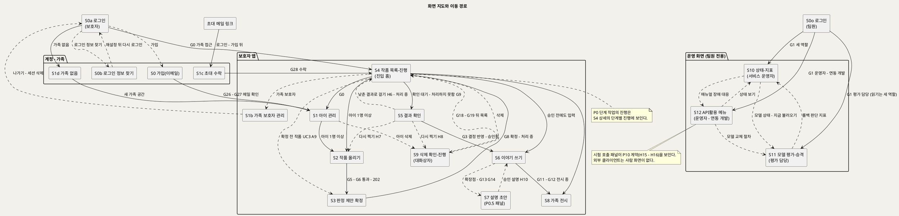

**[「화면 지도와 이동 경로」 PlantUML 뷰어로 열기](https://plantuml.sumzip.com/plantuml/svg/eNp1Vs9PG1cQvu9fMaIXOBh5bTA2hyo0agxSGpBQb73YQCgK2BE46qGqZMOCzI8Ik2K8pDY1klNM5FQLGLKopn_Qvrf_Q2fee95dL-VgybvzvZlvZr6Zt882Cpn1wru1VW3jzUrubWY9swbZzMKb5fX8u9zi8_xqfh2-eRF_oX__XQCx8XNmMf_LSm4ZXmdWN5a0wkphdQnc02N22QV-UWSHBj8tAm902eEpONcP7LyuaetLC4VMbhmRQ_PRDOA756vNG_ZPuWF203VNm59VRoYgswEvZ9Mzrwbx-QG8e1Dkfyjw7CM075bZQRHY5TFv9IBdlNxSR0B_mJp5qb3F9DLLCHNuDN6sQgQcq8jPr4bgVw1gIKiwnG0PUyLCmYw4Hw0Dsz47QJ-YDnDrX8e2FD4bOqAvgCLJyyZrPEiYvhCGLSpuwGs7vHGgYIvab34WXumAV_8nhzHgZ0fuhzKwz5fsvBHhF4Z7soslxD-YGjatrJIaCwdHhwZmDk63yP7qqNhhULbP0OcxgA9nHuvz4WYHUV6JYiFcHNyDCrWHN-u8WkaeVXyS2HgIO44Ss5ybngA1bAkaD4ESJEde7WFE4L9bXuBECDcB3Gixz9vUIAyMlZqLjo4jmzYzlOLmJ0Jnkl6bmgbfr0tQMgRKAd_8gtkoln4nUAY4Onyr5Ol_PhXsMP_Y5WapP15K-yLUx8uRxx3Xo4C-3K06Rii6R3XqtVFn9wbfa4H05QfSw1LWdVRKm723wT3cxawifO_eub6kmRPPwPa7bP--f_yRHmIwNTfjntaRGw0g2-1S_H5UHDZes8RSsOrMqvfdxDBfTcwxRCLfohZhEtJRv6pHzteeso-Ooj2KdjmbA2-z-PqJQdTwjHCtk-tYApmkYxP9HSFbopEH8iR9TqJUOygGUiH70MLMW9hcP0CQME7q5OCsarRslHFhgFdEUSenGhn9lGNJtRA08ujx5VvlvnPn5taxDA3hImU968f1JlCj18E82KaJGFI-1t-w-baptKjNBnOgqqZ1QmAOX9xqc9CsS_OADgB34wM6ZnvHgXMjgwdjyu9TKqBs_N5Ekb58pHNqB-liInGAt0oe-ilzTJrj5Gyc-pwAd-eW9kMEYtGYhha_4km1WYjTtYkbCXjryAsxjhCpDcApVQUUMLdq4njhrPzjVtuQTmmIFUcS5DVOG0noxjJpdvHU3j16YZW255uA8q2Y5VoFb01U3DZrftLQKDBJUTmdksAqyu0yQDBJUKGECUX17BNvVsSBOP7GNDQIezCcXHDTOPzIWliplkrf3HpPiU5PeMYxIaG_-Z2pFi1qGZwrW8ASjyonzsQVHbHBjf7S__F5HKZSHihFnKQQ-7FSj4kkSRA-Xna8fyzlU0zrSZF3Sk6ruO80UrWcFJHiRQs3Ej_pAdWp2qSu8gayRqtEkQTVAnRuK_waIzXL3GoHIFExkbRhaeTEbtH1gI2dt5h1RfcX22-DXMIBHoEIykuEQI6Nd_Rdmf3Z4WaLnGq5fGEJsvlCIb8G-ddiSwJgYdyaCTTod3V1K1E95tA_fdBUH4andVL9tJ4Y4Q2DKJLw9lujdPrUZndFcEtd1ujRvJzY7p4thnezw84O1CUjClzbEYeWcotATB7Roe-FuSg2q41xqcG8ts0buFnEvcYbRbTT5wfea7hy0CCRjMASUqsE2XmBnuE_-iL9D6uRtuQ=)** — 클릭 시 브라우저로 연결됩니다.

**읽는 법**

- **진입 홈은 S4다.** 로그인 뒤 G0를 통과하면 작품 목록이 먼저 열린다. 보호자는 올린 뒤 떠났다가(UX7) 여기로 돌아와 확정(S3)·결과 확인(S5)·이야기(S6)로 간다.
- **점선 셋이 되돌아가는 루프다.** 다시 찍기(S5 → S2, H7), 낮춘 결과로 걸기(S5 → S4, H6), 확정 전 작품(S4 → S3, UC3 A9).
- **계정·가족 화면(S0 · S0b · S1c · S1d)은 G0 앞에 있다.** 가족에 속하지 않은 계정은 S4 대신 S1d로 가고, 초대 메일 링크는 로그인(없으면 S0 가입) 뒤 S1c를 연다. S1b는 S4의 가족 메뉴에서 연다.
- **S9는 대화상자다.** S4 · S5 · S1 어디서든 열리고, 끝나면 S4로 돌아온다.
- **로그인은 둘이다(D21).** 보호자는 S0a(`/app/login`, `POST /v1/auth/login`, 쿠키 `uam_sid`), 팀원은 S0o(`/ops/login`, `POST /v1/ops/auth/login`, 쿠키 `uam_ops_sid`). 서로 링크하지 않는다(UX8).
- **운영 화면은 보호자 앱과 연결선이 없다**(UX8). 운영 화면 셋 사이의 점선은 UC11 A4·A5와 UC9 A1이 적은 참조 이동이다.

### 2-3 진행 레일

보호자 앱의 작품 화면(S3 · S5 · S6 · S7 · S9) 맨 위에 **C1 진행 레일**을 고정한다(**2026-09-30 D34 ④: 보호자에게 보이는 단계는 §17-8의 세 칸** — 아래 7단계는 내부 상태). 레일의 단계는 공통 기준 §5 작품 상태 그대로다: `접수됨 → 판정 중 → 확정 대기 → 처리 중 → 확인 대기 → 승인됨 → 전시 중`, 종료 상태 `처리하지 못함` · `삭제 중`. 작품이 아직 없는 S1 · S2에서는 보호자 여정 단계(`아이 등록 > 작품 올리기 > 확정 > 결과 확인 > 이야기 > 전시`)를 쓴다. 운영 화면에는 작품 레일이 없고, 대신 생존·준비 요약 행(S10)을 고정한다.

레일 단계의 원천이 되는 상태 전이는 아래와 같다. 전이 라벨에 그 전이를 일으키는 화면과 게이트를 적었다.

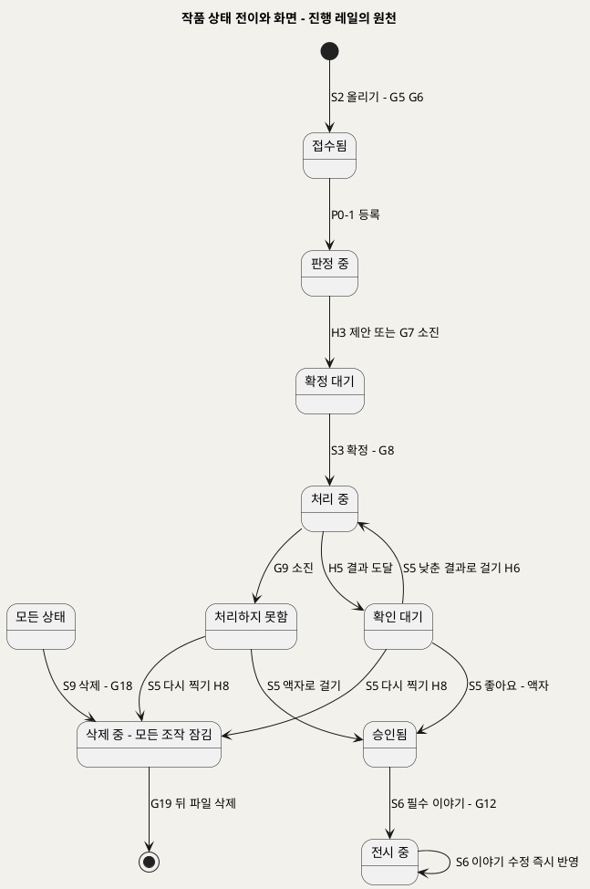

**[「작품 상태 전이와 화면」 PlantUML 뷰어로 열기](https://plantuml.sumzip.com/plantuml/svg/eNqFVM9vElEQvr-_YlJvJiRSAhYPTdVYejImnozxsApWUgoGtvFKW2JowXRpWbNUtlkMabFBs8XG0MhfxJv9H5z39qd0jYc9vJlvvvlm3vd2raYqVXVnu8RqW8Xye6WqbMNr5c3WZrWyU84_rpQqVbiznlpPPnkUQdTeKfnKh2J5E94qpVqBqUW1VAA86zjHTcD9XWe_D2g10LzGXh2cXpd_u4YE4EXD-XwA3GqiOUPTAPyi4aTPSINagCWnraGlAw47S6DUwD3SKcj3dJHn7fp8arsQGXEDPgonBj8fByzucYHFnC6ymNM4Fkc38KIO_PK3o48idG7cDQcVNG-rH_aVx0hf3PuOlszTJvjliJ9YgAOblkaLs-Y3dbdMokTZy7uvIJFYJaIONg2ujeABPF8GNMYkgJQSSy4NuQwLAQIebI3gz-4lksBPrvjAZGFcoiKLI-BGCkRXvQnc0PhhF3L3AT-26b7YX0ipx1-o0JPymISYFRam_B7-WkWPNMwn9vznDPhRg7fGC-jbi6WaXDYqIyCT-MMbEXDXkgb82kK9gaddYTN9gGdaTElUeRr43g_8ZXii-KAP86upgG5kWIyYuJ6yT1jJwrx7cZ4DBDoDDslrkuXpTegz7_6SyyxExdSEYCqVb-P8QJiM2wYauzET-u7xJmwNpSXtT3KulX_O9Z8yz8G-aeX7lm59-PQFo-82SdY7yiGpb5ATSOFsuttkFvjxkAzbpr-Bh2drhXJe_I3-AH6Qa3U=)** — 클릭 시 브라우저로 연결됩니다.

---

## 3. 공통 컴포넌트

### 3-1 컴포넌트 목록

두 화면 이상에 나타나는 것만 뽑았다. 모든 컴포넌트는 대응하는 UC 단계가 있다.

| ID | 컴포넌트 | 용도 | 쓰는 화면 | 대응 UC 단계 | 근거 원칙 |
|:--:|---|---|---|---|---|
| C1 | 진행 레일 | 작품이 지금 어디이고 어디서 막혔는지 상시 표시 | S1~S7 · S9 | UC3 BF2·6 · UC2 BF4·6 · UC4 BF5 · UC5 BF5 | UX1 · UX6 · UX7 |
| C2 | 차단 블록 | 게이트 미통과의 사유 · 해제 주체 · 다음 행동 | S1~S12 | 각 UC 예외흐름(게이트 사상표 §16) | UX6 |
| C3 | 이유 달린 비활성 버튼 | 게이트가 막는 버튼. 라벨 뒤에 사유, hover·포커스에도 같은 문구 | S1~S12 | 각 UC 예외흐름 | UX6 |
| C4 | 상태 배지 | 작품 상태·단계 작업 상태 한 단어 표시 | S4 · S5 · S9 | UC3 BF1·2 · UC7 BF3 | UX7 · UX3 |
| C5 | 원본-결과 비교 뷰 | 원본과 결과를 나란히, 결과는 정지 먼저, 재생·시차·회전 토글 | S5 · S8 | UC4 BF1~3 · UC6 BF3~5 | UX4 · UX2 |
| C6 | 낮춤 안내 | "어느 단계에서 어디로" 낮췄는지 문구 | S4 · S5 | UC3 BF6 · A3~A5 · UC4 A3 | UX3 |
| C7 | 이야기 카드 | 제목·그린 날·나이·한마디(원문)와 AI 작성 칸을 분리 표시 | S6 · S7 · S8 | UC5 BF6 · UC10 BF6 · UC6 BF3 | UX5 |
| C8 | 전시 조건 체크 | G12의 두 조건(결과 확인 · 필수 이야기) 충족 여부 | S6 · S8(직접 주소) · C1 | UC4 BF5 · UC5 BF5 · UC6 E3 | UX1 |
| C9 | 셸 헤더 | 보호자 앱(가족 표시) / 운영 화면(역할·계정 표시) 구분 | S1~S12 | INC1 · INC2 (UC1 BF1 · UC8 BF1 · UC9 BF1 · UC11 BF1) | UX8 |
| C10 | 모델 상태 칩 | 모델별 준비됨 · 미준비 · 불러오는 중 · 적재 실패 · 내려감 짐작(M6) · 비활성(라이선스 확인 전) · CPU 실행 · 비노출 · 확인 불가 | S10 · S11 · S12 | UC8 BF3 · A1~A4 · E5 · UC9 BF2 · UC11 BF4 | UX8 · UX6 |
| C11 | 작품 영역 자르기 (D32) | 미리보기 위 사각형으로 올릴 영역을 고른다. 처음엔 사진 전체, 손대지 않으면 그대로 | S2 | UC2 BF2 · A10 | UX7 · BR-PRV-01 |

### 3-2 C1 진행 레일

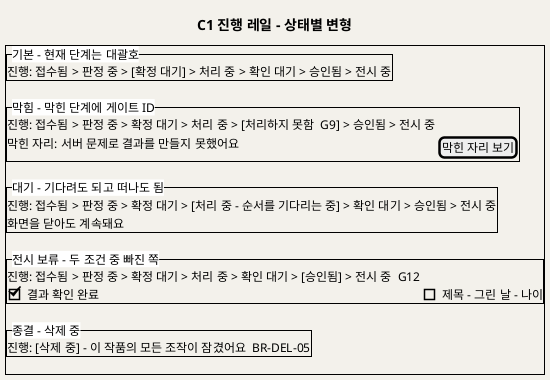

**[「C1 진행 레일 - 상태별 변형」 PlantUML 뷰어로 열기](https://plantuml.sumzip.com/plantuml/svg/eNqllE1rE1EUhvfzKw51KQGjuNCFlH6J4MqVMIwQbZHSNJEkXdVCTEdJk5EmbSZOZRJuNU3SGCFmBpxi_ENzzv0PnpuZaFMQiu5y7_l63vPeyWK-kMoVdrbTWn5rM_MqlUttw_PUi62XuexOZn05m87m4MbanbXk6pJW2CykN2A5CdQzZfMAUJSpNYEE0P4bue-iZwJ6RenYWj6VLmi7N7XdZwthMEIv4CTpmNQeAlb7oWdipQFoFUPflE6woEHc8j6QqFPZwVofHoC0aiRsoE6dD7o8sdVJVQUjg29o7GB3GIdVtBXEURWsXPA56kPCpKqrErU9hYS9A9l2GGn6w4qR6EMNwrFFLV9WAni0ci2qOairTHp0krZDvSLg4Ie0-wAP7xl_54MZE7VrXMqTTRfHvNdhQMLFU5cRR6E3wbMJZ1p43Jm1bpap6dPHBrwGfa4He-KrjcXaI9IEKF-qHRQdPOT2NSf0BGBTYMmJLvr_pF-_tAB-F2VX8TNrPK07VMZz0Li-ZcCJDTz3qcVY1S9kmwpQGfbuPR5OWHKkLC5htXg2NbdeAzodhd_8KQ1eCFYDNPj5_8ZeJdd_oxtz7Gx28jZP058asW-zUjox8bOlvAIDlLODc-XJ9wC7I8CSUPwlh99irO3TW65XGy195WzV-7IK_c-1oZJaLLldl0f8eTr8OPp4LNQq-C4KiXA8iV8LLD1JrKw-Tty6y5P2tMWNzLr6M_gF04Y8LQ==)** — 클릭 시 브라우저로 연결됩니다.

| 구분 | 내용 |
|---|---|
| 상태 | 기본(현재 단계를 대괄호로) · 막힘(막힌 단계에 게이트 ID와 "막힌 자리 보기") · 대기(순서 대기 중, "화면을 닫아도 계속돼요") · 전시 보류(G12의 빠진 조건을 C8로 펼침) · 종결(`삭제 중`, 모든 조작 잠김) |
| 변형 | 작품 레일(공통 기준 §5 상태 7단계 + 종료 2) · 여정 레일(작품이 없는 S1 · S2) |
| 동작 | "막힌 자리 보기"는 같은 화면의 C2로 스크롤·포커스 이동한다. 레일 단계 자체는 누를 수 없다 [추론 — 상태는 사용자가 건너뛸 수 없는 순서라서]. 상태는 화면을 열 때와 S4 새로고침 때 갱신한다(폴링·푸시는 U8) |
| 데이터 바인딩 | 작품 상태(2.3 · 0.5 · 2.7 · 0.10 · 3.5 · 3.9 · 6.3 Output) · 막힘 게이트 ID(0.9 · 0.5의 오류 분류와 시도 횟수) |

### 3-3 C2 차단 블록 · C3 이유 달린 비활성 버튼

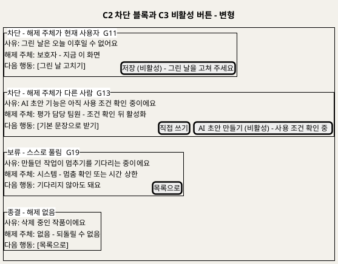

**[「C2 차단 블록과 C3 비활성 버튼 - 변형」 PlantUML 뷰어로 열기](https://plantuml.sumzip.com/plantuml/svg/eNqFlFFP2mAUhu_7K07czZaFC8bVuHIzc9lvMC5h0yxGlAXxyplUVhaELoBSqdqSshWQhSVVmq0k_UU95_sPO19RRMdc0hs-vnPe933OaRd3Cpl8YXcrq-xsbmx_zOQzW_Au837zQz63u722lMvm8vBoObWcfPVSKWwUsuuw9AzIu8DqBWDQxI4djUJYSgGONXFqkXYJeKWJSggJwJEqTEPZyWQLyt5TZe_twnVhAoThk2MBfQ_pyo88FYSpUXsIVBzS2YDadYDXyeSCAvGJ5aQh-h1gzwMsOmSrQKaLFRPI9sW5RnYIVOZfrS904tNZk8vuCKTZii_MQPZNAPXVKCjLWhCnTRz4fB2rLtk6iJNDrJ2mYeVWDaKRQ2MzCrxV-AQr5KjU7sLjadwn3HHWmxYXjOqxtBawm1Vl_-HsLI7dQCbFti6Dp2aDv3gD5JfJKAN7wEo3jm9o1D-4pgXU8aJLGcYgm9u4DY5GrfpcEKJ2OJH0sToGoat0HjO50wKPXJikY0Dz6LCREV8bMtEuWSF2LEDvfMqof0BOA-jYuzm5zYB9HY9dPr-H8F9RruHx_LBrynsVlx8pKI5U7IUS1_NZXBMB_Mrr0G5QqyTHjIMy_WpK190wpsjAe0OsNP8Di6oWi4mSJZdZ9nCnhMx6XF61Ik8D-nwgDOtvUFMpXjmeWYXHhjUNsBaynOSCPwb8Bk0I3qzJt1J05c2sCS-1rc8mpOLP-A9pPZApxVH5oRBxA5mgbmJNx54_fVlsfc5w73vaVxbXt9fkF-IPGcxgzw==)** — 클릭 시 브라우저로 연결됩니다.

| 구분 | 내용 |
|---|---|
| 상태 | 차단(해제 주체 = 현재 사용자) · 차단(해제 주체 = 다른 사람) · 보류(G19, 스스로 풀림, 점선 테두리) · 종결(해제 없음, `삭제 중`) |
| 구성 | 제목 행 `막힘  G번호 - 요약  E번호` · 사유 · 해제 주체 · 다음 행동(버튼). 세 줄은 빠질 수 없다 |
| 변형 규칙 | 해제 주체가 현재 사용자면 **해제 행동 버튼**을 준다. 다른 사람이면 해제 버튼을 주지 않고 **대안 행동**만 준다(예: G13의 기본 문장·직접 쓰기). 요청 보내기 채널은 상류에 없어 만들지 않았다(§16 사상 규칙 ③) |
| C3 동작 | 비활성 버튼은 라벨에 `(비활성) - 사유`를 붙이고, hover·키보드 포커스에서 같은 사유를 말풍선으로 보인다. 누르면 아무 일도 없고 C2로 포커스를 옮긴다 [추론] |
| C3 폼 제출 | 폼의 주 버튼(로그인 · 가입 · 찾기 · 재설정 · 팀원 로그인)은 제출 버튼이다. 입력 칸에서 **Enter**를 누르면 그 버튼을 누른 것과 같다 — 활성이면 제출하고, 비활성이면 제출하지 않고 누른 것과 같은 안내(사유 표시)를 한다 (2026-09-29 신지현 요청) |
| C3 줄바꿈 | **버튼 이름은 한 줄**(낱말 중간에서 끊지 않음 — C9 메뉴 이름 원칙과 같다). 비활성 사유 `(비활성) - 사유`는 이름 옆이 아니라 **버튼 안 둘째 줄**에 작은 글자로(좁은 폭에서 이름이 쪼개지지 않게, 2026-09-30 이제민 지시 — 390px [카카오로 시작하기] "카카오로 시작하 / 기" 오류). 390 · 1440 같음 |
| 금지 | 토스트·자동으로 사라지는 배너 · 회색 자리표시 |

### 3-4 C4 ~ C10

| ID | 상태 | 변형 | 동작 |
|:--:|---|---|---|
| C4 상태 배지 | 접수됨 · 판정 중 · 확정 대기 · 처리 중(대기 / 다시 시도 중) · 확인 대기 · 승인됨 · 전시 중 · 처리하지 못함 · 삭제 중 | 작품 배지(S4 목록) · 단계 작업 배지(S4 상세: 대기 / 진행 중 / 완료 / 다시 시도 중 / 처리하지 못함 / 취소) | 누르면 해당 작품의 다음 화면(확정 대기 → S3, 확인 대기·처리하지 못함 → S5)으로 간다 |
| C5 원본-결과 비교 뷰 | 정지(기본) · 재생 중 · 시차 켬 · 회전 중(P1) · 결과 못 읽음(G10) · 원본 못 읽음(E1) · 형식 표시 불가(UC6 E6) | 결과 종류별: 움직임(재생) · 2.5D(시차) · 액자(토글 없음) · 3D(회전 + "뒷면은 AI가 추정했어요") | 토글은 누를 때만 켜지고 다시 누르면 정지. 자동 반복·자동 넘김 없음. 원본 칸은 늘 보이거나(S5) 버튼으로 전환(S8) |
| C6 낮춤 안내 | 낮춤 없음(숨김) · 모델 낮춤 · 인프라 실패와 구분된 "처리하지 못함" 문구 | 움직임 → 2.5D · 2.5D → 액자 · 3D → 2.5D · 분리 실패 → 액자 · 설명 LLM → 템플릿(S7) | 읽기 전용. S8에는 두지 않는다(BR-EXH-07) |
| C7 이야기 카드 | 입력(S6) · 표시(S8) | 한마디 칸(원문, 표시 없음) · AI 작성 칸(출처 LLM·템플릿이면 "AI 작성", 직접이면 표시 없음, D6) · 승인 전 초안(S7에서만) | 한마디 칸과 AI 칸은 입력·저장·표시가 모두 따로다. 한 칸의 편집이 다른 칸을 바꾸지 않는다 |
| C8 전시 조건 체크 | 둘 다 충족 · 결과 확인 빠짐 · 이야기 빠짐 · 둘 다 빠짐 | 체크 두 줄 | 빠진 줄을 누르면 해당 화면(S5 또는 S6 필수 칸)으로 간다 |
| C9 셸 헤더 | 보호자(가족명 가림) · 팀원(역할 · 계정 가림) | 보호자 앱 헤더 · 운영 화면 헤더 | 운영 화면 헤더에는 보호자 앱으로 가는 링크가 없다. 역할에 없는 메뉴는 그리지 않는다(403 링크를 두지 않음). 메뉴는 §2-1 역할별 메뉴 표를 따른다. 좁은 화면(768px 이하)에서도 메뉴를 숨기지 않고 헤더 아래 줄에 가로로 둔다. 메뉴 이름은 줄바꿈하지 않고 한 줄에 두며, 줄에 다 들어가지 않으면 메뉴 줄을 가로로 밀어 본다(390px에서 "작품 올/리기"처럼 낱말이 끊기지 않게, 2026-09-29 이제민)(스타일가이드 목차는 960px 미만에서 숨기지만 앱 메뉴는 휴대폰에서도 써야 한다, 2026-09-29 [추론 — 신지현 검토], 구현 `web/src/styles/shell.css`). 보호자 셸은 `GET /v1/me`(계정·가족), 운영 셸은 `GET /v1/ops/me`(역할·가린 계정, 새로고침 뒤 복원)와 `POST /v1/ops/auth/logout`을 쓴다(D21) |
| C10 모델 상태 칩 | 준비됨 · 미준비(`not_loaded`, 기동 순서 대기) · **불러오는 중**(`loading`: 경과 초, 예상 시간이 있으면 남은 시간, 예상의 1.5배를 넘으면 "예상보다 오래 걸려요") · **적재 실패**(`failed`: "60초마다 다시 시도해요") · **내려감 짐작**(`cold`, M6만: "첫 요청 때 올라가요", 짐작임을 표시) · 비활성(라이선스 확인 전) · **비활성(승격 전)**(라이선스는 확인됐으나 활성 버전이 없음 — model-api `load.diagnostic = no_active_version`, 2026-09-29 이제민: `licenseConfirmed`는 활성 버전 기준이라 활성 버전이 없으면 거짓이다) · 비활성(P0.5) · CPU 실행 · 비노출(P1) · 확인 불가 | 표 행(S10 · S11) · 인라인(S12) | "미준비"와 "비활성"과 "CPU 실행"은 모양과 문구를 모두 다르게 한다(§17). "불러오는 중"은 오류 색을 쓰지 않는다(적재 중은 오류가 아니다). 값은 `GET /v1/ops/models`의 `load.state` · `elapsedSeconds` · `remainingSeconds` · `expectedSeconds` · `lastLoadSeconds` · `expiresAt`(T109 · T143) |
| C11 작품 영역 자르기 | 사진 전체(기본) · 잘림(크기 표시) · 열 수 없음(자르기 없이 그대로 올림 안내) | S2 미리보기 위 | 핸들 8개(모서리 4·변 4)와 가운데 "네모 옮기기"는 모두 초점을 받는 버튼이고 이름이 있다("왼쪽 위 모서리" 등). 화살표 1%, Shift+화살표 10%. 핸들은 44px 이상 터치 영역. 사각형 밖은 어둡게 덮는다(`--color-ink` 50%). 자른 크기는 픽셀로 보인다(`web/src/components/CropBox.vue`, 계산 `web/src/app/crop.ts`) |

### 3-5 상태 모양 → 스타일가이드 토큰 사상 (D21 · D22 확정)

§17의 "문구 + 모양" 규칙을 스타일가이드 토큰으로 옮긴 것이다. 스타일가이드에는 오류 색(빨강)이 없고 이 문서도 색만으로 상태를 말하지 않으므로, **모양은 테두리 굵기·선 종류·채움으로** 구분한다. 강조색 `--color-accent-magenta`는 상태 표현에 쓰지 않는다. C1·C2·C10의 시안은 스타일가이드 HTML의 "상태 컴포넌트" 절에 있다(D22 ②).

| 대상 | 모양 | 토큰 |
|---|---|---|
| C2 차단 | 굵은 실선 테두리 블록 | 테두리 2px `--color-ink` · 배경 `--color-canvas` · 모서리 `--r-md` · 안쪽 `--s-md` |
| C2 보류 | 점선 테두리 블록 | 테두리 2px dashed `--color-ink` · 배경 `--color-block-cream` |
| C2 종결 | 가는 테두리 + 채움, 블록 안 조작 모두 잠금 | 테두리 1px `--color-hairline` · 배경 `--color-surface-soft` |
| C6 낮춤 안내 | 테두리 없는 안내 블록 | 배경 `--color-block-lilac` · 모서리 `--r-md` |
| C3 비활성 버튼 | 원래 버튼 모양 유지 + 라벨 뒤 사유, 채움만 옅게 | `.btn-*` 그대로, 배경 `--color-hairline-soft` · 글자 `--color-ink` (대비 4.5:1 유지) |
| S3 선택지(C3 비활성 포함) | 쓸 수 있는 칸과 비활성 칸이 같은 칩 모양·같은 폭·같은 높이(UX2 "같은 크기"). 비활성 칸은 채움만 옅게 하고 라벨 뒤 사유를 붙인다. 순서는 제안과 관계없이 움직임 → 2.5D → 액자 → 3D 고정 | `.chip-opt` 모양 그대로(1px `--color-hairline` · `--r-pill`), 줄마다 같은 폭 칸(좁은 화면은 한 칸씩), 비활성 배경 `--color-hairline-soft` |
| C1 현재 단계 | 채운 알약 | `--color-inverse-canvas` 배경 · `--color-inverse-ink` 글자 · `--r-pill` |
| C1 지난·남은 단계 | 테두리 알약 | 1px `--color-hairline` · `--r-pill` |
| C1 막힌 단계 | 굵은 테두리 알약 + 게이트 ID | 2px `--color-ink` · `--r-pill` |
| C10 준비됨 | 채움 | `.chip` + 배경 `--color-inverse-canvas` · 글자 `--color-inverse-ink` |
| C10 미준비 · 내려감 짐작 | 빈 칸(테두리만), 내려감 짐작은 "짐작" 문구를 붙임 | 1px `--color-ink` |
| C10 불러오는 중 | 빈 칸 + 경과/예상 막대(오류 색 없음) | 1px `--color-ink` · 막대 `--color-block-mint` |
| C10 적재 실패 | 굵은 테두리 칸 | 2px `--color-ink` |
| C10 비활성(라이선스·P0.5) | 사선 칸 | `repeating-linear-gradient`(`--color-hairline`) |
| C10 CPU 실행 | 연한 채움 | 배경 `--color-block-mint` |
| C10 비노출(P1) | 점선 칸 | 1px dashed `--color-hairline` |
| C10 확인 불가 | 회색 채움 | 배경 `--color-hairline` |

중단점: 스타일가이드의 560 · 768 · 960px를 레이아웃 기준으로 쓰고, 시험은 390px(휴대폰)·1440px(데스크톱)에서 한다(T138). 글꼴 굵기 320·330·340·540은 가변 글꼴(Inter Variable · Pretendard Variable)로만 나온다(T011).

---

## 4. S1 아이 관리

### 4-1 와이어프레임

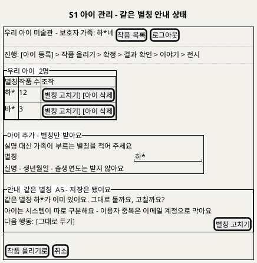

**[「S1 아이 관리 - 같은 별칭 안내 상태」 PlantUML 뷰어로 열기](https://plantuml.sumzip.com/plantuml/svg/eNqNU8Fu2kAQvfsrRuTWNkgk6iWHNm3V_ECPFZVoE1VRCFRATgTJCaYigBRo7RSIjYxKSomI6hSHGIkv8o7_oTNrg0jVQ-2LZ_zm7Xszs9v5QipXODpMK_mD_cynVC51CO9THw4-5rJHmd1X2XQ2B2s7mzuJ1y-Vwn4hvQdvEoCGhpYLvquKH2NYB9_poKWCmGg4u6G_VXHqApZPgrKp5FPpglJ8rBQBuw7Do2Lxy8OqTRRULyZu0Paw14Rj4lKxf7sFgdF-JLQBZd5irxV8qYK4Hom-leSM6Jv-vcdMl-UklJR4nPmHWnBxtkX46ISvtxL_DCICbI9JgO85lAo6BtoGffi_HX8yl7HlMdZy0ZiHILQ1rJsR_7vYQwOwIa4rMaW4tvB9vDyn2uag71CsgHRCcWJDKg-x_sTGWZtOSS7l4ukN2maSCoSjc8Hm_-FL9LK4KDvVqYOyp1wohg2iu-SfXT1G3FgfkGwQDRXrdtRs2aypKq5cUdOjQrQ0sn-CF0T5fY6aR_UsbWE1Jl2tPCvk6zR7S1RoODpacw6nJmXwmyPONXkEKRqq1MhaKGzhQO7NX9sEL54yg61i70qmm00SFbl5CGVJbJ780HbRNKohMg60LOSYtgZEq-3PGpR8EvbUDqPnrF52kPXR0LE2CCqm7IzucKF_NxZTLTCYkAXRmnRHvLI4aInJHcvg6pG07JMg20BzLo8cnkU2qX_1AVoNoD0V5x1a1VVhTTnef82c-7O8BsstpioJx_uf-LnB16CkbO9ldvky_wE3Ix-X)** — 클릭 시 브라우저로 연결됩니다.

### 4-2 영역별 설계

| 영역 | 내용 | 데이터 바인딩 | UX 의도 |
|---|---|---|---|
| 헤더 | 가족명(가림) · 작품 목록 · 로그아웃 | 1.1 Output 가족 ID(세션) | UX8 (C9) |
| 여정 레일 | "아이 등록" 단계 | — | UX7 (C1 여정 변형) |
| 우리 아이 목록 | 별칭 · 작품 수 · 별칭 고치기 · 아이 삭제 | 1.1 Output 별칭 목록 · 작품 수는 6.1의 "지워지는 항목" 안내와 같은 값 [추론] | UX8 — 다른 가족 아이는 목록에 없다 |
| 아이 추가 | 별칭 입력 하나(앞뒤 공백 뺀 1~20자, 남은 글자 수 표시, D22), "실명 대신 가족이 부르는 별칭" 안내, 받지 않는 항목 명시 | 1.2 · 1.3 Input 별칭 | 최소 수집(BR-CHD-01). 받지 않는 칸을 아예 두지 않는다 |
| 안내·차단 블록 | 같은 별칭 안내(A5, 저장 유지) · G4 별칭 검사(E2 빈 값·20자 초과 `alias_too_long`) · G3 저장 실패(E5) | 1.4 Output 안내·거절 사유 코드 | UX6 (C2 · C3). 별칭 중복은 막지 않는다(D18) |

### 4-3 상호작용

| 조작 | 동작 | 근거 |
|---|---|---|
| 별칭 입력 | 빈 값이면 저장 버튼 비활성 | UC1 BF3 · E2 |
| 저장 | `POST /v1/children`. 같은 별칭이면 저장 뒤 안내 블록(A5)을 보인다 | UC1 BF4 · A5 |
| 별칭 고치기 | 같은 칸을 수정 모드로 열고 같은 검사 | UC1 A1 |
| 아이 삭제 | S9 대화상자(작품 수 안내) | UC7 A1 |
| 작품 올리기로 | S2로 이동. 아이가 없으면 버튼 비활성 "아이를 먼저 등록해 주세요" | UC1 A3 |

### 4-4 상태 전이

`목록` → (아이 추가) → `입력 중` → (저장) → `저장 중` → `목록(갱신)` · `입력 중` → (G4 미통과: 빈 값·형식) → `차단(G4)` → (별칭 고침) → `입력 중` · `저장 중` → (같은 별칭) → `목록(갱신) + 안내(A5)` · `저장 중` → (G3 실패) → `차단(G3)` → (다시 시도) → `저장 중` · 어느 상태든 (세션 만료, G0) → 로그인.

### 4-5 S0 가입(이메일) · S0b 로그인 정보 찾기 — 2026-09-28 추가(D18)

보호자가 처음 쓰는 화면이다. 이용자 중복은 여기서 **이메일**로 막는다(UC13 · SD_01 1.0 · G26 · G27). 따로 아이디를 만들지 않는다. 받는 것은 이메일과 비밀번호뿐이다.

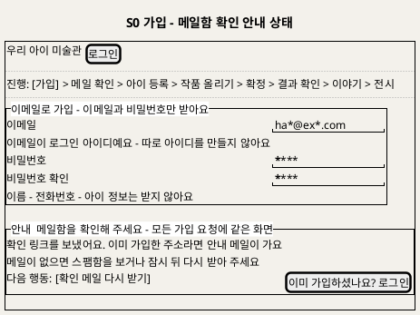

**[「S0 가입 - 메일함 확인 안내 상태」 PlantUML 뷰어로 열기](https://plantuml.sumzip.com/plantuml/svg/eNptU11r01AYvs-veKl3lRXFOy9mmbg_4OWoELeiY_2QtgNhFto1G7ErqFuytbMZGda1lcqyLmCE_qK87_kPvic5abbhuTp5v57nfc6TfL2h1xq75ZJW39mufNBrehne6ps772rV3crWy2qpWoNH68_Wn75a0xrbjVIRXj-B0GvRxQGsAE4tchbCnoAY2OQEQLaJ-z5Qpy06Q62ulxra3mNtD-jcw6sZpw1yfMDrgEw39FvwCTbwchj-Cbi5AE0tl5PFY0Ocfn4OGzFOAVYVUIKyuhx0coOXjvy--CaOTaD-jGHCwOOQrHVtvoRzL7y92-v4ZC_iInINOhoq4DcZTsVITCrdchmVY_CvgV4L56boBzjuAXrfJZlzK6NBWsmLZd7r2XzxYza3WS0Dn3v5iHyyuNoGLYv6Jk-SwlqepLBM4E9GHvfwZETjFoe7MSaPvMtHombVgfhkHpYoGf5fKcGuDLmya4iBpVpWErlZT7z1sWtFW98j0ozki18_tQU5hgIUNrf_WJARqAV_TfDETTTmGM1_09lXDgzIaYEEn_qSkuKL47ZozyIZmEHHpFOfm3IR4-tAzRH2MAI57CE_4dRP7JhqLuti2ZYhOjukYVzdHYleoGgzTHjj4X6fveVKj-DxCPBoFF2jN0_3kfM44_SAfYtfBmzdhHbshrSPbVeQrn_Au08HE8biWS9SXxRY1aaWL1a25P_5D0uVDLk=)** — 클릭 시 브라우저로 연결됩니다.

| 영역 | 내용 | 데이터 바인딩 | UX 의도 |
|---|---|---|---|
| 헤더 | 서비스 이름 · 로그인 링크 | — | 이미 계정이 있으면 바로 로그인(UC13 A2) |
| 여정 레일 | "가입 → 메일 확인"이 첫 단계 | — | UX7 (C1 여정 변형). 메일 확인까지 해야 끝난다는 것을 보인다 |
| 가입 양식 | 이메일 · 비밀번호 · 비밀번호 확인. "이메일이 로그인 아이디" 안내, 받지 않는 항목 명시 | 1.0 Input 이메일·비밀번호 | 최소 수집(BR-ACC-07). 아이디 칸을 두지 않는다 |
| 메일 확인 대기 | "메일함을 확인해 주세요" · [확인 메일 다시 받기] | 1.0 Output 발송 결과 | UC13 BF4 · A1 · E6 |
| 안내·차단 블록 | 메일함 확인 안내(새 가입·이미 가입 모두 같은 화면, E1·E4 비노출) · G26 형식(E2)·비밀번호(E3) · G27 링크 무효(E7, 400 `token_invalid`) · G3 저장 실패(E5) · E8 요청 한도 | 1.0 Output | UX6 (C2 · C3). 가입 여부를 화면에 드러내지 않는다(이제민 결정 ④) |

| 조작 | 동작 | 근거 |
|---|---|---|
| 가입 | 형식·일치를 먼저 검사하고 `POST /v1/auth/signup`(항상 202). 늘 "메일함을 확인해 주세요" 화면으로 간다. 이미 가입된 주소면 안내 메일만 간다 | UC13 BF2~4 · E1 · E4 |
| 확인 메일 다시 받기 | `POST /v1/auth/email/verify/resend`. 이전 링크는 무효. 재요청 간격 제한 | UC13 A1 · E8 |
| 메일 링크 | `POST /v1/auth/email/verify`. 유효하면(204) 세션을 받고 S1로 이동해 "이제 아이를 등록해 주세요"를 보인다. 만료·사용·무효면(400 `token_invalid`) G27 블록 | UC13 BF5~6 · E7 |

상태 전이: `입력 중` → (가입) → `저장 중` → `메일 확인 대기` → (링크) → `S1(가입 완료)` · `저장 중` → (이미 가입·동시 가입) → `메일 확인 대기`(같은 화면, 안내 메일) · `메일 확인 대기` → (링크 만료) → `차단(G27)` → (다시 받기) → `메일 확인 대기`.

**S0b 로그인 정보 찾기** — 로그인 화면의 "로그인 정보를 잊었어요"에서 들어온다(UC14).

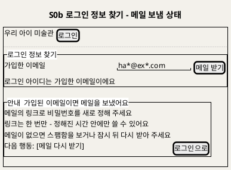

**[「S0b 로그인 정보 찾기 - 메일 보냄 상태」 PlantUML 뷰어로 열기](https://plantuml.sumzip.com/plantuml/svg/eNp1kt9KAlEQxu_PUwx2VyRFd11JUS_QZRhsJRX-C10hUEFzi62EonbNbA0jywShUy20gfRAO7Pv0BzTSqi92XPOnO-b33y7kayuZfRcMiGy8Z3UrpbRkrCubcS3MulcanMxnUhnYGJ5bnl2aUHoO3oiBisz64C3jv_mUdMDatn46gLJD9-TMA3YtajZBz7DigFUKQcVR2S1hC7yUyIP1JD40AOyDWq6gE8emS3fLUEBVr89o1AU4bDIr4X-aRMSAL4s0c1BYDvARsOmBQhta5OR2N5keCOdBH5CA-MhkrxmbZS1v2wHHGhZeGz9ZckLujyjhiWKiodsE_fdUXM8G7-JXRdGG-MrAZNqLqsV8KhSB-yUg3KPIQDfDZQlfDGDuof3fY7LVMc8bGDzsHd9MjzVHEYaplR8rMBOldP-ukkdTvrE8SW_bJOBVZEueDyzDnQzhPjFwN6Xh-T0FTEdt4OqF9iPQ2j_WeK-krXYEvC8DXjSHizlNcc1TsWVZhWC2hGeXs3_JP0tUIGPfVvV9NaJcpxFEYmlNtWP9wm9EXC5)** — 클릭 시 브라우저로 연결됩니다.

| 영역 | 내용 | 데이터 바인딩 | UX 의도 |
|---|---|---|---|
| 찾기 양식 | 이메일 입력 하나 · 메일 받기 | 1.R1 Input 이메일 | 입력은 하나만 받는다 |
| 안내 블록 | 가입 여부와 관계없이 같은 문구 | 1.R2 Output(화면에는 계정 유무 없음) | BR-ACC-08. 남의 가입 여부를 알아내는 데 쓰이지 않게 한다 |
| 재설정 화면 | 새 비밀번호 · 확인 · 저장. 만료면 G27 블록 | 1.R3 Input 토큰·새 비밀번호 | UC14 BF4~6 · E2 · E3 |

| 조작 | 동작 | 근거 |
|---|---|---|
| 메일 받기 | `POST /v1/auth/recovery`(항상 202). 응답 문구는 항상 같다. 이메일별·IP별 한도를 넘으면 메일만 보내지 않는다 | UC14 BF2~3 · A1 · A2 · E6 |
| 메일 링크 → 저장 | `POST /v1/auth/recovery/reset`. 링크 무효면 400 `token_invalid`. 성공(204)하면 현재 세션을 포함해 모든 세션이 끊기고, "이메일과 새 비밀번호로 로그인해 주세요"와 함께 로그인 화면으로 | UC14 BF4~6 · E2 · E3 · E5 |

상태 전이: `입력 중` → (메일 받기) → `메일 보냄 안내` → (링크) → `재설정 입력` → (저장) → `로그인 화면` · `재설정 입력` → (링크 만료) → `차단(G27)` → (다시 요청) → `입력 중`.

**S0a 로그인(보호자) · S0o 로그인(팀원)** — 2026-09-29 추가(D21). 두 화면은 같은 모양(이메일 · 비밀번호 · 로그인 버튼)이지만 경로·쿠키·셸이 다르고 서로 링크하지 않는다. 와이어프레임은 아래 두 장이다(D22 ③).

| 구분 | S0a 보호자 | S0o 팀원 |
|---|---|---|
| 주소 | `/app/login` (`?next=` 로 돌아갈 곳 — 초대 링크 `/app/invite?token=…` 등) | `/ops/login` |
| 호출 | `POST /v1/auth/login` → `GET /v1/me` | `POST /v1/ops/auth/login` → `GET /v1/ops/me` |
| 성공 뒤 | `next`가 있으면 그곳(S1c 등), 가족이 없으면 S1d(409 `no_family`), 그 밖에는 S4 | 역할별 메뉴 표(§2-1)의 첫 화면(S10) |
| 링크 | 가입(S0) · 로그인 정보를 잊었어요(S0b) | 없음(팀원 계정은 운영 CLI로 만든다) |
| 실패 | 이메일·비밀번호 불일치는 한 문구("이메일 또는 비밀번호가 맞지 않아요", 가입 여부 비노출) · 메일 확인 전 계정은 확인 메일 다시 받기 안내 · 요청 한도(E8)는 C2 | 불일치 한 문구 · 역할 없음은 G1 C2 |
| 세션 만료 | S0a로(`next`에 현재 주소). 이야기·설명 입력은 그 기기 브라우저에 임시 저장했다가 다시 로그인하면 복원 — §17 전역 실패 3 | S0o로 |
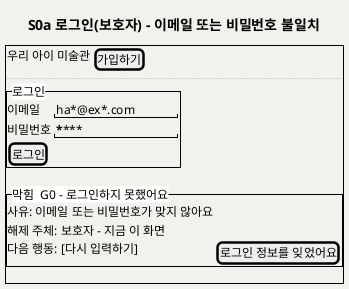

**[「S0a 로그인(보호자) - 이메일 또는 비밀번호 불일치」 PlantUML 뷰어로 열기](https://plantuml.sumzip.com/plantuml/svg/eNp9Uc1KAlEU3t-nONimjMRo50qK7AFaisGkUuJf6AiBCkMojBrkYsYmcYaJMjGExIYaySeac-YdutdMbNPZXc73ne_nRsuyVJIr-RwrZzOFK6kk5eFcSmYvSsVKIXVUzBVLsBU7iO0fHzI5I-fScBqWAB8H3qdLpruN745vuGR1d2APyHRwrJG5ADS62NYA5w2cKjhTOQbwQ-UrmhusLOVkVt1lVaD-FF8mQHqDcwHfXFJtz1GgBnFvqpDV9HXDc6cJqLNQiFXPAmvlAIMNvRoELqVgNH0dDCWLeeAj9n_kOSS4GvgZAYmvDyZYfSkwavmWAXAS5oHWS26DRgrg65ffU6nnUF9bGriZ0MCO_B-cBwEcWYJPeltE7Wuc6-sO2QOgpwXNnAisixQ9jhTPVcVV8B80HDsiS-eZzFvwey28e4hw3_zd4XSrifbwt6XaRh4gW-dHcbjgoDbdr2yLmHUWTRdS4tO_AQwYD2M=)** — 클릭 시 브라우저로 연결됩니다.

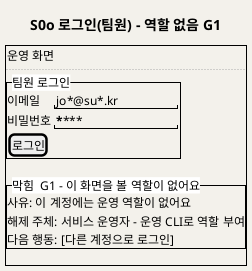

**[「S0o 로그인(팀원) - 역할 없음 G1」 PlantUML 뷰어로 열기](https://plantuml.sumzip.com/plantuml/svg/eNptkU1LAkEYx-_zKR7sUkaSdPMkSUbQrWMUbBlhrm7sricTLJbIF8jD-tqubGSEYBA61Ab7iZxnvkMzuhpBcxmYeX7P_P7PJA1T0c1iXiVGLlu4VnQlD2fKee5S14qFTEpTNR3W0jvp-N4uMbOmegFH2xqwZ2f25aPrr_NGBZ-aG7AF2HnnLU9s9-g2YD9ODEU1SWmTlAD7FLu3wHs2G1Eok1iMlE4jC_S3V4QAoEvZyEY3gBuIXGnRpFGMxnI6yCXv2bfFPips8sC7viyJhgtgVXK8anhCyvId9lblgy4IJWnp0tADXQvYNAi95blUb1Ps23OTuzE6XmIOzKYWei3sNFnNXob5BxMUb1H0HMCXACdUwJYjjLE2DCkcNKXDokPq8ECoLufGPivYGcuI9aEcIG9X2WMvIeLUh-zVXzo4gWT-RCyT5EUhI7_wByin6gE=)** — 클릭 시 브라우저로 연결됩니다.


**S0c 계정 - 비밀번호 변경**(T161, UC14 A5, D24 — 2026-09-29 이제민. **들어가는 자리·배치는 디자인(신지현) 확인 대상 [추론]**) — 보호자 셸 헤더의 계정 표시(가린 이메일)를 누르면 연다. 칸은 현재 비밀번호 · 새 비밀번호 · 새 비밀번호 확인 셋이고, 규칙은 재설정(S0b)과 같다(8자 이상, 확인 일치). `POST /v1/auth/password` 204면 "비밀번호를 바꿨어요 - 다른 기기에서는 다시 로그인해야 해요" 안내 블록을 보이고 이 기기는 로그인을 유지한다. 현재 비밀번호가 틀리면 422 `current_password_mismatch` → C2 "현재 비밀번호가 맞지 않아요"(해제 주체: 보호자 - 지금 이 화면, 다음 행동 [다시 입력하기] · [로그인 정보를 잊었어요]), 여러 번 틀리면 429 `login_attempts` 보류 블록. 입력 검사 문구는 S0 가입과 같은 문장을 쓴다.

**S1b 가족 보호자 관리** — 공동 보호자 초대·해제·나가기(UC15, U1 확정). 보호자는 부모 두 명까지다(만든 보호자 + 공동 보호자 1명). 권한은 같고 **초대하기와 해제 버튼만 만든 보호자에게 보인다**(G29). 공동 보호자가 이미 있으면 초대하기는 이유 달린 비활성("보호자는 두 명까지예요")이다. 아래는 만든 보호자 화면의 **두 명 찬 상태**다.

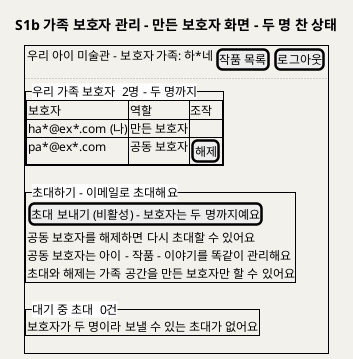

**[「S1b 가족 보호자 관리 - 만든 보호자 화면 - 두 명 찬 상태」 PlantUML 뷰어로 열기](https://plantuml.sumzip.com/plantuml/svg/eNptk19r2mAUxu_fT3GwN61jsm53u5KV9QvsUhykrWyl_imawsAKWc1GWIXVzaxJp6JgVxwdizRjFvKJck6-w84x0ekc3sT3nPN7nvO8Sbama1X9pFRUtaPD8rFW1Uqwp-0fvapWTsoHO5VipQobu092t58_U_qhXizAi-09CD2DhhPAOz9yptS_gNA38NstPAS8aeHnwVIlcjs49qXSvgD8_g7IuwVqvo2aXVXTirqqP1B1oCtP5sk2qecD_pySNWCmjC1Ip4nsU4hsJ43miE9y1G9HnywGj3HYy8sJDrvh76mQvjbz0FCZjKq_TCUCa8bhsXhauAvvW3RjpFR9Y0WYLn9E9kAehh4rKoDXWjpbeJPO7FdKsIlnzhYX13Y_hQy3Hi-18g53v_Cju9KUi2yfBt28avBPvPoWtgxeMpx6bI0TwXGHegFvBvOaT1edFMNz8YHw8MyXgU28NyO3S-Zkazk-_NBZXZIcixl5ZvxrCa8DiC2xB7k8PB_R-V_tAZDlAPUt-iI2_kdgseQu2X98RbNFyA7Yowig0w49VzridydeiVmxCrlG4kFYybWxTOgx1VyLmv_DurFZmgyTWGjUTtAAj8KJL-Etxpk_D0fS7gVxnsGcN9tnNiyddPl-IdBQ2UL5QL6fP6Q-2NQ=)** — 클릭 시 브라우저로 연결됩니다.

| 영역 | 내용 | 데이터 바인딩 | UX 의도 |
|---|---|---|---|
| 보호자 목록 | 이메일(가림) · 역할 · 해제(만든 보호자 화면에만). "두 명까지" 표시 | 1.I1 · 1.I3 `GET /v1/family/members` | 같은 권한임을 먼저 보인다. 해제 버튼은 G29를 통과하는 사람에게만 |
| 초대하기 | 만든 보호자 화면에만 있다. 공동 보호자 자리가 비었으면 이메일 하나 · 초대 보내기 · 같은 권한 안내. 두 명 찼으면 C3 이유 달린 비활성("보호자는 두 명까지예요")과 "해제하면 다시 초대할 수 있어요" | 1.I1 Input · `GET /v1/family/members`의 공동 보호자 수 | 응답은 항상 "초대 메일을 보냈어요"(가입 여부 비노출). 누를 수 없는 이유를 버튼에 붙인다(UX6 · G29 · UC15 E9) |
| 대기 중 초대 | 초대 번호 · 초대 이메일(가림) · 만료 시각 · 취소. **대기 초대는 1건만**이고 새로 초대하면 이전 초대는 무효 | 1.I1 `GET /v1/family/invites` | UC15 A2 · E9 |
| 공동 보호자 화면 | 초대하기 영역과 해제 버튼이 없다. 해제 대신 [가족 공간에서 나가기] | 1.I4 | UC15 A1 · A5 · 만든 보호자에게는 나가기 버튼 없음(E5) |

| 조작 | 동작 | 근거 |
|---|---|---|
| 초대 보내기 | `POST /v1/family/invites`(항상 202). 초대 메일 요청 한도를 넘으면 메일만 보내지 않는다. 화면을 거쳐 오지 않은 요청은 서버가 막는다: 공동 보호자가 보내면 403 `invite_owner_only`, 두 명 찬 뒤면 409 `co_guardian_full`(C2 블록 "보호자는 두 명까지예요") | UC15 BF2~3 · A1 · E6 · E8 · E9 · G29 |
| 초대 수락(메일 링크) | 로그인(없으면 S0 가입, 이메일 미리 채움) 뒤 S1c에서 `POST /v1/family/invites/accept`. 성공하면 S4로 이동 | UC15 BF4~6 · A4 · E1~E3 → S1c |
| 해제 | 확인 창("해제하면 이 가족 자료를 볼 수 없게 돼요. 올린 작품은 남아요") 뒤 `DELETE /v1/family/members/{id}`. 대상 계정의 세션은 즉시 모두 지워진다. 해제 뒤 초대하기가 다시 활성이 된다 | UC15 A3 · G29 |
| 나가기 | 확인 창 뒤 `POST /v1/family/leave`. 세션이 모두 지워져 로그인 화면으로 간다. 다시 로그인하면 S1d로 간다 | UC15 A5 · A6 → S1d |

상태 전이(만든 보호자 화면): `보호자 1명` → (초대 보내기) → `대기 초대 1건` → (수락) → `두 명 찬 상태`(초대 비활성) → (해제) → `보호자 1명` · `대기 초대 1건` → (취소·만료) → `보호자 1명`.

**S1c 초대 수락** — 초대 메일의 링크에서 들어온다(UC15 BF4~6). 로그인하지 않았으면 먼저 로그인하고, 계정이 없으면 초대받은 이메일이 미리 채워진 S0 가입으로 간다(A4). 아래는 이미 다른 가족 공간에 속한 계정(E3)의 차단 상태다.

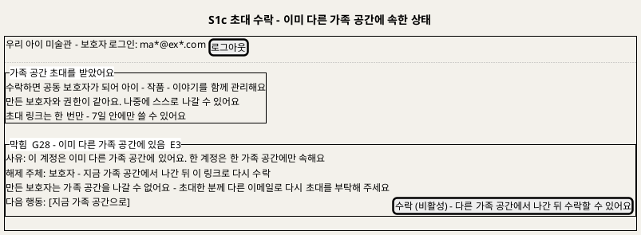

**[「S1c 초대 수락 - 이미 다른 가족 공간에 속한 상태」 PlantUML 뷰어로 열기](https://plantuml.sumzip.com/plantuml/svg/eNqNVN9r2lAUfs9fceheto4JXR82fJKNdn_AHosDZ2WU-mOohYETYg0lrY7Z1rTRJpIyO1cQltbMZcz9Q7nn_g87J2ZYnQ-FPCT3nvud7_vOd5MolVPF8l4uq5R2d_LvU8VUDt6m0rvvioW9_PbLQrZQhAeb65trGy-U8k45m4HXa2lATxdNFVA3hf0HngDanvjug2j0xZUPgavi5Q0Eox-Bq-F5C_DgkzQswHpN1i2llMqWlcpjpQLYdcXXIaChEQAQAupO4KkEKEaeNH3steAjiEsr-Omj7cchl1pNZD6sxtKFHG1sRTt0_KKehKoSiymVNytz7SOq4moCwr1Aw8QzD7vtFQUi9tIwxbXH1eJzZ9aXQEC0uPofPVLZO5Yn-lQuGpPAdxlWGt-C3yYQb9IiDUYncDFoilNnhocdFYJxk2xgrMDtMGq3HQOxb2L_OHTpqE8PaeK1wNWZIPXUp4yZ8NR1MajJ2lActYFNFbc69SJSz9CeEFedoHgBT_0FgCqbIwaHsmcCvHr6_B5zo7N2E2BjPfRrf4iWE4dQwEhDx0BbvQ9E2D4Wsp2dC78WqkPenJVIML84lJsvE7z14ndCQcwHauDr_yGgFrmngTjph1Qju9jWRh8bVjT3JTNiS-cBbW1uFucHUy3cP5xFOICxxvOPDGA7rts0irsNZxEcq5IugeGFmjQ_ygqVkc3y7JAiGIetpdosRkxy6qNb91D80mTHQu3mEV-Y5f4v-hFF3pmPRpKyUVUSmfw2_wj-Al6WYiE=)** — 클릭 시 브라우저로 연결됩니다.

| 영역 | 내용 | 데이터 바인딩 | UX 의도 |
|---|---|---|---|
| 헤더 | 지금 로그인한 계정 이메일(가림) · 로그아웃 | `GET /v1/me` | 초대받은 이메일로 로그인했는지 스스로 확인하게 한다(E2) |
| 초대 안내 | 공동 보호자가 되면 무엇을 하는지 · 같은 권한 · 나가기 가능 · 1회용·유효 기간 | 초대 토큰(링크) | 수락 전에 결과를 안다. 아이 별칭·작품은 보이지 않는다(초대 메일과 같은 원칙) |
| 수락 | [수락하기] 하나. 차단이면 C3 이유 달린 비활성 | 1.I2 Input 토큰 | 결정은 한 번 누름으로 끝난다 |
| 안내·차단 블록 | E1 링크 무효(400 `token_invalid` — "초대 링크를 쓸 수 없어요. 초대한 분께 다시 요청해 주세요") · E2 이메일 다름(403 `forbidden_role` · reason `invite_email_mismatch` — "초대받은 이메일로 로그인해 주세요" + [로그아웃하고 다시 로그인]) · E3 다른 가족 소속(409 `already_in_family`. 만든 보호자면 나갈 수 없으니 다른 이메일로 다시 초대받으라는 안내 추가 [추론]) | 1.I2 Output | UX6 (C2 · C3). 만료·사용·취소를 구분하지 않는다(BR-ACC-08) |

| 조작 | 동작 | 근거 |
|---|---|---|
| 수락하기 | `POST /v1/family/invites/accept` {token}. 204면 "하*네 가족 공간에 합류했어요"와 함께 S4로 | UC15 BF5~6 · G28 |
| 로그아웃하고 다시 로그인 | 세션을 끝내고 로그인 화면으로. 로그인 뒤 같은 링크로 돌아온다 | UC15 E2 |
| 이메일로 가입(계정 없음) | S0으로, 초대받은 이메일을 미리 채운다(S0이 `GET /v1/family/invites/lookup?token=`으로 초대 이메일을 받는다 — 토큰을 쓰지 않는 조회, 무효면 400 `token_invalid`이고 빈 칸으로 둔다. 2026-09-29 이제민, 보조 세션 E2E 발견). 가입하면 새 가족 공간 없이 이 가족에 합류하고 확인 메일은 생략한다 | UC15 A4 · UC13 A4 [추론] |
| 지금 가족 공간으로 | S4로 | UC15 E3 |

상태 전이: `링크 열림` → (로그인 안 됨) → `로그인 - 가입` → `수락 대기` → (수락) → `S4(합류 완료)` · `수락 대기` → (400) → `차단(E1)` · (403 이메일 다름) → `차단(E2)` → (다시 로그인) → `수락 대기` · (409) → `차단(E3)`.

**S1d 가족 없음** — 가족에서 나가거나 해제된 계정이 다시 로그인하면 S4 대신 이 화면이 열린다(UC15 A6 · U20 P0 기본값 [추론]). 새 가족 공간을 자동으로 만들지 않고 보호자가 고른다.

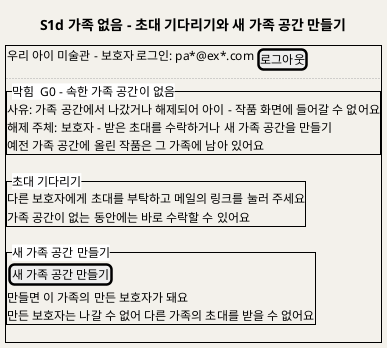

**[「S1d 가족 없음 - 초대 기다리기와 새 가족 공간 만들기」 PlantUML 뷰어로 열기](https://plantuml.sumzip.com/plantuml/svg/eNp9k81u00AQx-9-ilG5FRFRccspAlEegGNVJNNEqGo-qsSVkEIkJ7GqBYwIYLdOawdX9INKlnAbAz6EF9odvwOztkNMWpAvuzuzM7__f9aVjqa2tb1GXensbDd31bbagOfq1s6LdmuvWX3UqrfacGf9wfra44eKtq3Va_B0rQo81PHkCvBwHz0T7gFGTJg68DgUb0_FeUALHOuAQzZP5dPvPDRAXJji0ymFlY5a15TuXaULeBTSFUDbQC8C8S1G5vNIp7JiGiVOjJMRvAJx4vKfMXpxGXbV1Urt5Wppq9WgwEYeoevHw03oKaWS0n22Ii5eJxMH4Ml9ybf_LrHdv1lks0zAigKAgwBdv7yUcjhCwwUxcHho8auQFpDYEfquGDl4EM2ZqcHkQ_KRQTK2xGVE14BUUgIPGSBz0j4HER5Z1CkrAPhlhtdRuaCR9IbH6Om5m-JsJu8K71diO3nzG4aiV_SUZDgMfeOGCjoPxHmYY8oe5FieldIOvpIUCrMcsyctvGWq0iq5OYsX4FSAX5sFavFDT4Z9ST31QVxa6M3Qc4izn_SDNIGZ4nOQWmDEmSu3jUa8sUC8H6PNqEW6CS0a9h9X_MzbJeh_vzkJv_Gf-KYUl25oiCAhcodSeDr3F6IpQmyzDH45mLLKR1Oc_ty3Rc2CY3LwxtJT6dFXqTWr8uf8DRmQJeM=)** — 클릭 시 브라우저로 연결됩니다.

| 영역 | 내용 | 데이터 바인딩 | UX 의도 |
|---|---|---|---|
| 차단 블록 | G0 가족 없음. 사유 · 해제 주체 · 예전 작품은 남는다는 안내 | `GET /v1/me` `hasFamily=false` | UX6 (C2). 왜 작품이 안 보이는지 먼저 말한다 |
| 초대 기다리기 | 할 일 안내만(버튼 없음) | — | 초대 수락은 메일 링크(S1c)로만 한다 |
| 새 가족 공간 만들기 | 버튼 하나 · 만든 보호자가 된다는 것과 그 결과(나갈 수 없어 다른 가족 초대를 못 받음) | 1.0 Output 가족 공간 | 되돌리기 어려운 선택이라 결과를 버튼 옆에 적는다 [추론] |

| 조작 | 동작 | 근거 |
|---|---|---|
| 새 가족 공간 만들기 | `POST /v1/family`(201). 만든 보호자(owner)가 되고 S1 아이 관리로 가서 "이제 아이를 등록해 주세요"를 보인다. 이미 가족이 있으면 409 `already_in_family`(다른 탭에서 수락한 경우)라 S4로 보낸다 | UC15 A6 · U20 [추론] · T106 |
| 로그아웃 | 로그인 화면으로 | — |

상태 전이: `로그인` → (`hasFamily=false`) → `S1d` → (새 가족 공간 만들기) → `S1(만든 보호자)` · `S1d` → (초대 링크) → `S1c` → (수락) → `S4(공동 보호자)`.

---

## 5. S2 작품 올리기

### 5-1 와이어프레임

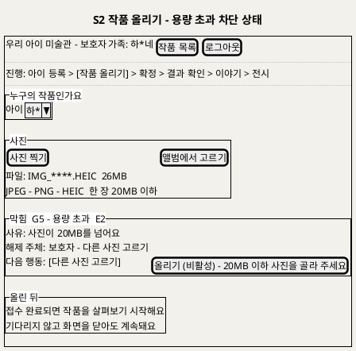

**[「S2 작품 올리기 - 용량 초과 차단 상태」 PlantUML 뷰어로 열기](https://plantuml.sumzip.com/plantuml/svg/eNptk1FP02AUhu_7K07wRjEuOqMXvTAEMiYmMyReks1MIYYwNjPGFSyZ0JjBhgOk2GGLXdhg0yV2o8aa9Bf1nP4Hz9nqJNEtWb5-53vPed7v7WY2StliaXM9p2ysrebfZovZdXiVfb32pljYzC_PFXKFItyafzj_IDGrlFZLuRV4EQc6PwqPq0BGHy_7gefAPaCzHn7ZA3KrwbUP5HSx1gXafRfumspGNldStu4qW3zKYQWQrpHlAn73qGoHboX1eO2Ghkfnh7ANgVOh1kCFUDemUWvzzlI0Eb_2sGWlZQdbZvDTk06fd9NQVmIx6X-lhad76mTAxwEfhycT_YQ4zZthUydb50UwdARani2Pn1lKui--eG1rVDOj_pkprGrBjz5ZRnQHLBDas5MpBf5M3YaMkGeUsihop89UUl4aL_lyDkYEYkvv4vCEPh2SZkJwbWPHlRIfDut1snwVFlLJl9P8iT1NLMwBxB-nZrn6bDGR5EtbfC6_40qom8zUgfj91Kw4YIQxAF7thecGQPLRPzFBIj7iZi7TVmHMJxakCXZ8QM2gU5ftCZHuks0zLnwauuqNwDi8Whs7XqT_64NFXCGrDhwKNpoqp_b_k-PLmLxOt_GXFjZN0gZ3uPsNRxNE0XbR8kc4mseE6ei6pYkDeNweObOPqMqqpoYXdTw0sOdOguMgdtzwg8tGZCanLBU9cstbwnrJ4yoc7D6j8gtywg1EibVvHDY2BEOj9wfY8EVW5u_MSn5Z_k6_Ae7rysI=)** — 클릭 시 브라우저로 연결됩니다.


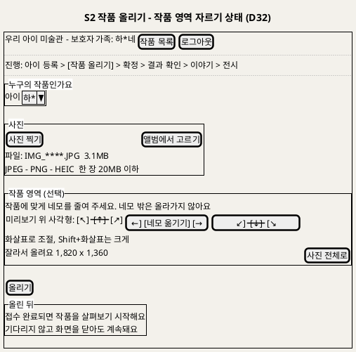

**[「S2 작품 올리기 - 작품 영역 자르기 상태 (D32)」 PlantUML 뷰어로 열기](https://plantuml.sumzip.com/plantuml/svg/LLDTIzjW5BxFhpYu6pzBRM6CNWpHgLDm5BoKT7JJRMBLKIiCLB0sI6VhRBMngKianJe_rcsnPgmN-JLUvZtv3pidJIkca9wFzvptUPvpChQHIQOpcwifQMDbUUrpCfrSXNV9zoiVq-kRQuiJwwdrD3oRYawDJevBcULCQWdc8u3dPUyu3wWrnO-csxPWv36KnUelyahYqkOCvh9UJeV-Lz78WBIHJ6MahI5f2_3Ceb90LK731l6dZNdJjNUfaRYtFQrD3M0RN6iNwtSny5HjK2WDYYm4zuZR6r4tP8w8kkx-QtEdxpaPTgHGYFjVATxfrrZlWfCxEWulU_Kzw385lPgAfag6sxBSUyVtZJRvL8ggmpJ8DXKiw47_H9_8A-xV9XfQm9mA6ErPfK-2xgtRa63a2Mc7At2lIQWulT0n0Qr37m7JKgz5guBL4YewkFTcHpsP3dl58XfE36RcfjyEqXEQZKy3H4EZS-EKdOrFJfDeyJVyVZqvCq45gawOBY4IdXjd1WGX0F1aHFsec5xE6F3nTYXKIo2kpjrM4KXiSNijBXt0Xe9L6jI5WqgRw8M270Zh58rTNqZ3OUfNvAW7JFsiGZstUAgaCStJtmET-EurNIlhQMeC5XxsJsKO6M6Zt3MglXGF-oMPfjgv1RNVLEshH8dZu42jMt7IDJIUF76lLN3FziewBGLWtK8pFmppdvO_P8OUKmSLyB9DekaprmW-Yyv4p0PXXz7X5v4mVA7_wFEmFvnWNBG1BPiwowmdXHztgACl-nQ8uuQlgLd6F6r7JH4NHL7In8tTMnMMmlQ-sLrj2ZfdLBkZ78L4eK6j0qbf7PWODU1AKVX96eiZXTP4mVr3SUHmsGxznfRM5lbB_Wy0)** — 클릭 시 브라우저로 연결됩니다.

### 5-2 영역별 설계

| 영역 | 내용 | 데이터 바인딩 | UX 의도 |
|---|---|---|---|
| 여정 레일 | "작품 올리기" 단계 | — | UX7 |
| 아이 선택 | 드롭다운. 다시 찍기로 왔으면 이전 작품의 아이가 미리 선택 | 2.1 Output 아이 목록 · H7 아이 ID | UC2 A7 |
| 사진 | 찍기 · 앨범 · 파일 형식·용량 안내 · 미리보기 | 2.2 Input 사진 파일 · Output 미리보기 | 검사 기준을 먼저 보인다(BR-INT-01) |
| 작품 영역 (선택, D32) | 미리보기 위 사각형(처음엔 사진 전체) · 네 모서리·네 변 핸들과 가운데 "네모 옮기기" · 안내 "작품에 맞게 네모를 줄여 주세요. 네모 밖은 올라가지 않아요" · 자른 크기 표시 · [사진 전체로] · 브라우저가 열지 못하는 사진이면 "이 사진은 화면에서 열 수 없어 자르지 않고 그대로 올려요" | 2.2 Input 자르기 사각형 · Output 올릴 사진(자른 이미지) | 아이 얼굴·교실 배경을 서버에 보내지 않는다(BR-PRV-01). 손대지 않아도 되는 선택 단계(UX7) |
| 차단 블록 | G5(형식 E1 · 용량 E2 · 판독 E3) · G6(원본·기록 저장 실패 E4 · E5) | 2.2 · 2.3 Output 거절 사유 | UX6 |
| 올린 뒤 안내 | "접수 완료되면 살펴보기 시작, 닫아도 계속" | 2.3 Output 202 · 상태 "판정 중" | UX7 |

### 5-3 상호작용

| 조작 | 동작 | 근거 |
|---|---|---|
| 사진 고르기 | 화면에서 형식·용량·판독을 먼저 검사, 통과하면 미리보기와 사진 전체 사각형 | UC2 BF2 |
| 사각형 조절 (D32) | 마우스·터치: 모서리·변 핸들 끌기, 가운데 끌면 옮기기. 키보드: 핸들에 초점 → 화살표 1%, Shift+화살표 10%. 한 변 48px 이상, 사진 밖으로 못 나감. 바꾸면 요청 번호를 새로 만든다(다른 사진) | UC2 A10 · D32 |
| [사진 전체로] (D32) | 사각형을 사진 전체로 되돌린다 — 고른 파일을 그대로 올린다 | UC2 A10 |
| 올리기 | 사각형이 사진 전체가 아니면 브라우저가 그 영역만 새 이미지(PNG 입력은 PNG, 그 밖은 JPEG 0.92, 1,600만 화소 넘으면 비율 유지 축소)로 만들고 20MB 검사 뒤 보낸다(D32). `POST /v1/artworks`(요청 번호 포함). 버튼은 누르는 즉시 비활성(중복 전송 방지) | UC2 BF3 · A6 · A10 · BR-INT-03 · D32 |
| 접수 완료 | S3로 이동해 "살펴보는 중" 표시. 떠나도 S4에서 이어진다 | UC2 BF4 · A2 |
| G6 실패 | "접수되지 않았어요, 다시 올려 주세요". 목록에 작품이 생기지 않음 | UC2 E4 · E5 |

### 5-4 상태 전이

`빈 양식` → (사진 선택) → `검사 중` → `미리보기`(사각형 = 사진 전체) 또는 `차단(G5)` · `미리보기` → (사각형 조절) → `미리보기`(잘림) → ([사진 전체로]) → `미리보기` · `미리보기` → (올리기) → (`자르는 중`, 잘린 경우만) → `전송 중` → `접수 완료`(→ S3) 또는 `차단(G6)` → (다시 올리기) → `전송 중`.

---

## 6. S3 판정 제안 확정

### 6-1 와이어프레임

와이어프레임은 차단 상태(G7 — 제안 없음)를 그렸다. 정상 상태에서는 제안 칸에 "움직일 수 있을 것 같아요" 같은 문구가 보이고 차단 블록이 없다. 어느 상태에서도 선택지는 미리 선택되지 않는다.

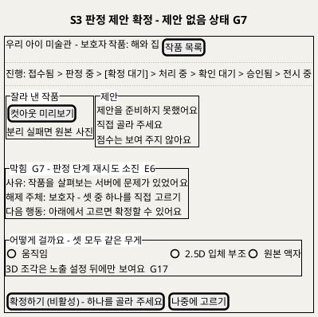

**[「S3 판정 제안 확정 - 제안 없음 상태 G7」 PlantUML 뷰어로 열기](https://plantuml.sumzip.com/plantuml/svg/eNpdU29L22AQf59Pcbg3ypjgZBP6Ysg29QPspTjopgyx6qj1lSvEGqWzYbZi2lSTkLK6VikstsFF9BPlLt9hd09iHcur55673O_P3TO_U8oXS7ubBW1nY33ra76Y34RP-c8bX4rbu1ur77YL20V4tji7OLPwViutlwpr8GEWErNOvgXkO2RVIWlbEr14jKl1RK4JdLCfHDiwNKft5Aslbe-5tgd0HuCvAZBlkBsC_o6o6sehzv_iKEzsiLw6fAPyGslpNQeJFVJbB-o1-HI5vQW8vsKOuwJlbXpaOvaMpPk9x9gNqtpY78ObMb1ug4PljB6aehwFK3xDQ1uRUGnJulGWleTxHcdpH_INqjmqMEPb-zhBno3uA2AlynhOaMDfMt3_EVkXByKL-7MgwVNJvDUUYq2bmH28CoEu6jjiBpUB8-eSMguU3srAtGF6JtdgfB3vjMSyqaez_PukWaVmSOdnaV1vn7VDPOoLLfr5QEY0zvl1MeX4TOyl1kCluQlZx8JVVZVZG0Nj73vi2cDj4mFkBmKtH48Y3xuwDXjCpyOT-QIsvBaOwt7xc5kNimklTH6EjCWQZDg4NKhVBxxErCYOGNirUuuJvQzYdxSrYZj7Zwd4lw5ryniWjRUbLx-ehPp4Kdby_1jryqbxAuBJOydrhZ7NiAyd1YnZ6QIklg9shqKQ4ivdfMbmfTw0Ib6J4juTExk6XvexUYc4aJPLvg9CLhLZkzDF89OFjmfw3CR-Of3qPXc-ZBk8bJ06QZZ4HLTVYVn88yyXdYI42Fc9DyO6ZflGV7l92mXq2DOzYQkTWJqZE56PW8xuyJpOyj60HTJupmRaY4v-X4IVeTecYyNlDmPr5PWUtfm1rVV5-H8BM5ozZg==)** — 클릭 시 브라우저로 연결됩니다.

### 6-2 영역별 설계

| 영역 | 내용 | 데이터 바인딩 | UX 의도 |
|---|---|---|---|
| 진행 레일 | 판정 중 → 확정 대기 | 0.5 Output 상태 | UX7 |
| 잘라 낸 작품 | 컷아웃 미리보기, 분리 실패면 원본과 "액자 권장" | H3 마스크·컷아웃 참조 (0.3 · 0.5 Output) | UX4 |
| 제안 | 제안 문구만. 점수 칸 없음. 판정 중이면 "살펴보는 중". 분리·판정 모델을 올리는 중이면 "그림을 볼 준비를 하고 있어요. 조금만 기다려 주세요"(남은 시간이 있으면 "약 N초") — 오류 블록·빨간 표시 없음, 직접 고르기는 그대로 가능 | H3 제안 문구 코드 (0.5 Output) · `GET /v1/artworks/{id}` 단계 `waitingForModel` · `etaSeconds` | UX2 · UX7 (모델 적재, T143) |
| 차단 블록 | G7(판정 소진) · G8(확정할 수 없는 상태). **판정 모델이 비활성이라 판정 단계가 아예 없으면(접수 때 `suggestion=none`, `stages`에 judge 없음) G7 블록을 그리지 않는다** — 서버 문제가 아니므로 제안 칸에 "제안을 준비하지 못했어요 - 직접 골라 주세요" 한 줄만 둔다(2026-09-29 이제민, clarify 2026-09-28 · T116) | 0.5 Output 오류 분류 · 2.6 거절 · `stages[judge].status` | UX6 · 원칙 3(실패를 꾸미지도 부풀리지도 않는다) |
| 선택지 | 움직임 · 2.5D 입체 부조 · 원본 액자 — 같은 크기, 기본 선택 없음. 3D는 노출 설정 뒤(G17). **모델이 비활성인 선택지**는 같은 크기의 C3 비활성 버튼 "(비활성) - 지금은 이 방식을 쓸 수 없어요"로 그리고, 해제 주체는 평가 담당(새 버전 승격)이다(clarify 확정: 비활성화는 낮춤으로 우회하지 않음) | 2.6 Input 확정값 · `GET /v1/artworks/{id}`의 `choices[]`·`unavailable[{choice, reason:'model_disabled'}]` | UX2 · BR-SUG-03 · UX6 |
| 행동 | 확정하기(선택 전 비활성) · 나중에 고르기 | 2.6 · 2.7 Output 처리 단계 작업(H4) | UX7 — 나중에 S4에서 이어 확정 |

### 6-3 상호작용

| 조작 | 동작 | 근거 |
|---|---|---|
| 제안 전 직접 고르기 | 제안을 기다리지 않고 선택·확정할 수 있다. 제안값은 "제안 전" | UC2 A3 · BR-SUG-05 |
| 선택 | 셋 중 하나. 제안과 달라도 경고 없음 | UC2 A1 · BR-SUG-03 |
| 확정하기 | `POST /v1/artworks/{id}/confirm`. 성공하면 "만들기 시작했어요"와 S4로 | UC2 BF7 · BF8 |
| 나중에 고르기 | S4로. 작품은 "확정 대기" 배지 | UC2 A2 |
| 액자 선택 | 추가 확인 없음. 원인 "보호자 선택"으로 기록된다(화면에는 원인 표시 없음) | UC2 A4 · UX3 |
| 비활성 선택지 | 누르면 선택되지 않고 C2(해제 주체 평가 담당)로 포커스. 화면을 연 사이 비활성이 되어 확정이 409 `model_disabled`(G8)로 거절되면 C2를 보이고 선택지를 다시 불러온다 | clarify 2026-09-28 · T116 |

### 6-4 상태 전이

`살펴보는 중`(판정 중, 모델 적재 대기면 `준비 중` 문구) → (H3 도착) → `제안 있음` 또는 (G7) → `차단(G7) · 제안 없음` · 두 상태 모두 (선택) → `선택됨` → (확정) → `확정 중` → `처리 시작`(→ S4) 또는 `차단(G8)`. `살펴보는 중`에서도 (선택)이 가능하다(A3).

---

## 7. S4 작품 목록과 진행 상세

### 7-1 와이어프레임

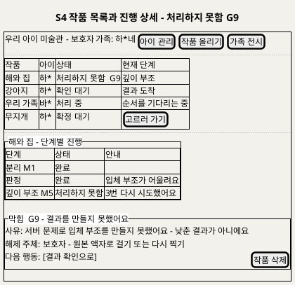

**[「S4 작품 목록과 진행 상세 - 처리하지 못함 G9」 PlantUML 뷰어로 열기](https://plantuml.sumzip.com/plantuml/svg/eNp1k0FvElEQx-_7KSb0pilJUz3IqdFYTz15bDBB25imFAzQEzRB-kxowZQqSxdccEmptAZ1CxuyRj7Rzux3cGZ3sZDYwyZv572Z_39-895GvpDKFQ4P0lp-fy_zLpVLHcDr1Jv9t7nsYWbnWTadzcHK5vrm2vOnWmGvkN6Fl4-Aeuf-pyrg9xvsd73JDGio_NYJ0PF7Ui6sAo0N_DbydYOGZT72x9ev4cUTLZ9KF7TiQ60I1LH5AJCuqOsA_nKpanlOmVNx4viGS70GlMCzy9S_TQAXeoBqwJHtKIPPcn4yiIRmyBhxxHPtIBhmAlmKamYSjrR4XCuuzI2X5sIlsewfm7zwDUW9EWDt2psoDVjToXaZOzuXTTYgh__TFvclTn-fBo1MWdbmbM_WRYKP_Uv22zp1XcB6mU1KytgWdHimyL7hlAhJ5LwEaDfvNIEG4oOqJikTr2bANbA24B08bcomF8CRw4KebS5rWvqd5rY3sfDKwa-BjsDSQjSvYgv9rkYUcKKiycYEXhhcZEZ6FSuOSE-VmNxak2Bb4WWdF3GhWG-IgYUo9T7QeE6KTQC1HOq4aA2o0xRyiyRh6_E92EuwjmO-grUBDxj4Y45-qxoUa3JTR9ITDk_8nhGMaDXiLexwWMfPg3mxeVJMZlAZkWklQCCPFRN1yTKxby67vr-GoKv8pKkRqQX96QprVbpohP0JZ4sLXs64YGLhuvOr-dLAicsJff4XVe_Wlbmh0ZApz3u1P3JQoPN_tw48HjxrJ3i24YUK7xmZM66w9EAqP1g4GbDZ2M3syJv_C9mrOk0=)** — 클릭 시 브라우저로 연결됩니다.

### 7-2 영역별 설계

| 영역 | 내용 | 데이터 바인딩 | UX 의도 |
|---|---|---|---|
| 헤더 | 가족명 · 아이 관리 · 작품 올리기 · 가족 전시 | 3.1 세션 | UX8 |
| 작품 목록 | 작품 · 아이 · 상태 배지 · 현재 단계 | 3.1 Output 작품별 상태 목록 | UX7 (C4) |
| 단계별 진행 | 분리 · 판정 · 움직임 렌더 · 깊이 부조 · (P1) 3D의 상태와 안내 | **P0** 0.1 · 0.5 · 0.6 · 0.9 · 0.10 Output 단계 작업 기록(상태 · 시도 횟수 · 낮춤 원인 · 오류 분류) → 3.2 | UX7 · UX3 (C6) |
| 모델 준비 대기 | 단계가 `대기`이고 그 단계 모델을 올리는 중이면 "그림을 볼 준비를 하고 있어요. 조금만 기다려 주세요"(`etaSeconds`가 있으면 "약 N초"). 진행 막대는 "대기"에 머물고 갱신은 계속한다. 오류 블록·빨간 표시 금지. 모델 이름·상태 원문·버전·장치는 보이지 않는다. 적재 실패는 보호자에게 말하지 않고 기존 "다시 시도 중"으로 보인다 | `GET /v1/artworks/{id}` 단계 `waitingForModel` · `etaSeconds`(T143) | UX7 · BR-SUG-02 · D3 |
| 차단 블록 | G9 처리하지 못함 — 낮춘 결과가 아님을 명시 | 0.9 Output 상태 "처리하지 못함" · 마지막 오류 분류 | UX3 · UX6 |

### 7-3 상호작용

| 조작 | 동작 | 근거 |
|---|---|---|
| 목록 열기 | 가족 작품만, 상태와 현재 단계 | UC3 BF1 |
| 작품 누르기 | 확정 대기 → S3 · 확인 대기·처리하지 못함 → S5 · 처리 중 → 진행 상세 | UC3 BF2 · BF7 · A9 |
| 새로고침 | 상태 다시 읽기(갱신 방식 U8) | UC3 BF6 · A11 |
| 작품 삭제 | S9 대화상자 | UC7 BF1 |

### 7-4 상태 전이

`목록` → (작품 선택) → `진행 상세` · `진행 상세`의 표시 상태: `대기` / `대기 · 모델 준비 중`(오류 아님) / `진행 중` / `다시 시도 중`(재시도 중) / `낮춤 안내`(모델 낮춤) / `차단(G9)`(소진) / `확인 대기`(→ S5 버튼 활성). 목록에서 삭제된 작품은 즉시 사라진다(BR-DEL-01).

---

## 8. S5 결과 확인

### 8-1 와이어프레임

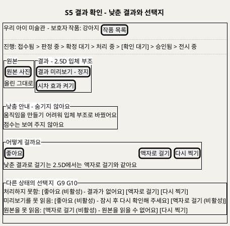

**[「S5 결과 확인 - 낮춘 결과와 선택지」 PlantUML 뷰어로 열기](https://plantuml.sumzip.com/plantuml/svg/eNp9VF1PE1EQfd9fMcEXjYGIhgf7YIgf8AN8bNakCjGEUkwpT9hkKaupdE2Kdsu23W22WmglRJfS4DbU-H_2zv0PztzdSEsI7UMzc2fOOXNm0sWtQiZf2N7Ialvra7l3mXxmA15n3qy_zW9u51aebWY383Bn6dHS_IunWmGtkF2FlwsQDYLofAyyYaMXwiyI0k-8cJI0NgxA05d7HvYMbSuTLWg797UdwGYgjk8BbRO9IYhfIZb9aGhw-_lQOiG2q_AesH0gv5RTEAU2V_YMyqXjJIiTH6Lj6VDU5uYYsGfK-qcUoH-AZUdU-_AEpFVF3wbsHnBA-igQlhGFAcU4cJQC9ZhO1MevOj_vjygR46BvYsVVpQnbzqsZbFXFeTijAX3ScQBYOiUdusqhcyqOA4h-hwQqOi4liySfOhPDZuHh3MJzmvEDDsiCCwM7QQKXVJAtJJEMYcWzJMMmC_SEseJi0AfZ7HMljl3WrTiKGnGoJXTJ37IoDbm33KcCdhDtffayWWMubBnY28U2bcEE0bPE1y5zYX0o_C62rGl1NAWIoBb97VMBITCAX2W792u8NzwkP7-Pp1g0JYcB65fRwILoLIxGVkKfxm-VuExXm7U7tHdm4SreAyVFpavMDz4nE07d11Uxa2BD8bCKpsvRdTi-xShoTOoicHFEe9vblXsues7VrQIsP4bl-QfKJXUq0nY4L04upd1PTWiHu2JkyoaL5tk9sjoWFgVkwuHH2Cj9ptlumGxi3-JozFSA3h_0rFvosO0zimzRAmPA-JalPVTLMMObBUzC6OoU-ITVHUzR3tLG7P-7VAf9lJ2pua8NWaTv4mpuhf9j_gFGg32w)** — 클릭 시 브라우저로 연결됩니다.

### 8-2 영역별 설계

| 영역 | 내용 | 데이터 바인딩 | UX 의도 |
|---|---|---|---|
| 진행 레일 | 확인 대기 | H5 상태 | UX7 |
| 원본 · 결과 | 나란히, 결과는 정지. 결과 종류에 맞는 토글(재생·시차·회전) | 3.3 Output 원본 · 결과 미리보기 · H5 결과 종류 | UX4 (C5) |
| 낮춤 안내 | "어느 단계에서 어디로". 점수 없음 | H5 낮춤 원인 (0.8 Output) | UX3 (C6) |
| 선택지 | 결과 종류별: 움직임·3D = 좋아요 / 낮춘 결과로 걸기 / 액자로 걸기 / 다시 찍기 · 2.5D = 좋아요 / 액자 / 다시 찍기 · 액자 = 좋아요 / 다시 찍기 · 처리하지 못함 = 액자 / 다시 찍기 | 3.4 Output 선택지 · 3.5 Input 결정 코드 | UX2 · BR-APR-02 |
| 차단 블록 | G9(처리하지 못함) · G10(미리보기·원본 못 읽음) · G3(결정 저장 실패) | 0.9 · 3.3 · 3.5 Output | UX6 |

### 8-3 상호작용

| 조작 | 동작 | 근거 |
|---|---|---|
| 재생·시차·회전 | 누를 때만. 다시 누르면 정지 | UC4 BF3 · BR-EXH-03 |
| 좋아요 | `decision like`. 승인됨. 이야기가 비었으면 "이야기를 채우면 전시돼요"와 S6 | UC4 BF4 · BF5 |
| 낮춘 결과로 걸기 | 2.5D가 없으면 "입체 부조를 새로 만들어요" 안내 뒤 S4로(처리 중). 처음 결과는 보관 | UC4 A1 · H6 |
| 액자로 걸기 | 모델 없이 승인. 처리하지 못함에서도 가능 | UC4 A2 · A5 |
| 다시 찍기 | 확인 대화상자("지금 작품은 지워지고 새로 올려요", 2026-09-29 문구 검토 확정) → 결정 기록 → S2(아이 미리 선택) + 이전 작품은 S9 절차 | UC4 A6 · H7 · H8 |
| 중복 누름 | 첫 결정만 반영, 이미 반영된 결정을 보여 줌 | UC4 E7 · BR-APR-06 |

### 8-4 상태 전이

`불러오는 중` → `확인 가능` 또는 `차단(G10)` · `확인 가능` → (결정) → `반영 중` → `승인됨`(→ S6 또는 전시) / `처리 중`(use_lower, → S4) / `닫힘`(retake, → S2) 또는 `차단(G3)`. `처리하지 못함` 진입이면 처음부터 `차단(G9)` 표시와 함께 액자·다시 찍기만 활성.

---

## 9. S6 이야기 쓰기

### 9-1 와이어프레임

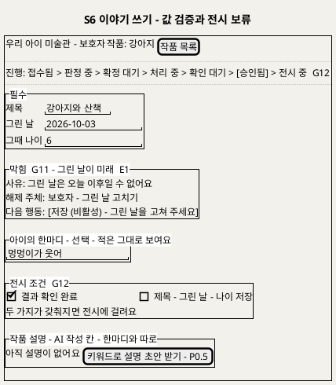

**[「S6 이야기 쓰기 - 값 검증과 전시 보류」 PlantUML 뷰어로 열기](https://plantuml.sumzip.com/plantuml/svg/eNptU0FLG2EQve-vGNJLS0lIlHrIQWyLlt4KvRQkhbRKEaOWGE9WWONaVt3SRLO6MdmwwWiqCN2Ypd2Av2hn9j90ZjdJY2kIJPN9b2bevHnf3GYpXyxtrRWUzdWV9c_5Yn4NPuQ_rn4qbmytL73cKGwU4dHC9EJm_oVSWikVluHtDJDtkXkf-C7QiSs_SQjcYwjuVLqyg_49kKPRUROw7-GlpWzmCyVl-6myDXTu4tUtkKlxCcCfPulO4Kmcz9DQ8qlVgS9ArWp4rGe5pinIrspni_Eh4M01tu0c7CiplBTsauHpQZYbVkm3sPIDZiE0KuSYQJ2qBHVTAjRU4TkLdGdFDMaXtv_3cpEOB3zAZXICjYcQKLzKTA1bvk-EzEm3Egowosl8mF1iTJXqKlDZpd4-AAgm-O3jlQtYdgQ3lZ6aSWbSyfQ0wATANBhgiSaMmYEHn4SyI12xexC2LGGSEbnHVYdCotzNZyJW5VtqOtkHGCZldfDQktWFDVafd6RzdPaVTj06r3FaaHo8D9DFPd152YmFTHaDoO_QwGK5OAOPOmQbwAvA7_Usq-eo1LqExzjQwnqTtN6Tf5hqUXq_EjXRfO6bi4eLDUG2xSya2NWxVuNU0pxwz5Y_zq6MIKUMFduRsejslvNl3gRef-MvFwhcnrOxxyP9R8DROttu0POijUry4rsc-9YV0w7dQHUNLwyxHORGG34gQXK0q3heEaJaYbOqvH5hELin9MvlAK-9oYnojAE9H52OaB3Tif1MWgdv9rnm89fiexYNaOBzPBZCHIU1l8eOlisu2x2mRSRGKxTGYblDDQNPmiLSsDR5Opn8cNxG_FLfpFPPRPYdZW55fUle_h_8ARqc)** — 클릭 시 브라우저로 연결됩니다.

### 9-2 영역별 설계

| 영역 | 내용 | 데이터 바인딩 | UX 의도 |
|---|---|---|---|
| 진행 레일 | 승인됨 + G12 표시 | 3.9 Output | UX1 (C1 전시 보류) |
| 필수 | 제목 · 그린 날 · 그때 나이 | 3.6 Output 기존 이야기 · 3.7 Input | UX1 |
| 한마디 | 선택, 적은 그대로 | 3.7 Input 한마디 원문 | UX5 (C7) |
| 차단 블록 | G11(미래 날짜 E1 · 나이 범위 E2 · 전시 중 필수 비움 E7 · **다른 보호자가 먼저 고침** 409 `story_conflict`) · G3(저장 실패 E3) · 삭제 중 종결(E4) | 3.8 Output 거절 사유 | UX6 |
| 전시 조건 | 결과 확인 · 필수 이야기 두 줄 | 3.9 Output 승인 상태 · 이야기 필드 | UX1 (C8) |
| 작품 설명 | AI 작성 칸(한마디와 분리) · P0.5 확장점 버튼 · 승인 설명이 있으면 고정 표시 | 3.10 Output · H10 | UX5 |

### 9-3 상호작용

| 조작 | 동작 | 근거 |
|---|---|---|
| 입력 | 화면에서 날짜·나이 즉시 검사 | UC5 BF2 · E1 · E2 |
| 저장 | `PUT /v1/artworks/{id}/story`. 서버 재검사 | UC5 BF4 |
| 저장 뒤 | 승인됨 + 필수 충족이면 "전시에 걸렸어요", 아니면 C8에 빠진 줄 | UC5 BF5 · A1 · A5 |
| 한마디 지우기 | 비우고 저장하면 지움 | UC5 A4 |
| 동시 수정 충돌 | 저장 요청에 불러올 때의 `baseUpdatedAt`을 싣는다. 공동 보호자가 먼저 고쳤으면 409 `story_conflict`(G11) — C2 "다른 보호자가 먼저 고쳤어요" + [최신 내용 불러오기]. 내 입력은 지우지 않고 옆에 남겨 다시 옮겨 적게 한다 | FR-9 · U1 공동 보호자 · T142 |
| 키워드로 설명 초안 받기 | S7 패널 열기(P0.5, 승인 설명이 없을 때만) | UC5 A6 · UC10 BF1 |

### 9-4 상태 전이

`불러오는 중` → `편집` → (저장) → `저장 중` → `저장됨(전시 보류)` / `저장됨(전시 중)` 또는 `차단(G11)` · `차단(G3)`. `삭제 중` 작품이면 `종결`(입력 불가). `편집` → (설명 초안 받기) → S7 패널.

---

## 10. S7 설명 초안 받기 (P0.5)

### 10-1 와이어프레임

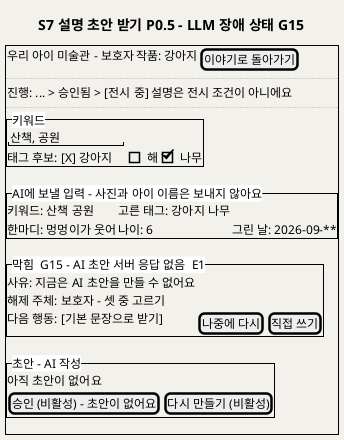

**[「S7 설명 초안 받기 - LLM 장애 상태 G15」 PlantUML 뷰어로 열기](https://plantuml.sumzip.com/plantuml/svg/eNplk29L23AQx5_nVRzuyebWUh06lgdDN3QIDgZ7MigddFOGWHXU-kiFWtMRbYftbGpt0xJZtdsoLLURI_QV5S7vYXdJ65SFBn693_35fu4uM5uZZDqztZZSNldX1r8k08k1-Jj8tPo5vbG1vvRqI7WRhgfzT-cn5l4qmZVMahnePQPS2vg7D-ToZOiAdsNzbXgbi05BBBYX3wC1zsmwgPb3_H0TXk9MKZvJVEbZfqxsA9VtvOgCGRo1HcA_LumW52Q5EvuOX3OpVYIdzlD2v-sqeLYhnp0s2-IcQMaAa-GZCXhU5BvPzvL_BOwq0agk72h-9UCFaDQKL4AOb6jpYuknn-NkaVQwgdrlhOQPCKiZhZH9zPZ6jkjirFjQ6aRE9cow74cxP9emRhGPzTEFYIxyNvXyT8DrX1GjBMNHrpjXu3bBb2hMo0L8feI-AiTANxw58Q3math1lF0pMLvAFaUFmBswfR6tc24J5bqM5PUHo37xixea6A5cHUlLxqHc1iuBgJFQFUKVI5E7fLDw3B1KvNvaoQ4ONkzs6FipqIC_vvGPy3GHgRr7VBXV7MkmFaYl3bWLFzabLBUmY5PTkdjzyPh4SIOdA79VAxk9U8wujFaFNBMvNaYoY-EK6OQrNYsAcxOiXFhNzsWKPFcXxNs4amqAHaZqA-m1IK7qMHAg2SGLx_djQJcs7N8OcfPyBRl3yO3wmrA7FtpSkpcEj055PrJMfRew68rOmoNgs4J9li2JC2-7HEyGAwtmYKTOHllloGNb3ELgIV_I2iqT1guQpL97txDOPeXxcD3hId5o_qnJIY9E9P--oZKg_rAL8rndCRMNu8rM8vqSfMd_AdkiCec=)** — 클릭 시 브라우저로 연결됩니다.

### 10-2 영역별 설계

| 영역 | 내용 | 데이터 바인딩 | UX 의도 |
|---|---|---|---|
| 레일 | "설명은 전시 조건이 아니에요" | — | UX1 |
| 키워드 · 태그 후보 | 키워드 입력, M2 태그 후보 칩(고른 것만 입력) | 4.1 Output 태그 후보(H3) · 4.2 Input | BR-CAP-06 |
| 보낼 입력 미리보기 | 키워드 · 고른 태그 · 한마디 · 나이 · 그린 날. 사진·이름 제외 안내 | 4.3 Output LLM 입력 | UX5 · BR-CAP-01 |
| 첫 생성 지연 안내 | 설명 모델(M6)이 내려갔다고 짐작되거나(`cold`) 올리는 중이면 버튼 아래 "처음 만들 때는 조금 더 걸릴 수 있어요"(최대 관측값이 있으면 "최대 약 N초", 실측 13초). 앞선 요청이 있으면 "다른 설명을 먼저 만들고 있어요". 안내일 뿐 버튼은 막지 않는다 | `GET /v1/captions/model-status`(보호자 세션, P0.5 — P0에서는 404) `{warming, maxWaitSeconds, busy}`: `warming`이면 첫 문장, `maxWaitSeconds`가 null이면 "최대 약 N초"를 뺀다. `busy`면 둘째 문장. 모델 이름·버전·원래 상태값은 없다(이제민 결정 `aa4e55d`, T128) | UX7 · UX6 |
| 차단 블록 | G13(사용 조건) · G14(입력 없음) · G15(LLM 장애) · 승인 설명 있음(종결, E3) | 4.1 · 4.2 · 4.4 Output | UX6 |
| 초안 | AI 작성 표시, 한마디와 다른 칸. 템플릿으로 낮췄으면 C6 문구 | 4.6 Output 초안 · 출처 · 검사 결과 · 생성 횟수 | UX5 · UX3 |
| 행동 | 초안 만들기 · 다시 만들기 · 버리고 직접 쓰기 · 승인 | 4.7 · 4.8 | UX6 |

### 10-3 상호작용

| 조작 | 동작 | 근거 |
|---|---|---|
| 초안 만들기 | 입력이 없으면 비활성(G14). 누르면 "쓰는 중" 진행 표시와 경과 초만(문장은 검사 뒤 한 번에). 30초(호출자 상한)를 넘기면 G15 선택지 | UC10 BF3~5 · BR-CAP-07 · A §3.1 |
| 규칙 검사 반복 실패 | "AI 초안이 입력에 없는 내용을 넣어 기본 문장으로 바꿨어요" + 템플릿 초안 | UC10 E2 · G16 |
| LLM 장애 | G15 블록, 기본 문장 / 나중에 / 직접 쓰기 중 선택 | UC10 E1 |
| 다시 만들기 | 승인 전만. 생성 횟수 증가 | UC10 A1 |
| 버리고 직접 쓰기 | 출처 "직접", AI 작성 표시 없음 | UC10 A3 · D6 |
| 승인 | 고정. 전시 중이면 곧바로, 아니면 "전시될 때 함께 보여요" | UC10 BF8 · A4 |

### 10-4 상태 전이

`입력` → (초안 만들기) → `쓰는 중` → `초안(LLM)` / `초안(템플릿)`(G16) / `차단(G15)` · `초안` → (수정) → `수정본` → (승인) → `고정` · `초안` → (버리고 직접) → `직접 입력` → (승인) → `고정`. 진입 시 G13이면 `AI 초안 차단 — 템플릿·직접만`, 승인 설명이 있으면 `고정`(재생성 불가).

### 10-5 구현 배치 (2026-09-29 이제민, T129)

- S6 이야기 화면 아래 확장 패널(C7 이야기 카드 옆 칸이 아니라 폼 아래 별도 카드)로 둔다. 패널 표시 조건은 `GET /v1/captions/model-status`가 응답하는 것 — P0(`CAPTION_ENABLED=false`)에서는 404라 패널 자체가 없다(T095 숨김 유지).
- 초기값: 작품 상세의 `caption`(현재 초안 또는 승인 설명)과 `tagCandidates`. 승인 설명이 있으면 `고정` 상태로 열고 입력 영역을 보이지 않는다.
- 보낼 입력 미리보기의 한마디·나이·그린 날은 **저장된 이야기** 값이다(서버가 저장된 값으로 다시 조립하므로, 저장 전 입력은 보내지 않는다).
- 30초 호출자 상한은 화면 타이머다: 넘기면 G15 선택지를 먼저 보이고, 늦게 온 응답이 초안이면 그 초안으로 바꾼다.
- 초안이 `source=template`으로 오면(초안 만들기로 요청했는데) G16 문구를 C6 낮춤 안내 모양으로 붙인다. 문구는 docs/C/C_화면문구.md §4 "S7 구현 문구".

---

## 11. S8 가족 전시

### 11-1 와이어프레임

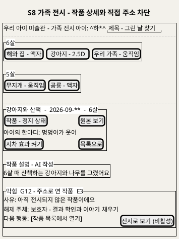

**[「S8 가족 전시 - 작품 상세와 직접 주소 차단」 PlantUML 뷰어로 열기](https://plantuml.sumzip.com/plantuml/svg/eNpVU11r2mAUvs-vOLibzaG0lpbNq-6jHbveZVFwaxmlVofaKyf4kQ5bHdNh2mjfSKRdtUVYrBnLQPaDck7-w84bo0PIRfJy3ufzZDtfSOUKJ8dpJX90mPmUyqWO4X3qw9HHXPYks_8qm87m4NHuxu76zkulcFhIH8C7Z-BaZRpMgEyVGgIiQP22970OVKuQ6lC3DDSskNkGup7RlyaQNcLGSMmn0gWl-FQpAvUsvB0DaSoZNuBPh-qma5cZaRX5czASh6Sn6eEkH4TIFHh_J0d_O3hrAVZNJvjrOhaEoKREo0oxGdqiqh1SAPY8zZ7raUuZ2oD6rQSj7LmWJqGHkjMW3XztHwayAg08f1WWRvpqQilJ1M0FKo5tvupaYmXIx53-wuvBfy5loWhJ6MupWjQ5BR6D2FpsK7L2PBIO-59L4UGkDGRqUiZn69XEXOZVC6cO4NRm0wkenodEhg6eJnBYx04nDnj3lR8-ZzssskYXto_bEFwHeL2RO50BzYTEkKgcKg4MEjMciMDvolb1Bu9PWcqLt7JpUidSoVQKqDUDM9wPnndgxSZWdU4Kf8z8rkyHJVCvM8fG4ZnX1wHerMekSX9RmBno0lqsE-xsSCKqjkmYcd_lsBKsBrZ0PxXtnIxycEFmcNmSDACyd1P4uA-8PpyVpztciNybB0ta97oaGY4fAt_TZnKBaKLyDvAbI2DjhowmeBdn-K0bXxYSxMQ8qhRrL-ILZLGDeS_wGP-oXldwWk9knCVl-yCzL_-zf5G11xg=)** — 클릭 시 브라우저로 연결됩니다.

### 11-2 영역별 설계

| 영역 | 내용 | 데이터 바인딩 | UX 의도 |
|---|---|---|---|
| 헤더 | 아이 선택 · 제목·그린 날 찾기 | 5.1 Output 아이 목록 | UC6 A6 · A7 |
| 연령 묶음 | 나이별 묶음, 묶음 안 제작일 순, 결과 종류 같은 크기, 낮춤 배지 없음 | 5.2 Output 정지 상태 목록(H11) | UX1 · UX3 · BR-EXH-02 · BR-EXH-04 |
| 작품 상세 | 정지 결과 · 원본 보기 · 한마디 먼저 · 토글 | 5.3 · 5.4 · 5.5 Output | UX4 (C5) · UX5 (C7) |
| 작품 설명 | AI 작성 칸(승인된 것만) | H10 | UX5 |
| 차단 블록 | G12(직접 주소로 연 미전시 작품) · G17(3D 노출 전) · G0(다른 가족) | 5.2 · 5.3 Output | UX6 · UX1 |

### 11-3 상호작용

| 조작 | 동작 | 근거 |
|---|---|---|
| 아이 고르기 | 그 아이의 전시 중 작품만 | UC6 BF2 |
| 작품 고르기 | 정지 상태 결과 + 이야기 | UC6 BF3 |
| 재생·시차·회전 | 누를 때만 | UC6 BF4 · A1~A3 |
| 원본 보기 | 원본으로 전환, 다시 결과로 | UC6 BF5 · A4 |
| 목록으로 | 자동 넘김 없이 묶음 목록 | UC6 BF6 |
| 전시 작품 없음 | 빈 전시와 "작품 올리기" | UC6 A8 |

### 11-4 상태 전이

`목록` → (작품) → `상세(정지)` → (토글) → `재생 중` → (토글) → `상세(정지)` · `상세` ↔ `원본 보기` · 파일 못 읽음 → `장애 표시`(이야기만, 다시 불러오기) · 직접 주소 조건 미충족 → `차단(G12)` · 삭제됨 → `종결`("더 이상 없는 작품이에요").

---

## 12. S9 삭제 확인과 진행

### 12-1 와이어프레임

```plantuml
@startuml
skinparam backgroundColor #F3F1EB
title S9 삭제 확인과 진행 - 멈춤 대기 G19
salt
{+
{ 우리 아이 미술관 - 보호자 | 작품: 우리 가족 | [작품 목록] }
..
{ 진행: [삭제 중] - 이 작품의 모든 조작이 잠겼어요 }
..
{^"되돌릴 수 없어요 - 지워지는 것"
  원본 사진 - 잘라 낸 그림 - 깊이 정보 - 결과물
  이야기 - 작품 설명 - 임시 파일
  통계용 숫자만 남고 누구의 작품인지는 남지 않아요
  [삭제] | [취소]
}
{^"보류  G19 - 만들던 작업이 멈추기를 기다려요"
  사유: 입체 부조를 만들던 작업을 멈추는 중이에요
  해제 주체: 시스템 - 멈춤 확인 또는 시간 상한
  다음 행동: 기다리지 않아도 돼요 | [목록으로]
}
{^"이 작품의 조작"
  [결과 확인 (비활성) - 삭제 중] | [이야기 쓰기 (비활성) - 삭제 중] | [설명 초안 (비활성) - 삭제 중]
}
{^"막힘  G18 - 삭제를 시작하지 못함  E5"
  사유: 삭제되지 않았어요 - 아무것도 바뀌지 않았어요
  해제 주체: 보호자 - 다시 요청
  다음 행동: [다시 삭제하기]
}
}
@enduml
```

**[「S9 삭제 확인과 진행 - 멈춤 대기 G19」 PlantUML 뷰어로 열기](https://plantuml.sumzip.com/plantuml/svg/eNp9lF9P02AUxu_7KU7wRmMgIcZEuCIY8AN4SWYyhRjCADPGFZJM6EjZajZkhTLapYtlGzhi2QqU2E_Uc_odPO_bjolEb9b1PX_e5_yes81sFLL5wuZqTtlYWV77lM1nV-F99sPKx_z65tri6_Xceh6ezL-Yn5ybVQrLhdwSvJ0C2rkkx4L4xCA7iAYhUEeNj_ZhHPBcoxsXUC9GgQdvJqeUjWyuoGw9V7aAGh62e0CGSrYP-DMgzYn8oqga-LEZULMGn4GaB_E3bXqYHXlFal3x-UISALw4x5adgW1lYkI0lTdPczjRRO5BhjuKG5ICsk2u6eKhA9Ty-CwJOVE_pCOfGvW007sxrJlY1bHNYc0EOt5L49ytU6RTnT-xXIeovzumANBpDQcBo-ixBJHTNNEOAXcCiG4DbId8Ft2V5W2OwROK977HtLAXinrbJyMUlMZTpUCqixcl-a5ShfnqOtkiN967jgYqNc5Z2Q_GhB2dL-pGAwdQU6PrnhhyOG6Q6uQE_sa4y4J4o859UkgZifO2S3t6RtmWow98PDNBGCbs6Oh46OJX2ZOOS9IuYWyd5eJZCOJRcdFxua1kwRAshz1rlqjPuTfsmUx83ElNOwmF7JWgcFxL1MWGLx38HnITblaxqOzGJWu0VsnCAZo1WV6xIk8F2v0SGxbXsySydeB1wOrJ9FBkuzeigFW-vhoKU5lAsklkhdiyUg4P1ybZFzHgQuLcUMBTvFPjE4vUq2fCrT82T4C9N5YOPfH4f3biOfkaGdq_U1ObOvtxU9r06j4sMAtUrNowxah48Ss2ugBzLx9YkyTXzHsa5mi9mUzP572WfLw6FvW_sx7bM_rNjkvyvK-cR_3Lx04sDONSA8tkKmKibWVmaW1R_Pf8Bv-JkRw=)** — 클릭 시 브라우저로 연결됩니다.

### 12-2 영역별 설계

| 영역 | 내용 | 데이터 바인딩 | UX 의도 |
|---|---|---|---|
| 진행 레일 | 종결 변형 `삭제 중` | 6.3 Output | UX6 |
| 확인 | 지워지는 것 목록, 남는 것(통계 숫자), 되돌릴 수 없음. 아이 삭제면 작품 수 | 6.1 Output 안내 | 비가역 행동의 확인(UC7 A3) |
| 보류 블록 | G19 멈춤 대기 — 기다리지 않아도 됨 | 6.4 Output 멈춤 확인 대기 | UX6 · UX7 |
| 잠긴 조작 | 결과 확인 · 이야기 · 설명 버튼 비활성 "삭제 중" | 6.3 Output 상태(BR-DEL-05) | UX6 |
| 차단 블록 | G18 삭제 착수 실패 · G0 권한 없음 | 6.3 · 6.1 Output | UX6 |

### 12-3 상호작용

| 조작 | 동작 | 근거 |
|---|---|---|
| 삭제 | `DELETE`. 즉시 목록·전시에서 사라짐, 202. 대화상자를 열어 둔 동안 `GET /v1/artworks/{id}/deletion`(아이는 `GET /v1/children/{id}/deletion`)을 폴링해 `waiting_stop`(G19 보류) → `deleting_files` → `done`을 보인다. 끝내 실패한 파일(삭제 미완료)도 보호자에게는 `done`이다(S10 집계, 운영 CLI로 처리) | UC7 BF2 · D21 |
| 취소 | 아무것도 바뀌지 않음 | UC7 A3 |
| 목록으로 | 기다리지 않고 S4로. 삭제는 계속 | UC7 BF3 · BF4 |
| 다시 삭제하기 | G18 실패 뒤 재요청 | UC7 E5 |

### 12-4 상태 전이

`확인` → (삭제) → `착수 중` → `삭제 중` 또는 `차단(G18)` · `삭제 중` → (실행 중 작업 있음) → `보류(G19)` → (멈춤 확인·시간 상한) → `파일 삭제 중` → `삭제 완료`("삭제했어요"). 끝내 실패한 파일은 화면에 보이지 않고 "삭제 미완료"로 S10에만 집계된다(§18).

---

## 13. S10 서비스 상태와 모델별 지표

### 13-1 와이어프레임

```plantuml
@startuml
skinparam backgroundColor #F3F1EB
title S10 서비스 상태와 모델별 지표 - 서비스 운영자 뷰
salt
{+
{ 운영 화면 | 역할: 서비스 운영자 | jo*@su*.kr | [모델 평가] | [API활용] }
..
{ 생존: 응답함 | 준비: 일부 모델 미준비 | 기간: ^최근 7일^ }
..
{^"준비 - 모델별"
{# 모델 | 서빙군 | 상태 | 영향
  M1 분리 | CPU 비전 | 준비됨 | .
  M2 판정 | CPU 비전 | 비활성 - 라이선스 확인 전 | 제안 없이 확정
  M3 관절 | CPU 비전 | 미준비 | 움직임 - 액자 경로는 동작
  M5 깊이 | GPU | CPU 실행 | 처리 시간 증가
  M6 설명 | LLM | 비활성 - P0.5 | .
  M7 3D | GPU | 비노출 - P1 | .
}
}
{^"지표 - 정의와 검증 계획이며 실적 아님"
{# 지표 | 값
  첫 결과 승인율 | 0.**
  판정 수정률 | 0.**
  결과 미도달 수 - 목표 0 | *
  삭제 미완료 수 | *
}
}
{/ <b>모델별 | 원인 5분류 | 결과 미도달 추적 }
{# 단계 작업 번호 | 모델 버전 | 오류 분류 | 시도
  J-****1 | M3 v* | 엔진 다운 | 3
}
{^"미도달 건의 이미지 - 구조적 차단"
  운영 화면에는 가족 사진과 이야기로 가는 경로가 없어요
}
}
@enduml
```

**[「S10 서비스 상태와 모델별 지표 - 서비스 운영자 뷰」 PlantUML 뷰어로 열기](https://plantuml.sumzip.com/plantuml/svg/eNptVF1PGlEQfd9fMdE3GimUWJOmaWxtbdpoQtL0qdEEq2msKA1gX8RkqWuDoBEaVoEuZklRwGK6IiAm9A_tnf0Pnbl8GS08sHvvuWfmnDmX6Ug0EI5urgeVyNrqxpdAOLAOS4GPa5_Coc2N5ZlQMBSG8VnfrPfVCyW6Gg2uwDuvB1AzxI2GyTLgTtzZMTCvgjivioOOuNIAK6qTMWDiNqzQxFwcT9Igri0lEghGla0HylZ_HZx8VtSaEAM8vnB088l_T8bgc8g1Hdl0udfC9PKhVxCcwz3bUhd45bn_jZM3sFBbgG3F7Wb-nSKWmsRXzIhUy9GrXKOsEjevdUV70DeIP53eBiHsjmVbhFjElmFfd2GKoIt9ysWxPmxipHhM2Rof8MR6veftlsXP0h5-yMWdo1MFYN4Loq2JszotzvjfA8s0tWFbIs0tuhn4CJz9NJr6XSA9sErtklsodrHYRM1kq5y8jsUO9OlMA_UEGfqdAHLL1JnVB3ZTRTNxj_WWfvypYoU8Z5Gol9h8u_FXlAyRzII4zONJhqkmwb5JMnsMXhNVjxBTZedoj0kaOVaJKYO8BDwr0pT41GMyqCzOdwkyNzd_R4_f454c6J8C38shNVuz28E2x8rvlZBt-vI4hmkzSX6Oo2g3VKoH9pXmFA6oQVGzuC804yRHE6mcHFj_II3b-kH1sPGbDlr2VRcweUNGosGj8LhdLtrtjwITOfoRp-Zop3-G_BOHxF1njAxHjdk9BGQUfrugiUiX85r4tS9RvCVVPISnS89GF4gnkOZRTnJUThl4v0o7y3q2ZfRSVZvv3UkGj3dBNBJOjoM4SHZjkLBcmcmGnDQaIqPm3k646MOuUjy-uuQ9zGJFI-Iy3T969_W8HpW3L5tkNrC5JKmikmK7VceSJU22qtTSGMu-fb_xOM0Bohxg6ZIcqVMJaTclWO_SpaOE8a4EybzRi0zwURMLWWnV9MrGMv9b_QNbpHfU)** — 클릭 시 브라우저로 연결됩니다.

### 13-2 영역별 설계

| 영역 | 내용 | 데이터 바인딩 | UX 의도 |
|---|---|---|---|
| 헤더 | 역할 · 계정(가림) · 역할별 메뉴 표(§2-1)의 메뉴 | 7.1 Output · `GET /v1/ops/me` | UX8 (C9) |
| 요약 행 | 생존 · 준비 · 기간 | 7.2 · 7.3 Output | 운영 화면의 고정 레일 |
| 준비 - 모델별 | 모델 · 서빙군 · 상태 칩 · 영향 경로 · 마지막 점검(통과/실패·시각, D20 — 읽기만, 점검 실행은 S11) | 7.3 Output 모델별 준비·활성 버전 · H14 · H18 | UX8 (C10) |
| 지표 | 첫 결과 승인율 · 판정 수정률 · 결과 미도달(목표 0) · 삭제 미완료 · 설명 규칙 검사 실패율(P0.5) — "정의와 검증 계획이며 실적 아님" | 7.4 Output (H13) | BR-OPS-02 |
| 탭 | 모델별(낮춤률 · p95 · 재시도율 · 큐 적체 · 외부 호출량·한도 초과) · 원인 5분류 · 결과 미도달 추적(단계 작업 번호 기준, **운영자에게만 그림**) | 7.5 · 7.6 · 7.7 Output | UX3 · UX8 |
| 구조적 차단 안내 | 가족 이미지·이야기로 가는 경로 없음 | — (BR-ACC-03) | UX8 |

### 13-3 상호작용

| 조작 | 동작 | 근거 |
|---|---|---|
| 기간 선택 | 지표 다시 계산. 분모 0이면 "해당 없음" | UC8 BF4 · A6 |
| 탭 전환 | 모델별 · 원인 5분류 · 미도달 추적 | UC8 BF5~7 |
| 미도달 행 | 단계 작업 번호·모델 버전·오류 분류·시도만. 행을 눌러도 이미지 없음 | UC8 BF7 · E2 |
| API활용 | S12로 | UC11 A4 |

### 13-4 상태 전이

`역할 확인` → `운영 화면` 또는 `차단(G1)`(역할 없음, 화면 거부) · `운영 화면` → (지표 요청) → `지표 표시` 또는 `장애 표시`(작업 DB 장애 E1, 게이트 아님) · 준비 확인 무응답 서빙군은 칩 `확인 불가`(E5).

---

## 14. S11 모델 평가와 승격

### 14-1 와이어프레임

```plantuml
@startuml
skinparam backgroundColor #F3F1EB
title S11 모델 평가와 승격 - 평가 담당 뷰
salt
{+
{ 운영 화면 | 역할: 평가 담당 | jo*@su*.kr | [상태-지표] }
..
{# 모델 | 활성 | 롤백 후보 | 후보 | 라이선스 | 해시
  M1 BiRefNet | v1 | 없음 | v2 | 확인 | 일치
  M2 OpenCLIP | 없음 | 없음 | v1 | 확인 전 | 일치
  M3 Animated Drawings | v1 | 없음 | . | 확인 | 일치
}
..
{^"모델 상태 - 2초마다 갱신 - 예시 값"
{# 모델 | 장치 | 적재 | 대기 | 마지막 점검 | 동작
  M1 BiRefNet | CPU | 준비됨 - 마지막 적재 **초 | 0 | 통과 - 1.*초 - **분 전 | [점검]
  M3 Animated Drawings | CPU | 불러오는 중 42초 - 남은 약 20초 | 2 | 점검 중 | [점검 (비활성) - 점검 중이에요]
  M5 Depth Anything | MPS | 적재 실패 - 60초마다 다시 시도 | 1 | 실패 - 모델 미준비 | [지금 불러오기] [점검]
  M6 Qwen3-4B | Ollama | 내려감 짐작 - 첫 요청 때 올라가요 | 0 | P0.5부터 | .
}
}
{^"막힘  G30 - 점검 입력"
  사유: M7을 점검할 입체 작품 사진이 평가 묶음에 없어요
  해제 주체: 평가 담당 - 평가 묶음에 입체 작품 등록
  다음 행동: [평가 항목 등록] | [점검 (비활성) - 점검할 사진이 없어요]
}
..
{^"M1 후보 v2 평가"
  평가 묶음: 사람 - 비인물 - 촬영 조건 - 입체 | 팀원 제작 작품만
  진행: 42 / 44 완료 - 평가 미완료 2 - 인프라 소진
  [평가 요청] | [보고서 열기] | [판단 기록]
}
{^"막힘  G22 - 전체 재평가 미완료  E6"
  사유: 평가 미완료 항목 2건이 있어 승격 근거가 되지 않아요
  해제 주체: 평가 담당 - 미완료 항목 재평가
  다음 행동: [미완료 항목 다시 평가] | [승격 (비활성) - 미완료 2건]
}
{^"롤백 - 해제 주체 없음  E8"
  사유: 첫 버전이라 되돌릴 후보가 없어요
  다음 조치는 정해지지 않았어요 - 미해결
  [롤백 (비활성) - 롤백 후보 없음]
}
}
@enduml
```

**[「S11 모델 평가와 승격 - 평가 담당 뷰」 PlantUML 뷰어로 열기](https://plantuml.sumzip.com/plantuml/svg/eNqNVV1PG1cQffevGJGXlsqubQiteKIQUlUqDWnUJ-RKbnETF2OQbRpVEMmQDTJ4K0xqB0Nsd1GcLqRGXZstsSX6h_bO_ofO3Lv-wlTtg-Xdu_NxzpkzuzPpTDSV2VhN-NIr8eR6NBVdhe-i3688Tq1tJJfn1hJrKbhzf-J-aH7Wl4lnEjF4FAqBeHcmfmmDe7DnWFk8zgLud5zWOfi9IxB5W-Q7IN5bvnQ0kfFtfuTbBDyxsbwN7nFRnNuwBXh04ZaM6Rs5W_Dj2vhMemM8sJKimyV8vu0-r_jRzLqHlQg88wUCvs07XQhbVK6CWpMuxGldWE1wX2viksv3LkT1Gqs2agbu1_m8ZGO-4gNYCMFs_OvYD1_FMnT8U0hC2sWqzndhWbqEVe6BVKFT5pQwPFiPJee-_GJxMLqfFuqnoaENpU7AZ8n4ajQTW4Z7qejTePJxeqRt4JauivG3Yx5jpQdJHUY7J8ycyNfBsZqYN-gMyzniRvcvx4ZEwtpbKsUXxjbWGiyKnnXaFl-YOdJWmHv0rOC0snx0cIy1wxGF5ha_4Qr1rOhoonBG7QZzZd3xcQJFQUHmsfuXc3lNUaGAPPXTU3GlebosqW6Rf1dGtRNXOfFbA8t1sV-k3ocwGVbFxM4ZVsl5pb8hHFRdw5KgJMGRvSbwASFWPvmQReqFsC2OCnhSlDDuwr3YeuYJgfk584RAUIGFxUd90TBfd3WmPRXsS08_Vpx-4oB5yXF2Az39xZ9tpZqEZJLwuT4vmkJkSI0pePg0lpzwT85S-INEIroaZR12bGHUHasAaBZoOsyj9QftVBFbFyBKOs2-QU7nhTwpeiNYDAbuiqusq_GgA-SkZ9JI5p5bKwN8PhEcUKP2QhhvxwgA7jSwQmu58AlWNe8x7SlHYMumv0P3ZU5GmRoJ2FvfxhV5mOSUbn5lEwoqxstmkDxvrin35qr7b8kdaiJ-bYrTKpVhlWlB3Fd75M1pWPLy3NKFeHfuhUX-Y-CSQw91D2Skt2Dkdu-dQduvOrAeQxinuYSo6TzcDhVqiwZbHO0Gv9rw1HKaNt8rGrQEehZfEy2jwjNTtISps8ymRnSmyc_wMUxOAh5r4o0-oAmZRh2FuWC17RY1mi_grk6pVKArgrKAZE_YnUsDNRL8yJbGokNXL4j8GdAti3TDAmFZ3NCU6I2R3jA_NeiJkefeBMJEW6pay5Gq3c-B8_7aaVoyoVAm39Oy7mNJ-1_OGGnRQ3eLHUaCva1UCcoYCtKwMQY0JgJdbdR3xD-MsPuOhvlPBwXhHRQtjRWs2jweYioOdPG77XlJTmhgITzo5BR6Ict3mlHiRma2J1BZBSt89MxpWTxuD9cNBkMfPYUxIhd9JpZcpu_6PxnIK8M=)** — 클릭 시 브라우저로 연결됩니다.

### 14-2 영역별 설계

| 영역 | 내용 | 데이터 바인딩 | UX 의도 |
|---|---|---|---|
| 헤더 | 역할 평가 담당 | 8.1 Output | UX8 |
| 매니페스트 표 | 모델 · 활성 · 롤백 후보 · 후보 · 라이선스 · 해시 일치 (D16 채택 5종 + M7 P1) | 8.2 Output 매니페스트 | UX8 (C10) |
| 모델 상태 표 | 모델 · 활성 버전 · 장치(`execDevice`/`runtime`, MPS 표기) · 적재(C10 칩, 불러오는 중이면 경과/예상 막대, 마지막 적재 초, M6는 내려갈 시각) · 대기(M6 `queue`, 그 밖은 `queue_backlog`) · **마지막 점검**(통과/실패 사유 · 처리 시간 · 끝난 지 얼마, 점검 중이면 "점검 중", 점수 없음 — D20) · 동작. 2초 폴링, 화면이 안 보이면 멈춤 [추론]. **운영자 · 평가 담당 · 연동 개발이 읽고, 지금 불러오기는 운영자 · 평가 담당만** | `GET /v1/ops/models`(T143 · T109) | UX8 (C10) · UX6 |
| 평가 진행 | 평가 묶음 구성(팀원 제작만) · 완료/전체 · 평가 미완료 수. 새로 고친 뒤에도 버전의 가장 최근 평가 기록으로 이어 간다 | 8.3 · 8.4 Output · `GET /v1/admin/models`의 `versions[].latestEvalRunId` → `GET /v1/admin/eval-runs/{id}`(2026-09-29 계약 보완) | G20 · UX6 |
| 차단 블록 | G20 항목 등록 · G21 착수(해시·격리) · G22 승격(미완료·라이선스·계약) · G30 점검 입력(맞는 평가 묶음 사진 없음 · 폐기 버전) | 8.3 · 8.7 · 7.8 Output | UX6 |
| 모델 점검(D20) | 행의 [점검]은 모델 하나를 평가 묶음 사진 한 장으로 돌려 본다. 버전·사진은 고르지 않으면 서버가 정한다(활성, 없으면 가장 최근 후보). 평가 담당은 후보 버전 행에서도 점검할 수 있다(UC9 A7). 결과는 행의 "마지막 점검" 칸에 폴링으로 바뀐다. **점검 통과는 승격 근거가 아니다** — 승격 버튼의 조건(G22)과 섞지 않는다 | `POST /v1/ops/models/{id}/check` · `GET /v1/ops/model-checks/{id}` · `GET /v1/ops/model-checks`(최근) · 7.8~7.10 Output | UX6 · UX8 |
| 롤백 · 비활성화 | 직전 활성 후보가 있으면 **롤백**. 없으면 롤백 버튼은 C3 "(비활성) - 되돌릴 후보가 없어요"이고 대신 **비활성화**를 준다(clarify 확정). 비활성은 "미준비"(장애)와 다른 칩(사선)으로 보이고, 새 버전 승격 때 다시 활성 | 8.8 Output · `POST /v1/admin/models/{id}/rollback` · `…/deactivate` | UX6 |
| 역할 | 평가 담당만 조작. 운영자·연동 개발은 같은 화면을 읽기 전용으로 보고 조작 버튼을 그리지 않는다(지금 불러오기는 운영자도 조작) | §2-1 역할별 메뉴 표 | UX8 |

### 14-3 상호작용

| 조작 | 동작 | 근거 |
|---|---|---|
| 지금 불러오기 | M1 · M2 · M3 · M5 · M7이 `미준비`·`적재 실패`일 때만 보인다. `POST /v1/ops/models/{id}/warmup`(202) 뒤 결과는 폴링으로 본다. M6에는 버튼 없이 "첫 요청 때 올라가요"(공유 Ollama는 기동 때 1회만 미리 올림, 요청하면 409 `m6_preload_at_start_only`). 연동 개발 역할에는 버튼을 그리지 않는다(C9) | T143 · A §3.2 |
| 점검 | M1 · M2 · M3 · M5 · M7 행에만 보인다(M4 규칙은 없음, M6은 P0.5부터). `POST /v1/ops/models/{id}/check`(202) 뒤 3→6→10초 폴링(R-12), 끝나면 "마지막 점검" 칸을 바꾼다. 점검 중이면 C3 "(비활성) - 점검 중이에요"(409 `check_in_progress`). 맞는 평가 묶음 사진이 없으면 C2 G30(해제 주체 평가 담당). serving 점검 실행기가 아직 없으면 503 `check_runner_missing` → C2 "점검을 아직 쓸 수 없어요". 연동 개발 역할에는 버튼을 그리지 않는다 | UC8 A8 · E7 · UC9 A7 · D20 |
| 평가 요청 | 해시·격리 확인 뒤 항목별 작업 등록(202) | UC9 BF3 |
| 보고서 열기 | 불일치 · 오인 후보 · 시간 · 메모리를 활성 버전과 나란히 | UC9 BF5 |
| 판단 기록 | 오인 분류 · 통과 판단 · 근거 | UC9 BF6 · A2(보류) |
| 승격 | G22 통과 시에만 활성. 직전 활성은 롤백 후보로 | UC9 BF7 · D5 |
| 롤백 | S10 지표를 근거로. 재평가 없이 즉시 | UC9 A1 |
| 비활성화 | 롤백 후보가 없는 첫 버전 문제일 때. 확인 창("이 모델이 필요한 선택지가 보호자 화면에서 막혀요") 뒤 실행. 대기 중인 작업은 모델 미준비 규칙을 따른다 | UC9 E8 · clarify 2026-09-28 |

### 14-4 상태 전이

모델 상태: `미준비`/`적재 실패` → (지금 불러오기) → `불러오는 중` → `준비됨` 또는 `적재 실패`(60초마다 재시도) · M6 `준비됨` → (5분 요청 없음) → `내려감 짐작` → (첫 요청) → `불러오는 중`. 모델 점검(D20): `점검 없음`/`통과`/`실패` → (점검) → `점검 대기` → `점검 중` → `통과` 또는 `실패`(오류 분류·출력 형식 불량) · `점검 대기`가 15분 넘으면 `실패`(모델 미준비) · (점검) → `차단(G30)`. 평가: `목록` → (평가 요청) → `착수 검사` → `평가 중` 또는 `차단(G21)` · `평가 중` → `보고서` → (판단) → `판단 기록됨` → (승격) → `활성` 또는 `차단(G22)` · `활성` → (롤백) → `되돌림` · `활성`(후보 없음) → (비활성화) → `비활성` → (새 버전 승격) → `활성`.

---

## 15. S12 API활용 메뉴

### 15-1 와이어프레임

```plantuml
@startuml
skinparam backgroundColor #F3F1EB
title S12 API활용 메뉴 - 시험 호출 차단 상태
salt
{+
{ 운영 화면 | 역할: 연동 개발 | jo*@su*.kr | [상태-지표] | [모델 평가(읽기)] }
..
{/ <b>엔드포인트 | 가이드라인 | 매뉴얼 }
..
{# 묶음 | 경로 | 구간
  보호자 앱 | /v1/artworks | P0
  운영 | /ready 모델별 | P0
  모델 기능 | /v1/models/segment | P0
  모델 기능 | /v1/models/pose | P0 팀 내부 키
  모델 기능 | /v1/models/caption | P0.5 예정
}
{ 문서 버전 v1 - 명세 v1 - 매니페스트 일치 | [openapi.json 다시 읽기] }
..
{^"시험 호출 - classify"
  입력: ^평가 묶음 작품 E-***^ | 키: 팀 시험 키 ****
}
{^"막힘  G25 - M2 비활성 - 라이선스 확인 전"
  사유: classify 모델이 아직 활성화되지 않았어요
  해제 주체: 평가 담당 - 라이선스 확인 뒤 승격
  다음 행동: [다른 기능 고르기] | [시험 호출 (비활성) - 모델 비활성]
}
{^"응답 - H16"
  결과 분류 - 모델 ID 버전 - 처리 시간 - 오류 분류 | 결과는 가족 저장소에 쓰지 않아요
}
}
@enduml
```

**[「S12 API활용 메뉴 - 시험 호출 차단 상태」 PlantUML 뷰어로 열기](https://plantuml.sumzip.com/plantuml/svg/eNqNVFtPGlEQft9fMdEXpRGKjX0gTWMv2vrQxKSPjSSrUoMCS1i0MWqCujYCtt5AVrMQTKGKocmKq4EE_9DOnP_QOVxsfGjT7MPumTMzZ77L2XE9qSaSy9GIoi-FY3E1oUZhVp1bWkhoy7H5N1pES8Dg5LNJ_8RrJRlORkLw0T8Kr6anxKlFZzXAWg7TDowAZS1RMEGYTbqzgOxLzF4CbW-KbUvR1UhSWXuirAGdOWRugjjNYc2BdaDCL5EvB_ht4_4puLaFtsXxRc0zri97vEsJXnzqthmhi5Q4tGZkBK8u8VsTxH7atVNDVLx3m_bwDGwoXq-y5oMXsy-pkMNjS-zXqdgUmSYXcSYVHQ5isc1BjuBFhYenk3avcBCwfkfFPZncuMdzOYl7W3dtQwHAG0eCKx0A5a95w7fi9zF1X7TEks7L6aec04PHm4mQOr8K3THxxugn9ObmaTFT7TWJavOhiO7TQwvRUCz5H5lxTQ910kDspQC3HLxLgdiq_LtqTo0nw1qsU-gdAzJ3qZxXNlgUrDfJsAAbBpUNWPGzmni1Q0az980sZXfFd5MyFckkMX0tU6qgxUMxNR72LurcF7MV9gB0tehLERx47IsRmIuouh7-vDog6SrtYLkagGBXxz77VDoUR7swMeLxeIJ8DkMLdKD2e21VgLc8cvjgAF6kRckEeDc6xu0_jAK2DGlO41rOLqV2yCjz7Oy6vNSdQXYO36qTxdbrD9TjjtNZYIMupEtlF-nVA5O9x-EM5U06cegsxw1E3qEyA_7RpoYTgD6GrIPZ1l-OxqMKUKblNmpSKyaM0YqTNFs_wJ7OVrD6oJ17U8aq06FS3oBHLA49QBzuaNXR_CE20-WFioeYveX99_7nEq_bsN2bNuCdgVXzT9nU277wfIcbJv6sS5rZ8nJtVmRur2S91wIzuc5dOr9mKlNUqtLXPSrwtTi2H1gyJEUb_IyHYvPy7_IbOZZGBQ==)** — 클릭 시 브라우저로 연결됩니다.

### 15-2 영역별 설계

| 영역 | 내용 | 데이터 바인딩 | UX 의도 |
|---|---|---|---|
| 헤더 | 역할(운영자 · 연동 개발) | 9.1 Output | UX8 |
| 탭 | 엔드포인트 · 가이드라인 · 매뉴얼 | 9.2 · 9.5 · 9.6 Output | BR-API-07 |
| 엔드포인트 표 | 묶음 · 경로 · 구간. P0 네 기능(`pose`는 팀 내부 키), `caption`은 "P0.5 예정"(D17) | 9.2 Output(`/openapi.json`) | BR-API-08 |
| 버전 대조 행 | 문서 · 명세 · 매니페스트 일치 여부, 불일치면 경고(차단 아님) | 9.4 Output · H14 | UC11 E3 |
| 시험 호출 | 평가 묶음 작품 선택 · 팀 시험 키 · 호출 | 9.7 Input · H15 | BR-API-09 |
| 차단 블록 | G23(평가 묶음 밖·라이선스 미확인) · G25(모델 비활성·미준비) · G24(크기·형식) · G2(키) | 9.7 · 10.1~10.3 Output | UX6 |
| 응답 | 결과 분류 · 모델 ID·버전 · 처리 시간 · 오류 분류. 가족 저장소에 쓰지 않음 | H16 (10.6 · 10.7 Output) | P10 계약의 사람 쪽 창 |

### 15-3 상호작용

| 조작 | 동작 | 근거 |
|---|---|---|
| 탭 전환 | 엔드포인트 · 가이드라인 · 매뉴얼 | UC11 BF2~6 |
| openapi.json 다시 읽기 | 서버 무응답이면 마지막 확인 명세와 시각 표시 | UC11 E2 |
| 시험 호출 | 평가 묶음 작품만 고를 수 있는 드롭다운(파일 업로드 칸 없음 [추론]) | UC11 A1 · E4 |
| 매뉴얼의 교체·상태 링크 | S11 · S10으로 | UC11 A4 · A5 |

### 15-4 상태 전이

`역할 확인` → `메뉴` 또는 `차단(G1)` · `엔드포인트` → (시험 호출) → `호출 가능` / `차단(G23·G25)` → (호출) → `대기(queued·running)` → `응답(done·failed)`. 명세 못 읽음 → `장애 표시(마지막 명세)`.

---

## 16. 게이트 맵 → 화면 표현 사상

SD_01 §15의 게이트 **31개 전건**(G0~G30)이다. 모든 게이트가 하나 이상의 버튼을 비활성화한다.

| 게이트 | 화면 | UI 표현 | 비활성화 대상 | 해제 액션 |
|:--:|---|---|---|---|
| G0 가족 접근 | S1~S9 전부 | 세션 없음 → 로그인으로 이동. 다른 가족 자료 → "찾을 수 없어요"(존재 비노출) C2 | 해당 화면의 모든 조작 버튼(S9는 삭제) | 보호자: 다시 로그인 |
| G1 팀원 역할 | S10 · S11 · S12 | 역할 없는 메뉴는 헤더에 그리지 않음. 주소로 오면 C2 "이 화면을 볼 역할이 없어요" | 화면 전체 조작 | 역할을 가진 계정으로 다시 로그인(역할 부여 요청 채널 없음, §18) |
| G2 API 키·한도 | S12 시험 호출(사람 쪽 창) · P10 응답 | 401/403/429 응답을 C2로 표시. `pose`에 팀 밖 키면 403 | 시험 호출 버튼(키 없음) | 연동 개발: 유효한 시험 키로 다시 / 한도 창 뒤 |
| G3 기록 반영 | S1 · S5 · S6 | C2 "저장되지 않았어요/반영되지 않았어요", 입력값 유지 | 다음 단계 이동 버튼(작품 올리기로 · 이야기로 · 전시 보기) | 보호자: 다시 저장 |
| G4 별칭 검사 | S1 | C2 + C3 | 저장 | 보호자: 별칭 고치기 |
| G5 사진 검사 | S2 | C2(형식·용량·판독 사유) | 올리기 | 보호자: 다른 사진 고르기 |
| G6 내구 접수 | S2 | C2 "접수되지 않았어요" | S3로 가는 진행(접수 완료 화면이 뜨지 않음) · 올리기는 다시 활성 | 보호자: 다시 올리기 |
| G7 판정 제안 도달 | S3 · S4(배지) | 제안 칸을 "제안을 준비하지 못했어요"로, C2 | 확정하기(선택 전) | 보호자: 셋 중 직접 고르기 |
| G8 확정 가능 상태 | S3 | C2 "이미 만들기 시작했어요/삭제 중이에요" + 현재 상태. 비활성 모델 선택지는 409 `model_disabled` → C2 "지금은 이 방식을 쓸 수 없어요"(해제 주체 평가 담당) | 선택지 · 확정하기 | 보호자: S5에서 결정으로 바꾸기(삭제 중은 종결) |
| G9 결과 단계 소진 | S4 · S5 · C1 | 레일 막힘 변형 + C2 "서버 문제로 만들지 못했어요 - 낮춘 결과가 아니에요" | 좋아요 · 낮춘 결과로 걸기 | 보호자: 액자로 걸기 / 다시 찍기 |
| G10 결과 열람 | S5 | C5 칸 안 C2 | 미리보기 실패: 모든 결정 버튼 / 원본 실패: 액자로 걸기 | 보호자: 나중에 다시 열기 / 다시 찍기 |
| G11 이야기 값 | S6 | 필드 옆 사유 + C2. 동시 수정은 409 `story_conflict` C2 "다른 보호자가 먼저 고쳤어요" | 저장 | 보호자: 값 고치기 · 최신 내용 불러오기 |
| G12 전시 | S6 · S8 · C1 · C8 | 레일 전시 보류 변형 + C8 빠진 줄. S8 직접 주소는 C2 | S8 "전시로 보기" · S6 "전시 보기" | 보호자: 빠진 쪽 채우기(S5 결정 · S6 필수) |
| G13 설명 모델 조건 | S7 · S6 | C2(해제 주체 = 평가 담당) | AI 초안 만들기 | 보호자 대안: 기본 문장으로 받기 · 직접 쓰기. 해제는 평가 담당의 P8 승격(요청 채널 없음) |
| G14 설명 입력 | S7 | C3 사유 "키워드를 하나 이상 적거나 골라 주세요" | 초안 만들기 | 보호자: 키워드·태그 입력 |
| G15 LLM 초안 도달 | S7 | C2 선택지 셋 | 승인 · 다시 만들기(초안 없음) | 보호자: 기본 문장 / 나중에 / 직접 쓰기 |
| G16 규칙 검사 | S7 | 걸린 초안은 보이지 않음. 반복 실패면 C6 "기본 문장으로 바꿨어요" | 걸린 초안의 승인(초안 자체가 표시되지 않음) | 시스템 재생성 → 보호자: 템플릿 고치기 / 직접 쓰기 |
| G17 3D 노출 | S3 · S5 · S8 | 3D 선택지·회전 토글을 그리지 않음. 직접 주소는 C2 | 3D 조각 선택지 · 돌려 보기 | 노출 설정을 켜는 팀원(주체 미정, §18). 보호자 쪽 요청 채널 없음 |
| G18 삭제 착수 | S9 | C2 "삭제되지 않았어요" | 목록으로 가기 전 "삭제 완료" 표시 없음 · 잠금 해제 없음 | 보호자: 다시 삭제하기 |
| G19 처리 멈춤 (보류형) | S9 · C1 | C2 보류 변형(점선 테두리) | 이 작품의 결과 확인 · 이야기 · 설명 버튼 | 시스템(멈춤 확인·시간 상한). 보호자는 기다리지 않아도 됨 |
| G20 평가 항목 등록 | S11 | C2 "팀원이 만든 작품만 등록할 수 있어요" | 항목 등록 | 평가 담당: 조건 채워 다시 등록 |
| G21 평가 착수 | S11 | C2 해시 불일치 항목 · 열린 포트 | 평가 요청 | 평가 담당: 재설치·격리 조치 뒤 다시 요청 |
| G22 승격 | S11 | C2 미완료 수 · 라이선스 · 계약 불일치 | 승격 | 평가 담당: 미완료 재평가 · 라이선스 확인 · 어댑터 수정 |
| G23 시험 호출 입력 | S12 | 드롭다운에 평가 묶음 작품만. 비활성 모델은 C2 | 시험 호출 | 연동 개발: 평가 묶음에서 다시 고르기 |
| G24 요청 크기·형식 | S12 응답 · P10 | 413/422를 C2로 | 시험 호출(형식 오류 입력) | 연동 개발: 입력 고치기 |
| G25 외부 기능 준비 | S12 · C10 | 모델 칩 비활성·미준비 + C2 | 해당 기능의 시험 호출 | 해제 주체가 타인: 평가 담당(승격) · 운영자(서빙군 복구). 연동 개발은 다른 기능 고르기 |
| G26 이메일 검사(가입) | S0 | 형식·비밀번호 규칙은 필드 옆 사유 + C2. 이미 가입된 주소도 새 가입과 같은 "메일함을 확인해 주세요"(가입 여부 비노출). 요청 한도는 C2 | 가입하기 | 보호자: 값 고치기 · 로그인(S0a) · 찾기(S0b) |
| G27 메일 링크 토큰 | S0(확인) · S0b(재설정) | 400 `token_invalid` → C2 "링크를 쓸 수 없어요"(만료·사용·무효 구분 없음) | 확인 완료 표시 · 새 비밀번호 저장 | 보호자: 메일 다시 받기 |
| G28 초대 수락 | S1c | 400 `token_invalid` · 403 `forbidden_role`/`invite_email_mismatch` · 409 `already_in_family` → C2 | 수락하기 | 초대받은 사람: 올바른 이메일로 다시 로그인 · 다른 가족에서 나오기 · 새 초대 받기 |
| G30 점검 입력 (D20) | S11 | C2 "점검할 평가 묶음 사진이 없어요"(M7이면 "입체 작품 사진") · 폐기 버전 C2. 해제 주체 평가 담당을 이름으로 밝힘 | 해당 모델 행의 점검 | 평가 담당: 평가 묶음 항목 등록(G20). 운영자는 다른 버전·사진 고르기 |
| G29 보호자 관리 권한 | S1b | 초대·해제 버튼은 만든 보호자에게만 그림. 두 명 찬 뒤 초대는 C3 "보호자는 두 명까지예요"(409 `co_guardian_full`). 만든 보호자의 나가기는 C3 | 초대하기 · 해제 · (만든 보호자) 나가기 | 만든 보호자: 공동 보호자 해제. 만든 보호자의 탈퇴·이전은 U20 |

**사상 규칙**

1. **모든 게이트는 하나 이상의 버튼을 비활성화한다.** 위 표 "비활성화 대상"이 빈 행은 없다. 배너만 띄우고 진행되는 표현은 쓰지 않는다.
2. **비활성 버튼에는 이유가 붙는다.** 라벨 뒤 `(비활성) - 사유`와 hover·포커스 말풍선이 같은 문구다(C3).
3. **해제 주체가 현재 사용자가 아니면 해제 버튼을 두지 않는다.** 프롬프트는 이 경우 «요청 보내기»를 요구하지만, 이 프로젝트의 상류 문서(UC·SD_01)에는 보호자가 팀원에게, 팀원이 다른 팀원에게 요청을 보내는 기능이 없다. 기능을 지어내지 않으려고(근거 규율 4) **해제 주체를 C2에 이름으로 밝히고 현재 사용자가 할 수 있는 대안 행동만** 준다(G13 · G17 · G19 · G25 · G1). 요청 채널이 필요한지는 §18에 올렸다.
4. **두 화면에 걸치는 게이트는 문구를 같게 한다.** G9(S4 · S5): "서버 문제로 결과를 만들지 못했어요 - 낮춘 결과가 아니에요". G12(S6 · S8 · C1): "결과 확인과 제목·그린 날·나이가 갖춰지면 전시돼요". G7(S3 · S4): "제안을 준비하지 못했어요. 직접 골라 주세요". G19(S9 · C1): "만들던 작업이 멈추기를 기다리는 중이에요".
5. **게이트가 아닌 차단(SD_01 §15-2)은 게이트처럼 꾸미지 않는다.** 종결(`삭제 중`, 승인 설명 고정)은 C2 종결 변형, 구조적 차단(운영 화면의 가족 이미지, 외부 3D)은 경로를 그리지 않음, 장애 표시는 §17 전역 실패 규칙을 따른다. 롤백 후보 없음(E8)은 "해제 주체 없음"을 그대로 밝힌다.

---

## 17. 상태 표현·접근성·오류 규약

**상태 표현** — 색만으로 상태를 말하지 않는다. 모든 상태는 **문구 + 모양**으로 구분한다.

| 상태 | 문구 | 모양 [추론] |
|---|---|---|
| 차단 | "막힘 G번호" | 굵은 테두리 블록 |
| 보류 | "기다리는 중" | 점선 테두리 블록 |
| 종결 | "되돌릴 수 없어요" / "삭제 중" | 블록 + 모든 조작 잠금 |
| 낮춤 | "…로 바꿨어요" | 안내 블록(테두리 없음) |
| 준비됨 · 미준비 · 비활성 · CPU 실행 · 비노출 · 확인 불가 | 칩 문구 그대로 | 칩 모양을 서로 다르게(채움 · 빈 칸 · 사선 등) |

아이콘은 상태 문구를 대신하지 않는다. 이모지는 쓰지 않는다.

**접근성**

- 키보드만으로 모든 조작이 된다. 비활성 버튼도 포커스를 받아 사유를 읽힌다(C3).
- 좁은 화면에서 옆으로 넘치는 표는 그 표를 감싼 영역이 키보드 초점을 받고 이름을 가진다(`tabindex="0"` · `role="region"` · 표 제목을 `aria-label`로 — WCAG 2.1.1, axe scrollable-region-focusable, 2026-09-29 T138 발견).
- 차단 블록이 나타나면 스크린리더에 사유·해제 주체를 알리고(라이브 영역), 포커스를 블록 제목으로 옮긴다 [추론].
- 재생·시차·회전은 기본 꺼짐이고, 움직임 줄이기 설정이면 토글이 켜져도 정지 화면 + 원본을 먼저 보인다 [추론 — BR-EXH-03의 확장].
- 명암은 본문 대비 4.5:1 이상 [추론 — 원천 수치 없음, 일반 기준].
- 모바일 웹이 기본(spec Assumptions). S5 원본-결과 나란히는 좁은 화면에서 위아래로 쌓는다.

**전역 실패 규칙** (장애 표시 — 게이트가 아님)

1. 저장소 장애로 파일을 못 읽으면, DB에서 읽은 글(제목·이야기)은 그대로 보이고 파일 자리에 "지금은 불러올 수 없어요 · 다시 불러오기"(UC6 E4). 결과를 다시 만들지 않는다.
2. API 서버 무응답이면 운영 화면은 마지막 확인 값과 시각을 보이고 "갱신 불가"를 적는다(UC11 E2 · UC8 E4).
3. 세션 만료는 로그인으로 보낸다(G0, `next`에 현재 주소). 이야기(S6)·설명(S7) 입력 중이었다면 그 기기 브라우저에만 임시 저장하고, 다시 로그인해 같은 작품을 열면 "저장하지 못한 입력이 있어요"와 함께 채워 준다. 서버에는 저장하지 않고, 저장 성공·로그아웃 때 지운다(D22 ⑨, UC5 E5).
4. 장애 문구에 오류 원문·객체 키를 쓰지 않는다(BR-PRV-01).

---

## 17-2 전시실 홈 (D25 확정 — 2026-09-29 이제민 결정, 신지현 몫 위임)

> **2026-09-29 D26 ⑥으로 모양·경로는 §17-4가 앞선다(르네상스 폐기). 아래 내용 · 동작 · 문구 규칙은 유효.**
> 상태: **확정(D25)**. **2026-09-29 오후 개정분(월 라벨 전시 해설·뒤로가기·건축 평면도·원근 전시실·르네상스 전시관 ⑥)은 **2026-09-29 신지현 구현**(MuseumView·WelcomeView·ArtFrame 금박 변형, museum.css) — 인계받은 디자인**(인계 `docs/C/인계_전시실_르네상스_2026-09-29.md`). §7(S4)은 "작품 관리" 메뉴 화면, §11(S8)은 홈 전시실로 읽는다 — 이 절이 앞선다. 팀 결정 1~5는 아래와 같이 닫았다.
> 스타일가이드의 로고·색·구성은 다시 그리지 않고 **배치만** 바꾼다. 3D 전시장·three.js·소리는 넣지 않는다(P1).

### 왜 바꾸나

9/29 공개 서버(p1)를 직접 써 본 결과 기능은 돌지만 미술관이라는 느낌이 없다(이제민 사용 확인).
- 로그인 뒤 첫 화면이 작품 목록 **표**(작품·아이·상태·현재 단계)다. 관리 도구처럼 보인다.
- 설계 원칙 "흑백 액자 위 파스텔 색 면"(스타일가이드 원칙 01)이 화면에 없다. 전시 카드는 회색 카드 위 사진일 뿐이다.
- 아이 그림이 "진짜 미술관에 걸린" 경험(Intent [가치제안])이 전달되지 않는다.

### 참고한 미술관 공간 구조 [추론 — 일반 평면 유형]

| 참고 | 공간 구조 | 화면으로 옮긴 것 |
|---|---|---|
| 큰 미술관의 입구 홀(예: 메트로폴리탄 그레이트 홀) | 들어서면 높은 홀과 안내가 먼저 있다 | **입장 화면**(첫 방문 한 번) · 로비 배너 |
| 긴 회랑과 양옆 전시실(예: 루브르 그랑 갤러리, 우피치의 U자 회랑과 번호 붙은 방) | 가운데 복도를 따라 번호 붙은 방이 양옆에 이어진다 | **평면 안내도**(가운데 복도 + 양옆 `N세관`) · 세관별 구역 |
| 작품 옆 벽 명패(월 라벨) | 제목·작가·연도·짧은 해설을 작품 옆에 둔다 | 액자 아래 **명패**, 작품 상세의 **월 라벨** |

### 바뀌는 화면

| 화면 | 지금 | 바꿀 모습 |
|---|---|---|
| **S0w 입장**(새, 로그인 전 첫 방문만) | 로그인 폼 | **밝은 그랜드 홀**(2026-09-29 이제민 개정 — 대형 미술관 입구 홀 느낌): 유리 아치 천장 · 양옆으로 멀어지는 기둥 회랑 · 천장에서 늘어진 배너 · 벽에 걸린 아이 그림 액자 · 반사되는 바닥 · 가운데 조명 받은 대표 액자, 그 위에 입체감 있는 간판 "우리 아이 미술관"과 [입장하기] → S0a. 장면은 인라인 SVG·CSS로 직접 그리고(외부 이미지·게임 화면 없음) 색은 토큰만. 빛·배너의 느린 움직임은 움직임 줄이기면 멈춘다. 한 번 본 뒤에는 건너뛴다(브라우저 저장값 `uam.entered`; 읽지 못하면 입장 화면 없이 로그인) |
| **홈 = 전시실**(S8 확장, `/app`) | S4 작품 목록 표 | "{별칭}의 미술관" 걸린 배너 → **건축 평면도**(2026-09-29 개정 — 두꺼운 벽선·문 틈·실 번호·가운데 긴 회랑과 양옆 전시실·아래 로비와 입구 계단·방위 표시, 누르면 그 관으로) → 세관마다 **원근 전시실**(한 점 투시: 천장 채광창 · 안쪽 벽 · 양옆 벽 · 원근 바닥 · 가운데 벤치, 안쪽 벽에 흑백 액자와 조명·명패, 작품이 많으면 벽을 따라 옆으로 이어짐, 옆벽에 세관 명판). CSS 투시(clip-path·perspective)만 쓰고 3D 엔진은 쓰지 않는다. 아이가 여럿이면 아이 고르기 |
| 작품 앞(전시실 안 상세) | 회색 카드 + 사진 | 큰 흑백 액자 + 옆 **월 라벨 = 전시 해설**(2026-09-29 이제민 개정): ① 작품명 「제목」 ② 작가 줄 "{별칭} ({나이}세 작, {그린 해})" — 실명·출생연도는 받지 않으므로(BR-CHD-01) 별칭과 그린 나이로 쓴다 ③ 결과 종류 ④ **해설 문단**(규칙으로 만든 문장, AI 아님): "「{제목}」은(는) {별칭}이(가) {나이}살이던 {해}년 {월}월에 그린 작품입니다." + 한마디가 있으면 "작가는 이 그림을 두고 “{한마디 원문}”라고 말했습니다." + 결과 종류 문장 ⑤ 보호자 감상평(원문, 따로) ⑥ 작품 해설 - AI 작성(승인된 설명이 있을 때만, 따로 — UX5). **뒤로가기**: 라벨 위 [← 전시실로] 버튼과 브라우저 뒤로가기(주소 `?art={id}`), Esc 키 |
| 빈 상태 | "아직 걸린 작품이 없어요" | 빈 액자 걸이만 있는 벽 + "첫 그림을 걸어 볼까요?" · [작품 올리기] |
| 전시 확정 순간(S6 저장 뒤) | "전시에 걸렸어요" 글자 | 액자가 벽에 걸리는 1초 안팎의 애니메이션 + 같은 문구 |
| 나이별 묶음 | "6살" | "6세관" |
| S4 작품 목록 표 | 홈 | **작품 관리** 메뉴(`/app/works`)로 옮김 — 기능·상태 흐름(S2~S8)은 그대로. 홈 아래에 "전시 준비 중인 작품 N점 · [작품 관리]" |
| 셸 메뉴(C9) | 작품 목록 · 작품 올리기 · 가족 전시 · 우리 아이 · 가족 보호자 | **미술관** · 작품 올리기 · 작품 관리 · 우리 아이 · 가족 보호자 |

### 상태

| 상태 | 보이는 것 |
|---|---|
| 첫 방문(로그인 전, 저장값 없음) | S0w 입장 → [입장하기] → S0a |
| 재방문 · 저장값을 읽지 못함 | 입장 화면 없이 S0a |
| 작품 0개 | 배너 + 빈 세관 하나(빈 액자 걸이) + "첫 그림을 걸어 볼까요?" · [작품 올리기] |
| 작품 1개 · 여러 개 | 평면 안내도 + 세관별 벽(제작일 순, 같은 크기, 낮춤 배지 없음 — UX3) |
| 불러오는 중 | 빈 벽과 조명만(글자 "불러오는 중" 없음, 자리 흔들림 없음) [추론] |
| 오류 | §17 전역 실패 규칙 — 파일을 못 읽으면 그 액자 안에만 "지금은 불러올 수 없어요 · 다시 불러오기", 명패 글은 그대로 |

### 토큰 사상 (새 색 없음 — 스타일가이드 토큰과 그 혼합만)

| 요소 | 모양 | 토큰 |
|---|---|---|
| 입장 벽 | 어두운 벽 + 가운데 조명 원 | `--color-inverse-canvas` · 조명은 흰색 투명도 원형 그라데이션 |
| 전시관 바탕(복도·로비) | 흰 바탕 없이 석조 벽 톤, 천장 쪽 조명 번짐 | `color-mix(--color-block-cream 70%, --color-surface-soft)` · 흰색 투명도 원형 그라데이션 [추론] |
| 세관 벽 | **세관마다 다른 벽색**(방마다 벽색이 다른 미술관 관행 — 우피치·레이크스 등 [추론]) + 위 몰딩 · 아래 걸레받이 · 원근 바닥 | 파스텔 블록 6색(cream·mint·lilac·pink·lime·coral)을 차례로 석조 톤과 섞어 채도를 낮춘다 `color-mix(… 50%, 석조 톤)` · 몰딩·걸레받이 `--color-ink` 투명도 · 벽 위 조명 번짐 [추론] |
| 바닥 | 옅은 줄눈 | `--color-surface-soft` · `--color-hairline` |
| 액자 | **흑백 액자**: 검은 테두리 + 흰 매트 + 그림자(스타일가이드 원칙 01) | 테두리 `--color-ink` · 매트 `--color-canvas` · 그림자 `--elev-3` |
| 조명 | 액자 위 부채꼴 빛 | 흰색 투명도 그라데이션 |
| 세관 명판 · 월 라벨 | 어두운 판에 흰 글자 | `--color-inverse-canvas` · `--color-inverse-ink` |
| 걸린 배너 | 천장에서 끈 두 줄로 걸린 배너 | `--color-block-lime` |

> **르네상스 전시관 확장(2026-09-29 이제민 결정, D25 ⑥)**: 전시 공간(입장·홈 전시실·작품 앞)에만 르네상스 미술관 요소를 쓴다 — 금박 액자(흑백 액자 대신), 짙은 다마스크 벽(보르도·짙은 초록·남색·테라코타를 세관마다), 코니스 몰딩, 카세톤 격자 볼트 천장, 대리석 체크 바닥, 기둥머리 있는 벽기둥, 로비 받침대의 대표 작품, 소장 작품 명판. 색은 스타일가이드 토큰을 바꾸지 않고 **전시관 전용 팔레트** `web/src/styles/museum.css`(`--museum-*`: 금 3단·보르도·짙은 초록·테라코타·대리석 2단·석조)로 따로 둔다. 관리 화면(작품 관리·아이·가족·운영)은 스타일가이드 그대로다. 글자 대비는 짙은 벽 위 명판을 밝은 금속판(짙은 글자)으로 해 4.5:1 이상을 지킨다.

> **스타일가이드와 다른 점(팀 확인 필요)**: 세관마다 벽색을 달리하면 한 화면에 파스텔 면이 여럿 보여 스타일가이드 원칙 "한 화면에 컬러 블록은 하나"와 어긋난다. 미술관다운 생동감(이제민 요청, 9/29)을 위해 시안에 넣었고, 승인되지 않으면 벽을 한 색으로 되돌린다(팀 결정 5).

### 지키는 원칙 · 접근성

- 점수 없음 · 기본 선택 없음 · 토스트 없음 · 막힘은 세 줄 블록 · 해요체(§1, §17 그대로). 자동 넘김·자동 재생 없음(UX4).
- **그림 전체가 보이게**: 액자 안 그림은 잘라 내지 않는다(`object-fit: contain`, 액자는 그림 비율을 따른다). 피드백 "그림이 잘려 보여요" 해결.
- `prefers-reduced-motion`이면 입장·걸리는 애니메이션을 끈다. [입장하기]·액자·세관 안내는 키보드로 누를 수 있다. 액자 이미지의 대체 글은 작품 제목.
- 한국어 줄바꿈은 낱말 단위(`word-break: keep-all`). 390px에서 가로 스크롤이 없어야 한다.

### 이번에 하지 않는 것

3D 전시장·three.js(P1) · 소리·배경 음악 · 외부 이미지·벽 질감 사진·Lottie(쓸 경우 파일마다 출처·라이선스를 이 절에 적어야 한다 — **없음**) · 보호자 감상평을 AI 해설에 섞기(D25 ④).

### 팀이 정할 것

1. ~~개정안 승인~~ → **승인**(이제민, 신지현 몫 위임, D25).
2. ~~명칭~~ → **"N세관"**.
3. ~~보호자 코멘트 칸~~ → **추가: "보호자 감상평"**(SD_03 `story.guardian_note`, 계약 `Story.guardianNote`·`GalleryItem.guardianNote`, S6 선택 칸, BR-STY-04).
4. ~~큐레이션 해설~~ → **아이 기준**: AI 해설 입력은 BR-CAP-01 그대로(보호자 감상평은 넣지 않음). 월 라벨은 "아이의 한마디" · "보호자 감상평" · "작품 해설 - AI 작성"을 서로 다른 칸으로 둔다(UX5 확장).
5. ~~세관별 벽색~~ → **전시실 예외로 인정**(D25 ⑤): 토큰 파스텔을 석조 톤과 섞어 채도를 낮춰 쓴다.

## 17-3 홈 시안 — 아날로그 감성의 현대 디스플레이 (D26, 시안 · 신지현 검토 전)

> 상태: **확정(D26 ⑥, 2026-09-29 신지현)** — 이 화면이 홈 `/app`이다(시안 경로 `/app/draft/paper`는 `/app`으로 넘긴다). 시안 띠는 없앤다. [전시실로 들어가기] · 작품 카드 · 관람권 칩은 전시실 `/app/hall`(§17-4)로 간다. 색은 스타일가이드 토큰 v2와 같은 값이다.
> 참고(구조만): CJ4DPLEX(GDWEB 2026 WINNER) — 파낸 모서리 첫 화면 · 원통으로 휜 포스터 줄 · 강조색 숫자 · 모듈 패널. 로고 · 영상 · 이미지는 쓰지 않는다.

### 화면 구성 (위에서 아래로)

| 순서 | 요소 | 모습 | 데이터 |
|:--:|---|---|---|
| 0 | 시안 띠 | 맨 위 얇은 띠 "시안 - 아날로그 감성 홈 (검토용)" · [지금 홈 보기] → `/app` | — |
| 1 | **파낸 모서리 첫 화면** | 큰 블러시 판(둥근 모서리) 안에 최근 작품을 매트 액자로 크게, 모서리에 반투명 테이프 두 장, 빨간 선 문양. 판의 왼쪽 위를 파낸 자리에 눈썹 "우리 아이 미술관" · 가는 큰 제목 "{별칭}의 미술관" · 태그라인. 오른쪽 아래를 파낸 자리에 빨간 도장 버튼 [전시실로 들어가기] → `/app` | `GET /v1/gallery`의 가장 최근 그린 작품(madeOn) |
| 2 | **숫자 줄** | 빨강 큰 숫자 + 작은 설명, 세로 괘선으로 나눔: 소장 작품 {n}점 │ 세관 {m}개 │ 첫 그림 {YYYY.MM} | gallery 합계 · 세관 수 · 가장 이른 madeOn |
| 3 | **원통으로 휜 작품 줄** | 폴라로이드 카드(흰 여백 아래 제목 · 그린 날)를 가로로 넘긴다. 가운데 카드만 정면, 멀어질수록 기울고 작아진다(CSS rotateY · scale — 3D 엔진 없음). 아래 진행 막대와 주홍 점, [이전 작품] · [다음 작품] 버튼. 카드를 누르면 작품 앞(`/app?art={id}`) | gallery 전 작품, 제작일 순 |
| 4 | **모듈 패널** | 얇은 먹선 테두리의 둥근 종이 패널 2~4개: ① 전시실 안내 — 세관마다 관람권 모양 칩 → `/app` ② 아이의 한마디 — 최근 한마디 원문(따옴표) ③ 전시 준비 중 {n}점 · [작품 관리](있을 때만) ④ 가족 보호자 → `/app/family` | gallery · `GET /v1/artworks` |
| — | 빈 상태 | 첫 화면 판에 빈 폴라로이드와 테이프 + "첫 그림을 걸어 볼까요?" · [작품 올리기]. 숫자 줄 · 작품 줄은 숨긴다 | — |

### 재료 (시안 팔레트 `paper.css`, 새 색은 이 파일에만 — 2026-09-29 개정 ⑤: 갈색·베이지 폐기, 스튜디오카일 색 틀)

| 요소 | 모양 | 값 · 대비 |
|---|---|---|
| 바탕 | 아이보리 한 면(결 없음) | `--paper-bg #FFFEEF` |
| 구획 | 섹션을 번갈아 블러시로 깐다 · 첫 화면 판도 블러시 | `--paper-blush #FFE8DA` |
| 큰 제목 · 숫자 · 선 · 문양 | 선명한 빨강. 제목은 굵게 | `--paper-accent #E43828` — 큰 글자(24px 이상)만, 아이보리 4.2:1 · 블러시 3.6:1(큰 글자 기준 3:1 충족) |
| 본문 | 짙은 빨강(먹색 대신) | `--paper-ink #B8291B` — 아이보리 6.1:1 · 블러시 5.3:1 |
| 보조 글자 | 한 단계 밝은 빨강 | `--paper-ink-2 #C8301F` — 아이보리 5.3:1 · 블러시 4.6:1 |
| 버튼 | 빨강 바탕 흰 글자(도장), 보조는 가는 빨간 테두리 원형 화살표 | `#C8301F` 위 흰 글자 5.4:1 |
| 액자 | 흰 매트 + 가는 빨간 선, 테이프는 반투명 블러시 | `--paper-mat #FFFFFF` |
| 장식 | 빨간 가는 선 스피로그래프 문양(인라인 SVG, 장식 전용 aria-hidden) | — |

### 지키는 원칙
- UX3(낮춤 표시 없음) · UX4(움직임은 누를 때만) · 점수 숨김 · 토스트 없음 · 해요체 그대로.
- 움직임 줄이기면 작품 줄의 기울기 전환 애니메이션을 끈다(배치는 그대로).
- 390px에서 가로 스크롤 0(작품 줄은 그 영역 안에서만 넘김, 영역은 키보드 초점과 이름을 가진다 — §17 접근성).
- 손글씨 글꼴은 이 시안에 넣지 않는다(자체 호스팅 · 라이선스 확인 뒤 검토).

## 17-4 전면 개편 — 색 틀 v2와 전시실 · 입장 (D26 ⑥ 확정, 2026-09-29 신지현)

> §17-2의 르네상스 전시관(D25 ⑥)을 **폐기**하고 아래로 바꾼다. 평면도 · N세관 · 작품 앞의 **내용과 동작**(명패 · 전시 해설 · 뒤로가기 `?art=` · Esc · 초점 돌려주기)은 §17-2 그대로이고, **모양과 경로**만 바뀐다.

### 색 틀 v2 (스타일가이드 매뉴얼 §4.1 — 모든 화면)

> **2026-09-30 D31 ②: 값이 v3(연한 동화 색)로 바뀌었다** — 정본은 스타일가이드 매뉴얼 §4.1 v3. 아래 표는 v2 기록이다.

| 역할 | 값 | 비고 |
|---|---|---|
| 바탕 `canvas` | `#FFFEEF` 아이보리 | 모든 화면 기본 |
| 구획 `surface-soft` · `block-pink` | `#FFE8DA` 블러시 | 섹션을 번갈아 깐다 |
| 글자 `ink` | `#B8291B` | 아이보리 6.1:1 · 블러시 5.3:1 |
| 주 버튼 · 선택 `primary` · `inverse-canvas` | `#C8301F` + 아이보리 글자 5.3:1 | 셸 메뉴 선택 · 진행 레일 현재 단계 |
| 큰 제목 · 숫자 · 선 · 문양 `accent-magenta`(이름 유지) | `#E43828` | 24px 이상 큰 글자 · 선에만 |
| 컬러 블록 | 노랑 `#FFF1B8` · 장미 `#FCDDE6` · 크림 `#FFF6DC` · 복숭아 `#FFEEDE` · 산호 `#FFD6C8` · 짙은 빨강 `#8F1F14`(아이보리 글자 8.7:1) | 상태는 색만으로 말하지 않는다(§17) |
| 제목 굵기 | display 750 · headline 700 | 참고 사이트의 굵은 제목 |

### 경로

| 경로 | 화면 |
|---|---|
| `/app` | 홈(§17-3) |
| `/app/hall` | 전시실 — 평면도 → N세관 → 작품 앞(`/app/hall?art={id}`) |
| `/app/gallery` · `/app/draft/paper` | `/app/hall` · `/app`으로 넘김 |

### 전시실 `/app/hall`

| 요소 | 모양 |
|---|---|
| 머리 | 굵은 빨간 제목 "{별칭}의 전시실" · 아이 고르기 · [← 홈으로] |
| 평면도 | 아이보리 판에 빨간 가는 선 도면(두꺼운 벽선은 빨강, 문 틈 · 실 번호 · 회랑 · 로비 · 입구 계단 · 방위 그대로). 칸 바탕은 세관마다 블록 색을 옅게 |
| N세관 | 평평한 구획(아이보리 · 블러시 번갈아). 왼쪽에 굵은 빨간 "N세관", 오른쪽에 "{n}점 · {가장 이른 그린 날} ~" 한 줄. 아래로 흰 매트 액자(빨간 가는 안쪽 선)와 명패(아이보리 바탕 · 빨간 글자 · 가는 테두리)를 가로로 — 많으면 그 영역 안에서 옆으로 넘김(키보드 초점 · 이름) |
| 작품 앞 | 아이보리 바탕, 큰 흰 매트 액자, 옆 월 라벨(흰 카드 · 빨간 가는 테두리, StoryCard 내용 그대로), 라벨 위 [← 전시실로] |
| 빈 상태 | 빈 매트 액자(점선) + "첫 그림을 걸어 볼까요?" · [작품 올리기] |

### 입장 S0w (첫 방문만, 동작 §17-2 그대로)

아이보리 한 면. 가운데 아주 큰 굵은 글자 "우리 아이 미술관" — 글자 안을 아이 그림 같은 색 띠(빨강 · 분홍 · 노랑 · 하늘 그라데이션, CSS background-clip)로 채운다. 위에 태그라인, 오른쪽 위 짧은 소개 두 줄, 가장자리에 빨간 가는 선 고리 문양, 아래 [입장하기](빨간 원형 테두리 + 화살표). 외부 이미지 없음. 움직임 줄이기면 색 띠의 느린 흐름을 멈춘다.

## 17-5 홈 "이탈리아 고전 대형 미술관" 시안 A · B (D30, 시안 — 팀 선택 전)

> **선택됨(2026-09-30 신지현, D31 ①)**: 금빛 액자 · 크림 벽 + 보호자가 고르는 벽 색 · 세리프 채택 · 3초 목표 보류. 이 목록형 화면은 **[한눈에 보기] `/app/list`**가 되고, 홈 `/app`은 §17-6 걸어 다니는 미술관이 된다. 아래는 시안 때의 기록이다.
> 상태: **시안**(2026-09-30, 신지현 지시). 작업 브랜치 `c/museum-classic`에만 구현하고, main 병합과 p1 배포는 팀이 A·B 중 하나를 고른 뒤에 한다. 지금 main의 홈(§17-3, 색 틀 v2)은 그대로다.
> 왜: 지금 홈은 벽 · 액자 · 명패는 있지만 **건축감이 없어 허전하다**. 들어서자마자 "큰 미술관에 우리 아이 작품이 걸렸다"는 느낌을 주는 것이 목표다.
> 참고한 분위기(사진 · 로고 · 명칭은 쓰지 않고 CSS · SVG로 직접 그린다): 피렌체 두오모 오페라 박물관(흰 벽과 대리석), 우피치 미술관(긴 회랑과 기둥), 바티칸 박물관(아치 천장), 루브르(천창 빛과 붉은 살롱 벽).
> 전환: `web/src/app/museumTheme.ts`의 **한 줄**(`MUSEUM_THEME_DEFAULT = 'v2' | 'classic-a' | 'classic-b'`). 빌드할 때 `VITE_MUSEUM_THEME`로 덮어쓸 수 있다. 화면 코드에는 값을 쓰지 않는다(하드코딩 금지).

### 바뀌는 범위

- **바뀌는 것**: 홈 `/app`의 배치와 장식(간판 · 로비 벽 · 안내도 · 전시실 구획), 전시실 이름, 작품 설명판, 작품 앞(`/app/hall?art=`)의 벽 · 액자 · 라벨 모양, 전시실 `/app/hall` 평면도 글자(세로 쪼개짐 수정).
- **그대로인 것**: 로고 워드마크 · 셸 머리와 메뉴 · 스타일가이드 토큰 v2 값 · 입장 화면 S0w · 데이터와 동작(§17-2 · §17-4: `GET /v1/children` · `/v1/gallery` · `/v1/artworks`, 작품 앞 뒤로가기 · Esc · 초점 돌려주기) · 문구 원칙.

### 홈 구성 (위에서 아래로, A · B 공통)

| 순서 | 요소 | 모습 | 데이터 |
|:--:|---|---|---|
| 1 | **아치 간판** | 둥근 아치 판(위가 반원) 안에 눈썹 "우리 아이 미술관" · 세리프 큰 제목 "{별칭}의 미술관" · 태그라인. 아치 테두리는 가는 몰딩 두 줄 + 가운데 이맛돌(쐐기돌). 390px에서 높이 약 170px 이하 — 첫 화면에 작품이 보이게 | 아이 별칭 |
| 2 | **로비 벽(대표 작품)** | 위에서 내려오는 천창 빛 · 벽 윗부분 몰딩 한 줄 · 양옆 얇은 기둥(세로 홈) · 가운데 최근 작품을 큰 액자로 · 아래 황동 설명판 · 바닥 대리석 띠 | `GET /v1/gallery`에서 가장 최근 그린 작품 |
| 3 | **미술관 안내도** | 방 칸(제N전시실 · N살 · 작품 수)을 두 줄로, 아래 로비 칸에 **"● 현재 위치"**, 맨 아래 벽의 문 틈에 "입구"(가로 글자 한 줄). 방 칸을 누르면 같은 화면의 그 전시실로 내려간다 | 전시실 목록 |
| 4 | **전시실 구획(방마다)** | 아치 입구 머리(아치 선 안에 "제N전시실", 아래 "N살 · {n}점 · {가장 이른 그린 날} ~") → 벽(천창 빛 · 몰딩 · 기둥) 위에 액자와 황동 설명판을 가로로(많으면 그 영역 안에서 옆으로 넘김, 키보드 초점 · 이름) → 대리석 바닥 띠 | 나이별 묶음, 제작일 순 |
| 5 | 아래 | 전시 준비 중 {n}점 · [작품 관리](있을 때만) · 가족 보호자 → `/app/family` | `GET /v1/artworks` |
| — | 빈 상태(작품 0개) | 간판 + 로비 벽에 빈 액자(점선) + "첫 그림을 걸어 볼까요?" · [작품 올리기]. 안내도 · 전시실 구획은 숨긴다 | — |
| — | 아이가 여럿 | 간판 아래 아이 고르기(§17-2와 같은 select) | `GET /v1/children` |

### 건축 요소표

| 요소 | 화면 적용 | 만드는 법 |
|---|---|---|
| 아치 | 간판과 전시실 입구 머리 | CSS `border-radius`(위 반원) + 이중 테두리, 이맛돌은 `clip-path` 사다리꼴 |
| 대리석 바닥 | 로비 · 전시실 아래 바닥 띠(높이 28~44px) | CC0 질감 WebP(아래 자원표) + 위쪽 그림자 그라데이션(벽과 바닥 경계). B는 두 대리석을 체크 무늬로(`conic-gradient` 마스크) |
| 천창 빛 | 벽 위쪽에서 내려오는 부드러운 빛 | `radial-gradient`(흰색, 투명도) · 아주 느린 밝기 변화(20초). **움직임 줄이기면 멈춘다** |
| 기둥 · 벽 장식 | 벽 양옆 얇은 기둥(폭 10~18px, 세로 홈 3줄) · 벽 윗부분 몰딩 한 줄(코니스) · 아래 걸레받이 | `repeating-linear-gradient`, 테두리 선. 장식 대비는 낮게 — 그림보다 눈에 띄지 않게 |
| 전시실 번호 | "6세관" → **"제1전시실 · 6살"**. 나이가 어린 순서로 1부터 번호를 붙인다(아이마다 따로) | 문구 `ko.classic.room(no, age)` |
| 작품 설명판 | 검은 명패 → **황동판**(제목 · 그린 날 · 나이). 누르면 크게 보기(작품 앞 `/app/hall?art=`) — 전시 해설과 아이의 한마디가 함께 보인다 | 황동 그라데이션 + 가는 테두리 + 나사 점 두 개(장식) |
| 전시실 이동 | "전시실 안내" 관람권 칩 → **미술관 안내도**(방 칸 + 현재 위치 표시). 전시실 `/app/hall` 평면도의 "회랑"·"입구" 세로 쪼개짐도 고친다(가로 한 줄, 줄바꿈 없음) | CSS grid, `white-space: nowrap`, `writing-mode` 쓰지 않음 |

### 두 시안

| | **A. 건축만 고전** | **B. 전체 고전** |
|---|---|---|
| 한 줄 | 위 건축 요소만 더하고 색은 지금 틀 그대로 | A에 더해 금빛 액자와 전시실별 깊은 벽색 |
| 벽 | 밝은 크림 `--color-block-cream #FFF6DC`(모든 방 같음) | 로비 · 제1전시실 진홍 `#6E1A22`, 다음 짙은 녹색 `#1E4636`, 다음 남색 `#1C2B4F` 차례로 |
| 액자 | **흑백 액자**: 검은 테 `#161616` + 흰 매트 `#FFFFFF`(스타일가이드 원칙 01) | **금빛 액자**: 금 그라데이션 테(`#F1D98B → #C9A043 → #8E6B22`) + 아이보리 매트 |
| 벽 위 글자 | 전시실 이름 · 정보 `--color-ink #B8291B`(크림 위 5.8:1) | 아이보리 `#FFFEEF`(진홍 11.3 · 녹색 10.4 · 남색 13.7:1), 전시실 이름 금색 `#E7C66F`(6.4:1 이상) |
| 바닥 | 회색 대리석 한 가지 | 회색 대리석 + 짙은 녹색 대리석 체크 |
| 스타일가이드와의 관계 | 원칙 "흑백 액자 위 파스텔 색 면"을 지킨다 | **승인된 시각 체계를 바꾸는 안**(원칙 01 흑백 프레임 · 02 컬러 블록 하나를 전시 공간에서 깬다) — 디자인 담당(신지현)과 팀 결정 전에는 브랜치 시안까지만 |

공통 색 · 글꼴 토큰(전시 공간 전용 `web/src/styles/classic.css`의 `--mc-*`, 스타일가이드 토큰 값은 바꾸지 않는다):

| 토큰 | A | B | 쓰는 곳 · 대비 |
|---|---|---|---|
| `--mc-wall` | `#FFF6DC` | 방마다 `#6E1A22` · `#1E4636` · `#1C2B4F` | 벽 |
| `--mc-wall-ink` | `#B8291B` | `#FFFEEF` | 벽 위 글자(위 대비) |
| `--mc-title` | `#B8291B` | `#E7C66F` | 전시실 이름(큰 글자) |
| `--mc-stone` · `--mc-stone-2` · `--mc-stone-line` | `#ECEAE4` · `#D3D0C8` · `#B9B5AC` | 같음 | 기둥 · 몰딩 · 안내도 벽선(장식, 글자 아님) |
| `--mc-brass-1~3` | `#E6CB86` · `#C9A552` · `#B38B3C` | 같음 | 황동판 바탕 |
| `--mc-brass-ink` | `#2B2007` | 같음 | 황동판 글자 — 가장 어두운 바탕 `#B38B3C`에서 **5.1:1**, 밝은 쪽 10.1:1 |
| `--mc-frame` | `#161616`(테) · `#FFFFFF`(매트) | 금 3단 · `#FFFEEF`(매트) | 액자 |
| `--mc-serif` | "Noto Serif KR"(600, 자체 호스팅) → "Nanum Myeongjo" · "AppleMyungjo" · serif | 같음 | 간판 제목 · 전시실 이름만(본문 · 버튼은 지금 글꼴 그대로) |

### 외부 자원 (파일마다 출처 · 라이선스 — 확인한 것만 쓴다)

| 파일(`web/src/assets/classic/`) | 원본 | 출처 URL | 라이선스(확인한 곳) | 가공 | 크기 |
|---|---|---|---|---|---|
| `marble-grey.webp` | ambientCG **Marble012** (1K-JPG, Color 맵) | https://ambientcg.com/view?id=Marble012 | CC0 1.0 Universal — https://docs.ambientcg.com/license/ ("All ambientCG assets are provided under the Creative Commons CC0 1.0 Universal License", 2026-09-30 확인) | 512×512로 줄여 WebP q60 | 25.0KB |
| `marble-green.webp` (B만) | ambientCG **Marble009** (1K-JPG, Color 맵) | https://ambientcg.com/view?id=Marble009 | 위와 같음 | 512×512 WebP q60 | 23.3KB |
| `noto-serif-kr-600-ksx.woff2` | Google **Noto Serif KR** 가변 글꼴 `NotoSerifKR[wght].ttf` | https://github.com/google/fonts/tree/main/ofl/notoserifkr | SIL Open Font License 1.1 — 같은 폴더 `OFL.txt`(저장소에 `OFL-NotoSerifKR.txt`로 함께 둠, 2026-09-30 확인) | 굵기 600 고정, KS X 1001 한글 2,350자 + 기본 라틴 · 문장부호로 줄임(fontTools), `font-display: swap` | 297.7KB |

- 질감 이미지 합계 **48.3KB**(한도 WebP 300KB 이하). 글꼴은 질감 한도와 따로 적고, 첫 화면을 막지 않게 `swap`으로 불러온다.
- 마루부리(네이버)는 이번에 쓰지 않는다 — 배포 파일의 라이선스 원문을 저장소에 함께 둘 수 있는지 확인하지 못했다.
- 손으로 그린 장식(아치 · 기둥 · 몰딩 · 안내도 · 황동판 · 금빛 액자 · 천창 빛)은 모두 CSS · 인라인 SVG다. 외부 이미지 · 아이콘 · 로고 없음.

### 지키는 원칙 · 기준

- **주인공은 아이 그림**: 390px에서 로비 대표 작품과 전시실 작품의 그림(img) 너비가 화면 너비의 **70% 이상**. 장식(기둥 · 몰딩 · 천창 빛)은 낮은 대비로, 그림보다 눈에 띄지 않게.
- **성능**: 로비 대표 작품만 먼저 받고(`fetchpriority="high"`), 전시실 구획의 작품 그림은 화면에 가까워질 때 받는다(`loading="lazy"`) — 첫 화면의 대역폭을 로비 작품에 몰아준다. 질감 WebP 합계 300KB 이하. 390px 첫 화면이 3G 느린 설정(Chrome DevTools "Slow 3G" 값: 지연 2,000ms · 내려받기 400Kbps)에서 3초 안에 보이는지 잰다(시안 보고에 실제 측정값만).
- **접근성**: 글자와 바탕 대비 4.5:1 이상(황동판 5.1:1 이상 — 위 표), 큰 제목 3:1 이상. `prefers-reduced-motion`이면 천창 빛 변화 · 작품 떠오르기 · 부드러운 스크롤을 끈다. 장식은 `aria-hidden`. 안내도는 `nav`와 이름, 방 칸은 링크(키보드로 이동).
- UX3(낮춤 표시 없음) · UX4(움직임은 누를 때만) · 점수 숨김 · 해요체 그대로.
- 390px에서 가로 스크롤 0(작품 줄은 그 영역 안에서만 넘김).

### 하지 않을 것

- 3D(WebGL · three.js · 3D 엔진), 소리, 실제 미술관 사진 · 로고 · 명칭, 외부 CDN 글꼴 · 이미지.
- 로고 · 색 틀 v2 토큰 · 입장 화면 · 셸 메뉴 다시 그리기.
- 2차 피드백의 문구 수정(G코드 노출 · 해제 주체 등, D28)과 섞기 — 따로 커밋한다.

### 팀이 정할 것

1. **A와 B 중 무엇으로 갈지** — 액자 색(흑백 / 금빛)과 벽색(크림 한 가지 / 방마다 깊은 색).
2. B를 고르면 스타일가이드 원칙 01 · 02를 전시 공간에서만 예외로 둘지(매뉴얼 §6.6).
3. 세리프 글꼴 Noto Serif KR(약 298KB)을 받아들일지, 시스템 명조로만 갈지.
5. **3G 느린 설정 3초 목표**: 시안 측정(`docs/C/museum-classic/README.md`)에서 지금 v2 홈도 첫 화면까지 약 15.5초(지연 2,000ms가 요청마다 겹침) — 홈 장식이 아니라 앱 전체(번들 · 글꼴 · API 순서)의 문제라 따로 과제로 둘지.
4. 고른 뒤: `MUSEUM_THEME_DEFAULT` 한 줄을 바꾸고 main 병합 → `ops/p1/deploy-web.sh`로 p1 배포. 고르지 않은 쪽 코드는 병합 때 지운다.

## 17-6 걸어 다니는 미술관 — 홈 `/app` (D31, 2026-09-30 신지현 결정 + 고객 요구)

> **2026-09-30 D33(이제민 결정)으로 홈의 장면 넘기기(입구 → 회랑 → 갈림길 → 방)는 §17-9 1인칭 고전 회랑으로 바뀐다.** 이 절의 방문 기억 · 크게 보기 · 막대 규칙은 §17-9가 그대로 쓰고, 이 절의 SVG 장면은 사진을 못 읽을 때의 대체 화면이다. 벽 색 고르기는 [목록]에만 남는다.

> 목표: 들어서면 **금빛 아치 천장의 긴 회랑**을 걸어 우리 아이 그림 앞에 서는 경험. 분위기는 **동화와 동심의 세계**(색 틀 v3 — 스타일가이드 매뉴얼 §4.1).
> 참고(분위기만 — 사진 · 이름 · 로고를 쓰지 않고 팀이 CSS · 인라인 SVG로 직접 그린다): 루브르 아폴론 갤러리 "Sun and Gold"(금빛 반원통 천장, 칸마다 그림판 · 메달리온 · 스투코 장식이 이어지는 긴 의전 회랑), 링크키즈북 두 번째 사진(분홍 구름 사이 흰 아치 문, 민트 하늘과 달), 스튜디오카일 COSMETICS 첫 사진(크림 · 살구 · 장밋빛 · 흰 리본).
> 3D 엔진(WebGL · three.js)은 쓰지 않는다 — CSS 원근(perspective · translateZ)과 그라데이션만.

### 장면 흐름

```
[입구] ──[입장하기]──▶ (걷기 전환) ──▶ [회랑: 작품 1 … n] ──끝──▶ [갈림길] ──← / →──▶ [N살 전시실] ──누름──▶ [크게 보기 + 한마디]
   ▲                                    ↑↓ 앞뒤로 걷기            ← N살 전시실 · M살 전시실 →        ← / → 옆 전시실 · [회랑으로]     Esc · [닫기]
   └─ 두 번째 방문부터는 여기를 건너뛰고 "마지막으로 본 방"에서 시작
```

| 장면 | 모습 | 데이터 | 조작 |
|---|---|---|---|
| **입구** | 한 점 투시의 긴 회랑: 금빛 반원통 천장(칸 격자 · 칸마다 동화 그림판 — 분홍 구름 · 달 · 별 · 민트 하늘, 가운데 메달리온), 크림 벽(고른 벽 색) · 금빛 벽기둥, 대리석 바닥이 소실점으로, 맨 끝에 흰 아치 문과 민트 하늘 · 달(빛). 가운데 세리프 "{별칭}의 미술관" · [입장하기] | 아이 별칭 | [입장하기] · Enter · 위로 밀기 · 탭 |
| **걷기 전환** | 장면 전체가 앞으로 다가오며(scale · translateZ, 약 0.9초) 회랑 장면으로 바뀐다 | — | 움직임 줄이기면 전환 없이 바로 바뀜 |
| **회랑** | 같은 회랑 배경 위에 지금 작품을 금빛 액자로 크게(벽에 걸린 각도에서 정면으로 다가옴), 액자 위 스포트라이트(그림에만 조명, 둘레는 살짝 어둡게), 아래 **명패**(제목 · 그린 날 · 나이 — 가까이 온 작품에만 보임). 앞뒤 작품은 양옆 벽에 작게 비스듬히 | 최근 걸린 작품부터 최대 6점(그린 날 최신순) | ↑ · 위로 밀기 · [앞으로] = 다음 작품 / ↓ · 아래로 밀기 · [뒤로] = 이전. 액자 · 명패를 누르면 크게 보기 |
| **갈림길** | 회랑 끝, 양옆 아치 입구에 화살표와 방 이름: "← 5살 전시실" · "6살 전시실 →"(방이 1개면 가운데 "6살 전시실로 →" 하나, 3개 이상이면 가운데 작은 안내 "전시실 3개 · 지금 위치 갈림길") | 나이별 묶음 | ← / → · 좌우로 밀기 · 화살표 탭 |
| **N살 전시실** | 방 안쪽 벽(고른 벽 색) · 천장 몰딩 · 바닥. 그 나이 작품을 금빛 액자로 벽을 따라(390은 한 점씩 넘김, 1440은 3점까지 한 줄), **그림에만 스포트라이트**. 액자 아래 명패. 방 이름 세리프 "N살 전시실" · "{n}점" | 그 나이 작품(그린 날 순) | 좌우 밀기 · 작품 넘김, ← / → 옆 방(양 끝에 "← 5살 전시실" · "7살 전시실 →"), [회랑으로] |
| **크게 보기** | 어둡게 가린 화면 위 큰 금빛 액자 + 전시 해설 카드(StoryCard — 작품명 · 작가 줄 · 규칙 문장 해설 · **아이의 한마디** · 보호자 감상평 · 승인된 AI 해설). 움직이는 그림은 [움직여 보기]를 누를 때만(UX4) | GalleryItem | Esc · [닫기] · 바깥 탭, 초점은 연 액자로 돌아간다 |
| **작품 0개** | 회랑 첫 액자 자리에 빈 금빛 액자(점선 매트) + "첫 그림을 걸어 볼까요?" · [작품 올리기]. 갈림길 · 방은 없다 | — | — |

**늘 보이는 막대**(화면 위, 장면과 겹쳐도 읽히게 반투명 바탕): [건너뛰기](입구 · 걷기 · 회랑에서 — 마지막 방 또는 첫 방으로 바로) · [작품 올리기] · [한눈에 보기] → `/app/list` · [벽 색] · 아이가 여럿이면 아이 고르기. 지금 위치 한 줄("입구" · "회랑 2/5" · "갈림길" · "6살 전시실")은 `aria-live`로 읽어 준다.

### 방문 기억 (이 기기 브라우저, 아이마다)

| 키 | 값 | 쓰임 |
|---|---|---|
| `uam.walk.{childId}` | `{ "room": 6 }`(마지막으로 본 방 나이) | 있으면 두 번째 방문 — 입구 · 걷기 없이 그 방에서 시작(그 방이 없어졌으면 첫 방) |
| `uam.wall.{childId}` | `"#FFF6EA"` | 고른 벽 색 |

저장소를 못 쓰면(사생활 보호 모드 등) 늘 첫 방문처럼 동작한다. 로그아웃해도 지우지 않는다(개인정보 아님 — 방 나이와 색만).

### 벽 색 고르기 (D31 ①)

- [벽 색]을 누르면 작은 판: 연한 색 6개(크림 `#FFF6EA` 기본 · 분홍 구름 `#FDE4E8` · 민트 하늘 `#E0F3EF` · 라일락 `#EEE6F8` · 하늘 `#E4F1FA` · 버터 `#FFF5D6`) + [직접 고르기](`input type=color`) + [처음 색으로].
- 직접 고른 색이 벽 위 글자(`ink #6E3550`)와 **4.5:1이 안 되면 흰색을 섞어 4.5:1이 될 때까지 밝게** 보정하고 "글자가 잘 보이도록 조금 밝게 했어요"를 보인다.
- 적용 범위: 걷는 미술관의 벽 · 방 · 크게 보기 무대, [한눈에 보기]의 벽. 관리 화면에는 쓰지 않는다.
- 서버에 저장하지 않는다(공동 보호자와 나눠 쓰지 않음) [추론 — 필요하면 가족 설정으로 옮기는 것은 별도 결정].

### 색 · 재료 (v3 토큰 + 전시 공간 전용 `--walk-*`)

| 요소 | 값 |
|---|---|
| 벽 | `--walk-wall`(고른 색, 기본 `--color-block-cream #FFF6EA`) |
| 천장 금 | 금 3단 `#F3DFA2` · `#D9B566` · `#B08A3E` + 칸 선 `#C9A45A`, 칸 안 그림판은 분홍 구름 `#FDE4E8` · 민트 `#E0F3EF` · 라일락 `#EEE6F8` 그라데이션과 흰 구름 · 달 · 별(인라인 SVG) |
| 액자 | 금빛 액자(ArtFrame `gold`) |
| 조명 | 그림 위 원뿔 빛(`radial-gradient` 흰색 0.55 → 0) + 방 가장자리 옅은 어둠(자두빛 `rgba(74,58,99,.18)`) |
| 바닥 | 회색 대리석 질감(CC0 Marble012, §17-5 자원) 위 옅은 분홍 반사 |
| 글자 | 제목 세리프 `--mc-serif`, 글자 `ink #6E3550`(벽 위 4.5:1 이상 보장 — 벽 색 보정) · 명패는 황동판(§17-5, 5.09:1 이상) |
| 화살표 · 막대 버튼 | 우유빛 반투명 알약(`rgba(255,251,247,.86)`) + 자두빛 글자 8.9:1 |

### 조작 · 접근성

- 키보드: Enter · ↑ 앞으로, ↓ 뒤로, ← / → 옆 전시실(갈림길 · 방) 또는 이전 · 다음 작품(방 안), Esc 크게 보기 닫기. 모든 버튼은 Tab으로 닿는다(장면 이동 키는 버튼의 지름길일 뿐).
- 손가락: 위로 밀기 = 앞으로, 아래로 밀기 = 뒤로, 좌우 밀기 = 옆 방 · 옆 작품(30px 이상 움직였을 때만), 탭 = 버튼. **그림 위에서 밀어도** 이동한다(밀었으면 그 손끝의 누름은 크게 보기로 치지 않는다). 방 안 작품 줄은 좌우 밀기가 줄 넘김이다.
- 움직임 줄이기: 걷기 전환 · 천창 빛 변화 · 떠오르기를 끄고 장면만 바꾼다.
- 장면이 바뀌면 지금 위치 한 줄을 읽어 주고, 초점은 새 장면의 첫 조작(또는 제목)으로 옮긴다.
- 장식(천장 · 기둥 · 바닥 · 빛)은 모두 `aria-hidden`. 그림은 `alt`=제목.

### 성능

- **빈 화면 없애기(첫 그림)**: `web/index.html` 안에 JS 없이 뜨는 **첫 장면 판**(금빛 아치 천장을 닮은 그라데이션 + "우리 아이 미술관" · "미술관 문을 여는 중이에요", 인라인 CSS 약 1KB, 이미지 · 글꼴 파일 없음)을 둔다. HTML이 오자마자 보이고, 앱이 뜨면 그 자리를 앱 화면이 대신한다(모든 경로 공통). 움직임 줄이기면 반짝임을 끈다.
- **입구는 이미지 없이** CSS · 인라인 SVG로만 그린다 — API 응답을 기다리지 않고 먼저 그린다(별칭 자리는 "우리 아이 미술관"으로 먼저 보이고 이어서 바뀜). 대리석 질감(25KB)은 배경이라 늦게 와도 된다.
- 회랑 첫 작품 그림은 입구가 그려진 뒤 미리 받아 둔다(`fetchpriority=high`), 나머지는 그 장면에 가까워질 때.
- 3G 3초 목표는 보류(D31 ①) — 측정만 기록한다.

### 경로

| 경로 | 화면 |
|---|---|
| `/app` | 걸어 다니는 미술관(이 절). `?scene=gate|corridor|junction|room&room={나이}` 주소로 장면을 기억하지는 않는다 — 기억은 브라우저 저장소 |
| `/app/list` | 한눈에 보기(§17-5 목록형 — 금빛 액자 · 고른 벽 색 · "제N전시실 · N살") |
| `/app/hall?art={id}` | 작품 앞(§17-4 그대로) — 한눈에 보기에서 설명판을 누를 때 |

### 하지 않을 것

3D 엔진 · 소리 · 실제 미술관 사진 · 이름 · 로고 · 자동 재생(UX4) · 점수 · 무한 피드. 로그인 전 입장 화면 S0w의 구성은 그대로(색만 v3).

## 17-8 보호자 화면 말 다듬기와 미술관 셸 (D34 ④ 구현 · 고객 요구 §7 C①②, 2026-09-30)

> 보호자 화면에는 **내부 상태 이름 · G번호 · 모델 단계 · 파일 크기 · 형식 목록을 쓰지 않는다**(D34 ④). 운영 화면(S10~S12)과 요소 속성(`data-gate` · `data-state`)에는 그대로 남긴다. 이 절이 §2-3 · §3-2 · §3-3 · §3-4의 보호자 쪽 표시를 대신한다(동작 · 규칙은 그대로).

### 보호자 3단계 (작품 상태 → 보이는 말)

| 작품 상태(SD_01, 내부) | 레일(C1) 단계 | 상태 칩(C4, S4 목록) |
|---|---|---|
| `received` | **올리는 중** | 올리는 중 |
| `judging` · `processing` · `approved` | **액자에 담는 중** | 액자에 담는 중 |
| `awaiting_confirm` | 액자에 담는 중 | **골라 주세요**(보호자 차례 — D34 전까지) |
| `awaiting_review` | 액자에 담는 중 | **확인해 주세요**(보호자 차례 — D34 전까지) |
| `exhibited` | **걸었어요** | 걸었어요 |
| `failed` | 액자에 담는 중(막힘) | 담지 못했어요 |
| `deleting` | (레일 대신) 지우고 있어요 | 지우고 있어요 |

- C1 진행 레일은 세 칸이다. 막힘 · 보류 변형에서도 **G번호를 보이지 않는다**(`data-gate`에만).
- C2 차단 블록은 보호자 화면에서 **G번호를 보이지 않는다**(`data-gate`에만). 세 줄(사유 · 해제 주체 · 다음 행동) 문구 개편은 D28(`d/feedback2`, 이진우)을 따른다.
- C8 전시 조건 체크: 제목 옆 "G12"를 없애고, 표시는 `✓`(됐어요) · `○`(아직)로(읽는 말 "- 됐어요" · "- 아직이에요").
- S4 작품 상세: 모델 단계 표(분리 · 판정 · 액자 · 움직임 등 단계 작업 목록과 "완료")를 보호자에게 보이지 않는다. 레일 세 칸 + 기다림 문장만. 단계 작업 목록은 운영 화면에서 본다.
- S2 올리기: 안내 "JPEG - PNG - HEIC 한 장 20MB 이하"와 고른 파일의 "이름 - 크기" 줄을 보이지 않는다. 사진을 고르면 미리 보기만. 형식 · 크기 검사는 그대로(막히면 C2 문장으로만).
- 결과 종류 이름: 움직임 → **움직이는 그림**, 2.5D 입체 부조 → **입체 그림**, 원본 액자 → 원본 액자(그대로), 3D 조각 → **입체 조각**.

### 미술관 셸 (미술관 안에서는 메뉴를 접는다)

- 미술관 화면(`/app` 걷는 미술관 · `/app/list` 한눈에 보기 · `/app/hall` 작품 앞)에서는 위쪽 메뉴 줄 · 이메일 · [로그아웃]을 **[메뉴] 버튼 하나로 접는다**. 누르면 같은 메뉴(미술관 · 작품 올리기 · 작품 관리 · 우리 아이 · 가족 보호자 · 계정 · 로그아웃)가 판으로 열린다(Esc · 바깥 누름으로 닫힘, 초점은 [메뉴]로 돌아옴).
- 지름길 **[작품 올리기] · [한눈에 보기]**는 미술관 화면 오른쪽 위에 늘 보인다(한 번에 닿음). [한눈에 보기] = `/app/list`. 좁은 화면(420px 이하)은 [올리기] · [목록]으로 줄여 보이고 읽는 이름은 그대로.
- 미술관 밖 화면(올리기 · 관리 · 아이 · 가족 · 계정)은 지금 머리 그대로다.

## 17-9 홈 = 1인칭 고전 회랑 (D33 이제민 결정 구현, 2026-09-30 — §17-6의 장면 넘기기를 대체)

> 근거: REF D33 · 고객 요구 `docs/공통/고객요구_올리면걸리는미술관_2026-09-30.md` §7 C③ · 시안 `docs/C/louvre-walk/` · 가이드라인 `docs/C/걷는미술관_1인칭_루브르_가이드라인_2026-09-30.md` · 사진 자산 SD_04 §3-3.
> 자유 라이선스 실사진(한 점 투시)을 3D 상자 면으로 편 조각(`web/public/museum/photos/<노드>/<desktop|mobile>/`)을 CSS `perspective` · `preserve-3d`로 세우고 그 안을 1인칭으로 걷는다. **3D 엔진 없음.** 화면 이름은 "고전 회랑" — 실제 미술관 이름 · 로고 · 특정 가능한 표지를 쓰지 않는다.

### 공간과 배치

| 항목 | 규칙 |
|---|---|
| 회랑 | manifest의 첫 `kind: "tip"` 노드. 휴대폰(짧은 변 < 761px)은 `mobile`, 그 밖은 `desktop` 조각. 걷는 깊이는 24~96m(사진에 찍힌 곳만) |
| 나이 구역 = N살 전시실 | 입구 쪽이 가장 최근 나이, 안쪽으로 갈수록 어릴 때. 구역 머리에 자두빛 배너 "N살 전시실 · {n}점"(글자만, 미술관 이름 없음) |
| 걸기 | 작품은 구역 안에서 왼쪽 · 오른쪽 벽을 번갈아, 간격 2.2m, 액자 중심 높이 1.45m(눈 1.5m), 긴 변 1.15m. 금빛 두 겹 테 + 매트 + 위쪽 빛 번짐(그림에만 조명). 명패(제목 · 그린 날 · 나이)는 액자 옆 황동판 |
| 걸 수 있는 수 | 깊이 안에 들어가는 만큼(약 30점) — 넘치면 최근 순으로 걸고, 나머지는 [목록](한눈에 보기) |
| 입구 | 처음 방문: 사진 화각 그대로(사진 = 화면) + 제목 "{별칭}의 미술관" · "고전 회랑에 우리 아이 그림이 걸렸어요" · [입장하기] → 사진 속으로 걸어 들어감(3.4초, 움직임 줄이기면 바로) |
| 두 번째 방문 | 입구 연출 없이 **마지막으로 본 구역**의 첫 작품 앞에서 시작(`uam.walk.{아이}` — §17-6 방문 기억 키 그대로, 값은 구역 나이) |
| 입구 뒤쪽 | 사진 밖이라 크림 벽으로 막는다 |
| 바닥 | 사진 맨 앞의 선명한 헤링본 결(`web/src/assets/walk/parquet.webp`, 같은 사진의 변형물 · CC BY-SA 4.0)을 겹쳐 흐림을 줄인다 |

### 조작

| 입력 | 동작 |
|---|---|
| W A S D · ↑↓ | 걷기(1.9m/s, Shift 2배) · ←→ 몸 돌리기 |
| 끌기(마우스 · 손가락) | 둘러보기(좌우 · 위아래 −16~22°) |
| 조이스틱(터치 기기, 왼쪽 아래) | 걷기 |
| [다음 작품 ›] · [‹] · Space | 다음 · 이전 작품 앞으로 안내 걷기(작품 앞 2.7m, 살짝 비켜 서서) |
| 작품 가까이(4.2m 안, 바라보는 방향 ±30°) | 액자 테가 빛나고 아래에 황동 알림 "{제목} · {그린 날} · {나이}살 · 눌러서 크게 보기" · E · 알림 누름 → 크게 보기 |
| 3D 액자 누름 | 가까우면 크게 보기, 멀면 그 앞으로 걸어감 |
| 안내도(왼쪽 위 작은 평면도, M) | 누르면 큰 안내도 — 구역 · 작품 점 · 지금 위치 · 시야 부채꼴. 작품 점을 누르면 그 앞으로 걸어감 |
| [건너뛰기] | 입구 연출을 건너뛰고 마지막 구역(없으면 가장 최근 작품) 앞으로 |
| 셸 [올리기] · [목록] · [메뉴] | §17-8 미술관 셸 그대로 |

- 계기판(HUD)은 네 귀퉁이의 떠 있는 유리 섬(위 가운데 지금 위치 "N살 전시실" · 왼쪽 위 안내도 · 오른쪽 위 건너뛰기 · 오른쪽 아래 다음 작품 · 왼쪽 아래 조이스틱)이다. 글자는 크림 알맹이 위 자두빛(8.9:1).
- 사진 저작자 표시(오른쪽 아래 작게): "사진: {작가}, {라이선스} (변형: 3D 면으로 펴서 자름)" — 원본 링크(SD_04 §3-3 BY · BY-SA 필수).
- 크게 보기는 §17-6 크게 보기(한마디 · 전시 해설) 그대로. 벽 색 고르기는 [목록](한눈에 보기)에만(D33 ⑤).
- 움직임 줄이기: 걸음 흔들림 · 자동 걷기 · 입장 연출을 끄고 바로 옮긴다.
- 작품 0개: 입구 뒤 첫 벽에 빈 금빛 액자 + "첫 그림을 걸어 볼까요?" · [작품 올리기](HTML 판).
- 사진 목록(`/museum/photos/manifest.json`)을 못 읽으면 §17-6 걷는 미술관(SVG)으로 대신한다.
- 접근성: 장면은 `role=region` 이름 "고전 회랑 — 1인칭 장면". 액자는 버튼(이름 "{제목}, {나이}살 — 가까이 가기"). 안내도 · 다음 작품 · 건너뛰기 · 알림은 키보드로 닿는다.

### 나이 미정 구역 · 제목 권유 (D34 ③, `docs/B/B_D34_설계반영안_2026-09-30.md` — B API 뒤 실제로 나타남)

- `GET /v1/gallery` 묶음의 `ageAtMaking`이 null이면 **"나이 미정 전시실"** 구역. 회랑에서는 입구 쪽 맨 앞(막 올린 작품이 먼저 보이게) [추론], 한눈에 보기 · 전시실에서는 맨 뒤. 명패의 나이 자리는 "나이 미정".
- 항목의 `titleAuto`가 true("제목 없는 그림 N")면 크게 보기의 해설 위에 조용히 **"제목을 붙여 줄까요?" · [제목 적기]**(→ S6 이야기). 강요 · 빨간 표시 · 알림 없음, 닫을 필요 없는 한 줄.
- 두 값이 오지 않는 지금 API에서는 화면이 지금과 같다(값이 있을 때만 나타남).

### 걸리는 장면 (D34 ⑤, 시안 `docs/C/louvre-walk/` `startHang()` · `showSuggest()`)

| 순서 | 모습 |
|---|---|
| 1 | 어두운 무대 위에 그 작품 그림, 아래 단계 점 3개 · 글자 "액자에 담는 중"(2번째 점) |
| 2 | 그림에 금빛 두 겹 테 + 매트가 씌워진다(1.3초) → "걸었어요"(3번째 점) |
| 3 | 무대가 걷히며 그림이 작아져 날아가고, 카메라가 그 작품이 걸린 벽 앞으로 걸어가는 동안 액자가 관람자 앞에 떠 있다가 벽으로 붙는다(빛 번짐이 늦게 켜짐) |
| 4 | 권유 알림 "걸었어요 · 이렇게도 만들어 볼까요?" — [움직이게] · [입체로] · [괜찮아요]. 12초 뒤 저절로 닫힘, 눌러도 닫힘 |

- **들어오는 곳**: `/app?hung={작품 id}`. 지금(D34 한 번에 걸기 API 전)은 이야기 저장으로 전시에 걸린 뒤 [전시 보기]가 이 주소로 온다. D34 구현 뒤에는 올리기가 끝나면 바로 이 주소로 온다.
- **권유 버튼**: [움직이게] · [입체로]는 걸린 뒤 바꿔 만들기 API(D34 ②, B)가 생기면 보인다. 그 전에는 "걸었어요" 알림 + [괜찮아요]만.
- 자동 자르기 · 펴기(D35)는 A가 정한 방법으로 올리기 화면에서 한다 — 이 장면은 이미 처리된 그림을 쓴다.
- 움직임 줄이기: 무대 · 날아가기 없이 그 작품 앞에 바로 서고 알림만 보인다. 단계 글자는 `aria-live`로 읽는다.

### 하지 않을 것

3D 엔진 · 소리 · 실제 미술관 이름 · 로고 · 권리 불명 사진(SD_04 §3-3). 필름 그레인 · 가장자리 어둠은 장식(aria-hidden).

## 17-10 저장하기 — 액자 그림 · 움직이는 그림 (D37, 2026-09-30 이제민 지시)

크게 보기(`walk/ArtViewer` — 회랑 · 한눈에 보기 · 작품 앞 공통)의 설명판 아래에 저장 버튼 두 개를 둔다.

| 버튼 | 보이는 때 | 만드는 것 | 어떻게 |
|---|---|---|---|
| [액자 그림 저장] | 그림이 있으면 늘 | PNG 한 장: 그림(원본 비율) + 금빛 액자 + 아이보리 매트 + 아래 명패(제목 · 그린 날 · 나이) + 오른쪽 아래 작은 글씨 "{별칭}의 미술관" | 브라우저 캔버스로 그린다(서버 변경 없음). 긴 변 최대 2400px. EXIF 없음 |
| [움직이는 그림 저장] | 걸린 결과가 움직임(`kind = animated`)이고 파일이 있을 때 | 움직임 결과 MP4 그대로 | 같은 출처 파일 링크(`/v1/files/{token}`)를 받아 저장 |

- 휴대폰: 공유 시트(`navigator.share({ files })`)가 파일을 받으면 먼저 연다 — "사진에 저장"을 고를 수 있다. 안 되면 파일 내려받기(`<a download>`).
- 파일 이름: `{별칭}_{제목}_{그린 날}.png` · `.mp4`. 파일 이름에 못 쓰는 글자(`/ \ : * ? " < > |`)와 공백은 `_`.
- 누르는 동안 버튼은 "저장하는 중…"(비활성), 끝나면 "저장했어요"(3초), 실패하면 "저장하지 못했어요 — 다시 해 볼까요?". 상태는 `aria-live`로 읽어 준다.
- 공개 링크 · 외부 공유 주소는 만들지 않는다(BR-PRV). 공유 시트는 보호자 기기의 앱으로만 넘긴다.
- 다음 단계 `[추론]`: 액자를 입힌 움직임 영상(합성 MP4) — 춤추는 그림 앱 기술 조사 뒤.

## 17-11 보호자 화면 전체 = 미술관 안의 방 (D38, 2026-09-30 이제민 지시)

> "웹사이트처럼 딱딱하다 · 물 흐르듯 · 공간감 · 꽉 찬 느낌." 홈 회랑(§17-9)만 공간이던 것을 **보호자 화면 전체**로 넓힌다. 3D 엔진은 쓰지 않는다.

**셸**: `MuseumBar`(§17-8)를 보호자 화면 전체에 쓴다. 위쪽 탭 메뉴 · 이메일 줄 · 단계 탭(아이 등록 · 올리기 · 확정 …)은 보호자 화면에서 없앤다 — 단계는 방 안 레일(C1 세 칸)로만.

**방(`MuseumRoom` 컴포넌트)** — 화면 높이를 꽉 채우는 배경. 내용은 방 안의 물건 위에 놓인다.

| 경로 | 방 | 내용이 놓이는 곳 |
|---|---|---|
| `/app/upload` | 아틀리에 | 가운데 **이젤** — 고른 사진이 캔버스처럼 얹힌다. 버튼은 이젤 아래 황동판 |
| `/app/works` | 수장고 | 원근 있는 벽(살짝 안쪽으로 기운 두 면)에 **액자로 걸린 작품 격자**, 각 액자 아래 상태 명패(걸었어요 · 액자에 담는 중 · 골라 주세요) |
| `/app/artworks/:id` · `/review` · `/confirm` | 작업대 | 큰 액자(공유 요소) + 옆 작업 카드(레일 · 결정 · [사진 고치기]) |
| `/app/artworks/:id/story` | 명패 쓰는 책상 | 크림 카드가 책상 위에 비스듬히 놓였다가 펴짐 — 입력칸은 명패 모양 |
| `/app/children` · `/app/family` · `/app/account` | 안내 데스크 | 대리석 데스크 카드 |

- 방 재료(모든 방 공통, CSS만): 벽(크림 회반죽 그라데이션 + 위 몰딩 금선) · 벽 아랫단(징두리) · 바닥(헤링본 쪽모이 — 사진 자산 `grande-galerie-v1/*/parquet.webp`가 있으면 쓰고 없으면 CSS 결) · 위에서 내리는 원뿔 조명 · 가장자리 비네트 · 필름 그레인 3%.
- 꽉 채우기: 방은 `min-height:100dvh`, 내용이 짧아도 바닥이 화면 아래까지 온다. 내용 폭은 방 가운데 사물 크기로(카드가 빈 흰 바탕 위에 떠 있지 않게).

**전환(같은 문서 View Transitions API)**

| 이동 | 연출 |
|---|---|
| 더 깊은 화면으로(목록 → 상세, 상세 → 이야기) | 새 방이 94% → 100%로 다가오며 흐림이 걷힌다(480ms) |
| 뒤로 | 반대로 물러난다 |
| 미술관(`/app` · `/app/list` · `/app/hall`) ↔ 관리 화면 | 문 지나기 — 옆으로 밀리며 겹친다(640ms) |
| 작품 썸네일 → 상세 큰 액자 · 크게 보기 | 같은 액자가 이어져 커진다(`view-transition-name: art-{id}`) |

- 지원 안 되는 브라우저는 그냥 바뀐다. 움직임 줄이기면 교차 페이드 200ms만.
- 움직임 토큰: `--ease-spring: cubic-bezier(.32,.72,0,1)` · `--dur-1: 240ms` · `--dur-2: 480ms` · `--dur-3: 800ms`. 목록 항목은 화면에 들어올 때 차례로 떠오른다(아래 16px → 0, 60ms 간격, IntersectionObserver). 액자는 마우스 포인터를 따라 최대 4° 기울고(`pointer: fine`만), 누르면 0.98로 눌린다.
- transform · opacity만 움직인다. `will-change`는 전환 중에만.

## 17-12 사진 고치기 (D39, 2026-09-30 이제민 지시 — D35 ③ 구현)

- 작품 상세(작업대)에 **[사진 고치기]**. 누르면 이젤 위 편집판이 열린다(모달, 초점 가둠, Esc 닫기).
  - 네 모서리 핸들(손가락 · 마우스 · 키보드: 모서리 고르기 Tab, 화살표 1px · Shift+화살표 10px). 처음 값 = 자동 찾기(`autocrop` D35) 추정, 못 찾으면 사진 네 귀퉁이.
  - [왼쪽으로 돌리기] · [오른쪽으로 돌리기](90°) · [원래대로](원본 그대로) · [저장] · [닫기].
  - 편 판 미리 보기가 옆(좁은 화면은 아래)에 바로 바뀐다.
- [저장] → 브라우저가 편 판(JPEG 0.92, 긴 변 최대 2400px)을 만들어 `PUT /v1/artworks/{id}/photo`. 끝나면 편집판이 닫히며 큰 액자의 그림이 바뀌는 연출(교차 페이드 480ms) + "사진을 고쳤어요".
- 원본은 서버에 그대로(BR-INT-04). [원본 보기]는 원본을 보인다.
- 문구([추론]): 사진 고치기 · 모서리를 그림 끝에 맞춰 주세요 · 왼쪽으로 돌리기 · 오른쪽으로 돌리기 · 원래대로 · 저장 · 사진을 고쳤어요 · 고치지 못했어요 — 다시 해 볼까요?

## 18. 미해결·확인 필요

| # | 항목 | 걸리는 화면 | 영향 |
|:--:|---|---|---|
| 1 | ~~요청 채널~~ → 확정(D22): 두지 않는다. 해제 주체 이름과 대안 행동만 보인다 | S7 · S3 · S8 · S10~S12 | 닫음 |
| 2 | ~~API 키 발급·폐기 화면~~ → 확정(D22): 운영 CLI `npm run ops:key`(T123)만. 화면은 두지 않고 S12 매뉴얼에 절차를 안내한다 | S12 | 닫음 |
| 3 | ~~3D 노출 설정을 켜는 화면·역할~~ → 확정(D22): 서비스 운영자가 GPU 확인(U2) 뒤 운영 CLI로 켠다. 화면 없음(P1) | S3 · S5 · S8 · S10 | 닫음 |
| 4 | ~~삭제 미완료 건을 끝내는 화면~~ → 확정(clarify 2026-09-28): 서비스 운영자가 원인 해결 뒤 운영 CLI(`ops:purge-retry`)로 다시 삭제한다. 화면은 두지 않고 S10은 수만 보인다 | S10 | 닫음 |
| 5 | ~~롤백 후보 없음의 다음 조치~~ → 확정(clarify 2026-09-28): 평가 담당이 모델을 **비활성화**한다(S11 §14-2 · D21) | S11 | 닫음 |
| 6 | ~~화면 갱신 방식(U8)~~ → 확정(R-12): 폴링 3→6→10초, 전이 중 상태만, 숨김 탭 정지. S11 모델 상태 표만 2초 | S3 · S4 · S9 · S11 · S12 | 닫음 |
| 7 | ~~제안 문구·낮춤 문구 확정 (U10)~~ → 확정(2026-09-30 신지현, U10 닫음): 지금 문구 그대로 — `docs/C/C_화면문구.md` · `docs/C/C_화면문구_검토안_2026-09-29.md` | S3 · S4 · S5 · S7 | 닫음 |
| 8 | 결과 파일 형식(U9) — 재생·시차 컨트롤의 모양 | S5 · S8 | 중간 |
| 9 | ~~가족 계정 모델(U1)~~ → 확정: 공동 보호자 초대, 같은 권한, 부모 두 명까지, 초대는 만든 보호자만(`1c460b0`). 역할별 뷰는 나누지 않고 S1b의 초대·해제 버튼만 만든 보호자에게 보인다. 초대 이메일 불일치(UC15 E2) 응답 코드도 확정: 403 `forbidden_role` · reason `invite_email_mismatch`(이제민 결정, R-25). 남은 것: 만든 보호자의 탈퇴·권한 이전(U20) | S1b · S1c · S1d | 닫음 |
| 10 | ~~입력값 기준~~ → 확정(D22): 별칭 1~20자·허용 문자 제한 없음(UC1 E2) · 키워드 5개·각 20자(UC10 E6) · 세션 만료 시 브라우저 임시 저장(UC5 E5, §17 3) | S1 · S6 · S7 | 닫음 |
| 11 | 명암·움직임 줄이기 등 접근성 수치 — 원천에 없어 일반 기준을 [추론]으로 적었다 | 전 화면 | 낮음 |

### 도면 목록과 렌더 검증

| # | 도면 | 절 |
|:--:|---|---|
| 1 | 화면 지도와 이동 경로 | §2-2 |
| 2 | 작품 상태 전이와 화면 | §2-3 |
| 3 | C1 진행 레일 - 상태별 변형 | §3-2 |
| 4 | C2 차단 블록과 C3 비활성 버튼 - 변형 | §3-3 |
| 5~16 | S1 ~ S12 와이어프레임 (화면당 1장, 모두 차단 상태 포함) | §4 ~ §15 |
| 17~21 | S0 가입 · S0b 로그인 정보 찾기 · S1b 가족 보호자 관리 · S1c 초대 수락 · S1d 가족 없음 (D18 · U1 · `1c460b0`) | §4-5 |
| 22~23 | S0a 로그인(보호자) · S0o 로그인(팀원) (D21 · D22) | §4-5 |

도면은 21개다(처음 16개에 D18·U1로 계정·가족 화면 5개를 더했다). 처음 16개가 기준(14개 내외)보다 둘 많은 이유는 화면이 12개라서다(프로세스 11개 중 P3을 결정·이야기·설명의 세 화면으로, P2를 올리기·확정의 두 화면으로 나눴다 — 사이에 비동기 대기가 있어 보호자가 한 자리에서 끝내지 않기 때문이다(SD_01 §1-3)).

`plantuml.sumzip.com`에서 처음 16개 모두 HTTP 200, `image/svg+xml`, SVG 안 `Syntax Error` 없음을 확인했다(2026-09-28). URL 최대 1,393자로 4096자 이하다. 링크를 복호한 소스가 코드블록과 글자까지 같다. PNG로 받아 차단 블록·비활성 버튼이 그려졌는지 눈으로 확인했다. 추가 5개(S0 · S0b · S1b · S1c · S1d)도 같은 기준으로 확인했다(2026-09-28, S1b는 두 명 찬 상태로 다시 그림).

---

*우리 아이 미술관 P0 · P0.5 · P1 · SD_02 UI/UX 설계서 · 2026-09-28 작성 · 입력: SD_01(개정 2) · SD_01 통합 · UC_00 · UC_01~UC_12 · 공통 기준 D1~D17*

### 17-7 카카오 로그인·초대 링크 화면 (2026-09-30, 이제민 결정 D36)

| 화면 | 보이는 것(해요체) | 동작 |
|---|---|---|
| S0a 로그인 | 큰 [카카오로 시작하기] · 아래 작게 "이메일로 로그인(기존 회원)" | 버튼 → `/v1/auth/kakao/start`(브라우저 이동). 키 미설정이면 "(비활성) 준비 중이에요", 이메일 로그인은 그대로 |
| S0a (취소하고 돌아옴) | "로그인을 취소했어요. 다시 해 볼까요?" + [카카오로 시작하기] | `?kakao=cancelled` |
| S0a (실패) | "카카오 로그인이 되지 않았어요. 잠시 뒤 다시 해 볼까요?"(보호자 문구에 '실패했'을 쓰지 않는다 — copy 규칙) | `?kakao=failed` |
| S1 처음 로그인 뒤 | "아이를 등록해 볼까요?" 안내 + 아이 등록 칸 | `/app/children?welcome=1` |
| 다시 온 보호자 | 마지막으로 본 전시실 | `/app/after-login` → 브라우저에 남긴 마지막 전시실 경로, 없으면 `/app/hall` |
| S1b 가족 보호자 | [초대 링크 복사하기] → "링크를 복사했어요. 카카오톡으로 보내 주세요" · 대기 중 링크 [취소] | `POST /v1/family/invites {}` → 201 link → 클립보드 |
| S1c 초대 받음 | "가족 보호자로 초대받았어요" + [카카오로 시작하기](로그인 전) / [초대 받기](로그인한 이메일 계정) | `/v1/auth/kakao/start?invite=<토큰>` → 합류 뒤 `/app/family?joined=1` |

내리는 문구: "메일을 확인해 주세요" · "메일 다시 받기" · "로그인 정보 찾기(메일)" · 초대 이메일 입력 칸.
