# SD_03 데이터베이스 설계서 — 우리 아이 미술관 (P0 · P0.5 · P1)
**우리 아이 미술관 · 화면 표출 항목 전수 · 저장/유도 판정 · 영역별 ERD · 게이트의 데이터 표현 · 표준 SQL DDL**

---

> **문서 식별**: `design/SD_03_데이터베이스설계서_우리아이미술관.md` · DDL 파일 `design/uri_gallery_ddl.sql`
> **작성일**: 2026-09-28
> **입력**: `design/SD_02_UIUX설계서_우리아이미술관.md`(화면 S1~S12 · 컴포넌트 C1~C10 · 데이터 바인딩 · 게이트 사상) · `design/SD_01_프로세스설계서_우리아이미술관.md`(개정 2, D17 — IPO Output · 게이트 G0~G29 · 인계 H1~H16) · `SD_01_프로세스통합.md` · `UC_00` · `UC_01`~`UC_12` 전건(사후조건 · 업무규칙 84개) · 공통 기준 §5 상태 모델 · §11 D1~D17
> **원천**: `Intent-Specify.md` [핵심 데이터] · [부정적 영향](아동 이미지 유출·과잉 수집·삭제 누락) — 보존·보안 제약 확인에만 썼다.
> **생성 프롬프트**: `분석설계 프롬프트 - 데이터베이스.md`
> **검증 DBMS**: MariaDB 12.0.2(검증 전용 임시 인스턴스). DDL은 표준 SQL 기준이며, MariaDB 때문에 벗어난 9곳은 DDL 파일 머리 주석에 이유를 적었다.
> **표기**: `A`~`H` = 데이터 영역 · `S`/`C` = SD_02 화면/컴포넌트 · `P`/`G`/`H` = SD_01 프로세스/게이트/인계 · `n.m` = SD_01 IPO 단계 · `BF n` · `A`/`E` = UC 기본·대체·예외흐름 · `[추론]` = 원천에 직접 없는 설계 판단
> **개정 (2026-09-28, 통합 결정 D18)**: 보호자 이메일 로그인을 반영했다. `guardian_account`에 이메일(로그인 아이디)·소문자 정규화 이메일(UNIQUE)·비밀번호 해시·이메일 확인 시각을 더하고, 메일 링크 토큰 테이블 `auth_email_token`을 새로 두었다(G26 · G27 · BR-ACC-06~08). 별칭 중복 검사를 없애 `uq_child_family_alias`를 삭제했다(BR-CHD-02 개정). 이제민 조건부 승인에 따라 `password_changed_at`, 토큰 인덱스 `(account_id, purpose)`, 인증 시각 컬럼의 UTC DATETIME 규칙을 더했다. U1 확정(공동 보호자)에 따라 `uq_guardian_family`를 풀고 `role`·`owner_family_id`(가족당 만든 보호자 1명)와 `family_invite`를 더했다(G28 · G29). `gate_event.subject_kind`와 `v_gate_event_orphans`에 `family_invite` · `guardian_account`를 더했다(이제민 보완 1). DDL은 임시 MariaDB 12.0.2에서 두 번 실행(멱등)과 제약 시험을 통과했다.

> **개정 (2026-09-28, 구현 보완 S1~S9 — B 이제민, plan v1.1 `data-model.md` §6)**: 구현에 필요한데 이 설계에 없던 것을 되돌려 넣었다. S1 `stage_job.available_at`(재시도 간격·판정 열기) · S2 `stage_job.priority`와 점유 인덱스 `ix_sj_claim` · S3 평가 작업(`origin='eval'`, `evaluation_id`·`eval_item_id`, `chk_sj_eval_owner`, `trg_stage_job_bi`가 평가 작업에는 후보 버전 허용·retired 거부·가족 작품 연결 거부, `v_metrics_model`·`v_not_delivered_trace`에서 평가 작업 제외) · S4 `external_job` 점유 컬럼과 `ix_ej_claim` · S5 `team_member.password_hash`·`disabled_at`(팀원 로그인) · S6 `app_session`(가족 ID 저장 안 함, 재설정 시각 이전 세션 무효) · S7 `auth_rate_event`(가입·재발송·찾기·로그인·초대 요청 한도, 이메일·IP는 HMAC만) · S9 `release_event.kind`에 `deactivate`(첫 버전 문제 시 비활성화, 사유 필수). S8(MPS 장치 표기)은 스키마 변경 없음. 이어서 사용자 결정 `1c460b0`(부모 두 명까지·초대는 만든 보호자만)을 DB로 강제했다: `guardian_account.co_family_id` + `uq_guardian_co_family`(가족당 공동 보호자 1명), `family_invite.pending_family_key` + `uq_invite_one_pending`(대기 초대 1건 [추론]), `trg_family_invite_bi`(초대는 만든 보호자만 `G29 invite_owner_only`, 자리 차면 `G29 co_guardian_full`), G29 이름 "보호자 관리 권한". 결과: 테이블 35 · 뷰 16 · 트리거 15, 두 번 실행(멱등) 성공, 새 제약 시험 24/24 통과(§18-2).

---

## 목차

1. [설계 원칙](#1-설계-원칙)
2. [표출 항목과 유도 속성](#2-표출-항목과-유도-속성)
3. [영역 구분과 개념 모델](#3-영역-구분과-개념-모델)
4. [전체 ERD](#4-전체-erd)
5. [영역 A 가족·계정](#5-영역-a-가족계정)
6. [영역 B 작품·판정](#6-영역-b-작품판정)
7. [영역 C 처리](#7-영역-c-처리)
8. [영역 D 결정·이야기·설명](#8-영역-d-결정이야기설명)
9. [영역 E 삭제·집계](#9-영역-e-삭제집계)
10. [영역 F 모델·평가](#10-영역-f-모델평가)
11. [영역 G 외부 호출·API](#11-영역-g-외부-호출api)
12. [영역 H 게이트·추적](#12-영역-h-게이트추적)
13. [근거 역추적 구현](#13-근거-역추적-구현)
14. [게이트의 데이터 표현](#14-게이트의-데이터-표현)
15. [IPO·UI 대 테이블 사상](#15-ipoui-대-테이블-사상)
16. [무결성 제약과 인덱스](#16-무결성-제약과-인덱스)
17. [보존·마스킹·감사](#17-보존마스킹감사)
18. [DDL 전문과 실행 검증](#18-ddl-전문과-실행-검증)
19. [미해결·확인 필요](#19-미해결확인-필요)

---

## 1. 설계 원칙

| # | 원칙 | 근거 | 스키마로의 귀결 |
|:--:|---|---|---|
| D-1 | **화면에 없는 컬럼을 만들지 않는다.** 모든 컬럼은 SD_02 표시 항목 · SD_01 IPO Output · UC 사후조건 중 하나로 역추적된다 | 프롬프트 근거 규율 1 | §2 전수표 · §15 사상표. 계정 인증 정보·가족 표시명처럼 상류에 출처가 없는 항목은 컬럼을 만들지 않고 §19에 남겼다 |
| D-2 | **전시 중은 저장하지 않는다.** "승인 + 필수 이야기"로 늘 계산되므로 한 곳(뷰)에서만 유도한다 | G12 · BR-EXH-01 · 프롬프트 "판정은 단일 지점" | `artwork.status`는 8종만 저장, `v_exhibit_gate`가 유일한 전시 판정 |
| D-3 | **작품이 지워져도 집계 필드는 남는다.** 작품 연결만 끊고(SET NULL) 숫자는 둔다 | BR-DEL-02 · H13 · UC7 사후조건 (5) | `stage_job` · `artwork_outcome` · `deletion_request`의 작품 FK는 `ON DELETE SET NULL` |
| D-4 | **파일이 먼저, 기록이 나중이다.** 삭제 순서를 FK로 강제한다 | BR-DEL-01 · UC7 BF4→5 | `stored_object.artwork_id` RESTRICT — 객체가 남아 있으면 작품을 지울 수 없다 |
| D-5 | **낮춤과 인프라 실패는 한 행에 함께 오지 않는다** | BR-FBK-04 · BR-API-02 · SD_01 §3-3 | `chk_sj_cause_exclusive` · `chk_ej_exclusive` |
| D-6 | **가족 데이터와 평가·외부 데이터를 섞지 않는다** | BR-MDL-04 · BR-API-05·06 · BR-ACC-03 · D8 | 평가 객체는 `owner_kind='eval_set'`, 외부 작업에는 입력 컬럼이 없다 |
| D-7 | **게이트는 1급 엔티티다.** 판정은 제약·트리거·뷰 한 곳, 발생·해제는 `gate_event`에 이력으로 | 프롬프트 절차 6 · SD_01 §15 | `gate_catalog`(26행 상수) · `gate_event` |
| D-8 | **자유 입력·객체 키는 운영 뷰로 나가지 않는다** | BR-PRV-01 · BR-OPS-04 · UX8 | 운영 화면용 뷰(`v_metrics_*` · `v_not_delivered_trace`)에 작품 ID·객체 키·자유 입력 컬럼이 없다 |

### 1-1 명명·타입 규약

| 대상 | 규약 |
|---|---|
| 테이블·컬럼 | 영어 snake_case 단수형. 업무 용어는 공통 기준 영문 코드(`animated`·`relief`·`frame`·`sculpture` 등)를 그대로 쓴다 |
| 키 | `<엔티티>_id` BIGINT. 상수 테이블은 업무 코드가 키(`model_id='M1'`, `gate_id='G12'`) |
| 코드 컬럼 | VARCHAR + `CHECK (col IN (...))`. ENUM을 쓰지 않는다(표준 SQL이 아니다) |
| 시각 | TIMESTAMP, `<동작>_at`. 날짜만이면 DATE(`made_on`) |
| 제약 이름 | `pk_` · `fk_` · `uq_` · `chk_` 접두어 + 테이블 약어. 업무규칙 구현 제약에는 DDL 주석으로 BR ID를 붙였다 |
| 유도 | 저장하지 않으면 뷰 `v_…`, 행 안에서 계산되면 생성 컬럼(`GENERATED ALWAYS AS … STORED`), 수치 분포(p95)는 애플리케이션 |
| 문자셋 | utf8mb4 (한글 별칭·제목·한마디) |

---

## 2. 표출 항목과 유도 속성

### 2-1 화면 표출 항목 전수

SD_02의 화면 12개와 공통 컴포넌트를 훑어 화면에 뜨는 값을 모두 모았다. 성격은 **저장** · **유도** · **상수**, 그리고 DB 밖에서 오는 **외부**(DB에 두지 않음, 이유를 적음) 넷이다.

| 화면 | 영역 | 표시 항목 | 성격 | 저장·유도 위치 | 근거(IPO·UC) |
|:--:|---|---|:--:|---|---|
| C9 | 셸 헤더(보호자) | 가족 표시명 | 외부(미정) | 없음 — 출처 미정(§19) | SD_02 헤더 · U1 |
| C9 | 셸 헤더(팀원) | 역할 | 저장 | `team_member_role.role` | 7.1 · 8.1 · 9.1 |
| C9 | 셸 헤더(팀원) | 계정(가림) | 유도 | `v_team_member_masked.email_masked` ← `team_member.email` | SD_02 §17 · BR-PRV-01 |
| C1 | 진행 레일 | 현재 단계 | 유도 | `v_artwork_display.display_status` ← `artwork.status` + G12 | 3.2 · 3.9 |
| C1 | 진행 레일 | 막힌 게이트 ID | 유도 | 열린 `gate_event.gate_id`(released_at IS NULL) | SD_02 C1 |
| C1 | 진행 레일 | 대기 중 여부 | 저장 | `stage_job.status='queued'` | UC3 A6 |
| C2 | 차단 블록 | 사유·해제 주체·다음 행동 문구 | 상수 | `gate_catalog.release_role` + 애플리케이션 문구표(사유 코드 → 문구) | SD_02 §16 |
| C2 | 차단 블록 | 사유 코드 | 저장 | `gate_event.reason_code` | 각 게이트 |
| C3 | 비활성 버튼 | 비활성 여부·사유 | 유도 | 게이트 판정 지점(§14)의 결과 | SD_02 §16 규칙 1·2 |
| C4 | 상태 배지 | 작품 상태 | 유도 | `v_artwork_display.display_status` | 3.1 |
| C4 | 상태 배지 | 단계 작업 상태 | 저장 | `stage_job.status` | 3.2 · P0 |
| C5 | 원본-결과 | 원본 파일 | 저장 | `artwork_original` → `stored_object.object_key` | 3.3 · 5.5 |
| C5 | 원본-결과 | 결과 파일 | 유도(선택) | `v_current_result.object_id` → `stored_object` | 3.3 · 5.3 |
| C5 | 원본-결과 | 결과 종류 | 유도 | `v_current_result.result_kind` (S8은 `v_gallery.display_kind`) | H5 |
| C6 | 낮춤 안내 | 어느 단계에서 어디로 | 저장 | `stage_job.downgrade_cause` → 문구는 애플리케이션 상수표 | 0.8 · 3.2 |
| C7 | 이야기 카드 | 제목·그린 날·나이·한마디 | 저장 | `story.title` · `made_on` · `age_at_creation` · `utterance` | 3.7 · 3.8 |
| C7 | 이야기 카드 | AI 작성 표시 | 유도 | `caption.ai_badge`(생성 컬럼) ← `source` | 4.6 · D6 |
| C7 | 이야기 카드 | 설명 문장 | 저장 | `caption.body` | 4.6 · 4.8 |
| C8 | 전시 조건 | 결과 확인 완료 · 필수 이야기 | 유도 | `v_exhibit_gate.cond_approved` · `cond_story` | 3.9 |
| C10 | 모델 상태 칩 | 준비됨·미준비·확인 불가 | 외부 | `/ready` 실시간 응답(저장하지 않음) | 7.3 · UC8 BF3 |
| C10 | 모델 상태 칩 | 비활성(라이선스 확인 전) | 저장 | `model_version.license_confirmed` · `release_state` | 8.2 · BR-MDL-07 |
| C10 | 모델 상태 칩 | 비활성(P0.5) · 비노출(P1) | 상수 | `model.phase` + `feature_setting.enabled` | UC8 A3 · D10 |
| C10 | 모델 상태 칩 | CPU 실행 | 저장 | `model_version.exec_device` | UC8 A3 · BR-SRV-02 |
| S1 | 우리 아이 목록 | 별칭 | 저장 | `child.alias` | 1.1 |
| S1 | 우리 아이 목록 | 작품 수 | 유도 | `v_child_artwork_count.artwork_count` | 1.1 · 6.1 |
| S1 | 아이 추가 | 입력 별칭 | 저장 | `child.alias` | 1.3 · 1.4 |
| S2 | 아이 선택 | 아이 목록 | 저장 | `child` | 2.1 |
| S2 | 사진 | 파일명·용량·미리보기 | 외부 | 기기에서 검사(G5), 업로드 전이라 저장하지 않음 | 2.2 |
| S2 | 올린 뒤 | 접수 완료·상태 판정 중 | 저장 | `artwork.status`, `artwork.received_at` | 2.3 |
| S3 | 잘라 낸 작품 | 컷아웃 | 저장 | `judgment.cutout_object_id` → `stored_object` | 0.3 · H3 |
| S3 | 제안 | 제안 문구 | 저장(코드) | `judgment.suggestion` → 문구는 애플리케이션 상수표 | 0.5 · H3 |
| S3 | 제안 | 제안 없음(G7) | 저장 | `judgment.suggestion_state='exhausted'` | 0.5 |
| S3 | 선택지 | 3종(+3D) | 상수 | 결과 종류 코드 · `feature_setting`(G17) | 2.6 |
| S3 | 행동 | 확정값 | 저장 | `artwork_outcome.confirmed_path` · `suggestion_at_confirm` | 2.6 |
| S4 | 작품 목록 | 작품(제목)·아이·상태·현재 단계 | 저장·유도 | `story.title` · `child.alias` · `v_artwork_display` · 최신 `stage_job.stage_kind` | 3.1 |
| S4 | 단계별 진행 | 단계·상태·안내 | 저장 | `v_job_progress`(stage_kind · status · attempt_count · downgrade_cause · error_class) | 3.2 · P0 |
| S4 | 단계별 진행 | 시도 횟수 | 저장 | `stage_job.attempt_count` | 0.9 |
| S5 | 원본·결과 | (C5와 같음) | — | — | 3.3 |
| S5 | 선택지 | 결과 종류별 선택지 | 유도 | 애플리케이션 규칙 1곳(결과 종류 · 마스크 유무 · 상태) — §2-3 | 3.4 · BR-APR-02 |
| S5 | 결정 | 결정 코드 | 저장 | `decision.decision_code` · `review_round` | 3.5 |
| S5 | 결정 | 이미 반영된 결정 | 저장 | `decision`(uq_dc_round) | UC4 E7 |
| S6 | 필수 | 제목·그린 날·나이 | 저장 | `story` | 3.7 |
| S6 | 한마디 | 원문 | 저장 | `story.utterance` | 3.7 |
| S6 | 작품 설명 | 승인 설명·확장점 | 저장·유도 | `caption`(status='approved') · 확장점 노출은 승인 설명 없음 + M6 활성 | 3.10 · G13 |
| S7 | 키워드 | 키워드 | 저장 | `caption.keywords` | 4.2 · 4.3 |
| S7 | 태그 후보 | 태그 칩 | 저장 | `tag_candidate.label` | 4.1 · H3 |
| S7 | 태그 후보 | 고른 태그 | 저장 | `caption_selected_tag` | 4.2 |
| S7 | 보낼 입력 | 키워드·태그·한마디·나이·그린 날 | 유도 | 위 컬럼들의 조회(저장하지 않음, BR-CAP-01) | 4.3 |
| S7 | 초안 | 초안·출처·생성 횟수·수정 여부 | 저장 | `caption.body` · `source` · `generation_count` · `is_edited` | 4.6 · 4.7 |
| S7 | 초안 | 템플릿으로 낮춤 안내 | 저장 | `stage_job.downgrade_cause='llm_to_template'` | 4.5 |
| S8 | 헤더 | 아이 선택·찾기 | 저장 | `child` · `story.title` · `story.made_on` | 5.1 · UC6 A6 |
| S8 | 연령 묶음 | 나이 묶음·제작일 순 | 유도 | `v_gallery.age_group` · `made_on` 정렬 | 5.2 · BR-EXH-02 |
| S8 | 연령 묶음 | 결과 종류(3D는 노출 꺼지면 액자) | 유도 | `v_gallery.display_kind` | 5.2 · D10 |
| S8 | 작품 상세 | 결과·원본·이야기·설명 | 저장·유도 | `v_gallery` · `artwork_original` | 5.3~5.5 |
| S9 | 확인 | 지워지는 항목 목록 | 상수 | 애플리케이션 문구(BR-DEL-01 목록) | 6.1 |
| S9 | 확인 | 작품 수(아이 삭제) | 유도 | `v_child_artwork_count` | UC7 A1 |
| S9 | 보류 | 멈춤 대기 여부 | 유도 | `v_deletion_hold.running_jobs` | 6.4 · G19 |
| S9 | 진행 | 삭제 상태 | 저장 | `deletion_request.status` | 6.3~6.7 |
| S10 | 요약 행 | 생존·준비 | 외부 | `/live` · `/ready` 실시간 | 7.2 · 7.3 |
| S10 | 준비 | 모델·서빙군·영향 경로 | 상수·저장 | `model` · `model_version`(활성) | 7.3 |
| S10 | 지표 | 첫 결과 승인율·판정 수정률·결과 미도달·삭제 미완료·설명 규칙 검사 실패율 | 유도 | `v_metrics_service` | 7.4 · BR-OPS-02 |
| S10 | 모델별 | 낮춤률·재시도율·큐 적체 | 유도 | `v_metrics_model` | 7.5 |
| S10 | 모델별 | 처리 시간 p95 | 유도 | 애플리케이션(Prometheus)만 | 7.5 |
| S10 | 모델별 | 외부 호출량·거부 수 | 유도 | `v_external_usage` | 7.5 · UC8 A5 |
| S10 | 원인 5분류 | 분류별 건수 | 유도 | `v_cause_breakdown` | 7.6 |
| S10 | 미도달 추적 | 단계 작업 번호·모델 버전·오류 분류·시도 | 저장 | `v_not_delivered_trace` | 7.7 |
| S11 | 매니페스트 | 모델·활성·롤백 후보·후보·라이선스·해시 일치 | 저장·외부 | `model_version`(release_state · license_confirmed · 해시). 설치본 해시 대조는 실시간(G21) | 8.2 |
| S11 | 평가 진행 | 평가 묶음 구성·완료/전체·미완료 수 | 저장·유도 | `eval_item.category` · `v_promotion_eligibility.done_count` · `incomplete_count` · `evaluation.item_total` | 8.3 · 8.4 |
| S11 | 보고서 | 불일치·오인 후보·시간·메모리 | 저장 | `eval_item_result` | 8.5 |
| S11 | 판단 | 통과 판단·근거 | 저장 | `evaluation.verdict` · `rationale` | 8.6 |
| S11 | 승격·롤백 | 승격 가능 · 롤백 후보 | 유도·저장 | `v_promotion_eligibility.eligible` · `model_version.release_state='rollback_candidate'` | 8.7 · 8.8 |
| S12 | 엔드포인트 표 | 묶음·경로·구간 | 외부 | `/openapi.json`(BR-API-08, 저장하지 않음) | 9.2 |
| S12 | 버전 대조 | 문서·명세·매니페스트 일치 | 외부·저장 | 문서·명세 버전은 배포물, 매니페스트는 `model_version` | 9.4 |
| S12 | 시험 호출 | 평가 묶음 작품 · 시험 키 | 저장 | `eval_item` · `api_key`(key_kind='test') | 9.7 |
| S12 | 응답 | 결과 분류·모델 버전·처리 시간·오류 분류 | 저장 | `external_job` | 10.6 · H16 |

**누락 0건** — SD_02 §4~§15 영역별 설계 표의 "데이터 바인딩" 열 전부와 §3 컴포넌트를 대조했다.

### 2-2 저장/유도 판정

| 판정 | 기준 | 이 설계의 예 |
|---|---|---|
| **저장** | 외부에서 들어오거나 사람이 결정한 값 | 별칭 · 원본 · 확정값 · 결정 · 이야기 · 키워드 · 통과 판단 · 워커가 잰 시도 횟수와 분류 |
| **유도** | 다른 저장 값으로 계산 가능 | 전시 중 · 현재 결과 · 작품 수 · 지표 전부 · AI 작성 표시 · 수정 여부 · 첫 결정 여부 · 승격 가능 |
| **유도인데 저장** | 계산 시점의 값을 고정해야 함 | `artwork_outcome.result_cause`(원인 5분류) · `in_approval_base` · `evaluation.item_total` — §2-3 끝 |
| **외부** | DB가 아닌 곳이 원천 | `/ready` · `/live` · `/openapi.json` · 업로드 전 파일 정보 · 설치본 해시 |

### 2-3 유도 속성 총괄표

같은 유도값은 한 곳에서만 계산한다. 아래 "구현 위치" 외의 곳에서 다시 계산하지 않는다.

| 유도 속성 | 산출식 | 입력 컬럼 | 산출 시점 | 구현 위치 | 저장 여부와 근거 |
|---|---|---|---|---|---|
| 전시 중(display_status) | `status='approved' AND story_complete` | `artwork.status` · `story.*` | 조회 시 | 뷰 `v_exhibit_gate` → `v_artwork_display` | 저장 안 함. 이야기 수정 때마다 바뀌어 저장하면 어긋난다 (G12 단일 지점) |
| 필수 이야기 충족 | `title · made_on · age_at_creation` 모두 NOT NULL | `story` | 조회 시 | 뷰 `v_story_complete` | 저장 안 함 |
| 현재 결과 | 작품의 가장 나중 `result` | `result.created_at` | 조회 시 | 뷰 `v_current_result` | 저장 안 함. 낮춘 결과가 붙으면 저절로 바뀐다 |
| 전시 결과 종류 | 3D이고 노출 꺼짐이면 `frame` | `v_current_result.result_kind` · `feature_setting.enabled` | 조회 시 | 뷰 `v_gallery` | 저장 안 함 (D10) |
| 연령 묶음 | `age_at_creation` 그대로 묶음 | `story.age_at_creation` | 조회 시 | 뷰 `v_gallery` | 저장 안 함 |
| 아이별 작품 수 | `COUNT(artwork)`(삭제 중 제외) | `artwork` | 조회 시 | 뷰 `v_child_artwork_count` | 저장 안 함 |
| 처리 시간 | `finished_at - started_at` | `stage_job` | 조회 시 | 뷰 `v_job_progress`에서 두 시각을 내주고 화면이 뺀다 [추론] | 저장 안 함 |
| 처리 시간 p95 | 대기 포함 분포의 95백분위 | `stage_job` 시각 | 수집 주기 | **애플리케이션(Prometheus)** | 저장 안 함. DB 뷰로 두 번 계산하지 않는다 |
| AI 작성 표시 | `source IN ('llm','template')` | `caption.source` | 쓰기 시 | 생성 컬럼 `caption.ai_badge` | 생성 컬럼(D6 단일 규칙) |
| 수정 여부 | 제안이 있었고 `confirmed_path <> suggestion_at_confirm` | `artwork_outcome` 두 컬럼 | 쓰기 시 | 생성 컬럼 `artwork_outcome.is_modified` | 생성 컬럼 |
| 첫 결정 여부 | `review_round = 1` | `decision.review_round` | 쓰기 시 | 생성 컬럼 `decision.is_first` | 생성 컬럼 |
| 결과 종류별 선택지 | 결과 종류 · M1 마스크 유무 · 상태(G9·G10)로 정해지는 표(UC4 §1) | `v_current_result` · `judgment.mask_object_id` · `artwork.status` | 조회 시 | **애플리케이션** 규칙 함수 1곳 | 저장 안 함. 트리거 `trg_decision_bi`는 G9(처리하지 못함)만 막고 선택지 전체는 앱 한 곳이다 |
| 첫 결과 승인율 | `like 수 / in_approval_base 수` | `artwork_outcome` | 조회 시 | 뷰 `v_metrics_service` | 저장 안 함 |
| 판정 수정률 | `is_modified 수 / 제안 제시 수` | `artwork_outcome` | 조회 시 | 뷰 `v_metrics_service` | 저장 안 함 (D14: 제안 전 제외) |
| 결과 미도달 수 | `result_cause='not_delivered'` 수 | `artwork_outcome` | 조회 시 | 뷰 `v_metrics_service` | 저장 안 함 |
| 삭제 미완료 수 | `status='incomplete'` 수 | `deletion_request` | 조회 시 | 뷰 `v_metrics_service` | 저장 안 함 |
| 설명 규칙 검사 실패율 | 걸린 초안 / (걸린 초안 + 통과해 끝난 설명 단계) | `caption_check_failure` · `stage_job` | 조회 시 | 뷰 `v_metrics_service` | 저장 안 함 |
| 모델별 낮춤률·재시도율·큐 적체 | 모델 버전별 비율·대기 수 | `stage_job` | 조회 시 | 뷰 `v_metrics_model` | 저장 안 함 |
| 원인 5분류 건수 | `GROUP BY result_cause` | `artwork_outcome` | 조회 시 | 뷰 `v_cause_breakdown` | 저장 안 함 |
| 외부 호출량·거부 수 | 엔드포인트별 상태 코드 집계 | `external_call_log` | 조회 시 | 뷰 `v_external_usage` | 저장 안 함 |
| 승격 가능 | 완료 수 = item_total ∧ 라이선스 ∧ 통과 ∧ 해시 | `evaluation` · `eval_item_result` · `model_version` | 조회·승격 시 | 뷰 `v_promotion_eligibility` (트리거가 이 뷰만 읽는다) | 저장 안 함 (G22 단일 지점) |
| 삭제 보류 | 취소 요청됐고 멈추지 않은 단계 작업 수 | `stage_job` | 조회 시 | 뷰 `v_deletion_hold` | 저장 안 함 (G19 단일 지점) |
| 활성 버전 유일 키 | `release_state='active'`일 때 model_id | `model_version` | 쓰기 시 | 생성 컬럼 `active_model_key` + UNIQUE | 제약 구현용 |
| 승인 설명 유일 키 | `status='approved'`일 때 artwork_id | `caption` | 쓰기 시 | 생성 컬럼 `approved_key` + UNIQUE | 제약 구현용 |
| 계정 가림 | 앞 2자 + `*@` + 도메인 앞 2자 + `*.` + 최상위 | `team_member.email` | 조회 시 | 뷰 `v_team_member_masked` | 저장 안 함 |

**유도인데 저장하는 것 (고정 근거와 재계산 금지 사유)**

| 컬럼 | 원래 유도식 | 고정 근거 | 재계산 금지 사유 |
|---|---|---|---|
| `artwork_outcome.result_cause` | 확정값 · 낮춤 기록 · 결정 · 재시도 소진의 조합 | 작품이 지워지면 입력(작품·결정·결과)이 사라지는데, 원인 5분류는 지표로 남아야 한다(BR-DEL-02 · BR-OPS-03) | 삭제 뒤에는 재계산할 입력이 없다. 사건 시점에 한 번 쓴다 |
| `artwork_outcome.in_approval_base` | 결과가 도달한 작품의 첫 결정인가 | D2 · D14: 소진 뒤 액자·두 번째 확인은 분모에서 빠진다 — 판정 시점의 상태가 필요하다 | 나중 상태로 재계산하면 "처리하지 못함 → 액자로 승인"이 승인 건으로 섞인다 |
| `evaluation.item_total` | 평가 요청 시점의 평가 묶음 항목 수 | UC9 A6: 항목을 나중에 더해도 이미 요청한 평가의 분모는 바뀌지 않는다 | 현재 묶음 크기로 재계산하면 이미 끝난 평가가 "미완료"로 바뀐다 |

---

## 3. 영역 구분과 개념 모델

영역은 **쓰기 주체와 생애주기**로 갈랐다.

| 영역 | 이름 | 쓰기 주체 | 생애주기 | 엔티티 |
|:--:|---|---|---|---|
| A | 가족·계정 | 보호자(아이) · 팀원 관리(계정) | 가족이 있는 동안 · 아이는 UC7 A1까지 | family · guardian_account · child · team_member · team_member_role |
| B | 작품·판정 | 보호자(접수) · P0-1 워커(판정) | 접수 → 삭제 | artwork · stored_object · artwork_original · judgment · tag_candidate |
| C | 처리 | P0-2 워커 | 단계 작업은 영구(작품 연결만 끊김) · 결과는 작품과 함께 | stage_job · result |
| D | 결정·이야기·설명 | 보호자 · (P0.5) LLM 단계 | 작품과 함께 | decision · story · caption · caption_selected_tag · caption_check_failure |
| E | 삭제·집계 | 보호자(삭제 요청) · 시스템(집계) | 영구(집계 필드) | artwork_outcome · deletion_request |
| F | 모델·평가 | 평가 담당 팀원 | 영구 | model · model_version · feature_setting · eval_item · evaluation · eval_item_result · release_event |
| G | 외부 호출·API | 외부 클라이언트 · 서비스 운영자(키) | 외부 작업은 수령 즉시 비움 · 호출 기록은 건수만 | api_key · external_job · external_call_log |
| H | 게이트·추적 | 전 영역(시스템) | 영구 | gate_catalog · gate_event |

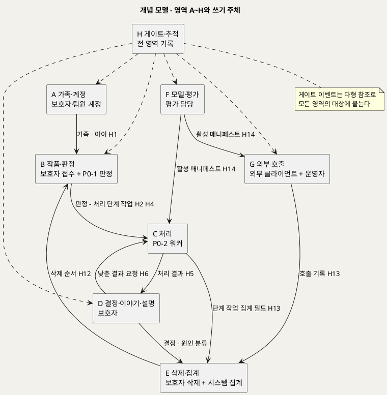

**[「개념 모델 - 영역 A~H와 쓰기 주체」 PlantUML 뷰어로 열기](https://plantuml.sumzip.com/plantuml/svg/eNp9VMtu2lAQ3fsrRumyIiok7aKLKLy97AewcQKhKGBX4Ki7iqRGoiFtIUBjgolApU0UlYoAAldlxedwx__QufZN4my6mmvPOTNz5lx7t6QrRf2okJdKhzn1nVJUCrCn7B9mi9qRmo5qea0IzxJbiWA84kOU3ipp7X1OzcKBki9lJD2n5zOwHlusUgd2e8M-2xAANI_xYgThDzJ2yoDN8doeA35f4mQmFTP7uqJmibURJmIZB3erxXpqYL-dUtl05pg2XtVXC-esjN06eJkNUEoQ9nMjgFcN57zKgfWnXMB-A6smPIc3LwJB8PJuhYi_QhRwYrKfv1IqwUKA3TP8O3RhUT8sBuvJmAqsFtibYXtJUuhoDNltxdfT5cX8vDjgyQj7FoGvG6TiyYBuhgbEmoWnQ6digQdyy8T9ZRJiq6Tz6ydaV0r1IrDajNX-uISEn5AE7NhsXgbea26l1PvH4xnrLbmGb7ZzavPmlzNulBg-6S8ik-gzwhKQ5p-3sH9MhfrGvbO0BDbouTxZCkMgsAMReC3s5BegbRAb5KAUcZNRSno-8KS7dhJwQ4q5jXhRATkE8rYUddExQgsQ7X49XYL8Uoo9FGInv3Fu3qfwsoWTEcivBCLO53Ad4626dezZwOYG-2GK6hzwtLe3e3DaBmtaNPSWFH-QJKzCqoUGz4WkxKOiDr28A3Y9ZLWq88XkVtJm5eC2ACX_D0o-zON5JdbqTiDD5uYOXXkvRkSMiZgQMSmpmp6BPU3XtQJoB-QGPFoHFNiEt2OnLdI8dMw24NjGAbWxCMmvVrMvTMWeCYw-uo_0QN_yvEMk4kgZNQ28i7RLJ_pf_ANyoQtS)** — 클릭 시 브라우저로 연결됩니다.

---

## 4. 전체 ERD

엔티티 31개를 PK·FK만으로 줄였다. 상세 컬럼은 영역별 도면에 있다.

```plantuml
@startuml
hide circle
skinparam backgroundColor #F3F1EB
skinparam shadowing false
skinparam linetype ortho
title 전체 ERD - 우리 아이 미술관 (PK - FK만)
entity "family" as family {
  * family_id <<PK>>
}
entity "guardian_account" as ga {
  * account_id <<PK>>
  --
  family_id <<FK>>
}
entity "auth_email_token" as aet {
  * token_id <<PK>>
  --
  account_id <<FK>>
}
entity "family_invite" as fi {
  * invite_id <<PK>>
  --
  family_id <<FK>>
}
entity "child" as child {
  * child_id <<PK>>
  --
  family_id <<FK>>
}
entity "team_member" as tm {
  * member_id <<PK>>
}
entity "team_member_role" as tmr {
  * member_id <<PK>> <<FK>>
  * role <<PK>>
}
entity "artwork" as aw {
  * artwork_id <<PK>>
  --
  family_id <<FK>>
  child_id <<FK>>
}
entity "stored_object" as so {
  * object_id <<PK>>
  --
  artwork_id <<FK>>
}
entity "artwork_original" as ao {
  * artwork_id <<PK>> <<FK>>
  --
  object_id <<FK>>
}
entity "judgment" as jd {
  * artwork_id <<PK>> <<FK>>
  --
  judge_job_id <<FK>>
}
entity "tag_candidate" as tc {
  * tag_id <<PK>>
  --
  artwork_id <<FK>>
}
entity "stage_job" as sj {
  * job_id <<PK>>
  --
  artwork_id <<FK>>
  model_version_id <<FK>>
}
entity "result" as rs {
  * result_id <<PK>>
  --
  artwork_id <<FK>>
  job_id <<FK>>
}
entity "decision" as dc {
  * decision_id <<PK>>
  --
  artwork_id <<FK>>
}
entity "story" as st {
  * artwork_id <<PK>> <<FK>>
}
entity "caption" as cp {
  * caption_id <<PK>>
  --
  artwork_id <<FK>>
  job_id <<FK>>
}
entity "caption_selected_tag" as cst {
  * caption_id <<PK>> <<FK>>
  * tag_id <<PK>> <<FK>>
}
entity "caption_check_failure" as ccf {
  * failure_id <<PK>>
  --
  job_id <<FK>>
}
entity "artwork_outcome" as oc {
  * outcome_id <<PK>>
  --
  artwork_id <<FK>>
}
entity "deletion_request" as dr {
  * deletion_id <<PK>>
  --
  artwork_id <<FK>>
  child_id <<FK>>
}
entity "model" as md {
  * model_id <<PK>>
}
entity "model_version" as mv {
  * version_id <<PK>>
  --
  model_id <<FK>>
}
entity "feature_setting" as fs {
  * setting_key <<PK>>
}
entity "eval_item" as ei {
  * item_id <<PK>>
  --
  object_id <<FK>>
}
entity "evaluation" as ev {
  * evaluation_id <<PK>>
  --
  version_id <<FK>>
}
entity "eval_item_result" as eir {
  * evaluation_id <<PK>> <<FK>>
  * item_id <<PK>> <<FK>>
}
entity "release_event" as re {
  * event_id <<PK>>
  --
  to_version_id <<FK>>
  evaluation_id <<FK>>
}
entity "api_key" as ak {
  * key_id <<PK>>
}
entity "external_job" as ej {
  * ext_job_id <<PK>>
  --
  key_id <<FK>>
  model_version_id <<FK>>
}
entity "external_call_log" as ecl {
  * call_id <<PK>>
  --
  key_id <<FK>>
}
entity "gate_catalog" as gc {
  * gate_id <<PK>>
}
entity "gate_event" as ge {
  * event_id <<PK>>
  --
  gate_id <<FK>>
  subject_id <<다형>>
}
family ||--o{ ga
ga ||--o{ aet
family ||--o{ fi
family ||--o{ child
tm ||--o{ tmr
family ||--o{ aw
child ||--o{ aw
aw ||--o{ so
aw ||--|| ao
aw ||--o| jd
aw ||--o{ tc
aw |o--o{ sj
aw ||--o{ rs
sj ||--o{ rs
aw ||--o{ dc
aw ||--o| st
aw ||--o{ cp
cp ||--o{ cst
tc ||--o{ cst
sj ||--o{ ccf
aw |o--o| oc
aw |o--o{ dr
md ||--o{ mv
mv ||--o{ sj
mv ||--o{ ev
ev ||--o{ eir
ei ||--o{ eir
ev |o--o{ re
mv ||--o{ re
ak ||--o{ ej
mv ||--o{ ej
ak |o--o{ ecl
gc ||--o{ ge
@enduml
```

**[「전체 ERD」 PlantUML 뷰어로 열기](https://plantuml.sumzip.com/plantuml/svg/eNqlV82OIzUQvvsprOWyIOWAuK5WK2BzmcuKF7A8dqXjxN0Otjuzo81KHPaABNeVEBLSHhBckEBoDjwTE96Biv_aSTozifYySlV1ffXjz1WeF85z6_tWk7mSQIWyQgNxS9WtuOUtveZi2VjTd_Iro42ln0y_mH7-8svqCzfn0tyorqEzrl3tq1UH_nYF1Fg_N8Qrr4FuP7zb_n1HX37zNZ3Q7c9_3f_2B92-f7f95Y7e__nP9vsP_959R5--ukLr9Or-9x8_JdCh5y19MuOt0rdPKHc0_qRvCKWfJYEpSZ89e3X1_Dl5W1yanlupeMe4EFiDD84NT45JWXlSOpngnxpxuo_Iez9n0HKlmTdL6AIiB58gg-4YcC_SAWIO1q2Vh1idSmhRd1F-Yq60DCjhVwIKvy_C8cBb1kJ7DTag-TZBRd1otysfZo2G5GhPeOagO9vu82NAZOaNscvY45t8alF5RjW0rvugPueNBcnM9QJEpIUzKUDUjRxiHXg6mikzVjWq4zqmbE6lPGQYkOuIB8CLXjYtJOYu5JmAOy9gC3M9fra8YYJ3UkmeGOdF5i-aLiocx0eMFHu4SDgl9MM4lLZGgmZrsE6ZbjSCBdfrWL91CT7qzotwqgsShNoFDcgyNyBrL-2CsXEyOf_YEVV3la98TkCs8lWNyo-rLYM40Egs5DmeUgxT8juKU1_HPRqchhdzEEs2w2HY20gkIWZlKgftcR2nci5XqPfCtBHO5GNJystOBZkFIU8L3_bgIoekLSedrGd1-vQkCQwO0G2-npHUYyNyj-7RaZ2c9u5AnU6Fdrg6gPtdjx14jws4Lo98R5KSLeH2OA9Yc4T00AYfKAsHNccJPDCedjg9LyyGXMygP4Z76LKXvFh17UHZB2Br3u7nPzZLNHAHDNZ5pFoo0DD2FPBmZDjRo0QOubxSu77HLbBMEVAxygl47cHizihTFPIURQsbnaQF6uwpWoIIrjXTJpIFhC7jQOvH4lTvKlwciOR5BmryRQ2W0afYzjD0vXmk7wNOKtH1FQvvf_j1v5_eB_z0FNxsJhPzBt0IPu-SgM-yA_NMHSjCtSb4uEkyvlYOvuA3JL6kBhmfIklwJgubDa77Ytngqq4-8yIIJvosKot1BHfmIAwWKSo05yuLWBHcFllAE27vShrwcBiXuBucpVUS0pK2lNSuCU6hXNKiEmBNYBCUJTgpammd8SxUXigg6fN3e3iLYIk-SD7SlNQbIC-gk_ifyP9wOvT6)** — 클릭 시 브라우저로 연결됩니다.

---

## 5. 영역 A 가족·계정

### 5-1 ERD

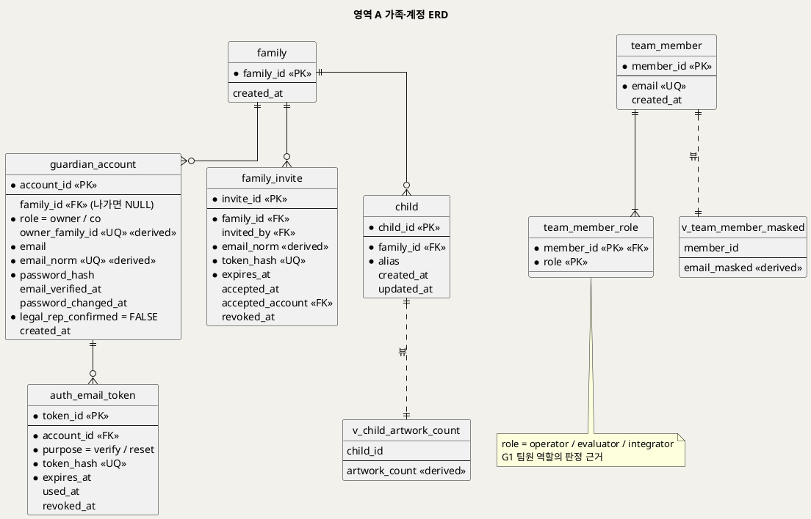

**[「영역 A 가족·계정 ERD」 PlantUML 뷰어로 열기](https://plantuml.sumzip.com/plantuml/svg/eNqNVU1v00AQvftXjMoFIqWo4oZC1QINByrEh3pebbwTexXba63XLlGDVBBHDr1UVEJI5cgBqRVIvXDi56Tpf2C8a8fOR6Veot3nmTfzZmYnO5nh2uRx5IVSIPhS-xF62UgmKdc8hgH3R4FWeSKeqUhpuNd_1N_ae9qyyEIu1KFMAhjyKGv7RjJBM04RlDah8ow0EcLs7OPs6y_YhenF8ezH5b-r6e_Ps_NT2Hv73MOEbMawMeSxjMYbwDNwRzjyADrVhUkBvd7rl9vbBHa79ONr5AYF48b7MCcJcq6F5Anjvk_5G0sX8IqqAle52jH6hMP9609nlOv1zz_w6mB__4F114qkPAF1mKCGh-ArQu2Ftf0P3pB_rydQywKFjdEBjLmMmhNLlI5vs015lh0qLVjIs5AQ51GQzVA6vdDY-CFPghrtQIQBj5jGlPkqGUodo6CM-7v77_ZuK1mde1JIg678sqqXw1bL1VkpGIHOWLDBuMGW5C7qNGqEiRVZVcI5vE-lxswJooZhamp5zc31sYmjsSCyJWE8NyFz8W0oq42jqcS58Gu0LUzJXEia61RlZf9tJ8Y0AJQmmrtKybNaxtpk_VBGwmZoT1WO9nzH-lPikeTZYpspbipWe26QxyzGeIDaxjRxFdBh6yLaQjbq1o5Si5aVj6Xi1reQt3O3b6uK2RAWzFWAthVN-4g1b7rwLWldoDrPBcOFiWuTtvOMeUbNcJyuCvM0a1I3Q85wibPaVJNJt6uOaNF4tGuqC03a0uehXAJs9h4Vv7xPjspSea79k8nm5mRSqnwM11cXzsZBcQUlyiAMlDEqBjW0vjBfUSlqblS5pbDgUV6dZWIwsB_I9MUW3Hw5nn07AVrNN6fns-9nBJyUa3l69Xd6eUEFE1BG8XboRP8W_wGU1xQ8)** — 클릭 시 브라우저로 연결됩니다.

### 5-2 엔티티 명세

| 엔티티 | 용도 | 핵심 컬럼 | 쓰기 주체 | 생애주기 |
|---|---|---|---|---|
| family | 가족 공간. 모든 가족 데이터의 격리 단위(G0) | family_id | 이메일 가입(P1 1.0) | 영구 |
| guardian_account | 보호자 계정. 로그인 아이디는 이메일(D18). 한 가족에 만든 보호자 1명 + 공동 보호자 여럿(U1 확정) | family_id(나가면 NULL), role(owner/co), owner_family_id(UQ, 가족당 만든 보호자 1명), email, email_norm(UQ, 대소문자 무시), password_hash, email_verified_at, password_changed_at(이보다 먼저 만든 세션 무효), legal_rep_confirmed | 이메일 가입(P1 1.0) · 재설정(1.R3) | 영구 |
| auth_email_token | 가입 확인·비밀번호 재설정 메일 링크 토큰(D18) | account_id, purpose, token_hash(UQ), expires_at, used_at, revoked_at | 가입·찾기(P1 1.0 · 1.R1) | 사용·만료 뒤 정리 주기(U19) · 계정 삭제 시 연쇄 삭제 |
| family_invite | 공동 보호자 초대(UC15). 이메일에 건다 | family_id, invited_by, email_norm, token_hash(UQ), expires_at, accepted_at, accepted_account, revoked_at | 보호자 초대(P1 1.I1) · 수락(1.I2) | 수락·취소·만료 뒤 정리 주기(U20) · 가족 삭제 시 연쇄 삭제 |
| child | 아이 별칭 | family_id, alias(중복 허용, D18) | 보호자(P1) | UC7 A1 삭제까지 |
| team_member | 팀원 계정 | email(UQ) | 팀 관리(절차 미정) | 영구 |
| team_member_role | 팀원 역할(G1) | role ∈ operator · evaluator · integrator | 팀 관리 | 영구 |

### 5-3 핵심 컬럼 설계 판단

- **별칭 외에 아이 컬럼이 없다.** 실명·생년월일·출생연도 컬럼을 두지 않는 것이 BR-CHD-01의 구현이다. 나이는 작품마다 `story.age_at_creation`으로 받는다.
- **`legal_rep_confirmed`는 늘 FALSE다.** UC1 사후조건 (5) "법정대리인 확인이 끝난 것으로 기록하지 않는다"를 CHECK로 박았다. 동의 절차(U13)가 정해지면 CHECK를 풀고 동의 엔티티를 더한다.
- **U1 확정(공동 보호자)으로 `guardian_account.family_id` UNIQUE를 풀었다.** 대신 `role`과 조건부 생성 컬럼 `owner_family_id` UNIQUE로 가족당 만든 보호자 1명만 허용한다. 나가거나 해제된 계정은 `family_id`가 NULL이다.
- **인증 정보(비밀번호·토큰) 컬럼이 없다.** INC1·INC2의 인증 방식이 미정이고(U8) 화면·IPO에 출처가 없다.

---

## 6. 영역 B 작품·판정

### 6-1 ERD

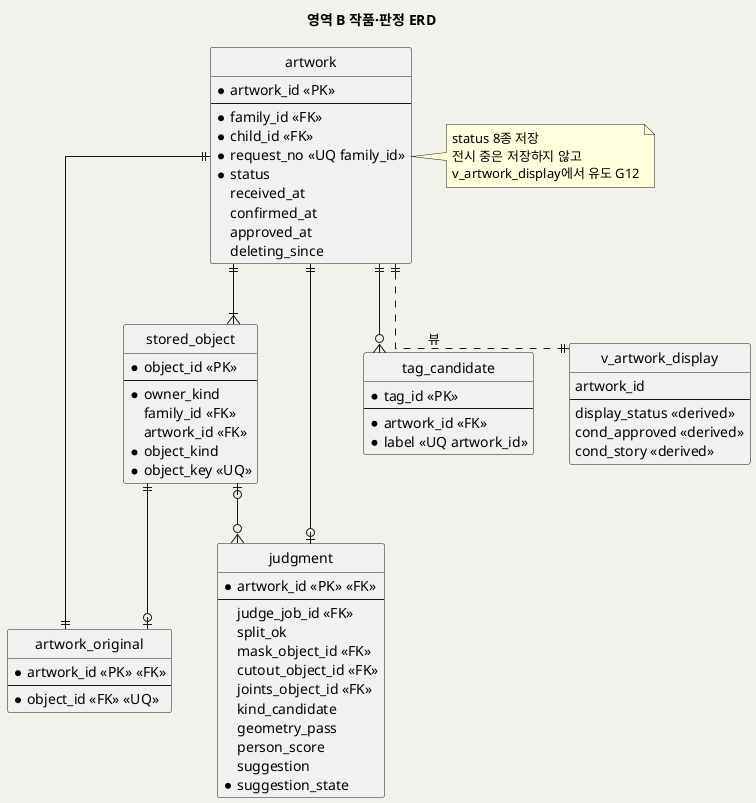

**[「영역 B 작품·판정 ERD」 PlantUML 뷰어로 열기](https://plantuml.sumzip.com/plantuml/svg/eNqNVE1rFEEQvc-vaOItsIHoRSSEEM168KKC56Z3une2d3u6xu6eLMNuIEIEUcFEWJJDDIsongTBQ-7-HNP5D1bPzH46grd-9aq6ul69mT3rmHF5qqKe5ILE0sRKRHYgdcYMS0mHxYPEQK75Q1BgyJ32vfb2wf5Shu0xDkOpE9Jlyi7XKqmFKzJBwLgeRE46JYi_eOXPv5N94q_Obj---XV9-_7UTyfk4PmjSGjMKcgGvmgIZrBBmCVsSEYRIZukDlLJyc7O0ye7uxhttUqqy1KpioppV8wmiXtS8bWYES9zYR3VgNEXzxaFNY9iuNzi0YhYyEPBKXOIYtBdadIZZFlmYE5yoYTD8amVOhbR0XwK68BgEnT6InblLBbqWapY0ygw1MJQlJAjbJhrRYX5XPV9ddkCi6KcE7OO1sWlYGQiNVOVyvAvlRdtZi9cenu7Sljr0M95kiIob-7z_7w5VAnah87KbDZT0lEY4DFldkDXu4ft5A5y18T0QWpnm5igFI2Z5pIzJzCQCEiFMwXNmA0GyISxoKmNcYfhGXmSoHEk6Monc0iDZZa37liyuLhUwMW1AoFqWHnzShXrCFW5dJGwIvMhnRFcokysKLsdVnovamaN6iRaeRxv5sIEi1caAuox83UTF8xcrBBHEX6a43GrNR6hsedgjF6K0OgBQAlqBkGflwwgGAUwY0aoUQW2tvACHOEBubn-EWlwgqBNe45AF_8EYRHV6-_7z6-Jnx77q68Y9NMT_-6S-C9n_tNxHb6dXPhvCCZvf_-cYs5favnzU3-CRZfTmw8n5PH2XRSWk9Ay2sMT_hL_AEJ-v3s=)** — 클릭 시 브라우저로 연결됩니다.

### 6-2 엔티티 명세

| 엔티티 | 용도 | 핵심 컬럼 | 쓰기 주체 | 생애주기 |
|---|---|---|---|---|
| artwork | 작품. 상태 머신의 주인 | family_id, child_id, request_no(UQ), status, 시각 4종 | API 서버(P2 · P3 · P6) | 접수 → 삭제 |
| stored_object | 저장소 객체 참조(원본·마스크·컷아웃·관절·깊이·결과·GLB·임시·평가 입력) | owner_kind, object_kind, object_key(UQ) | API 서버 · 워커 | 파일과 같이 생기고 같이 지워짐 |
| artwork_original | 작품 ↔ 원본 객체 1:1 | object_id(UQ) | API 서버(2.3) | 작품과 함께 |
| judgment | 판정 결과(H3) | split_ok, 마스크·컷아웃·관절 참조, kind_candidate, geometry_pass, person_score, suggestion, suggestion_state | P0-1 워커 | 작품과 함께 |
| tag_candidate | M2 태그 후보(H3 → P4) | label(UQ 작품 안) | P0-1 워커 | 작품과 함께 |

### 6-3 핵심 컬럼 설계 판단

**상태 머신** — `artwork.status`는 공통 기준 §5의 8가지 저장 상태만 가진다: `received` · `judging` · `awaiting_confirm` · `processing` · `awaiting_review` · `approved` · `failed`(처리하지 못함) · `deleting`. "전시 중"은 저장하지 않는다(D-2). 전이의 합법성(예: 승인됨 → 확정 대기 금지)은 CHECK로 표현할 수 없어 **애플리케이션 상태 전이표**가 책임진다(SD_02 §2-3 도면이 그 표다). DB는 상태마다 필요한 시각(`approved_at` · `deleting_since`)과 상태별 쓰기 금지(트리거 `trg_decision_bi` · `trg_story_b*` · `trg_caption_bi` · `trg_stage_job_bi`)만 막는다.

**원본 참조를 별도 테이블로 뺀 이유** — `artwork`와 `stored_object`는 서로를 참조한다(객체는 작품에, 작품은 원본 객체에). 순환 FK를 피하고 "원본은 바꾸지 않는다"(BR-INT-04)를 한 테이블의 UPDATE 금지 트리거로 걸려고 `artwork_original`로 뺐다.

**제안값을 두 곳에 두는 이유** — `judgment.suggestion`은 P0-1이 **만든** 제안이고, `artwork_outcome.suggestion_at_confirm`은 보호자가 확정할 **때 본** 제안이다(제안 전 확정이면 `before`, 판정 소진이면 `none`). 판정 수정률은 후자로 센다(D14). 둘은 같은 값의 복사가 아니라 다른 사실이다.

**점수 컬럼** — `judgment.person_score`는 BR-PRC-04 "기록만"의 구현이다. 보호자 화면용 뷰(`v_gallery` · `v_job_progress` · `v_artwork_display`)에는 이 컬럼이 없다(BR-SUG-02).

---

## 7. 영역 C 처리

### 7-1 ERD

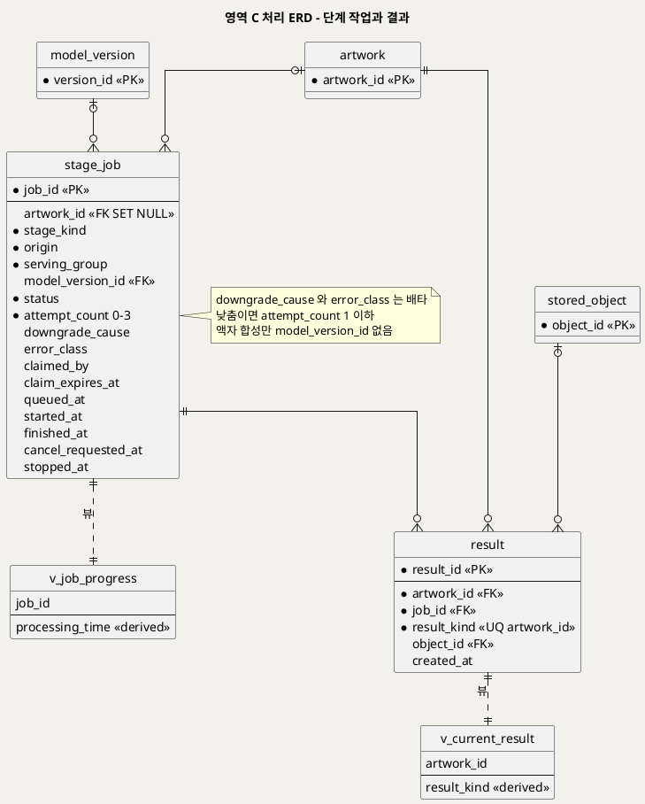

**[「영역 C 처리 ERD」 PlantUML 뷰어로 열기](https://plantuml.sumzip.com/plantuml/svg/eNplVE1v00AQvftXjMqtUiqq3lBVVZT20grx1bO1WW-TTR2vmV2nVA1SgcIBegCJKuHQSkgIqAQotBVc-EXx5j8wXtuN417sndn3xm_eznpVG4Ym6YZeWwYCuEQeCk_vyihmyLrQZHy3hSqJgjUVKoRbG0sbi-t3KwjdZoHak1ELdlioq9xQRsLsxwIUmrbyjDShADt8YQc_YQ3sxTD9-gPWH92DBqTvvo8vj8CefbCD1-PLfzC-GNHLExGx9mGOVLaE31HNOWAadAcOPIB5oIQvA1hefrC5skKZRoMe1M-ewt18Y2MTHq8_gfvbW1sOMQ95KRIZuFChbMko3xHYoz78rN-YMl0ViNDvCdRSRWW5aRWTaLdkxohubHxOLhm43ViiLDkStZAFwucsIVMABKJCn4dMZyx6y64I_OZ-GfjiWSxRaJ8ZSj1NRELbbu1OqAx2ZCR1u4w4izhJREF4baYEFcd58PzaQSqdhMbZh7qwL8_ddHC-7mHR9LXd15miQuYmpbcfVogOoZodwc0MiaNgpq6uoDl5bK-QNyPC6ZsSZs7G0bq9gjZzYDUaWYP07VxWPkuqoFWl1lg9nyeIFPkVF3scHXOqsrRv1pRAoOyJoFYwszJG1SKszst1Ylcu97gsRRBOiGwqDQ1MrRw51VeNhjqgG-FR_9Mg2-m7ALVH16USqBJGAU1Cv7-w0O-7bu5A-neUo_McScpzkTIC6KK0DaidrP6NCQf76bA645C-_QjpaDR5dUjg9OUv--eLPb1Kz69q92URKD05GRLKnny2Z-9hcnJuj36n345vXkA7eGNPj8nGADJJ3iqt6N_1H1W_sqE=)** — 클릭 시 브라우저로 연결됩니다.

### 7-2 엔티티 명세

| 엔티티 | 용도 | 핵심 컬럼 | 쓰기 주체 | 생애주기 |
|---|---|---|---|---|
| stage_job | 단계 작업(분리·판정·움직임 렌더·깊이 부조·액자 합성·설명·3D). 모든 모델 실행의 기록 | stage_kind, origin, serving_group, model_version_id, status, attempt_count, downgrade_cause, error_class, 점유·취소 시각 | P0 워커 · API 서버(등록 · 취소) | **영구**. 작품 삭제 시 artwork_id만 NULL |
| result | 결과 종류별 처음 만든 결과(H5) | result_kind(UQ 작품 안), object_id | P0-2 워커 | 작품과 함께 |

### 7-3 핵심 컬럼 설계 판단

- **`origin`** — 같은 깊이 부조라도 보호자 확정(H4 `confirm`) · 모델 낮춤(`downgrade`) · 낮춘 결과로 걸기(H6 `use_lower`)가 다르다. 원인 5분류와 두 번째 확인의 분모 제외(UC4 A1)를 가르는 근거다.
- **`downgrade_cause`와 `error_class`의 배타** — D-5. 한 단계 작업은 품질 미달(다음 단계로 낮춤)이거나 인프라 실패(같은 단계 재시도)이지 둘 다일 수 없다. 낮춤이면 `attempt_count ≤ 1`이다(BR-PRC-02 재시도 없음).
- **재시도를 행으로 두지 않고 `attempt_count`로 센 이유** — 화면(S4)은 횟수와 마지막 오류 분류만 보이고, UC3 §6.2 대응표도 단계 작업 1행에 시도 횟수를 둔다. 시도별 로그는 구조화 로그(Prometheus)가 맡는다.
- **액자 합성** — `frame_compose` 단계는 모델이 없다(BR-PRC-01). `model_version_id`가 NULL인 유일한 단계다.
- **`claimed_by` · `claim_expires_at`** — 중복 처리 금지와 이어받기(BR-PRC-05, UC3 A7)의 근거다. `삭제 중` 작품의 작업은 이어받지 않는다(D4) — 워커 쿼리 조건이며 애플리케이션 책임이다.

---

## 8. 영역 D 결정·이야기·설명

### 8-1 ERD

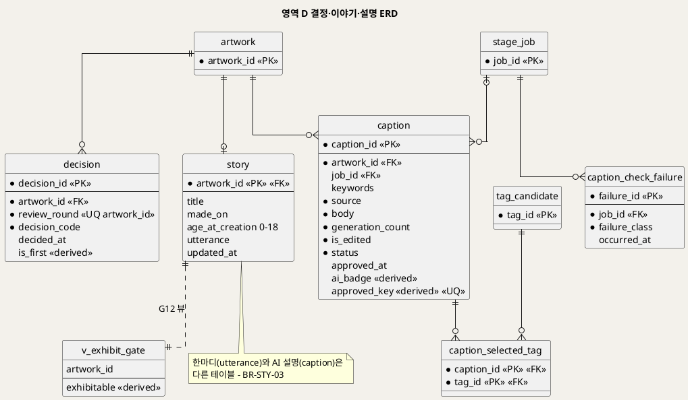

**[「영역 D 결정·이야기·설명 ERD」 PlantUML 뷰어로 열기](https://plantuml.sumzip.com/plantuml/svg/eNqNVE1rFEEQvc-vKOIlCUxIzEUkhBiTiHjRqAdPQ2937WxnZ6eHnp5dl4yQgAFBjxtUMOAhIghCECE5ePLnZCb_wer52J3dVfA0XVWvql69rp6t2DBtkl7gdKRA4FLzAJ24K8OIadaDFuNdX6skFPdVoDTc2lvfW9vdbiDiDhNqIEMf2iyIm7mBDNEMIwSlTUc5RpoAIf9wnL__Djtw_eMi_3z6-zI_-5mf_rq-uqDj6_Ps2wns7u84GBJ8CAsCuYylCheAxSA4HDoAy1B7PSlgY-Pxo81NcrtuEaNxBkp3y9BeGVoGjX2JA6-YhPzPnzRwFWRclCuB5LG2QOExQ4aMvbbUsaFcgVr20Wa9GtOMjdLDgiNBDud5WIoTOgXTQg769phAT4V0Yj5SM49rZIZ4wKq7dofciTGoWcgtOIkEMyWnSXPOIlNLxKOqfeX8X4UOVGvK7uKQMCIuEmKV6KL9MrSUGBYHH0NiZUq9ktAUTlIJhSSCZZphJrEVWBRp1a-lZNJrMeHjlJQNELVuhorbmhK7Hi3GALlVwzC_HH4s_tz0zV0g-HxgvjzvIO96bSaDRGNZn7er-pX3b-rOKjkB84DFVg7FeaL17C1Wt1I0YoN_LVEjwY7BWSikXYkizdTvY2rCqTW1O0YMy1U9qOBjyjPwvocvO7IljefXLfp-kTPhVQ9eIVkrwJk3QsOkqeuqQ3q_YyOl7WhEeOTQ5tYGhWiUhkVMU1UDrVGFeNuhK0_TlZU0tdTuwoO125BdXjihMkjLaozqgWrbZgA3p5-yr2-y0Whx_KSW8o9HcO8hlH-exerql_KzI8Jnb8-zL1dwc_KO_lHZ1Qhc2N53nz574a6uk0YCbBNni070__wDGznIxg==)** — 클릭 시 브라우저로 연결됩니다.

### 8-2 엔티티 명세

| 엔티티 | 용도 | 핵심 컬럼 | 쓰기 주체 | 생애주기 |
|---|---|---|---|---|
| decision | 결과 확인 결정 | review_round(UQ 작품 안), decision_code, is_first | 보호자(3.5) | 작품과 함께 |
| story | 이야기(필수 3 + 한마디) | title, made_on, age_at_creation, utterance | 보호자(3.8) | 작품과 함께. 언제든 수정 |
| caption | 작품 설명(P0.5) | keywords, source, body, generation_count, is_edited, status, ai_badge | 보호자 · LLM 단계(4.3~4.8) | 작품과 함께. 승인 뒤 고정 |
| caption_selected_tag | 보호자가 고른 태그 | caption_id, tag_id | 보호자(4.2) | 설명과 함께 |
| caption_check_failure | 규칙 검사에 걸린 초안의 실패 분류 | job_id, failure_class | LLM 단계(4.5) | **영구**(단계 작업에 붙음) |

### 8-3 핵심 컬럼 설계 판단

- **`review_round`** — BR-APR-06 "결정은 작품당 1회"와 UC4 A1 "낮춘 결과를 새로 만들면 1회 더 확인"을 함께 만족시키려고 회차를 키에 넣었다. 1회차만 `use_lower`를 허용한다(`chk_dc_round`).
- **한마디와 설명을 다른 테이블에** — BR-STY-03 · BR-EXH-05의 구조적 구현이다. 한 테이블의 두 컬럼이면 "설명이 한마디 칸을 채우는" 코드가 한 줄로 가능해진다.
- **걸린 초안은 저장하지 않는다** — `caption.body`에는 통과했거나 템플릿·직접 입력인 문장만 들어간다(BR-CAP-07). 실패는 `caption_check_failure`에 분류만 남기고, 작품이 지워져도 실패율이 유지되도록 설명이 아니라 **단계 작업**에 붙였다.
- **`generation_count`의 상한을 CHECK로 두지 않았다** — 자동 재생성 2회는 [추론]이고 보호자 요청 재생성 상한은 `자료 없음`(U11)이다. 상수를 지어내지 않았다(§19).
- **이야기의 부분 저장** — UC5 A5가 필수 항목 일부만 저장하는 것을 허용하므로 필수 컬럼도 NULL 허용이다. "필수"는 `v_story_complete`가 판정한다.

---

## 9. 영역 E 삭제·집계

### 9-1 ERD

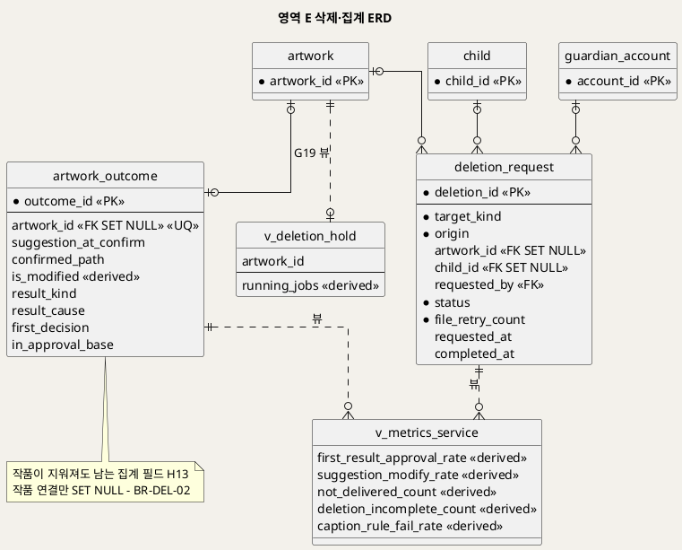

**[「영역 E 삭제·집계 ERD」 PlantUML 뷰어로 열기](https://plantuml.sumzip.com/plantuml/svg/eNp9VE9rE0EUv--neNRbYIuxJ0sJpTZVaBCt9rxMdia7Y3Zn1pnZhNAUtORQpCD1DxWs0lu8FIIK9ezHabbfwbeTzSZNg5cw7817b35_3mZTG6JMGkdOyCkDnys_Yo5uc5EQRWJoEr8dKJkK-khGUsG9nbWdan1rrkKHhMouFwG0SKTneyMumOklDKQyoXQMNxGD7Mvb7OwS6pAdXWYX53-vsuHp9a8B1Pe2HSawpgcriKgrVduTqfFlzFaAaJA-HDgAFSiSHqewsfFst1bDrOviz7TLXuzswov6S3i632jUahjvP7eFOg0Cpg2XwiPG86VocRVjvjgx6iXEhJjg2osl5S3O8mmUKd5h1I5QTKeR8ZAlnUU-SZE6AA7RxqPM5xrfyOfgQ0miZIdEXpNgzWHJkrKIWSSKvU4RlKVJVUGzvL3DswJoWcBKCCiJ4gEX_5Ug5xjyiC6_KhAg_WbPXttsBXA5TKrtscUjhkiN6qFsqTC3uoixGsYJYp6Eh4tmWnakW7C7BdSSmzVYnLbcnoqOOfQL9UFKFOUEhfYtMtsakOlLk-TSzo4XIyHua08z1eH-ZNM6sba9Ey8Lg0sTFTFsYSPmlsruTG9ZkZD5XkQYK1TIYlqomDkuplIurfNJMlmbFB1pEb4E0zzFcmwoC1k7NLQEZyZMV0ulQuCX7L2STb0wEK3rS9eVffwSy-AA99WZuDSLUfpZgJ9tv7-6ikEu6zqMr0YO7vidXD4xz_UtunV4XH1o8ygbg6Y0RsYgW_nbANn305sPx9m335AN32RfT7KLP-P3Axgf_Ri_-wTF_8nN58H44zk8qa6VHZCdja5_jsbDk3L7wYWtPXe73nDvP0DNaG4TczbxhH-J_wBS0tAP)** — 클릭 시 브라우저로 연결됩니다.

### 9-2 엔티티 명세

| 엔티티 | 용도 | 핵심 컬럼 | 쓰기 주체 | 생애주기 |
|---|---|---|---|---|
| artwork_outcome | 작품 집계 기록(H13). 삭제 뒤에도 남는다 | suggestion_at_confirm, confirmed_path, is_modified, result_kind, result_cause, first_decision, in_approval_base | API 서버(2.6 · 0.10 · 3.5) | **영구** |
| deletion_request | 삭제 요청과 진행 | target_kind, origin, status, file_retry_count | 보호자(6.1~6.3) · 시스템(6.4~6.7) | **영구**(끝나면 식별 연결 없음) |

### 9-3 핵심 컬럼 설계 판단

- **확정값이 `artwork`가 아니라 `artwork_outcome`에 있는 이유** — 확정값·제안값·결과 종류·원인은 작품이 지워져도 남아야 하는 집계 필드다(UC7 §1 "남긴다 — 집계 필드"). 작품 쪽에 두면 삭제 때 복사해야 하고, 복사는 두 번째 계산 지점이 된다. 처음부터 한 곳(`artwork_outcome`)에만 두고 작품과는 1:1(UQ)로 잇는다.
- **삭제 순서의 데이터 표현** — `accepted`(G18 통과) → `waiting_stop`(G19 보류) → `deleting_files` → `completed` 또는 `incomplete`(BR-DEL-03). 끝난 삭제에는 `artwork_id` · `child_id`가 남지 않는다(트리거 `trg_deletion_bu`).
- **`file_retry_count`만 두고 재시도 상한을 두지 않았다** — 재시도 횟수·간격은 `자료 없음`(UC7 E1).

---

## 10. 영역 F 모델·평가

### 10-1 ERD

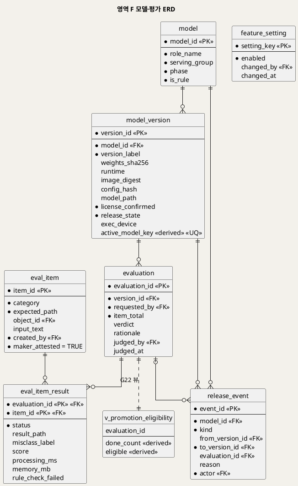

**[「영역 F 모델·평가 ERD」 PlantUML 뷰어로 열기](https://plantuml.sumzip.com/plantuml/svg/eNqNVc1u1DAQvucprHJD2koUwQGVVQV0OXCBip4tx55N3PVPsJ20q24lOHJAHMsjICSk3sqZx6HlHRg7SZNdVohb5hvPzDe_OfCBuVBrlZVSAOHScQWZX0hTMcc0yRlfFM7WRjy3yjpyb_Zw9uDw2eiFL5mwp9IUZM6UH9sqaSAsKyDWhdJmQQYF5PbLh9vL72RGbr59vfn04-f1788ff129J4dHLzIw-GZJdrQVoHYI80QLcp4Rcp8kiEpB9vdfv5pOEZtMksJZBdQwDUny4BqkQiPlKiFVyXyrk566GpO7WI9DG3BeWtPGa7p4Hbgt4ojKrFUMzxXLQSFyCrIog6dYnL1HjxFwNcZMJKVmBVAhC_ABRW7NXBYUWZYotb4rFsrkVkkOxgNNj5wG0aYMCjApiq0L0SOcAacCGnyMEuNBNkBbTwtYIk0BDiExneL38RukPJQAGoa5BNApfZBd-hHZljvHiIV1yyTAWQU8gOj52vwE5bXK4CjUgQY4C625AxYN8uW4eJotwFEWAlYEBHlK3h4dH25wrFnoewR9jwZ8G9W1Dt7FcvCuTmE2OKSEgw0sdg9NheSRskvumYqFPalFsWHXQSxsqyh14GsVusK6f5D-i8gWTZdV7HntI7PkvC-9lp4r5v3dAHpuXSRdOcvB-7gTOppp0Ng-qvM0k7g6vAS-oHMmFU7XkEU_Y9AgklJwcJcBQv-7GHgM4tDOndV0e0eC3arYrFMH4wB5a5IhDjoepE4zMJ_jiNUOtwNCwLQT97nvuHdgtxfr9MGwXKUV4yUzm63usbVeNxTrq21iCUoWMpcKFSlmU6WYa3n0wYQ1canxJoy3M75OTvBMjuGLDM_gajWZ2HM8UBneqE6AJoNBkC7D_R1JgxWOwmCFQrSyY2G1u7taRcpPyMu9PXJzfZUdgBH4X_gDx3z8CQ==)** — 클릭 시 브라우저로 연결됩니다.

### 10-2 엔티티 명세

| 엔티티 | 용도 | 핵심 컬럼 | 쓰기 주체 | 생애주기 |
|---|---|---|---|---|
| model | M1~M7 카탈로그(상수) | serving_group, phase, is_rule | 시드 | 영구 |
| model_version | 매니페스트(BR-MDL-01) | 해시 3종 · runtime · model_path · license_confirmed · release_state · exec_device | 평가 담당(8.2 · 8.7 · 8.8) | 영구 |
| feature_setting | 3D 노출 설정(D10) | enabled | 미정(§19) | 영구 |
| eval_item | 평가 묶음 항목 | category, expected_path, object_id / input_text, created_by, maker_attested | 평가 담당(8.3) | 영구 |
| evaluation | 후보 버전 평가 1회 | version_id, item_total, verdict, rationale | 평가 담당(8.3 · 8.6) | 영구 |
| eval_item_result | 항목별 평가 결과 | status, result_path, misclass_label, score, processing_ms, memory_mb | 워커(8.4) · 평가 담당(오인 분류) | 영구 |
| release_event | 승격·롤백 이력(H14) | kind, from/to version, evaluation_id, reason, actor | 평가 담당(8.7 · 8.8) | 영구 |

### 10-3 핵심 컬럼 설계 판단

- **`release_state`** — `candidate` → `active` → `rollback_candidate` → `retired`. 모델당 활성 1건은 조건부 생성 컬럼 + UNIQUE로 강제한다. 승격은 `release_event` 삽입 트리거가 `v_promotion_eligibility`만 읽어 판정하고(G22 단일 지점), 상태 전환(후보 → 활성, 직전 활성 → 롤백 후보, D5)은 같은 트랜잭션에서 애플리케이션이 한다.
- **`model_path`는 NULL 허용** — R1이 경로 명시를 요구했지만 값은 미정(U14)이다. 컬럼은 두되 값을 지어내지 않았다.
- **`exec_device`** — GPU가 없으면 M5는 CPU로 돈다(BR-SRV-02). S11·S12의 "실행 장치" 표시 원천이다.
- **평가 입력은 가족 객체를 쓸 수 없다** — `stored_object.owner_kind='eval_set'`만 허용(트리거 `trg_eval_item_bi`, G20).

---

## 11. 영역 G 외부 호출·API

### 11-1 ERD

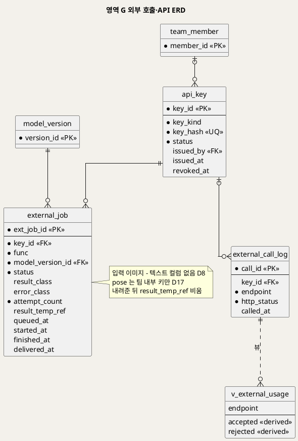

**[「영역 G 외부 호출·API ERD」 PlantUML 뷰어로 열기](https://plantuml.sumzip.com/plantuml/svg/eNp1VMFu00AQvfsrRuUWKZUqDiBUVQXaIsSlIHG2NvYk3mbtNbvrQNRUChXlELUXhNQiKPQQ1AsIDlUbBCd-x5t_YLxxnTSlt3lvZnbem117VRumTBYLL-IhQsBVINDTbZ6kTLEYGixot5TMkvChFFLBrY3bG0vrD2YqdMRC-ZInLWgyoWd7BU_QdFMEqUwkPcONQLBHr-3hd3gE9sMoP-_D-Ghkzz_9vbi_-RjWn615mFBdFxZYyv02dheAaWBt2PYAakCEz0NYXt58srJCTL1e0TQ1rEDEdERVz5-6qhqQSZNpCrnWGYZ-o0vZjckZJcUMxQo7sj0BO5USfGVQJUz4W7Lh5OBWKYcyBXmTJEeXU2rQzJLABbEMUfgdVJrLZK6oEqpQZ8L4gWC6gKiUVBWqATMG45TydDNmWl6QvsImMS8yrGy5O74ETZ5wHV0iksJJyo2eAyaEL2RrYjwQpXNHX7N93TQmYSq5k1iDyJjUrxwWR8yPvbIaNzLulBOv7MsNnbYZZLEfY9xA5ZpMXDZNuP_2dPzKY6ZZC11jJ3ONM6qdLxYEmNIC6ZQQFe0rdPYUbmEwT-949Fp7vXpdbtND8Uj_FBQZOQGB8EhliVjbK1bb6y0uEiIR9yC_-Okl0iAo3ooMyGbRD2A_7-UnX8Een-U_Rva0D3UY7x3YwXA8GIH9_S3_8gfs4Vt7vA9rd6k-lRohH7yH8X4f8t0z98XtDvNTyi_doYKCOxnaIWXfDeefEeS_3tiPfdpZCIUYb5Ui-lf8A_DmfPE=)** — 클릭 시 브라우저로 연결됩니다.

### 11-2 엔티티 명세

| 엔티티 | 용도 | 핵심 컬럼 | 쓰기 주체 | 생애주기 |
|---|---|---|---|---|
| api_key | API 키(해시만) | key_kind(team_internal · course_internal · external · test), key_hash, status | 발급 주체 미정(U12, 예시: 운영자) | 폐기까지 |
| external_job | 외부 작업 메타(H16) | func, model_version_id, status, result_class · error_class, result_temp_ref, delivered_at | P10 API 서버 · 워커 | 수령 즉시 임시 참조 비움 |
| external_call_log | 호출 건수 기록 | endpoint, http_status, key_id | P10 API 서버 | 보존 기간 미정(§19) |

### 11-3 핵심 컬럼 설계 판단

- **입력 컬럼이 없다** — 외부 입력은 워커 임시 영역에만 둔다(D8 · BR-API-05). DB는 메타와 결과 임시 참조만 가지며, 내려주면 참조를 비운다(`chk_ej_delivered`).
- **`pose`는 팀 내부 키만** — D17. 키 종류는 다른 테이블이라 CHECK로 못 걸고 트리거 `trg_external_job_bi`가 막는다.
- **요청 한도 수치는 두지 않았다** — 키당 분당 30건 등은 예시값(U12, 확정 아님)이다. 한도 판정은 `external_call_log`를 세는 애플리케이션 한 곳이며, 수치는 설정값으로 둔다.

---

## 12. 영역 H 게이트·추적

### 12-1 ERD

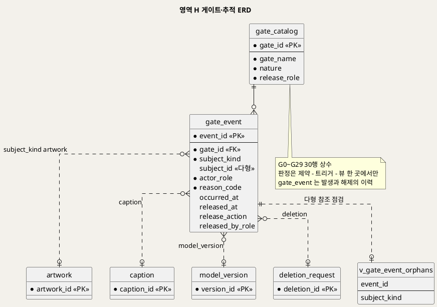

**[「영역 H 게이트·추적 ERD」 PlantUML 뷰어로 열기](https://plantuml.sumzip.com/plantuml/svg/eNp1VE1v00AQvftXjMqtUqpCT0RVVVGaInFB_AFrs94mbmxPWK8TRU1Qo3KAkkMODc0hkYLExwWk0FS0B7jwc-LNf2D81Tgo3HbezJud92btfV8xqQLXMaq2JYDbkjvC8Gu2V2eSuVBmvFaRGHjWAToo4UFpp_Tw8Emuwq8yC5u2V4Fj5vh5rmN7QrXqAlCqKhrKVo4APezqq-_wDObXPT2-WVzc_bnVPy_1pAuHL58awqOyFmxUmBImZ4o5WNkA5kOFw6kBsAlxxrZgd_fF8709ggqFJe4xV8SRx1Qgk6MUjmC-MCWSss7qDaJBYdJfpP1j6L8XxHgpwTfBD8ongiuTJFsEZGFcFL7_tBgO0kLGFcpkgmQk5qNncrSiGDkPpBSWyRRF6birkUkNbPTy6XLrX0W0yCbKWiyHNVM5KZgTtCRwVo-6xgReTwkpuJbg0sCO2RDSz2huI6Wl4FoakUTcU4pXgfATwy2ZMu-z66gNc7knE2W9yjw_pjcwpmfbyta0spGOQa-m3S4U8JT2a9CKO7i1he3IneJKaWZTroYMKWZm5GASXIQVH3JJ0lS81xPh7XaM07BFSB4E6Omd_jgFPenPr88MD5WAMiqFLuAxvXLScLT9-ujRY9jZXnx4B_q8q98OCV30-noy0OMzoo704DcUgD6e8Mu3-Y8pncPbKSwGI5jPZvqqr9-Mwq89Yi3dg_DiEsLpSJ-P57NfVHsT9RkPgb7CcPKZHLcgmsbYpxP9EP4CYnyEFQ==)** — 클릭 시 브라우저로 연결됩니다.

### 12-2 엔티티 명세

| 엔티티 | 용도 | 핵심 컬럼 | 쓰기 주체 | 생애주기 |
|---|---|---|---|---|
| gate_catalog | SD_01 게이트 30개(상수, G26·G27은 D18, G28·G29는 U1 확정) | gate_name, nature, release_role | 시드 | 영구 |
| gate_event | 게이트 발생·해제 이력 | gate_id, subject_kind, subject_id, actor_role, reason_code, released_at, release_action, released_by_role | 시스템(모든 게이트 지점) | 영구(작품 삭제 시 subject_id NULL) |

### 12-3 핵심 컬럼 설계 판단

- **다형 참조** — 게이트 대상은 작품·아이·설명·단계 작업·삭제·모델 버전·평가·외부 호출 등 여럿이라 FK를 걸 수 없다. `subject_kind`로 대상 테이블을 정하고, 짝이 없는 행은 점검 뷰 `v_gate_event_orphans`로 주기적으로 찾는다(§16-3).
- **판정과 기록의 분리** — 게이트 판정은 제약·트리거·뷰가 한 곳에서 하고, `gate_event`는 "막혔다 · 풀렸다"의 **사실**만 남긴다. 막는 로직이 `gate_event`를 읽어 판단하지 않는다(판정이 두 곳이 되지 않게).
- **`release_role`이 `unresolved`인 게이트** — G1(역할 부여 주체)과 G17(노출 설정 주체)은 해제 주체가 UC에 없다. SD_01 §17 · SD_02 §18과 같은 미해결이다.

---

## 13. 근거 역추적 구현

"화면의 이 값은 어디서 왔는가"를 네 경로로 설계했다. 아래 SQL은 검증 DB에서 실제로 실행했다.

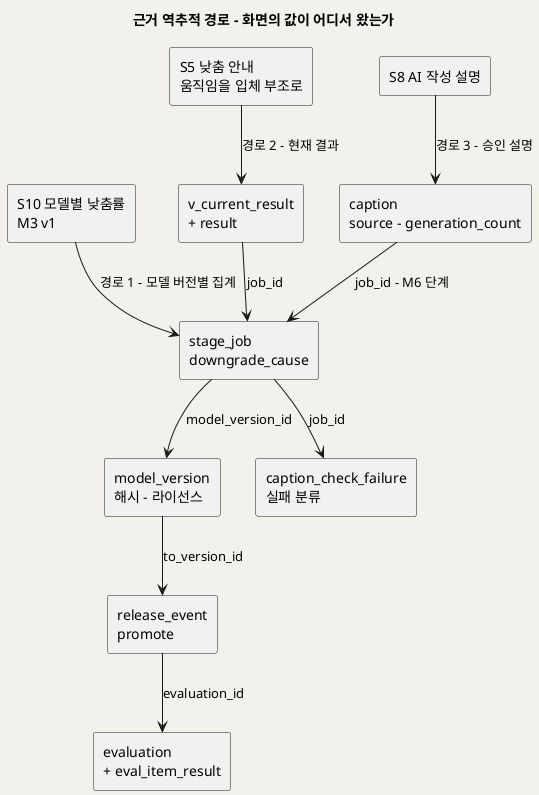

**[「근거 역추적 경로」 PlantUML 뷰어로 열기](https://plantuml.sumzip.com/plantuml/svg/eNptk9Fr01AUxt_zVxzmoxSsZVJ8kGlpQaEwKuypEO7Suyw2vSk3SX3tRgbS6cOk04rr6KBjdah0W5kT6j-Ue_o_eG5TbSo-5n6_78vNd042_IDJIGy4hl93RJNJ1oBtZtVt6YWiVvBcT8K9Uq6ULT5LEf4uq3mvHWHDDnN9bgRO4HKIf0zjqzHgx29428XBHsTXv9TZCWRg9qmrvkyw34N4_B77E8APE9XtYnQCSFKnG4_bhuRWwIRNQWsvsw9AXY7Uuzt1E4Ha_463Q3U-qIpyDlrZNWA-ELLiWF9ggMdv1P6kKvBzGy_28DTCfgR4eoDXE1C3bTwb052SiPWVhDw8fU7gEUZXgNFQXR4kVD5NUV02N19521VBDQhbsho3LRb6PIFfpOGGV-Ou2eLSdzxRFbPjCR7qOlR_SiVgNMDOcG4rb6Vtkruc-dzkLS6CqmhKr-EFSX6lmAZ5i7khC-bh90E_mU7AG6bkfugGc0NxJbllWqGUlLpAtC0FFypp2GLNJNr3QmlxurfNBZfz95kWrcfCtPkfk2ntcqtu7jDHDSWnYRwOZ29H1H-kznuJrVAy9JgzmSfUGjz-syxZ3c989KCuIxxEegPw4ii-iQziNF7eInylW9OpGXSqxUqRxMBLK3SklaK2LSvTCm2NVgqV5fsf6nXtRXj6lU7G8c3UIPXvJWnwc18-8W0ufTnyYecn9u8Wy2OQ-o-PkPIjUIej1MdQD8vcDS5q9C_-BoMqe_o=)** — 클릭 시 브라우저로 연결됩니다.

**경로 1 — S10 모델별 낮춤률 → 이 버전은 어떤 평가를 통과해 활성이 됐나**

```sql
SELECT mv.model_id, mv.version_label,
       COUNT(j.job_id) AS attempts,
       SUM(CASE WHEN j.downgrade_cause IS NOT NULL THEN 1 ELSE 0 END) AS downgraded,
       re.event_id AS promote_event_id, re.evaluation_id,
       pe.item_total, pe.done_count, e.verdict, e.judged_at
  FROM model_version mv
  JOIN stage_job j ON j.model_version_id = mv.version_id AND j.status <> 'cancelled'
  LEFT JOIN release_event re ON re.to_version_id = mv.version_id AND re.kind = 'promote'
  LEFT JOIN evaluation e ON e.evaluation_id = re.evaluation_id
  LEFT JOIN v_promotion_eligibility pe ON pe.evaluation_id = e.evaluation_id
 WHERE mv.model_id = 'M3'
 GROUP BY mv.model_id, mv.version_label, re.event_id, re.evaluation_id,
          pe.item_total, pe.done_count, e.verdict, e.judged_at;
```

**경로 2 — S5 낮춤 안내 "움직임을 만들기 어려워 입체 부조로 바꿨어요" → 어느 단계·어느 모델 버전이 낮췄나**

```sql
SELECT a.artwork_id, cr.result_kind AS current_kind,
       jd.stage_kind AS downgraded_stage, jd.downgrade_cause,
       mv.model_id, mv.version_label, jr.stage_kind AS result_stage
  FROM artwork a
  JOIN v_current_result cr ON cr.artwork_id = a.artwork_id
  JOIN stage_job jr ON jr.job_id = cr.job_id
  LEFT JOIN stage_job jd ON jd.artwork_id = a.artwork_id AND jd.downgrade_cause IS NOT NULL
  LEFT JOIN model_version mv ON mv.version_id = jd.model_version_id
 WHERE a.artwork_id = ?;
```

**경로 3 — S8 "AI 작성" 설명 → 어떤 출처·모델 버전·규칙 검사 실패를 거쳤나**

```sql
SELECT cp.caption_id, cp.source, cp.ai_badge, cp.generation_count, cp.is_edited, cp.approved_at,
       j.job_id, j.downgrade_cause, mv.model_id, mv.version_label,
       (SELECT COUNT(*) FROM caption_check_failure f WHERE f.job_id = cp.job_id) AS rule_failures
  FROM caption cp
  LEFT JOIN stage_job j ON j.job_id = cp.job_id
  LEFT JOIN model_version mv ON mv.version_id = j.model_version_id
 WHERE cp.artwork_id = ? AND cp.status = 'approved';
```

**경로 4 — S10 결과 미도달 건 → G9는 언제 발생했고 누가 어떻게 풀었나**

```sql
SELECT j.job_id, mv.model_id, mv.version_label, j.error_class, j.attempt_count,
       g.event_id, g.occurred_at, g.released_at, g.release_action, g.released_by_role
  FROM stage_job j
  JOIN model_version mv ON mv.version_id = j.model_version_id
  LEFT JOIN gate_event g ON g.subject_kind = 'stage_job' AND g.subject_id = j.job_id AND g.gate_id = 'G9'
 WHERE j.status = 'failed' AND j.stage_kind IN ('animate_render','depth_relief','sculpture');
```

경로 1·4는 작품이 지워진 뒤에도 끝까지 따라간다(단계 작업·게이트 이벤트는 영구). 경로 2·3은 작품이 살아 있는 동안만 따라간다 — 삭제 뒤에 그 문장·결과를 되살릴 수 있다면 삭제가 아니다(BR-DEL-01).

---

## 14. 게이트의 데이터 표현

SD_01 게이트 **26개 전건**이다. "차단 구현"이 판정의 **단일 지점**이다.

| 게이트 | 판정 근거 데이터 | 차단 구현 | 해제 기록 |
|:--:|---|---|---|
| G0 가족 접근 | 세션의 가족 ID ↔ `artwork.family_id` · `child.family_id` | 애플리케이션 인가 모듈(모든 가족 조회에 `family_id` 조건). 삭제 권한은 `deletion_request.requested_by` → `guardian_account` FK | `gate_event`(subject session, actor anonymous/guardian) · 해제는 재로그인 |
| G1 팀원 역할 | `team_member_role.role` | 애플리케이션 인가 모듈 · `chk_tmr_role` | `gate_event`(released_by_role = 해당 역할) |
| G2 API 키·한도 | `api_key.status` · `key_kind` · `external_call_log` 건수 | 애플리케이션(한도 계산) · 트리거 `trg_external_job_bi`(폐기 키 · `pose` 팀 내부 키) | `external_call_log.http_status`(401/403/429) · `gate_event`(external_call) |
| G3 기록 반영 | DB 쓰기 성공 여부 | 트랜잭션 경계(부분 반영 없음) | `gate_event`(reason db_write_failed) · 재시도 성공 시 해제 |
| G4 별칭 검사 | `child.alias` | `chk_child_alias_nonblank`(중복 검사 없음, D18) | `gate_event`(child) |
| G5 사진 검사 | 업로드 파일(형식·용량·판독) | 애플리케이션(업로드 단계). DB 행이 생기기 전이다 | `gate_event`(session, reason format/size/unreadable) |
| G6 내구 접수 | 원본 객체 + `artwork` + 작업 기록 | 한 트랜잭션 + 보상 삭제(원본 제거) · `uq_artwork_request` | `gate_event`(session) |
| G7 판정 제안 도달 | `stage_job`(judge) attempt_count · error_class | `judgment.suggestion_state='exhausted'` · `chk_jd_state_suggestion` | `artwork_outcome.suggestion_at_confirm='none'`(보호자 직접 확정) |
| G8 확정 가능 상태 | `artwork.status` · `artwork_outcome.confirmed_path` | 트리거 `trg_outcome_bu`(확정값 고정) · `trg_decision_bi`(상태) | `gate_event`(artwork) |
| G9 결과 단계 소진 | `stage_job.attempt_count=3` ∧ `status='failed'` | `artwork.status='failed'` · `trg_decision_bi`(액자·다시 찍기만) | `decision`(frame · retake) · `artwork_outcome.result_cause='not_delivered'` · `gate_event.released_at` |
| G10 결과 열람 | 저장소 읽기 결과 | 애플리케이션(파일 읽기). 결정 버튼 비활성 | `gate_event`(artwork, reason preview/original_unreadable) |
| G11 이야기 값 | `story.made_on` · `age_at_creation` | `chk_st_age` · 트리거 `trg_story_b*`(미래 날짜 · 전시 중 필수 비움) | `gate_event`(artwork) |
| G12 전시 | `artwork.status` · `v_story_complete` | **뷰 `v_exhibit_gate`** (v_gallery는 이 뷰만 통과) | 조건이 채워지면 자동 해제 — `gate_event.released_at` |
| G13 설명 모델 조건 | `model_version`(M6) `release_state` · `license_confirmed` | `chk_mv_license_active` · 트리거 `trg_stage_job_bi`(활성 버전만) | `release_event`(M6 promote) |
| G14 설명 입력 | 키워드 · `caption_selected_tag` | 애플리케이션(요청 전 검사) | 해당 없음(입력하면 끝남) |
| G15 LLM 초안 도달 | `stage_job`(caption) error_class · attempt_count | `stage_job.status='failed'` | `caption.source`(template · direct) 선택 · `gate_event.released_at` |
| G16 규칙 검사 | 규칙 검사 결과 | M6 어댑터 코드 · `caption_check_failure` · `stage_job.downgrade_cause='llm_to_template'` | `caption` 행 생성(통과 초안 또는 템플릿) |
| G17 3D 노출 | `feature_setting.enabled` | 트리거 `trg_outcome_b*` · 뷰 `v_gallery.display_kind` | `feature_setting.changed_by` · `changed_at` |
| G18 삭제 착수 | `artwork.status='deleting'` 전환 성공 | 트랜잭션 · `chk_artwork_deleting` | `deletion_request.status='accepted'` |
| G19 처리 멈춤(보류) | `stage_job.cancel_requested_at` · `stopped_at` | **뷰 `v_deletion_hold`** · `chk_sj_stop_after_cancel` | `stage_job.stopped_at` · `deletion_request.status` 전이 |
| G20 평가 항목 등록 | `eval_item.maker_attested` · 객체 소유 | `chk_ei_attested` · 트리거 `trg_eval_item_bi` | 재등록 |
| G21 평가 착수 | 설치본 해시(실시간) ↔ `model_version` 해시 · 포트 격리 | 애플리케이션(평가 요청 시) | `gate_event`(model_version) |
| G22 승격 | `eval_item_result` 완료 수 · `item_total` · 라이선스 · 해시 · verdict | **뷰 `v_promotion_eligibility`** + 트리거 `trg_release_event_bi` | `release_event`(promote) |
| G23 시험 호출 입력 | `eval_item` · `model_version` 활성 | 애플리케이션(평가 묶음 드롭다운) · `trg_external_job_bi`(활성 버전) | `gate_event`(eval_item) |
| G24 요청 크기·형식 | 요청 본문 | 애플리케이션(본문 읽기 전) · `chk_ej_func` | `external_call_log.http_status`(413/422) |
| G25 외부 기능 준비 | `model_version` 활성 · `/ready` | 트리거 `trg_external_job_bi` · `chk_ej_func`(3D 없음) | `release_event` 또는 운영자 복구 · `external_call_log`(503/404) |
| G26 이메일 검사(가입) | `guardian_account.email` · `email_norm` | `uq_guardian_email` · `chk_guardian_email_format` · NOT NULL `password_hash` + 애플리케이션(이메일별·IP별 요청 한도) | 계정·가족 공간 미생성(트랜잭션 롤백). 응답은 항상 202, 이미 가입된 주소엔 안내 메일만 |
| G27 메일 링크 토큰 | `auth_email_token.token_hash` · `expires_at` · `used_at` · `revoked_at` | `uq_token_hash` · `chk_token_purpose` · `chk_token_used_or_revoked` · `ix_token_account_purpose`(재발급 시 이전 무효) + 애플리케이션(UTC 만료 비교) | 400 `token_invalid`(만료·사용·무효 구분 없음) |
| G28 초대 수락 | `family_invite.token_hash` · `email_norm` · `expires_at` · `accepted_at` · `revoked_at` · `guardian_account.family_id` | `uq_invite_token_hash` · `chk_invite_accepted_or_revoked` · `ix_invite_family_email` + 애플리케이션(이메일 일치·다른 가족 미소속·UTC 만료) | `gate_event`(family_invite) · 400 `token_invalid` · 409 `already_in_family` |
| G29 보호자 해제 권한 | `guardian_account.role` · `owner_family_id` | `uq_guardian_owner_family` · `chk_guardian_role` · `chk_guardian_owner_family` + 애플리케이션(요청자 role = owner) · 해제·나가기 시 대상 계정 세션 전부 삭제 | `gate_event`(guardian_account) · 403 · 409 |

**게이트 이벤트를 남기는 규칙** — 모든 게이트 미통과는 `gate_event` 1행을 남긴다(사유 코드만, BR-PRV-01). 해제되면 같은 행의 `released_at` · `release_action` · `released_by_role`을 채운다. G14처럼 입력 즉시 풀리는 입력 검증은 화면 안에서 끝나므로 이벤트를 남기지 않아도 된다 [추론 — 이벤트 폭주 방지].

---

## 15. IPO·UI 대 테이블 사상

### 15-1 IPO 단계 → 테이블

| IPO | 쓰는(W) · 읽는(R) 테이블 |
|---|---|
| 0.1 · 0.6 점유 | W `stage_job`(claimed_by · attempt_count · started_at) · R `model_version` |
| 0.2 원본 읽기 | R `artwork_original` · `stored_object` |
| 0.3 분리 | W `stored_object`(mask · cutout) · `judgment.split_ok` |
| 0.4 판정 | W `judgment`(kind_candidate · geometry_pass · person_score) · `stored_object`(joints) · `tag_candidate` |
| 0.5 제안 | W `judgment.suggestion` · `suggestion_state` · `artwork.status` · `gate_event`(G7) |
| 0.7 모델 실행 | W `stage_job` · R `judgment`(마스크 · 관절 재사용) |
| 0.8 낮춤 | W `stage_job.downgrade_cause` · 새 `stage_job`(origin downgrade) |
| 0.9 재시도 | W `stage_job.error_class` · `attempt_count` · `artwork.status='failed'` · `gate_event`(G9) · `artwork_outcome.result_cause` |
| 0.10 결과 | W `result` · `stored_object` · `stage_job.finished_at` · `artwork.status` · `artwork_outcome.result_kind`·`result_cause` |
| 0.11 취소 | W `stage_job.stopped_at` · `status='cancelled'` |
| 0.12 임시 정리 | W `stored_object`(temp 삭제) |
| 1.1~1.5 | R/W `child` · R `family` |
| 2.1~2.3 | W `artwork` · `stored_object`(original) · `artwork_original` · `stage_job`(split · judge) |
| 2.5~2.7 | R `judgment` · `tag_candidate` · W `artwork_outcome`(suggestion_at_confirm · confirmed_path) · `stage_job` · `artwork.status` |
| 3.1~3.4 | R `v_artwork_display` · `v_job_progress` · `v_current_result` · `artwork_original` |
| 3.5 | W `decision` · `artwork_outcome`(first_decision · result_cause · in_approval_base) · `artwork.status`·`approved_at` · (H6) `stage_job` · (H8) `deletion_request` |
| 3.6~3.9 | R/W `story` · R `v_exhibit_gate` |
| 3.10 | R `caption` |
| 4.1~4.9 | R `tag_candidate` · `model_version` · W `caption` · `caption_selected_tag` · `stage_job`(caption) · `caption_check_failure` |
| 5.1~5.6 | R `v_gallery` · `artwork_original` · `stored_object` |
| 6.1~6.7 | W `deletion_request` · `artwork.status` · `stage_job.cancel_requested_at` · DELETE `stored_object` → `artwork`(CASCADE: story · decision · caption · judgment · tag_candidate · result) · R `v_deletion_hold` |
| 7.1~7.7 | R `team_member_role` · `v_metrics_service` · `v_metrics_model` · `v_cause_breakdown` · `v_not_delivered_trace` · `v_external_usage` · `model_version` |
| 8.1~8.8 | R/W `model_version` · `eval_item` · `evaluation` · `eval_item_result` · `release_event` · R `v_promotion_eligibility` |
| 9.1~9.7 | R `model_version` · `eval_item` · `api_key` · W `external_job`(시험) |
| 10.1~10.7 | R `api_key` · `model_version` · W `external_call_log` · `external_job` |

### 15-2 UI 컴포넌트 → 테이블

| 컴포넌트 | 테이블·뷰 |
|---|---|
| C1 진행 레일 | `v_artwork_display` · `stage_job`(queued) · `gate_event`(열린 게이트) |
| C2 차단 블록 | `gate_event` · `gate_catalog` |
| C3 비활성 버튼 | §14의 판정 지점 |
| C4 상태 배지 | `v_artwork_display` · `stage_job.status` |
| C5 원본-결과 비교 | `artwork_original` · `v_current_result` · `stored_object` · `v_gallery.display_kind` |
| C6 낮춤 안내 | `stage_job.downgrade_cause` |
| C7 이야기 카드 | `story` · `caption`(approved, ai_badge) |
| C8 전시 조건 체크 | `v_exhibit_gate` |
| C9 셸 헤더 | `team_member_role` · `v_team_member_masked` |
| C10 모델 상태 칩 | `model` · `model_version` · `feature_setting` (+ `/ready` 외부) |

### 15-3 UC 사후조건 → 컬럼 변화

| UC | 사후조건 | 테이블·컬럼 변화 |
|:--:|---|---|
| UC1 | 새 아이 저장 · 별칭 중복 허용(D18) · 실명 없음 · 법정대리인 미완료 · 로그에 별칭 없음 | INSERT `child`(alias) · (UNIQUE 없음) · 컬럼 부재 · `legal_rep_confirmed=FALSE` · 로그 규칙(§17) |
| UC2 | (1) 원본·작품·작업 기록 (2) 판정 단계 기록·마스크 (3) 제안값·확정값·수정 여부·처리 중 (4) 확정 대기 유지 (5) 실패 시 아무것도 없음 (6) 원본 불변 | (1) `artwork` · `stored_object` · `artwork_original` · `stage_job` (2) `stage_job` · `judgment` · `stored_object`(mask) (3) `artwork_outcome` · `artwork.status='processing'` (4) `artwork.status='awaiting_confirm'` (5) G6 트랜잭션 (6) `trg_artwork_original_bu` |
| UC3 | 확인 대기/처리하지 못함 · 단계 기록 · 결과 종류와 원인 분리 · 처음 결과만 · 임시 파일 없음 · 원본 불변 · 점수 기록만 · 미전시 | `artwork.status` · `stage_job.*` · `artwork_outcome.result_kind`·`result_cause` · `uq_rs_first` · `stored_object`(temp 삭제) · `judgment.person_score` · G12 뷰 |
| UC4 | 결정 1회 · 보호자 전환 · 승인됨/전시 · use_lower면 처리 중 · retake면 삭제 · 원본·처음 결과 보관 · 첫 결정 이벤트 | `decision`(uq_dc_round) · `artwork_outcome.result_cause='guardian_switch'` · `artwork.status`·`approved_at` · `stage_job`(origin use_lower) · `deletion_request`(origin retake) · `uq_rs_first` · `decision.is_first` · `artwork_outcome.first_decision` |
| UC5 | 원문 저장 · 설명 필드 불변 · 전시 중 전환 · 문장 생성 없음 · 로그에 자유 입력 없음 | `story` · `caption` 무변화 · `v_exhibit_gate` · — · §17 |
| UC6 | 전시 중만 봄 · 미전시·삭제 중 비노출 · 읽기만 · 모델 호출 없음 | R `v_gallery` 전용 · 쓰기 없음 |
| UC7 | 목록 제외 · 단계 작업 멈춤 · 파일 0 · 기록·설명 없음 · 집계 필드만 · 아이 삭제 · 삭제 미완료 집계 · 평가 묶음 불변 | `artwork.status='deleting'` · `stage_job.stopped_at` · DELETE `stored_object` · CASCADE · `stage_job.artwork_id`·`artwork_outcome.artwork_id` NULL · DELETE `child` · `deletion_request.status='incomplete'` · `owner_kind='eval_set'` 분리 |
| UC8 | 생존·준비 확인 · 지표 확인 · 식별 정보 비노출 · 읽기 전용 | 외부 · `v_metrics_*` · 운영 뷰 컬럼 제한 · 쓰기 없음 |
| UC9 | 평가 기록이 매니페스트에 연결 · 승격(활성·롤백 후보) · 롤백(사유) · 계약 불변 · 가족 데이터 없음 | `evaluation` · `eval_item_result` · `model_version.release_state` · `release_event` · `chk_ej_func`·응답 분류 CHECK 불변 · `chk_so_owner` |
| UC10 | 설명 기록 1건 · 승인본 고정 · 한마디 불변 · 단계 작업 기록 · 이미지·이름 미전송 | `caption` · `caption_selected_tag` · `uq_cp_one_approved`·`trg_caption_bu` · `story` 무변화 · `stage_job`(caption) · 입력 컬럼 부재 |
| UC11 | 확인만 · 버전 불일치 경고 · 가족 데이터 없음 · 시험 호출 비보존 | R `model_version` · 외부 · — · `external_job`(test 키, 입력 컬럼 없음) |
| UC12 | 결과 또는 오류 분류 · 모델 버전 · 수령 뒤 흔적 없음 · 키 식별자·집계만 · 가족 데이터 무변화 · 한도 1건 차감 | `external_job.result_class`/`error_class` · `model_version_id` · `result_temp_ref` NULL · `external_call_log` · — · `external_call_log` 1행 |
| UC13 | 계정·가족 공간 동시 생성 · 이메일 대소문자 무시 유일 · 확인 전/후 · 비밀번호 해시 · 법정대리인 미완료 | INSERT `family` + `guardian_account`(한 트랜잭션) · `uq_guardian_email` · `email_verified_at` · `password_hash` · `chk_guardian_legal_rep` |
| UC14 | 재설정 토큰 1회용·유효 시간·재발급 시 이전 무효 · 비밀번호 해시 변경 · 가입 여부 비노출 | INSERT/UPDATE `auth_email_token`(used_at · revoked_at) · UPDATE `guardian_account.password_hash` · `password_changed_at`(이전 세션 무효) · 응답 규칙(애플리케이션) |
| UC15 | 초대 1건·재초대 시 이전 무효 · 수락 시 공동 보호자 연결 · 가족당 만든 보호자 1명 · 해제·나가기 시 연결 끊김, 자료 유지 | INSERT/UPDATE `family_invite` · UPDATE `guardian_account.family_id`·`role` · `uq_guardian_owner_family` · 세션 무효(애플리케이션) |

---

## 16. 무결성 제약과 인덱스

### 16-1 업무규칙 → 제약

업무규칙 **84개 전건**이다. 구현 종류: `UQ`(UNIQUE) · `CHK`(CHECK) · `FK` · `GEN`(생성 컬럼) · `TRG`(트리거) · `VIEW` · `APP`(애플리케이션 책임, 이유를 적음) · `부재`(컬럼을 두지 않는 것이 구현).

| BR | 구현 | 제약·위치 |
|---|---|---|
| BR-CHD-01 | 부재 · CHK | 실명·생년월일 컬럼 없음 · `chk_child_alias_nonblank` |
| BR-CHD-02 | 부재(v2.2 개정, D18) | 별칭 UNIQUE 없음 — 아이는 `child_id`로 구분 |
| BR-INT-01 | APP | 업로드 검사(G5). 행 생성 전이라 DB로 못 막는다 |
| BR-INT-02 | APP(트랜잭션) | 원본 저장 + `artwork` + `stage_job` 한 단위, 실패 시 보상 삭제(G6) |
| BR-INT-03 | UQ | `uq_artwork_request` |
| BR-INT-04 | TRG · FK | `trg_artwork_original_bu` · 판정·결과는 원본을 읽기만(쓰기 경로 없음) |
| BR-INT-05 | CHK | `chk_oc_path` — 처리 경로는 `artwork_outcome.confirmed_path` |
| BR-SUG-01 | APP | 워커 파이프라인 순서(M1→M4). 결과는 `judgment` |
| BR-SUG-02 | VIEW · 부재 | 보호자 뷰에 `person_score` 없음 |
| BR-SUG-03 | GEN · CHK | `is_modified` · 확정값을 막는 CHECK 없음 |
| BR-SUG-04 | APP | 제안 규칙 코드(점수 단독 금지). `geometry_pass` 저장 |
| BR-SUG-05 | CHK | `suggestion_at_confirm IN ('before','none')` 허용 |
| BR-PRC-01 | CHK | `chk_sj_model_required` · `chk_sj_frame_no_model` |
| BR-PRC-02 | TRG | `trg_stage_job_bu`(낮춤으로 닫힌 작업 재개 금지, §19 #19) |
| BR-PRC-03 | CHK | `chk_sj_attempts`(0~3) · `chk_ej_attempts` |
| BR-PRC-04 | 부재 | 점수는 `judgment.person_score` · `eval_item_result.score`에만, 결정 로직 입력 아님 |
| BR-PRC-05 | APP · 컬럼 | `claimed_by` · `claim_expires_at` + 워커의 원자적 점유 쿼리 |
| BR-PRC-06 | APP | 시간 상한(움직임 10분 외 미정, U6). 초과는 `error_class='timeout'` |
| BR-PRC-07 | 컬럼 | `stage_job.status='queued'` · `ix_sj_queue` |
| BR-PRC-08 | APP · 컬럼 | `object_kind='temp'` 행 정리(0.12) |
| BR-FBK-01 | CHK | `chk_sj_downgrade` 구간 코드 |
| BR-FBK-02 | CHK | `chk_jd_split_fail_frame` |
| BR-FBK-03 | 컬럼 | `stage_job.downgrade_cause` → C6 |
| BR-FBK-04 | CHK | `chk_sj_cause_exclusive` · `chk_oc_cause` |
| BR-APR-01 | VIEW | `v_exhibit_gate` · `v_gallery` |
| BR-APR-02 | CHK · APP | `chk_dc_code` · 선택지 규칙 함수(§2-3) |
| BR-APR-03 | UQ | `uq_rs_first` |
| BR-APR-04 | CHK | `result_cause='guardian_switch'` |
| BR-APR-05 | CHK | `deletion_request.origin='retake'` |
| BR-APR-06 | UQ · CHK · TRG | `uq_dc_round` · `chk_dc_round` · `trg_decision_bi` |
| BR-STY-01 | VIEW | `v_story_complete`(부분 저장 허용, UC5 A5) |
| BR-STY-02 | CHK · TRG | `chk_st_age` · `trg_story_b*`(제작일 ≤ 오늘 — CURRENT_DATE를 CHECK에 못 씀) |
| BR-STY-03 | 부재(분리) | `story.utterance`와 `caption.body`가 다른 테이블 |
| BR-CAP-01 | 부재 · APP | 이미지·별칭 입력 컬럼 없음 · 입력 조립 코드(4.3) |
| BR-CAP-02 | TBL · APP | `caption_check_failure` · 재생성 상한(U11) |
| BR-CAP-03 | GEN · 컬럼 | `ai_badge` · `source` · `generation_count` |
| BR-CAP-04 | UQ · TRG | `uq_cp_one_approved` · `trg_caption_bi/bu` |
| BR-CAP-05 | APP | LLM 호출 대상 설정(과정 제공 LLM은 U3 뒤) |
| BR-CAP-06 | FK | `caption_selected_tag.tag_id` → `tag_candidate` |
| BR-CAP-07 | 부재 | 걸린 초안 컬럼 없음(`caption.body`는 통과분만) |
| BR-EXH-01 | VIEW | `v_exhibit_gate` |
| BR-EXH-02 | VIEW · 인덱스 | `v_gallery` · `ix_story_age` |
| BR-EXH-03 | APP | 화면 재생 동작(데이터 없음) |
| BR-EXH-04 | VIEW · 부재 | `v_gallery`에 낮춤·원인 컬럼 없음 |
| BR-EXH-05 | VIEW | `v_gallery.caption_body` · `ai_badge` 분리 |
| BR-EXH-06 | VIEW · APP | 3D 표시 문구는 화면 · 노출은 `display_kind` |
| BR-EXH-07 | VIEW · 부재 | `v_gallery`에 `downgrade_cause` · `result_cause` 없음 |
| BR-DEL-01 | FK · TRG | `fk_so_artwork` RESTRICT · `trg_stage_job_bi`(새 작업 차단) · `v_deletion_hold` |
| BR-DEL-02 | FK · TRG | `ON DELETE SET NULL` · `trg_deletion_bu` |
| BR-DEL-03 | CHK | `deletion_request.status='incomplete'` · `file_retry_count` |
| BR-DEL-04 | 부재 | 백업 사본 테이블 없음(P0 밖, U15) |
| BR-DEL-05 | TRG | `trg_story_b*` · `trg_caption_bi` · `trg_stage_job_bi` · `trg_decision_bi` |
| BR-ACC-01 | APP · 컬럼 | 모든 가족 테이블에 `family_id` 경로 + 인가 모듈(G0) |
| BR-ACC-02 | APP | 세션 인가(G0) |
| BR-ACC-03 | VIEW · 부재 | 운영 뷰에 작품 ID·객체 키 없음 |
| BR-ACC-04 | FK | `deletion_request.requested_by` → `guardian_account` |
| BR-ACC-05 | CHK | `chk_tmr_role` |
| BR-ACC-06 | UQ · GEN | `email_norm = LOWER(email)` STORED + `uq_guardian_email` |
| BR-ACC-07 | 컬럼 · APP | 계정 컬럼은 이메일·비밀번호 해시뿐(실명·전화번호 컬럼 없음) · 계정+가족 공간 한 트랜잭션 |
| BR-ACC-08 | UQ · CHK · APP | `uq_token_hash` · `chk_token_purpose` · `chk_token_used_or_revoked` · 만료 비교와 존재 비노출 응답은 애플리케이션 |
| BR-ACC-09 | UQ · GEN · CHK · APP | `owner_family_id` STORED + `uq_guardian_owner_family` · `chk_guardian_role` · `family_invite` · 해제 권한과 이메일 일치는 애플리케이션 |
| BR-OPS-01 | 외부 | `/live` · `/ready`(저장 안 함) |
| BR-OPS-02 | VIEW | `v_metrics_service` · `v_metrics_model` |
| BR-OPS-03 | VIEW | `v_cause_breakdown` |
| BR-OPS-04 | VIEW · 부재 | 지표 뷰 라벨에 식별 정보 없음 |
| BR-MDL-01 | CHK · GEN | `chk_mv_manifest_active` · `uq_mv_one_active` · `stage_job.model_version_id` |
| BR-MDL-02 | APP | 어댑터 구조(데이터 없음) |
| BR-MDL-03 | VIEW · TRG · CHK | `v_promotion_eligibility` · `trg_release_event_bi` · `chk_re_promote_eval` · `chk_re_rollback` |
| BR-MDL-04 | CHK · TRG | `chk_ei_attested` · `chk_so_owner` · `trg_eval_item_bi` |
| BR-MDL-05 | CHK | 응답 분류 코드 CHECK(`chk_sj_*` · `chk_ej_*`)는 모델 버전과 무관 |
| BR-MDL-06 | 컬럼 · APP | `image_digest` · 격리 확인(G21) |
| BR-MDL-07 | CHK · TRG | `chk_mv_license_active` · `trg_stage_job_bi` · `trg_external_job_bi` |
| BR-SRV-01 | CHK | `chk_model_serving` · `chk_sj_serving` |
| BR-SRV-02 | 컬럼 · VIEW | `exec_device` · `feature_setting` · `v_gallery.display_kind` |
| BR-SRV-03 | APP | 시간 상한·동시 처리 상한(U6) |
| BR-SRV-04 | APP | 네트워크 설정(데이터 없음) |
| BR-API-01 | APP | 배포 구조(데이터 없음) |
| BR-API-02 | CHK | `chk_sj_error` · `chk_sj_downgrade` · `chk_ej_result` · `chk_ej_error` |
| BR-API-03 | 컬럼 · TRG | `api_key.key_hash` · `trg_external_job_bi` |
| BR-API-04 | APP · TBL | `external_call_log` 집계 + 설정값(U12) |
| BR-API-05 | 부재 · CHK | 입력 컬럼 없음 · `chk_ej_delivered` |
| BR-API-06 | APP | 외부 키의 경로 인가(가족 경로 403) |
| BR-API-07 | APP | 메뉴 인가(G1) |
| BR-API-08 | 외부 | `/openapi.json` |
| BR-API-09 | CHK · TRG | `chk_so_owner` · `trg_eval_item_bi`(시험 입력은 `eval_item`만) |
| BR-PRV-01 | 부재 · CHK | `gate_event.reason_code` 코드만 · 운영 뷰 컬럼 제한 · 로그 규칙(§17) |
| BR-PRV-02 | APP · 부재 | 학습 재사용 경로 없음 · 외부 전송 설정 |
| BR-PRV-03 | CHK | `chk_guardian_legal_rep` |

**CHECK로 옮기지 못한 규칙과 이유**

| 규칙 | 강제 위치 | 이유 |
|---|---|---|
| 제작일 ≤ 오늘(BR-STY-02) | 트리거 | CHECK에 비결정적 함수(CURRENT_DATE)를 쓸 수 없다 |
| 삭제 중 작품에 쓰기 금지(BR-DEL-05) · 결정 가능 상태(G8·G9) · 3D 노출(G17) · 활성 버전만(BR-MDL-07) · pose 키 종류(D17) · 승인 설명 고정(BR-CAP-04) · 평가 객체 소유(G20) · 승격 가능(G22) | 트리거 | 다른 테이블의 행을 봐야 한다(다중 행 조건) |
| 끝난 삭제에 연결 없음(BR-DEL-02) | 트리거 | MariaDB는 SET NULL FK 컬럼을 CHECK에 쓸 수 없다(실측 ERROR 1901) |
| 상태 전이의 합법성 | 애플리케이션 상태 전이표 | 이전 상태와 새 상태의 쌍 조건. 트리거로도 가능하지만 전이표가 SD_02 §2-3 도면과 한 곳에서 관리되도록 앱에 두었다 |
| 한도·시간 상한·재시도 간격 | 애플리케이션 설정 | 수치가 미정(U6 · U12). 상수를 스키마에 박지 않는다 |
| 사진 검사(BR-INT-01) · 입력 조립(BR-CAP-01) | 애플리케이션 | DB 행이 생기기 전 단계다 |

### 16-2 인덱스

| 인덱스 | 쓰는 곳 |
|---|---|
| `ix_artwork_family_status (family_id, status)` | S4 목록 · G0 가족 조건 |
| `ix_artwork_child (child_id)` | S1 작품 수 · S8 아이별 |
| `ix_sj_queue (serving_group, status, queued_at)` | 워커 점유(0.1 · 0.6) · 큐 적체 |
| `ix_sj_artwork (artwork_id, stage_kind)` | S4 진행 · 삭제 시 실행 중 작업 찾기 |
| `ix_sj_version (model_version_id, status)` | S10 모델별 지표 · 역추적 경로 1 |
| `ix_so_artwork (artwork_id)` | 삭제 대상 목록(6.5) |
| `ix_story_age (age_at_creation, made_on)` | S8 연령 묶음 → 제작일 순 |
| `ix_ge_subject (subject_kind, subject_id)` · `ix_ge_open (gate_id, released_at)` | C1 막힌 자리 · 역추적 경로 4 |
| `ix_ecl_key_time (key_id, called_at)` | G2 한도 계산 |
| `ix_ej_queue (status, queued_at)` | 외부 작업 대기열(보호자 작업보다 낮은 우선순위, D17) |
| `ix_sj_claim (serving_group, status, available_at, priority, queued_at)` | 워커 점유 `SELECT … FOR UPDATE SKIP LOCKED`(S2) |
| `ix_ej_claim (status, available_at, queued_at)` | 외부 작업 점유(S4) |
| `ix_session_subject (subject_kind, subject_id)` | 재설정·해제 시 그 계정 세션 전부 삭제(S6) |
| `ix_rate_window (subject_type, subject_hash, action, occurred_at)` | 인증·초대 요청 한도 창 계산(S7) |

### 16-3 다형 참조 점검

`gate_event(subject_kind, subject_id)`는 FK를 걸 수 없다. 점검 뷰 `v_gate_event_orphans`가 대상 행이 없는 이벤트를 찾는다. 작품이 삭제되면 그 작품을 가리키는 이벤트의 `subject_id`를 NULL로 바꾸는 것이 삭제 절차(6.6)의 한 단계다 [추론 — BR-DEL-02의 연장]. 점검 주기는 미정이다(§19).

```sql
SELECT COUNT(*) FROM v_gate_event_orphans;   -- 0이어야 한다
```

---

## 17. 보존·마스킹·감사

| 대상 | 저장 형태 | 조회 경로 | 근거 |
|---|---|---|---|
| 아이 | 별칭만 | 가족 인가를 거친 보호자 화면 | BR-CHD-01 |
| 원본·결과 파일 | 저장소 객체, DB에는 `object_key`만 | 보호자 화면의 짧게 유효한 읽기 전용 주소([추론], UC6) · 운영 뷰에는 없음 | BR-PRV-01 · BR-ACC-03 |
| 제목·한마디·키워드·설명 | 평문(가족 화면에 그대로 보여야 함) | 가족 인가 경로만. 운영 로그·지표 라벨에 나가지 않음 | BR-PRV-01 · BR-OPS-04 |
| 판정 점수 | 숫자 | 내부 기록만(보호자 뷰에 없음) | BR-PRC-04 · BR-SUG-02 |
| 팀원 이메일 | 평문 | 화면은 `v_team_member_masked` | SD_02 §17 |
| API 키 | SHA-256 해시만 | 원문은 발급 순간에만 보임(발급 흐름 미정, U12) | BR-API-03 |
| 외부 입력 | 저장하지 않음 | — | BR-API-05 · D8 |
| 게이트 사유 | 코드만 | `gate_event.reason_code` | BR-PRV-01 |

**보존** — 원천에 보존 기간이 있는 것은 "삭제하면 즉시"(UC7)와 "외부 결과는 수령 즉시 또는 보관 상한"(D8, 상한은 U12 예시값 1시간·확정 아님)뿐이다. 그 밖(단계 작업·게이트 이벤트·호출 기록·평가 기록)의 보존 기간은 원천에 없어 **정하지 않았다**(§19). 백업 사본은 P0 밖이다(BR-DEL-04, U15).

**감사(외부 반출)** — 외부로 나가는 데이터는 P10 결과뿐이다. `external_call_log`(키·엔드포인트·상태 코드·시각)와 `external_job.delivered_at`이 반출 감사 기록이다. 가족 데이터는 외부 경로가 없다(BR-API-06). 운영 로그 자체의 규칙(이미지·객체 키·자유 입력·오류 원문 금지)은 애플리케이션 로깅 설정이 책임지며 DB 밖이다.

---

## 18. DDL 전문과 실행 검증

DDL 전문은 **`design/uri_gallery_ddl.sql`** 이다(테이블 35 · 뷰 16 · 트리거 15 · 상수 시드: 모델 7 · 게이트 30(G0~G29) · 기능 설정 1). 평가 작업 FK 2개는 위상 순서 때문에 `evaluation`·`eval_item` 뒤에서 `ALTER TABLE … ADD FOREIGN KEY IF NOT EXISTS`로 붙인다(S3). 생성 순서는 FK 위상 정렬이다: 상수(`gate_catalog` · `model`) → A → F(모델 버전·설정) → B → C → D → E → F(평가) → G → H → 인덱스 → 트리거 → 뷰 → 시드.

**실행 검증 3종** (MariaDB 12.0.2, 2026-09-28, 검증 전용 임시 인스턴스)

| 검증 | 결과 |
|---|---|
| ① 무오류 실행 | 빈 DB에서 전문 실행 성공 |
| ② 재실행(멱등) | 같은 파일 두 번째 실행 성공, 객체 수 불변(보완 S1~S9·공동 보호자 강제 반영 뒤 테이블 35 · 뷰 16 · 트리거 15) |
| ③ 위반 시도 거부 | **48건 전부 거부**(아래 표). 이어서 제약 직접 확인과 정상 흐름 14단계 모두 기대대로(결정 회차 UNIQUE · 2회차 use_lower CHECK · G9 좋아요 거부 · 노출 켠 뒤 3D 확정 허용 · 취소 → 멈춤 → 파일 삭제 → 기록 삭제 → 삭제 완료 뒤 집계 필드만 잔존) |

| 위반 시도 | 거부한 제약 |
|---|---|
| 빈 별칭(중복은 허용, D18) | `chk_child_alias_nonblank` |
| 이메일 중복(대소문자 무시) · 형식 · 비밀번호 해시 없음 | `uq_guardian_email` · `chk_guardian_email_format` · NOT NULL `password_hash` |
| 메일 토큰 목적 위반 · 해시 중복 · 사용과 무효 동시 | `chk_token_purpose` · `uq_token_hash` · `chk_token_used_or_revoked` |
| 한 가족에 만든 보호자 2명 · 역할 위반 · 초대 수락과 취소 동시 · 초대 토큰 중복 | `uq_guardian_owner_family` · `chk_guardian_role` · `chk_invite_accepted_or_revoked` · `uq_invite_token_hash` |
| 법정대리인 확인 완료 기록 | `chk_guardian_legal_rep` |
| 없는 팀원 역할 | `chk_tmr_role` |
| 같은 요청 번호 중복 접수 | `uq_artwork_request` |
| 상태 "전시 중" 저장 | `chk_artwork_status` |
| 원본 교체 | `trg_artwork_original_bu` |
| 가족 객체를 평가 묶음 소유로 | `chk_so_owner` |
| 시도 4회 · 낮춤+오류 동시 · 낮춤 뒤 재시도 · 액자 합성에 모델 | `chk_sj_attempts` · `chk_sj_cause_exclusive` · `trg_stage_job_bu` · `chk_sj_frame_no_model` |
| 비활성 버전으로 단계 작업 · 라이선스 미확인 활성화 · 모델당 활성 2개 | `trg_stage_job_bi` · `chk_mv_license_active` · `uq_mv_one_active` |
| 제안 소진인데 제안값 · 분리 실패인데 2.5D 제안 | `chk_jd_state_suggestion` · `chk_jd_split_fail_frame` |
| 같은 종류 결과 재생성 | `uq_rs_first` |
| 승인된 작품에 결정 · 확정값 변경 | `trg_decision_bi` · `trg_outcome_bu` |
| 연령 19 · 미래 제작일 · 전시 중 필수 비우기 | `chk_st_age` · `trg_story_bu` |
| 승인 설명 수정 · 승인 뒤 새 초안 · 후보 밖 태그 · 실패 분류 밖 값 | `trg_caption_bu` · `trg_caption_bi` · `fk_cst_tag` · `chk_ccf_class` |
| 노출 꺼진 3D 확정 · 원인 5분류 밖 · 미도달인데 승인율 분모 | `trg_outcome_bi` · `chk_oc_cause` · `chk_oc_base` |
| 제작 확인 없는 평가 항목 · 가족 사진을 평가 항목으로 | `chk_ei_attested` · `trg_eval_item_bi` |
| 평가 미완료로 승격 · 평가 근거 없는 승격 · 후보 없는 롤백 | `trg_release_event_bi`(v_promotion_eligibility) |
| 팀 밖 키로 pose · 외부 3D · 비활성 버전 외부 작업 · 수령 뒤 임시 참조 | `trg_external_job_bi` · `chk_ej_func` · `chk_ej_delivered` |
| 해제 기록 불완전 · 취소 없이 멈춤 | `chk_ge_release` · `chk_sj_stop_after_cancel` |
| 삭제 중 작품에 새 작업·이야기 · 파일보다 기록 먼저 삭제 · 작품 남은 아이 삭제 · 끝난 삭제에 연결 남김 | `trg_stage_job_bi` · `trg_story_bu` · `fk_so_artwork` · `fk_artwork_child` · `trg_deletion_bu` |

### 18-2 구현 보완 S1~S9 검증 (2026-09-28, 임시 MariaDB 12.0.2, 네트워크 끔)

빈 DB 실행·재실행 성공(테이블 35 · 뷰 16 · 트리거 15, `stage_job` FK 4개). 새 제약 시험 **24/24**:

| 시험 | 기대 | 결과 |
|---|---|---|
| 팀원 비밀번호 해시 없음(S5) | 거부 | 거부 |
| 평가 작업인데 평가 연결 없음 · 보호자 작업에 평가 연결(S3 `chk_sj_eval_owner`) | 거부 | 거부 |
| 평가 작업에 가족 작품 연결(S3 `trg_stage_job_bi`) | 거부 | 거부 |
| 평가 작업이 후보 버전 사용(S3) | 허용 | 허용 |
| 보호자 작업이 후보 버전 사용(기존 BR-MDL-07) | 거부 | 거부 |
| 평가 작업이 retired 버전 사용(S3) | 거부 | 거부 |
| 보호자 작업이 활성 버전 사용 | 허용 | 허용 |
| 비활성화 사유 없음 / 있음(S9 `chk_re_deactivate`) | 거부 / 허용 | 거부 / 허용 |
| 세션 대상 종류 오류 · 만료가 생성보다 이름 / 정상 세션(S6) | 거부 / 허용 | 거부 / 허용 |
| 요청 한도 동작 오류 / 초대 동작(S7) | 거부 / 허용 | 거부 / 허용 |
| 외부 작업 점유 컬럼 존재(S4) | 있음 | 있음 |
| `v_metrics_model`이 평가 작업 제외(S3) | 보호자 작업 1건만 | 1건 |
| 만든 보호자가 초대(자리 빔) / 대기 초대 2건째 / 이전 초대 취소 뒤 새 초대 | 허용 / 거부 / 허용 | 허용 / 거부 / 허용 |
| 공동 보호자 합류 / 공동 보호자 2명째(`uq_guardian_co_family`) | 허용 / 거부 | 허용 / 거부 |
| 공동 보호자가 초대(`G29 invite_owner_only`) · 자리 찬 뒤 초대(`G29 co_guardian_full`) | 거부 | 거부 |

**이탈 기록** — 실행 중 논리 설계와 어긋나 고친 곳은 둘이다. (보완 S3) `stage_job`의 "평가 작업에는 작품 연결이 없다"도 같은 ERROR 1901로 CHECK에 쓸 수 없어 `trg_stage_job_bi`로 옮겼다. 원래 한 곳은 다음과 같다. `deletion_request`의 "끝난 삭제에는 연결이 없다" CHECK가 MariaDB에서 생성되지 않아(ERROR 1901: SET NULL FK 컬럼은 CHECK에 쓸 수 없음) 트리거로 옮겼고, DDL 머리 주석 9번에 사유를 남겼다.

---

## 19. 미해결·확인 필요

| # | 항목 | 걸리는 곳 | 처리 |
|:--:|---|---|---|
| 1 | 가족 표시명(S1~S9 헤더 "하*네")의 출처 | C9 | 상류에 입력 단계가 없어 컬럼을 만들지 않았다. U1과 함께 정한다 |
| 2 | 계정 모델(U1 확정) · 인증 방식(U8) | `guardian_account` · `team_member` | 보호자 인증은 D18(이메일), 공동 보호자는 `role`·`family_invite`, 팀원 인증은 S5 `password_hash`, 세션은 S6 `app_session`으로 반영(U8은 plan research R-08에서 닫음). 남은 세부는 U20 |
| 3 | 법정대리인 동의(U13) | `guardian_account.legal_rep_confirmed` | 현재 CHECK로 FALSE 고정. 절차가 정해지면 동의 엔티티를 더한다 |
| 4 | 3D 노출 설정을 바꾸는 주체 | `feature_setting.changed_by` | 컬럼만 두었다(SD_01 §17 3번) |
| 5 | 삭제 미완료를 끝내는 주체·재시도 횟수 | `deletion_request` | `incomplete` 상태로 남는다. 상한 없음(SD_01 §17 1번) |
| 6 | 롤백 후보 없음의 다음 조치(UC9 E8) | `release_event` | 닫음 — clarify(2026-09-28)로 평가 담당의 모델 비활성화 확정, S9 `kind='deactivate'`(활성 버전 → `retired`, 사유 필수) |
| 7 | 보존 기간 — 단계 작업 · 게이트 이벤트 · 외부 호출 기록 · 평가 기록 | G · H · C | 원천에 없어 정하지 않았다 |
| 8 | 외부 결과 보관 상한·요청 한도(U12 예시값) · 키 발급 흐름 | `external_job` · `api_key` | 수치를 스키마에 두지 않았다. 설정값으로 둔다 |
| 9 | 시간 상한·동시 처리 수(U6) | `stage_job` | `error_class='timeout'`만 기록. 수치는 설정값 |
| 10 | 설명 재생성 상한(U11) · 키워드 개수·길이 | `caption.generation_count` · `keywords` | 상한 CHECK 없음. `keywords`는 저장 크기 400자만(규칙 아님) |
| 11 | 별칭 길이·허용 문자(UC1 E2) | `child.alias` | 저장 크기 100자만(규칙 아님) |
| 12 | 모델 파일 경로(U14) | `model_version.model_path` | NULL 허용 컬럼 |
| 13 | 결과 파일 형식(U9) | `stored_object.object_kind` | plan research R-07로 닫음(움직임 MP4 · 2.5D 깊이 PNG16 + 컷아웃 · 액자는 새 파일 없음 · GLB). 종류로 형식이 정해져 `content_type` 컬럼은 두지 않는다 |
| 14 | 다형 참조 점검 주기 | `v_gate_event_orphans` | 주기 미정 |
| 15 | 보호자 앱 DBMS(U7) | 전체 | plan research R-01로 닫음 — Vue + Node + **MariaDB**(팀 DB). 표준 SQL 기준이라 이식 시 머리 주석 이탈 사유만 바꾸면 된다 [추론] |
| 19 | (닫음, 2026-09-28 B) 인프라 재시도 뒤 낮춤 | `stage_job` | 옛 `chk_sj_downgrade_no_retry`(`attempt_count <= 1`)는 첫 시도가 인프라 실패(재시도)이고 두 번째 시도에서 품질 미달로 낮추는 정상 경우(워커·설명 모두, stage-job §4·§11)를 막았다. BR-PRC-02의 뜻은 "낮춘 작업을 다시 시도하지 않는다"이므로 `trg_stage_job_bu`(`done_downgraded`에서 상태·시도 수 변경 거부)로 바꾸고, 기존 DB에서는 `DROP CONSTRAINT IF EXISTS`로 걷어 낸다 |
| 18 | (닫음, 2026-09-28 B) 기간별 지표(FR-13) | `artwork_outcome` | `confirmed_at`·`first_decided_at`(UTC) 추가 — 작품이 지워져도 남는 집계 시각. 기간 없는 조회는 뷰(`v_metrics_*`) 그대로, 기간 조회는 앱이 같은 식에 기간 조건만 더한다(두 결과 일치를 시험으로 확인). 모델 지표는 `stage_job.finished_at`, 삭제 미완료는 `deletion_request.requested_at` 기준 |
| 17 | (닫음, 2026-09-28 B) 결정 `frame`(액자로 걸기)의 전시 표현 | `v_gallery` | 결과 행·단계 작업을 만들지 않고 `v_gallery.display_kind`가 결정 `frame`이면 `frame`(원본 액자, `result_object_id` NULL). 앱은 결정 때 `artwork_outcome.result_kind='frame'`을 기록한다(UC4 A2·A5) |
| 16 | `artwork_outcome.result_cause='infra_failure'`의 기록 시점 | `artwork_outcome` | 미정. plan data-model §2.4의 `[추론]`(H6 소진 뒤 처음 결과 유지 등) 확인 필요 |

### 도면 목록과 렌더 검증

| # | 도면 | 절 |
|:--:|---|---|
| 1 | 개념 모델 | §3 |
| 2 | 전체 ERD | §4 |
| 3~10 | 영역 A~H ERD | §5~§12 |
| 11 | 근거 역추적 경로 | §13 |

도면은 11개다. 기준(8장 내외)보다 많은 이유는 영역이 8개이기 때문이다(쓰기 주체와 생애주기가 다른 모델·평가(F)와 외부 호출(G), 그리고 1급 엔티티인 게이트(H)를 따로 뒀다). `plantuml.sumzip.com`에서 11개 모두 HTTP 200 · `image/svg+xml` · `Syntax Error` 없음을 확인했다(2026-09-28). URL 최대 1,229자로 4096자 이하이고, 링크를 복호한 소스가 코드블록과 글자까지 같다.

---

*우리 아이 미술관 P0 · P0.5 · P1 · SD_03 데이터베이스 설계서 · 2026-09-28 작성 · 입력: SD_02 · SD_01(개정 2) · UC_00 · UC_01~UC_12 · 공통 기준 D1~D17 · DDL: uri_gallery_ddl.sql*
