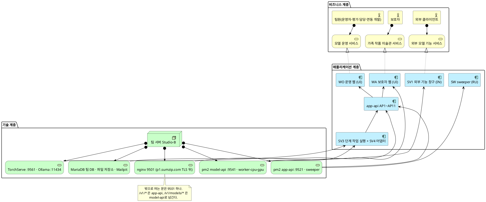
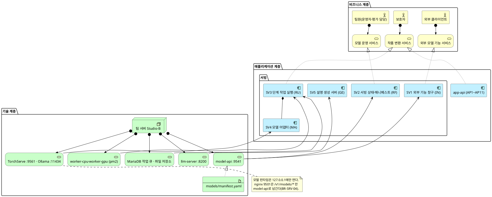
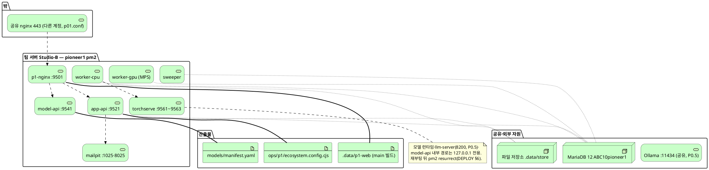
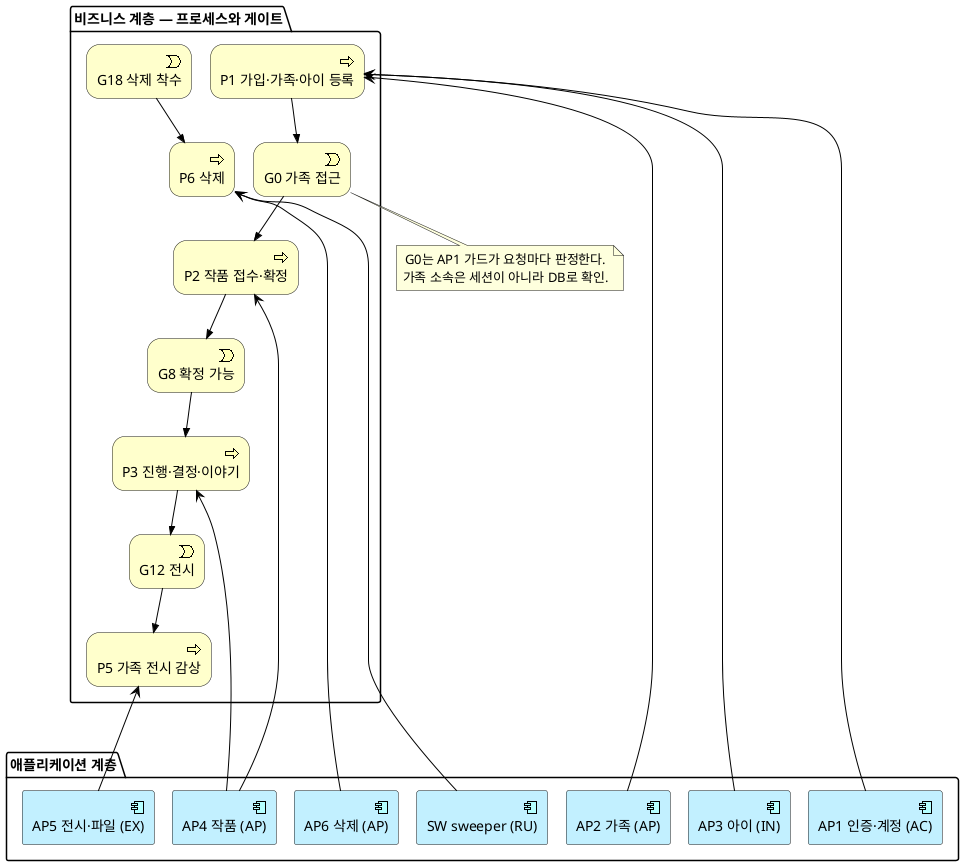
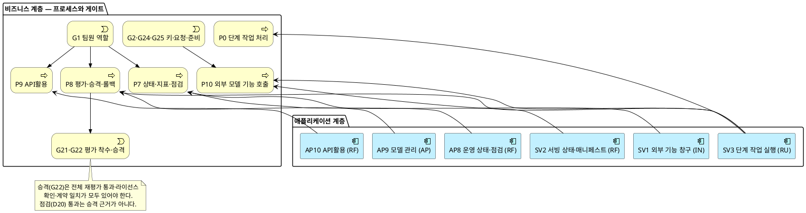
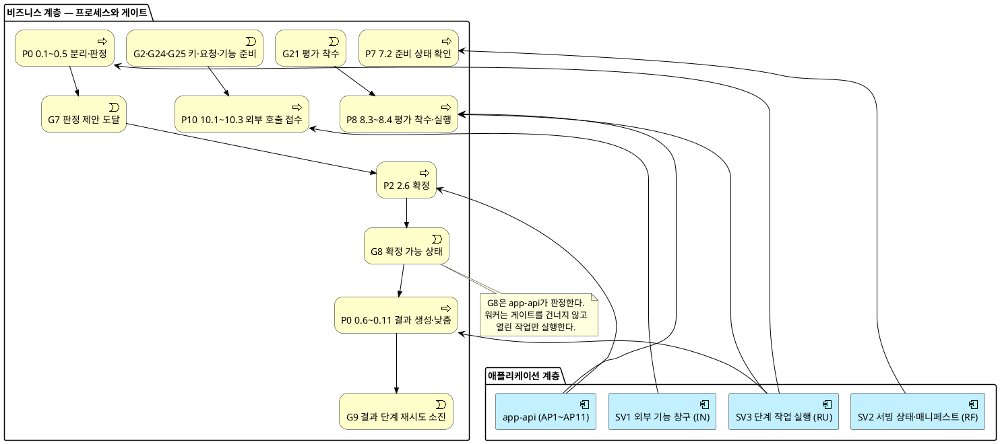
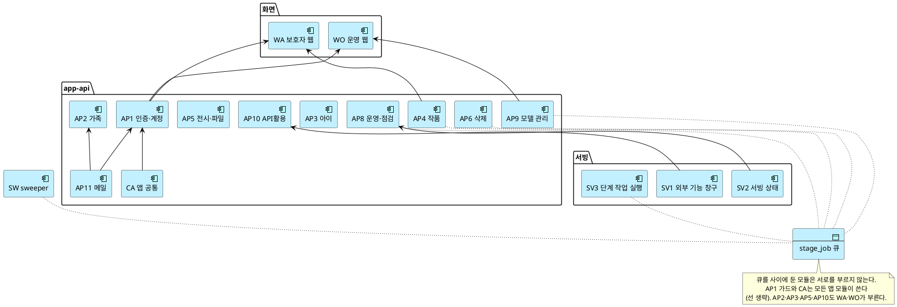
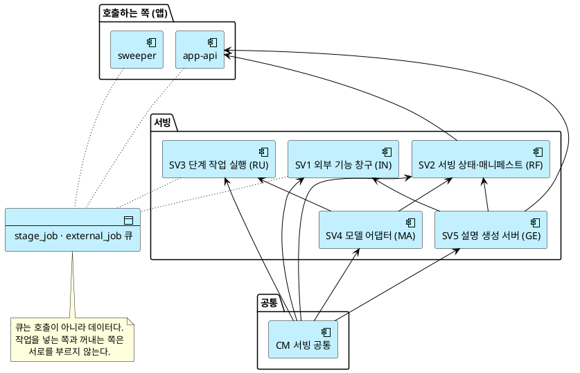
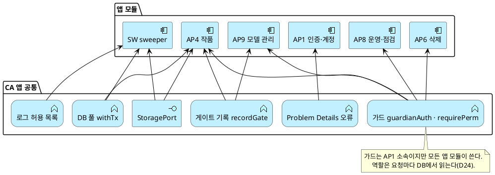
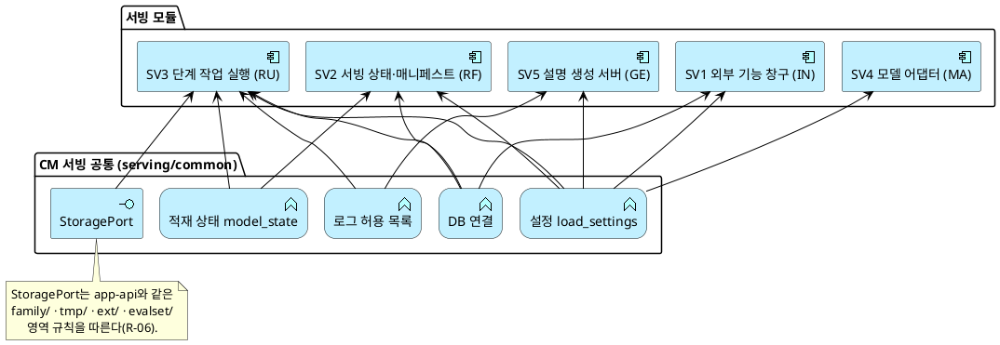

# SD_04 아키텍처 설계서 — 우리 아이 미술관

> 작성: 2026-09-29 · 개정: 2026-09-29(전체 시스템으로 확장 — 앱 API·웹·sweeper·운영 CLI·배치, 구현 기준 main `a65ce73`) · 서빙 절 원작성 D(이진우, A7), 전체 확장 A(최호준)
> 입력: SD_01 프로세스 설계서(P0~P10, 게이트 맵 §15) · SD_02 UI/UX(§2-1 역할별 메뉴) · SD_03 데이터베이스 설계서와 `uri_gallery_ddl.sql`(테이블 36) · UC_00~UC_15 · REF D17~D25 · data-model §3 쓰기 소유 · plan Architecture · research R-02·R-03·R-04·R-06·R-08·R-18·R-22 · `contracts/*` · `api/src`·`serving/`·`web/src`·`ops/` 코드(2026-09-29 main)
> **이 개정은 설계서(design/)와 구현이 같은지를 도면으로 보인다.** 모듈·테이블·경로·포트는 모두 코드에서 확인한 값이다(§3-5 테이블 배정은 코드의 INSERT·UPDATE·DELETE로 대조). 상류 문서에 없는 모듈·기술요소는 만들지 않았다.
> 공통모듈 설계서는 따로 없다. 앱 공통 코드(`api/src/lib`·`db`·`storage`·`auth`)와 서빙 공통 코드(`serving/common/`)를 §7의 공통모듈로 본다.

## 목차

- §1 목적과 표기
- §2 모듈화 원칙
- §3 모듈 목록 (3-1 앱 · 3-2 서빙 · 3-3 화면 · 3-4 운영 CLI · 3-5 테이블 배정)
- §4 전체 아키텍처 (4-1 전체 · 4-2 서빙 관점 · 4-3 배치)
- §5 프로세스 대 모듈 배치 (5-1 가족 흐름 · 5-2 운영·평가·외부 · 5-3 서빙 상세)
- §6 모듈 간 의존 (6-1 전체 · 6-2 서빙 · 6-3 의존 규칙 점검)
- §7 공통모듈 연계 (7-1 앱 공통 · 7-2 서빙 공통)
- §8 제공 인터페이스 — API 도출 근거
- §9 미해결·확인 필요
- 관련 문서

---

## 1. 목적과 표기

### 1-1 이 문서가 답하는 질문

앞 문서들은 **무엇을**(UC), **어떤 순서로**(SD_01), **어떻게 조작하는지**(SD_02), **어디에 담는지**(SD_03)를 정했다. 이 문서는 남은 질문에 답한다 — **누가 이 기능을 담당하고, 그 모듈은 어디서 도는가.**

| 범위 | 이 문서의 답 |
|---|---|
| 모듈 경계 | 앱 모듈 11개(AP1~AP11)·sweeper(SW)·서빙 모듈 5개(SV1~SV5)·화면 2개(WA·WO)·운영 CLI(CL)·공통 2개(CA·CM). 경계는 쓰기 소유·UC 주도·게이트로 정했다 |
| 서빙 3종 | CPU 비전 큐(`worker-cpu`) · GPU 전용 큐(`worker-gpu`) · LLM 동기 서버(`llm-server`, P0.5에서 띄움) |
| 배치 | 팀 서버 1대(Studio-B). 밖으로 여는 문은 입구 nginx 9501 하나이고, 공유 nginx가 `https://p1.sumzip.com`의 TLS를 풀어 넘긴다. 앱 9521·모델 API 9541·모델 런타임은 모두 127.0.0.1. **다음 배치 계획(2026-10-28, 아직 적용 전):** 모듈 경계는 그대로 두고 실행을 pm2에서 Docker Compose로 바꾼다. 서비스·이미지·볼륨 대응은 팀이 지금 구성을 분석한 뒤(`design/PLAN_3인디벨롭_컨테이너협업_우리아이미술관.md` 부록 A) 다시 설계해 이 칸과 4-1 기술 층에 적는다 |
| 권한 | 역할 = 유스케이스 액터(D24). 팀원 권한 정본은 `api/src/auth/policy.ts`, 사용자 유형별 전체 표는 `design/RBAC_권한매트릭스_우리아이미술관.md` |
| 매니페스트·승격 | 매니페스트 파일(SV2)이 "무엇을 실행할 수 있는가", DB `model_version`(AP9)이 "무엇이 활성인가"를 정한다 |

### 1-2 ArchiMate 3.2 표기

**요소**

| 계층 | 매크로 | 의미 |
|---|---|---|
| Business | `Business_Actor` · `Business_Process` · `Business_Service` · `Business_Object` · `Business_Event` | 사람이 하는 일과 그 산출물 |
| Application | `Application_Component` · `Application_Service` · `Application_Function` · `Application_Interface` · `Application_DataObject` | 시스템이 하는 일 |
| Technology | `Technology_Node` · `Technology_Service` · `Technology_Artifact` | 그것이 도는 곳 |

**관계**

| 관계 | 매크로 | 의미 |
|---|---|---|
| Assignment | `Rel_Assignment(a,b)` | 행위자가 프로세스를 수행 · 노드가 서비스를 제공 |
| Realization | `Rel_Realization_Up(a,b)` | 하위가 상위를 실현 (모듈이 서비스를 실현) |
| Serving | `Rel_Serving_Up(a,b)` | 제공 (모듈이 프로세스·모듈에 서비스 제공) |
| Access | `Rel_Access(a,b)` | 데이터 읽기·쓰기 |
| Composition | `Rel_Composition(a,b)` | 구성 (모듈이 기능을 포함) |
| Triggering | `Rel_Triggering(a,b)` | 순서 유발 |
| Association | `Rel_Association(a,b)` | 느슨한 연관 |
| Flow | `Rel_Flow(a,b)` | 산출물 흐름 |
| Specialization | `Rel_Specialization_Up(a,b)` | 상속·구체화 |

이 문서의 도면에서 게이트는 `Business_Event`로 그린다. 게이트는 프로세스 사이에서 다음 단계를 열거나 막는 사건이기 때문이다.

---

## 2. 모듈화 원칙

### 2-1 세 가지 기준

| 기준 | 내용 | 적용 |
|---|---|---|
| **1. 데이터 소유** | 한 테이블 묶음의 쓰기 권한은 한 모듈만 가진다 | 코드의 실제 쓰기(INSERT·UPDATE·DELETE)로 확인했다(§3-5). 앱은 `api/src/modules/<모듈>`이 곧 쓰기 경계다. 워커 패키지 전체는 같은 테이블에 쓰므로 한 모듈(SV3)이다 |
| **2. 유스케이스 정합** | 한 UC는 한 모듈이 주도한다 | UC1 AP3 · UC2 AP4 · UC3 AP4(보호자 부분) · UC4·UC5 AP4 · UC6 AP5 · UC7 AP6 · UC8 AP8 · UC9 AP9 · UC10 AP7 · UC11 AP10 · UC12 SV1 · UC13·UC14 AP1 · UC15 AP2 |
| **3. 게이트 경계** | 게이트를 사이에 둔 두 행위는 다른 모듈이다 | G8(확정)은 AP4가 판정하고 워커(SV3)는 열린 작업만 실행한다. G22(승격)는 AP9, G18(삭제 착수)은 AP6, G19(파일 삭제 보류)는 SW다. 기준 1과 부딪히는 곳은 §9-1 |

기준 1이 가장 강하다. 셋이 부딪히면 1을 따른다.

### 2-2 아키타입

기본 9종(IN·VA·RF·GE·RV·AP·EX·EV·RU)에 **MA(모델 어댑터)를 하나 더했다.**

| 코드 | 아키타입 | 하는 일 | 전형적 인터페이스 | 서빙 절 사용 |
|---|---|---|---|---|
| **IN** | 수집 | 외부 입력을 시스템 안으로 들인다 | `POST /{res}` | SV1 |
| **VA** | 검증 | 누락·형식·규칙을 판정한다 | `POST /{res}/validate` | SV3 안의 기능(판정) |
| **RF** | 참조 | 기준 데이터를 조회·판본 고정한다 | `GET /{res}` · `POST /{res}/pin` | SV2 |
| **GE** | 생성 | 산출물 초안을 만든다 | `POST /{res}/compose` | SV5, SV3 안의 기능(결과 생성) |
| **RU** | 실행 | 작업을 돌리고 재현 가능하게 기록한다 | `POST /runs` · `GET /runs/{id}` | SV3 |
| **MA** | 모델 어댑터 *(추가)* | 모델 하나를 같은 모양의 호출 뒤에 숨긴다 | `run(JobInput) → AdapterResult` | SV4 |

- **MA를 더한 이유**: BR-MDL-02는 "모델마다 어댑터 하나, API 서버는 모델을 import하지 않는다"를 요구한다. 어댑터는 DB에 쓰지 않고 다른 모듈을 부르지도 않으며, 모델을 바꿀 때 **교체되는 단위**다. RU·GE와 성격이 달라 따로 분류해야 교체 경계가 문서에 남는다.
- **쓰지 않은 아키타입**: RV(비교)·AP(승인)·EX(반출)·EV(근거)는 서빙 절에 없다. 승인(승격 G22·확정 G8)과 반출(전시)은 app-api 몫이다.

**앱·화면을 위해 더한 아키타입** — 기본 9종에 MA(서빙) 외에 둘을 더했다.

| 코드 | 아키타입 | 하는 일 | 전형적 인터페이스 | 사용 |
|---|---|---|---|---|
| **AC** | 접근 *(추가)* | 신원을 세우고 역할·가족 범위를 판정한다 | `POST /auth/login` · 가드 `requirePerm` | AP1 |
| **UI** | 화면 *(추가)* | 사람의 조작을 API 호출로 바꾼다. 테이블을 갖지 않는다 | 경로(`/app/*`·`/ops/*`) | WA · WO |

- **AC를 더한 이유**: G0·G1·G26·G27과 RBAC(D24)는 모든 모듈이 거치는 관문인데, 수집(IN)·승인(AP)과 성격이 다르다. 따로 두어야 "모두가 쓰는 모듈은 말단"(§6-3) 규칙을 점검할 수 있다.
- **UI를 더한 이유**: 화면은 쓰기 소유가 없어 기준 1로 가를 수 없다. 대신 역할별 셸(보호자/팀원, 쿠키·경로 분리 BR-ACC-03)로 가른다.

### 2-3 아키타입 분포와 해석

| 아키타입 | 앱 | 서빙 | 계 | 모듈 |
|---|---:|---:|---:|---|
| AP 승인 | 4 | 0 | 4 | AP2 가족 · AP4 작품 확정·결정 · AP6 삭제 · AP9 모델 관리 |
| RU 실행 | 1 | 1 | 2 | SW sweeper · SV3 단계 작업 실행 |
| RF 참조 | 2 | 1 | 3 | AP8 운영 상태·점검 · AP10 API활용 · SV2 |
| IN 수집 | 1 | 1 | 2 | AP3 아이 · SV1 외부 기능 창구 |
| EX 반출 | 2 | 0 | 2 | AP5 전시·파일 · AP11 메일 |
| GE 생성 | 1 | 1 | 2 | AP7 설명(P0.5) · SV5 설명 서버(P0.5) |
| AC 접근 | 1 | 0 | 1 | AP1 인증·계정 |
| MA 모델 어댑터 | 0 | 1 | 1 | SV4 |
| UI 화면 | 2 | — | 2 | WA · WO |
| VA·RV·EV | 0 | 0 | 0 | 판정(VA)은 SV3 안의 기능, 비교(RV)는 화면(S5 원본 비교), 근거(EV)는 `gate_event` 기록으로 흩어져 있다 |

**해석**: 앱은 **승인(AP) 중심**이고 서빙은 **실행(RU) 중심**이다. 보호자의 결정(확정·결정·삭제·초대)과 팀원의 결정(승격)이 모두 앱에 있고, 서빙은 앱이 연 작업만 돌린다. 이 분리가 게이트 경계(기준 3)의 실체다 — 서빙에 승인이 생기거나 앱이 모델을 import하면 경계가 무너졌다는 신호다(BR-MDL-02). 반출(EX)이 적은 것은 이 서비스가 **가족 안에서만 전시**하고 밖으로 보내지 않기 때문이다(외부 반출은 SV1의 모델 기능 결과 1회 수령뿐).

---

## 3. 모듈 목록

### 3-1 앱 모듈 (`api/`, pm2 `app-api` :9521)

| ID | 모듈 | 아키타입 | 주도 UC (보조) | 프로세스 | 쓰기 소유 테이블 | 코드 |
|:--:|---|:--:|---|---|---|---|
| **AP1** | 인증·계정 | AC | **UC13·UC14** (INC1·INC2 전부) | P1 1.0 · 1.R1~1.R3 · 7.1·8.1·9.1(G1) | `guardian_account`(계정·확인·비밀번호 컬럼), `auth_email_token`, `auth_rate_event`, `app_session`, `team_member`, `team_member_role`, `family`(가입 때 빈 가족) | `modules/auth` · `auth/`(guards·policy·session·staffAdmin) |
| **AP2** | 가족·공동 보호자 | AP | **UC15** | P1 1.I1~1.I4 | `family_invite`, `guardian_account`(`family_id`·`role`), `family`(새 가족 공간) | `modules/family` |
| **AP3** | 아이 | IN | **UC1** | P1 1.1~1.4 | `child` | `modules/children` |
| **AP4** | 작품 접수·확정·결정·이야기 | AP | **UC2**(보호자 행위) · **UC3**(보호자 부분) · **UC4** · **UC5** | P2 · P3 | `artwork`(생성·확정·결정 전이), `artwork_original`, `stored_object`(`original`), `stage_job`(판정·확정 결과 작업 생성), `artwork_outcome`(확정·결정 컬럼), `decision`, `story`, `judgment`(판정 모델 비활성 시 `exhausted` 1행) | `modules/artworks` |
| **AP5** | 전시·파일 | EX | **UC6** | P5 | 없음(읽기 전용: `v_gallery`, 파일 토큰) | `modules/gallery` · `modules/files` |
| **AP6** | 삭제 요청 | AP | **UC7** | P6 6.1~6.3 | `deletion_request`, `artwork`(`deleting` 전환), `stage_job`(`cancel_requested_at`) | `modules/deletion` |
| **AP7** | 설명 (P0.5) | GE | **UC10** | P4 | `caption`, `caption_check_failure`, `stage_job`(`caption` 행 전체) | `modules/captions` |
| **AP8** | 운영 상태·점검 | RF | **UC8** | P7 (7.8~7.10 점검) | `model_check`(생성·대기 초과 닫기·정리), `stage_job`(`origin='check'` 생성) | `modules/ops` |
| **AP9** | 모델 관리 | AP | **UC9** | P8 | `model_version`, `evaluation`, `eval_item`, `release_event`, `stage_job`(`origin='eval'` 생성), `stored_object`(`eval_input`) | `modules/admin` |
| **AP10** | API활용 | RF | **UC11** | P9 | 없음(명세 읽기, 시험 호출은 SV1이 기록) | `modules/apiGuide` |
| **AP11** | 메일 발송 | EX | — (AP1·AP2 보조) | P1 1.0 · 1.R2 · 1.I1 | 없음(SMTP → Mailpit → Gmail SMTP 자동 중계, R-23 2026-09-30) | `modules/mail` |
| **SW** | sweeper(배치) | RU | — (UC7 6.4~6.6, UC3 이어받기) | P6 6.4~6.6 · P0 이어받기 · P10 만료 | 삭제 완료 시 가족 자료 행(`artwork`·`stored_object`·`child` 등), `deletion_request`(상태), `stage_job`(이어받기), `external_job`(만료), `model_check`(점검 이어받기 닫기), `app_session`·`auth_email_token`·`auth_rate_event`(정리), `gate_event`(G19) | `src/sweeper` · pm2 `sweeper` |
| **CA** | 앱 공통 | — | — | — | `gate_event`(모든 앱 모듈이 `recordGate`로 추가만) | `lib/`(problem·gateEvent·logger) · `db/pool` · `storage/`(StoragePort) · `config` |

- **AP4를 하나로 둔 이유**: 접수·확정·결정·이야기가 모두 `artwork`·`artwork_outcome`에 쓴다(기준 1). 게이트(G6·G8·G12)는 모듈 안의 단계 검사로 둔다. 코드도 `modules/artworks` 한 폴더다.
- **SW가 많은 테이블에 쓰는 이유**: 삭제 완료(BR-DEL-01~05)는 작품에 딸린 행을 모두 지우는 **수명 종료** 행위이고, 이어받기·정리는 시간이 지나 생기는 일이다. 모두 "행을 만든 모듈의 행위가 끝난 뒤"라 소유와 겹치지 않는다(§9-1).

### 3-2 서빙 모듈 (`serving/`)

| ID | 모듈 | 아키타입 | 주도 UC (보조) | 프로세스 | 쓰기 소유 테이블 | 코드 위치 · 실행 단위 |
|:--:|---|:--:|---|---|---|---|
| **SV1** | 외부 기능 창구 | IN | **UC12** (UC11 시험 호출 대상) | P10 10.1~10.3 | `external_job`(생성·전달·결과 1회 수령), `external_call_log`, `gate_event`(G2·G24·G25) | `serving/model_api/external.py`·`auth.py` · pm2 `model-api` |
| **SV2** | 서빙 상태·매니페스트 | RF | — (UC8 준비 상태, UC9 매니페스트 대조) | P7 7.2 · P8 8.2~8.3 | DB 없음. 파일 `models/manifest.yaml`의 실측 칸(후보 등록은 요청 본문만 만든다, §9-2) | `serving/model_api/internal.py` · `serving/ops/models.py` · `models/manifest.yaml` · pm2 `model-api`(내부 경로) |
| **SV3** | 단계 작업 실행 | RU | — (UC2 판정, UC3 결과, UC9 BF4 평가, UC12 실행) | P0 0.1~0.12 · P8 8.4 · P10 실행 | `stage_job`(점유·실행 컬럼, 낮춘 작업 등록), `judgment`, `tag_candidate`, `result`, `stored_object`(원본 외 종류), `artwork`(워커 전이), `artwork_outcome`(`result_kind`·`result_cause`), `eval_item_result`, `external_job`(실행 컬럼), `gate_event`(G7·G9) | `serving/workers/` · pm2 `worker-cpu`·`worker-gpu` |
| **SV4** | 모델 어댑터 | MA | — (SV3·SV2가 부름) | P0 0.3·0.4·0.7 | 없음 | `serving/adapters/` M1·M2·M3·M5 · (P1) M7(`m7_triposr.py` → 전용 환경 `.venv-m7` 하위 프로세스 `m7_run.py`, research R-22) · `serving/rules/m4_geometry.py` |
| **SV5** | 설명 생성 서버 (P0.5) | GE | — (UC10, UC12 `caption`) | P4 4.4~4.5 | 없음. 기록은 호출자(app-api)가 `stage_job(caption)`에 남긴다(R-18) | `serving/llm_server/` · pm2 `llm-server`(P0에서는 띄우지 않음) |
| **CM** | 서빙 공통 | — | — | — | 없음 | `serving/common/` (설정·DB 연결·StoragePort·로그 허용 목록·적재 상태) |

**SV3 안의 기능** — 한 모듈이지만 작업 종류(`stage_kind`·`origin`)에 따라 네 기능으로 나뉜다. 기능끼리는 쓰는 행(작업 종류)이 갈린다.

| 기능 | 성격 | 작업 종류 | 코드 | 처리 서빙군 |
|---|:--:|---|---|---|
| 판정 | VA | `split` · `judge` | `workers/stages/split.py` · `judge.py` | CPU 비전 |
| 결과 생성·낮춤 | GE | `animate_render` · `depth_relief` · `frame_compose` · (P1) `sculpture` | `workers/stages/results.py` · `chain.py` | 움직임·액자 CPU 비전, 2.5D·3D GPU(없으면 CPU, BR-SRV-02) |
| 평가 실행 | RU | `origin='eval'` | `workers/stages/eval.py` | 모델의 서빙군 |
| 외부 작업 실행 | RU | `external_job` | `workers/external.py` | 모델의 서빙군, 서빙군별 1건 |

서빙 모듈과 앱 모듈의 경계: 앱은 `stage_job` 행을 만들고 취소하며 G8·G22를 판정한다. SW는 점유가 끊긴 `running` 작업을 `retry_wait`로 되돌리되(3회째는 `failed`), **점검 작업(`origin='check'`)은 재시도 없이 `failed`·`engine_down`으로 닫고 `model_check`도 함께 닫는다**(D20, stage-job §13, `api/src/sweeper/takeover.ts`). 화면은 서빙을 직접 부르지 않는다.

### 3-3 화면 (`web/`, 입구 nginx 9501이 `.data/p1-web` 배포본을 내보냄)

| ID | 화면 묶음 | 아키타입 | 경로 | 부르는 앱 모듈 | 구현 |
|:--:|---|:--:|---|---|---|
| **WA** | 보호자 웹 | UI | `/app/*` — S0 가입·S0a 로그인·S0b 찾기·S0c 계정(비밀번호)·S1 아이·S1b~S1d 가족·S2 올리기·S3 확정·S4 목록·진행·S5 결과·S6 이야기·S8 전시(전시관) | AP1~AP7 | `web/src/app/views` 18개 |
| **WO** | 운영 웹 | UI | `/ops/*` — S0o 팀원 로그인·S10 상태·지표·S11 모델 평가·점검·S12 API활용 | AP1 · AP8 · AP9 · AP10 | `web/src/ops/views` 4개 |

두 화면은 쿠키(`uam_sid` / `uam_ops_sid`)·경로·셸이 다르고 서로 링크하지 않는다(BR-ACC-03, D21). 운영 셸 메뉴는 SD_02 §2-1 역할별 메뉴 표대로 그린다. **화면은 서빙을 직접 부르지 않는다.**

**사진 자산(2026-09-30, 이제민 지시 — 전시 공간을 루브르 실제 사진으로, 요구: 이제민 세션2)**: 화면에 쓰는 실제 사진은 앱 데이터가 아니라 정적 자산이다. 전시 공간 노드는 두 형식이다(화면 설계는 SD_02 §17). **`tip`(지금 쓰는 것)**: 한 점 투시 사진 한 장을 Tour Into the Picture로 3D 상자 5면(바닥·천장·좌우 벽·끝벽)으로 펴고 깊이 구간마다 잘라 CSS 3D로 띄운다 — 커먼즈에 루브르 실내 360° 파노라마가 없어서(세션2, 2026-09-30). **`cube`**: 360° 파노라마(등장방형)를 큐브 6면으로.

| 항목 | 규칙 |
|---|---|
| 위치 | tip: `web/public/museum/photos/<노드>/<desktop\|mobile>/<면>.webp`(면 이름 `floor_8`·`ceil_18`·`wallL_26`·`wallR_12`·`back` 등, 두 벌 같은 이름) · cube: `…/<노드>/<1024\|2048>/{px,nx,py,ny,pz,nz}.webp` — Vite가 빌드 때 배포본 루트로 복사해 `/museum/photos/...`로 나간다. 1024판은 390px 화면, 2048판은 데스크톱 |
| 면 방향 | 파노라마 가운데 = 정면 `pz`(+z), 오른쪽 `px`(+x), 위 `py`(+y), 뒤 `nz`, 왼쪽 `nx`, 아래 `ny` — 변환 도구가 이 규칙으로 자른다 |
| 라이선스 목록 | `web/public/museum/photos/manifest.json` `{nodes:[…]}` — 공통 `id`·`kind`(`tip`\|`cube`, 없으면 cube)·`title`·`source`(원본 페이지 https URL)·`author`·`license`·`original{width,height}`. tip은 `camera{vx,vy,f}`·`box{xl,xr,yf,yc,zb}`(m, 1m = 100 CSS px)·`faces[{name,src,w,h,tf}]`(`src`는 파일 이름 — 화면이 `desktop/`·`mobile/`을 앞에 붙인다, `tf`는 CSS transform)·`bytes{desktop,mobile}`. cube는 `position{x,z}`·`bytes{1024,2048}`. 목록과 폴더가 어긋나면 시험 실패(`web/src/__tests__/museum-photos.spec.ts`, CI web) |
| 허용 라이선스 | `PD`·`CC0`·`CC BY`·`CC BY-SA`(버전 표기 허용). 루브르 공식 사이트·언론 사진 등 권리 불명 사진 금지. BY·BY-SA는 화면에 저작자 표시("사진 출처" 버튼, SD_02) |
| 크기 예산 | 노드 합계 — tip: 모바일 ≤ 900KB · 데스크톱 ≤ 2MB(세션2) · cube: 1024판 ≤ 900KB · 2048판 ≤ 3MB `[추론]` |
| 변형물 | 사진을 펴고 자른 면은 원본의 변형물 — BY-SA는 같은 라이선스로 배포하고 출처에 "변형(3D 면으로 펴서 자름)"을 적는다 |
| 캐시 | 입구 nginx: `/museum/photos/` 1년 `immutable`, `manifest.json`만 `no-cache`. 그래서 **사진을 바꾸면 노드 이름을 바꾼다**(예: `grande-galerie-v2`) — 같은 이름으로 덮어쓰면 받은 사람 화면이 1년간 옛 사진 |
| 변환 도구 | tip: `ops/museum/tip2faces.py`(세션2 `docs/C/louvre-walk/tip.py`를 옮겨 감쌈) · cube: `ops/museum/pano2cube.py` — 둘 다 serving/.venv의 numpy·Pillow(새 의존성 없음), 예산에 맞춰 webp 품질 조정 + manifest 갱신 |
| 개인정보 | 관람객 얼굴이 알아볼 수 있게 찍힌 사진은 쓰지 않는다(BR-PRV-01 취지) |

### 3-4 운영 CLI (서버 셸, 액터 아님)

| ID | 명령 | 쓰는 테이블·파일 | 비고 |
|:--:|---|---|---|
| **CL** | `ops:staff`(팀원·역할·정지·비밀번호) | `team_member`·`team_member_role`·`app_session` — AP1의 `staffAdmin`을 부른다 | D24 ③ |
| | `ops:key`(API 키 발급·폐기) | `api_key` | external은 U12 전 발급 거부(D17) |
| | `ops:eval-items`(평가 묶음 일괄 등록, T164) | `eval_item`·`stored_object`(`eval_input`) | AP9의 등록 규칙(G20)을 따른다 |
| | `ops:purge-retry` | `deletion_request` | 삭제 재시도 |
| | `db:migrate` | `schema_migration` | DDL 적용 |
| | `ops.models`(서빙) | `models/manifest.yaml` | SV2. 후보 등록은 본문만 만든다(§9-2) |
| | `ops/p1/deploy-web.sh` | `.data/p1-web` | main 커밋으로 웹 빌드·배포(DEPLOY §7) |

### 3-4b 수업 점검 규격 층 `ops/team1_museum/` (2026-09-30, 이제민 지시 — 같은 날 저장소 최상위에서 `ops/` 아래로 옮김: 흩어진 API 파일을 한 폴더에서 보게. 폴더 이름 · 파일 · md5는 그대로)

MS 과정 API 서비스 점검(해설 `docs/B/API_서비스_점검.pdf` 5쪽)이 전제하는 **수업본 8파일 구조**를 우리 모델로 갖춘 폴더다. 서비스 경로(app-api·model-api·워커)와 따로 서며, 그것들을 부르지도 바꾸지도 않는다.

| 파일 | 구분 | 우리 것 |
|---|---|---|
| `app.py` · `bench.py` · `metrics.py` | 공용 — 수업본과 **바이트까지 같다**(md5 대조, 점검 B2) | project2608 수업 연동본 `models/modelapi/team1_apt/`에서 그대로 가져옴 |
| `predict.py` | 팀 — 모델을 부르는 유일한 곳 | **M2 그림 종류 판정**(OpenCLIP ViT-B-32, 활성 버전과 같은 가중치·프롬프트). `_load()` 기동 시 1회, 최고 확률 < TAU면 `판단보류` |
| `schemas.py` | 팀 — 계약 | 요청 `image_base64`(PNG·JPEG, 20MB 이하) · `extra="forbid"` · 배치 1~32 · 응답은 `label`·`warnings`·`model_version`만(점수는 싣지 않는다, BR-SUG-02) |
| `settings.py` | 팀 — 설정(.env로 바꾼다) | 모델 이름·버전(M2 활성 라벨)·TAU·가중치 위치 |
| `model/` | 팀 산출물 그대로 | M2 프롬프트 사본·가중치 지문(sha256·revision) — 가중치 파일 자체는 `models/hf` 캐시를 오프라인으로 읽는다 |
| `test_app.py` | 배포 전 3분 5종 | 상태 · 정상 · 계약 위반(모르는 칸) · 경계값(그림 아닌 입력 → 판단보류) · 배치 개수·순서 |
| 부속 | `examples/request.json`·`request_batch.json` · `requirements.txt`(==) · `.env.example`(이름만) · `README.md` · `모듈카드_team1.md` | |

- 실행 환경: 폴더 안 `.venv`(git 제외). 기동 `.venv/bin/uvicorn app:app --host 127.0.0.1 --port <포트> --root-path /model-api`.
- **포트·공개는 팀 결정 대기**: 9541은 model-api가 쓰고 있다. `/model-api` 공개 범위(A·D 결정) 전에는 띄우지 않거나 로컬 시험(`pytest`, TestClient)만 한다.
- 판단보류 행선지: 수업본 그대로 `review_queue.jsonl`(req_id·경고만, 입력 원문 없음, git 제외).

### 3-5 테이블 배정 (SD_03 36개 전수, 코드 대조)

| 테이블 | 쓰기 소유 | 함께 쓰는 곳(행·컬럼·수명으로 갈림) |
|---|---|---|
| `guardian_account` | **AP1** | AP2(`family_id`·`role`) · SW(삭제·정리) |
| `auth_email_token` · `auth_rate_event` · `app_session` | **AP1** | SW(만료 정리) · CL(팀원 정지 시 세션 삭제) |
| `team_member` · `team_member_role` | **AP1** | CL(`ops:staff`는 AP1 `staffAdmin`을 부름) |
| `family` | **AP1**(가입) · **AP2**(새 가족 공간) | §9-1 — 둘 다 빈 가족 1행을 만든다 |
| `family_invite` | **AP2** | — |
| `child` | **AP3** | SW(삭제 완료) |
| `artwork` | **AP4** | AP6(`deleting` 전환) · SV3(워커 전이) · SW(삭제 완료) |
| `artwork_original` · `decision` · `story` | **AP4** | SW(삭제 완료) |
| `artwork_outcome` | **AP4**(확정·결정 컬럼) | SV3(`result_kind`·`result_cause`) · SW(집계 필드만 남김) |
| `stored_object` | **AP4**(`original`) | AP9·CL(`eval_input`) · SV3(파생물) · SW(삭제) |
| `stage_job` | **AP4**(판정·결과 작업 생성) | AP6(취소) · AP7(`caption`) · AP8(`check`) · AP9(`eval`) · SV3(점유·실행·낮춘 작업) · SW(이어받기) |
| `judgment` · `tag_candidate` · `result` | **SV3** | AP4(판정 모델 비활성 시 `exhausted` 1행) · SW(삭제 완료) |
| `deletion_request` | **AP6** | SW(상태 진행) · CL(`ops:purge-retry`) |
| `caption` · `caption_check_failure` | **AP7** | — |
| `caption_selected_tag` | **AP7**(설계) | **코드에 쓰기 없음** — §9-3 |
| `model_check` | **AP8** | SV3(결과 컬럼) · SW(점검 이어받기 닫기) |
| `model_version` · `evaluation` · `release_event` | **AP9** | — |
| `eval_item` | **AP9** | CL(`ops:eval-items`) |
| `eval_item_result` | **SV3** | — |
| `external_job` | **SV1** | SV3(실행 컬럼) · SW(만료) |
| `external_call_log` | **SV1** | — |
| `api_key` | **CL**(`ops:key`) | SV1은 읽기만 |
| `feature_setting` | **AP9**(설계, T132) | **P1 — 쓰는 경로 아직 없음**(AP8·AP9가 읽기만). §9-3 |
| `gate_event` | **CA**(추가만) | 게이트 ID로 갈림 — 앱 모듈 전부 · SV1(G2·G24·G25) · SV3(G7·G9) · SW(G19) |
| `model` · `gate_catalog` | DDL 초기값 | 읽기만 |
| `schema_migration` | **CL**(`db:migrate`) | — |

미배정 테이블은 0건이다(36개). 소유가 겹치는 곳은 모두 행·컬럼·수명으로 갈리며 §9-1에 이유를 적었다.

---

## 4. 전체 아키텍처

### 4-1 전체 아키텍처 (구현 기준)

**[「전체 아키텍처 — 구현 기준」 PlantUML 뷰어로 열기](https://plantuml.sumzip.com/plantuml/svg/eNqFVW1v00gQ_u5fMfS-uBxtcRzQgU6IlBMS0gGnpoWP1dZZglV7d2U7DcfpUDiFU0lz4kXQhiOtihQQQpXIHYG6UvnSn5Nd_4fb3TS5pI2LJcvWPPPMzD4zY18OIxREJd8zTrnE8UoFDD-iwLnr-ijCM7n-2yUjXHYJQwHyYQk5y8WAlkjhCvVoAN9d1deQB6EFHGIG1g9DxgCRZWXMnDcMJkOgIoYJvlcV71b52qqotaD7qSrizxPwmwEwWwpdgsNwMedENDCXkHVGen_qJI1YbD2dmBznkpEuSb0iXj81xd8d0XgoPQ92kyePu-0K8LUOX9s72BUbbf7kFXTbTd5uTo4PZMtA4lXMv1Qgedjhm_tisyPW46QWj_rncbDiOthcClV1Mot48w-IrWfJ81XgH2Oxut3tVEBUm-qYtVYaWdXNP7znf8XQq_vblKEKD5nduM1rb0eYv_-vs3i5nbyo83c7Yr-iDvOoMaJ2jjHPdVDkUrJ4hfqMEkwis4xklts5GMgO4vUemAvXerKlkKgi3Ryc5NsMxCQDMTaFmAu5X6wH8rZO8A_L0j9_G8IyxgwHYM4tnBQ-XFHNyd-y4FCwvlLtr93PO2Beu3Ey29ZsWw7QeymZaq_YeARirZWsP4bvIX8rC2K9w-vPkmp7VHSZSI7AiNDz2LlL5NYUf128IZfEjIjVG1rduH-rkI9KBZdOzeqShrz7rY_Cs5JAii65BxfOnbXAZNZ0WPLvu2zaoT7M_5wH_rw1mc5XCZmfgb7iFy-cy1hwsNvXM52ZOWT6snKvz81qbpkGyziYcljpYLfISukxlJrzVH5WlAmrAOd1gJueh3wEFy0ra2fT6VlJv44CF_00C0o1-ZDkpF4Xm_sgtiti6634s65s15HrMTfSHTHmsLeYC0O3SHzVVP01kUs7eRzIKCAzBrAVYPeAOYw8935vVBaY3pNBtKMYHQp4BNOTOQiqD0mKClAbUUbjzfSYWY8oYsdq1rMl5yUNsNKATBpgpwHZY0XpOR1zBj1__WKP2sPyGLvsiBQqDbDHAHYakO2lNgiNMCzRKJILQ-8ojeS88fa6aO7zN00QGzu89gL4Tiw2K70tS142-B-Naek2s2LNnAYFHC7QGW3SOxH2EOk1WBEVj1cb3Vj-fVrTBiYFUNmNy_JN_XX_A5ch8nM=)** — 클릭 시 브라우저로 연결됩니다.

**읽는 법**: 위에서 아래로 읽는다. 맨 위는 누가 무엇을 받는지다. 보호자는 가족 작품 미술관, 팀원은 모델 운영, 외부 클라이언트는 모델 기능을 받는다. 가운데는 그것을 실현하는 모듈이다. 보호자·팀원은 화면(WA·WO)을 통해 app-api를 쓰고, 외부 클라이언트는 화면 없이 SV1을 부른다. app-api는 모델을 직접 부르지 않고 작업을 큐에 넣으며, SV3(워커와 어댑터)이 꺼내 돌린다(화살표는 "제공하는 쪽 → 쓰는 쪽"). 맨 아래는 모두 팀 서버 한 대에서 돈다는 것이다. 입구는 nginx 9501 하나이고 나머지는 서버 안에서만 열린다.

### 4-2 서빙 관점

**[「전체 아키텍처 — 서빙 관점」 PlantUML 뷰어로 열기](https://plantuml.sumzip.com/plantuml/svg/eNqFVctu20YU3fMrbt0NVVS2SEl5GEUROW2CLpIWcpKtMabGCmFySJAjt0mRQoaVwrGU1ilaW24t1wWUB4Is1FqpFcDd-HM0w3_ozFBKKFuEJQggeO4593VmdC2kKKA119E-sonl1CoYPkOBdd92EcVzpfHT51q4ahMfBciFZWStVgOvRirXPccL4OMb6pOIIF4Fh9gH40riZYDIqnxpXtI0X0igKoYZ9q7BX2yy5ibf6sLwqMEHb2fgew1goRbaBIfhUsmiXqAvI-NTEX3Uj9oDfrA9k5kWYoqQqFXnf2zr_Pc-b6-LyNPj6Ocnw14dWLPPmu8y05l5weR7A_ZvHaL1Puuc8E6f7wyircFk_CIO1mwL68uhLIcfPIt-2QR2VI_22sAb-7KbrW4aRZbHXr9iTwcQl3cxJVHXiDkc9NjW8wnmow_j5L8dRr-22Is3_KQuW3jcnhhqyfcd20LU9sjSdc_1PYIJ1ZGfE2mQ72eRb4Ne-sb4QfyMeFQfpGXGvVgnTSlck2NZvGfAqOhxtb3_hm_fgP7V7Vg0nW8qvhn3twd8Yz3a2D89Zi-7wiPRT23RsVgK6OUbFynllVJe7P2VGAGIXfHdx8Cb3WjnieDfvYhfUPzCeO58p89az6JGD_RbpYu4RcUtii667LVIutHhjb9VT_80QL_5Zcx_lNycmBTfPJzY1h1s3SfihFUfLN0WB0qnxIgNPlZapLWK7WUXlFoieuwfqlz6rRes4iBr-bXT49Fz1a-B7rtmJp0pF-GKrI4yxfzVYsFID5azdhw3G4o3OID5K2Yulx4tJ3vHEzeLfIWl9iUDTo_ha8dBLoJ5wyjkC-l0OdxbKLDRFwvjrUbr21IgarV45wT4YZ0fPOc_ts5qlAJqryCL6lTdJqq9cM5FxF7BIZ19gFxHHSetjJ2lUhjaVeLKharLRxz5zHnAlIA5BchLIB8DZYwc-2Fsk7t-fN7ey50BlXHTwWS-c6CRyKnsGNoSjDWFo8-VqRxFpzQ2Asw0IJ8GpOYoxoBaI6nKepU7RWlTAFMCRhpgTgFUg9NyFBKdTwDFRPIzk1T2UN1rxKMYlj1KPRe8FdmgsNToSmB_9qINYbUG79TBMC_P5sTX4Lvb7GUL-G6PNbuzIppUbfIdXC3mDBk3t2bMjYz3CYhAEfD-mLG_9oE12sOB-Kfq6gvl7GL5XjZXyMxqmFRAlqJdE0_yz_p_VGIEnw==)** — 클릭 시 브라우저로 연결됩니다.

**읽는 법**: 위에서 아래로 읽는다. 맨 위는 누가 무엇을 받는지(보호자는 작품 변환, 팀원은 모델 운영, 외부 클라이언트는 모델 기능), 가운데는 그것을 실현하는 모듈, 맨 아래는 모듈이 도는 곳이다. 작품 변환은 app-api와 SV3가 함께 실현한다 — app-api가 접수·확정·결정을 맡고, SV3가 모델을 돌린다. SV4 어댑터는 SV3에 포함된 부품이며(마름모), 모델 런타임(TorchServe·Ollama)은 어댑터를 통해서만 쓰인다. 모든 기술 서비스는 팀 서버 한 대(Studio-B)에 있고, 모델 런타임은 루프백에만 열린다.

**자원 배치** (`docs/A/A_팀서버_자원확인.md` 2026-09-29 실측, 이 서버를 팀 서버로 보는 것은 팀 확인 필요)

| 기술 서비스 | 모델 | 장치 | 동시 처리 | 메모리(최대 RSS) |
|---|---|---|---|---|
| worker-cpu (1개) | M1 · M2 · M3(→TorchServe) · M4 · `frame_compose` | M1 CPU(MPS에 `deform_conv2d` 없음), M2 MPS | 프로세스당 작업 1건. split·judge 2(limits.yaml) — 이 서버에서는 1 권장(M1 8.5GB) | M1 8.5GB · M2 1.0GB |
| worker-gpu (1개) | M5 · (P1) M7 | MPS(`GPU_ENABLED=true`). MPS가 없으면 M5는 worker-cpu로 | 1건, 모델 상주 | M5 1.3GB |
| TorchServe | M3 검출·자세 `.mar` 2종 | CPU, 워커 1개 | 1 | 약 2.0GB |
| llm-server → Ollama (P0.5) | M6 Qwen3-4B-Instruct-2507 Q4_K_M | Metal(공유 Ollama) | 1건(세마포어) | 파일 2.5GB |
| 외부 작업 | 모델 기능 4종 | 해당 서빙군 | 서빙군별 1건 `[예시값 U12]` | — |

같은 서버를 다른 사용자가 쓰고 있다(약 70GB 사용 중). 모델을 모두 올리면 약 15GB에 M3·M6 실행 메모리가 더해진다. 그래서 서빙군별 동시 처리를 1로 둔다.

**내부망 배치** (BR-SRV-04, BR-MDL-06)

| 주소 | 무엇 | 밖에서 보이는가 |
|---|---|---|
| 9501 | nginx 입구 | 예 — 유일한 입구 |
| 127.0.0.1:9541 `/v1/models/*` | SV1 외부 기능 | nginx가 넘긴다 |
| 127.0.0.1:9541 `/internal/*` | SV2 상태·적재 | 아니오(nginx가 404) |
| 9501 `/model-api`·`/model-api/*` | (없음 — 수업 점검표 C2·E1의 외부 모델 API 주소) | 아니오 — nginx가 404 problem+json(`reason: model_api_not_public`). 웹 SPA 대체(`index.html` 200)로 떨어지면 없는 모델 API가 살아 있는 것처럼 보인다(2026-09-30 점검 C2 거짓 200). 공개 범위(health·docs만 / 추론까지 / 닫음)는 팀 결정 대기(A·D) — 결정 뒤 이 행을 바꾼다 |
| 127.0.0.1:8200 | SV5 llm-server | 아니오 |
| 127.0.0.1:9561~9563 | TorchServe 예측·관리·지표 | 아니오. 보관 처리된 엔진이라 보안 수정이 없다 |
| 127.0.0.1:9564·9565 · 9566~ | TorchServe gRPC 예측·관리 · 모델 작업자(모델당 1개, 재시작하면 다음 번호) | 아니오. 기본값(7070·7071·9000~)은 다른 계정과 겹치기 쉬워 956x로 모은다(2026-09-30 점검 가이드 A6). 0.12에는 gRPC를 끄는 설정이 없다. 배정표(D19)는 9501·9521·9541뿐이라 956x 사용은 관리자 확인 대상 |
| 127.0.0.1:11434 | 공유 Ollama | 아니오 |

### 4-3 배치 (구현 기준 — pm2 프로세스·포트·저장소)

**[「배치 — pm2·포트·저장소」 PlantUML 뷰어로 열기](https://plantuml.sumzip.com/plantuml/svg/eNp1VN9P01AUfu9fcZwvW8K6tvvBIMYwQJ9EiPjiE7l0d6Ou7W3uvXMSoyE4fdCZEEUTdSImEH-EBwLKMMGX_Sk-0u5_8HSDbHNrmzTNl-985-v5zu2MkITLqmMrVyzXtKtFCtcIN9csh0iaKly-XVdExXI9wokDq8SslDmrusU5ZjMOV292rwGGy4pUUA_0_ADIiVsJQSOnKB5KkDKFmH_4LgaPFIC71FxzUa68vrJM-QPLpHGpTUDs_PhX0NwFt2y5DyGTSUPcf7nn75_C-XE92H07AZ6mqyZzS4lYQnncF-40NiCoN_2jOizLatFiyVn4u7ENnsVcSrkOnmNEd9axs6cne12np7KajurjqQZSiecliWeFTCOamUamqFHqUR7JySDHwenZl3qZaL0scmuMVyhPml41kpbr08peFeILS8uJSPIkkiXD1AUiNDSQ05_gIx1ZkQ8dE8v2LAnTumZk2608PofT6KXYbgXvT_0TDGZnK_i4FT3-KdRctG3iEJTUM-kMxHsKE7CkqdkR-7dxYnE3DG2BcIvMz4JuQGF2Ttcu4x5fEWbXaTSCT2cQ7G4EO_vB8waoRSJJSuAU6PBHBJuHwUnTPzgbMV7g0ioRU8ZJ6KEngOtTo6sQx9m44P9u-G-aI777dcZl7iLlENcqUSHVdeLY0RXhNjFPYJ8UNZlYF5I63YNglVXzvuhav0PtlZs2q3WPktQTAwAalcb_QKYHFEyTCtFdbVcfhtKjUHYUyo1CoZYxWjhkAQE5OQhgkcxfFAnBTItIzLPrlehjcDw9xBiDow5JJxTFZZLCKpOSOcBK2AyH6__45r86Bf_zYecprkC93bJtJ9ldfx7PG5p2sXPtFpL7R9Pf_Blu8vnRH_9L03-xjRs3qWp467hK9eDDdxXpwc4BkjqNZ-C_3gv_OMCpqHJOMcD5G0u3Fu9B-2suoSrULUJoTpnBt_Bn_A_wDPtP)** — 클릭 시 브라우저로 연결됩니다.

**읽는 법**: 실선 화살표는 요청이 흐르는 길이다. 사용자의 요청은 공유 nginx(TLS) → 입구 p1-nginx 9501로 들어와, `/v1/*`는 app-api로, `/v1/models/*`는 model-api로 갈린다. 점선은 데이터 접근이다. app-api·sweeper·워커가 같은 팀 DB와 파일 저장소를 쓰고, 그 사이의 작업 전달은 DB 큐(`stage_job`)로 한다. 워커(M3)만 TorchServe를 부른다. 맨 아래 산출물은 각 프로세스가 읽는 파일이다. 웹은 공유 폴더가 아니라 main 커밋 빌드(`.data/p1-web`)를 내보낸다(DEPLOY §7). pm2 프로세스 8개(p1-nginx·app-api·sweeper·model-api·worker-cpu·worker-gpu·torchserve·mailpit)가 이 그림의 실행 단위다.

| 프로세스 | 포트 | 모듈 | 밖에서 보이는가 |
|---|---|---|---|
| p1-nginx | 9501 | 입구(웹·API 라우팅, real_ip) | 예 — 공유 nginx 뒤 |
| app-api | 127.0.0.1:9521 | AP1~AP11 · CA | `/v1/*`·`/live`·`/ready`·`/openapi.json`만 nginx가 넘김 |
| sweeper | — | SW | 아니오 |
| model-api | 127.0.0.1:9541 | SV1 · SV2 | `/v1/models/*`만 넘김(`/internal/*`·`/model-api/*`는 404) |
| worker-cpu · worker-gpu | — | SV3 · SV4 | 아니오 |
| torchserve | 127.0.0.1:9561~9565 · 작업자 9566~ | M3 런타임 | 아니오(보관 처리 엔진, BR-MDL-06) |
| mailpit | 127.0.0.1:1025·8025 | AP11 대상 · 새 메일을 Gmail SMTP(smtp.gmail.com:587)로 자동 중계(`.data/mailpit-relay.yaml`, 없으면 중계 안 함) | 아니오 — 화면은 팀 내부. 중계로 나가는 메일만 밖으로 |
| (P0.5) llm-server | 127.0.0.1:8200 | SV5 | 아니오 — 지금 띄우지 않음 |

---

## 5. 프로세스 대 모듈 배치

### 5-1 가족 흐름 (P1~P6)

**[「프로세스 대 모듈 — 가족 흐름」 PlantUML 뷰어로 열기](https://plantuml.sumzip.com/plantuml/svg/eNqFVF1P02AUvu-vOM6bLjG4dmzZhTEMROKNISDRu6Vsr7Vha5u2gwtjMrGQOWYCshkwK9kSHDGRZCBmM9kVP8XL9e1_8Lwtc-A66EU_njzPc857zumZMS3JsIqFPHdPUbP5Yo7AI8nIvlEKkkUepodvjzlzTVF1yZAKsCpl12RDK6q5OS2vGXD_qX9dY6hajphEByF1DTQkdY2BYpLjdLSQZAIR97dN22V3p0wrxzD4adPeL_hTqoFXs91Wg9o9xOlhCQbnVepceJVeBN5yALNFU1GJaWYWDS2LT14XHkBkUYBBp0SPti677Nk6u-zSuo06cPfP3JYTiV6Xzq8T1eLlGAoXYhAIgDb3Bt3-TeK_GCKLIQI92vM-lxmVlg8uu95hnTbrod4p5p2CgMFCuJVvE7zjzDsO9MT2vnzE_M87KMH8nQta7w96nVB_gWW0IGBKTZvuNCZYJ5h1YnRCRsWvXfrh_QRFkimSQDdPabMRHtk_mpC64gDtfMdiIPXdqLe03vRqVbf9g_ZL7BxbB1cdDnqY1vW8kpUsRVMzc1pB11TmLPmdTGMrqdOjbQdLgRqsHp-ei_qpTNKJvk4cnpNPL97Oj_t8LHkwIvyz57fzp33-9LD9d_onfH7iquA4J1Uc4T7w869u1yV93bD6d8UxN5C-_BLMDUJ0YgC_tBL127BE8pkXhiLLxFBU2f9B5Fj0f5iNvy6OwayYcmqcjV3X4-NsLCXO4jidzaeeCMGZTzLAl4mxjmBmRQ96rwshuDgBj0_Ap0enGsPjIXhilOcNPBmaJ6s5gzlVswisapalFUB7jfXFNi3E3EoN0sEucvcbeAf6tUbPT90TXHTH4FV3cZ69egM_plAw_C-3q3T7E3WQjVtv64DNJI4mrkYXp-bJLK5Df5E4vSmOqDlgsbkZfGO7-y-jxFCc)** — 클릭 시 브라우저로 연결됩니다.

**읽는 법**: 윗줄은 보호자의 여정(프로세스)과 그 사이의 게이트다. 아랫줄 모듈에서 올라가는 화살표는 "이 모듈이 이 단계를 맡는다"는 뜻이다. 가입·가족·아이 등록(P1)은 AP1·AP2·AP3이 나눠 맡는다. 그 뒤의 모든 단계는 G0(가족 접근)를 지나야 하며, 이 판정은 AP1의 가드가 한다. 접수부터 이야기까지(P2·P3)는 AP4 한 모듈이 맡고, 그 안에서 G8(확정)·G12(전시)를 단계 검사로 판정한다. 삭제(P6)는 AP6이 착수(G18)하고, 파일 삭제는 SW가 처리 멈춤(G19)을 확인한 뒤 한다. 판정·결과 생성(P0)은 워커 몫이라 §5-3에 있다.

| 프로세스 단계 | 담당 모듈 | 게이트 | 화면 |
|---|---|---|---|
| P1 1.0 가입·메일 확인 · 1.R 찾기·재설정 | AP1 (+AP11 메일) | G26 · G27 | S0 · S0a · S0b |
| P1 계정 비밀번호 변경(UC14 A5) | AP1 | G0 | S0c |
| P1 1.I1~1.I4 초대·수락·해제·나가기 | AP2 (+AP11) | G28 · G29 | S1b~S1d |
| P1 1.1~1.4 아이 관리 | AP3 | G0 · G3 · G4 | S1 |
| P2 2.1~2.6 올리기·확정 | AP4 | G5 · G6 · G8 · G17 | S2 · S3 |
| P3 3.1~3.9 진행·결정·이야기 | AP4 | G10 · G11 · G12 | S4 · S5 · S6 |
| P4 설명 초안(P0.5) | AP7 (+SV5) | G13~G16 | S7(후속) |
| P5 전시 | AP5 | G12 재확인 · G17 | S8 |
| P6 6.1~6.3 삭제 요청 · 6.4~6.6 파일 삭제 | AP6 · SW | G18 · G19 | S9 |

### 5-2 운영·평가·외부 (P7~P10)

**[「프로세스 대 모듈 — 운영·평가·외부」 PlantUML 뷰어로 열기](https://plantuml.sumzip.com/plantuml/svg/eNqFVN9P2lAUfuevOGMvkCwbrduEZFlkbhpfFqJzr6RCxxqhbQr6siypsy4IbtMEFBwYTJg_Fk0QUUqCL_wpe2xv_4edewHFDZQH2nw93znnft85dyKZErTUUiLueiDJkfhSVIQXghb5KCWElPgk2H976UouSrIqaEICFoTIYkxTluTopBJXNHg4xX4DEbISFZOiCpx_ANQEeZGC_HOXS8UUQkwEt90yyEHazqZJpgrWuUHMC_ij58DJGfZ-iRgm4qSog1XfIOWGkzHd8MkF8GopKcliMhl-syzKKU-MewTuaQ6cDZ383ASyc-rkK27vYGBIUyL49KjjGBoaB7K64qyWOk1yqDtb9FnZtOr6CI6fcvzg_Fi3ajrGZlpW_bjTtPerdu3sNqfXEM_Tjniu05zm-R4RSO2YpAt9_ohaAVorAMHQjFMskd3j4elZdpr8Kf17Bs6XKubdzZH6KT6rOuo6Ij_nowU4H5CiaV_qYP8-sr-ZYJk1O_MLnIJJLksjqIzpAzt7hE4B2dsiO2tA6gX74AQZn29cJfmKk9tAmLR1tI2sFXredt0LqmpciggpSZHDk0pCVWR6KIHJHESdyW6DFFZuLGLWgGd2yssaG0UPMHrg-kQNHTsATzB0N40JEqSKXGt-X63kMh24ufdcX8SeeqR2ZV1gyZm3d7N5xuaBGCW7Vbw-qH1YxU1wvhdw6HHU7-9ijOUZ-9eRbNXZXkf2vJfZMivGw-80KRYTNUmOsWVRx71DYf9wOPAfTL3CIf8_HI-GinbxOVFbRjA8r3bN7VcdwJkWQ3DmZr-dW_FjQ_Gujf1GbxG44R11M438gLhLVlIiLCiplJIA5QM9L3rRXV4PrrWXlHGnKwapN1D6k96SO18vrPM2mllu09E3Kmgm0pxinpTNTpPuQf4KCH5tFWg8ndYtvLP20mS7QfJtcPIlO1t9TEuxwfe85n3eXlo7k-s1AFazbZ3V2LWSN3BsGEeUo0C7dk3gG73U_wInfIK3)** — 클릭 시 브라우저로 연결됩니다.

**읽는 법**: 팀원 쪽 세 흐름(P7·P8·P9)은 모두 G1(팀원 역할)을 지나야 열린다. 권한 이름은 `policy.ts`다(D24). 상태·지표·점검(P7)은 AP8이 맡고 서빙 상태는 SV2에서 읽는다. 평가·승격(P8)은 AP9가 착수(G21)·승격(G22)을 판정하고 실제 평가 실행은 SV3이 한다. API활용(P9)은 AP10이 명세를 보여 주고, 시험 호출은 SV1을 거친다. 외부 호출(P10)은 화면 없이 SV1이 키·요청·준비(G2·G24·G25)를 판정하고 SV3이 실행한다. P0(단계 작업)은 보호자·평가·점검·외부 작업을 모두 SV3이 처리한다.

### 5-3 서빙 상세 (P0·P4·P8·P10)

**[「프로세스 대 모듈 배치」 PlantUML 뷰어로 열기](https://plantuml.sumzip.com/plantuml/svg/eNp9VF1vElEQfd9fMeILJIrs8tnEmNbGNr6YprW-ki2s66awe7NAX4wNtltDgVibgAWlpia01aQa-gU01hd-io_cu__BuQvYVqAk7G4m58yZO3PmTqbSspnOJBPCHU2PJTJxBR7KZuyVlpTTyoOpwdcjIbWs6UQ25SQsybFl1TQyenzaSBgm3J1xftcQuhFXUgoBMXItaMr6Mg9KIUEgmEJWFXDRC4sd5Gghx_J16J5arH0Of7IlsEsW_VpjVhvjrJqF7kmR7Z7Z-bYLXgsAjzMpTVdSqeicacTw7SbiPXDN-cDnFVd93iDQpkUPjjotu_iB7ZVdnuucJyuKnnarYWTMhqGHALZXY-Uc0C2LFo5u4v9pSFxDAskbArtaHpc3wvNG-gjoNrI0vw9s_a29XhuT1z-oPYS1iyIettE9vUTOLrOOOy269pM16yO1JrjWxIBAC9-whcC-HLFCDU8C7F2RHVpjVANcNQIRr3814g2AvbWJtQJrfGe5SqfFCnX74-ZIUYn3elYSb1LGqAS5iugDkU8GH35g1TZtZsGutFmzhn3fHiIPdIKOTqc1KwX4Iwj2Wh0r-1RiJz86rW674XS2nkUTjVEPcfUwhL1SH9cfhDOd3Tay3lx5kZX37FIRbcMus2g2tlHpO7LnuSlCElpMTmuGHp02ksTQeZUy8aGGTMh9mWjgnpoTV_EvepyCRlNSK7yBCy_EQSsGJ2n87p4fgfvps9vZksPGE1k1elHtnwhtcljHPbLfV3BlcFHAPT9zex6_k8d_ZZtttrMBvcEje9HjtEeYVxLR56amqoqp6aqzaWrY83-YrxORhsJ8Z9TIMBqXhPiH0ViSOjGM5o4jgRFxdAgJ9uILirmCwegi6R2NiENxZ1aDIofw_jH4wBj8qLg4ph7sAgl5BEE30gosGem0kQTjJXYGxzMbYbtZ6DuI71PvRrLLNVqoexHAPhfZrzrNl65uQbp_Cd3jM2rl2CEuYDnfPd3jyJ0zetDoT5IeFvvDHKRS9DjwCoRJ_OJX_l8QP3n6)** — 클릭 시 브라우저로 연결됩니다.

**읽는 법**: 윗줄은 프로세스(사각형)와 그 사이의 게이트(사건)다. 화살표는 "이 단계가 끝나면 이 게이트를 지나야 다음 단계가 열린다"는 뜻이다. 아랫줄 모듈에서 올라가는 화살표는 "이 모듈이 이 단계를 맡는다"는 뜻이다. 판정(P0 0.1~0.5)과 결과 생성(0.6~0.11)은 둘 다 SV3가 하지만, 그 사이의 확정(P2 2.6)과 G8은 app-api가 맡는다. 그래서 워커는 게이트를 건너지 않는다 — app-api가 확정한 뒤 등록한 작업만 꺼낸다. 평가(P8)는 app-api가 착수 검사(G21)를 하고 SV3가 실행하며, 외부 호출(P10)은 SV1이 키·요청·기능 준비(G2·G24·G25)를 확인한 뒤 작업을 만든다.

| 프로세스 단계 | 담당 모듈 | 게이트 | 서빙 쪽 기록 |
|---|---|---|---|
| P0 0.1 판정 작업 점유 | SV3 | — | `stage_job` 점유 컬럼 |
| P0 0.3~0.5 분리·판정·제안 | SV3(판정) + SV4(M1·M2·M3·M4) | **G7** 소진 시 제안 없이 확정 대기 | `judgment`·`tag_candidate`·`gate_event` |
| P2 2.6 확정 | app-api | **G8** | — |
| P0 0.6~0.10 결과·낮춤·재시도 | SV3(결과 생성) + SV4(M3·M5·M7) | **G9** 결과 단계 3회 소진 | `result`·`artwork_outcome.result_*`·낮춘 작업 |
| P0 0.11 취소 수신 | SV3 | (G19의 반대편) | `stage_job.stopped_at` |
| P7 7.2 준비 상태 | SV2 | — | 없음(읽기) |
| P8 8.3 평가 착수 | app-api | **G21** | — |
| P8 8.4 항목별 평가 실행 | SV3(평가 실행) + SV4 | — | `eval_item_result` |
| P8 8.7~8.8 승격·롤백 | app-api | **G22** | — (워커는 새 작업부터 새 버전을 쓴다) |
| P10 10.1~10.3 외부 호출 접수 | SV1 | **G2 · G24 · G25** | `external_call_log`·`external_job` |
| P10 실행·결과 | SV3(외부 작업 실행) + SV4 | — | `external_job` 실행 컬럼 |
| P4 4.4~4.5 설명 초안 (P0.5) | SV5 (호출·기록은 app-api) | **G15 · G16** | 없음 |

**매니페스트·승격·롤백 흐름** — 서빙에서 "어떤 모델 버전을 부르는가"는 세 곳이 함께 정한다.

| 순서 | 무엇이 | 어디서 | 모듈 |
|:--:|---|---|---|
| 1 | 설치본의 가중치 SHA-256·런타임·설정 해시·적재 시간을 실측해 적는다 | `models/manifest.yaml` | SV2 (`ops.models measure --write`) |
| 2 | 후보 버전을 등록한다. SV2의 CLI는 매니페스트에서 값을 뽑아 등록 요청 본문(JSON)만 만들고, 등록은 app-api 경로로 한다(§9-2) | `model_version` | app-api |
| 3 | 평가 착수 전 설치본 해시가 매니페스트와 같은지 확인한다(G21) | app-api → SV2 | app-api |
| 4 | 평가 묶음을 같은 어댑터로 돌린다 | `stage_job(origin='eval')` → `eval_item_result` | SV3 |
| 5 | 전체 재평가 통과·라이선스 확인·계약 일치로 승격한다(G22). 직전 활성은 롤백 후보가 된다 | `model_version`·`release_event` | app-api |
| 6 | 워커는 작업을 점유할 때 활성 버전을 작업에 박아 두고(`model_version_id`), 매니페스트와 다시 대조한 뒤 부른다. 실행 중 작업은 시작 버전으로 끝낸다(D5) | `stage_job.model_version_id` | SV3 |
| 7 | 롤백은 재평가 없이 롤백 후보를 활성으로 되돌린다. 새 작업부터 적용된다 | `model_version`·`release_event` | app-api |

라이선스 팀 확정(`docs/A/A_모델_라이선스_확정.md` §4)은 2026-09-29에 M1·M2·M3·M5 모두 켬으로 채워졌고 매니페스트 `license_confirmed`도 참이다. 켬은 활성화가 아니다 — 평가 통과(G22) 뒤 승격해야 워커가 부른다(BR-MDL-07).

---

## 6. 모듈 간 의존

### 6-1 전체 의존 (구현 기준)

**[「모듈 간 의존 — 전체」 PlantUML 뷰어로 열기](https://plantuml.sumzip.com/plantuml/svg/eNp9VV1PE0EUfd9fca0vkCj2A5o2MYZNjYlPEIn2sZlux7rQ7i67C30wJsVWgxRjkSIUW1ISQDCYgGxtSfClP2dn9j84MwVFSncfJptzz7l3594zs5OWjUx7IZ-T7qiaklvIYHiITOWVmkc2fiBfvT2SrDlVM5CJ8pBGylzW1Be0TELP6SbcfSKeawxNz2ALGxCKXQNNpM1xMByVJIOlQFkMAa9eI0dOAF5LALJh5FQF2aqupRJ63tA1rNkjBXQPAkkZyJnjbXXpThXo1_PA6HC-zvlTQLcdurV0SX7zryIyjPvIUP1KIiPEcsjTIaDNLj1o9jruWZm2NnyqIiMsJGFwT4p099SXGhHUCNCNMm06vtRxQR0HurPmfV72pU4I6gTQVplWGr2Ot7pKmxe-kqiQRIG-_UFbDV9qTFBjl23tdWir6v4s-kriQhIH8v2QfOyC6xTJwbGvIhTs9z0I8vRTr96g20f-_Ms5hYAc1fw3q3AbJWTW81Nwz9re-_b_tqDlBjmv-7nCWuTVZl4wV9S75FcR3O4JWdkHevLbbfvty1oMC2EY-kWAlpa8UsNXERGKCJDKIfMeHz_dfAe0sud9-SA-fIiwwHVJsAoYG9hkzOu8x8hGU-lZrNgj84zHTn4Wp2b1NHhLVUaVnuFcagabi6qWTT03-seggEYH8fEhOOfrt-DxITifH1uHRsIDEdFL5sZbAv1cwYEIn_zfIrKiYMvqb2H-BhQdhGKDUPwmJIZ1AyoIRNJ0G0Nat209D_pLmGcDZ60m-xfsxB2zo083q0DWauKErC_TZlE4ZLfBGcxhZN-h3xi2sUJWaqSyN8YNw24ldsWQ9QatFyEhs0hf3hLWvsrkAF13mIQpRmiZxUpNstMeHWP6cK_DLh--TPAlFCSfypCUe53kFEvcr9sV1bCWAb4FaZK98V_EHxjQbkc=)** — 클릭 시 브라우저로 연결됩니다.

**읽는 법**: 실선 화살표는 "제공하는 쪽 → 쓰는 쪽", 점선은 큐 접근이다. 화면은 app-api만 부른다. 보호자 웹은 AP1~AP6을, 운영 웹은 AP1·AP8·AP9·AP10을 부른다(그림에는 대표 선만 그렸다). app-api 안에서 모듈끼리의 호출은 AP11(메일, AP1·AP2가 부름)뿐이다. 나머지는 모두 공통(CA·AP1 가드)을 거친다. app-api가 서빙을 부르는 곳은 두 군데다. AP8이 SV2 상태·미리 올리기를 부르고, AP10 시험 호출이 SV1을 부른다. **작품 처리·평가·점검은 호출이 아니라 큐로 전달한다.** AP4·AP6·AP8·AP9가 작업을 넣거나 취소하고, SV3이 꺼내며, SW가 이어받는다. 그래서 app-api와 SV3 사이에는 호출 화살표가 없다.

| 쓰는 쪽 | 제공하는 쪽 | 방식 | 근거(코드) |
|---|---|---|---|
| WA · WO | AP1~AP10 | HTTP `/v1/*`(쿠키 세션) | `web/src/api/client.ts` |
| 앱 모듈 전부 | AP1 가드·`policy.ts`, CA | import | `auth/guards.ts`·`lib/*` |
| AP1 · AP2 | AP11 | import `Mailer` | `modules/mail` |
| AP8 | SV2 | HTTP `/internal/ready`·`/internal/models`·warmup | `modules/ops/modelApi.ts` |
| AP10 | SV1 | HTTP 시험 호출(test 키) | `modules/apiGuide` |
| AP7 (P0.5) | SV5 | HTTP `/v1/caption` | `modules/captions/llmServer.ts` |
| AP4·AP6·AP7·AP8·AP9 ↔ SV3 · SW | `stage_job` | DB 큐(`FOR UPDATE SKIP LOCKED`) | stage-job.md |

### 6-2 서빙 안 의존

**[「모듈 간 의존」 PlantUML 뷰어로 열기](https://plantuml.sumzip.com/plantuml/svg/eNp9VMtu00AU3fsrLmHjSLzyQiwQahQoYlGQWpVtNHGG4Mb2uLaTIiGklBgECUVUIiWVEiREolYRi5Q8GlC66ed4xv_A2E5FqjT2anzOPefO3Ll3VkwLGVZJVYRrsiYppTyG-8iQXsoqsvDt9MXqgWAWZU1HBlIhh6RiwSAlLZ8hCjHg-qr_zUVoJI9NrEPs3hxoIK3ogfG7gqBzC1TAEHGbEzZuuY0mrX0F1jsDkTVOohF4LQCkdV2RJWTJRMtmiKoTDWuWiPQ7NyCCdP0m0uVIdGmcuePFmTsY69jgcW_-J2V2i_45DEtilmNcvPE8BuxwQscVcCZ9WusC6585o18gPnkaDUtdjvvqOASZgFV33Wrr_JQedWj9g_u5yWodtzYBcX013Cfh-ySA1o-dgQ3s-z779g5YveMefOTqzXB10lcngfaO6d4E2MGQftp37T6Ia-lwZcpXpvj-O7THE1bbzD7xT_PbBvHxo-jlgjqDkft-FFZQSfUKmlm7qMhM4bnMCx4iCz3LbWHJEvPb3vVZ3D-7RXJwfgr4lYUNDSn-v7v7hauFdaxkN7BRlrVCdlMPKs87JLpIpEIIft3LiPgVRDKUSCwQ_uGvyjEj4suIpVbJZUQqINKShE0zmJX89iXMb-0FLLGI7cy0gkYsDDliWUQF8oJj_JZ5-b2JDcaXtYfAGjZvbdqeAt3rc4C3Ga13bvHQoGlZ2wZq_5yNuTOYgvN3St8OZwBrV7xQ3hw_WrTLTcYV2h2yowo3rvEY3wtrefA2I6zwlfdk_QOmbuSy)** — 클릭 시 브라우저로 연결됩니다.

**읽는 법**: 화살표는 "제공하는 쪽 → 쓰는 쪽"이다. app-api는 SV2(준비 상태·미리 올리기, HTTP)와 SV5(설명, HTTP)를 쓴다. SV1은 외부 `caption`을 SV5로 동기 전달한다. SV2는 SV4의 목록(`adapters.registry`)과 SV5의 준비 상태를 읽는다. SV3은 SV4를 import해서 부른다. 점선은 큐 접근이다 — app-api·SV1이 작업을 넣고 SV3이 꺼내며 sweeper가 이어받기를 한다. **큐를 사이에 둔 모듈은 서로를 부르지 않는다.** 그래서 app-api와 SV3 사이, SV1과 SV3 사이에는 호출 화살표가 없다.

의존 근거는 `serving/` 코드의 import와 HTTP 호출이다(2026-09-29 main).

| 쓰는 쪽 | 제공하는 쪽 | 방식 | 근거 |
|---|---|---|---|
| app-api | SV2 | HTTP `/internal/ready`·`/internal/models`·warmup | `api/src/modules/ops/routes.ts` |
| app-api | SV5 | HTTP `/v1/caption` (P0.5) | R-18 |
| SV1 | SV5 | HTTP 동기 프록시(`caption`, P0.5) | R-18, `model_api/external.py` |
| SV2 | SV5 | HTTP `/v1/ready` | `model_api/internal.py` |
| SV2 | SV4 | import `adapters.registry` | `ops/models.py` |
| SV3 | SV4 | import `adapters.*`, `rules.m4_geometry` | `workers/runner.py`·`stages/*` |
| SV1·SV2·SV3·SV4·SV5 | CM | import `common.*` | 전 모듈 |

### 6-3 의존 규칙 점검

| 순환 의존 | 말단 모듈 | 최다 피의존 모듈 | 데이터 소유 중복 |
|---|---|---|---|
| **없음.** 앱 모듈끼리의 호출은 AP11(메일) 한 방향뿐이다. 앱 ↔ 서빙은 HTTP 두 곳(AP8→SV2, AP10→SV1)과 큐뿐이고, 서빙은 앱을 부르지 않는다. 화면은 app-api만 부른다 | **CA**·**CM**(아무도 부르지 않음) · AP11 · SV4 | **AP1 가드·`policy.ts`**(앱 모듈 전부, G0·G1) · **CA** · **CM**(서빙 전부). 셋 다 말단이라 순환이 생기지 않는다 | 행·컬럼·수명으로 갈리는 공동 쓰기만 있다(§3-5, §9-1). 같은 행·같은 컬럼을 두 모듈이 쓰는 곳은 `family`(가입 AP1·새 가족 공간 AP2) 하나로, §9-1에 적었다 |

서빙 안 점검(원 서빙 절):

| 순환 의존 | 말단 모듈 | 최다 피의존 모듈 | 데이터 소유 중복 |
|---|---|---|---|
| **없음.** SV4·SV5는 다른 서빙 모듈을 부르지 않는다. SV2는 SV4·SV5를 읽기만 하고, 아무도 SV2를 import하지 않는다(app-api는 HTTP). SV3 안의 `runner ↔ stages` 상호 import는 모듈 안의 일이다 | **CM**(아무도 부르지 않음) · SV4(CM만) | **CM** — 서빙 모듈 5개 전부. 그래서 CM은 말단이어야 하고, 실제로 `serving/common/`은 다른 서빙 패키지를 import하지 않는다 | 서빙 안에서는 `external_job`(SV1 생성·SV3 실행)만 겹친다. 컬럼이 갈린다. app-api와의 겹침은 §9-1. `model_version`은 app-api로 모았다(§9-2) |

---

## 7. 공통모듈 연계

### 7-1 앱 공통 (`api/src` — lib·db·storage·auth)

**[「공통모듈 연계 — 앱」 PlantUML 뷰어로 열기](https://plantuml.sumzip.com/plantuml/svg/eNp9VF1rGkEUfd9fcWtfDJQUP1EoJUZJ6Zs0LX2UcZ3o4u7Mdna2FkrBliCSGkhjRAlaDKSxKRVSY9CXvvhz3PE_dHalGDDuPl3OnHPvnXPn7o7FEeO2oSuPNKLqdgHDM8TUkmYgjp-m_kfPFausERMxZEAeqeUiozYppKlOGTze8757DEIL2MImhBL3QIZI2QXDcUUxZQpUxBAQrT_g_PrpNOsB-KgApExT11TENUpyaWqYlGDCg8gMPYFAKhsC0ZuKq95sMr89FP1WYMtHEvUkURDfvy1O677UuEeNg_gyFP2uLzXhURMgzsei83k2Ef2T-ajqK0l6kqR3z-MpzMdV5-q3j8KqSMH-W7AqGJuYSeanlWHpFLiezW_vFrW7dc_2bKK6QVB1HZvfVJ1mF4o2YgUNkZTNSzCbAMPvbI3hLGbGWhurBGGZIMtoXscGZDBHmm6B6Fw6Pzo-oohbddQQvfHiSF51euNc9GQ9lbLCC_mMfJTuuDK7sDitQkXjpdcf1rgvCcfsAKk4qMZchzhl0pIsZdwnrTta56I7n0xh0a6L82s5hmvZlOfqK6zn9jF7r5Fi7o3peSbfzdbDeHwDntiAJ9fxsIuH1vHIhrqRDXmiG_gStyrrcGwDPfYwPb6EFUI5hjzlnBpAD0ANSZOXL8o5OgNvG2sNUTuWwxaDqjNoLDe5D6ullkcgmmPn6-W2FIv2cNHqi15Vbs-ZGA2dQV2eQGZXtE_EYVcu91-ZWULBTDi6ta1gUgC3CWVHRu4v6h8LEtLB)** — 클릭 시 브라우저로 연결됩니다.

**읽는 법**: 아랫줄은 앱 공통 기능이고, 화살표는 그것을 쓰는 모듈을 가리킨다(대표만 그렸다 — 실제로는 앱 모듈 전부가 가드·오류·로그를 쓴다). 가드는 보호자 가족 범위(G0)와 팀원 권한(G1, `requirePerm`)을 판정한다. 게이트를 거절하거나 통과시킨 기록은 `recordGate`가 `gate_event`에 추가만 한다. 파일은 모두 StoragePort로 `family/`·`tmp/`·`ext/`·`evalset/` 영역에 쓰며, 서빙 공통(§7-2)과 같은 규칙이다.

| 공통 기능 | 규칙 | 근거 |
|---|---|---|
| 가드 | 보호자 세션은 가족 범위만, 팀원 세션은 `policy.ts` 권한만. 가족 소속·역할은 요청마다 DB로 확인 | D24, R-25, BR-ACC-01~05 |
| Problem Details | RFC 9457 + `code`·`reason`·`gate`. 계약과 다른 응답은 시험 모드에서 잡는다 | R-10, T024 |
| recordGate | `gate_event`에 추가만(수정·삭제 없음). 식별 정보는 넣지 않는다 | SD_03, BR-PRV-01 |
| withTx | 쓰기는 한 트랜잭션에서 모두 되거나 모두 안 된다 | G3 · G6 |
| StoragePort | 로컬 드라이버(`.data/store`), S3 호환으로 교체 가능. 가족 파일은 토큰(`/v1/files/{token}`)으로만 | R-06 |
| 로그 허용 목록 | 이미지·객체 키·별칭·제목·키워드·이메일 원문을 로그에 남기지 않는다 | BR-PRV-01 |

### 7-2 서빙 공통 (`serving/common`)

**[「공통모듈 연계」 PlantUML 뷰어로 열기](https://plantuml.sumzip.com/plantuml/svg/eNp9VFFP01AUfu-vOM6XLhEn3UZ8MAZEMTxADARfl0t3Nxvae5v2jmiMCcumwU1NiMiY2QgkIwLBpIK48eALP6f39j94W0ZcMtq-3Nv7ne9853z3tNMuQw6rWKZyxyC6WSlieIQc_ZVhIYYzMze7x4q7ZhAbOciCVaSvlR1aIcVZalIH7s5Fz0gEoUXsYhsmH44cOoishYfalKLYMgUqY0iJeodftoGfHPGvmyl4qwDM2LZp6IgZlBRmqWVTgglT3fXJe5BafjkJoj3gfzbAH3i8cQjC--tfnII6v5hOpRPYWsTWYCgoatWg1rnq8x893twMvuyKRi9oDEBdmkvOk43yZIE3j_zzOoi9LdF6D6LZC3Y-SvZKMjsXsXNRv58HIHZ-809bQd0DdWEmmZmPmHlZf4-fSMFaV9R_Rd2c1UF9_ixkv_vv6-zCTaf--UXw4QJUFzvrBilndGpZlKTHvZ6rED3cqHoptFoKif1vYFJULLiYMcl1xyoc4YQGP30CouX5Z95Y4Dxh2CkhHcvIyEJGHVnoC-qwpKShX_yg4_cHELQ2xfdj6dwxP-gmcUKnxH5V7J0ObxksOY5mQQ46w5FLS_Jt-dqOwop93a-cr3QMoMUB2TggFwfkbwG0OHEtTlyLE8_GAblE4Laq8nHi-WEqhVCGYZUyRi2gJZDq8k5G7pU3tgHZ9gSyDdGW36vXFt0NGVJClmG-ycBVH5hlRyt-za7XdWTKWcvIKLFbFa2f4Pc74lIS68C3PX444M2eujTxYCp9X8GkCGENyrTchT-wf_GG3Dc=)** — 클릭 시 브라우저로 연결됩니다.

**읽는 법**: 아랫줄은 `serving/common/`이 내놓는 공통 기능이고, 화살표는 그 기능을 쓰는 서빙 모듈을 가리킨다. 설정은 모든 모듈이 쓰고, 파일 저장소 접근(StoragePort)은 SV3만 쓴다. 외부 입력 파일(SV1의 `ext/{id}/input`)도 SV3이 저장소 규칙대로 읽는다. 로그 허용 목록은 모델 입력·출력을 다루는 SV3·SV5가 쓴다.

**참조 규칙**

| 공통 기능 | 규칙 | 근거 |
|---|---|---|
| 설정 `load_settings` | 환경 변수 이름을 `.env.example`과 같게 둔다. 서빙은 `.env`를 스스로 읽지 않고 pm2가 넣는다 | R-21, `ops/p1/ecosystem.config.cjs` |
| DB 연결 | 큐 점유는 `FOR UPDATE SKIP LOCKED`, 우선순위 보호자 10 · 점검 30(D20) · 평가 50, 외부는 별도 테이블로 그 뒤 | R-04, stage-job §9·§12 |
| StoragePort | `family/`·`tmp/`·`ext/`·`evalset/` 영역을 app-api와 같은 규칙으로 쓴다. 로컬 드라이버에서 S3 호환으로 바꿀 수 있다 | R-06 |
| 로그 허용 목록 | 이미지·객체 키·별칭·제목·키워드를 로그에 남기지 않는다 | BR-PRV-01 |
| 적재 상태 `model_state` | 워커가 적재 상태를 쓰고 SV2가 읽는다. 적재 시간은 작업 시간 상한에 넣지 않는다 | limits.yaml `load` |
| 재시도 정책 | 인프라 오류만 첫 시도 포함 최대 3회(10초·60초 간격). 품질 미달은 재시도 없이 낮춘다. 공통 코드는 `workers/runner.py`·`records.py`에 있다 | D1, BR-PRC-02·03, stage-job §4 |

---

## 8. 제공 인터페이스 — API 도출 근거

아키타입이 같으면 인터페이스 모양도 같다. 세부는 계약 파일이 정본이고, 여기서는 모양과 소비자만 적는다.

### 8-1 앱 모듈 (`contracts/openapi.yaml`)

| 모듈 | 아키타입 | 제공 인터페이스 | 주 소비자 | 권한 |
|---|:--:|---|---|---|
| AP1 | AC | `POST /v1/auth/signup·login·logout·recovery·recovery/reset·email/verify(·resend)·password` · `GET /v1/me` · `POST /v1/ops/auth/login·logout` · `GET /v1/ops/me` | WA · WO | 익명·보호자·팀원(RBAC 매트릭스 §2-1) |
| AP2 | AP | `POST /v1/family` · `GET·POST /v1/family/invites` · `DELETE …/invites/{id}` · `POST …/invites/accept` · `GET /v1/family/invites/lookup` · `GET·DELETE /v1/family/members(/{id})` · `POST /v1/family/leave` | WA | 만든 보호자·공동 보호자 구분(G28·G29) |
| AP3 | IN | `GET·POST /v1/children` · `PATCH·DELETE /v1/children/{id}` · `GET …/deletion` | WA | 보호자(가족 범위) |
| AP4 | AP | `GET·POST /v1/artworks` · `GET /v1/artworks/{id}` · `POST …/confirm` · `POST …/decision` · `PUT …/story` | WA | 보호자(가족 범위) |
| AP5 | EX | `GET /v1/gallery` · `GET /v1/files/{token}` | WA | 보호자(가족 범위) |
| AP6 | AP | `DELETE /v1/artworks/{id}` · `GET …/deletion` (아이 삭제는 AP3 경로가 AP6 규칙을 쓴다) | WA | 보호자 |
| AP7 | GE | `POST /v1/artworks/{id}/captions` · `PUT …/captions/{id}` · `GET /v1/captions/model-status` (P0.5) | WA | 보호자 |
| AP8 | RF | `GET /live` · `GET /ready` · `GET /metrics`(로컬) · `GET /v1/admin/metrics` · `GET /v1/admin/unreached` · `GET /v1/ops/models` · `POST …/warmup` · `POST …/check` · `GET /v1/ops/model-checks(/{id})` | WO · 모니터링 | `metrics.read` · `unreached.read` · `models.read·warmup·check(.read)` |
| AP9 | AP | `GET /v1/admin/models` · `POST …/versions·evaluate·promote·rollback·deactivate` · `GET·PATCH /v1/admin/eval-runs/{id}` · `GET·POST /v1/admin/eval-items` | WO · CL | `models.read` · `models.manage` |
| AP10 | RF | `GET /v1/admin/api-guide/spec` · `POST …/test-call` · `GET …/test-call/{id}` · `GET /openapi.json` | WO | `apiGuide.use` |
| AP11 | EX | `Mailer.send(kind, to, link)`(내부) | AP1 · AP2 | — |
| SW | RU | 없음(10초 주기 배치: 이어받기 → 삭제 → 정리) | — | — |

아키타입이 같으면 인터페이스 모양이 같다. 승인(AP) 모듈은 모두 `POST …/{동작}`으로 상태를 바꾸고, 거절은 `409`·`403` + `gate`로 돌려준다. 참조(RF) 모듈은 `GET`만 내놓는다. 세부는 계약 파일이 정본이다.

### 8-2 서빙 모듈

| 모듈 | 아키타입 | 제공 인터페이스 | 주 소비자 | 계약 |
|---|:--:|---|---|---|
| SV1 | IN | `POST /v1/models/{function}` → 202 작업 · `GET /v1/models/jobs/{id}` · `GET /v1/models/jobs/{id}/result`(1회 수령) · `POST /v1/models/caption`(P0.5, 동기) · `GET /v1/models/openapi.json` | 외부 클라이언트, UC11 시험 호출 | model-api.openapi.yaml |
| SV2 | RF | `GET /internal/ready` · `GET /internal/models` · `POST /internal/models/{id}/warmup` · `ops.models status·check·measure·register`(register는 등록 요청 본문 JSON 출력) | app-api 운영(S10·S11), 평가 담당(CLI) | model-api.openapi.yaml `/internal` |
| SV3 | RU | 큐 계약: `stage_job` 행(작업 종류·출처·우선순위) 입력 → 응답 분류 8종(`ok`·`quality_below`·인프라 5종·`cancelled`)과 결과 기록 출력. 점검 작업(`origin='check'`) → `model_check` 결과(D20) | app-api(작업 등록·점검 등록), SV1(외부 작업), sweeper | stage-job.md §2~§13 |
| SV4 | MA | `run(JobInput) → AdapterResult(outcome, score, outputs, diagnostic)` · `ensure_loaded()` | SV3, SV2 | `serving/adapters/base.py`, stage-job §4 |
| SV5 | GE | `POST /v1/caption` · `GET /v1/ready` | app-api, SV1 | llm-contract.md |

**점검 API(D20)의 서빙 쪽 모양**: 점검은 **새 HTTP 경로 없이 큐로** 들어온다. app-api가 `model_check` 1행과 `stage_job`(`origin='check'`, 우선순위 30) 1행을 한 트랜잭션에 넣고, SV3의 점검 실행기가 꺼내 돌린다 — 평가 작업(stage-job §12)과 같은 모양이다. 처음 적어 둔 "SV2 내부 경로를 쓴다"는 버렸다. 큐를 사이에 둔 모듈은 서로 부르지 않는다는 §6 규칙과, app-api가 이미 평가 작업을 같은 방식으로 넣는다는 점 때문이다. SV2는 바뀌지 않는다(`/internal/ready`에 점검 결과를 싣지 않고, app-api가 `/ready`에 `model_check`를 합친다).

| 항목 | 서빙 쪽 규칙 (D20 · SD_01 §10-4 · stage-job §13) |
|---|---|
| 점유 순서 | 보호자 작업 → **점검 작업** → 평가 작업 → 외부 작업. 보호자 작업 점유 조건은 `origin NOT IN ('eval','check')`(`workers/runner.py`). 점검 실행기는 `workers/stages/check.py`(T155, 2026-09-29) |
| 실행 | 워커에 올라간 그 모델 어댑터만 한 번. M3는 관절 추정까지, M5는 깊이 추정까지. 입력은 `eval_item.object_id`의 `evalset/…` 파일 |
| 판정 | 어댑터 `ok`·`quality_below` + 출력 형식 확인 통과 → `passed`(outcome 기록). 형식 불량 → `failed`·`bad_output`. 인프라 5종 → `failed`·그 분류. **재시도 없음** |
| 기록 | `stage_job`은 `done`(통과) 또는 `failed`(오류 분류)로 닫고, `model_check`에 결과·`processing_ms`(적재 제외)·`memory_mb`(평가와 같은 측정)·시각. 출력 파일은 워커 임시 영역에서 지운다. 로그는 허용 목록만 |
| 배포 순서 | 이 실행기와 점유 조건 변경이 배포된 뒤에 app-api `MODEL_CHECK_ENABLED=true`를 켠다(D20 ⑨). p1은 2026-09-29 켬 — 점검 그림(평가 묶음, T118)이 없으면 G30 `no_check_sample` |

---

## 9. 미해결·확인 필요

### 9-1 기준 1의 예외 — 행·컬럼·수명으로 갈리는 공동 쓰기

| 테이블 | 쓰는 모듈 | 겹치지 않는 이유 |
|---|---|---|
| `stage_job` | app-api · SV3 · sweeper | app-api는 행 생성과 `cancel_requested_at`, SV3는 점유·실행 컬럼과 낮춘 작업 행, sweeper는 만료된 `running`의 되돌림만 쓴다. `caption` 행은 app-api만 쓴다(R-18) |
| `artwork` | app-api · SV3 · sweeper | 상태 전이 구간이 갈린다. SV3는 `judging→awaiting_confirm`, `processing→awaiting_review`/`failed`만 쓴다. `삭제 중`에서 나가는 전이는 없다(D4) |
| `stored_object` | app-api · SV3 · sweeper | `object_kind`로 갈린다(원본은 app-api, 파생물은 SV3). sweeper는 삭제만 한다 |
| `artwork_outcome` | app-api · SV3 | 컬럼이 갈린다(확정·결정 ↔ `result_kind`·`result_cause`) |
| `external_job` | SV1 · SV3 · sweeper | SV1은 생성·전달·수령, SV3는 실행 컬럼, sweeper는 만료 정리 |
| `gate_event` | 여럿 | 게이트 ID로 갈리고 추가만 한다 |
| `family` | AP1 · AP2 | 같은 종류의 행(빈 가족 1행)을 두 모듈이 만든다. 가입(AP1, UC13)과 "새 가족 공간"(AP2, UC15 A4)은 서로 다른 계정 상태에서만 일어난다(가족 없는 계정만 AP2 경로를 쓸 수 있다 — 409 `already_in_family`). 생성 코드를 AP2로 모으는 것을 제안으로 둔다 |
| `guardian_account` | AP1 · AP2 · SW | AP1은 계정·확인·비밀번호 컬럼, AP2는 `family_id`·`role`, SW는 만료·삭제 정리만 쓴다 |
| `judgment` | SV3 · AP4 | AP4는 판정 모델이 비활성일 때 제안 없이 확정하도록 `suggestion_state='exhausted'` 1행만 만든다. 그 밖의 컬럼은 SV3 |
| `stage_job`(앱 쪽) | AP4 · AP6 · AP7 · AP8 · AP9 | 작업 출처(`origin`)로 갈린다 — `intake·confirm·use_lower`(AP4), 취소(AP6), `caption`(AP7), `check`(AP8), `eval`(AP9) |
| `eval_item` · `stored_object(eval_input)` | AP9 · CL | CL(`ops:eval-items`)은 AP9와 같은 등록 규칙(G20, 제작자 확인)을 쓴다. HTTP 경로를 거치지 않는 대량 등록 경로다 |
| 삭제 완료 시 가족 자료 전부 | SW | 삭제 요청(AP6) 뒤 처리 멈춤(G19)을 확인하고 지우는 수명 종료 행위다. 행을 만든 모듈의 행위가 끝난 뒤라 겹치지 않는다(BR-DEL-01~05) |

**게이트 경계(기준 3)와의 충돌**: 판정과 결과 생성은 G8을 사이에 두지만 같은 모듈(SV3)이다. 기준 1(같은 테이블에 쓴다)이 이긴다. 대신 게이트를 판정하는 행위(확정)는 app-api에 있어 워커가 G8을 건너지 않는다. 워커 안에서는 `workers/stages/` 하위 파일로 나눠 두었다.

### 9-2 `model_version` 후보 등록 주체 — 정리함 (2026-09-29, A 최호준 동의)

**문제**: `serving/ops/models.py register --apply`(SV2)와 app-api `POST /v1/admin/models/:mid/versions`(운영·관리)가 모두 후보 행을 만들었다. CLI 경로는 평가 담당 권한 확인과 게이트 기록이 없고 `image_digest`를 넣지 않는다. tasks T114를 A의 `ops.models register`로 바꾼 결정에서 생긴 겹침이다.

**결정**

| 항목 | 내용 |
|---|---|
| 등록 주체 | **app-api 하나**(`POST /v1/admin/models/:mid/versions`, 평가 담당 역할 G1). `model_version` 쓰기 소유는 app-api 운영·관리 모듈만 갖는다 |
| SV2 CLI의 역할 | `ops.models register`는 DB에 쓰지 않는다(`--apply` 없앰). 매니페스트에서 값을 뽑아 **등록 요청 본문 JSON**(`version`·`weightsSha256`·`runtime`·`imageDigest`·`configHash`·`device`)을 출력하고, 평가 담당이 그 본문으로 API를 부른다 |
| 후속 구현 | A: `serving/ops/models.py`에서 `--apply` 제거·JSON 출력, `ops/server/DEPLOY.md` §1 표의 `register … --apply` 문구 수정. 이 절이 커밋된 뒤에 한다 |

**실행 환경 다이제스트(`image_digest`) 정의** — API는 `imageDigest`(16진수 64자)를 필수로 받는다. 지금 매니페스트에 값이 있는 것은 M3뿐이라 나머지 모델의 정의를 여기서 정한다. 목적은 R-03과 같다 — 컨테이너 이미지 대신 "이 모델을 돌리는 환경이 바뀌었는가"를 한 값으로 잡는다.

| 모델 | 재료(이 순서로) | 비고 |
|---|---|---|
| M3 | R-03 정의 그대로(`serving/conda-m3.lock` + `serving/requirements-m3.lock` + `ops/torchserve/config.properties` + `.mar` 2종 해시) | 이미 계산된 값을 바꾸지 않는다 |
| M1 · M2 · M5 | `serving/requirements.lock` + `serving/requirements-models.lock` + 매니페스트 `runtime` 문자열 | 같은 파이썬 환경(`serving/.venv`)을 쓴다. 리눅스 x86_64는 모델 묶음을 `serving/requirements-models-linux-x86_64.lock`(같은 버전, PyTorch만 CPU 전용)으로 깐다. 지문 계산(`serving/ops/models.py`)은 아직 맥 잠금을 재료로 쓴다 |
| (P1) M7 | `serving/requirements.lock` + `serving/requirements-m7.lock` + 매니페스트 `runtime` 문자열 | 전용 환경(`serving/.venv-m7`, research R-22 M7 실행 환경). 워커 쪽 코드는 `serving/.venv` |
| M6 | `serving/requirements.lock`(llm-server 환경) + 매니페스트 `runtime` 문자열(Ollama 버전 포함, 예: `ollama-0.34.0-metal`) | 가중치(GGUF 블롭)는 `weights_sha256`에 따로 있다 |
| M4 | 등록하지 않는다 | 규칙 파일이라 `config_hash`로 충분하다 |

계산 방법(M3 외): 재료마다 한 줄씩 `<저장소 기준 상대 경로 또는 "runtime">` + 탭 + `<파일 SHA-256 또는 runtime 문자열>` + 줄바꿈을 위 순서로 이어 붙인 UTF-8 글의 SHA-256. 매니페스트에는 `sha256:` 접두어를 붙여 적고, API 본문에는 접두어 없이 16진수 64자만 보낸다. `[추론 — D 제안, A 계산 반영 때 확정]` research R-22의 매니페스트 필드 설명은 A가 계산을 반영할 때 같은 내용으로 맞춘다.

### 9-3 그 밖의 확인 필요

| # | 항목 | 상태 | 담당 |
|:--:|---|---|---|
| 1 | Studio-B를 팀 서버로 보는 전제 | 팀 확인 필요(A_팀서버_자원확인 §0) | 팀 |
| 2 | worker-cpu split·judge 동시 처리 2 → 1 | 권장만 함. U6·T137과 함께 `limits.yaml` 변경 | A |
| 3 | ~~모델 라이선스 팀 확정 칸~~ | **닫음**(2026-09-29): M1·M3·M5 켬(신지현), M2 보류 해제(팀 합의, 이진우 전달). 남은 것은 평가 뒤 승격(§9-3 #12) | 팀 |
| 4 | ~~기본 pm2 구성(`ops/server/ecosystem.config.cjs`)에 TorchServe가 없다~~ | **닫음**(2026-09-29): `torchserve` 앱을 기본 구성으로 옮기고 p1 구성은 기본 구성을 물려받는다(`MODEL_ROOT` 없으면 `<저장소>/models`, U14) | B(이제민, 기본 구성 파일 담당) |
| 5 | ~~`.env.example`에 `M3_AD_PYTHON`·`M3_AD_ROOT`가 없다~~ | **닫음**(ba1f858): `.env.example`에 두 값과 `UAM_FAKE_MODELS` 운영값 0을 넣었다. 값이 비면 움직임 렌더는 `model_not_ready`(ad_env_missing)로 끝나므로 배포 확인 항목으로 둔다 | A |
| 6 | ~~M7 TripoSR의 MPS 동작~~ | **닫음**(2026-09-29): 보완 2건 전제로 MPS 동작(D 시험기록). 어댑터는 전용 환경 하위 프로세스(T131). 라이선스 팀 확정 전이라 활성화 금지 | A |
| 7 | SV3 평가 실행이 M6를 평가할 때 SV5를 부르는 경로 | **결함이 아니라 P0.5 몫이다.** stage-job §12가 `caption_input` 평가 항목을 P0.5로 미뤄 두었고, 워커는 지금 그 작업을 점유하지 않는다. M7 평가도 GPU가 있을 때만이다(UC9 A4) | A(P0.5 착수 때) |
| 8 | ~~점검 API(D20)의 서빙 쪽 모양~~ | **닫음**(2026-09-29): §8 "점검 API(D20)의 서빙 쪽 모양" — 큐 방식, 새 HTTP 경로 없음. 구현은 A(tasks T155) | D·A |

---
| 9 | `caption_selected_tag` 쓰기 경로가 코드에 없다 | P0.5 설명(AP7)에서 보호자가 고른 태그를 저장해야 한다(설계 SD_03). 지금은 테이블만 있다 | AP7(P0.5 착수 때) |
| 10 | ~~`feature_setting` 쓰기 경로가 없다(3D 노출 설정)~~ | **닫음**(T132): 운영 CLI `api/scripts/ops/feature.ts`(로직 `api/src/modules/admin/featureSetting.ts`)만 쓴다 — 서비스 운영자, M7 활성 버전 없이는 켜지 않음. AP8·AP9는 계속 읽기만 | D(T132) |
| 11 | `family` 생성이 AP1·AP2 두 곳 | §9-1. 동작은 겹치지 않지만 코드를 AP2로 모으면 기준 1이 깨끗해진다 | B(제안) |
| 12 | 평가 전 임시 활성 | 2026-09-29 D27(86c938d, 이진우 지시)로 p1에서 M1·M2·M3·M5를 평가 전에 켰다(BR-MDL-03·G22 예외). 평가 묶음(T118·T164) → 평가 → 정식 승격(G22)이 남았다 | A·팀 |

---

## 관련 문서

- /Users/pioneer1/project2610/design/SD_01_프로세스설계서_우리아이미술관.md
- /Users/pioneer1/project2610/design/SD_02_UIUX설계서_우리아이미술관.md
- /Users/pioneer1/project2610/design/RBAC_권한매트릭스_우리아이미술관.md
- /Users/pioneer1/project2610/contracts/openapi.yaml
- /Users/pioneer1/project2610/ops/server/DEPLOY.md
- /Users/pioneer1/project2610/ops/p1/ecosystem.config.cjs
- /Users/pioneer1/project2610/api/src/auth/policy.ts
- /Users/pioneer1/project2610/design/SD_03_데이터베이스설계서_우리아이미술관.md
- /Users/pioneer1/project2610/design/uri_gallery_ddl.sql
- /Users/pioneer1/project2610/design/UC_00_개요_우리아이미술관.md
- /Users/pioneer1/project2610/design/REF_재작성공통기준_우리아이미술관.md
- /Users/pioneer1/project2610/.specify/features/우리-아이-미술관/plan.md
- /Users/pioneer1/project2610/.specify/features/우리-아이-미술관/data-model.md
- /Users/pioneer1/project2610/.specify/features/우리-아이-미술관/research.md
- /Users/pioneer1/project2610/contracts/stage-job.md
- /Users/pioneer1/project2610/contracts/model-api.openapi.yaml
- /Users/pioneer1/project2610/contracts/llm-contract.md
- /Users/pioneer1/project2610/docs/A/A_모델재현기록.md
- /Users/pioneer1/project2610/docs/A/A_팀서버_자원확인.md
- /Users/pioneer1/project2610/docs/A/A_모델_라이선스_확정.md
- /Users/pioneer1/project2610/분석설계 프롬프트 - 아키텍처.md
