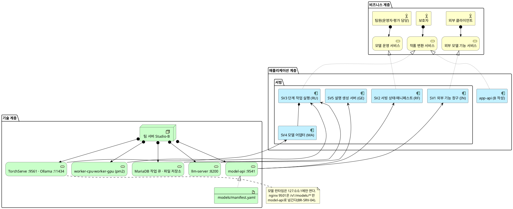
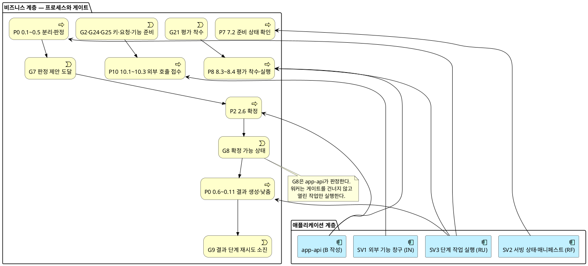
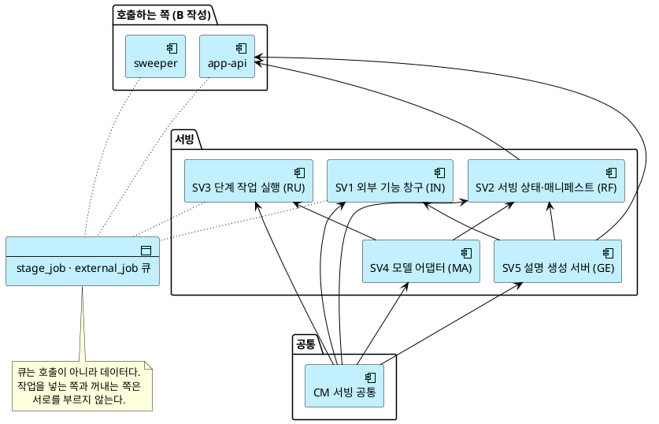
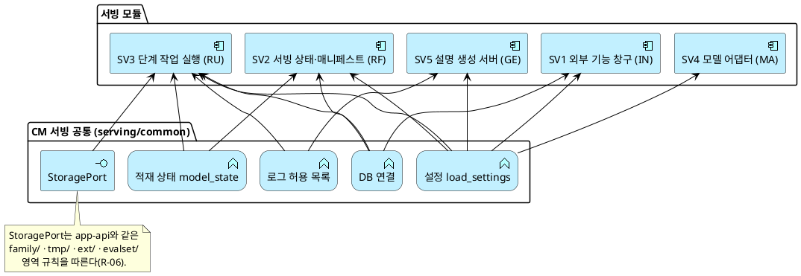

# SD_04 아키텍처 설계서 — 우리 아이 미술관 (모델 서빙 절)

> 작성: 2026-09-29 · 범위: 팀원별 작업지시 A7 — **모델 서빙 부분만**. API·DB 절은 B가 쓰므로 제목만 두고 "B 작성"으로 표시한다.
> 입력: SD_01 프로세스 설계서(P0·P7·P8·P10, 게이트 맵 §15) · SD_03 데이터베이스 설계서와 `uri_gallery_ddl.sql`(테이블 35) · UC_00~UC_15 · data-model §3 쓰기 소유 · plan Architecture · research R-02·R-03·R-04·R-05·R-18·R-22 · `contracts/stage-job.md` · `docs/A_모델재현기록.md` · `docs/A_팀서버_자원확인.md` · `serving/` 코드(2026-09-29 main)
> 공통모듈 설계서는 따로 없다. 서빙 안의 공통 코드 `serving/common/`을 §7의 공통모듈로 본다.

## 목차

- §1 목적과 표기
- §2 모듈화 원칙
- §3 모듈 목록
- §4 전체 아키텍처
- §5 프로세스 대 모듈 배치
- §6 모듈 간 의존
- §7 공통모듈 연계
- §8 제공 인터페이스 — API 도출 근거
- §9 미해결·확인 필요
- 관련 문서

---

## 1. 목적과 표기

### 1-1 이 문서가 답하는 질문

앞 문서들은 **무엇을**(UC), **어떤 순서로**(SD_01), **어떻게 조작하는지**(SD_02), **어디에 담는지**(SD_03)를 정했다. 이 절은 모델 서빙 쪽에서 남은 질문에 답한다 — **어느 모듈이 모델을 부르고, 어느 모듈이 그 결과를 기록하며, 그 모듈들은 어디서 도는가.**

서빙 절이 다루는 범위는 네 가지다(작업지시 A7).

| 범위 | 이 문서의 답 |
|---|---|
| 서빙 3종 | CPU 비전 큐(`worker-cpu`) · GPU 전용 큐(`worker-gpu`) · LLM 동기 서버(`llm-server`). LLM은 스트리밍 없이 짧은 동기 요청으로 정했다(R-18) |
| 모델 런타임의 내부망 배치 | TorchServe(M3) 9561~9563 · Ollama(M6) 11434 · llm-server 8200 · model-api 내부 경로 — 모두 127.0.0.1. 밖으로 나가는 문은 nginx 9501의 `/v1/models/*` 하나다 |
| 매니페스트·승격·롤백 흐름 | 매니페스트 파일(SV2)이 "무엇을 실행할 수 있는가"를, DB `model_version`(app-api)이 "무엇이 활성인가"를 정한다. 워커는 둘이 맞을 때만 모델을 부른다 |
| 자원 배치와 동시 처리 상한 | 팀 서버 1대(Studio-B, 128GB, CUDA 없음·MPS 있음)에서 서빙군별 1건 처리 |

### 1-2 ArchiMate 3.2 표기

**요소**

| 계층 | 매크로 | 의미 |
|---|---|---|
| Business | `Business_Actor` · `Business_Process` · `Business_Service` · `Business_Object` · `Business_Event` | 사람이 하는 일과 그 산출물 |
| Application | `Application_Component` · `Application_Service` · `Application_Function` · `Application_Interface` · `Application_DataObject` | 시스템이 하는 일 |
| Technology | `Technology_Node` · `Technology_Service` · `Technology_Artifact` | 그것이 도는 곳 |

**관계**

| 관계 | 매크로 | 의미 |
|---|---|---|
| Assignment | `Rel_Assignment(a,b)` | 행위자가 프로세스를 수행 · 노드가 서비스를 제공 |
| Realization | `Rel_Realization_Up(a,b)` | 하위가 상위를 실현 (모듈이 서비스를 실현) |
| Serving | `Rel_Serving_Up(a,b)` | 제공 (모듈이 프로세스·모듈에 서비스 제공) |
| Access | `Rel_Access(a,b)` | 데이터 읽기·쓰기 |
| Composition | `Rel_Composition(a,b)` | 구성 (모듈이 기능을 포함) |
| Triggering | `Rel_Triggering(a,b)` | 순서 유발 |
| Association | `Rel_Association(a,b)` | 느슨한 연관 |
| Flow | `Rel_Flow(a,b)` | 산출물 흐름 |
| Specialization | `Rel_Specialization_Up(a,b)` | 상속·구체화 |

이 문서의 도면에서 게이트는 `Business_Event`로 그린다. 게이트는 프로세스 사이에서 다음 단계를 열거나 막는 사건이기 때문이다.

---

## 2. 모듈화 원칙

### 2-1 세 가지 기준

| 기준 | 내용 | 서빙 절 적용 |
|---|---|---|
| **1. 데이터 소유** | 한 테이블 묶음의 쓰기 권한은 한 모듈만 가진다 | data-model §3과 `serving/` 코드의 실제 쓰기(INSERT·UPDATE)로 확인했다. 워커 패키지 전체가 같은 테이블(`stage_job` 실행 컬럼·`judgment`·`result` 등)에 쓰므로 한 모듈(SV3)이다 |
| **2. 유스케이스 정합** | 한 UC는 한 모듈이 주도한다 | 서빙 모듈이 주도하는 UC는 UC12(외부 모델 기능 호출, SV1) 하나다. 나머지 UC(UC2·UC3·UC8·UC9·UC10)는 app-api가 주도하고 서빙은 보조다 |
| **3. 게이트 경계** | 게이트를 사이에 둔 두 행위는 다른 모듈이다 | G8(확정)은 판정(SV3)과 결과 생성(SV3) 사이에 있지만, **게이트를 건너는 행위(확정)는 app-api가 한다.** 워커는 app-api가 연 작업만 실행한다. 기준 1과 부딪히는 부분은 §9-1에 적었다 |

기준 1이 가장 강하다. 셋이 부딪히면 1을 따른다.

### 2-2 아키타입

기본 9종(IN·VA·RF·GE·RV·AP·EX·EV·RU)에 **MA(모델 어댑터)를 하나 더했다.**

| 코드 | 아키타입 | 하는 일 | 전형적 인터페이스 | 서빙 절 사용 |
|---|---|---|---|---|
| **IN** | 수집 | 외부 입력을 시스템 안으로 들인다 | `POST /{res}` | SV1 |
| **VA** | 검증 | 누락·형식·규칙을 판정한다 | `POST /{res}/validate` | SV3 안의 기능(판정) |
| **RF** | 참조 | 기준 데이터를 조회·판본 고정한다 | `GET /{res}` · `POST /{res}/pin` | SV2 |
| **GE** | 생성 | 산출물 초안을 만든다 | `POST /{res}/compose` | SV5, SV3 안의 기능(결과 생성) |
| **RU** | 실행 | 작업을 돌리고 재현 가능하게 기록한다 | `POST /runs` · `GET /runs/{id}` | SV3 |
| **MA** | 모델 어댑터 *(추가)* | 모델 하나를 같은 모양의 호출 뒤에 숨긴다 | `run(JobInput) → AdapterResult` | SV4 |

- **MA를 더한 이유**: BR-MDL-02는 "모델마다 어댑터 하나, API 서버는 모델을 import하지 않는다"를 요구한다. 어댑터는 DB에 쓰지 않고 다른 모듈을 부르지도 않으며, 모델을 바꿀 때 **교체되는 단위**다. RU·GE와 성격이 달라 따로 분류해야 교체 경계가 문서에 남는다.
- **쓰지 않은 아키타입**: RV(비교)·AP(승인)·EX(반출)·EV(근거)는 서빙 절에 없다. 승인(승격 G22·확정 G8)과 반출(전시)은 app-api 몫이다.

### 2-3 아키타입 분포와 해석

| 아키타입 | 모듈 | 모듈 안 기능 |
|---|---:|---:|
| RU | 1 (SV3) | 평가 실행 · 외부 작업 실행 |
| GE | 1 (SV5) | 결과 생성 |
| VA | 0 | 판정 |
| IN | 1 (SV1) | — |
| RF | 1 (SV2) | — |
| MA | 1 (SV4) | — |

**해석**: 서빙은 **실행(RU) 중심**이다. 판정·결과 생성·평가·외부 작업이 모두 "큐에서 작업 하나를 꺼내 어댑터로 돌리고 기록한다"는 같은 틀 위에 있다. 이 편중은 결함이 아니다 — 서빙은 본질적으로 **작업 실행기**이고, 무엇을 할지(확정·승격·전시)는 앞에서 app-api가 정한다. 그래서 승인(AP)이 서빙에 하나도 없다. 서빙에 승인이 생기면 게이트 경계(기준 3)가 무너졌다는 신호다.

---

## 3. 모듈 목록

### 3-1 서빙 모듈

| ID | 모듈 | 아키타입 | 주도 UC (보조) | 프로세스 | 쓰기 소유 테이블 | 코드 위치 · 실행 단위 |
|:--:|---|:--:|---|---|---|---|
| **SV1** | 외부 기능 창구 | IN | **UC12** (UC11 시험 호출 대상) | P10 10.1~10.3 | `external_job`(생성·전달·결과 1회 수령), `external_call_log`, `gate_event`(G2·G24·G25) | `serving/model_api/external.py`·`auth.py` · pm2 `model-api` |
| **SV2** | 서빙 상태·매니페스트 | RF | — (UC8 준비 상태, UC9 매니페스트 대조) | P7 7.2 · P8 8.2~8.3 | DB 없음. 파일 `models/manifest.yaml`의 실측 칸(후보 등록은 요청 본문만 만든다, §9-2) | `serving/model_api/internal.py` · `serving/ops/models.py` · `models/manifest.yaml` · pm2 `model-api`(내부 경로) |
| **SV3** | 단계 작업 실행 | RU | — (UC2 판정, UC3 결과, UC9 BF4 평가, UC12 실행) | P0 0.1~0.12 · P8 8.4 · P10 실행 | `stage_job`(점유·실행 컬럼, 낮춘 작업 등록), `judgment`, `tag_candidate`, `result`, `stored_object`(원본 외 종류), `artwork`(워커 전이), `artwork_outcome`(`result_kind`·`result_cause`), `eval_item_result`, `external_job`(실행 컬럼), `gate_event`(G7·G9) | `serving/workers/` · pm2 `worker-cpu`·`worker-gpu` |
| **SV4** | 모델 어댑터 | MA | — (SV3·SV2가 부름) | P0 0.3·0.4·0.7 | 없음 | `serving/adapters/` M1·M2·M3·M5(P1 M7) · `serving/rules/m4_geometry.py` |
| **SV5** | 설명 생성 서버 (P0.5) | GE | — (UC10, UC12 `caption`) | P4 4.4~4.5 | 없음. 기록은 호출자(app-api)가 `stage_job(caption)`에 남긴다(R-18) | `serving/llm_server/` · pm2 `llm-server`(P0에서는 띄우지 않음) |
| **CM** | 서빙 공통 | — | — | — | 없음 | `serving/common/` (설정·DB 연결·StoragePort·로그 허용 목록·적재 상태) |

**SV3 안의 기능** — 한 모듈이지만 작업 종류(`stage_kind`·`origin`)에 따라 네 기능으로 나뉜다. 기능끼리는 쓰는 행(작업 종류)이 갈린다.

| 기능 | 성격 | 작업 종류 | 코드 | 처리 서빙군 |
|---|:--:|---|---|---|
| 판정 | VA | `split` · `judge` | `workers/stages/split.py` · `judge.py` | CPU 비전 |
| 결과 생성·낮춤 | GE | `animate_render` · `depth_relief` · `frame_compose` · (P1) `sculpture` | `workers/stages/results.py` · `chain.py` | 움직임·액자 CPU 비전, 2.5D·3D GPU(없으면 CPU, BR-SRV-02) |
| 평가 실행 | RU | `origin='eval'` | `workers/stages/eval.py` | 모델의 서빙군 |
| 외부 작업 실행 | RU | `external_job` | `workers/external.py` | 모델의 서빙군, 서빙군별 1건 |

### 3-2 이웃 모듈 (B 작성)

서빙 모듈과 맞닿는 모듈이다. 경계만 적고 세부는 B 절에 둔다.

| 모듈 | 서빙과의 경계 |
|---|---|
| app-api: 가족·작품·이야기·결정·삭제 | `stage_job` 행을 만들고 취소한다(`cancel_requested_at`). 원본 `stored_object`·`artwork_original`을 쓴다. G8 확정을 판정한다 |
| app-api: 운영·관리 | `model_version`·`evaluation`·`eval_item`·`release_event`·`feature_setting`을 쓴다. 승격(G22)·롤백·노출 설정(G17)을 결정한다. SV2 내부 경로를 부른다 |
| app-api: 설명 | SV5를 동기로 부르고 `stage_job(caption)`·`caption*`을 쓴다 |
| sweeper | 점유가 끊긴 `running` 작업을 `retry_wait`로 되돌린다(이어받기). 외부 결과를 만료시킨다 |
| web | 서빙을 직접 부르지 않는다 |

### 3-3 테이블 배정 (SD_03 35개 전수)

| 테이블 | 쓰기 소유 모듈 | 비고 |
|---|---|---|
| `judgment`, `tag_candidate`, `result`, `eval_item_result` | **SV3** | 서빙만 쓴다 |
| `external_call_log` | **SV1** | 서빙만 쓴다 |
| `external_job` | **SV1**(생성·전달) · **SV3**(실행 컬럼) | 둘 다 서빙. 컬럼이 갈린다(§9-1) |
| `stage_job` | app-api(생성·취소, `caption` 행 전체) · **SV3**(점유·실행 컬럼, 낮춘 작업 등록) · sweeper(이어받기) | 컬럼·행이 갈린다(§9-1) |
| `stored_object` | app-api(`original`) · **SV3**(`mask`·`cutout`·`joints`·`depth`·결과·임시) · sweeper(삭제) | `object_kind`로 갈린다 |
| `artwork` | app-api(생성·확정·결정·삭제 전이) · **SV3**(`judging→awaiting_confirm`, `processing→awaiting_review`/`failed`) · sweeper(삭제) | 상태 구간이 갈린다 |
| `artwork_outcome` | app-api(확정·결정 컬럼) · **SV3**(`result_kind`·`result_cause`) | 컬럼이 갈린다 |
| `gate_event` | app-api · **SV1**(G2·G24·G25) · **SV3**(G7·G9) · sweeper(G19 해제) | 게이트 ID로 갈린다. 추가만 한다 |
| `model_version` | app-api(운영·관리) | SV2 CLI는 등록 요청 본문만 만든다(§9-2에서 정리) |
| `api_key` | app-api(발급·폐기) | SV1은 읽기만 |
| `model`, `gate_catalog` | DDL 초기값(변경 없음) | SV2·SV3은 읽기만 |
| `family`, `guardian_account`, `family_invite`, `auth_email_token`, `app_session`, `auth_rate_event`, `child`, `team_member`, `team_member_role`, `artwork_original`, `decision`, `story`, `caption`, `caption_selected_tag`, `caption_check_failure`, `deletion_request`, `feature_setting`, `eval_item`, `evaluation`, `release_event` | app-api 또는 sweeper (B 작성) | 서빙은 쓰지 않는다. SV3은 `feature_setting`·`eval_item`을 읽는다 |

미배정 테이블은 0건이다.

---

## 4. 전체 아키텍처

**[「전체 아키텍처 — 서빙 관점」 PlantUML 뷰어로 열기](https://plantuml.sumzip.com/plantuml/svg/eNqFVctu20YU3fMrbt0NFVS2SElpYhRFpLQpukgKyEm2xpgaK4TJIUGO3KZFABlWAsdSW6dobbm1XBdQHgiyUGulVgB348_RDP-hM0MpoWwRljYEzz3nvs4Mb4QUBbTuOtpHNrGcehXDZyiwHtguonihNHn6XAvXbOKjALmwgqy1WuDVSfWm53gBfHxL_RIRxKviEPtgXEu8DBBZky_Nq5rmCwlUwzDH3jX5iy3W2uLbPRgdN_nw7Rz8oAGU66FNcBgulyzqBfoKMj4R0ceDqDPkhztzmVkhpgiJ2g3-x47Ofx_wzoaIPDuJfn466jeAtQas9S4zm5kXTL4_ZP82INoYsO4p7w747jDaHk7HL-Fg3bawvhLKcvjhs-iXLWDHjWi_A7x5ILvZ7qVRZHns9Sv24xDi8i6nJOoaM0fDPtt-PsV89GGc_Lej6Nc2e_GGnzZkC487U0Mt-b5jW4jaHlm-6bm-RzChOvJzIg3y_SzybdDLIPrizb_jUX2Qlhn3Y500pXBdjmXpvgHjoifV9v8bvX0D-td3YtF0vqn4ZtzfPvDNjWjz4OyEvewJj0Q_dUTHYimgV25dppRXSnmx91diBKqnvcfAW71o96ng37uMX1D8wmTufHfA2s-iZh_026XLuEXFLYoueuy1SLrZFfNUPf3TBP2rL2P-o-TmxKT41tHUtu5i6wERJ6z2cPmOOFA6JUZs8InSEq1XbS9bVmqJ6Il_qHLpt16whoOs5dfPTsbPNb8Ouu-amXSmXIQrsjrKFIvXiwUjPVjO2nHcbCje4AAWr5m5XHq0nOxdT9ws8hWW2lcNODuBbxwHuQgWDaOQL6TT5XBvo8BGX5QnW402dqRA1G7z7inwowY_fM6ftM9rlAJqryKL6lTdJqq9cMFFxF7FIZ1_iFxHHSetgp3lUhjaNeLKharLRxz5zEXAlIA5A8hLIB8DFYwc-_vYJvf8-Ly9lzsHKuOmg8l8F0AjkVPZMbQlGGsKR18oUzmKzmhsDJhpQD4NSM1RjAG1RlKT9Sp3itJmAKYEjDTAnAGoBmflKCQ6nwKKieTnJqnsobrXiEcxrHiUei54q7JBYanxlcD-7EebwmpN3m2AYX46nxN_g-_tsJdt4Ht91urNi2hSs8l3cL2YM2TcwrqxMDbeFRCBIuD9MWN_HQBrdkZD8aXq6eVKdqlyP5srZOY1TKogS9FuiCf5sf4f77gHCg==)** — 클릭 시 브라우저로 연결됩니다.

**읽는 법**: 위에서 아래로 읽는다. 맨 위는 누가 무엇을 받는지(보호자는 작품 변환, 팀원은 모델 운영, 외부 클라이언트는 모델 기능), 가운데는 그것을 실현하는 모듈, 맨 아래는 모듈이 도는 곳이다. 작품 변환은 app-api와 SV3가 함께 실현한다 — app-api가 접수·확정·결정을 맡고, SV3가 모델을 돌린다. SV4 어댑터는 SV3에 포함된 부품이며(마름모), 모델 런타임(TorchServe·Ollama)은 어댑터를 통해서만 쓰인다. 모든 기술 서비스는 팀 서버 한 대(Studio-B)에 있고, 모델 런타임은 루프백에만 열린다.

**자원 배치** (`docs/A_팀서버_자원확인.md` 2026-09-29 실측, 이 서버를 팀 서버로 보는 것은 팀 확인 필요)

| 기술 서비스 | 모델 | 장치 | 동시 처리 | 메모리(최대 RSS) |
|---|---|---|---|---|
| worker-cpu (1개) | M1 · M2 · M3(→TorchServe) · M4 · `frame_compose` | M1 CPU(MPS에 `deform_conv2d` 없음), M2 MPS | 프로세스당 작업 1건. split·judge 2(limits.yaml) — 이 서버에서는 1 권장(M1 8.5GB) | M1 8.5GB · M2 1.0GB |
| worker-gpu (1개) | M5 · (P1) M7 | MPS(`GPU_ENABLED=true`). MPS가 없으면 M5는 worker-cpu로 | 1건, 모델 상주 | M5 1.3GB |
| TorchServe | M3 검출·자세 `.mar` 2종 | CPU, 워커 1개 | 1 | 약 2.0GB |
| llm-server → Ollama (P0.5) | M6 Qwen3-4B-Instruct-2507 Q4_K_M | Metal(공유 Ollama) | 1건(세마포어) | 파일 2.5GB |
| 외부 작업 | 모델 기능 4종 | 해당 서빙군 | 서빙군별 1건 `[예시값 U12]` | — |

같은 서버를 다른 사용자가 쓰고 있다(약 70GB 사용 중). 모델을 모두 올리면 약 15GB에 M3·M6 실행 메모리가 더해진다. 그래서 서빙군별 동시 처리를 1로 둔다.

**내부망 배치** (BR-SRV-04, BR-MDL-06)

| 주소 | 무엇 | 밖에서 보이는가 |
|---|---|---|
| 9501 | nginx 입구 | 예 — 유일한 입구 |
| 127.0.0.1:9541 `/v1/models/*` | SV1 외부 기능 | nginx가 넘긴다 |
| 127.0.0.1:9541 `/internal/*` | SV2 상태·적재 | 아니오(nginx가 404) |
| 127.0.0.1:8200 | SV5 llm-server | 아니오 |
| 127.0.0.1:9561~9563 | TorchServe 예측·관리·지표 | 아니오. 보관 처리된 엔진이라 보안 수정이 없다 |
| 127.0.0.1:11434 | 공유 Ollama | 아니오 |

---

## 5. 프로세스 대 모듈 배치

**[「프로세스 대 모듈 배치」 PlantUML 뷰어로 열기](https://plantuml.sumzip.com/plantuml/svg/eNp9VEtvElEU3s-vOOIGEkVmeDYxpo_Yxo1pWuuWTOk4TgozNwN0YzTYTg0FYm0CtlVqMKFFEzT0BTTWDT_FJffOf_DcAWwrUBbD5OT7znce35nJZEo2U-lEXLij6bF4ekWBh7IZe6kl5JTyYGrw9khIrmo6kU05ActybFU1jbS-MmPEDRPuzjq_awjdWFGSCgExci1oyvoqD0ohQSCYQlYVcNELix1laT7LclXonlqsfQ5_MkWwixb9WmZWG-NsPwPdkwI7OLNzbRe8EgCm00lNV5LJ6LxpxPDfTcR74Jr3gc8rvvF5g0CbFj2qd1p24QOrlFye65zHa4qecqthZMyFoYcAVimzUhbotkXz9Zv4fxoS15BA8obA3i-NyxvheSN9BHQbGZo7BLbx1t4oj8nrH9QewtpFEZttdE8vkXPArONOi67_ZM3qSK0JrjUxIND8NxwhsC91li9jJ8DeFVjNGqMa4KoRiHj9byLeANjbW1grsMZ3lt3rtFi-an_cGikq8VnPSeJNyhiVIFcRfSDyzeDDD2y_TZsZsPfarFnGue8MkQc6QUen05qTAvwRBHu9ipV9KrKTH51Wt91wJlvNoInGqIe4ehjCXqmP6y_C2c5BG1mvr7zIShW7WEDbsMsMmo1t7vUd2fPcFCFxLSanNEOPzhgJYui8Spn4UEMm5L5MNHBP4_R3cGsep6DRlOQaH-Dic3EwikEnjd_d8zq4nzy9nS05bOzIKtOL_X5HaJNaFe_Ifr-HJ4OHAu6F2dvz-J08_ivb7LDdTegtHtlLHmc8woISjz4zNVVVTE1XnUtTw57_w_yciDQU5jejRobReCTEP4zGktSJYTR3HAmMiKNDSLAXX1TMNQxGl0ivNSIOxZ1dDYocwvvH4ANj8KPi4ph6cAok5BEE3UgpsGykUkYCjBc4GVzPXIQdZKDvIH5PvS-SXSrTfNWLAPa5wH5Vaa549RWkh5fQPT6jVpbV8ABLue5phSN3z-hRo79JWiv0lzlIpegrwCsQJvGNf_L_An_vfGU=)** — 클릭 시 브라우저로 연결됩니다.

**읽는 법**: 윗줄은 프로세스(사각형)와 그 사이의 게이트(사건)다. 화살표는 "이 단계가 끝나면 이 게이트를 지나야 다음 단계가 열린다"는 뜻이다. 아랫줄 모듈에서 올라가는 화살표는 "이 모듈이 이 단계를 맡는다"는 뜻이다. 판정(P0 0.1~0.5)과 결과 생성(0.6~0.11)은 둘 다 SV3가 하지만, 그 사이의 확정(P2 2.6)과 G8은 app-api가 맡는다. 그래서 워커는 게이트를 건너지 않는다 — app-api가 확정한 뒤 등록한 작업만 꺼낸다. 평가(P8)는 app-api가 착수 검사(G21)를 하고 SV3가 실행하며, 외부 호출(P10)은 SV1이 키·요청·기능 준비(G2·G24·G25)를 확인한 뒤 작업을 만든다.

| 프로세스 단계 | 담당 모듈 | 게이트 | 서빙 쪽 기록 |
|---|---|---|---|
| P0 0.1 판정 작업 점유 | SV3 | — | `stage_job` 점유 컬럼 |
| P0 0.3~0.5 분리·판정·제안 | SV3(판정) + SV4(M1·M2·M3·M4) | **G7** 소진 시 제안 없이 확정 대기 | `judgment`·`tag_candidate`·`gate_event` |
| P2 2.6 확정 | app-api | **G8** | — |
| P0 0.6~0.10 결과·낮춤·재시도 | SV3(결과 생성) + SV4(M3·M5·M7) | **G9** 결과 단계 3회 소진 | `result`·`artwork_outcome.result_*`·낮춘 작업 |
| P0 0.11 취소 수신 | SV3 | (G19의 반대편) | `stage_job.stopped_at` |
| P7 7.2 준비 상태 | SV2 | — | 없음(읽기) |
| P8 8.3 평가 착수 | app-api | **G21** | — |
| P8 8.4 항목별 평가 실행 | SV3(평가 실행) + SV4 | — | `eval_item_result` |
| P8 8.7~8.8 승격·롤백 | app-api | **G22** | — (워커는 새 작업부터 새 버전을 쓴다) |
| P10 10.1~10.3 외부 호출 접수 | SV1 | **G2 · G24 · G25** | `external_call_log`·`external_job` |
| P10 실행·결과 | SV3(외부 작업 실행) + SV4 | — | `external_job` 실행 컬럼 |
| P4 4.4~4.5 설명 초안 (P0.5) | SV5 (호출·기록은 app-api) | **G15 · G16** | 없음 |

**매니페스트·승격·롤백 흐름** — 서빙에서 "어떤 모델 버전을 부르는가"는 세 곳이 함께 정한다.

| 순서 | 무엇이 | 어디서 | 모듈 |
|:--:|---|---|---|
| 1 | 설치본의 가중치 SHA-256·런타임·설정 해시·적재 시간을 실측해 적는다 | `models/manifest.yaml` | SV2 (`ops.models measure --write`) |
| 2 | 후보 버전을 등록한다. SV2의 CLI는 매니페스트에서 값을 뽑아 등록 요청 본문(JSON)만 만들고, 등록은 app-api 경로로 한다(§9-2) | `model_version` | app-api |
| 3 | 평가 착수 전 설치본 해시가 매니페스트와 같은지 확인한다(G21) | app-api → SV2 | app-api |
| 4 | 평가 묶음을 같은 어댑터로 돌린다 | `stage_job(origin='eval')` → `eval_item_result` | SV3 |
| 5 | 전체 재평가 통과·라이선스 확인·계약 일치로 승격한다(G22). 직전 활성은 롤백 후보가 된다 | `model_version`·`release_event` | app-api |
| 6 | 워커는 작업을 점유할 때 활성 버전을 작업에 박아 두고(`model_version_id`), 매니페스트와 다시 대조한 뒤 부른다. 실행 중 작업은 시작 버전으로 끝낸다(D5) | `stage_job.model_version_id` | SV3 |
| 7 | 롤백은 재평가 없이 롤백 후보를 활성으로 되돌린다. 새 작업부터 적용된다 | `model_version`·`release_event` | app-api |

라이선스 확정 기록(`docs/A_모델_라이선스_확정.md` §4 팀 확정)이 채워지기 전에는 `license_confirmed`가 거짓이라, 승격도 워커 호출도 일어나지 않는다(BR-MDL-07).

---

## 6. 모듈 간 의존

**[「모듈 간 의존」 PlantUML 뷰어로 열기](https://plantuml.sumzip.com/plantuml/svg/eNp9VMtu00AU3fsrLmHjSLzyQiwQaggUsShIrco2mthDcON4XNtJkBBSSgyChCIq0ZJKCRIiUauIRSCPBpRu-jme8T8wtlORKo29Gp9zz7nj-_CKaSHDKhVV4YqiSWpJxnAXGdILpYgsfDN9fronmAVF05GBipBDUiFvkJImZ4hKDLi66j9zERqRsYl1iN2ZAw2kFTwwflsQdG6B8hgibnPCxi13v0nrX4D1TkG8D-zbHrN_RSPwSgBI67qqSMhSiJbNkKJONKxZItJvXYMI0vXrSFci0aVxZsWLMysY69jgca__Z2Z2i_45DEtilmNcvPEsBuxwQsdVcCZ9Wu8C6586o58gPn4SDUtdjvvqOASZgNV23Frr7IQedWjjvfupyeodtz4BcX013Cfh-ySANo6dge2X5-tbYI2Oe_CBqzfD1UlfnQTaO6a7E2AHQ_pxz7X7IK6lw5UpX5ni9-_QHk9Ya_O2-F_z2wbx0cPoxYI6g5H7bhRWUKnoFTSzdl6RmcJzmRc8QBZ6mtvCkiXK2177LO6f3SI5ODsB_NLChoZU_93d-czVwjpWsxvYKCtaPrupB5XnExJdJFIhBG_3MiJ-CZEMJRILhP_xl-WYEfFlxFKr5DIiFRBpScKmGeyKvH0B80d7AUssYpWZVtCIhSFHLIsUgTznGO8yL7-3tsEOs_YQ2L7NR5u2p0B3-xzgY0YbnRs8NBha1raB2j9mu-4MpuD8ndI3wxnA2lUvlA_H9xbtcpNxlXaH7KjKjes8xvfCmgzeZYQVfvL-W_8A4HjnHg==)** — 클릭 시 브라우저로 연결됩니다.

**읽는 법**: 화살표는 "제공하는 쪽 → 쓰는 쪽"이다. app-api는 SV2(준비 상태·미리 올리기, HTTP)와 SV5(설명, HTTP)를 쓴다. SV1은 외부 `caption`을 SV5로 동기 전달한다. SV2는 SV4의 목록(`adapters.registry`)과 SV5의 준비 상태를 읽는다. SV3은 SV4를 import해서 부른다. 점선은 큐 접근이다 — app-api·SV1이 작업을 넣고 SV3이 꺼내며 sweeper가 이어받기를 한다. **큐를 사이에 둔 모듈은 서로를 부르지 않는다.** 그래서 app-api와 SV3 사이, SV1과 SV3 사이에는 호출 화살표가 없다.

의존 근거는 `serving/` 코드의 import와 HTTP 호출이다(2026-09-29 main).

| 쓰는 쪽 | 제공하는 쪽 | 방식 | 근거 |
|---|---|---|---|
| app-api | SV2 | HTTP `/internal/ready`·`/internal/models`·warmup | `api/src/modules/ops/routes.ts` |
| app-api | SV5 | HTTP `/v1/caption` (P0.5) | R-18 |
| SV1 | SV5 | HTTP 동기 프록시(`caption`, P0.5) | R-18, `model_api/external.py` |
| SV2 | SV5 | HTTP `/v1/ready` | `model_api/internal.py` |
| SV2 | SV4 | import `adapters.registry` | `ops/models.py` |
| SV3 | SV4 | import `adapters.*`, `rules.m4_geometry` | `workers/runner.py`·`stages/*` |
| SV1·SV2·SV3·SV4·SV5 | CM | import `common.*` | 전 모듈 |

### 6-1 의존 규칙 점검

| 순환 의존 | 말단 모듈 | 최다 피의존 모듈 | 데이터 소유 중복 |
|---|---|---|---|
| **없음.** SV4·SV5는 다른 서빙 모듈을 부르지 않는다. SV2는 SV4·SV5를 읽기만 하고, 아무도 SV2를 import하지 않는다(app-api는 HTTP). SV3 안의 `runner ↔ stages` 상호 import는 모듈 안의 일이다 | **CM**(아무도 부르지 않음) · SV4(CM만) | **CM** — 서빙 모듈 5개 전부. 그래서 CM은 말단이어야 하고, 실제로 `serving/common/`은 다른 서빙 패키지를 import하지 않는다 | 서빙 안에서는 `external_job`(SV1 생성·SV3 실행)만 겹친다. 컬럼이 갈린다. app-api와의 겹침은 §9-1. `model_version`은 app-api로 모았다(§9-2) |

---

## 7. 공통모듈 연계

**[「공통모듈 연계」 PlantUML 뷰어로 열기](https://plantuml.sumzip.com/plantuml/svg/eNp9VFFP01AUfu-vOM6XLhEn3UZ8MAZEMTxADARfl0t3Nxvae5v2jmiMCcumwU1NiMiY2QgkIwLBpIK48eALP6f39j94W0ZcMtq-3Nv7ne9853z3tNMuQw6rWKZyxyC6WSlieIQc_ZVhIYYzMze7x4q7ZhAbOciCVaSvlR1aIcVZalIH7s5Fz0gEoUXsYhsmH44cOoishYfalKLYMgUqY0iJeodftoGfHPGvmyl4qwDM2LZp6IgZlBRmqWVTgglT3fXJe5BafjkJoj3gfzbAH3i8cQjC--tfnII6v5hOpRPYWsTWYCgoatWg1rnq8x893twMvuyKRi9oDEBdmkvOk43yZIE3j_zzOoi9LdF6D6LZC3Y-SvZKMjsXsXNRv58HIHZ-809bQd0DdWEmmZmPmHlZf4-fSMFaV9R_Rd2c1UF9_ixkv_vv6-zCTaf--UXw4QJUFzvrBilndGpZlKTHvZ6rED3cqHoptFoKif1vYFJULLiYMcl1xyoc4YQGP30CouX5Z95Y4Dxh2CkhHcvIyEJGHVnoC-qwpKShX_yg4_cHELQ2xfdj6dwxP-gmcUKnxH5V7J0ObxksOY5mQQ46w5FLS_Jt-dqOwop93a-cr3QMoMUB2TggFwfkbwG0OHEtTlyLE8_GAblE4Laq8nHi-WEqhVCGYZUyRi2gJZDq8k5G7pU3tgHZ9gSyDdGW36vXFt0NGVJClmG-ycBVH5hlRyt-za7XdWTKWcvIKLFbFa2f4Pc74lIS68C3PX444M2eujTxYCp9X8GkCGENyrTchT-wf_GG3Dc=)** — 클릭 시 브라우저로 연결됩니다.

**읽는 법**: 아랫줄은 `serving/common/`이 내놓는 공통 기능이고, 화살표는 그 기능을 쓰는 서빙 모듈을 가리킨다. 설정은 모든 모듈이 쓰고, 파일 저장소 접근(StoragePort)은 SV3만 쓴다. 외부 입력 파일(SV1의 `ext/{id}/input`)도 SV3이 저장소 규칙대로 읽는다. 로그 허용 목록은 모델 입력·출력을 다루는 SV3·SV5가 쓴다.

**참조 규칙**

| 공통 기능 | 규칙 | 근거 |
|---|---|---|
| 설정 `load_settings` | 환경 변수 이름을 `.env.example`과 같게 둔다. 서빙은 `.env`를 스스로 읽지 않고 pm2가 넣는다 | R-21, `ops/p1/ecosystem.config.cjs` |
| DB 연결 | 큐 점유는 `FOR UPDATE SKIP LOCKED`, 우선순위 보호자 10 · 평가 50, 외부는 별도 테이블로 그 뒤 | R-04, stage-job §9·§12 |
| StoragePort | `family/`·`tmp/`·`ext/`·`evalset/` 영역을 app-api와 같은 규칙으로 쓴다. 로컬 드라이버에서 S3 호환으로 바꿀 수 있다 | R-06 |
| 로그 허용 목록 | 이미지·객체 키·별칭·제목·키워드를 로그에 남기지 않는다 | BR-PRV-01 |
| 적재 상태 `model_state` | 워커가 적재 상태를 쓰고 SV2가 읽는다. 적재 시간은 작업 시간 상한에 넣지 않는다 | limits.yaml `load` |
| 재시도 정책 | 인프라 오류만 첫 시도 포함 최대 3회(10초·60초 간격). 품질 미달은 재시도 없이 낮춘다. 공통 코드는 `workers/runner.py`·`records.py`에 있다 | D1, BR-PRC-02·03, stage-job §4 |

---

## 8. 제공 인터페이스 — API 도출 근거

아키타입이 같으면 인터페이스 모양도 같다. 세부 엔드포인트는 `contracts/model-api.openapi.yaml`·`contracts/stage-job.md`·`contracts/llm-contract.md`에 있고, 여기서는 모양과 소비자만 적는다.

| 모듈 | 아키타입 | 제공 인터페이스 | 주 소비자 | 계약 |
|---|:--:|---|---|---|
| SV1 | IN | `POST /v1/models/{function}` → 202 작업 · `GET /v1/models/jobs/{id}` · `GET /v1/models/jobs/{id}/result`(1회 수령) · `POST /v1/models/caption`(P0.5, 동기) · `GET /v1/models/openapi.json` | 외부 클라이언트, UC11 시험 호출 | model-api.openapi.yaml |
| SV2 | RF | `GET /internal/ready` · `GET /internal/models` · `POST /internal/models/{id}/warmup` · `ops.models status·check·measure·register`(register는 등록 요청 본문 JSON 출력) | app-api 운영(S10·S11), 평가 담당(CLI) | model-api.openapi.yaml `/internal` |
| SV3 | RU | 큐 계약: `stage_job` 행(작업 종류·출처·우선순위) 입력 → 응답 분류 8종(`ok`·`quality_below`·인프라 5종·`cancelled`)과 결과 기록 출력 | app-api(작업 등록), SV1(외부 작업), sweeper | stage-job.md §2~§12 |
| SV4 | MA | `run(JobInput) → AdapterResult(outcome, score, outputs, diagnostic)` · `ensure_loaded()` | SV3, SV2 | `serving/adapters/base.py`, stage-job §4 |
| SV5 | GE | `POST /v1/caption` · `GET /v1/ready` | app-api, SV1 | llm-contract.md |

**점검 API(D20, 작성 예정)**: 모델마다 샘플 추론으로 동작을 확인하는 기능은 SV2(RF)의 내부 경로와 SV3(RU)의 실행을 함께 쓴다. 이 문서는 모양을 정하지 않는다 — D20 설계서(REF·UC8·UC9·SD_01)가 먼저 정한 뒤 여기에 반영한다.

### API·DB 절 (B 작성)

*B 작성.*

---

## 9. 미해결·확인 필요

### 9-1 기준 1의 예외 — 행·컬럼으로 갈리는 공동 쓰기

| 테이블 | 쓰는 모듈 | 겹치지 않는 이유 |
|---|---|---|
| `stage_job` | app-api · SV3 · sweeper | app-api는 행 생성과 `cancel_requested_at`, SV3는 점유·실행 컬럼과 낮춘 작업 행, sweeper는 만료된 `running`의 되돌림만 쓴다. `caption` 행은 app-api만 쓴다(R-18) |
| `artwork` | app-api · SV3 · sweeper | 상태 전이 구간이 갈린다. SV3는 `judging→awaiting_confirm`, `processing→awaiting_review`/`failed`만 쓴다. `삭제 중`에서 나가는 전이는 없다(D4) |
| `stored_object` | app-api · SV3 · sweeper | `object_kind`로 갈린다(원본은 app-api, 파생물은 SV3). sweeper는 삭제만 한다 |
| `artwork_outcome` | app-api · SV3 | 컬럼이 갈린다(확정·결정 ↔ `result_kind`·`result_cause`) |
| `external_job` | SV1 · SV3 · sweeper | SV1은 생성·전달·수령, SV3는 실행 컬럼, sweeper는 만료 정리 |
| `gate_event` | 여럿 | 게이트 ID로 갈리고 추가만 한다 |

**게이트 경계(기준 3)와의 충돌**: 판정과 결과 생성은 G8을 사이에 두지만 같은 모듈(SV3)이다. 기준 1(같은 테이블에 쓴다)이 이긴다. 대신 게이트를 판정하는 행위(확정)는 app-api에 있어 워커가 G8을 건너지 않는다. 워커 안에서는 `workers/stages/` 하위 파일로 나눠 두었다.

### 9-2 `model_version` 후보 등록 주체 — 정리함 (2026-09-29, A 최호준 동의)

**문제**: `serving/ops/models.py register --apply`(SV2)와 app-api `POST /v1/admin/models/:mid/versions`(운영·관리)가 모두 후보 행을 만들었다. CLI 경로는 평가 담당 권한 확인과 게이트 기록이 없고 `image_digest`를 넣지 않는다. tasks T114를 A의 `ops.models register`로 바꾼 결정에서 생긴 겹침이다.

**결정**

| 항목 | 내용 |
|---|---|
| 등록 주체 | **app-api 하나**(`POST /v1/admin/models/:mid/versions`, 평가 담당 역할 G1). `model_version` 쓰기 소유는 app-api 운영·관리 모듈만 갖는다 |
| SV2 CLI의 역할 | `ops.models register`는 DB에 쓰지 않는다(`--apply` 없앰). 매니페스트에서 값을 뽑아 **등록 요청 본문 JSON**(`version`·`weightsSha256`·`runtime`·`imageDigest`·`configHash`·`device`)을 출력하고, 평가 담당이 그 본문으로 API를 부른다 |
| 후속 구현 | A: `serving/ops/models.py`에서 `--apply` 제거·JSON 출력, `ops/DEPLOY.md` §1 표의 `register … --apply` 문구 수정. 이 절이 커밋된 뒤에 한다 |

**실행 환경 다이제스트(`image_digest`) 정의** — API는 `imageDigest`(16진수 64자)를 필수로 받는다. 지금 매니페스트에 값이 있는 것은 M3뿐이라 나머지 모델의 정의를 여기서 정한다. 목적은 R-03과 같다 — 컨테이너 이미지 대신 "이 모델을 돌리는 환경이 바뀌었는가"를 한 값으로 잡는다.

| 모델 | 재료(이 순서로) | 비고 |
|---|---|---|
| M3 | R-03 정의 그대로(`serving/conda-m3.lock` + `serving/requirements-m3.lock` + `ops/torchserve/config.properties` + `.mar` 2종 해시) | 이미 계산된 값을 바꾸지 않는다 |
| M1 · M2 · M5 · (P1) M7 | `serving/requirements.lock` + `serving/requirements-models.lock` + 매니페스트 `runtime` 문자열 | 같은 파이썬 환경(`serving/.venv`)을 쓴다. M7이 따로 잠금 파일을 두면 그 파일을 더한다 |
| M6 | `serving/requirements.lock`(llm-server 환경) + 매니페스트 `runtime` 문자열(Ollama 버전 포함, 예: `ollama-0.34.0-metal`) | 가중치(GGUF 블롭)는 `weights_sha256`에 따로 있다 |
| M4 | 등록하지 않는다 | 규칙 파일이라 `config_hash`로 충분하다 |

계산 방법(M3 외): 재료마다 한 줄씩 `<저장소 기준 상대 경로 또는 "runtime">` + 탭 + `<파일 SHA-256 또는 runtime 문자열>` + 줄바꿈을 위 순서로 이어 붙인 UTF-8 글의 SHA-256. 매니페스트에는 `sha256:` 접두어를 붙여 적고, API 본문에는 접두어 없이 16진수 64자만 보낸다. `[추론 — D 제안, A 계산 반영 때 확정]` research R-22의 매니페스트 필드 설명은 A가 계산을 반영할 때 같은 내용으로 맞춘다.

### 9-3 그 밖의 확인 필요

| # | 항목 | 상태 | 담당 |
|:--:|---|---|---|
| 1 | Studio-B를 팀 서버로 보는 전제 | 팀 확인 필요(A_팀서버_자원확인 §0) | 팀 |
| 2 | worker-cpu split·judge 동시 처리 2 → 1 | 권장만 함. U6·T137과 함께 `limits.yaml` 변경 | A |
| 3 | 모델 라이선스 팀 확정 칸 | 비어 있음. 채워지기 전에는 승격·호출 불가(G22, BR-MDL-07). M2는 보류 권고 | 팀 |
| 4 | ~~기본 pm2 구성(`ops/ecosystem.config.cjs`)에 TorchServe가 없다~~ | **닫음**(2026-09-29): `torchserve` 앱을 기본 구성으로 옮기고 p1 구성은 기본 구성을 물려받는다(`MODEL_ROOT` 없으면 `<저장소>/models`, U14) | B(이제민, 기본 구성 파일 담당) |
| 5 | ~~`.env.example`에 `M3_AD_PYTHON`·`M3_AD_ROOT`가 없다~~ | **닫음**(ba1f858): `.env.example`에 두 값과 `UAM_FAKE_MODELS` 운영값 0을 넣었다. 값이 비면 움직임 렌더는 `model_not_ready`(ad_env_missing)로 끝나므로 배포 확인 항목으로 둔다 | A |
| 6 | M7 TripoSR의 MPS 동작 | 자료 없음. P1 착수 게이트 | A |
| 7 | SV3 평가 실행이 M6를 평가할 때 SV5를 부르는 경로 | **결함이 아니라 P0.5 몫이다.** stage-job §12가 `caption_input` 평가 항목을 P0.5로 미뤄 두었고, 워커는 지금 그 작업을 점유하지 않는다. M7 평가도 GPU가 있을 때만이다(UC9 A4) | A(P0.5 착수 때) |
| 8 | 점검 API(D20)의 서빙 쪽 모양 | D20 설계 뒤 §8에 반영 | D·A |

---

## 관련 문서

- /Users/pioneer1/project2610/design/SD_01_프로세스설계서_우리아이미술관.md
- /Users/pioneer1/project2610/design/SD_02_UIUX설계서_우리아이미술관.md
- /Users/pioneer1/project2610/design/SD_03_데이터베이스설계서_우리아이미술관.md
- /Users/pioneer1/project2610/design/uri_gallery_ddl.sql
- /Users/pioneer1/project2610/design/UC_00_개요_우리아이미술관.md
- /Users/pioneer1/project2610/design/REF_재작성공통기준_우리아이미술관.md
- /Users/pioneer1/project2610/.specify/features/우리-아이-미술관/plan.md
- /Users/pioneer1/project2610/.specify/features/우리-아이-미술관/data-model.md
- /Users/pioneer1/project2610/.specify/features/우리-아이-미술관/research.md
- /Users/pioneer1/project2610/contracts/stage-job.md
- /Users/pioneer1/project2610/contracts/model-api.openapi.yaml
- /Users/pioneer1/project2610/contracts/llm-contract.md
- /Users/pioneer1/project2610/docs/A_모델재현기록.md
- /Users/pioneer1/project2610/docs/A_팀서버_자원확인.md
- /Users/pioneer1/project2610/docs/A_모델_라이선스_확정.md
- /Users/pioneer1/project2610/분석설계 프롬프트 - 아키텍처.md
