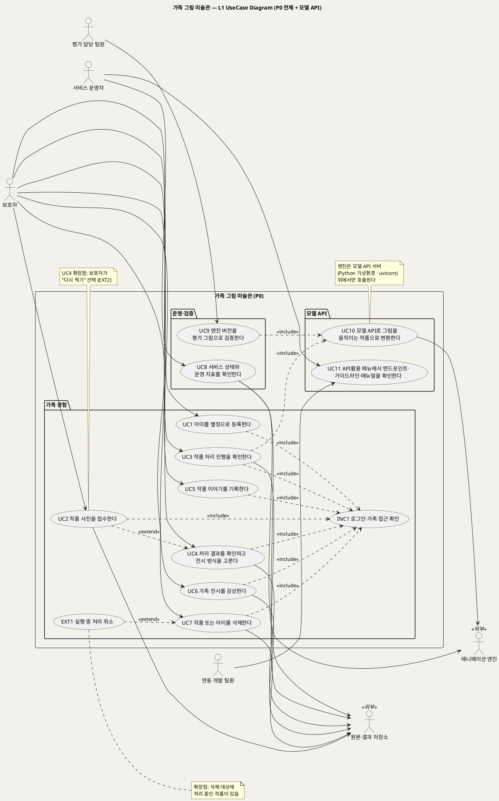

# UseCase 개요 — 가족 그림 미술관 (P0)
**가족 그림 미술관 · 유스케이스 개요 · UML 2.5.1 표준 (UseCase Diagram + UseCase 목록)**

---

> **문서 식별**: `design/UC_00_개요_가족그림미술관.md`
> **작성일**: 2026-09-23 · **표준**: UML 2.5.1 (OMG)
> **원천(SoT)**: `.specify/features/가족-그림-미술관/spec.md` (v1.0 Draft) — P0 기능 명세. 보조 원천 `Intent-Specify.md` (2026-09-23 기획 기준안)
> **다이어그램**: PlantUML 소스는 사내 Kroki(`plantuml.sumzip.com`)로 렌더를 검증했다(HTTP 200, image/svg+xml). 아래 링크를 누르면 브라우저에서 열린다.
> **개정 (2026-09-28)**: 추가 요구 R1~R4(모델 정의 · 모델을 쓰는 기능 · 가상환경 uvicorn API 서버 · 'API활용' 메뉴)를 반영했다. §2.1~§2.5를 새로 넣고, UC10·UC11 문서를 추가했으며, §3·§4·§5(L1)·§7·§8을 고쳤다. 다음 설계 단계의 정본은 `UC_ALL_가족그림미술관_통합명세.md`다.
> **표기**: `[추론]` = 원천에 직접 없는 설계 판단 · `자료 없음 — 확인 필요` = 원천에 근거가 없는 항목

---

## 목차

1. [시스템 목적·개요](#1-시스템-목적개요)
2. [주요 기능](#2-주요-기능) — 2.1 추가 요구사항 · 2.2 핵심 모델 정의 · 2.3 모델을 쓰는 기능 · 2.4 모델 API 서버 구성 · 2.5 'API활용' 메뉴 구성
3. [유스케이스 목록](#3-유스케이스-목록)
4. [Actor 카탈로그](#4-actor-카탈로그)
5. [L1 UseCase Diagram](#5-l1-usecase-diagram)
6. [시스템 경계 (하지 않는 것)](#6-시스템-경계-하지-않는-것)
7. [생성 결과](#7-생성-결과)
8. [결론](#8-결론)

---

## 1. 시스템 목적·개요

**목적** — 아이의 그림과 그날의 말을 가족이 함께 간직하고, 시간이 흐른 뒤에도 다시 만나는 기록으로 잇는다. 기술은 기억을 꾸며내지 않는다. 다시 꺼내 보는 수단일 뿐이다. (원천: spec §Overview Problem Statement · Intent [미션])

**개요** — 보호자가 휴대폰으로 찍은 그림을 올리면, 시스템은 두 가지 중 하나로 결과를 만든다. 사람 형태 그림은 **움직이는 작품**으로, 그 밖의 그림이나 품질이 미달한 결과는 **원본 액자**로 만든다. 보호자는 결과를 확인해 승인하고, 제목·제작일·제작 당시 연령·아이의 한마디를 직접 입력한다. 승인된 작품만 아이별·연령별 **가족용 2D 전시**에 걸린다. 이번 범위(P0)는 다음 흐름까지다(spec §비전과 이번 범위(P0)의 위치 · Intent [개요]).

내구 접수 → 움직임/액자 → 부모 확인 → 이야기 직접 입력 → 2D 전시 · 삭제 · 운영 지표

**핵심 원칙** (원천: spec §Constraints)

| 원칙 | 내용 |
|---|---|
| 승인 전 비전시 | 보호자 승인 없이 어떤 결과도 전시하지 않는다 |
| 원본 불변 | 원본을 덮어쓰지 않고, 결과물은 처음 만든 것을 보관한다 |
| 원인 분리 | 정상 액자, 품질 미달 액자, 인프라 실패를 섞지 않는다 |
| 최소 수집 | 아이는 별칭만 받는다. 실명, 생년월일, 출생연도는 받지 않는다 |
| 기억 왜곡 금지 | 입력에 없는 사건·감정을 만들지 않고, 자동 해석·발달 평가·비교를 하지 않는다 |

**증거 수준** — 엔진을 개인 PC에서 단독 실행한 것만 확인했다. 통합 서비스, 팀 서버, 사용자 반응은 검증 전이다(spec 머리말).

---

## 2. 주요 기능

| # | 기능 | 설명 | 원천 근거 | 관련 UC |
|:--:|---|---|---|:--:|
| F1 | 아이 등록 | 별칭 하나로 등록, 여러 아이 가능 | spec FR-1 | UC1 |
| F2 | 내구 접수 | 형식·용량·판독 검사. 원본·작품·작업 기록이 모두 저장돼야 접수 | spec FR-2, FR-15 | UC2 |
| F3 | 경로 결정 | "사람·캐릭터 그림인가요?"에 대한 보호자 답으로 움직임/원본 액자 경로를 정함 | spec FR-3 | UC2 |
| F4 | 백그라운드 처리·상태 조회 | 올리기와 처리를 분리하고, 작품별 상태를 조회 | spec FR-4, FR-11, FR-15 | UC3 |
| F5 | 결과 분류 | 움직임 / 정상 액자 / 품질 대체 액자 / 인프라 실패(제한 재시도) | spec FR-5 | UC3 |
| F6 | 부모 확인 | 좋아요 · 액자로 걸기 · 다시 찍기, 승인 전 비전시 | spec FR-6 | UC4 |
| F7 | 이야기 직접 입력 | 제목·제작일·제작 당시 연령(필수), 아이의 한마디(선택, 원문 그대로) | spec FR-7 | UC5 |
| F8 | 가족용 2D 전시 | 아이별 → 연령 묶음 → 제작일 순, 골라서 재생, 무한 피드 없음 | spec FR-8 | UC6 |
| F9 | 가족 단위 접근 권한 | 다른 가족·비로그인·운영자의 이미지 접근 차단 | spec FR-9 | 공통(«include») |
| F10 | 삭제·실행 중 취소 | 새 작업 차단 → 취소 확인 → 원본·결과·임시 파일 삭제, 집계 필드만 남김 | spec FR-10, FR-11 | UC7 |
| F11 | 생존·준비 상태 | 생존과 준비를 분리 확인, 엔진 불가는 따로 표시 | spec FR-12 | UC8 |
| F12 | 운영 지표 | 지표 6종, 원인별 분리 집계, 이미지·식별 정보 없음 | spec FR-13, FR-14 | UC8 |
| F13 | 엔진 재현·평가 세트 | 버전·시간·메모리·오인 사례 기록, 버전을 바꿀 때 재평가 | spec FR-16, FR-17 | UC9 |
| F14 | 사용 관찰 기록 | 부모 역할 사용자의 막힌 지점 관찰 | spec FR-18 | 미전환(§8) |
| F15 | 추적성 | REQ → UC → T → 증거 연결 | spec FR-19 | 미전환(§8) |


### 2.1 추가 요구사항 (2026-09-28)

이 절(§2.1~§2.5)과 `UC_10`·`UC_11` 문서는 2026-09-28에 받은 추가 요구 4건을 반영했다. 원천 추적을 위해 네 요구에 R1~R4 번호를 붙인다.

| ID | 추가 요구 | 반영 위치 |
|:--:|---|---|
| R1 | 모델 정의 — 이 모델의 용도, 입력, 출력, 모델 경로를 밝힌다 | §2.2 |
| R2 | 모델을 유스케이스의 기능으로 쓴다 — 사용자가 무엇을 입력하면 무엇을 처리해 무엇을 출력하는지 밝힌다 | §2.3 · UC2 · UC3 · UC10 |
| R3 | 모델을 쓰는 기능은 가상환경(uvicorn)의 API 서버로 구성하고 웹서비스에 연동한다 | §2.4 · UC10 |
| R4 | API 서버는 엔드포인트·가이드라인·매뉴얼을 담은 'API활용' 메뉴를 갖춘다 | §2.5 · UC11 |

추가 기능

| # | 기능 | 설명 | 원천 근거 | 관련 UC |
|:--:|---|---|---|:--:|
| F16 | 모델 API 서버 | 애니메이션 모델을 웹서비스와 분리된 API 서버(Python 가상환경 + uvicorn)로 제공한다. 웹서비스는 HTTP API로만 모델을 부른다 | R2 · R3 · Intent [핵심 이네이블러] FastAPI · 엔진 어댑터 | UC10 |
| F17 | API활용 메뉴 | 엔드포인트, 가이드라인, 매뉴얼을 한 메뉴에서 본다. 운영자와 개발 팀원만 쓴다 | R4 | UC11 |

### 2.2 핵심 모델 정의 (R1)

> **쉽게 말하면** — 이 모델은 아이가 그린 사람·캐릭터 그림 사진을 받아서, 그 그림 속 인물이 실제로 움직이는 짧은 영상으로 바꿔 줍니다. 사람이 아닌 그림(집, 자동차 등)에는 쓰지 않습니다.

| 항목 | 내용 | 근거 |
|---|---|---|
| 모델명 | Meta Animated Drawings (코드·가중치 MIT). 2025-09-03 저장소 보관 처리 | spec Dependencies · Intent [핵심 이네이블러] |
| 용도 | 아이가 그린 **사람·팔다리가 있는 캐릭터 그림**을 **움직이는 작품**으로 만드는 애니메이션 엔진. 움직임 경로 전용이며 원본 액자 경로에는 쓰지 않는다 | spec FR-3 · Intent [핵심 활동] 4 |
| 입력 | 그림 사진 1장. UC2 접수 검사를 통과한 원본(JPEG·PNG·HEIC, 20MB 이하 기본값). 원본은 읽기만 하고 바꾸지 않는다 | spec Assumptions 허용 형식·용량 · BR-INT-04 |
| 내부 처리 | 사람 형태 검출 → 관절 추정 → OpenCV 기반 분할 → 리깅 → 렌더 | Intent [핵심 이네이블러] 애니메이션 |
| 출력 | (1) 움직이는 작품 파일 1개 (2) 결과 분류(움직임 / 품질 미달) (3) 검출 점수(기록용) (4) 엔진 버전 (5) 단계별 소요 시간. [추론] 원본 엔진의 기본 출력은 GIF 애니메이션이다. 서비스에서 쓸 파일 형식(GIF/MP4 등)은 `자료 없음 — 확인 필요` | spec FR-5 · FR-16 수용기준 2 |
| 모델 실행 구성요소 | TorchServe(2025-08-07 보관 처리). 검출 모델과 관절 추정 모델을 서빙한다. API 서버 뒤의 내부망에만 둔다 | spec Dependencies · FR-16 |
| **모델 경로** | `자료 없음 — 확인 필요`. 원천(spec·Intent)에 팀 서버 설치 경로가 없다. [추론] 공개 저장소 구성에서는 두 모델 파일(`drawn_humanoid_detector.mar`, `drawn_humanoid_pose_estimator.mar`)을 TorchServe 모델 저장소(model-store) 폴더에 두고 적재한다. 팀 서버 경로는 UC9 재현 기록(A3)에서 확정해 이 칸과 API 서버 설정(`MODEL_STORE_PATH` [추론])에 같은 값으로 적는다 | spec FR-16 수용기준 1 |
| 자원 실측(1차) | 개인 PC(CPU 4코어·메모리 3.8GB·그래픽 카드 없음)에서 한 장 53~62초(렌더 약 40초), 모델 서버 약 3.1GB. 빌드 약 36분, 설치 크기 32.9GB. 팀 서버 수치는 미측정 | Intent [핵심 장벽] 인프라·엔진 재현 |
| 알려진 한계 | 집 그림을 사람 점수 0.946으로 잘못 잡아 벽에 관절이 붙은 사례가 있다. 그래서 검출 점수는 기록만 하고 승인 근거로 쓰지 않는다 | Intent [핵심 장벽] 적용 범위·품질 · BR-PRC-04 |
| 예비 모델 | 그림 전용 YOLOv8 자세 모델(가중치 AGPL-3.0), rtmlib(Apache-2.0). 교체해도 API 규격은 그대로 둔다(BR-API-01) | spec Dependencies · FR-16 수용기준 3 |

### 2.3 모델을 쓰는 기능 (R2)

모델은 **움직임 경로의 작품 변환 기능**(F3·F4·F5)으로 쓴다. 보호자가 UC2에서 그림 사진을 올리고 "사람이나 캐릭터 그림인가요?"에 **"예"**라고 답하면, UC3의 백그라운드 처리가 모델 API(UC10)를 불러 **움직이는 작품**을 만든다. 보호자는 그 결과를 UC4에서 확인한다.

| 단계 | 사용자 입력 | 시스템 처리 (모델 사용) | 출력 | UC |
|:--:|---|---|---|:--:|
| 1 | 보호자가 아이를 고르고 그림 사진 1장을 올린다 | 형식·용량·판독을 검사하고 원본·작품 기록·작업 기록을 저장한다. 모델은 아직 부르지 않는다 | "접수 완료" | UC2 |
| 2 | "사람이나 캐릭터 그림인가요?"에 "예"라고 답한다 | 작업 경로를 "움직임"으로 정한다. "아니요"면 모델을 부르지 않고 원본 액자를 만든다(BR-PRC-01) | 처리 상태 "처리 중" | UC2 |
| 3 | (입력 없음 — 보호자는 화면을 떠나도 된다) | 처리 담당이 모델 API 서버에 원본을 보내고, 모델이 검출·관절 추정·분할·리깅·렌더를 한다 | 결과 분류, 검출 점수(기록용), 엔진 버전, 단계별 시간 | UC3 → UC10 |
| 4 | 보호자가 작품 목록에서 진행 상태를 확인한다 | 성공이면 움직이는 작품을 저장한다. 품질 미달이면 재시도 없이 원본 액자로 바꾼다. 인프라 장애면 최대 3회 재시도 뒤 실패로 알린다 | "확인 대기" 또는 "처리하지 못했어요" | UC3 |
| 5 | 보호자가 결과를 보고 좋아요 / 액자로 걸기 / 다시 찍기 중 하나를 고른다 | 선택을 기록한다. 승인된 작품만 전시 후보가 된다 | 움직이는 작품(또는 원본 액자) | UC4 |

모델은 같은 API로 두 곳에서 더 쓰인다. UC9의 평가 도구가 평가 그림을 보내 엔진 버전을 검증하고, UC8의 준비 확인이 API 서버의 `/ready`로 "엔진 불가"를 가린다.

### 2.4 모델 API 서버 구성 (R3)

모델 기능은 웹서비스 안에 넣지 않는다. **별도 API 서버**로 띄우고 웹서비스가 HTTP로 부른다. 이렇게 하면 원천이 요구한 "교체 가능한 엔진 어댑터"(Intent [핵심 장벽] 서빙 의존성)가 API 경계와 같아진다. 엔진을 바꿔도 웹서비스는 바뀌지 않는다(BR-ENG-05).

호출 경로는 다음 한 방향이다.

1. 보호자 브라우저 → (HTTPS) → 가족 그림 미술관 웹서비스
2. 웹서비스의 처리 담당(워커) → (내부망 HTTP · 토큰) → 모델 API 서버(Python 가상환경 + uvicorn)
3. 모델 API 서버 → (localhost 전용) → TorchServe + Animated Drawings 모델
4. 처리 담당 → 원본·결과 저장소(결과 저장은 웹서비스가 맡는다)

| 항목 | 내용 | 근거 |
|---|---|---|
| 실행 방식 | Python 가상환경(`venv`)에 의존성을 고정 설치하고, ASGI 서버 **uvicorn**으로 API 앱을 띄운다 | R3 |
| 프레임워크 | FastAPI. [추론] 원천 Intent-Specify [핵심 이네이블러]가 FastAPI를 적었고, uvicorn의 기본 짝이다. 웹서비스 스택(Intent-Plan은 Node/Express)과 무관하게 API 서버는 Python으로 둔다 | Intent-Specify · Intent-Plan |
| 연동 방식 | 웹서비스의 처리 담당이 작업을 요청하고(비동기, `202`), 상태를 조회한 뒤 결과를 받는다. [추론] 한 장에 53~62초가 걸리므로 요청-응답 한 번으로 기다리는 동기 호출은 쓰지 않는다 | Intent [핵심 장벽] 인프라 · spec FR-4 |
| 네트워크 | API 서버는 내부망 주소에만 바인딩한다. TorchServe는 API 서버와 같은 호스트의 localhost에만 열고, 관리 API는 닫는다. 외부 포트는 열지 않는다 | spec FR-14 · FR-16 수용기준 4 · BR-ENG-01 |
| 인증 | 호출자(웹서비스 처리 담당, 평가 도구)마다 발급한 토큰을 요청 헤더로 받는다. [추론] 인증 방식의 세부는 `자료 없음 — 확인 필요` | [추론] |
| 파일 처리 | API 서버는 결과를 가족 저장소에 직접 쓰지 않는다. 결과 파일을 돌려주고, 웹서비스가 원본·결과 저장소에 저장한다. 작업 정리(`DELETE`) 때 입력·결과·임시 파일을 지운다 | spec FR-11 · FR-14 학습 재사용 금지 |
| 고정 환경 | 가상환경의 패키지 버전은 잠금 파일로 고정하고, 엔진(TorchServe·모델 파일)은 고정 이미지와 체크섬으로 관리한다 | Intent [핵심 이네이블러] "Docker 고정 이미지·체크섬·엔진 어댑터" |
| 포트 | `자료 없음 — 확인 필요`. [추론] 예시 값은 8000 | — |

**엔드포인트** (API 규격 v1, [추론] — 이름과 형식은 plan 단계에서 확정)

| 메서드 · 경로 | 용도 | 주요 응답 | 쓰는 UC |
|---|---|---|---|
| `GET /health` | 생존 확인. 프로세스가 응답하는지 본다 | `200 {"status":"alive"}` | UC8 |
| `GET /ready` | 준비 확인. 모델이 적재되고 엔진이 응답하는지 본다 | `200 ready` / `503 engine_unavailable` | UC8 · UC10 |
| `GET /v1/model` | 모델명, 엔진 버전, 모델 파일 체크섬 | `200` | UC9 · UC11 |
| `POST /v1/jobs` | 변환 작업 요청. 원본 이미지(multipart)와 요청 번호를 받는다 | `202 {job_id}` / `401` `403` / `422 invalid_input` | UC10 |
| `GET /v1/jobs/{job_id}` | 작업 상태 조회 | `queued` `running` `done` `failed` + 결과 분류(`animated` / `quality_below`) 또는 오류 분류(`engine_down` / `timeout`) + 검출 점수 + 엔진 버전 + 단계별 시간 | UC10 |
| `GET /v1/jobs/{job_id}/result` | 움직이는 작품 파일 받기 | `200` 파일 / `404` | UC10 |
| `DELETE /v1/jobs/{job_id}` | 작업 정리. 진행 중이면 취소하고, 끝났으면 입력·결과·임시 파일을 지운다 | `204` | UC10 · UC7(EXT1) |
| `GET /openapi.json` · `GET /docs` | 기계가 읽는 API 명세와 자동 문서. API활용 메뉴의 엔드포인트 탭이 이것을 읽는다 | `200` | UC11 |

**결과·오류 대응** — API 응답의 분류는 웹서비스의 작업 기록 분류와 1:1로 맞춘다. 그래야 "품질 미달"과 "인프라 실패"가 섞이지 않는다(BR-OPS-03).

| API 응답 | 웹서비스 작업 기록 | 웹서비스 처리 |
|---|---|---|
| `done` + `animated` | 결과 종류 = 움직임 | 결과 저장 → 확인 대기 |
| `done` + `quality_below` | 대체 분류 = 품질 미달 | 재시도 없이 원본 액자(BR-PRC-02) |
| `failed` + `timeout` | 오류 분류 = 시간 초과 | 재시도 규칙(BR-PRC-03) |
| `503 engine_unavailable` · 연결 실패 | 오류 분류 = 엔진 다운 | 재시도 규칙(BR-PRC-03) |
| `401` `403` `422` | [추론] 오류 분류 = 연동 오류(설정 문제) | 재시도하지 않고 운영자에게 알린다. 보호자에게는 "처리하지 못했어요" |

### 2.5 'API활용' 메뉴 구성 (R4)

API 서버를 쓰고 관리하는 데 필요한 정보를 웹서비스의 **'API활용' 메뉴** 한 곳에 모은다. 서비스 운영자와 연동 개발 팀원만 볼 수 있고, 보호자 화면에는 나타나지 않는다(BR-API-07).

| 탭 | 담는 내용 | 원천 |
|---|---|---|
| 엔드포인트 | §2.4의 엔드포인트 목록, 요청·응답 형식, 오류 코드와 작업 기록 분류 대응표, 요청 예시(curl), 현재 모델명·엔진 버전. API 서버의 `/openapi.json`에서 생성해 실제 API와 어긋나지 않게 한다 | R4 · BR-API-08 |
| 가이드라인 | 호출 규칙: 내부망에서만 호출, 토큰 필수, "예" 경로 작품만 보낸다, 재시도는 웹서비스 규칙(최대 3회)을 따른다, 작업당 시간 상한 10분, 작업이 끝나면 반드시 정리(`DELETE`), 로그에 이미지·자유 입력 금지, 시험 호출에는 팀원이 직접 그린 그림만 쓴다 | R4 · BR-PRC-01~06 · BR-PRV-01 · BR-ENG-04 |
| 매뉴얼 | 설치(가상환경 만들기·의존성 설치), 기동·중지(uvicorn), 상태 확인(`/health`·`/ready`), 모델 파일 경로 설정과 모델 교체, 엔진 버전 변경 시 UC9 재평가 절차, 장애 대응(엔진 불가·시간 초과·디스크 부족) | R4 · spec FR-12 · FR-16 · FR-17 |
| 시험 호출 (선택, EXT3) | 평가 세트의 그림을 골라 API를 직접 불러 보고 응답을 확인한다 | R4 · BR-API-09 [추론] |

**매뉴얼 기동 예시** ([추론] 파일·모듈 이름은 plan 단계에서 확정)

```bash
python3 -m venv .venv
source .venv/bin/activate
pip install -r requirements.lock
export MODEL_STORE_PATH=<모델 경로 — 자료 없음, 확인 필요>
uvicorn app.main:app --host <내부망 IP> --port 8000 --workers 1
```

---

## 3. 유스케이스 목록

> 원천 Intent [수익] 절은 "UC-01~09의 작품 정리·감상·통제"를 P0 범위로 적고, 후속 범위로 UC-13(영화), UC-15(설명·큐레이션), UC-17(주문)을 언급한다. 아래 UC1~UC9는 그 P0 번호대에 대응한다. UC10·UC11은 2026-09-28 추가 요구 R1~R4로 더한 것으로, 원천 번호대와 무관하다. [추론] 원천에는 UC-01~09의 개별 명칭이 없다. 그래서 아래 명칭은 spec FR에서 도출했으며, 원천의 번호 체계와 이름이 같다는 보장은 없다.

| UC ID | 유스케이스명 | 주액터 | 우선순위 | 원천 근거 | 문서 | 상태 |
|:--:|---|---|:--:|---|---|:--:|
| UC1 | 아이를 별칭으로 등록한다 | 보호자 | Medium | spec FR-1 · Intent [핵심 데이터] 아이 | `UC_01_아이등록.md` | 완료 |
| UC2 | 작품 사진을 접수한다 | 보호자 | High | spec FR-2, FR-3, FR-15 · Intent [핵심 활동] 3·4 | `UC_02_작품사진접수.md` | 완료 |
| UC3 | 작품 처리 진행을 확인한다 | 보호자 | High | spec FR-4, FR-5, FR-11, FR-15 · Intent [핵심 장벽] 품질·인프라 | `UC_03_처리진행확인.md` | 완료 |
| UC4 | 처리 결과를 확인하고 전시 방식을 고른다 | 보호자 | High | spec FR-6 · Intent [핵심 활동] 5 | `UC_04_결과확인승인.md` | 완료 |
| UC5 | 작품 이야기를 기록한다 | 보호자 | High | spec FR-7 · Intent [핵심 활동] 5 · [부정적 영향] 기억의 재작성 | `UC_05_작품이야기기록.md` | 완료 |
| UC6 | 가족 전시를 감상한다 | 보호자 | High | spec FR-8, FR-9 · Intent [가치제안] 경험 원칙 | `UC_06_가족전시감상.md` | 완료 |
| UC7 | 작품 또는 아이를 삭제한다 | 보호자 | High | spec FR-10, FR-11 · Intent [부정적 영향] 삭제 누락 | `UC_07_작품아이삭제.md` | 완료 |
| UC8 | 서비스 상태와 운영 지표를 확인한다 | 서비스 운영자 | Medium | spec FR-12, FR-13, FR-14 · Intent [미션] 서빙 지표 | `UC_08_운영상태지표확인.md` | 완료 |
| UC9 | 엔진 버전을 평가 그림으로 검증한다 | 평가 담당 팀원 | Medium | spec FR-16, FR-17 · Intent [핵심 장벽] 엔진 재현 | `UC_09_엔진평가검증.md` | 완료 |
| UC10 | 모델 API로 그림을 움직이는 작품으로 변환한다 | 웹서비스 처리 담당(시스템) · 평가 도구(시스템) | High | 추가 요구 R1·R2·R3 · spec FR-4, FR-5, FR-16 · Intent [핵심 이네이블러] | `UC_10_모델API변환.md` | 완료 (2026-09-28 추가) |
| UC11 | API활용 메뉴에서 엔드포인트·가이드라인·매뉴얼을 확인한다 | 연동 개발 팀원 · 서비스 운영자 | Medium | 추가 요구 R4 · spec FR-9, FR-12, FR-16 | `UC_11_API활용메뉴.md` | 완료 (2026-09-28 추가) |

**공통·조건부 유스케이스** (독립 문서 없이 기반 UC 문서에서 다룬다)

| ID | 명칭 | 관계 | 원천 근거 |
|:--:|---|---|---|
| INC1 | 로그인·가족 접근 확인 | UC1~UC7이 «include» | spec FR-9 |
| EXT1 | 실행 중 처리 취소 | UC7을 «extend» (확장점: 삭제 대상에 처리 중인 작품이 있음) | spec FR-10 |
| EXT2 | 다시 찍어 재접수 | UC2가 UC4를 «extend» (확장점: 보호자가 "다시 찍기" 선택) | spec FR-6 |
| INC2 | 팀원 로그인·역할 확인 | UC11이 «include» | spec FR-9 수용기준 3 · Assumptions 운영자 권한 |
| EXT3 | 평가 그림으로 시험 호출 | UC11을 «extend» (확장점: 팀원이 "시험 호출" 선택). 실행 시 UC10을 «include» | 추가 요구 R4 [추론] |

**우선순위 근거**
- High: 가족 경험의 핵심 흐름(접수 → 처리 → 확인 → 이야기 → 전시)과 아동 정보 삭제 통제. spec §Overview의 P0 범위와 §Constraints에서 필수로 적은 항목이다.
- Medium: UC1은 선행 조건이지만 기능이 작다. UC8·UC9는 가족이 직접 쓰지 않는 운영·검증 기능이다(spec FR-16~17은 "Secondary Requirements"에 있다). UC8의 지표는 원천 [미션] "서빙 지표"에 근거한다.
- UC10(High): 움직임 경로의 유일한 모델 호출 통로다. 원천이 서빙 의존성을 "치명" 등급으로 분류했다. UC11(Medium): 추가 요구 R4의 필수 구성이지만 가족이 쓰는 기능은 아니다.

**추상수준 판정** — [추론] 다음 항목은 UC로 두지 않았다.
- "임시 파일 정리(FR-11)"는 시스템이 스스로 하는 일이라 액터의 목표가 아니다. UC3·UC7의 시스템 행위로 흡수했다.
- "자원 상한(FR-15)"은 규칙이므로 UC2·UC3의 업무규칙으로 흡수했다.
- "아동 정보 보호(FR-14)"는 전 UC에 걸친 제약이라 업무규칙과 특별 요구사항으로 흡수했다.

---

## 4. Actor 카탈로그

| 구분 | 액터 | 설명 | 관련 UC | 원천 근거 |
|:--:|---|---|---|---|
| Primary | 보호자(부모) | 아이를 등록하고, 작품을 올리고, 결과를 확인·승인하고, 이야기를 입력하고, 감상·삭제한다. 잠재 구매자(가설) | UC1~UC7 | spec Target Users |
| Primary | 서비스 운영자 | 생존·준비 상태와 운영 지표를 확인한다. 가족의 이미지와 이야기에는 접근하지 않는다 | UC8 | spec Target Users · FR-9 · Assumptions 운영자 권한 |
| Primary | 평가 담당 팀원 | 직접 그린 평가 그림으로 엔진 버전을 검증하고 오인 사례를 기록한다 | UC9 | spec Target Users · FR-17 |
| Primary | 연동 개발 팀원 | 'API활용' 메뉴에서 엔드포인트·가이드라인·매뉴얼을 보고 웹서비스·평가 도구와 모델 API의 연동을 구현한다. [추론] 원천에 없는 새 액터 | UC11 | 추가 요구 R4 |
| Primary(시스템) | 웹서비스 처리 담당 · 평가 도구 | 모델 API 서버를 부르는 호출자. UC10의 경계가 모델 API 서버이므로 이 UC에서만 액터로 둔다 | UC10 | 추가 요구 R3 · spec FR-4 · FR-17 |
| Secondary | 애니메이션 엔진 | 사람 형태 그림의 검출·관절 추정·리깅·렌더를 수행하는 외부 공개 엔진(Meta Animated Drawings, MIT, 2025-09-03 보관 처리). 내부 네트워크로 격리. 2026-09-28부터 모델 API 서버(Python 가상환경 · uvicorn) 뒤에서만 호출된다(§2.2·§2.4) | UC10(UC3·UC9가 포함), UC8(준비 확인) | spec Dependencies · FR-16 · 추가 요구 R1·R3 |
| Secondary | 모델 API 서버 | 애니메이션 모델을 감싼 API 서버. UC11에서 자기 명세(`/openapi.json`)와 모델 정보를 제공한다 | UC11 | 추가 요구 R3·R4 |
| Secondary | 원본·결과 저장소 | 원본, 결과, 임시 파일을 보관하는 저장소. 실제 제품은 미확정 | UC2, UC3, UC4, UC6, UC7, UC8(준비 확인) | spec Dependencies · Intent [핵심 이네이블러] 파일 |
| 이해관계자 | 아이 | 계정이 없고 보호자와 함께 화면을 본다. 주 수혜자이며 결제 대상이 아니다. [추론] 시스템을 직접 조작하지 않으므로 다이어그램 액터로 두지 않는다 | (UC6 감상 맥락) | spec Target Users |
| 이해관계자 | 성장한 아이 | 장기 수혜자. 내보내기·권한 이전은 P0 밖이다 | 없음 | spec Target Users · Out of Scope |

주의: spec FR-9의 가족 접근 계정 모델(보호자 1계정 / 공동 보호자 초대 / 감상 전용 초대)은 미확정([NEEDS CLARIFICATION])이다. 이 문서 묶음은 "보호자 계정"을 단일 역할로 표기한다. 공동 보호자나 감상 전용 액터를 추가할지는 `자료 없음 — 확인 필요`로 두었다.

---

## 5. L1 UseCase Diagram



**[「L1 전체 UseCase Diagram」 PlantUML 뷰어로 열기](https://plantuml.sumzip.com/plantuml/svg/eNp9Vt9P21YUfvdfcZS9gKZWhEACVYW6USpVqjakrdIekJCbmGDV2Chx2FBVyZRsAkJFUkhJio2CFKBMVEuTqAlS9tI_ZY-5x__DzrXjYHtkT_HhnO-7554f3-VRVhczem5NgVxyeUVck5XN5bSoKFJmc_lZVMi-lNV1MSOuwQsx-TKd0XJqal5TtAx88yT2JLrwvS8iuyqmtF9lNQ0ropKVBEVa0UHXICOnV3VIyRkpqcuaKuiyrkjQbxh49hn6nS676AH7q4s7tX7bgH-MI3gWhedZaV7MSvBYFtOcfGxxArCWx2YbvgX250f2tgvfLT4dFwQxqVM6EdZq25UunhYjIGZhUcxIqu75MG-ymzzu1QE_tLGy5UX9uJ71QuyDXcoIWKHNCjdg7xt44sYsbIjKkOe4wQ6qlLrJGqY_6LG0MYwp11hhh10dodXG3yuAx0d4mXep1LSsSvDwIVa77IsxNzfEnBRZq_u10282-q0e3dPA03P8Y99B_UQhAZDACymqaSpiZFQVqVzjEXglAKxT38S0L7T5t31ccX0AuayU5GWOPJ-PApbzlDQ7J6JWHm8-odljZyaww8_szLLLJivUnYwoNgyeBDwt2e92AN9c03XRytMtSrhTCcAmw7DYENassItrIKj9fpej7WoZrW4AHQujpzyYWzeeuAer9Fu1JZUPTIEu0LjCgsVZ6a_svHtLORWmnB4mRN0r9_rdBmflP6EKTIeRcW-i3UMdWKOI21sBWDwMS3gHskqR7R35eoBvPmHNDKATQfTTH6hp1CHqPl2axsdLoNTveKVwkDwwCF345Wfqd6FO1Qasl4b173z0xo5HEOa1f4Tc7eFzauCFdccMzYBv1ejq2yZWDeqDg6PuGnbJ9LfJd7eZMNfsYHWANfO8plZ-SR1sqTvug_F0kwlwzYYTvxWMuwZ_wicoDqNLzw_EEwMvt3hHeG-cTnlb0TLsanC8oxP_oY5yTrtq4ocrIE1gu208LlKN-N3YoWkfXPM67FHzllTePjro0GRWz-knu6xzwPveiIWIug16LQiu3MG9e3POcgbMyaAZC5pTQXM6aMaDZkIgxRx8zwhcGQfGrM9BWZEc3hoCl5b79-ecKYQHpGSymlRyKYmkjAvHSFdstGtqtGt6tCs-2pUY5XIWhft4DHdJv-mSmvLlzrMJOWIDB01W-KDZUS6HjxfN0XuHxG9NBax4wEoErJk7LPflEZxjfbagaro0eJ-1FW_l-aTR81MrPhhoEDB66ba3aHLJ6ylFvUTj6K2E1aYv-tkXqATAWV3qF5qua2uc2xV_fg8f_fDNptEnb4RGm-s1Nt6S4kZIS2r2tgVjlNfk-P8wO3vnigVahm-ZHTVq5sk7tripr2qqo9GkS9UKPYPwtQO5DTmpZdRxCmHv6u5usst94Gl9MVmRb9vtyY_oi_5V-hf7f_uM)** — 클릭 시 브라우저로 연결됩니다.

#### 다이어그램 쉽게 읽기 (유저 관점)

- **누가 쓰나** — 보호자는 가족 경험 일곱 가지(UC1~UC7)를 쓴다. 서비스 운영자는 상태·지표 확인(UC8)과 API활용 메뉴(UC11)를, 평가 담당 팀원은 엔진 검증(UC9)을, 연동 개발 팀원은 API활용 메뉴(UC11)를 쓴다. 오른쪽의 애니메이션 엔진과 원본·결과 저장소는 사람이 아니라 시스템이 기대는 외부 구성요소다.
- **무슨 순서로** — 아이 등록(UC1) → 사진 올리기(UC2) → 처리 진행 보기(UC3) → 결과 고르기(UC4) → 이야기 쓰기(UC5) → 전시 감상(UC6). 삭제(UC7)는 언제든 할 수 있다.
- **«include» = 항상 함께** — 보호자가 쓰는 모든 기능은 매번 "로그인·가족 접근 확인"을 거친다. 다른 가족의 작품은 보이지 않는다.
- **모델 API(2026-09-28 추가)** — 그림을 움직이게 만드는 모델은 웹서비스가 직접 부르지 않는다. 처리(UC3)와 평가(UC9)는 늘 모델 API(UC10)를 거친다(«include»). 그래서 애니메이션 엔진은 UC10에만 연결된다.
- **«extend» = 특정 상황에서만** — 삭제하려는 작품이 아직 처리 중일 때만 "실행 중 처리 취소"가 끼어든다. 결과 확인에서 "다시 찍기"를 고를 때만 사진 접수가 다시 시작된다.
- **Generalization(◁)** — 이 다이어그램에는 없다. 결과 종류(움직임/액자)는 UC를 나누지 않고 UC3·UC4의 흐름 안에서 갈라진다.

| 기호 | 의미 |
|---|---|
| 사람 모양(actor) | 시스템을 쓰는 사람 또는 외부 시스템(`<<외부>>`) |
| 타원(usecase) | 액터가 이루려는 목표 |
| 사각형(rectangle) | 시스템 경계. 안쪽이 이 시스템의 책임 |
| 실선 화살표 | 액터와 유스케이스의 연결 |
| 점선 `<<include>>` | 기반 UC가 항상 포함하는 하위 행위 |
| 점선 `<<extend>>` | 확장점 조건일 때만 기반 UC에 끼어드는 행위 |

---

## 6. 시스템 경계 (하지 않는 것)

원천 spec §Out of Scope를 그대로 옮긴다.

| 제외 항목 | 원천 근거 | 비고 |
|---|---|---|
| 키워드 입력, 설명 초안 생성, 큐레이션 | spec Out of Scope · Intent [핵심 활동] 후속 | Intent가 언급한 후속 UC-15 |
| 하이라이트 영화(장면 선택·순서·자막·음악) | spec Out of Scope | Intent가 언급한 후속 UC-13 |
| 3D 복원, 3D 전시, 실물 필름 제작·주문 | spec Out of Scope | 주문은 Intent가 언급한 후속 UC-17 |
| 결제, 구독, 가격 실험 | spec Out of Scope · Intent [수익] | |
| 촬영 보정(원근 보정·작품 영역 자동 자르기) | spec Out of Scope | |
| 내보내기, 성장 후 접근권 이전, 장기 보관 정책, 서비스 종료 이관 | spec Out of Scope | |
| 상용화용 법정대리인 동의 절차 | spec Out of Scope · Constraints 동의 오판 금지 | |
| 백업 사본의 보존·삭제 정책 | spec FR-10 · Out of Scope | 운영 전 결정 |
| 기관(유치원·미술학원)용 다아동 권한 | spec Out of Scope | |
| 외부 업체(알림장 앱, 인화·필름 업체) 연동 | spec Out of Scope · FR-14 | 외부 자동 전달 금지 |
| 얼굴 인식, 학습 재사용, 자동 감정 해석, 발달 평가, 아이 간 비교 | spec FR-14 · FR-8 · Constraints | 기능으로 만들지 않음 |

---

## 7. 생성 결과

2026-09-23에 파일을 실제로 열어 측정했다. UC10·UC11은 2026-09-28에 같은 방식으로 측정·검증했다. 분량은 문자 수(`wc -m`)이며, 렌더 링크를 포함한다. 다이어그램은 모두 사내 Kroki에서 `200 image/svg+xml`을 받았고, SVG 안에 `Syntax Error`가 없었다. 링크를 복호한 소스가 코드블록과 글자까지 같은지도 확인했다(`validate_usecase.py` 오류 0건).

| UC ID | 유스케이스명 | 문서 | 분량 | 14속성 | 예외흐름 | 다이어그램 |
|:--:|---|---|:--:|:--:|:--:|:--:|
| UC1 | 아이를 별칭으로 등록한다 | `UC_01_아이등록.md` | 8,702자 | 14/14 | E1~E4 (4) | UC + Seq |
| UC2 | 작품 사진을 접수한다 | `UC_02_작품사진접수.md` | 11,518자 | 14/14 | E1~E7 (7) | UC + Seq |
| UC3 | 작품 처리 진행을 확인한다 | `UC_03_처리진행확인.md` | 13,665자 | 14/14 | E1~E6 (6) | UC + Seq |
| UC4 | 처리 결과를 확인하고 전시 방식을 고른다 | `UC_04_결과확인승인.md` | 12,173자 | 14/14 | E1~E5 (5) | UC + Seq |
| UC5 | 작품 이야기를 기록한다 | `UC_05_작품이야기기록.md` | 10,746자 | 14/14 | E1~E5 (5) | UC + Seq |
| UC6 | 가족 전시를 감상한다 | `UC_06_가족전시감상.md` | 11,461자 | 14/14 | E1~E5 (5) | UC + Seq |
| UC7 | 작품 또는 아이를 삭제한다 | `UC_07_작품아이삭제.md` | 11,567자 | 14/14 | E1~E6 (6) | UC + Seq |
| UC8 | 서비스 상태와 운영 지표를 확인한다 | `UC_08_운영상태지표확인.md` | 11,911자 | 14/14 | E1~E4 (4) | UC + Seq |
| UC9 | 엔진 버전을 평가 그림으로 검증한다 | `UC_09_엔진평가검증.md` | 11,571자 | 14/14 | E1~E5 (5) | UC + Seq |
| UC10 | 모델 API로 그림을 움직이는 작품으로 변환한다 | `UC_10_모델API변환.md` | 14,270자 | 14/14 | E1~E6 (6) | UC + Seq |
| UC11 | API활용 메뉴에서 엔드포인트·가이드라인·매뉴얼을 확인한다 | `UC_11_API활용메뉴.md` | 11,461자 | 14/14 | E1~E4 (4) | UC + Seq |

**다이어그램 구성** — 전체 조감은 이 문서 §5의 L1 UseCase Diagram 1개다. UC 문서마다 UseCase Diagram과 Sequence Diagram이 1개씩 있어, 개별 다이어그램은 모두 22개다. 전체를 합치면 23개다.

**흐름 실측** — 기본흐름 단계는 UC별 5~7단계(합계 64단계)이고, 모두 시퀀스의 번호 붙은 주요 메시지와 1:1로 대응한다. 대체흐름은 43개, 예외흐름은 57개다.

### 7.1 업무규칙 색인

UC 문서들에 정의된 업무규칙은 54개다(2026-09-28 BR-API 9개 추가). 통합 명세에는 3개를 더 보탠 57개가 있다. 같은 ID는 문서마다 문맥에 맞춰 풀어 썼지만 규칙 내용은 같다. 요지와 적용 UC는 아래와 같다.

| 도메인 | BR ID | 요지 | 적용 UC |
|---|---|---|---|
| 아이(CHD) | BR-CHD-01 · 02 | 별칭만 수집(실명·생년월일·출생연도 금지) · 가족 내 별칭 중복 금지 | UC1, UC5 |
| 접수(INT) | BR-INT-01 ~ 05 | 형식·용량·판독 검사 · 원본·작품·작업 기록 모두 저장돼야 접수 · 중복 전송 1건 · 원본 불변 · 사람·캐릭터 답으로 경로 결정 | UC2, UC3, UC4 |
| 처리(PRC) | BR-PRC-01 ~ 08 | "아니요"는 엔진 미시도 · 품질 미달은 재시도 없이 액자 · 인프라 장애는 최대 3회 후 실패 · 점수는 기록만 · 중복 처리 금지·이어받기 · 시간 상한 10분 · 상한 도달 시 대기열 · 임시 파일 정리 | UC2, UC3, UC4, UC7, UC8, UC9 |
| 승인(APR) | BR-APR-01 ~ 05 | 승인 전 비전시 · 결과 종류별 선택지 · 처음 결과 보관·다시 찍기는 새 작품 · 액자 전환 = 부모 선택 · 다시 찍기 건은 삭제 규칙 적용 | UC2, UC3, UC4, UC6, UC7 |
| 이야기(STY) | BR-STY-01 ~ 03 | 필수 3항목·한마디 선택 · 제작일 ≤ 오늘, 연령 0~18 정수 · 원문 그대로, 자동 해석 금지 | UC5, UC6 |
| 전시(EXH) | BR-EXH-01 ~ 04 | 전시 조건 = 승인 + 필수 이야기 · 아이별 > 연령 > 제작일 · 선택 재생·무한 피드 금지 · 액자 동등 대우·점수·비교 금지 | UC4, UC5, UC6 |
| 삭제(DEL) | BR-DEL-01 ~ 04 | 차단 → 취소 확인 → 파일 삭제 · 집계 필드만 잔존 · 자동 재시도·삭제 미완료 집계 · 백업은 P0 밖 | UC7, UC8 |
| 접근(ACC) | BR-ACC-01 ~ 04 | 가족 단위 격리 · 비로그인 차단 · 운영자 이미지 차단 · 삭제는 보호자만 | UC1~UC8 |
| 운영(OPS) | BR-OPS-01 ~ 04 | 생존·준비 분리와 엔진 불가 표시 · 지표 6종 정의 · 원인별 분리 집계 · 지표에 식별 정보 없음 | UC4, UC8 |
| 엔진(ENG) | BR-ENG-01 ~ 05 | 격리·고정 환경 · 엔진 버전 기록 · 버전 변경 시 전체 재평가 · 팀원이 그린 그림만 · 교체해도 가족 흐름 불변 | UC3, UC9, UC10 |
| 모델 API(API) | BR-API-01 ~ 09 | 모델은 가상환경 uvicorn API 서버로만 제공 · 내부망 바인딩·토큰 · 결과·오류 분류 1:1 대응 · 엔진 버전·점수·단계 시간 응답 · 작업 정리 시 파일 삭제 · 처리 중 취소 · API활용 메뉴 3영역·팀원 전용 · OpenAPI 기반 엔드포인트·버전 대조 · 시험 호출은 평가 그림만 | UC3, UC7, UC8, UC9, UC10, UC11 |
| 개인정보(PRV) | BR-PRV-01 | 로그에 이미지·저장 위치 키·자유 입력·오류 원문 금지 | 전 UC |

---

## 8. 결론

### 8.1 도출 결과

| 항목 | 실측 |
|---|---|
| 유스케이스 | 11개(UC1~UC11), 공통 include 2개(INC1, INC2), extend 3개(EXT1~EXT3) |
| 액터 | 8개 = Primary 4(보호자, 서비스 운영자, 평가 담당 팀원, 연동 개발 팀원) + 시스템 호출자 1(웹서비스 처리 담당·평가 도구) + Secondary 3(애니메이션 엔진, 모델 API 서버, 원본·결과 저장소). 이해관계자(아이, 성장한 아이)는 액터로 두지 않음 |
| 업무규칙 | 54개(12개 도메인), 모든 BR에 원천 근거 명시 |
| 다이어그램 | 23개(L1 1 + UseCase 11 + Sequence 11), 전부 렌더 검증 통과 |
| 문서 분량 | UC 문서 11건 합계 129,045자 |

### 8.2 원천 커버리지

**spec 기능 요구사항 기준: 19개 중 17개 전환(89%).**

| spec FR | 전환 UC | 비고 |
|---|---|---|
| FR-1 | UC1 | |
| FR-2, FR-3 | UC2 | FR-3의 원본 액자 경로 동작은 UC3에서도 다룸 |
| FR-4, FR-5, FR-11 | UC3 | FR-11은 UC7에서도 다룸 |
| FR-6 | UC4 | |
| FR-7 | UC5 | |
| FR-8 | UC6 | |
| FR-9 | INC1(UC1~UC7) · UC6 · UC7 · UC8 | 계정 모델은 미결(8.3) |
| FR-10 | UC7 | |
| FR-12, FR-13 | UC8 | |
| FR-14 | 전 UC 업무규칙(BR-PRV-01) · UC3 · UC9(BR-ENG-01) | 아래 미전환 일부 참고 |
| FR-15 | UC2 · UC3 업무규칙 | |
| FR-16, FR-17 | UC9 | |
| **FR-18 사용 관찰 기록** | **미전환** | 사람이 수행하는 검증 활동이라 시스템과 상호작용하는 액터 목표가 아니다. P0 검증 계획(관찰 기록 양식)으로 관리할 것을 권고한다 |
| **FR-19 추적성** | **미전환** | 프로젝트 관리 활동(REQ → UC → T → 증거)이다. 이 문서 묶음의 "원천 근거"·"비고" 열이 REQ → UC 구간을 채운다. UC → T → 증거는 `/speckit.tasks` 이후 이어 간다 |

**추가 요구 기준 (2026-09-28): 4개 중 4개 전환.**

| 추가 요구 | 전환 위치 | 비고 |
|---|---|---|
| R1 모델 정의 | §2.2 · UC10 | 모델 경로는 원천에 없어 `자료 없음 — 확인 필요`(미해결 14) |
| R2 모델을 쓰는 기능 | §2.3 · UC2 → UC3 → UC10 → UC4 | 움직임("예") 경로의 작품 변환 기능 |
| R3 가상환경(uvicorn) API 서버·웹서비스 연동 | §2.4 · UC10 · BR-API-01~06 | 엔드포인트·포트·인증 세부는 [추론] |
| R4 'API활용' 메뉴(엔드포인트·가이드라인·매뉴얼) | §2.5 · UC11 · BR-API-07~09 | |

**부분 전환** — spec FR-14의 "얼굴 인식 없음·학습 재사용 금지·외부 업체 자동 전달 금지"는 **하지 않는 기능**이다. 그래서 흐름이 아니라 §6 시스템 경계에 옮겼다. 별도 BR로는 두지 않았다.

**Intent [핵심 활동] 기준** — 8개 중 3~6(접수·경로·확인·이야기·전시·삭제·운영)은 UC2~UC8로 전환했다. 2와 7(엔진 재현·팀원 그림 평가)은 UC9로, 7의 사용 관찰 부분은 미전환(FR-18과 동일)이다. 1(유스케이스 문서화)과 8(Spec-kit 진행 관리)은 이 산출물 자체이거나 프로세스 활동이라 UC 대상이 아니다.

### 8.3 미해결 사항

2단계에서 모은 `자료 없음 — 확인 필요` 항목 전체다. 영향이 큰 순서로 정리했다.

| # | 항목 | 관련 UC | 영향 |
|:--:|---|---|---|
| 1 | **가족 접근 계정 모델** — 보호자 1계정 / 공동 보호자 초대 / 감상 전용 초대 중 무엇인가 (spec FR-9 [NEEDS CLARIFICATION]) | UC1, UC6, UC7, INC1 | 높음. 액터 추가, 초대·해제 UC 신설, 삭제 권한 규칙이 달라진다 |
| 2 | 품질 미달 판정 기준(임계값)과 엔진 버전 채택 기준 수치 | UC3, UC9 | 높음. 원본 액자 대체와 버전 채택을 가르는 기준이다. 평가 그림 세트로 계획 단계에서 정한다 |
| 3 | 실패 건에서 "액자로 걸기"를 고를 때 대체 분류를 "부모 선택"으로 기록할지, 오류 분류만 둘지 | UC4, UC8 | 중간. 지표 집계 방식이 바뀐다 |
| 4 | 운영자 인증 방식과 운영자·보호자 역할 분리 방식 | UC8 | 중간. 보안 설계 전제다 |
| 5 | 보호자 계정·가족 공간 생성 절차 | UC1 | 중간. 원천에 가입 흐름이 없다 |
| 6 | 평가를 제품 안 화면으로 할지 별도 도구로 할지, 평가 그림의 제작자 확인 방식 | UC9 | 중간 |
| 7 | 생존 확인의 외부 감시 수단 | UC8 | 낮음 |
| 8 | 별칭 길이·허용 문자 규칙 | UC1 | 낮음 |
| 9 | 로그인 만료 시 입력 중이던 이야기의 임시 보존 여부 | UC5 | 낮음 |
| 10 | 감상 행위(조회 기록) 저장 여부. 저장한다면 재열람 관찰(FR-18)과의 관계 | UC6 | 낮음. 개인정보 최소 수집 원칙과 함께 판단해야 한다 |
| 11 | 사용빈도 정량값 전반(업로드·상태 확인·수정·감상·삭제·지표 확인·평가 그림 추가) | UC1~UC9 | 낮음. 부하 시험 설계 입력이다 |
| 12 | 원천 Intent가 언급한 UC-01~09의 원래 명칭과 이 문서 UC1~UC9의 대응 | 전체 | 낮음. 번호 체계만 확인하면 된다 |
| 13 | 백업 사본의 보존·삭제 정책(원천이 "운영 전 결정"으로 명시) | UC7 | P0 범위 밖 |
| 14 | **모델 경로** — 팀 서버에서 모델 파일(`.mar`)을 둘 모델 저장소 경로 (2026-09-28 추가) | UC10, UC11 | 높음. R1이 명시를 요구했다. UC9 팀 서버 재현 때 확정한다 |
| 15 | 움직이는 작품의 서비스 파일 형식(GIF / MP4 등) | UC4, UC6, UC10 | 중간 |
| 16 | 모델 API 서버의 포트, 인증 방식, 엔드포인트 이름·응답 형식 확정 | UC10, UC11 | 중간. 현재 값은 모두 [추론] |
| 17 | 'API활용' 메뉴 위치(운영 화면 안 / API 서버 `/docs` 연결)와 연동 개발 팀원 역할의 권한 | UC11 | 낮음 |

### 8.4 다음 단계 권고

1. **미해결 1번(계정 모델)을 먼저 확정한다.** `/speckit.clarify`로 spec FR-9를 닫는다. 공동 보호자나 감상 전용 모델이 선택되면 "가족 구성원을 초대한다/해제한다" UC를 추가하고 UC1·UC6·UC7의 권한 규칙을 고친다.
2. **미해결 2번은 계획 단계의 선행 작업으로 둔다.** 팀 서버 재현과 평가 그림 세트 1차 평가(UC9)를 먼저 수행하고, 그 결과로 품질 미달 임계값과 채택 기준을 정한다.
3. **미해결 3~6번은 `/speckit.plan` 전에 한 번에 정리한다.** 지표 집계(3), 운영자 인증(4), 가입 절차(5), 평가 도구 형태(6)는 데이터 모델과 화면 설계에 바로 들어간다.
4. **FR-18(사용 관찰)은 UC가 아니라 검증 계획 문서로 만든다.** 막힌 단계·이유·재열람 이유를 기록하는 양식이 필요하다. 동의 조건 확정 전에는 실제 아동을 관찰하지 않는다는 제약을 함께 적는다.
5. **모델 경로(미해결 14)는 UC9 팀 서버 재현과 함께 닫는다.** 같은 값을 §2.2, API 서버 설정, 'API활용' 매뉴얼에 적는다. 엔드포인트 규격(미해결 16)은 `/speckit.plan`에서 OpenAPI 명세로 확정한다.
6. **추적성(FR-19)은 이 문서의 BR·UC ID를 그대로 이어 쓴다.** `/speckit.tasks`에서 작업(T)마다 UC ID와 BR ID를 붙이면 REQ → UC → T → 증거 사슬이 닫힌다.

---

*가족 그림 미술관 P0 · 유스케이스 개요 · 2026-09-23 (2026-09-28 추가 요구 R1~R4 반영) · 원천: spec.md v1.0 · 보조 원천: Intent-Specify.md · 추가 요구 R1~R4*
