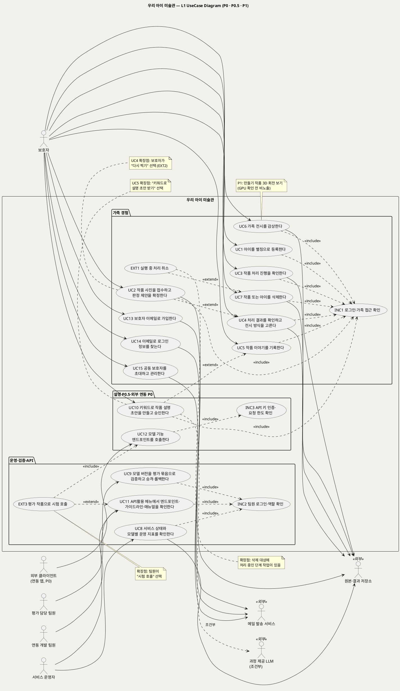

# UseCase 개요 — 우리 아이 미술관 (P0 · P0.5 · P1)
**우리 아이 미술관 · 유스케이스 개요 · UML 2.5.1 표준 (UseCase Diagram + UseCase 목록)**

---

> **문서 식별**: `design/UC_00_개요_우리아이미술관.md`
> **작성일**: 2026-09-23 · **개정**: 2026-09-28 · **표준**: UML 2.5.1 (OMG)
> **원천(SoT)**: `Intent-Specify.md` (2026-09-28 기획 기준안, DDBM에서 수정) + `.specify/features/우리-아이-미술관/spec.md` v2.0 (개정 중). 보조 원천 `Intent-Plan.md` (웹스택 후보 4종, 미확정)
> **개정 (2026-09-28)**: 모델 조합 서빙을 기준으로 전면 재검토했다. 서비스 이름을 "우리 아이 미술관"으로 바꿨다. 공개 사전학습 모델 7종(M1~M7)을 정의하고, 판정 제안·2.5D 부조·낮춤 체인·서빙 3종 분리·모델별 지표를 반영했다. UC9는 "모델 버전을 평가 묶음으로 검증하고 승격·롤백한다"로 이름과 범위를 바꿨다. 옛 UC10(모델 API 변환)은 UC3(단계 작업 호출)과 UC12(모델 기능 엔드포인트)로 흡수했다. UC10은 "키워드로 작품 설명 초안을 만들고 승인한다"(P0.5)로 새로 정의했다. UC12 "모델 기능 엔드포인트를 호출한다"(P0.5)를 더했다.
> **개정 2 (2026-09-28, 통합 결정 D17)**: 외부 모델 기능 엔드포인트 절충안을 반영했다. `segment`·`classify`·`pose`·`relief` 네 기능은 P0, `caption`과 외부 API 약관은 P0.5다. 호출자를 팀 밖 외부 클라이언트까지 넓힌다. 다만 팀 밖 클라이언트 키는 U12(한도·약관) 확정 뒤 발급하고, 그 전에는 팀·과정 내부 키만 발급한다(이제민 조건부 승인). 단 `pose`는 팀 내부 키 전용이다(보관 처리돼 보안 수정이 없는 M3(Animated Drawings·TorchServe)를 팀 밖 요청이 간접 호출하지 않도록, 외부 키는 403). 요청 한도는 예시값(U12, 확정 아님)이다. `classify`는 라이선스 확정 기록(A2) 뒤에 활성한다.
> **개정 3 (2026-09-28, 통합 결정 D18)**: 이용자 중복은 별칭이 아니라 **보호자 이메일 계정**으로 막는다. 따로 아이디를 만들지 않고 이메일로 로그인한다. UC13 "보호자 이메일로 가입한다"(P0, 확인 메일로 가입 완료)와 UC14 "이메일로 로그인 정보를 찾는다"(P0)를 새로 두었다. 별칭은 중복 검사를 하지 않는 표시용 이름이 되었다(BR-CHD-02 개정, BR-ACC-06~08 · FR-31 · FR-32 · U19 신설).
> **다이어그램**: PlantUML 소스는 사내 Kroki(`plantuml.sumzip.com`)로 렌더를 검증했다(HTTP 200, SVG 안 `Syntax Error` 없음). 아래 링크를 누르면 브라우저에서 열린다. `plantuml.sumzip.com`은 사내 SSO 로그인 후 열린다.
> **표기**: `[추론]` = 원천에 직접 없는 설계 판단 · `자료 없음 — 확인 필요` = 원천에 근거가 없는 항목

---

## 목차

1. [시스템 목적·개요](#1-시스템-목적개요)
2. [주요 기능](#2-주요-기능) — 2.1 모델 조합 · 2.2 모델을 쓰는 흐름 · 2.3 낮춤 체인과 원인 분리 · 2.4 서빙 구조와 API 서버 · 2.5 'API활용' 메뉴
3. [유스케이스 목록](#3-유스케이스-목록)
4. [Actor 카탈로그](#4-actor-카탈로그)
5. [L1 UseCase Diagram](#5-l1-usecase-diagram)
6. [시스템 경계 (하지 않는 것)](#6-시스템-경계-하지-않는-것)
7. [생성 결과](#7-생성-결과)
8. [결론](#8-결론)

---

## 1. 시스템 목적·개요

**목적** — 아이의 작품과 그날의 말을 가족이 함께 간직하고, 시간이 흐른 뒤에도 다시 만나는 기록으로 잇는다. 기술은 기억을 꾸며내지 않는다. 다시 꺼내 보는 수단일 뿐이다. 서비스 팀의 목표는 성격이 다른 공개 모델들을 하나의 작업 계약 뒤에서 안정적으로 서빙해, 어떤 사진을 올려도 결과가 돌아오게 하는 것이다. (원천: Intent [미션])

**개요** — 우리 아이 미술관은 휴대폰 사진 속 아이 작품을 찾아내 미술관의 작품으로 바꿔 거는 가족용 미술관이다. 모델을 새로 학습하지 않는다. 공개 사전학습 모델을 이어 붙여 API 서버 뒤에서 서빙한다. 한 장의 사진이 여러 모델을 거치며 중간 결과를 재사용하고, 어느 모델이 실패해도 **한 단계 낮춘 결과**가 돌아온다. (원천: Intent [개요])

접수 → 배경 분리 → 판정 제안(제로샷 분류 + 관절 기하 규칙) → **보호자 확정** → 움직임 / 2.5D 입체 부조 / 원본 액자 생성(낮춤 체인) → 보호자 결과 확인·승인 → 이야기 입력(P0.5: 키워드 설명 초안) → 전시

| 구간 | 포함 |
|:--:|---|
| P0 | 판정 제안 · 움직임 · 2.5D · 액자 · 전시 · 삭제 · 모델별 지표 · 모델 평가·승격 · API활용 메뉴 · 외부 모델 기능 네 가지(UC12, D17) |
| P0.5 | 키워드 기반 작품 설명(UC10) · 외부 `caption` 엔드포인트와 외부 API 약관(UC12 일부, D17) |
| P1 | 만들기 작품(점토·종이 공작)의 3D 조각. 팀 서버 GPU 확인 후 결정한다. 그 전에는 화면에 노출하지 않는다 |
| 후속 | 하이라이트 영화 · 실물 필름 · 결제 · 촬영 보정 · 내보내기·권한 이전 · 큐레이션 · 기관용 다아동 권한 |

**핵심 원칙** (원천: Intent [가치제안] 경험 원칙 · [부정적 영향])

| 원칙 | 내용 |
|---|---|
| 승인 전 비전시 | 보호자가 승인하지 않은 결과·설명은 어디에도 전시하지 않는다 |
| 원본 불변 | 원본을 덮어쓰지 않는다. 결과물은 처음 만든 것을 보관한다. 설명은 승인 전까지만 다시 만들 수 있다 |
| 결과는 늘 돌아온다 | 품질이 모자라면 한 단계 낮춘 결과(움직임→2.5D→액자, 설명→템플릿→직접)를 돌려주고, 낮춘 사실을 숨기지 않는다 |
| 원인 분리 | 보호자 선택·모델 낮춤·보호자 전환·인프라 실패·결과 미도달을 섞지 않는다 |
| 제안은 제안까지 | 판정은 문구로 제안만 하고 보호자가 확정한다. 점수를 보이지 않는다 |
| 최소 수집 | 아이는 별칭만 받는다. 설명 생성에 이미지·이름을 넣지 않는다. 외부 입력은 보관하지 않는다 |
| 기억 왜곡 금지 | 입력에 없는 사건·감정·발달 상태를 만들지 않는다. AI 설명은 "AI 작성"으로 표시하고 아이의 실제 말과 섞지 않는다. 자동 감정 해석·발달 평가·아이 간 비교·무한 피드는 없다 |

**증거 수준** — 개인 PC에서 애니메이션 엔진(M3)을 단독 실행한 것만 확인했다. 한 장 53~62초(렌더 약 40초), 빌드 36분, 설치 크기 32.9GB였다. 집 그림의 사람 점수가 0.946, 사람 그림이 0.997로 나와 엔진 점수만으로는 집 그림을 걸러내지 못했다. 다른 모델, 통합 서비스, 사용자 반응, 수요, 수익은 검증 전이다. (원천: Intent [개요] · [핵심 장벽])

---

## 2. 주요 기능

| # | 기능 | 설명 | 원천 근거 | 관련 UC |
|:--:|---|---|---|:--:|
| F1 | 아이 등록 | 별칭 하나로 등록, 여러 아이 가능. 실명·생년월일·출생연도는 받지 않음 | spec FR-1 · Intent [핵심 데이터] 아이 | UC1 |
| F2 | 내구 접수 | 형식·용량·판독 검사. 원본·작품 기록·작업 기록이 모두 저장돼야 접수 완료(202) | spec FR-2, FR-15 | UC2 |
| F3 | 배경·작품 분리 | M1로 작품 마스크·컷아웃을 만든다. 2.5D 마스크의 기본 출처 | spec FR-20 · Intent [핵심 이네이블러] | UC2 · UC3 |
| F4 | 판정 제안과 보호자 확정 | M1·M2·M3·M4를 합쳐 문구로 제안하고, 보호자 확정값으로 처리 경로를 정함. 점수 비노출, 수정 여부 기록 | spec FR-3, FR-21 · Intent [핵심 활동] 4 | UC2 |
| F5 | 백그라운드 처리·상태 조회 | 올리기와 처리를 분리하고, 작품별 상태·단계별 진행을 조회 | spec FR-4, FR-11, FR-15 | UC3 |
| F6 | 결과 생성 | 결과 종류 4종(움직임 / 2.5D 부조 / 원본 액자 / P1 3D 조각). 2.5D는 M1 마스크 + M5 깊이 | spec FR-5, FR-22 | UC3 |
| F7 | 낮춤 체인·원인 기록 | 품질 미달은 한 단계 낮춤, 인프라 장애는 제한 재시도. 원인 5분류를 섞지 않고 표시 | spec FR-23 · Intent [핵심 활동] 5 | UC3 · UC4 |
| F8 | 서빙 3종 분리 | CPU 비전 비동기 큐 · GPU 전용 큐 · LLM 동기 요청. 모델별 시간 상한·동시 처리 제한 | spec FR-25 · Intent [핵심 활동] 6 | UC3 · UC8 |
| F9 | 결과 확인·승인 | 좋아요 / 낮춘 결과로 걸기 / 액자로 걸기 / 다시 찍기. 승인 전 비전시 | spec FR-6, FR-23 | UC4 |
| F10 | 이야기 직접 입력 | 제목·제작일·제작 당시 연령(필수), 아이의 한마디(선택, 입력 그대로) | spec FR-7 | UC5 |
| F11 | 작품 설명 초안 (P0.5) | 보호자 키워드·선택 태그로 M6 초안 생성, 규칙 검사, 템플릿 기준선, "AI 작성" 표시, 승인 후 고정 | spec FR-27 · Intent [핵심 이네이블러] 작품 설명 | UC10 |
| F12 | 가족 전시 | 아이별 → 연령 묶음 → 제작일 순. 재생·시차 효과는 고를 때만. 무한 피드 없음 | spec FR-8 | UC6 |
| F13 | 3D 조각 (P1) | 만들기 작품을 M7로 GLB로 만들고 회전 보기. "뒷면은 AI가 추정했어요" 표시. GPU 확인 전 비노출 | spec FR-29 · Intent [부정적 영향] 3D의 추정 면 | UC6 (P1 대체흐름) |
| F14 | 가족 단위 접근 권한 | 다른 가족·비로그인·운영자의 이미지 접근 차단 | spec FR-9 | INC1 · INC2 |
| F15 | 삭제·실행 중 취소 | 새 작업 차단 → 모든 단계 작업 종료 확인 → 원본·마스크·깊이·중간·최종·설명·GLB·임시 파일 삭제 | spec FR-10, FR-11 | UC7 |
| F16 | 생존·준비·모델별 지표 | `/live`·`/ready`(모델별)·`/metrics`. 서빙 지표 전체, 원인별 분리 집계, 식별 정보 없음 | spec FR-12, FR-13, FR-14, FR-26 · Intent [미션] 서빙 지표 | UC8 |
| F17 | 모델 재현·평가·승격 | 모델 7종 버전 고정·매니페스트·어댑터, 평가 묶음 재평가 후 승격, 롤백 | spec FR-16, FR-17, FR-24 · Intent [핵심 활동] 2·7 | UC9 |
| F18 | 모델 API 서버 · API활용 메뉴 | Python 가상환경 + uvicorn API 서버, 엔드포인트·가이드라인·매뉴얼 메뉴(팀원 전용) | spec FR-30 · 추가 요구 R3·R4 | UC11 |
| F19 | 외부 모델 기능 엔드포인트 (P0 · caption은 P0.5) | `segment`·`classify`·`relief`(외부 키) · `pose`(팀 내부 키 전용) · `caption`(P0.5). API 키 인증·요청 한도·크기 제한·입력 비보존 | spec FR-28 · Intent [핵심 이네이블러] 외부 사용 | UC12 |
| F20 | 보호자 이메일 가입 | 이메일(로그인 아이디, 서비스 전체 유일)·비밀번호만으로 가입하고 확인 메일로 완료. 가입 여부는 화면에 드러내지 않는다(이미 가입된 주소엔 안내 메일). 가족 공간 생성. 이용자 중복은 이메일로 막는다 | D18 · spec FR-31 | UC13 |
| F21 | 로그인 정보 찾기 | 가입한 이메일로 로그인 아이디와 비밀번호 재설정 링크를 보낸다. 가입 여부는 드러내지 않는다 | D18 · spec FR-32 | UC14 |
| F22 | 공동 보호자 초대·관리 | 이메일 초대·수락으로 합류, 같은 권한. 해제는 만든 보호자만, 공동 보호자는 스스로 나가기. 나가도 작품은 남음 | spec FR-9 (U1 확정) | UC15 |
| F20 | 사용 관찰 기록 | 보호자 역할 사용자의 막힌 지점 관찰 | spec FR-18 · Intent [미션] P0 경험 검증 | 미전환(§8.2) |
| F21 | 추적성 | FR → UC → T → 검증 증거 연결 | spec FR-19 · Intent [핵심 활동] 8 | 미전환(§8.2) |

**추가 요구 R1~R4 반영 위치** — 2026-09-28에 받은 추가 요구 4건을 원천 추적을 위해 R1~R4로 부른다. 이번 개정은 그 반영 범위를 모델 1종에서 모델 7종으로 넓혔다.

| ID | 추가 요구 | 반영 위치 |
|:--:|---|---|
| R1 | 모델 정의 — 모델의 용도, 입력, 출력, 모델 경로를 밝힌다 | §2.1 · UC9(매니페스트) |
| R2 | 모델을 유스케이스의 기능으로 쓴다 — 사용자가 무엇을 입력하면 무엇을 처리해 무엇을 출력하는지 밝힌다 | §2.2 · UC2 · UC3 · UC4 · UC10 |
| R3 | 모델을 쓰는 기능은 가상환경(uvicorn)의 API 서버로 구성하고 웹서비스에 연동한다 | §2.4 · UC3 · UC11 · UC12 · spec FR-30 |
| R4 | API 서버는 엔드포인트·가이드라인·매뉴얼을 담은 'API활용' 메뉴를 갖춘다 | §2.5 · UC11 · spec FR-30 |

### 2.1 모델 조합 (R1)

> **쉽게 말하면** — 사진 한 장이 들어오면 먼저 작품만 오려 내고(M1), 무엇을 그렸는지 짐작하고(M2·M4), 사람이나 캐릭터면 움직이게 하고(M3), 그게 어려우면 도톰한 입체로 띄운다(M5). 가족이 원하면 키워드로 설명 초안을 받고(M6, P0.5), 점토·종이 공작은 나중에 3D로 돌려 본다(M7, P1). 모델은 새로 학습하지 않는다.

| ID | 모델 · 역할 | 용도 | 입력 | 출력 | 라이선스 | 서빙군 | 구간 |
|:--:|---|---|---|---|---|:--:|:--:|
| M1 | 배경·작품 분리 — BiRefNet | 사진에서 작품만 떼어 낸다. 2.5D 마스크의 기본 출처 | 접수된 원본 사진(읽기 전용) | 작품 마스크 · 컷아웃 | MIT 계열 | CPU 비전 | P0 |
| M2 | 종류 판정·태그 — OpenCLIP 제로샷 | "사람 그림 / 동물 / 집 / 사물" 판정으로 움직임 제안, 설명 키워드 후보 | M1 컷아웃 + 판정 문구 후보 | 종류 후보 · 태그(점수는 내부 기록만) | 가중치 라이선스 확인 필요 | CPU 비전 | P0 |
| M3 | 관절·리깅·렌더 — Meta Animated Drawings (내부 TorchServe, Docker 고정 이미지). 예비: 그림 전용 YOLOv8 자세 모델(ONNX) | 사람·캐릭터 그림을 원본 선 그대로 리깅해 움직이는 그림을 만든다 | 원본 또는 M1 컷아웃 | 관절 좌표 · 움직이는 작품 파일(형식은 U9) · 검출 점수(기록용) | MIT (2025-09-03 보관 처리, TorchServe 2025-08-07 보관 처리). 예비 모델 가중치 AGPL-3.0 → 서비스 소스 공개 전제 | CPU 비전 | P0 |
| M4 | 판정 보조 규칙 — 관절 기하(팔다리 길이·좌우 대칭·몸통 비율). **모델 아님** | 엔진 점수만으로 집 그림을 거르지 못하는 문제를 보완한다 | M3 관절 좌표 | 움직임 적합 여부(보조 판정) | — | CPU 비전 | P0 |
| M5 | 2.5D 부조 — Depth Anything V2 **Small** | 움직이기 어려운 작품을 도톰한 입체로 띄워 시차 효과를 준다 | 원본 + M1 마스크 | 깊이 맵 · 2.5D 부조 결과(형식은 U9) | Apache-2.0 (Base·Large는 비상업이라 제외) | GPU(없으면 CPU) | P0 |
| M6 | 작품 설명 — Qwen3-4B 자체 호스팅(Ollama/vLLM) + 규칙 검사 + 템플릿 기준선. 과정 제공 LLM 엔드포인트가 있으면 대체 | 보호자 키워드로 작품 설명 초안을 만든다 | 보호자 키워드 · 선택 태그 · 아이의 실제 발언 · 제작 당시 나이 · 제작일 (이미지·이름 제외) | 설명 초안 · 출처(LLM/템플릿) · 규칙 검사 결과 · 생성 횟수 | 조건 확인 필요 | LLM | P0.5 |
| M7 | 3D 조각 — TripoSR(채택 5종 밖, P1 후보) / 대안 TRELLIS | 만들기 작품을 화면에서 돌려 보는 3D로 만든다 | 만들기 작품 사진(+ M1 마스크) | GLB · 뒷면 추정 표시 | MIT (TRELLIS는 의존성 라이선스 확인 필요) | GPU | P1 |

**모델 경로** — `자료 없음 — 확인 필요`(U14). 원천에 팀 서버의 모델 파일 경로가 없다. [추론] 경로는 모델별 매니페스트(BR-MDL-01)의 한 항목으로 두고, UC9 재현 때 확정해 API활용 매뉴얼(UC11)과 같은 값으로 적는다.

**중간 결과 재사용** — M1 마스크 → M5 2.5D · M3 관절 → M4 판정 보조와 애니메이션이 공용 · M2 태그 → M6 키워드 후보(보호자가 골라야 입력이 됨, BR-CAP-06). 한 장의 사진을 모델마다 따로 처음부터 처리하지 않는다.

**제외·후순위 모델**

| 모델 | 판단 | 사유 |
|---|---|---|
| Hunyuan3D | 제외 | 한국이 라이선스 적용 대상 밖이다 |
| Depth Anything V2 Base·Large | 제외 | 비상업 라이선스다 |
| Stable Fast 3D | 후순위 | 자체 라이선스다 |
| 평면 그림용 image-to-3D | 쓰지 않음 | 보이지 않는 뒷면을 지어내므로 재창작 금지 원칙에 어긋난다 |

### 2.2 모델을 쓰는 흐름 (R2)

보호자는 사진을 올리고 제안을 확정하고 결과를 고르는 일만 한다. 모델 호출은 모두 API 서버 뒤의 단계 작업이 맡는다.

| 단계 | 사용자 입력 | 시스템 처리 (모델) | 출력 | UC |
|:--:|---|---|---|:--:|
| 1 | 보호자가 아이를 고르고 작품 사진 1장을 올린다 | 형식·용량·판독을 검사하고 원본·작품 기록·작업 기록을 저장한다. 판정 단계 작업을 등록한다. 모델은 아직 부르지 않는다 | "접수 완료"(202), 상태 `접수됨` | UC2 |
| 2 | (입력 없음 — 기다리거나 화면을 떠나도 된다) | 분리(M1) → 제로샷 판정(M2) → 관절 추정(M3) → 기하 규칙(M4)을 합쳐 제안 문구를 만든다 | 판정 제안 문구(점수 없음), 상태 `확정 대기` | UC2 |
| 3 | 제안을 보고 `움직임` / `2.5D 부조` / `원본 액자` 중 하나로 확정한다 | 제안값·확정값·수정 여부를 기록하고, 확정값으로 처리 경로를 정한다. 제안이 늦거나 실패해도 직접 확정할 수 있다 [추론] | 상태 `처리 중` | UC2 |
| 4 | (입력 없음) | 움직임: M3 렌더 · 2.5D: M1 마스크 + M5 깊이 · 액자: 모델 호출 없음. 품질 미달이면 재시도 없이 한 단계 낮춘다 | 결과 파일 · 결과 종류 · 낮춤 원인 · 모델 ID·버전·처리 시간 | UC3 |
| 5 | 작품 목록에서 진행 상태를 확인한다 | 단계별 진행과 낮춤 사실을 보여 준다. 인프라 장애는 같은 단계를 최대 3회 재시도한다 | `확인 대기` 또는 `처리하지 못함` | UC3 |
| 6 | 결과를 보고 좋아요 / 낮춘 결과로 걸기 / 액자로 걸기 / 다시 찍기 중 하나를 고른다 | 선택을 기록한다. 바꾼 경우 "보호자 전환"으로 남긴다. 다시 찍기는 새 작품으로 접수한다 | 상태 `승인됨` | UC4 |
| 7 | 제목·제작일·제작 당시 연령·아이의 한마디를 입력한다 | 필수 항목을 검사하고 한마디는 입력 그대로 저장한다 | 상태 `전시 중` | UC5 |
| 8 | (P0.5, 선택) 키워드를 적고 M2 태그 후보 중 일부를 고른다 | M6가 초안을 만들고 규칙 검사를 한다. 실패가 상한을 넘으면 템플릿 설명으로 낮춘다 | "AI 작성" 표시 초안 → 보호자 수정·승인 후 고정 | UC10 |
| 9 | 아이를 골라 전시를 감상한다 | 아이별 → 연령 묶음 → 제작일 순으로 보여 준다. 재생·시차 효과는 고를 때만 | 전시 화면 (P1: 3D 회전 보기) | UC6 |

모델은 가족 흐름 밖에서도 같은 어댑터로 쓰인다. UC9의 평가 담당 팀원이 평가 묶음으로 모델 버전을 검증하고, UC8의 `/ready`가 모델별 준비 상태를 보여 주고, UC12의 외부 클라이언트가 모델 기능 엔드포인트로 각 기능을 따로 부른다(P0 네 기능, caption은 P0.5).

### 2.3 낮춤 체인과 원인 분리

**낮춤 체인** (BR-FBK-01) — 품질 미달이면 재시도하지 않고 한 단계 낮춘다.

| 체인 | 1단계 | 2단계 | 3단계 |
|---|---|---|---|
| 평면 그림 | 움직임(M3) | 2.5D 부조(M5) | 원본 액자 |
| 만들기 작품 (P1) | 3D 조각(M7) | 2.5D 부조(M5) | 원본 액자 |
| 작품 설명 (P0.5) | LLM 초안(M6) | 템플릿 설명 | 보호자 직접 입력 |

**마스크 출처** (BR-FBK-02) — 2.5D 마스크는 M1 분리 결과가 기본이다. M1이 품질 미달이면 2.5D를 건너뛰고 원본 사진 전체를 액자로 건다. 사람을 찾지 못한 그림도 M1 마스크로 2.5D를 만들 수 있다.

**인프라 장애는 낮춤이 아니다** (BR-PRC-03) — 엔진 다운·시간 초과·저장소·DB·모델 미준비는 같은 단계를 최대 3회 재시도한다. 소진되면 `처리하지 못함`으로 알리고 "결과 미도달"로 집계한다(목표 0). 이때 보호자는 모델이 필요 없는 원본 액자로 걸기를 고를 수 있다.

**결과 원인 5분류** (BR-FBK-04) — 서로 섞지 않는다. 지표도 원인별로 따로 센다(BR-OPS-03).

| # | 원인 | 발생 시점 | 기록 위치 | 관련 UC |
|:--:|---|---|---|:--:|
| ① | 보호자 선택 | 확정 시 액자·2.5D를 고름 | 작품 확정값 · 수정 여부 | UC2 |
| ② | 모델 낮춤 | 품질 미달로 한 단계 낮춤(어느 단계에서 어디로) | 단계 작업 낮춤 원인 | UC3 |
| ③ | 보호자 전환 | 결과 확인 시 낮춘 결과·액자로 바꿈 | 작품 보호자 결정 | UC4 |
| ④ | 인프라 실패 | 재시도 중 또는 소진 | 단계 작업 오류 분류 · 시도 횟수 | UC3 · UC8 |
| ⑤ | 결과 미도달 | 재시도 소진으로 결과 없음 | 작품 상태 `처리하지 못함` | UC3 · UC8 |

**상태 모델** — 작품 상태는 `접수됨` → `판정 중` → `확정 대기` → `처리 중` → `확인 대기` → `승인됨` → `전시 중`(필수 이야기 입력 뒤)으로 간다. 종료 상태는 `처리하지 못함`과 `삭제 중`이다. 단계 작업은 작품당 여러 개이며(`분리` · `판정` · `움직임 렌더` · `깊이·부조` · `설명` · `3D`), 각각 모델 ID·버전·상태·시도 횟수·처리 시간·낮춤 원인 또는 오류 분류를 가진다.

### 2.4 서빙 구조와 API 서버 (R3)

API 서버는 접수·상태·권한만 맡고 모델을 직접 import하지 않는다(BR-MDL-02). 작업 계약 하나 뒤에 서빙 3종을 두고, 모델마다 어댑터와 버전 매니페스트를 둔다. 모델을 바꿔도 가족 흐름과 API 계약은 바뀌지 않는다(BR-MDL-05).

| 서빙군 | 모델 | 실행 방식 | GPU가 없을 때 |
|---|---|---|---|
| CPU 비전 워커 | M1 · M2 · M3 · M4 | 비동기 작업 큐 | 영향 없음 |
| GPU 워커 | M5 · M7 | 전용 큐, 모델 상주 | M5는 CPU에서 실행(속도 미측정), M7은 비노출(BR-SRV-02) |
| LLM 서버 | M6 | 짧은 동기 요청 또는 스트리밍 | [추론] CPU 실행 가능 여부는 U2·U3 확인 뒤 판단 |

기반은 DB 작업 테이블 + 전용 워커, S3 호환 저장소, Prometheus·구조화 로그다. TorchServe·Ollama 등 모델 런타임 포트는 내부망에만 둔다(BR-SRV-04). 모델 기능은 Python 가상환경 + uvicorn으로 띄운 API로 제공한다(R3, BR-API-01).

**스택** — 미확정이다. Intent-Plan에 웹스택 후보 4종(Vue+Node+MariaDB, React+FastAPI+PostgreSQL, Django, Next.js)이 있고, Intent-Specify는 FastAPI+PostgreSQL안과 Vue+Node+MariaDB안을 언급한다. [추론] 모델 서빙 계층(워커·어댑터·모델 기능 엔드포인트)은 R3와 모델 생태계 때문에 Python(uvicorn)으로 고정하고, 보호자 앱 API의 스택만 `/speckit.plan`에서 정한다(U7).

**엔드포인트** ([추론] 이름·형식은 `/speckit.plan`에서 OpenAPI로 확정, U8)

| 메서드 · 경로 | 용도 | UC |
|---|---|:--:|
| `POST /v1/auth/signup` · `POST /v1/auth/email/verify` · `POST /v1/auth/email/verify/resend` · `POST /v1/auth/login` · `POST /v1/auth/logout` · `POST /v1/auth/recovery` · `POST /v1/auth/recovery/reset` | 이메일 가입(항상 202) · 확인(204 / 400 token_invalid) · 확인 메일 재발송(항상 202) · 로그인(204 / 401 / 403 email_unverified) · 로그아웃 · 찾기 메일(항상 202) · 재설정(204 / 400 token_invalid) — 이제민 결정 ③ | UC13 · UC14 |
| `POST /v1/family/invites` · `DELETE /v1/family/invites/{id}` · `POST /v1/family/invites/accept` · `GET /v1/family/members` · `DELETE /v1/family/members/{id}` · `POST /v1/family/leave` | 공동 보호자 초대(항상 202) · 취소 · 수락(204 / 400 token_invalid / 409 already_in_family) · 목록 · 해제(만든 보호자만, 아니면 403) · 나가기(만든 보호자는 409) — [추론, U8] | UC15 |
| `POST /v1/children` · `GET /v1/children` | 아이 별칭 등록·조회 | UC1 |
| `POST /v1/artworks` | 사진 접수(202). 원본·작품 기록·작업 기록 저장 후 판정 단계 작업 등록 | UC2 |
| `GET /v1/artworks/{id}` | 상태·판정 제안 문구·단계별 진행·낮춤 표시 | UC2 · UC3 · UC4 |
| `POST /v1/artworks/{id}/confirm` | 보호자 확정 `animated` / `relief` / `frame` (P1 `sculpture`) | UC2 |
| `POST /v1/artworks/{id}/decision` | 결과 확인 선택 `like` / `use_lower` / `frame` / `retake` | UC4 |
| `PUT /v1/artworks/{id}/story` | 제목·제작일·제작 당시 연령·아이의 한마디 | UC5 |
| `POST /v1/artworks/{id}/captions` · `PUT /v1/artworks/{id}/captions/{cid}` | 설명 초안 생성(P0.5) · 수정·승인·폐기 | UC10 |
| `GET /v1/gallery?child={id}` | 아이별 → 연령 묶음 → 제작일 순 전시 | UC6 |
| `DELETE /v1/artworks/{id}` · `DELETE /v1/children/{id}` | 삭제 | UC7 |
| `GET /live` · `GET /ready` (모델별 상태 포함) · `GET /metrics` | 운영 | UC8 |
| `GET /v1/admin/models` · `POST /v1/admin/models/{mid}/evaluate` · `POST .../promote` · `POST .../rollback` | 매니페스트 조회·평가·승격·롤백 | UC9 |
| `POST /v1/models/{segment\|classify\|pose\|relief\|caption}` | 외부 클라이언트용 모델 기능(P0: segment·classify·relief는 외부 키, pose는 팀 내부 키 전용 / P0.5: caption. API 키 인증·요청 한도(예시값)·크기 제한·입력 비보존, D17) | UC12 |
| `GET /openapi.json` · `GET /docs` | API활용 메뉴의 엔드포인트 탭 원천 | UC11 |

**응답 분류 대응** — 단계 작업 응답 분류와 작업 기록 분류를 1:1로 맞춘다(BR-API-02). 그래야 "모델 낮춤"과 "인프라 실패"가 섞이지 않는다.

| 단계 작업 응답 | 작업 기록 | 처리 |
|---|---|---|
| 성공 | 결과 종류 기록 | 다음 단계 또는 `확인 대기` |
| 품질 미달 | 낮춤 원인(어느 단계에서 어디로) | 재시도 없이 한 단계 낮춤(BR-PRC-02) |
| 엔진 다운 · 시간 초과 · 저장소 · DB · 모델 미준비 | 오류 분류 · 시도 횟수 | 최대 3회 재시도, 소진 시 `처리하지 못함`(BR-PRC-03) |

외부 클라이언트는 `/v1/models/…`만 부를 수 있고 가족 데이터(`/v1/artworks…`, `/v1/gallery`)에는 접근하지 못한다(BR-API-06). 외부 호출 입력은 처리 뒤 보관하지 않고 로그에도 남기지 않는다(BR-API-05).

### 2.5 'API활용' 메뉴 (R4)

API 서버를 쓰고 관리하는 데 필요한 정보를 **'API활용' 메뉴** 한 곳에 모은다. 서비스 운영자와 연동 개발 팀원만 볼 수 있고, 보호자 화면에는 나타나지 않는다(BR-API-07).

| 탭 | 담는 내용 | 원천 |
|---|---|---|
| 엔드포인트 | §2.4 엔드포인트 목록, 요청·응답 형식, 응답 분류와 작업 기록 분류 대응표, 요청 예시, 모델별 활성 버전. `/openapi.json`에서 생성해 실제 API·모델 버전과 어긋나지 않게 한다 | R4 · BR-API-08 |
| 가이드라인 | 호출 규칙: 모델 런타임은 내부망 전용, 외부 엔드포인트는 API 키 필수·요청 한도·크기 제한, 품질 미달은 낮춤·인프라 장애는 최대 3회 재시도, 모델별 시간 상한, 로그에 이미지·자유 입력 금지, 외부 입력 비보존, 시험 호출은 평가 묶음 작품만 | R4 · BR-PRC-02·03·06 · BR-API-03~05·09 · BR-PRV-01 |
| 매뉴얼 | 가상환경 만들기·의존성 설치, uvicorn 기동·중지, `/live`·`/ready`·`/metrics` 확인, 모델 경로 설정(U14)과 매니페스트, 모델 버전 변경 시 UC9 재평가·승격·롤백 절차, 장애 대응(모델 미준비·시간 초과·큐 적체·디스크 부족) | R3 · R4 · spec FR-12 · FR-24 |
| 시험 호출 (선택, EXT3) | 평가 묶음 작품을 골라 모델 기능 엔드포인트(UC12)를 직접 불러 응답을 확인한다 | R4 · BR-API-09 |

---

## 3. 유스케이스 목록

> UC1~UC9는 2026-09-23 목록을 승계해 모델 조합 기준으로 고쳤다. UC10은 옛 "모델 API 변환"을 버리고 P0.5 작품 설명으로 다시 정의했다. 옛 UC10의 단계 작업 호출은 UC3으로, 모델 기능 제공은 UC12로 옮겼다. 원천 Intent [수익]은 UC1~7·UC10을 보호자 상품 가설의 근거로, UC12를 기관·외부 앱 후보로 적었다.

| UC ID | 유스케이스명 | 주액터 | 구간 | 우선순위 | 원천 근거 | 문서 | 상태 |
|:--:|---|---|:--:|:--:|---|---|:--:|
| UC1 | 아이를 별칭으로 등록한다 | 보호자 | P0 | Medium | spec FR-1 · Intent [핵심 데이터] 아이 | `UC_01_아이등록.md` | 개정 2026-09-28 |
| UC2 | 작품 사진을 접수하고 판정 제안을 확정한다 | 보호자 | P0 | High | spec FR-2, FR-3, FR-15, FR-20, FR-21 · Intent [핵심 활동] 3·4 | `UC_02_작품사진접수.md` | 개정 2026-09-28 |
| UC3 | 작품 처리 진행을 확인한다 | 보호자 | P0 | High | spec FR-4, FR-5, FR-11, FR-15, FR-22, FR-23, FR-25 · Intent [핵심 활동] 5·6 | `UC_03_처리진행확인.md` | 개정 2026-09-28 |
| UC4 | 처리 결과를 확인하고 전시 방식을 고른다 | 보호자 | P0 | High | spec FR-6, FR-23 · Intent [부정적 영향] 어색하거나 왜곡된 결과 | `UC_04_결과확인승인.md` | 개정 2026-09-28 |
| UC5 | 작품 이야기를 기록한다 | 보호자 | P0 | High | spec FR-7 · Intent [부정적 영향] 기억의 재작성 | `UC_05_작품이야기기록.md` | 개정 2026-09-28 |
| UC6 | 가족 전시를 감상한다 | 보호자 | P0 (P1 3D 대체흐름) | High | spec FR-8, FR-9, FR-29 · Intent [가치제안] 경험 원칙 | `UC_06_가족전시감상.md` | 개정 2026-09-28 |
| UC7 | 작품 또는 아이를 삭제한다 | 보호자 | P0 | High | spec FR-10, FR-11 · Intent [부정적 영향] 동의 오판·삭제 누락 | `UC_07_작품아이삭제.md` | 개정 2026-09-28 |
| UC8 | 서비스 상태와 모델별 운영 지표를 확인한다 | 서비스 운영자 | P0 | Medium | spec FR-12, FR-13, FR-14, FR-26 · Intent [미션] 서빙 지표 | `UC_08_운영상태지표확인.md` | 개정 2026-09-28 |
| UC9 | 모델 버전을 평가 묶음으로 검증하고 승격·롤백한다 | 평가 담당 팀원 | P0 | Medium | spec FR-16, FR-17, FR-24 · Intent [핵심 활동] 2·7 · [핵심 데이터] 모델 매니페스트·평가 묶음 | `UC_09_모델평가검증.md` | 개정 2026-09-28 |
| UC10 | 키워드로 작품 설명 초안을 만들고 승인한다 | 보호자 | P0.5 | Medium | spec FR-27 · Intent [핵심 이네이블러] 작품 설명 · [부정적 영향] 기억의 재작성 | `UC_10_작품설명생성.md` | 신규 2026-09-28 |
| UC11 | API활용 메뉴에서 엔드포인트·가이드라인·매뉴얼을 확인한다 | 연동 개발 팀원 · 서비스 운영자 | P0 | Medium | spec FR-30 · 추가 요구 R3·R4 | `UC_11_API활용메뉴.md` | 개정 2026-09-28 |
| UC12 | 모델 기능 엔드포인트를 호출한다 | 외부 클라이언트(연동 앱) | P0 (caption은 P0.5) | Medium | spec FR-28 · Intent [핵심 이네이블러] 외부 사용 · [핵심 장벽] 외부 엔드포인트 | `UC_12_모델기능호출.md` | 신규 2026-09-28 |
| UC13 | 보호자 이메일로 가입한다 | 보호자(가입 전) | P0 | High | D18 · spec FR-31 | `UC_13_보호자이메일가입.md` | 신규 2026-09-28 |
| UC14 | 이메일로 로그인 정보를 찾는다 | 보호자(로그인 전) | P0 | High | D18 · spec FR-32 | `UC_14_로그인정보찾기.md` | 신규 2026-09-28 |
| UC15 | 공동 보호자를 초대하고 관리한다 | 만든 보호자 · 공동 보호자 | P0 | High | spec FR-9(U1 확정) | `UC_15_공동보호자관리.md` | 신규 2026-09-28 |

**공통·조건부 유스케이스** (독립 문서 없이 기반 UC 문서에서 다룬다)

| ID | 명칭 | 관계 | 원천 근거 |
|:--:|---|---|---|
| INC1 | 로그인·가족 접근 확인 | UC1~UC7, UC10이 «include» | spec FR-9 |
| INC2 | 팀원 로그인·역할 확인 | UC8, UC9, UC11이 «include» | spec FR-9 · BR-ACC-05 |
| INC3 | API 키 인증·요청 한도 확인 | UC12가 «include» | spec FR-28 · Intent [부정적 영향] 외부 엔드포인트 남용 |
| EXT1 | 실행 중 처리 취소 | UC7을 «extend» (확장점: 삭제 대상에 처리 중인 단계 작업이 있음) | spec FR-10 |
| EXT2 | 다시 찍어 재접수 | UC2가 UC4를 «extend» (확장점: 보호자가 "다시 찍기" 선택) | spec FR-6 |
| EXT3 | 평가 작품으로 시험 호출 | UC11을 «extend» (확장점: 팀원이 "시험 호출" 선택). 실행 시 UC12를 «include». EXT3은 UC12와 같은 구간을 따른다(P0 네 기능, caption은 P0.5, D17) | 추가 요구 R4 · BR-API-09 |
| — | 설명 초안 받기 | UC10이 UC5를 «extend» (확장점: 보호자가 "키워드로 설명 초안 받기" 선택, P0.5) | spec FR-27 |

**우선순위 근거**
- High: 가족 경험의 핵심 흐름(접수·확정 → 처리 → 확인 → 이야기 → 전시)과 아동 정보 삭제 통제. Intent [개요]가 P0로 적은 판정 제안·움직임·2.5D·액자·전시·삭제다.
- Medium: UC1은 선행 조건이지만 기능이 작다. UC8·UC9·UC11은 가족이 직접 쓰지 않는 운영·검증·연동 기능이다. UC8은 Intent [미션] 서빙 지표, UC9는 [핵심 장벽] 서빙 기반(치명), UC11은 추가 요구 R4에 근거한다. UC10은 P0.5이지만 보호자 상품 가설의 근거다(Intent [수익]).
- Medium(UC12): 절충안(D17)으로 네 기능이 P0에 들어왔다. 외부 연동 수요는 여전히 가설이다. Intent [수익]은 권한·동의·계약 검증 전에는 판매 가능 제품으로 표시하지 않는다고 적었다.

**추상수준 판정** — [추론] 다음 항목은 UC로 두지 않았다.
- 모델별 처리(분리·판정·관절·깊이·설명·3D)는 액터의 목표가 아니라 시스템의 단계 작업이다. UC2(판정)·UC3(생성)·UC10(설명)의 시스템 행위와 시퀀스 lifeline으로 내렸다.
- 3D 조각(FR-29)은 P1이고 GPU 확인 전 비노출이다. 별도 UC 대신 UC2 확정값 `sculpture`와 UC6의 P1 대체흐름으로 둔다.
- "임시 파일 정리(FR-11)"·"자원 상한(FR-15)"·"서빙 3종 분리(FR-25)"는 규칙이다. UC3·UC7의 시스템 행위와 업무규칙으로 흡수했다.
- "아동 정보 보호(FR-14)"는 전 UC에 걸친 제약이라 BR-PRV와 특별 요구사항, §6 시스템 경계로 흡수했다.
- 옛 UC10(모델 API 변환)은 주액터가 시스템이었다. 액터의 목표 단위가 아니므로 해체해 UC3(가족 흐름의 모델 호출)과 UC12(외부 액터의 모델 기능 호출)로 옮겼다.

---

## 4. Actor 카탈로그

| 구분 | 액터 | 설명 | 관련 UC | 원천 근거 |
|:--:|---|---|---|---|
| Primary | 보호자 | 아이를 등록하고, 작품을 올려 판정 제안을 확정하고, 결과를 확인·승인하고, 이야기와 설명을 입력하고, 감상·삭제한다. 1차 잠재 구매자(가설) | UC1~UC7, UC10 | Intent [가치제안] · [수익] |
| Primary | 서비스 운영자 | 생존·준비 상태와 모델별 운영 지표를 확인하고 API활용 메뉴를 본다. 가족의 이미지와 이야기에는 접근하지 않는다(BR-ACC-03) | UC8, UC11 | Intent [미션] 서빙 지표 · spec FR-9 |
| Primary | 평가 담당 팀원 | 직접 만든 평가 묶음으로 모델 버전을 재평가하고 승격·롤백한다 | UC9 | Intent [핵심 활동] 7 · [핵심 데이터] 평가 묶음 |
| Primary | 연동 개발 팀원 | API활용 메뉴에서 엔드포인트·가이드라인·매뉴얼을 보고 연동을 구현하며, 시험 호출을 할 수 있다 | UC11 | 추가 요구 R4 |
| Primary | 외부 클라이언트(연동 앱, P0, 수요는 가설) | API 키로 인증해 모델 기능 엔드포인트를 부른다. 가족 데이터에는 접근하지 못한다. 유치원·알림장 앱은 확장 가설이다 | UC12 | Intent [핵심 이네이블러] 외부 사용 · [혜택] 외부 개발자 · [수익] 연동 수익 가설 |
| Secondary | 원본·결과 저장소(S3 호환) | 원본·마스크·깊이·중간·최종 결과·설명·GLB·임시 파일을 보관한다. 실제 제품은 미확정 | UC2~UC4, UC6, UC7, UC8 | Intent [핵심 이네이블러] 기반 |
| Secondary(조건부) | 과정 제공 LLM | 과정에서 제공하는 LLM 엔드포인트. 쓰게 되면 M6를 대체하는 외부 시스템 보조 액터로 올린다. 기본은 자체 호스팅이라 액터가 아니다. 조건 확인 전에는 아이 데이터를 보내지 않는다(BR-CAP-05) | UC10 | Intent [핵심 파트너] |
| 이해관계자 | 아이 | 계정이 없고 보호자와 함께 화면을 본다. 주 수혜자이며 결제 대상이 아니다. 시스템을 직접 조작하지 않으므로 액터로 두지 않는다 | (UC6 감상 맥락) | Intent [가치제안] · [수익] |
| 이해관계자 | 성장한 아이 | 장기 수혜자. 내보내기·권한 이전은 후속이다 | 없음 | Intent [가치제안] · [혜택] |

**모델은 액터가 아니다** — 자체 호스팅 모델(M1~M7)은 시스템 내부 구성요소다. UseCase Diagram의 액터로 두지 않는다. 시퀀스에서만 서빙군 lifeline(`CPU 비전 워커` / `GPU 워커` / `LLM 서버`)으로 나눈다. 옛 개요가 Secondary로 둔 "애니메이션 엔진"과 "모델 API 서버"는 이 원칙에 따라 내부 구성요소로 옮겼다.

주의: 가족 접근 계정 모델(보호자 1계정 / 공동 보호자 / 감상 전용)은 미확정이다(U1). 이 문서 묶음은 "보호자"를 단일 역할로 표기한다. 공동 보호자나 감상 전용 액터를 추가할지는 `자료 없음 — 확인 필요`로 두었다.

---

## 5. L1 UseCase Diagram

**[「L1 전체 UseCase Diagram」 PlantUML 뷰어로 열기](https://plantuml.sumzip.com/plantuml/svg/eNp9V1tPG1cQft9fMXJfiNRErI25KUJpSVJFIq2lFqkPSGhjNo4VZx3ZS9qqiuQkJuLiCLvBwYCNjGRCiEBdwI0XifaBn9LHPWf_Q2bOXrK7xnlAMDvzzZnzzZyZ4VZRVwr64pMcLKbn84uF-fSjbG5hPqPkcmrhj_kZWSo-zmpPlYLyBB4o6ceZQn5RW5jO5_IF-OZu4q585_uARfGRspD_Latl4KGSK6pSTn2og56HQjbzSIeFbEFN69m8JulZPacC3zbY-yPg9TJvdYH9bfLlttUtwf-lDZiRYbaoTitFFW5nlQw5H0oNw2UPUsM3kuK3fE2SlLSOgcTYWddumHy3GgOlCCmloGq6p-PlJjsv89UOntfljRee1U9Pi56Jvb5iGSVga122dg52pcR3HJs7z5Sc72fTYOtbYBlNZjSDRrfVZ77Nlsk-lcB-0WWtC7wUf2faq-acNuSCef3kW7zANYGbzmWDYe5U2Zl52bNODevsAni7xHf3-euKMP0ZTVS4edPxPzXlgdCSt-to3LTO_oGZmft01J5hnXTRzD0Fv16BZIcbvHUBeBX-eg98jgTkvpLNBSESpU3RMpiy2ICcxeBPCeApFoiSQStkk--dgHX6r73ZcHQAi0U1TfmMzU7LCfBTBujIiYbtNYGQu0t2vcnWnGDIuA8-Egbhj9UzeQuZRjrQM9tHBo3_2OpGwM1In5skIG2UFz8YBKKP7jKrlOx6wzprA14OLxwOKNnnySWEzmVnZX5-zJtOZG9P2F4rjI6C48B3a_Zfy8BfHvEDdFPGhNb4csOJYE6zK1U3y7y-TGp7q44fQl7jUa8J3-tpQ2TsoGy_W_HQLTOE7mN4xIM55Uj38mBOTLxd5mt4P-OQr7XIK35l--YXl31sJ_2A8F3ULyzTIK_0K0JQH7uj4NaTc6iAGVX-6kUINhqFjXkHskYVKyGQIv7yGMkMocfC6Hs_Yk79ssJX6QVQs3oeFQJJhmHonV9_wXJY6yDbwDs1n__eB-81kwVingdfDC932Mcl0dwue24bcZtGaviqFzQM9ssO36mwt00qNI9b4UaUsFsr7ABNOlTJfPU8mnd5uM9vHNjHD-yNKTKzuo-uNjfwDHv9iMCrpigFfCufwvzJ8T4CE_Bd6h5FiRk3-fvWZQ-dbW_w02Mg6Ho5wmOijxPRr6kllgQc3V3BxDgEOjzWxKsm3yrNac4t8DG6bR8fQMmuNYOVHAh_POp1wqOBnZap7OjduFPi6BNvVZz3Pac5sbm9Ahm2Tg8ve2yvw4yT0AETfUTLRI-91eTbh4CtjK10-WYVrwIRwok2Kj8sXUw1jRX8xA46BHh3MeBBy3JfOuLuzAqWNd88tuvtSB7iffWc8O7uVJnb2_ApYnd3i8ErbCeJzyXJGcJw_fqU08LD8khETkqiHZNE0yeiDYvxsJiQxDzxoWI8XO0ocmoyLI6GxbFIEMMSbgyuMB74G6mmNcGVJiRcB75onBnvyXGJooMbN6ZE34BJnLJZLZ1bXFBxzNIkGKhKDFaNDFYlB6tGB6vGBquw7QzUjXuqeJ9qYrBKlr-i8wlJRHSiyZKOoiWV-ruuagsBFomXiMINnmgJaUSFOxpZHqyKxieOosyK7UzkKCiNhKTRkDQWksZDkhul2Nsmwd_mJEnL66q7SecfekOEni7uie3qpDvVAFcXbIPYS1DrzZ5ODd837rcfLOqHuzW-uUTrG9_FEVGR8KpAzp0THuR1Pf-EjnC2CrpJ4BR_VcJ-gNoY9hxaBLjxBgdGDHtx237VgiEML37tK57F5KFMBFzHghONondmojPLcNXYCZzwFde0CKTkSW_ymYY3HBO3wd6uYDenS-B3tBv6ITXrtj8QivMyW6J-Fo09yHsizLvTVpFPoiPSFKPB3sK_8J-tz_lW4CI=)** — 클릭 시 브라우저로 연결됩니다.

#### 다이어그램 쉽게 읽기 (유저 관점)

- **누가 쓰나** — 보호자는 가족 경험 일곱 가지(UC1~UC7)와 P0.5 설명 초안(UC10)을 쓴다. 서비스 운영자는 상태·지표 확인(UC8)과 API활용 메뉴(UC11)를, 평가 담당 팀원은 모델 검증·승격(UC9)을, 연동 개발 팀원은 API활용 메뉴(UC11)를 쓴다. 외부 클라이언트(연동 앱)는 P0부터(caption은 P0.5) 모델 기능 엔드포인트(UC12)만 부른다. 원본·결과 저장소와 과정 제공 LLM(쓰게 될 때만)은 사람이 아니라 시스템이 기대는 외부 구성요소다.
- **무슨 순서로** — 아이 등록(UC1) → 사진 올리고 제안 확정(UC2) → 처리 진행 보기(UC3) → 결과 고르기(UC4) → 이야기 쓰기(UC5, 원하면 설명 초안 UC10) → 전시 감상(UC6). 삭제(UC7)는 언제든 할 수 있다.
- **모델은 어디에** — 다이어그램에 모델 이름이 없다. 모델 7종은 시스템 안쪽의 부품이라 액터로 그리지 않는다. 분리·판정은 UC2, 움직임·2.5D 생성은 UC3, 설명은 UC10 안에서 일어난다.
- **«include» = 항상 함께** — 보호자 기능은 매번 "로그인·가족 접근 확인"을, 팀원 기능은 "팀원 로그인·역할 확인"을, 외부 호출은 "API 키 인증·요청 한도 확인"을 거친다.
- **«extend» = 특정 상황에서만** — 삭제하려는 작품이 아직 처리 중일 때만 "실행 중 처리 취소"가 끼어든다. 결과 확인에서 "다시 찍기"를 고를 때만 사진 접수가 다시 시작된다. 이야기를 쓰다가 "키워드로 설명 초안 받기"를 고를 때만 설명 생성이 끼어든다. API활용 메뉴에서 "시험 호출"을 고를 때만 평가 작품으로 모델 기능을 불러 본다.
- **Generalization(◁)** — 이 다이어그램에는 없다. 결과 종류(움직임/2.5D/액자/P1 3D)는 UC를 나누지 않고 UC2 확정값과 UC3·UC4의 흐름 안에서 갈라진다.

| 기호 | 의미 |
|---|---|
| 사람 모양(actor) | 시스템을 쓰는 사람 또는 외부 시스템(`<<외부>>`) |
| 타원(usecase) | 액터가 이루려는 목표 |
| 사각형(rectangle) | 시스템 경계. 안쪽이 이 시스템의 책임 |
| 폴더(package) | 성격이 같은 UC 묶음(가족 경험 / 설명 P0.5·외부 연동 P0 / 운영·검증·API) |
| 실선 화살표 | 액터와 유스케이스의 연결 |
| 점선 `<<include>>` | 기반 UC가 항상 포함하는 하위 행위 |
| 점선 `<<extend>>` | 확장점 조건일 때만 기반 UC에 끼어드는 행위 |
| 점선 `조건부` | 조건이 확인될 때만 생기는 외부 시스템 연결 |

---

## 6. 시스템 경계 (하지 않는 것)

**후속 범위** (Intent [개요] P0/P0.5/P1 구분 · [수익])

| 제외 항목 | 원천 근거 | 비고 |
|---|---|---|
| 하이라이트 영화(장면 선택·순서·자막·음악) | Intent [수익] 부가 수익 가설 | 후속 |
| 실물 필름·인화물·3D 조각 출력 주문 | Intent [수익] 부가 수익 가설 | 후속 |
| 결제, 구독, 가격 실험 | Intent [수익] "결제는 범위 밖" | 결제가 없는 관심 실험으로 먼저 확인 |
| 촬영 보정(원근 보정·작품 영역 자동 자르기) | spec Out of Scope | M1 분리는 배경 제거이며 원근 보정이 아니다 [추론] |
| 내보내기, 성장 후 접근권 이전, 장기 보관 정책 | Intent [가치제안] 성장한 아이 · [수익] | 후속 가치이며 보장된 성과가 아님 |
| 큐레이션 | spec Out of Scope | P0.5 설명 초안(UC10)과 별개 |
| 기관(유치원·미술학원)용 다아동 권한 | spec Out of Scope · Intent [수익] | UC12 외부 클라이언트와 별개 |
| 상용화용 법정대리인 동의 절차 | Intent [부정적 영향] 동의 오판 | U13 |
| 백업 사본의 보존·삭제 정책 | spec FR-10 | 운영 전 결정, U15 |
| 3D 조각의 화면 노출 | Intent [개요] P1 | 팀 서버 GPU 확인 전 비노출(U2) |

**하지 않는 기능** (Intent [부정적 영향] · [핵심 파트너] · spec FR-14)

| 제외 기능 | 원천 근거 | 비고 |
|---|---|---|
| 얼굴 인식 | Intent [부정적 영향] 아동 이미지 유출 | BR-PRV-02 |
| 학습 재사용(가족 작품으로 모델 학습·미세조정) | Intent [부정적 영향] 아동 이미지 유출 · [개요] "새로 학습하지 않고" | BR-PRV-02 |
| 자동 감정 해석 | Intent [가치제안] 경험 원칙 | 아이의 한마디는 입력 그대로(BR-STY-03) |
| 발달 평가·그림 발달 점수 | Intent [부정적 영향] 비교·평가 오용 | BR-EXH-04 |
| 아이 간 비교 | Intent [부정적 영향] 비교·평가 오용 | BR-EXH-04 |
| 판정 점수 노출 | Intent [부정적 영향] 판정의 강요 | BR-SUG-02 |
| 외부 업체·외부 모델 API로 가족 기록 자동 전달 | Intent [핵심 파트너] · [부정적 영향] 아동 이미지 유출 | BR-PRV-02 · BR-CAP-05. 과정 제공 LLM은 조건 확인 뒤에만 |
| 평면 그림의 image-to-3D | Intent [부정적 영향] 3D의 추정 면 | 보이지 않는 뒷면을 지어내는 재창작이라 금지(BR-EXH-06) |
| Hunyuan3D 사용 | Intent [핵심 장벽] 라이선스 | 한국이 적용 대상 밖 |
| 무한 피드·자동 재생 | Intent [가치제안] 경험 원칙 | BR-EXH-03 |

---

## 7. 생성 결과

2026-09-28에 UC 문서 12건을 다시 쓰고 파일을 실제로 열어 측정했다. 분량은 문자 수(`wc -m`)이며 렌더 링크를 포함한다. 다이어그램 25개는 모두 사내 Kroki에서 `200 image/svg+xml`을 받았고 SVG 안에 `Syntax Error`가 없었다. 링크를 복호한 소스가 코드블록과 글자까지 같은지도 확인했다(`validate_usecase.py` 13건 PASS, 오류 0건·권고 0건).

| UC ID | 유스케이스명 | 문서 | 분량 | 14속성 | 예외흐름 | 다이어그램 |
|:--:|---|---|:--:|:--:|:--:|:--:|
| UC1 | 아이를 별칭으로 등록한다 | `UC_01_아이등록.md` | 12,926자 | 14/14 | E1~E5 (5) | UC + Seq |
| UC2 | 작품 사진을 접수하고 판정 제안을 확정한다 | `UC_02_작품사진접수.md` | 20,191자 | 14/14 | E1~E10 (10) | UC + Seq |
| UC3 | 작품 처리 진행을 확인한다 | `UC_03_처리진행확인.md` | 23,589자 | 14/14 | E1~E7 (7) | UC + Seq |
| UC4 | 처리 결과를 확인하고 전시 방식을 고른다 | `UC_04_결과확인승인.md` | 21,584자 | 14/14 | E1~E7 (7) | UC + Seq |
| UC5 | 작품 이야기를 기록한다 | `UC_05_작품이야기기록.md` | 16,860자 | 14/14 | E1~E7 (7) | UC + Seq |
| UC6 | 가족 전시를 감상한다 | `UC_06_가족전시감상.md` | 18,600자 | 14/14 | E1~E7 (7) | UC + Seq |
| UC7 | 작품 또는 아이를 삭제한다 | `UC_07_작품아이삭제.md` | 17,500자 | 14/14 | E1~E7 (7) | UC + Seq |
| UC8 | 서비스 상태와 모델별 운영 지표를 확인한다 | `UC_08_운영상태지표확인.md` | 20,251자 | 14/14 | E1~E6 (6) | UC + Seq |
| UC9 | 모델 버전을 평가 묶음으로 검증하고 승격·롤백한다 | `UC_09_모델평가검증.md` | 18,418자 | 14/14 | E1~E9 (9) | UC + Seq |
| UC10 | 키워드로 작품 설명 초안을 만들고 승인한다 | `UC_10_작품설명생성.md` | 21,639자 | 14/14 | E1~E7 (7) | UC + Seq |
| UC11 | API활용 메뉴에서 엔드포인트·가이드라인·매뉴얼을 확인한다 | `UC_11_API활용메뉴.md` | 22,856자 | 14/14 | E1~E6 (6) | UC + Seq |
| UC12 | 모델 기능 엔드포인트를 호출한다 | `UC_12_모델기능호출.md` | 21,391자 | 14/14 | E1~E7 (7) | UC + Seq |
| UC13 | 보호자 이메일로 가입한다 | `UC_13_보호자이메일가입.md` | 13,688자 | 14/14 | E1~E8 (8) | UC + Seq |
| UC14 | 이메일로 로그인 정보를 찾는다 | `UC_14_로그인정보찾기.md` | 11,336자 | 14/14 | E1~E6 (6) | UC + Seq |
| UC15 | 공동 보호자를 초대하고 관리한다 | `UC_15_공동보호자관리.md` | 13,491자 | 14/14 | E1~E8 (8) | UC + Seq |

**흐름 실측** — 기본흐름은 UC별 5~9단계(합계 79단계)이고, 모두 시퀀스의 번호 붙은 주요 메시지와 1:1로 대응한다. 대체흐름은 85개, 예외흐름은 85개다.

**다이어그램 구성** — 전체 조감은 이 문서 §5의 L1 UseCase Diagram 1개다. UC 문서마다 UseCase Diagram과 Sequence Diagram을 1개씩 두어 개별 다이어그램은 24개, 전체 25개다. 시퀀스 lifeline은 `보호자` · `웹 화면` · `API 서버` · `작업 DB·큐` · `CPU 비전 워커` · `GPU 워커` · `LLM 서버` · `원본·결과 저장소` 등 공통 이름을 쓴다.

### 7.1 업무규칙 색인

업무규칙은 16개 도메인 84개다. UC 문서에 정의된 80개에, 통합 때 문서 간 충돌을 풀며 4개(BR-APR-06, BR-CAP-07, BR-EXH-07, BR-DEL-05)를 더했다(아래 표 끝, `UC_ALL` §8). 옛 `BR-ENG-01~05`는 `BR-MDL-*`로 옮겼다(ENG-01 → MDL-06, ENG-02 → MDL-01, ENG-03 → MDL-03, ENG-04 → MDL-04, ENG-05 → MDL-05). 같은 ID는 문서마다 문맥에 맞춰 풀어 쓰지만 규칙 내용은 같다. 적용 UC는 UC 문서 작성 뒤 실제 사용과 대조했다.

| 도메인 | BR ID | 요지 | 적용 UC |
|---|---|---|---|
| 아이(CHD) | BR-CHD-01 · 02 | 별칭만 수집(실명·생년월일·출생연도 금지) · 별칭 중복 검사 없음(아이는 아이 ID로 구분, D18) | UC1 |
| 접수(INT) | BR-INT-01 ~ 05 | 형식(JPEG·PNG·HEIC)·용량(20MB 이하 기본값)·판독 검사 · 원본·작품 기록·작업 기록 모두 저장돼야 접수 완료 · 중복 전송 1건 · 원본 불변(모델은 읽기만) · 처리 경로는 보호자 확정값으로 | UC2, UC3, UC4 |
| 판정 제안(SUG) | BR-SUG-01 ~ 05 | M1→M2→M3→M4 조합으로 제안까지만 · 문구만 보이고 점수 비노출 · 다른 선택을 막지 않고 제안값·확정값·수정 여부 기록 · 엔진 사람 점수 단독 제안 금지 · [추론] 제안 지연·실패 시 직접 확정 | UC2, UC3, UC8 |
| 처리(PRC) | BR-PRC-01 ~ 08 | 액자 확정 시 M3·M5 미호출 · 품질 미달은 재시도 없이 낮춤 · 인프라 장애는 최대 3회 재시도 후 "처리하지 못함"·결과 미도달 · 모델 점수는 기록만 · 중복 처리 금지·이어받기 · 단계별 시간 상한(움직임 렌더 10분, 나머지 확인 필요) · 동시 처리 상한 시 대기열 · 임시 파일 정리 | UC2, UC3, UC7, UC8, UC9 |
| 낮춤(FBK) | BR-FBK-01 ~ 04 | 낮춤 체인 고정(움직임→2.5D→액자 · 3D→2.5D→액자 · LLM→템플릿→직접) · 2.5D 마스크는 M1 기본, M1 실패 시 원본 액자 · 낮춤 원인 기록·표시, 실패를 성공처럼 꾸미지 않음 · 결과 원인 5분류 분리 | UC3, UC4, UC8, UC10 |
| 승인(APR) | BR-APR-01 ~ 05 | 승인 전 비전시 · 선택지 좋아요/낮춘 결과/액자/다시 찍기 · 처음 결과 보관·다시 찍기는 새 작품 · 결과 확인에서 바꾸면 "보호자 전환" · 다시 찍은 이전 작품은 삭제 규칙 | UC2, UC4, UC6, UC7 |
| 이야기(STY) | BR-STY-01 ~ 03 | 제목·제작일·연령 필수, 한마디 선택 · 제작일 ≤ 오늘, 연령 0~18 정수 · 한마디는 입력 그대로, 자동 해석 금지, AI 설명과 필드·화면 분리 | UC5, UC6, UC10 |
| 설명(CAP) | BR-CAP-01 ~ 06 | (P0.5) 입력은 키워드·선택 태그·실제 발언·나이·제작일만(이미지·이름 금지) · 규칙 검사 후 재생성, [추론] 상한 2회 초과 시 템플릿 · "AI 작성" 표시와 출처·검사 결과·생성 횟수 기록 · 보호자 수정·승인 후 고정 · 외부 LLM API 금지, 과정 제공 LLM은 조건 확인 뒤 · M2 태그는 후보로만 | UC5, UC6, UC8, UC10, UC12 |
| 전시(EXH) | BR-EXH-01 ~ 06 | 전시 조건 = 승인 + 필수 이야기 · 아이별 → 연령 묶음 → 제작일 · 재생·시차·회전은 고를 때만, 무한 피드 금지 · 액자·2.5D 동등 대우, 점수·비교 금지 · 작품과 실제 말 먼저, AI 설명은 표시와 함께 분리 · (P1) 3D는 뒷면 추정 표시와 원본 함께, 평면 그림에는 쓰지 않음 | UC4, UC5, UC6, UC10 |
| 삭제(DEL) | BR-DEL-01 ~ 04 | 새 작업 차단 → 모든 단계 작업 종료 확인 → 원본·마스크·깊이·중간·최종·설명·GLB·임시 파일 삭제 · 집계 필드만 잔존 · 삭제 실패 자동 재시도·"삭제 미완료" 집계 · 백업 사본은 P0 밖 | UC4, UC7, UC8 |
| 접근(ACC) | BR-ACC-01 ~ 09 | 가족 단위 격리 · 비로그인 차단 · 운영자·팀원의 가족 이미지·이야기 접근 차단 · 삭제는 보호자만 · 팀원 역할(운영자·평가 담당·연동 개발) 분리 · 보호자 로그인 아이디는 이메일(서비스 전체 유일) · 가입은 이메일·비밀번호만, 가족 공간 함께 생성 · 메일 링크 1회용, 가입·찾기 응답은 가입 여부 비노출, 이메일별·IP별 요청 한도 · 공동 보호자 같은 권한, 해제는 만든 보호자만 | UC1~UC11, UC13~UC15 |
| 운영(OPS) | BR-OPS-01 ~ 04 | `/live`·`/ready` 분리, 준비는 모델별 · 지표 정의(첫 결과 승인율·판정 수정률·모델별 낮춤률·설명 규칙 검사 실패율·처리 시간 p95·재시도율·큐 적체·결과 미도달), 실적 아님 · 원인별 분리 집계 · 지표 라벨에 식별 정보 금지 | UC3, UC4, UC8 |
| 모델(MDL) | BR-MDL-01 ~ 07 | 버전 고정·매니페스트 · 모델별 어댑터, API 서버는 import 금지 · 버전 변경 시 평가 묶음 전체 재평가 후 승격, 롤백은 직전 활성 후보 · 평가 묶음은 팀원이 만든 작품만 · 모델을 바꿔도 가족 흐름·API 계약 불변 · 보관 처리 엔진은 내부망 격리·고정 이미지·체크섬 · 라이선스 미확인 모델 비활성 | UC3, UC8, UC9, UC11, UC12 |
| 서빙(SRV) | BR-SRV-01 ~ 04 | 서빙 3종 분리 · GPU가 없으면 M5는 CPU, M7은 비노출 · 모델별 시간 상한·동시 처리·재시도 제한 · 모델 런타임 포트는 내부망만 | UC3, UC6, UC8, UC9, UC12 |
| API(API) | BR-API-01 ~ 09 | 모델 기능 API는 가상환경 + uvicorn(R3) · 응답 분류와 작업 기록 분류 1:1 · 외부 엔드포인트 API 키 필수(P0부터) · 요청 한도·크기 제한 · 외부 입력 비보존·로그 금지 · 외부 클라이언트의 가족 데이터 접근 금지 · API활용 메뉴 3영역·팀원 전용 · 엔드포인트 탭은 `/openapi.json`에서 생성 · 시험 호출은 평가 묶음 작품만 | UC3, UC8, UC9, UC11, UC12 |
| 개인정보(PRV) | BR-PRV-01 ~ 03 | 운영 로그에 이미지·객체 키·자유 입력·오류 원문 금지 · 얼굴 인식·학습 재사용 금지, 외부 업체·외부 모델 API로 자동 전달 금지 · 보호자 계정만으로 법정대리인 확인 완료로 보지 않음 | 전 UC |
| 통합 시 추가 | BR-APR-06 | 결정은 작품당 1회 반영. "낮춘 결과로 걸기"로 2.5D를 새로 만드는 것은 다른 결과 종류라 재생성 금지에 걸리지 않고, 처음 결과는 보관 | UC4 |
| 통합 시 추가 | BR-CAP-07 | 규칙 검사 전 문장과 검사에 걸린 초안은 보이지 않고 저장하지 않는다(실패 분류만 기록). 스트리밍은 진행 표시에만 | UC10 |
| 통합 시 추가 | BR-EXH-07 | 전시 화면에는 낮춤 원인·결과 원인 분류를 표시하지 않는다. 낮춤 표시는 UC3·UC4에서만 | UC3, UC4, UC6 |
| 통합 시 추가 | BR-DEL-05 | `삭제 중`은 과도 상태. 확정·결정·이야기·설명 요청 거부, 이어받기 제외, 취소된 단계 작업은 "취소"로 분류해 지표에서 제외 | UC2~UC5, UC7, UC8, UC10 |

---

## 8. 결론

### 8.1 도출 결과

| 항목 | 결과 |
|---|---|
| 유스케이스 | 15개(UC1~UC15). 구간별로 P0 14개(UC13·UC14·UC15 신규)(UC6은 P1 3D 대체흐름 포함, UC12는 caption만 P0.5), P0.5 1개(UC10) |
| 공통·조건부 | «include» 3개(INC1 로그인·가족 접근 확인, INC2 팀원 로그인·역할 확인, INC3 API 키 인증·요청 한도 확인) · «extend» 3개(EXT1 실행 중 처리 취소, EXT2 다시 찍어 재접수, EXT3 평가 작품으로 시험 호출) + UC10 → UC5 «extend»(설명 초안 받기) |
| 액터 | 7개 = Primary 5(보호자, 서비스 운영자, 평가 담당 팀원, 연동 개발 팀원, 외부 클라이언트) + Secondary 1(원본·결과 저장소) + 조건부 Secondary 1(과정 제공 LLM). 이해관계자(아이, 성장한 아이)는 액터로 두지 않음. 모델 M1~M7은 내부 구성요소 |
| 모델 | 7종(M1~M7). 그중 M4는 규칙이며 모델이 아님. 서빙군 3종(CPU 비전 · GPU · LLM) |
| 업무규칙 | 84개(16개 도메인) = UC 문서 80 + 통합 시 추가 4 |
| 다이어그램 | 25개(L1 1 + UseCase 12 + Sequence 12), 전부 렌더 검증 통과 |
| 문서 분량 | UC 문서 12건 합계 235,805자 |

### 8.2 원천 커버리지

**spec v2.0 기능 요구사항 기준: 30개 중 28개 전환(93%).**

| spec FR | 전환 UC | 비고 |
|---|---|---|
| FR-1 | UC1 | |
| FR-2, FR-3 | UC2 | FR-3은 판정 제안 + 보호자 확정값으로 경로 결정으로 바뀜 |
| FR-4, FR-5 | UC3 | FR-5는 결과 종류 4종 + 낮춤·인프라 실패 분리 |
| FR-6 | UC4 | |
| FR-7 | UC5 | |
| FR-8 | UC6 | |
| FR-9 | INC1(UC1~UC7, UC10) · INC2(UC8, UC9, UC11) · UC6 · UC15 | 계정 모델은 미결(U1) |
| FR-10 | UC7 | |
| FR-11 | UC3 · UC7 | |
| FR-12, FR-13 | UC8 | FR-13은 Intent [미션] 서빙 지표 전체 |
| FR-14 | UC8 · 전 UC 업무규칙(BR-PRV-01~03) · §6 | 하지 않는 기능은 §6으로 |
| FR-15 | UC2 · UC3 업무규칙 | |
| FR-16, FR-17 | UC9 | 모델 7종 재현·평가 묶음 |
| FR-20 | UC2 · UC3 | M1 분리 |
| FR-21 | UC2 | 판정 제안·보호자 확정·수정 기록 |
| FR-22 | UC3 | M5 2.5D, 마스크 출처 규칙 |
| FR-23 | UC3 · UC4 | 낮춤 체인과 원인 기록·표시 |
| FR-24 | UC9 | 어댑터·매니페스트·승격·롤백 |
| FR-25 | UC3 | 서빙 3종 분리, UC8에서 관찰 |
| FR-26 | UC8 | 모델별 지표 |
| FR-27 | UC10 | P0.5 |
| FR-28 | UC12 | P0 (caption은 P0.5) |
| FR-29 | UC6 (P1 대체흐름) · UC2 확정값 `sculpture` | P1, GPU 확인 후(U2) |
| FR-30 | UC11 · UC3 · UC12 | R3·R4 |
| FR-31 | UC13 | D18 |
| FR-32 | UC14 | D18 |
| **FR-18 사용 관찰 기록** | **미전환** | 사람이 수행하는 검증 활동이라 시스템과 상호작용하는 액터 목표가 아니다. P0 검증 계획(관찰 기록 양식)으로 관리한다. 실제 아동 참여는 동의·수집 조건 확정 뒤에만 한다(Intent [미션]) |
| **FR-19 추적성** | **미전환** | 프로젝트 관리 활동(FR → UC → T → 검증 증거)이다. 이 문서 묶음의 "원천 근거" 열이 FR → UC 구간을 채운다. UC → T → 증거는 `/speckit.tasks` 이후 이어 간다 |

**Intent [핵심 활동] 기준: 8개 중 5개 전환, 1개 부분 전환, 2개는 UC 대상 아님.**

| # | 핵심 활동 | 전환 위치 | 비고 |
|:--:|---|---|---|
| 1 | 팀 통합 명세를 모델 조합 기준으로 재검토 | 이 문서 묶음 자체 | 산출물이라 UC 대상 아님 |
| 2 | 모델 7종 버전 고정 재현·매니페스트 | UC9 · §2.1 | 모델 경로는 U14 |
| 3 | API 서버(보호자 앱 · 외부 모델 기능 · 운영) | UC1~UC7, UC10 · UC12 · UC8 · §2.4 | 이름·형식은 U8 |
| 4 | 판정은 제안까지 | UC2 · BR-SUG | |
| 5 | 낮춤 체인, 인프라는 제한 재시도 | UC3 · UC4 · UC10 · BR-FBK · BR-PRC-03 | |
| 6 | 서빙 3종 분리 | UC3 · UC8 · BR-SRV | |
| 7 | 평가 묶음·템플릿 기준선 품질 측정 + 사용 관찰 | UC9 · UC10(템플릿 기준선) | 부분 전환. 사용 관찰은 미전환(FR-18과 같음) |
| 8 | Spec-kit 진행과 FR→UC→T→증거 관리 | — | 프로세스 활동이라 UC 대상 아님(FR-19와 같음) |

**추가 요구 기준 (2026-09-28): 4개 중 4개 전환.**

| 추가 요구 | 전환 위치 | 비고 |
|---|---|---|
| R1 모델 정의 | §2.1 · UC9(매니페스트) | 7종의 용도·입력·출력 정의. 모델 경로는 원천에 없어 `자료 없음 — 확인 필요`(U14) |
| R2 모델을 쓰는 기능 | §2.2 · UC2 → UC3 → UC4 · UC10 | 입력 → 모델 처리 → 출력을 단계별로 정의 |
| R3 가상환경(uvicorn) API 서버·웹서비스 연동 | §2.4 · UC3 · UC11 · UC12 · BR-API-01 | 보호자 앱 API 스택 분리는 U7, 엔드포인트 세부는 U8 |
| R4 'API활용' 메뉴 | §2.5 · UC11 · BR-API-07~09 | |

### 8.3 미해결 사항

모든 문서가 같은 번호(U1~U15)로 참조한다. U16~U18은 UC 문서를 쓰며 새로 드러나 통합 때 더했다. 영향은 P0 착수에 미치는 정도다.

| # | 항목 | 관련 UC | 영향 |
|:--:|---|---|---|
| U1 | ~~가족 접근 계정 모델~~ → 확정: 공동 보호자 초대, 같은 권한(2026-09-28 clarify). UC15로 반영. 보호자 가입은 UC13(이메일) | UC1, UC6, UC7, INC1 | 높음. 액터 추가, 초대·해제 UC 신설, 삭제 권한 규칙이 달라진다 |
| U2 | 팀 서버 GPU 유무 — M5 속도, M7(P1) 가능 여부 | UC3, UC6, UC8, UC9 | 높음. 2.5D 처리 시간과 P1 노출 여부를 가른다 |
| U3 | 과정 제공 LLM 엔드포인트 유무와 조건 — M6 실행 방식 | UC10 | 중간. 조건부 액터 추가 여부와 BR-CAP-05 적용 방식이 정해진다 |
| U4 | 라이선스 확인: OpenCLIP 가중치 · Qwen3 · TRELLIS 의존성 · AGPL 예비 모델 채택 여부 | UC2, UC3, UC9, UC10, UC12 | 높음. BR-MDL-07에 따라 확인 전에는 활성화하지 않는다. OpenCLIP은 P0 판정 제안의 핵심이다 |
| U5 | 모델별 품질 임계값(분리·판정·관절·깊이·설명 규칙 검사)과 승격 기준 — 평가 묶음 1차 측정 뒤 | UC2, UC3, UC9, UC10 | 높음. 낮춤 여부와 승격을 가르는 기준이다 |
| U6 | 모델별 시간 상한·동시 처리 수·처리 시간(M3 외 미측정) | UC3, UC8 | 중간. BR-PRC-06·07, BR-SRV-03의 수치가 비어 있다 |
| U7 | 보호자 앱 API 스택(Intent-Plan 후보 4종) 확정과 모델 서빙 계층(Python) 분리 여부 | UC1~UC15 | 중간. `/speckit.plan`의 첫 결정이다 |
| U8 | 엔드포인트 이름·응답 형식·포트·인증 방식(현재 [추론]) | UC1~UC15 | 중간. OpenAPI로 확정한다 |
| U9 | 움직이는 작품·2.5D 결과의 서비스 파일 형식(GIF/MP4/깊이맵+셰이더 등) | UC3, UC4, UC6 | 중간. 저장·전시 화면 구현이 달라진다 |
| U10 | 판정 제안 문구 확정과 제안 지연 시 화면 | UC2 | 중간. 현재 문구는 [추론] |
| U11 | 설명 규칙 검사의 금지어·사건 판별 방식, 재생성 상한 | UC10 | 중간. 기억 왜곡 방지의 핵심이다. 상한 2회는 [추론] |
| U12 | 외부 클라이언트 API 키 발급 주체·요청 한도 수치(현재 예시값, 확정 아님)·약관 | UC12 | 중간. 발급 주체·한도는 P0 착수 전, 약관은 P0.5 착수 전(D17). 예시값: 키당 분당 30건 · 키당 하루 1,000건 · 키당 동시 진행 작업 2건 |
| U13 | 법정대리인 동의 절차(상용화 전) | UC1 · 전체 | P0 밖. 다만 실제 아동 참여 관찰의 전제다 |
| U14 | 모델 파일 경로(팀 서버) | UC9, UC11 | 중간. R1이 명시를 요구했다. UC9 재현 때 확정한다 |
| U15 | 백업 사본 보존·삭제 정책 | UC7 | P0 밖. 운영 전 결정 |
| U16 | 승인된 설명을 내리거나 교체하는 절차(승인 후 고정 원칙과의 관계) | UC5, UC10 | 중간. 한마디를 고친 뒤 설명이 어긋날 수 있다 |
| U17 | 'API활용' 메뉴 위치와 연동 개발 팀원·운영자의 관리 엔드포인트(`/v1/admin/models`) 조회 권한 | UC9, UC11 | 낮음 |
| U18 | 연동 오류(`invalid_input` 등)의 분류. Intent 오류 분류 5종(엔진 다운·시간 초과·저장소·DB·모델 미준비)에 없다 | UC3, UC12 | 낮음 |
| U19 | 보호자 계정 세부: 비밀번호 규칙 · 확인·재설정 링크 유효 시간 · 메일 발송 서비스(SMTP) 선정과 발신 주소 · 탈퇴한 이메일로 재가입 허용 · 가입 공개 범위(누구나/초대) · 가입·찾기 요청 한도 · 메일 문구 | UC13, UC14 | 중간. 메일 발송 서비스가 정해져야 가입과 찾기가 실제로 동작한다 |
| U20 | 공동 보호자 세부: 한 계정의 여러 가족 소속(현재 한 가족 [추론]) · 공동 보호자의 초대 권한(현재 허용 [추론]) · 만든 보호자의 탈퇴·권한 이전 · 초대 유효 기간(예시 7일) · 가족당 보호자 수 상한 · 나간 계정의 "가족 없음" 상태 처리 | UC15 | 중간. 만든 보호자가 떠나면 가족 공간 관리자가 없어진다 |

### 8.4 다음 단계 권고

1. **팀 서버 GPU와 과정 제공 LLM을 먼저 확인한다(U2·U3).** GPU 유무가 M5 실행 위치와 P1 3D 노출을, LLM 조건이 M6 실행 방식과 조건부 액터를 정한다. 두 결과에 따라 서빙군 배치(§2.4)를 확정한다.
2. **라이선스를 확인한다(U4).** OpenCLIP 가중치는 P0 판정 제안에 바로 걸린다. Qwen3 조건, TRELLIS 의존성, AGPL 예비 모델의 소스 공개 여부를 정할 때까지 해당 모델은 비활성으로 둔다(BR-MDL-07).
3. **평가 묶음 1차 측정을 한다(U5·U6·U14).** 팀원이 만든 사람·비인물·촬영 조건·입체 작품과 설명 입력 세트로 모델 7종을 재현·측정하고(UC9), 품질 임계값·승격 기준·모델별 시간 상한·모델 경로를 채운다.
4. **`/speckit.clarify`로 가족 접근 계정 모델(U1)과 판정 제안 문구(U10), 설명 규칙 검사(U11)를 닫는다.** 공동 보호자나 감상 전용이 선택되면 초대·해제 UC를 추가하고 UC1·UC6·UC7의 권한 규칙을 고친다.
5. **`/speckit.plan`에서 보호자 앱 API 스택(U7)과 엔드포인트 OpenAPI(U8), 결과 파일 형식(U9)을 확정한다.** 모델 서빙 계층은 Python(uvicorn)으로 두는 [추론]을 이 단계에서 승인받는다.
6. **FR-18은 검증 계획 문서로, FR-19는 `/speckit.tasks`에서 잇는다.** 작업(T)마다 UC ID와 BR ID를 붙이면 FR → UC → T → 증거 사슬이 닫힌다.

---

*우리 아이 미술관 P0 · P0.5 · P1 · 유스케이스 개요 · 2026-09-23 작성 · 2026-09-28 개정(모델 조합 서빙 재검토 · 이름 변경) · 원천: Intent-Specify.md (2026-09-28) · spec.md v2.0 · 추가 요구 R1~R4*
