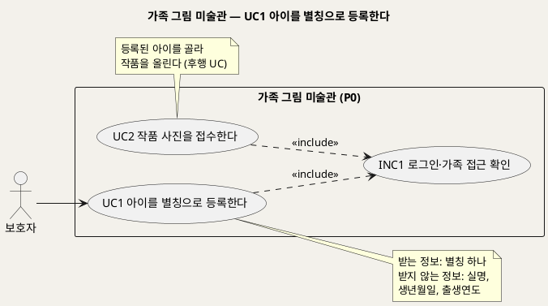
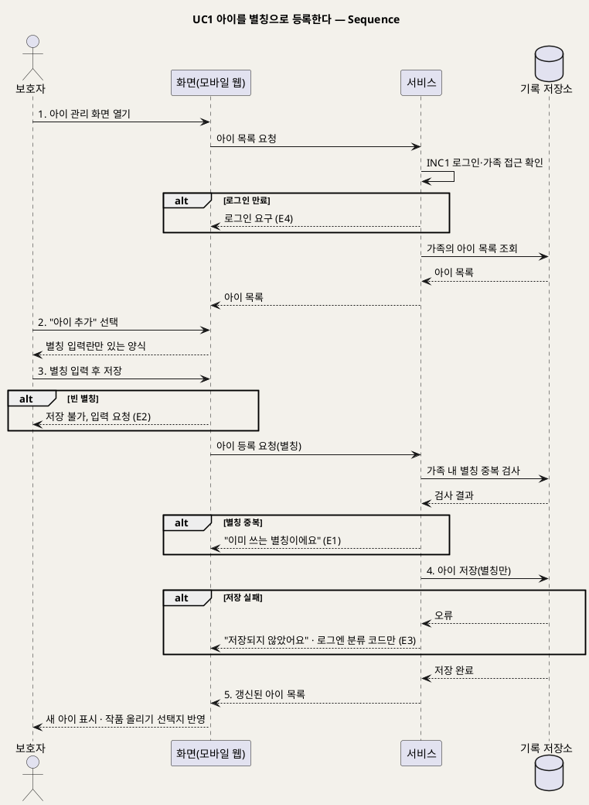

# UseCase 명세 — #1 아이를 별칭으로 등록한다 (가족 그림 미술관 P0)
**가족 그림 미술관 · UC1 · UML 2.5.1 표준 (UseCase Diagram + UseCase 기술 + Sequence Diagram)**

---

> **문서 식별**: `design/UC_01_아이등록.md`
> **작성일**: 2026-09-23 · **표준**: UML 2.5.1 (OMG)
> **원천(SoT)**: `.specify/features/가족-그림-미술관/spec.md` — FR-1, FR-9 · 보조 원천 `Intent-Specify.md` [핵심 데이터]·[부정적 영향]
> **다이어그램**: 모든 PlantUML 소스는 렌더 검증 완료(HTTP 200). 아래 링크로 브라우저에서 열 수 있다.

---

## 목차

1. [범위·개요](#1-범위개요)
2. [UseCase Diagram](#2-usecase-diagram)
3. [Actor 카탈로그](#3-actor-카탈로그)
4. [UseCase 목록 (원천 매핑)](#4-usecase-목록-원천-매핑)
5. [UseCase 기술 + Sequence Diagram](#5-usecase-기술--sequence-diagram)
6. [업무규칙 종합](#6-업무규칙business-rules-종합)
7. [UML 표준 준수 노트](#7-uml-표준-준수-노트)

---

## 1. 범위·개요

보호자는 작품을 올리기 전에 아이를 **별칭 하나**로 등록한다. 이 서비스는 아동 정보를 최소로 수집한다. 그래서 실명, 생년월일, 출생연도는 받지 않는다. 나이는 아이 정보가 아니라 작품마다 "제작 당시 연령"으로 받는다(UC5). 보호자 한 명이 여러 아이를 등록할 수 있고, 등록한 별칭은 작품 접수(UC2)와 전시(UC6)에서 아이를 구분하는 기준이 된다.

| 항목 | 값 |
|---|---|
| 대상 시스템 | 가족 그림 미술관 (P0) |
| 상위 프로세스 | 가족 공간 준비 → 작품 접수(UC2) |
| 원천 근거 | spec FR-1 · FR-9 · Intent [핵심 데이터] 아이 · [부정적 영향] 과잉 수집 |
| 핵심 UseCase | 1개 (UC1) + 공통 1개 (INC1) |
| 주요 액터 | 보호자 |

---

## 2. UseCase Diagram

**[「UC1 아이 등록 UseCase Diagram」 PlantUML 뷰어로 열기](https://plantuml.sumzip.com/plantuml/svg/eNqNkkFL3EAYhu_zKz7Wi4KKu72JLFKp0Evx0vMyJrMxmJ0pyYQipbDYCFs9VNuNTdlEXLAqxdKVXbpbyKk_pcfMl__QSXah60HoLcz3vu8z3zvZ9CR1pd9ywDcaTdqynYOGRR2HuQeNtSrx9m3-irq0BbvU2Ldc4XNzSzjChYXtJ9vVZ0_nFN4eNcVrm1vQpI7HiMOaEqQA17b2JJi2ywxpC06kLR0G2aCN_XvIxhN1nYL6McHOZTZqw592F15uVQHDAJOR-qpnwwB_fcc4Vf0Y1Kd71U_yMFYnV4RQQ-qrVNRwlEcTvDitAPVgh7qMS0IKHuWWZlUegy3urC1V4A0B8D1mUE9L_5NdkrR23vr8hfZqocZgMvk9nlHx8iwbp5B_CfVp6SuED5k1wIuz_GMH8PAObzQ9KGzYiR7QauQtIdP1YGWlXvKL-66u1stMWIeNDZsbjm-yep0UsY-MCBeSzV5GNGeLqEFPHXc1ONSFrs92hzyM1GE0HeNNW5dzPK_Ckyv17WhZz_Fdoo4C7HUxSZcBf8b6AD8P1IeAMG5CQZxid4WUojXl1orgsld1Gs8Vnw1vVZIWqWUvZSHRnboe6DZgMe8F-fl7bV_6F72pv_R__BcZpFBs)** — 클릭 시 브라우저로 연결됩니다.

#### 다이어그램 쉽게 읽기 (유저 관점)

- **누가 쓰나** — 보호자 한 사람이 쓴다. 아이는 계정이 없어 직접 등록하지 않는다.
- **무슨 순서로** — 로그인한 보호자가 아이의 별칭을 적어 등록한다. 그다음 작품을 올릴 때(UC2) 그 아이를 고른다.
- **«include» = 항상 함께** — 아이 등록은 매번 "로그인·가족 접근 확인"을 거친다. 내 가족 공간에만 아이가 추가된다.
- **«extend» = 특정 상황에서만** — 이 UC에는 확장 관계가 없다.
- **Generalization(◁)** — 이 UC에는 없다.

| 기호 | 의미 |
|---|---|
| 사람 모양(actor) | 시스템을 쓰는 사람 |
| 타원(usecase) | 액터가 이루려는 목표 |
| 사각형(rectangle) | 시스템 경계 |
| 점선 `<<include>>` | 항상 함께 수행되는 하위 행위 |
| 노트 | 규칙이나 선후 관계 보충 설명 |

---

## 3. Actor 카탈로그

| 구분 | 액터 | 이 UC에서의 역할 | 원천 근거 |
|:--:|---|---|---|
| Primary | 보호자 | 아이 별칭을 등록하고 수정한다 | spec Target Users · FR-1 |
| 이해관계자 | 아이 | 등록 대상. 시스템을 직접 조작하지 않는다 | spec Target Users |

---

## 4. UseCase 목록 (원천 매핑)

| UC ID | 유스케이스명 | 관계 | 원천 근거 |
|:--:|---|---|---|
| UC1 | 아이를 별칭으로 등록한다 | 본 문서 | spec FR-1 |
| INC1 | 로그인·가족 접근 확인 | UC1이 «include» | spec FR-9 |
| UC2 | 작품 사진을 접수한다 | 후행(등록된 아이를 선택) | spec FR-1 "작품을 올릴 때 어느 아이의 작품인지 고를 수 있다" |

---

## 5. UseCase 기술 + Sequence Diagram

### 5.1 UC1 아이를 별칭으로 등록한다

> **쉽게 말하면** — 보호자가 아이의 별명(예: "하늘")만 적어 등록합니다. 진짜 이름이나 생일은 묻지 않습니다. 형제가 있으면 여러 명을 등록하고, 작품을 올릴 때 누구 그림인지 고릅니다.

#### 유스케이스 기술

| 속성 | 내용 |
|---|---|
| **ID** | UC1 (spec FR-1) |
| **유스케이스명** | 아이를 별칭으로 등록한다 |
| **액터** | 주: 보호자 · 보조: 없음 |
| **사전조건** | (1) 보호자가 로그인되어 있다(INC1). (2) 보호자의 가족 공간이 존재한다. [추론] 가족 공간은 보호자 계정 생성 시 함께 생긴다고 본다. 계정 생성 절차는 원천에 없다 — `자료 없음 — 확인 필요` |
| **사후조건** | (1) 가족 공간에 새 아이가 별칭으로 저장된다. (2) 별칭은 같은 가족 안에서 유일하다. (3) 실명·생년월일·출생연도는 어디에도 저장되지 않는다. (4) 새 아이가 작품 올리기(UC2)의 아이 선택 목록에 나타난다 |
| **기본흐름** | ↓ 별도 기본흐름표 |
| **대체흐름** | A1. 별칭 수정 — 보호자가 등록된 아이의 별칭을 고친다. 중복 검사(BR-CHD-02)를 다시 거쳐 저장한다(spec FR-1). A2. 추가 등록 — 형제 등 두 번째 이후 아이를 같은 절차로 등록한다(spec FR-1 "2명 이상"). A3. 최초 진입 — 등록된 아이가 없는 상태에서 작품 올리기(UC2)를 시도하면, 아이 등록 화면으로 먼저 안내한다. [추론] 원천은 "등록 시 1회"만 명시한다 |
| **예외흐름** | E1. 별칭 중복 — 같은 가족 안에 같은 별칭이 있으면 저장을 거절하고 "이미 쓰는 별칭이에요"라고 안내한다(spec FR-1). E2. 빈 별칭 — 아무것도 입력하지 않으면 저장 버튼을 막고 입력을 요청한다. [추론] 별칭 길이·허용 문자 규칙은 `자료 없음 — 확인 필요`. E3. 기록 저장 실패 — 기록 저장소 장애로 저장하지 못하면 "저장되지 않았어요, 다시 시도해 주세요"라고 안내한다. 일부만 저장된 아이는 남기지 않는다. 운영 로그에는 분류 코드만 남긴다(spec FR-14 · Intent [핵심 장벽] 인프라 "저장소·DB 장애 분리"). E4. 로그인 만료 — 세션이 만료됐으면 INC1에 따라 다시 로그인하게 하고, 입력하던 별칭은 저장하지 않는다(spec FR-9) |
| **포함/확장** | «include» INC1 로그인·가족 접근 확인 |
| **우선순위** | Medium — 모든 작품 흐름의 선행 조건이지만 기능 범위가 작다(spec FR-1) |
| **사용빈도** | 아이당 1회 등록(Intent [핵심 데이터] "아이 등록 시 1회"). 별칭 수정 빈도는 `자료 없음 — 확인 필요` |
| **업무규칙** | BR-CHD-01, BR-CHD-02, BR-ACC-01, BR-PRV-01 |
| **특별 요구사항** | 개인정보: 등록 화면에 실명·생년월일·출생연도 입력란을 두지 않는다(spec FR-1 수용기준). 운영 로그에 별칭(자유 입력)을 남기지 않는다(spec FR-14). 접근: 다른 가족의 아이 목록은 조회할 수 없다(spec FR-9) |
| **비고** | 원천 추적: spec FR-1(수용기준 4개 전부 반영: 입력란 제한 / 가족 내 중복 거절 / 2명 이상·작품 올릴 때 선택 / 수정 가능) · FR-9 · FR-14 · Key Entities "아이" · Intent [핵심 데이터] "아이: 보호자가 정한 별칭. 아이 등록 시 1회. 출생연도·생년월일은 저장하지 않는다" · Intent [부정적 영향] "과잉 수집". 미결: spec FR-9 계정 모델([NEEDS CLARIFICATION])에 따라 공동 보호자의 등록 권한이 달라질 수 있다 |

#### 기본흐름 (Basic Flow)

| 단계 | 액터 행위 | 시스템 행위 |
|:--:|---|---|
| 1 | 보호자가 아이 관리 화면을 연다 | INC1로 로그인과 가족 공간을 확인하고, 이 가족에 등록된 아이 목록을 보여 준다 |
| 2 | 보호자가 "아이 추가"를 누른다 | 별칭 입력란 하나만 있는 등록 양식을 보여 준다(실명·생년월일·출생연도 입력란 없음) |
| 3 | 보호자가 별칭을 입력하고 저장을 누른다 | 같은 가족 안에 같은 별칭이 있는지 검사한다 |
| 4 | — | 중복이 없으면 아이를 가족 공간에 저장한다 |
| 5 | 보호자가 갱신된 목록에서 새 아이를 확인한다 | 새 아이가 포함된 목록을 보여 주고, 작품 올리기(UC2)의 아이 선택에 반영한다 |

#### Sequence Diagram

**[「UC1 아이 등록 Sequence」 PlantUML 뷰어로 열기](https://plantuml.sumzip.com/plantuml/svg/eNptlE1PGlEUhvf3V5zQDSSVFLUbF43xK3HTNDF2a64wWuIICmMad1SnDREWUAcddSCQQv0IpiijQEI3_pQu5575Dz3MDOqgKzL3vve8z33PuUynFZ5SdjZlSEvbK2t8My7vrqxzWZZSuyvvIiy9EU9s8RTfhFUe3VhPJXcSsdmknEzBm4WJhcj8zDNF-guPJb_GE-uwxuW0xJS4IkuwPBsBLKlYNkWjD6KtYu8ajb6oGSAOb0StbJcMkavDv4wGS9L2jpSISozxqEIeAdE2bb2LlUIAeBo-8ZSUUBi5KfFofIsnFAjYJ5q4NIPi6kK0NCz3Ac96IUe9vOhXomqInooHdWd36fMsi3GFr_K0BAGr2yISwGoGKw38kXckczOMuZYw9oHKwRREwt5dwDIz4ncTXHvAY5NKMNKQkkqT1NOJq0un8qmGt9dssPWoWPxI0VAOVqeL5e5Dx2plsHZDEEWr06fKJVplXFaeNCDO8-JXnoFTYWxI9bRPNtZdE4LzkyEmJWJDv7kZUrnlsayPotVa9mmekWbsdXjmM_NvjQY0HqagXQXea2QZAFSr9n7ZyYZUnn7KmwTAyndRbYhKhq5GH1lxoAEeFTH3svZE2H8I7DPVa5kbUy_rCSigUTtXB-I-S1BvhxXctlBe425erzXQGVJPGXTrh14JFsSe-chXL4r2HVi3Gdxr-pN11-inZbX7LvbzM6OtDQzezR9q7GFrkIz3fMomHheIKEDkEZfcRzT5OKbutT1sijjkWHphYK5u5y_I0t97vS4a-ksQ54wo6HieoeoHWNLxyHQgHjrDETwmxHuVjgP-1cShMWhqcH7CRfS7eAgn6mCg_SP2PkyZ3mCuKgrGyLy9aOt-dqiwiwbmjAEMVor2T1rXm_RE6V16IzgAFy0d9W9smnjoT-8_cOddyA==)** — 클릭 시 브라우저로 연결됩니다.

기본흐름 1~5단계는 시퀀스의 번호 붙은 주요 메시지 `1.`~`5.`와 1:1로 대응한다.

---

## 6. 업무규칙(Business Rules) 종합

| BR ID | 규칙 | 적용 UC | 근거 |
|---|---|---|---|
| BR-CHD-01 | 아이는 보호자가 정한 별칭으로만 등록한다. 실명·생년월일·출생연도는 받지 않고 저장하지 않는다 | UC1 | spec FR-1 · Intent [핵심 데이터] 아이 · [부정적 영향] 과잉 수집 |
| BR-CHD-02 | 같은 가족 안에서 별칭은 서로 달라야 한다. 등록과 수정 모두에 적용한다 | UC1 | spec FR-1 수용기준 2 |
| BR-ACC-01 | 가족 공간의 아이·작품·원본·결과·이야기는 해당 가족만 조회할 수 있다 | UC1~UC7 | spec FR-9 |
| BR-PRV-01 | 운영 로그에는 이미지, 저장 위치 키, 자유 입력 텍스트, 오류 원문을 남기지 않는다. 분류 코드와 요청 번호만 남긴다 | 전 UC | spec FR-14 · Intent [부정적 영향] 아동 그림·사진 유출 |

---

## 7. UML 표준 준수 노트

| 항목 | 적용 |
|---|---|
| 액터 | 보호자는 Primary이며 시스템 경계 밖에 둔다. 아이는 조작 주체가 아니므로 이해관계자로만 기록했다 |
| System Boundary | `rectangle`로 가족 그림 미술관(P0)의 책임 범위를 표시했다 |
| «include» | INC1은 모든 보호자 UC가 항상 거치는 공통 행위라 include로 분리했다(UML 2.5.1 UseCases 장의 Include 정의) |
| 선후 관계 | UC1 → UC2는 include나 extend가 아닌 업무 선후 관계라서 노트로만 표시했다 |
| Sequence | 기록 저장소는 `database` lifeline으로 분리했다. 예외는 `alt` 프래그먼트에 E1~E4를 붙였다 |

---

*가족 그림 미술관 P0 · UC1 · 2026-09-23 · 원천: spec.md FR-1*
