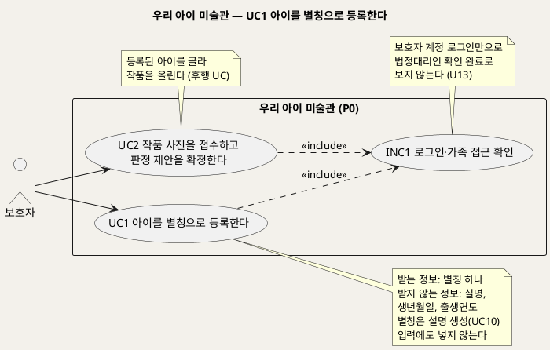
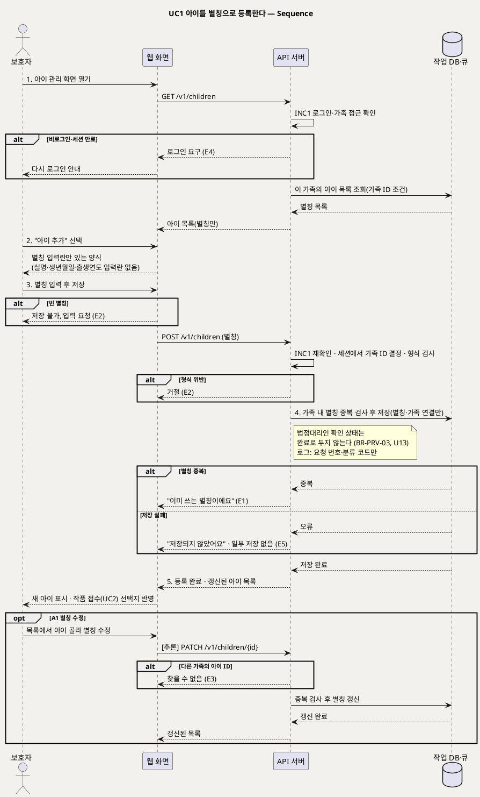

# UseCase 명세 — #1 아이를 별칭으로 등록한다 (우리 아이 미술관 P0)
**우리 아이 미술관 · UC1 · UML 2.5.1 표준 (UseCase Diagram + UseCase 기술 + Sequence Diagram)**

---

> **문서 식별**: `design/UC_01_아이등록.md`
> **작성일**: 2026-09-23 · **개정**: 2026-09-28 — 서비스 이름을 "우리 아이 미술관"으로 바꾸고, 원천을 2026-09-28 기준안으로 갱신했다. 비로그인 차단(BR-ACC-02)과 법정대리인 확인 미완료 원칙(BR-PRV-03)을 더하고, 시퀀스 lifeline을 공통 기준 이름으로 맞췄다 · **표준**: UML 2.5.1 (OMG)
> **원천(SoT)**: `Intent-Specify.md` (2026-09-28 기획 기준안) [핵심 데이터] 아이 · [부정적 영향] 과잉 수집·동의 오판 · [핵심 장벽] 아동 개인정보 — 그리고 `.specify/features/우리-아이-미술관/spec.md` v2.0 FR-1 · FR-9 · FR-14
> **다이어그램**: 모든 PlantUML 소스는 렌더 검증 완료(HTTP 200). 아래 링크로 브라우저에서 열 수 있다. 뷰어(plantuml.sumzip.com)는 사내 SSO 로그인 뒤에 열린다.

---

## 목차

1. [범위·개요](#1-범위개요)
2. [UseCase Diagram](#2-usecase-diagram)
3. [Actor 카탈로그](#3-actor-카탈로그)
4. [UseCase 목록 (원천 매핑)](#4-usecase-목록-원천-매핑)
5. [UseCase 기술 + Sequence Diagram](#5-usecase-기술--sequence-diagram)
6. [업무규칙 종합](#6-업무규칙business-rules-종합)
7. [UML 표준 준수 노트](#7-uml-표준-준수-노트)

---

## 1. 범위·개요

보호자는 작품을 올리기 전에 아이를 **별칭 하나**로 등록한다. 이 서비스는 아동 정보를 최소로 수집한다. 그래서 실명, 생년월일, 출생연도는 받지 않는다. 나이는 아이 정보가 아니라 작품마다 "제작 당시 연령"으로 받는다(UC5). 보호자 한 명이 여러 아이를 등록할 수 있고, 등록한 별칭은 작품 접수(UC2)와 전시(UC6)에서 아이를 구분하는 기준이 된다.

별칭은 가족 화면 안에서 아이를 가리키는 데만 쓴다. P0.5의 작품 설명 생성(UC10)에도 별칭을 포함한 아이 이름을 넣지 않는다. 또 보호자 계정으로 로그인해 아이를 등록했다고 해서 법정대리인 확인까지 끝났다고 보지 않는다. 동의 절차는 상용화 전에 정할 미해결 사항(U13)이다. 이 UC는 모델을 부르지 않는다. API 서버와 작업 DB만 관여한다.

| 항목 | 값 |
|---|---|
| 대상 시스템 | 우리 아이 미술관 (P0) |
| 상위 프로세스 | 가족 공간 준비 → **아이 등록(UC1)** → 작품 접수(UC2) |
| 원천 근거 | spec FR-1 · FR-9 · FR-14 · Intent [핵심 데이터] 아이 · [부정적 영향] 과잉 수집·동의 오판 · [핵심 장벽] 아동 개인정보 |
| 핵심 UseCase | 1개 (UC1) + 공통 1개 (INC1) |
| 주요 액터 | 보호자 |

---

## 2. UseCase Diagram

**[「UC1 아이 등록 UseCase Diagram」 PlantUML 뷰어로 열기](https://plantuml.sumzip.com/plantuml/svg/eNqNU01r20AQve-vGNyLDUmInVsIJjQ00EvJJbeCUSTFEVGkIq0ppRRMKoObGOq0UeM0krHJVykptWtTu-BTf0qP2tF_6KwsUvsQ6E27896-N29G6y5XHF45MKGiluyKU1L3DFMrlRXT1J1XpeU8c_cN64XiKAewo6j7ZceuWNqGbdoOPNpc2cw_eTyDcPcUzX5pWGXYVUxXZ6a-y4Hb4BjlPQ6a4egqN2yLcYObOuDnnri5A_Q9DIcgvo-x3omGVfhTPYXtjXxaENcTEAMPf33DYCK6AYiPfdENYz8Qx1eMKSonKxkxGMatMbabGVBc2FIc3eKMST3FKpNW5iGx7NZyLgOvGUDF1VXFJeh_aidKhJ2lPn1GXAJGozGG49-jqFfFbh-wcxKNJhCf-3Sb8CRwXrMA2D6JP9QBD-_wltQ9ScN6K_Zb0aDz3IobTez4dBmgX5dl-VzHnzNTYG8Ym3YPi4vFxN7cscBkd0tLxcQBrMLammGpZkXTi0UmTTxQYpbN9XSO9m7atuhdiKNTcuRT_KtpUkB-xWFrWsbbKkV5NIvC4yvxtbZAdXwbipqHF6cYThYAfwZ0gWc98d6T5GnsIfE9SZBo9PpZUl7OSXK7JjrXeNYkOAjv8p-SXAvd0kA6ntresTm3D6TvNPb7bYGIZCjU-5GJ28Z01BL1Q-YrGlVaHCql4wM898RlI4UMhnPCkN3Or-QelJf5Q7pEohnMbFk0-CLCSdKXXIJk-q07cdNLHo0vvPjTO6LPPL1OX_Tf_gUGQtGS)** — 클릭 시 브라우저로 연결됩니다.

#### 다이어그램 쉽게 읽기 (유저 관점)

- **누가 쓰나** — 보호자 한 사람이 쓴다. 아이는 계정이 없어 직접 등록하지 않는다. 공동 보호자나 감상 전용 가족이 등록할 수 있는지는 계정 모델이 정해진 뒤 결정한다(U1).
- **무슨 순서로** — 로그인한 보호자가 아이의 별칭을 적어 등록한다. 그다음 작품을 올릴 때(UC2) 그 아이를 고른다.
- **«include» = 항상 함께** — 아이 등록은 매번 "로그인·가족 접근 확인"을 거친다. 아이는 내 가족 공간에만 추가되고, 다른 가족은 볼 수 없다.
- **«extend» = 특정 상황에서만** — 이 UC에는 확장 관계가 없다.
- **Generalization(◁)** — 이 UC에는 없다.

| 기호 | 의미 |
|---|---|
| 사람 모양(actor) | 시스템을 쓰는 사람 |
| 타원(usecase) | 액터가 이루려는 목표 |
| 사각형(rectangle) | 시스템 경계 |
| 점선 `<<include>>` | 항상 함께 수행되는 하위 행위 |
| 노트 | 규칙이나 선후 관계 보충 설명 |

---

## 3. Actor 카탈로그

| 구분 | 액터 | 이 UC에서의 역할 | 원천 근거 |
|:--:|---|---|---|
| Primary | 보호자 | 아이 별칭을 등록하고 수정한다 | spec FR-1 · 공통 기준 §6 액터 |
| 이해관계자 | 아이, 성장한 아이 | 등록 대상. 시스템을 직접 조작하지 않아 액터로 두지 않는다 | 공통 기준 §6 액터 · Intent [가치제안] |

이 UC에는 보조 액터가 없다. 원본·결과 저장소와 모델(M1~M7)은 관여하지 않는다.

---

## 4. UseCase 목록 (원천 매핑)

| UC ID | 유스케이스명 | 관계 | 원천 근거 |
|:--:|---|---|---|
| UC1 | 아이를 별칭으로 등록한다 | 본 문서 | spec FR-1 · Intent [핵심 데이터] 아이 |
| INC1 | 로그인·가족 접근 확인 | UC1이 «include» | spec FR-9 · 공통 기준 §6 |
| UC2 | 작품 사진을 접수하고 판정 제안을 확정한다 | 후행(등록된 아이를 선택) | spec FR-1 수용기준 "작품을 올릴 때 어느 아이의 작품인지 고를 수 있다" |

---

## 5. UseCase 기술 + Sequence Diagram

### 5.1 UC1 아이를 별칭으로 등록한다

> **쉽게 말하면** — 보호자가 아이의 별명(예: "하늘")만 적어 등록합니다. 진짜 이름이나 생일은 묻지 않습니다. 형제가 있으면 여러 명을 등록하고, 작품을 올릴 때 누구 그림인지 고릅니다.

#### 유스케이스 기술

| 속성 | 내용 |
|---|---|
| **ID** | UC1 (spec FR-1) |
| **유스케이스명** | 아이를 별칭으로 등록한다 |
| **액터** | 주: 보호자 · 보조: 없음 |
| **사전조건** | (1) 보호자가 로그인되어 있다(INC1, BR-ACC-02). (2) 보호자의 가족 공간이 존재한다. [추론] 가족 공간은 보호자 계정을 만들 때 함께 생긴다고 본다. 계정 생성 절차와 계정 모델은 원천에 없다 — `자료 없음 — 확인 필요` (U1) |
| **사후조건** | (1) 가족 공간에 새 아이가 별칭으로 저장된다. (2) 별칭은 같은 가족 안에서 유일하다. (3) 실명·생년월일·출생연도는 어디에도 저장되지 않는다. (4) 새 아이가 작품 접수(UC2)의 아이 선택 목록에 나타난다. (5) 등록을 마쳐도 법정대리인 확인이 끝난 것으로 기록하지 않는다(BR-PRV-03, U13). (6) 운영 로그에는 별칭이 남지 않고 요청 번호와 분류 코드만 남는다 |
| **기본흐름** | ↓ 별도 기본흐름표 |
| **대체흐름** | A1. 별칭 수정 · A2. 추가 등록 · A3. 아이 없이 작품 접수 진입 · A4. 공동 보호자 등록 — ↓ 별도 대체흐름표 |
| **예외흐름** | E1. 별칭 중복 · E2. 빈 별칭·형식 위반 · E3. 다른 가족의 아이 접근 · E4. 비로그인·세션 만료 · E5. 작업 DB 저장 실패 — ↓ 별도 예외흐름표 |
| **포함/확장** | «include» INC1 로그인·가족 접근 확인 |
| **우선순위** | Medium — 모든 작품 흐름의 선행 조건이지만 기능 범위가 작다(공통 기준 §6, spec FR-1) |
| **사용빈도** | [추론] 아이당 등록 1회. 2026-09-28 원천은 "아이 등록 시 1회" 문구를 빼고 "보호자가 정한 별칭"만 적는다. 별칭 수정 빈도는 `자료 없음 — 확인 필요` |
| **업무규칙** | BR-CHD-01, BR-CHD-02, BR-ACC-01, BR-ACC-02, BR-PRV-01, BR-PRV-03 |
| **특별 요구사항** | 최소 수집: 등록 화면에 실명·생년월일·출생연도 입력란을 두지 않는다(spec FR-1 수용기준). 별칭은 가족 화면 표시에만 쓴다. P0.5 설명 생성(UC10) 입력에는 별칭을 포함한 아이 이름을 넣지 않는다(Intent [부정적 영향] 과잉 수집, UC10의 BR-CAP-01). 개인정보: 운영 로그와 지표 라벨에 별칭(자유 입력)을 남기지 않는다(BR-PRV-01, spec FR-14). 접근: 가족 ID는 요청 본문이 아니라 로그인 세션에서 정한다 [추론]. 다른 가족의 아이 목록은 어떤 경로로도 조회할 수 없다(spec FR-9). 동의: 보호자 계정만으로 법정대리인 확인이 끝났다고 보지 않는다. 동의 절차는 상용화 전에 정한다(U13). 엔드포인트 `POST /v1/children` · `GET /v1/children`의 이름·형식·응답 코드는 [추론]이며 `/speckit.plan`에서 확정한다(U8) |
| **비고** | 원천 추적: spec FR-1(수용기준 4개 전부 반영: 입력란 제한 / 가족 내 중복 거절 / 2명 이상 등록·작품 올릴 때 선택 / 수정 가능) · FR-9(가족 단위 접근, 계정 모델 [NEEDS CLARIFICATION]) · FR-14(로그 제한) · Intent [핵심 데이터] "아이: 보호자가 정한 별칭. 생년월일·출생연도는 저장하지 않는다" · Intent [부정적 영향] 과잉 수집("실명·생년월일 대신 별칭", "설명 생성 입력에 이미지와 아이 이름을 넣지 않는다")·동의 오판 · Intent [핵심 장벽] 상 — 아동 개인정보 · 공통 기준 §4(엔드포인트) · §6(UC 목록·INC1) · §8(BR) · §9(최소 수집 원칙) · §10(U1, U8, U13). 아이 삭제는 UC7이 다룬다. 모델이 관여하지 않으므로 시퀀스에 서빙군 lifeline을 두지 않았다. 미결: U1 계정 모델에 따라 공동 보호자의 등록·수정 권한이 달라진다. U13 동의 절차가 정해지면 등록 앞에 동의 단계가 붙을 수 있다 |

#### 기본흐름 (Basic Flow)

| 단계 | 액터 행위 | 시스템 행위 |
|:--:|---|---|
| 1 | 보호자가 아이 관리 화면을 연다 | 웹 화면이 `GET /v1/children`을 보낸다. API 서버는 INC1로 로그인과 가족 공간을 확인하고, 이 가족에 등록된 아이 목록(별칭만)을 보여 준다 |
| 2 | 보호자가 "아이 추가"를 누른다 | 별칭 입력란 하나만 있는 등록 양식을 보여 준다(실명·생년월일·출생연도 입력란 없음). [추론] "실명 대신 가족이 부르는 별칭을 적어 주세요" 같은 안내를 함께 둔다 |
| 3 | 보호자가 별칭을 입력하고 저장을 누른다 | 웹 화면이 빈 값을 먼저 걸러 낸 뒤 `POST /v1/children`(별칭)을 보낸다. API 서버는 INC1을 다시 확인하고 세션에서 가족 ID를 정한다 |
| 4 | 보호자가 저장 결과를 기다린다 | API 서버가 작업 DB에서 같은 가족 안의 별칭 중복을 검사하고, 중복이 없으면 별칭과 가족 연결만 저장한다. 법정대리인 확인 상태는 완료로 두지 않는다 |
| 5 | 보호자가 갱신된 목록에서 새 아이를 확인한다 | 등록 완료와 새 아이가 포함된 목록을 보여 주고, 작품 접수(UC2)의 아이 선택에 반영한다 |

#### 대체흐름 (Alternative Flow)

| ID | 분기 조건 | 흐름 |
|:--:|---|---|
| A1 | 등록된 아이의 별칭을 고친다 | 보호자가 목록에서 아이를 골라 별칭을 수정한다. 가족 내 중복 검사(BR-CHD-02)와 형식 검사를 다시 거쳐 저장한다(spec FR-1 "등록 후 수정할 수 있다"). 수정 엔드포인트는 공통 기준 §4 표에 없다 — [추론] `PATCH /v1/children/{id}`, U8에서 확정 |
| A2 | 두 번째 이후 아이를 등록한다 | 형제 등 추가 아이를 기본흐름 2~5단계로 등록한다. 등록 수 상한은 `자료 없음 — 확인 필요` (spec FR-1 "2명 이상") |
| A3 | 등록된 아이가 없는 상태에서 작품 접수(UC2)를 시작한다 | [추론] 아이 등록 화면으로 먼저 안내하고, 등록을 마치면 UC2로 돌아간다 |
| A4 | 공동 보호자가 아이를 등록하려 한다 | 계정 모델(U1)이 정해지기 전에는 가족 공간을 만든 보호자 계정만 등록·수정한다 [추론]. (a) 보호자 1계정 / (b) 공동 보호자 / (c) 관리 보호자 + 감상 전용 중 무엇으로 정하느냐에 따라 이 흐름을 고친다 |

#### 예외흐름 (Exception Flow)

| ID | 발생 조건 | 처리 | 근거 |
|:--:|---|---|---|
| E1 | 같은 가족 안에 같은 별칭이 있다 | 저장을 거절하고 "이미 쓰는 별칭이에요"라고 안내한다. 입력값은 화면에 남겨 고칠 수 있게 한다 | BR-CHD-02 · spec FR-1 |
| E2 | 별칭이 비어 있거나 형식에 맞지 않는다 | 웹 화면은 저장 버튼을 막고, API 서버도 같은 검사를 거쳐 거절한다. 별칭 길이·허용 문자 규칙은 `자료 없음 — 확인 필요` | BR-CHD-01 · [추론] |
| E3 | 다른 가족의 아이 ID로 조회·수정을 요청한다 | 찾을 수 없음으로 응답하고 존재 여부도 알리지 않는다 [추론]. 로그에는 분류 코드만 남긴다 | BR-ACC-01 · spec FR-9 "직접 주소 입력 어떤 경로로도" |
| E4 | 로그인하지 않았거나 세션이 만료됐다 | INC1에 따라 다시 로그인하게 한다. 입력하던 별칭은 저장하지 않는다 | BR-ACC-02 · spec FR-9 |
| E5 | 작업 DB 장애로 저장하지 못한다 | "저장되지 않았어요, 다시 시도해 주세요"라고 안내한다. 일부만 저장된 아이 기록은 남기지 않는다. 운영 로그에는 요청 번호와 분류 코드(DB)만 남긴다. 모델 단계가 아니므로 3회 재시도·결과 미도달 집계(BR-PRC-03)는 적용하지 않고 보호자가 다시 시도한다 [추론] | BR-PRV-01 · spec FR-14 · Intent [핵심 데이터] 오류 분류 "DB" |

#### Sequence Diagram

**[「UC1 아이 등록 Sequence」 PlantUML 뷰어로 열기](https://plantuml.sumzip.com/plantuml/svg/eNptVU1vGlcU3c-vuKIbkAIOdrLxoooxTutNayUhm7SyJjCxUQg4MG5VRZVwGFcoIBVqCBN7BoEKzYccFdvEYIl24Z_S5bw7_6H3zbzBjPEGad47736cc-7lXkGV8-ruiwwUlJebud38ZnI7nUltbsmZjJL_ZfN2VCo8T2d35Lz8Ap7Kyedb-dxuNrWay-Ty8NX9pfvRtdgMorAtp3I_p7Nb8EzOFBRJTasZBRKrUcCmhuaQ9SfAzjS8-IzGhHUNYAcnrGvaTYNVevBfsQEPlZe7SjapSJKcVClHgJ0NbX2M7VoA5AJsyHklq0qUTU0n0ztyVoUAHl2A_a7BPg4dSGLdf72ysQ6oGexUc67pU0rJqvxULij0tl3H1j7EY5cje89NEY9JkpsGwl9TNFiGaETUD9awyP46FukAW0NrPJAIQ0ieZxm-WXsECz9FFxwaKYjEj6e3698RFdS3NRqjOb4cWYMidk8AO3VrNKGoTTqV5IwK7EKbgaE2xn0d2Psq-7MqgRMs7BU3xQEeNqwvxxBcuxMiUMLFiFYIV-lhxZiFN8vs9VBSsimvyHiMcE6bTl1o6l7f7NNH0gmwO7APq0FR9nqcH1gnw5BEL8PTLl2FxRvJV6wvXNAFUluhOcoXIySOC8bzBiUMkIgdu2RKc3252bC9zzp91i5SOPooszcNwLd1rJg_ZINY6bFP-0RkyWT7Gh410JzQ17lBB9gasN-1q_ek6m9o3lDSUsSfC-wjetYpYrsvNCsLwA3suzhg52Xq5ZYXgRTD08-k2GLI0WHWSRvfP_RbCQRfoRs8he1j1z1wOQLXLtiqke3hSivrdICdJgfYepN4oYMivj52ahcnaGhsoF93mHVCD8tXVfrscifipSAzTQnq1dnZF5FghifRwZXxWwOqyjFANqcqkE9vbauQe-ZMKQA7bVLFrMpnjvcmWsTSnl0ySGCC4DuNZsJZJfUavif1mm_ohq-TYOxBeOPB4_DtpVuQiC7xmXDNv-zxzk7LtFsuR-xcY33y-j8NdmBQNbxL4AW5us72REF8Xp-e-hgL8F33N1V6MOA-FCvPHHJNDhsBojJKVNKG9HxBBrWrH-aC6z2qaz6484bVdNEvNnV8O3QCc_XNCTsvTgM7ZqaEd13t_PEFxuFQ8k_q3YhYzuKah7YGJ1jpsJrhn-O5kcRS2UPYdYNvHV5Xu27_Uea7Dst6MLG6GBITzbsg16G-J0m5HRVWolPKyzrpT_1fm0Q3rTC4t5nPPjBzMvdydqKe0CZh3c6PsLHyaPVb32wtvEqnfiW4ozcti_54fgeuxwlwTQsc_IumxtNdMe04jXMtsN5enZsJUavL6nXt3VNPm-sTORVCKMDT3aMf-if_HyqDs5s=)** — 클릭 시 브라우저로 연결됩니다.

기본흐름 1~5단계는 시퀀스의 번호 붙은 주요 메시지 `1.`~`5.`와 1:1로 대응한다.

---

## 6. 업무규칙(Business Rules) 종합

| BR ID | 규칙 | 적용 UC | 근거 |
|---|---|---|---|
| BR-CHD-01 | 아이는 별칭만 받는다. 실명·생년월일·출생연도는 받지 않고 저장하지 않는다 | UC1 | spec FR-1 · Intent [핵심 데이터] 아이 · [부정적 영향] 과잉 수집 |
| BR-CHD-02 | 같은 가족 안에서 별칭은 중복될 수 없다. 등록과 수정 모두에 적용한다 | UC1 | spec FR-1 수용기준 2 |
| BR-ACC-01 | 가족 단위로 격리한다. 아이·작품·원본·결과·이야기는 해당 가족만 조회할 수 있다 | UC1~UC7, UC10 | spec FR-9 |
| BR-ACC-02 | 로그인하지 않은 사용자는 차단한다 | UC1~UC7, UC10 | spec FR-9 수용기준 2 |
| BR-PRV-01 | 운영 로그에 이미지·객체 키·자유 입력(별칭 포함)·오류 원문을 남기지 않는다. 분류 코드와 요청 번호만 남긴다 | 전 UC | spec FR-14 · Intent [부정적 영향] 아동 이미지 유출 |
| BR-PRV-03 | 보호자 계정만으로 법정대리인 확인이 끝났다고 보지 않는다. 동의 절차는 U13에서 정한다 | UC1 (가족 흐름 전체) | Intent [핵심 장벽] 상 — 아동 개인정보 · [부정적 영향] 동의 오판 |

---

## 7. UML 표준 준수 노트

| 항목 | 적용 |
|---|---|
| 액터 | 보호자는 Primary이며 시스템 경계 밖에 둔다. 아이·성장한 아이는 조작 주체가 아니므로 이해관계자로만 기록했다 |
| System Boundary | `rectangle`로 우리 아이 미술관(P0)의 책임 범위를 표시했다 |
| «include» | INC1은 모든 보호자 UC가 항상 거치는 공통 행위라 include로 분리했다(UML 2.5.1 UseCases 장의 Include 정의) |
| 선후 관계 | UC1 → UC2는 include나 extend가 아닌 업무 선후 관계라서 노트로만 표시했다 |
| Sequence | 공통 기준 §3의 lifeline 이름(`보호자` · `웹 화면` · `API 서버` · `작업 DB·큐`)을 썼다. 모델이 관여하지 않으므로 CPU 비전 워커·GPU 워커·LLM 서버와 원본·결과 저장소는 넣지 않았다. 예외는 `alt`에 E1~E5를, 대체흐름 A1은 `opt`로 붙였다 |

---

*우리 아이 미술관 P0 · UC1 · 2026-09-23 작성 · 2026-09-28 개정 · 원천: Intent-Specify.md(2026-09-28) · spec.md v2.0 FR-1*
