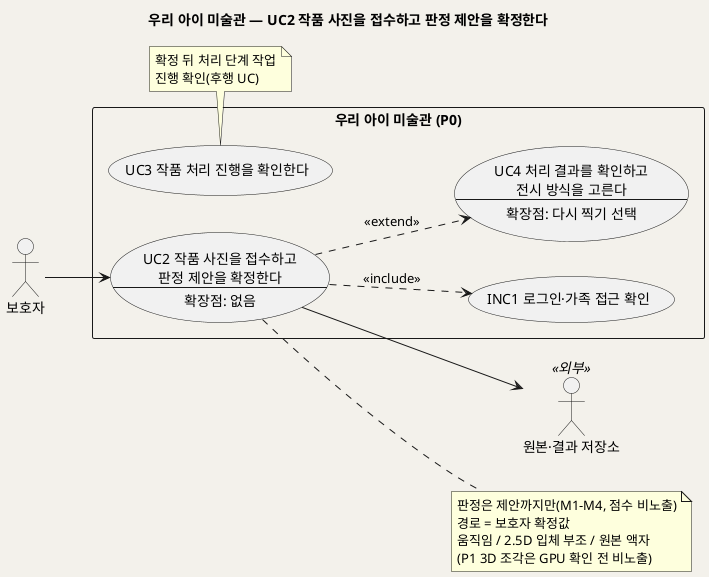
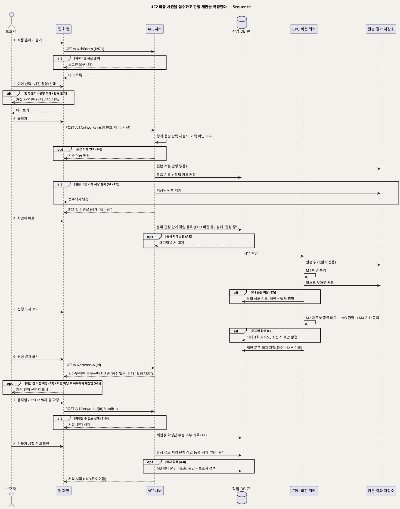

# UseCase 명세 — #2 작품 사진을 접수하고 판정 제안을 확정한다 (우리 아이 미술관 P0)
**우리 아이 미술관 · UC2 · UML 2.5.1 표준 (UseCase Diagram + UseCase 기술 + Sequence Diagram)**

---

> **문서 식별**: `design/UC_02_작품사진접수.md`
> **작성일**: 2026-09-23 · **개정**: 2026-09-28 — 보호자의 "사람·캐릭터 그림인가요?" 답으로 경로를 정하던 흐름을, 배경 분리(M1)·제로샷 판정(M2)·관절(M3)·기하 규칙(M4)의 판정 제안을 보여 주고 보호자가 움직임 / 2.5D 입체 부조 / 원본 액자 중 하나를 확정하는 흐름으로 바꿨다 · **표준**: UML 2.5.1 (OMG)
> **원천(SoT)**: `Intent-Specify.md` (2026-09-28 기획 기준안) [개요]·[미션]·[핵심 활동] 4·[핵심 장벽]·[부정적 영향]·[핵심 이네이블러]·[핵심 데이터] + `.specify/features/우리-아이-미술관/spec.md` v2.0 — FR-2, FR-3, FR-15, FR-20, FR-21 · 재작성 공통 기준(2026-09-28)
> **다이어그램**: 모든 PlantUML 소스는 렌더 검증 완료(HTTP 200). 아래 링크로 브라우저에서 열 수 있다. 렌더 서버 `plantuml.sumzip.com` 은 사내 SSO 로그인 뒤 열린다.

---

## 목차

1. [범위·개요](#1-범위개요)
2. [UseCase Diagram](#2-usecase-diagram)
3. [Actor 카탈로그](#3-actor-카탈로그)
4. [UseCase 목록 (원천 매핑)](#4-usecase-목록-원천-매핑)
5. [UseCase 기술 + Sequence Diagram](#5-usecase-기술--sequence-diagram)
6. [업무규칙 종합](#6-업무규칙business-rules-종합)
7. [UML 표준 준수 노트](#7-uml-표준-준수-노트)

---

## 1. 범위·개요

보호자가 아이를 고르고 휴대폰으로 찍은 작품 사진을 올린다. 시스템은 형식·용량·판독 가능 여부를 먼저 검사하고, **원본·작품 기록·작업 기록이 모두 저장된 경우에만** "접수 완료"로 응답한다(내구 접수). 접수가 끝나면 판정 단계 작업이 CPU 비전 워커 큐에 오른다. 워커는 원본을 읽기만 하면서 배경을 분리해 작품 마스크·컷아웃을 만들고(M1), 무엇을 그렸는지 제로샷으로 판정하고 태그를 뽑고(M2), 관절을 추정하고(M3), 관절 기하 규칙(M4)으로 움직일 수 있는 그림인지 따진 뒤 **제안 문구**를 만든다. 점수는 보여 주지 않는다.

보호자는 잘라 낸 작품(컷아웃)과 제안 문구를 보고 **움직임 / 2.5D 입체 부조 / 원본 액자** 중 하나를 확정한다. 처리 경로는 제안이 아니라 이 확정값으로 정해지고, 제안값·확정값·수정 여부가 함께 기록된다(판정 수정률의 원천). 확정되면 그 경로의 처리 단계 작업이 등록되고 이후 진행은 UC3에서 다룬다. 판정이 늦거나 실패해도 보호자는 직접 확정할 수 있다 [추론]. 결과 확인(UC4)에서 "다시 찍기"를 고르면 이 UC가 확장(EXT2)으로 다시 시작되고, 새 사진은 새 작품으로 접수된다. 만들기 작품(점토·종이 공작)의 3D 조각은 P1이며 팀 서버 GPU가 확인되기 전에는 선택지에 나타나지 않는다.

| 항목 | 값 |
|---|---|
| 대상 시스템 | 우리 아이 미술관 (P0) |
| 상위 프로세스 | 아이 등록(UC1) → **작품 접수·판정 제안 확정(UC2)** → 처리 진행 확인(UC3) → 결과 확인·전시 방식 선택(UC4) |
| 원천 근거 | spec v2.0 FR-2 · FR-3 · FR-15 · FR-20 · FR-21 · Intent [핵심 활동] 4 "판정은 제안까지만 한다" · [핵심 장벽] 상 — 판정 정확도 · [부정적 영향] 판정의 강요 · [핵심 이네이블러] 배경·작품 분리 / 종류 판정·태그 / 관절·리깅 / 판정 보조 |
| 핵심 UseCase | 1개 (UC2) + 공통 1개 (INC1) + 확장 관계 1개 (EXT2: UC2 ··> UC4 «extend») |
| 주요 액터 | 보호자 · 원본·결과 저장소(보조) |
| 쓰는 모델 | M1 배경·작품 분리 · M2 OpenCLIP 제로샷 종류 판정·태그 · M3 관절 추정 · M4 관절 기하 규칙(모델 아님) — 모두 CPU 비전 워커. 액자 확정 시 M3 렌더·M5는 부르지 않는다 |

---

## 2. UseCase Diagram

**[「UC2 작품 접수·판정 확정 UseCase Diagram」 PlantUML 뷰어로 열기](https://plantuml.sumzip.com/plantuml/svg/eNqFVF1r02AUvs-vONSbDuxc13kzZhlWJ15MCrK7QcnSrAvLEklSVETINBuVVuiGdZ1rSgubVRgY27FlMG_8KV7mPfkPnjdJRwd-3DXnPOc9z8ehi6YlGlZ1S4WqVNKrRknaUNRyqSKqqmy8LM3MCuamoj0TDXEL1kRps2LoVa1c0FXdgFtLuaXsw_sTCHNDLOvPFa0C66JqyoIqr1tg6WAolQ0LyoohS5aia4KlWKoM-Mljn08BWw66Z8C--VjrBWc2_LI_wEphFrC7F-7XAN-c4oAgDmBvD2vtsNUORj0IG03stajWwVaNd8PDFhXCVofVjwVBlCyimGKjs7DtY7eZAtGEomjImjXu4VGTjfyfF8HQC0ZX9JKN3RPcbUTQpwSRYWEBD312bufzgsDJi1qFiKf-xjxdnJlKwSsBoGrKkmgS9L9CVrV_KlnVMhmCUIW49ZrzgAe76MYc6e3JVY-fFLLA-p3gwkeX6_Js7H_ny4KLq-hR14_mOPAmxznAYZtLir1gJ2P8mCP2HKx3gHlfse5yjlRlJ_6fCFKNQ9F7H_geoNML37oJ3bmbW3PXzsTLyZ3w47uxA3w5dyCZzQmvBSEOEDKZfCSemzs9nY8EwTylpWiSWi3LFNe4xbXxjvzCkrVy0uDzUcCCoOmWnNynvp44GgeCrp1kElw2cGCzQSO9nM0sz92mcpPyA3bpsB0fzztTNBQMf5D3cA-uTy7JMfD2qY1HNg62sevAHZidvvuApO_gkI7nnELyqBhfI91Un0ZpIF3MQo5gfS_wtjmXR8WVxBfa70wuJ2HAdcRi1nTL0rdiNTmuJmIBbP947DOrfwlGDjcfD3Y4t8j35PF0eBR9rRQmHl6kX_Qn8RuDEAoC)** — 클릭 시 브라우저로 연결됩니다.

#### 다이어그램 쉽게 읽기 (유저 관점)

- **누가 쓰나** — 보호자가 사진을 올리고 전시 방식을 확정한다. 원본·결과 저장소는 원본과 잘라 낸 작품(마스크·컷아웃)을 보관하는 외부 구성요소다. 판정에 쓰는 모델은 서비스 안의 부품이라 그림에 사람 모양으로 나오지 않는다.
- **무슨 순서로** — 아이를 고르고 사진을 올리면 "접수 완료"가 뜬다. 잠시 뒤 잘라 낸 작품과 "움직일 수 있을 것 같아요" 같은 제안이 나오고, 보호자가 셋 중 하나를 고른다. 그 뒤 만드는 과정은 UC3에서 본다.
- **«include» = 항상 함께** — 사진을 올리거나 확정할 때마다 "로그인·가족 접근 확인"을 거친다.
- **«extend» = 특정 상황에서만** — 결과 확인(UC4)에서 "다시 찍기"를 고를 때만 사진 접수가 다시 시작된다. 이전 원본은 그대로 두고 새 작품으로 받는다.
- **Generalization(◁)** — 이 UC에는 없다. 움직임·2.5D·액자는 UC를 나누지 않고, 같은 확정 흐름에서 확정값만 다르게 기록한다.

| 기호 | 의미 |
|---|---|
| 사람 모양(actor) | 시스템을 쓰는 사람 또는 외부 구성요소(`<<외부>>`) |
| 타원(usecase) | 액터가 이루려는 목표. `--` 아래는 확장점 |
| 사각형(rectangle) | 시스템 경계 |
| 실선 화살표 | 액터와 UC의 연관 |
| 점선 `<<include>>` | 항상 함께 수행되는 하위 행위 |
| 점선 `<<extend>>` | 확장점 조건일 때만 기반 UC(UC4)에 끼어드는 행위 |
| 메모(note) | 경로 결정 규칙과 후행 UC 안내 |

---

## 3. Actor 카탈로그

| 구분 | 액터 | 이 UC에서의 역할 | 원천 근거 |
|:--:|---|---|---|
| Primary | 보호자 | 아이를 고르고 사진을 올린다. 컷아웃과 제안 문구를 보고 움직임 / 2.5D 입체 부조 / 원본 액자 중 하나를 확정한다 | spec FR-2 · FR-3 · FR-21 · Intent [핵심 활동] 4 · [가치제안] "지금의 보호자" |
| Secondary | 원본·결과 저장소(S3 호환) | 원본을 변형 없이 보관하고, M1이 만든 작품 마스크·컷아웃을 보관한다. 실제 제품은 미확정 | Intent [핵심 이네이블러] 기반 "S3 호환 저장소" · 공통 기준 §6 액터 |

모델 M1~M4는 자체 호스팅 구성요소라 액터로 두지 않는다. 시퀀스에서만 서빙군 lifeline "CPU 비전 워커"로 나타낸다(공통 기준 §6). 아이는 이해관계자이며 액터가 아니다.

---

## 4. UseCase 목록 (원천 매핑)

| UC ID | 유스케이스명 | 관계 | 원천 근거 |
|:--:|---|---|---|
| UC2 | 작품 사진을 접수하고 판정 제안을 확정한다 | 본 문서 | spec FR-2 · FR-3 · FR-15 · FR-20 · FR-21 |
| INC1 | 로그인·가족 접근 확인 | UC2가 «include» | spec FR-9 · 공통 기준 §6 |
| UC4 | 처리 결과를 확인하고 전시 방식을 고른다 | UC2가 UC4를 «extend»(EXT2, 확장점: 보호자가 "다시 찍기" 선택) | spec FR-6 · BR-APR-02 · BR-APR-03 |
| UC3 | 작품 처리 진행을 확인한다 | 후행(확정된 경로의 처리 단계 작업) | spec FR-4 · FR-5 · FR-22 · FR-23 · FR-25 |

---

## 5. UseCase 기술 + Sequence Diagram

### 5.1 UC2 작품 사진을 접수하고 판정 제안을 확정한다

> **쉽게 말하면** — 아이 작품을 찍어 올리면 사진과 기록이 안전하게 저장된 뒤 "접수 완료"가 뜹니다. 잠시 뒤 서비스가 작품만 잘라 보여 주고 "움직일 수 있을 것 같아요"처럼 어울리는 전시 방식을 제안합니다. 제안은 참고일 뿐이고, 움직임·입체 부조·액자 중 무엇으로 만들지는 보호자가 정합니다.

#### 유스케이스 기술

| 속성 | 내용 |
|---|---|
| **ID** | UC2 (spec v2.0 FR-2, FR-3, FR-15, FR-20, FR-21) |
| **유스케이스명** | 작품 사진을 접수하고 판정 제안을 확정한다 |
| **액터** | 주: 보호자 · 보조: 원본·결과 저장소. 시스템 내부 구성요소: API 서버, 작업 DB·큐, CPU 비전 워커(M1·M2·M3·M4) |
| **사전조건** | (1) 보호자가 로그인되어 있다(INC1). (2) 가족 공간에 아이가 1명 이상 등록되어 있다(UC1). (3) 보호자 기기에 올릴 작품 사진이 있거나 촬영할 수 있다. (4) 판정 모델(M1·M2·M3)이 매니페스트상 활성이다. 활성이 아니면 판정 제안 없이 직접 확정으로 진행한다(E6, BR-MDL-07) |
| **사후조건** | (1) 접수 성공 시 원본이 변형 없이 저장되고, 작품 기록과 작업 기록(요청 번호·상태 "접수됨")이 함께 저장된다. (2) 판정 단계 작업(분리 M1, 판정 M2+M3+M4)의 모델 ID·버전·상태·시도 횟수·처리 시간·낮춤 원인 또는 오류 분류가 기록되고, 작품 마스크·컷아웃이 저장소에 남는다(M1 성공 시). (3) 보호자가 확정하면 작품에 제안값·확정값(`animated` / `relief` / `frame`)·수정 여부가 기록되고, 확정 경로의 처리 단계 작업이 등록되어 상태가 "처리 중"이 된다. (4) 확정하지 않고 떠나면 상태는 "확정 대기"로 남고 목록에서 나중에 확정할 수 있다. (5) 접수 실패 시 원본·작품 기록·작업 기록 어느 것도 남지 않는다. (6) 어떤 경우에도 원본은 덮어쓰이지 않는다 |
| **기본흐름** | ↓ 별도 기본흐름표 |
| **대체흐름** | A1. 제안과 다르게 확정 — 7단계에서 제안과 다른 선택지를 골라도 막지 않는다. 수정 여부를 "예"로 기록하고 판정 수정률(보호자가 제안과 다르게 고른 건 / 제안 제시 건)에 집계한다(BR-SUG-03, BR-OPS-02). A2. 제안이 늦어 화면을 떠남 — 4~5단계 중 보호자가 화면을 닫아도 판정 단계 작업은 계속된다(BR-PRC-05). 작품은 목록에 "판정 중" → "확정 대기"로 보이고, 보호자가 나중에 목록에서 작품을 열면 6단계부터 이어서 확정한다. A3. 제안 전 직접 확정 [추론] — 제안이 나오기 전에 보호자가 "직접 고르기"로 확정할 수 있다(BR-SUG-05). 제안값은 "제안 전"으로 기록하고 판정 수정률의 분모(제안 제시 건)에서 뺀다 [추론]. 판정 단계 작업은 취소하지 않고 끝까지 수행해 M1 마스크·M3 관절을 처리 단계가 재사용하게 한다 [추론]. A4. 원본 액자로 확정 — 확정값이 `frame`이면 처리 단계에서 M3 렌더와 M5를 부르지 않는다(BR-PRC-01). 결과 원인은 "보호자 선택"으로 기록하고 모델 낮춤과 섞지 않는다(BR-FBK-04). A5. 사람을 찾지 못한 그림 — M2가 동물·집·사물로 판정하거나 M4 기하 규칙을 통과하지 못하면 "입체 부조가 어울려요"를 제안한다. 엔진 사람 점수가 높아도 그것만으로 움직임을 제안하지 않는다(BR-SUG-04, 집 그림 사람 점수 0.946 사례). A6. 중복 전송 — 같은 요청 번호로 올리기가 다시 오면 새 작품을 만들지 않고 기존 작품을 돌려준다(BR-INT-03). 확정 요청이 중복되면 첫 확정값을 유지하고 같은 응답을 돌려준다 [추론]. A7. 다시 찍기로 진입(EXT2) — UC4에서 "다시 찍기"를 고르면 이 UC가 1단계부터 시작되고 아이는 이전 작품의 아이로 미리 선택된다 [추론]. 새 사진은 새 작품·새 작업으로 접수되며 이전 작품의 원본·결과는 덮어쓰지 않는다(BR-APR-03, 이전 작품 처리는 BR-APR-05). A8. 동시 처리 상한 도달 — 접수는 정상 완료되고, 판정 단계 작업은 거절되지 않고 CPU 비전 큐에서 순서를 기다린다. 화면에는 "판정 중(대기)"로 보인다(BR-PRC-07). A9. (P1) 만들기 작품 — 팀 서버 GPU가 확인되고 M7이 활성화된 뒤에만 선택지에 "3D 조각(`sculpture`)"이 나타난다. 그 전에는 보이지 않는다(BR-SRV-02, U2) |
| **예외흐름** | E1. 허용되지 않는 형식 — JPEG·PNG·HEIC가 아니면 접수 전에 거절하고 "지원하지 않는 사진 형식이에요"라고 안내한다(BR-INT-01). E2. 용량 초과 — 20MB(기본값) 초과면 접수 전에 거절하고 상한을 안내한다(BR-INT-01). E3. 판독 불가 — 허용 형식이지만 이미지로 열리지 않는 깨진 파일이면 "사진을 열 수 없어요"라고 안내한다(BR-INT-01). E4. 원본 저장 실패 — "접수되지 않았어요, 다시 올려 주세요"라고 안내하고 작품 기록·작업 기록을 만들지 않는다(BR-INT-02). E5. 작품·작업 기록 저장 실패 — 이미 저장된 원본을 제거하고 E4와 같이 안내한다. 목록에 작품이 나타나지 않고 판정 단계 작업도 등록되지 않는다(BR-INT-02). E6. 판정 단계 인프라 장애 — 워커 다운·시간 초과·저장소·DB·모델 미준비(라이선스 미확인으로 비활성인 경우 포함, BR-MDL-07)는 낮춤이 아니다. 같은 단계를 최대 3회 재시도하고 오류 분류를 기록한다(BR-PRC-03). 소진되면 제안 없이 "제안을 준비하지 못했어요. 직접 골라 주세요"를 보여 주고, 보호자는 직접 확정할 수 있다(BR-SUG-05). [추론] 판정 단계 소진은 작품을 "처리하지 못함"으로 끝내지 않고 "확정 대기"로 두며, 인프라 실패로만 집계한다. E7. M1 분리 품질 미달 — 작품을 배경에서 분리하지 못하면(임계값은 U5) 컷아웃 대신 원본 사진을 보여 주고 "액자로 거는 것을 추천해요"를 제안한다. 분리 실패와 원인을 단계 작업에 기록한다(BR-FBK-02, BR-FBK-03). 보호자가 그래도 2.5D를 고르면 막지 않되 "배경을 분리하지 못해 액자로 걸릴 수 있어요"를 안내한다 [추론]. E8. 비로그인·세션 만료 — INC1에 따라 로그인을 요구하고 접수·확정은 이뤄지지 않는다(BR-ACC-02). E9. 다른 가족의 아이·작품 — 다른 가족의 아이로 올리거나 다른 가족 작품을 조회·확정하려 하면 거절하고, 작품의 존재 여부도 알리지 않는다 [추론](BR-ACC-01). E10. 확정할 수 없는 상태 — 이미 확정되어 "처리 중" 이후이거나 "삭제 중"인 작품에 다른 확정값이 오면 거절하고 현재 상태를 보여 준다. 처리 뒤 전시 방식을 바꾸려면 UC4를 쓴다 [추론] |
| **포함/확장** | «include» INC1 로그인·가족 접근 확인 · «extend» UC4(EXT2, 확장점: 보호자가 "다시 찍기" 선택) |
| **우선순위** | High — 모든 가족 경험의 입구이자 판정 제안·확정이 처리 경로를 정한다. Intent [핵심 활동] 4 "판정은 제안까지만 한다. 문구로 보여 주고 보호자가 확정하며, 수정 여부를 기록한다" |
| **사용빈도** | `자료 없음 — 확인 필요`. 원천은 작품 업로드 빈도와 판정 제안 제시 건수를 제시하지 않는다 |
| **업무규칙** | BR-INT-01, BR-INT-02, BR-INT-03, BR-INT-04, BR-INT-05, BR-SUG-01, BR-SUG-02, BR-SUG-03, BR-SUG-04, BR-SUG-05, BR-PRC-01, BR-PRC-03, BR-PRC-05, BR-PRC-07, BR-FBK-02, BR-FBK-03, BR-FBK-04, BR-SRV-01, BR-SRV-02, BR-MDL-07, BR-APR-03, BR-ACC-01, BR-ACC-02, BR-OPS-02, BR-PRV-01, BR-PRV-02 |
| **특별 요구사항** | 입력: JPEG·PNG·HEIC, 한 장 20MB 이하(기본값, 계획 단계에서 조정 가능). 응답성: `POST /v1/artworks`는 모델 처리를 기다리지 않고 202로 "접수 완료"를 돌려준다. 판정 단계 처리 시간 상한과 목표 시간은 `자료 없음 — 확인 필요`(U6). 신뢰성: 접수된 작품은 서버 재시작이나 워커 중단에도 사라지지 않고, 같은 단계 작업을 중복 처리하지 않으며 중단된 작업은 이어받는다(BR-PRC-05). 서빙: M1·M2·M3·M4는 CPU 비전 비동기 큐에서 돌고 API 서버는 모델을 import하지 않는다(BR-SRV-01). 화면 갱신 방식(폴링/푸시)은 [추론] 폴링이며 `/speckit.plan`에서 정한다(U8). 사용성: 제안은 문구로만 보여 주고 점수는 보이지 않는다(BR-SUG-02). 문구 확정과 제안 지연 시 화면은 U10. 선택지 셋을 같은 무게로 보여 준다 [추론]. 개인정보: 운영 로그에 이미지·객체 키·자유 입력·오류 원문을 남기지 않는다(BR-PRV-01). M1·M2는 작품 분리·종류 판정에만 쓰고 얼굴 인식·학습 재사용에 쓰지 않으며, 원본을 외부 모델 API로 보내지 않는다(BR-PRV-02) |
| **비고** | 원천 추적: Intent [개요] "사진에서 작품을 분리하고(배경 분리), 무엇을 그렸는지 판정을 제안하고(제로샷 분류+관절 규칙), 보호자가 확정하면" · [핵심 활동] 4 · [핵심 장벽] 상 — 판정 정확도 "엔진 점수만으로는 집 그림을 걸러내지 못했다(사람 점수 0.946, 사람 그림 0.997)" · [부정적 영향] 판정의 강요 "제안 문구만 보여 주고 점수를 노출하지 않는다. 제안과 다른 선택을 막지 않는다" · [핵심 이네이블러] 분리·판정·관절·판정 보조 · [핵심 데이터] 작품 "작품 마스크·판정 제안과 보호자 확정값", 처리 작업 · [미션] 서빙 지표 "판정 수정률". spec v2.0 FR-2(내구 접수) · FR-3(판정 제안을 보여 주고 보호자 확정값으로 경로 결정) · FR-15(대기열) · FR-20(M1 분리) · FR-21(판정 제안과 보호자 확정·수정 기록). 공통 기준 §2 모델 카탈로그 · §3 서빙 구조 · §4 엔드포인트 `POST /v1/artworks`, `GET /v1/artworks/{id}`, `POST /v1/artworks/{id}/confirm` · §5 상태 모델·판정 제안 · §8 BR. 추가 요구 R2(모델을 유스케이스의 기능으로 쓴다: 사진 입력 → M1~M4 → 컷아웃·제안 문구 출력). 공통 기준 §5는 분리(M1)와 판정(M2+M3+M4)을 별도 단계 작업으로 두므로, 이 문서는 두 단계 작업을 차례로 CPU 비전 큐에 등록한다. 제안 결정 규칙(M2 판정 + M4 통과 → 움직임, 그 밖에 M1 성공 → 2.5D, M1 실패 → 액자)은 [추론]이며 임계값은 U5. 제안 문구 3종은 [추론 문구](U10). 옛 문서의 "사람·캐릭터 질문 필수"(옛 BR-INT-05·E4)는 폐기했다 |

#### 기본흐름 (Basic Flow)

| 단계 | 액터 행위 | 시스템 행위 |
|:--:|---|---|
| 1 | 보호자가 "작품 올리기"를 연다 | INC1로 로그인과 가족 공간을 확인하고 등록된 아이 목록을 보여 준다(`GET /v1/children`) |
| 2 | 보호자가 아이를 고르고 사진을 찍거나 기기에서 고른다 | 형식(JPEG·PNG·HEIC)·용량(20MB 이하)·판독 가능 여부를 검사하고, 통과하면 미리보기를 보여 준다(BR-INT-01) |
| 3 | 보호자가 "올리기"를 누른다 | `POST /v1/artworks`로 요청 번호의 중복을 확인하고, 원본을 저장소에 변형 없이 저장한 뒤 작품 기록과 작업 기록을 함께 저장한다. 모두 성공하면 202 "접수 완료"(상태 "접수됨")를 돌려준다(BR-INT-02·03·04) |
| 4 | 보호자가 "접수 완료, 작품을 살펴보고 있어요" 안내를 보며 화면에 머문다 | 분리·판정 단계 작업을 CPU 비전 워커 큐에 등록하고 상태를 "판정 중"으로 바꾼다. 워커가 원본을 읽기만 하며 M1로 배경을 분리해 작품 마스크·컷아웃을 저장소에 저장한다(BR-SRV-01, FR-20) |
| 5 | 보호자가 진행 표시를 계속 본다 | 워커가 M2(OpenCLIP 제로샷: 사람 그림 / 동물 / 집 / 사물)로 종류와 태그를 뽑고, M3로 관절을 추정하고, M4 관절 기하 규칙(팔다리 길이·좌우 대칭·몸통 비율)을 적용한다(BR-SUG-01) |
| 6 | 보호자가 판정 결과 화면을 본다 | 결과를 합쳐 제안 문구를 만들고 점수는 내부 기록에만 남긴다. 상태를 "확정 대기"로 바꾸고 `GET /v1/artworks/{id}`로 컷아웃·제안 문구·선택지(움직임 / 2.5D 입체 부조 / 원본 액자)를 보여 준다(BR-SUG-02·04) |
| 7 | 보호자가 선택지 하나를 골라 확정한다 | `POST /v1/artworks/{id}/confirm`으로 확정값을 받고, 제안값·확정값·수정 여부를 작품에 기록한다(BR-INT-05, BR-SUG-03) |
| 8 | 보호자가 "만들기 시작했어요" 안내를 확인하고 화면을 떠나거나 진행 화면(UC3)으로 간다 | 확정 경로의 처리 단계 작업을 등록하고 상태를 "처리 중"으로 바꾼다. 움직임은 움직임 렌더(M3)를 CPU 비전 큐에, 2.5D는 깊이·부조(M5)를 GPU 전용 큐(GPU가 없으면 CPU)에, 액자는 모델 호출 없이 등록한다(BR-PRC-01, BR-SRV-02) |

#### Sequence Diagram

**[「UC2 작품 접수·판정 확정 Sequence」 PlantUML 뷰어로 열기](https://plantuml.sumzip.com/plantuml/svg/eNp9Vk1vE1cU3c-vuEo3thpsbCdAkUCQDyoWtJFo1tGQGLAwNthOEaoqOWQSGewKB2IyIWPXaUMdKlc1jokdUbrIT2E5781_6Hkf49hO1A3BM_e9e-49554717I5M5NbfpikbPzxQno5s7B4P5FcWrhnJpPxzNOF81Ej-yCRemRmzId0x1x8cC-TXk4tTaeT6Qx9dSN2IzI7NRCRvW8upZ8kUvforpnMxo1cIpeM0_x0lHhtw3tVIP6syRsWr1rE6xu8YHsV2z2ok1cq83oFzxxeKYi33nYFD7yKw4p79CW_Sbfjj5fjqcW4YZiLOeQeYwcdz-7xWnmMzCzNmZl4KmcARS6xmHhkpnI0xneOcM8me9-RIfM3h19fn7tJ3HJY25Kv8dNYMnPmHTMbx9naBt9ao5mp4663olLMTA2fn56bJ3Zk8Tpq2SnxT3syCk9HUZTZQe-467Zb7sE_KDHPa-_4eklG30YpKEmhp3NXAZIuUyTUb5fdZH803V6L-FYHfwy8R5SAfpm-nf2Bwj9GwpIxXECBm99NR4KGmcwJYGzXcbs9XkVubvX4mk2sUWK_lwyS58_52fpxxN9uuh-bFJi9FDTiqSVjKIxXQFuH2J_v2W71FORoyA_gVt1brdJxV3NNvNPk9kpYPZfgPLvCi1VihwVvq0Bh5H3Pfn2OwILoUFiogb1cE-_dVh5w5xUMnfIyuR9avK605NSRt8CedYA6gqOzUfFPTOEfPcf-7qGbEI7o5GgFsdBJt4faPPf9bdVnsPoknXmQpQAaxdt_EWsXIMFxXfm4Ljio-uYfV8WCA1kk5KSK47Wm287jxDihSL77QUoeJARmvwka6Uc5PN7m1TwN5aLA9QvBUQIBmO92fMmwlu1t2yf8XVUiEwxKJWoFBthBHtCgq3VeLfUxz0yJQHUT7gXV9DXpYdC_1XlJpL6R2WX2YnP4PfHinlfaRzkTgpHJPuoBPDKQlZ0TZA6oHS1PGQUr27yBblReAO5pdUbPR3Ug8W0LKgdJqyveqoMB1Of3x4KnSJ8IaYfgW2Vi-z3W_HeoE-zQgiIkacKfWHHfPbD8frDXH0S9gQEjgFcEoQOd2Xe1vY0xySh7uc2LqLZt41IZVXHA6CXRG6Q719cMK-UFqVsgteDAo_QDWbYIvCpsRhElgHiVOiseGeLZGXRXP-NoQP1BjywIMejHqmtuRaCaltv-rOsdvYk1CvzFnreCRvBPXaH2ndVBGeA89MIbBTlhReEgF0VN-pqBTvqqUFIZ14ZPV8DrLqyc3MOSuFTUOUrVJOazYXlvnpO34Yg26jkerkSowIGj8VX4z29r7J0N8laFwdGX9Vd0K0ZuJy_MQ_6aEECwgsjtOvxoW2m62vM2LVaFVcOnK3UUc2G0GP7RASMU896WxCADDXtpoZr1kjQ8wbEqTE2XrGfovHrLmj34bR-gHkxeLwu9YqBga-wwr5t1WrwXQv7e1LtFd-SsHeF7V_inxNLPI8buUwp2h3EpyxZjF0MvSSPTRQ3IXO5qrdExZV5-_WI5NlYwgnqjQ-6xoLB4OXXE3tTZs33ydiy9WDCHQu-iqfhMqCHp9WjwjBUw2F9_5wigShtnCugiBLSTF2hqFhBEQ5MzYvco4WFGNcL_937Zv_BiOnU3kXmolpn-UsEiUr0RzOnWYCedP23XcnuNYzGgwKYOHfTrAYm4rVeQh8wg_4sU0lG2mifCQIsip8VxKSTX_es9OfVFB1bhb0q1aIayaXJgAZgd36DOcrsT1n0X881NN7JP88SA48scmD1WL7FfNo-7tyaFU4jPt0NnXBiVWHxXqP9Jpwk94yNEJ1X1BOanYxJvtcPfdHijHDSu4Qi-Zv8DRPopiA==)** — 클릭 시 브라우저로 연결됩니다.

기본흐름 1~8단계는 시퀀스의 번호 붙은 주요 메시지 `1.`~`8.`과 1:1로 대응한다. 4·5단계의 모델 호출(M1, M2→M3→M4)은 모두 CPU 비전 워커 lifeline에서 일어나며, 2.5D 확정 시 GPU 워커로 가는 처리는 UC3 시퀀스에서 다룬다.

---

## 6. 업무규칙(Business Rules) 종합

| BR ID | 규칙 | 적용 UC | 근거 |
|---|---|---|---|
| BR-INT-01 | 형식(JPEG·PNG·HEIC)·용량(20MB 이하 기본값)·판독 검사를 통과한 사진만 접수한다. 실패하면 사유를 안내한다 | UC2 | spec FR-2 · 공통 기준 §8 |
| BR-INT-02 | 원본·작품 기록·작업 기록이 모두 저장돼야 "접수 완료"다. 하나라도 실패하면 일부 저장분까지 제거하고 미접수로 처리한다 | UC2 | spec FR-2 |
| BR-INT-03 | 같은 올리기 요청이 중복 전송되어도 작품은 하나만 생긴다 | UC2 | spec FR-2 |
| BR-INT-04 | 원본은 올린 그대로 보존한다. 모든 모델(M1~M4 포함)은 원본을 읽기만 한다 | UC2, UC3, UC4 | spec FR-2 · Intent [핵심 데이터] |
| BR-INT-05 | 처리 경로는 판정 제안이 아니라 보호자 확정값으로 정한다 | UC2, UC3 | spec FR-3 · Intent [개요] "보호자가 확정하면" |
| BR-SUG-01 | 판정은 M1 분리 → M2 제로샷 → M3 관절 → M4 기하 규칙을 합쳐 제안까지만 한다 | UC2 | spec FR-21 · Intent [핵심 활동] 4 · [핵심 이네이블러] |
| BR-SUG-02 | 제안은 문구로만 보여 주고 점수는 노출하지 않는다 | UC2 | spec FR-21 · Intent [부정적 영향] 판정의 강요 |
| BR-SUG-03 | 제안과 다른 선택을 막지 않는다. 제안값·확정값·수정 여부를 기록한다 | UC2, UC8 | spec FR-21 · Intent [핵심 활동] 4 · [미션] 판정 수정률 |
| BR-SUG-04 | 엔진 사람 점수 단독으로 움직임을 제안하지 않는다(집 그림 사람 점수 0.946 / 사람 그림 0.997) | UC2, UC9 | Intent [핵심 장벽] 상 — 판정 정확도 |
| BR-SUG-05 | [추론] 제안이 늦거나 판정 단계가 실패해도 보호자는 직접 확정할 수 있다 | UC2 | 공통 기준 §5 · U10 |
| BR-PRC-01 | 액자로 확정하면 M3·M5를 부르지 않는다 | UC2, UC3 | spec FR-3 · 공통 기준 §8 |
| BR-PRC-03 | 인프라 장애는 낮춤이 아니다. 같은 단계를 최대 3회 재시도하고, 소진 시 "처리하지 못함"·결과 미도달로 집계한다(판정 단계 소진의 처리는 E6 [추론] 참조) | UC2, UC3 | Intent [핵심 활동] 5 "인프라 장애는 낮춤이 아니라 제한 재시도다" |
| BR-PRC-05 | 같은 단계 작업의 중복 처리 금지, 워커 중단 시 이어받기 | UC2, UC3 | spec FR-2 "접수 후 소실 금지" · 공통 기준 §8 |
| BR-PRC-07 | 모델별 동시 처리 상한에 닿으면 거절하지 않고 대기열에 둔다 | UC2, UC3 | spec FR-15 · FR-25 |
| BR-FBK-02 | 2.5D 마스크는 M1 결과가 기본 출처. M1 실패 시 2.5D를 건너뛰고 원본 액자 | UC2, UC3 | spec FR-22 · Intent [핵심 이네이블러] "2.5D 마스크의 기본 출처" |
| BR-FBK-03 | 낮춤 원인(어느 단계에서 어디로)을 단계 작업에 기록하고 보호자에게 표시한다. 실패를 성공처럼 꾸미지 않는다 | UC2, UC3, UC4 | Intent [가치제안] "실패를 성공처럼 꾸미지 않고" |
| BR-FBK-04 | 결과 원인 5분류(보호자 선택·모델 낮춤·보호자 전환·인프라 실패·결과 미도달)를 섞지 않는다. 확정 시 액자·2.5D 선택은 "보호자 선택" | UC2, UC3, UC4, UC8 | spec FR-23 · 공통 기준 §5 |
| BR-SRV-01 | 서빙 3종 분리: CPU 비전 비동기 큐 · GPU 전용 큐(모델 상주) · LLM 짧은 동기·스트리밍 | UC2, UC3 | spec FR-25 · Intent [핵심 활동] 6 |
| BR-SRV-02 | GPU가 없으면 M5는 CPU로 실행하고 M7(3D)은 비노출 | UC2, UC3, UC6 | Intent [핵심 장벽] 상 — 자원 · U2 |
| BR-MDL-07 | 라이선스 조건이 확인되지 않은 모델은 활성화하지 않는다(OpenCLIP 가중치 포함) | UC2, UC9 | Intent [핵심 장벽] 상 — 라이선스 · U4 |
| BR-APR-03 | 처음 만든 결과를 보관한다. 다시 찍기는 새 작품으로 접수 | UC2, UC4 | spec FR-6 |
| BR-ACC-01 | 가족 단위 격리 | UC1~UC7, UC10 | spec FR-9 |
| BR-ACC-02 | 비로그인 차단 | UC1~UC7, UC10 | spec FR-9 |
| BR-OPS-02 | 판정 수정률 = 보호자가 제안과 다르게 고른 건 / 제안 제시 건. 정의·검증 계획이며 실적 아님 | UC2, UC8 | Intent [미션] 서빙 지표 · spec FR-26 |
| BR-PRV-01 | 운영 로그에 이미지·객체 키·자유 입력·오류 원문 금지 | 전 UC | Intent [부정적 영향] 아동 이미지 유출 |
| BR-PRV-02 | 얼굴 인식·학습 재사용 금지. 가족 기록을 외부 업체·외부 모델 API로 자동 전달하지 않는다 | 전 UC | Intent [부정적 영향] · [핵심 파트너] |

---

## 7. UML 표준 준수 노트

| 항목 | 적용 |
|---|---|
| 액터 | 원본·결과 저장소는 시스템이 기대는 외부 구성요소라 Secondary actor(`<<외부>>`)로 경계 밖에 뒀다. 모델 M1~M4는 자체 호스팅 내부 구성요소라 UseCase Diagram에 두지 않았다 |
| «include» | UC2 → INC1. 접수와 확정 요청마다 로그인·가족 접근을 확인한다 |
| «extend» | UC2 → UC4. 확장 UC(UC2)가 기반 UC(UC4)의 확장점 "다시 찍기 선택"에서 끼어든다. 화살표는 확장 UC에서 기반 UC로 향한다 |
| 확장점 표기 | 기반 UC 타원 안 `--` 아래에 확장점 이름을 적었다. UC2 자체는 확장점이 없다 |
| 경로 분기 | 움직임·2.5D·액자(P1 3D)는 같은 목표(접수·확정)의 확정값 차이라 UC를 나누지 않고 Generalization도 쓰지 않았다. 대체흐름 A1·A4·A9로 표현했다 |
| 단일 UC 유지 | 접수와 확정 사이에 비동기 판정이 끼지만, 보호자 목표(작품을 맡기고 전시 방식을 정한다)가 하나라 UC를 나누지 않았다. 나중 확정은 대체흐름 A2로 다뤘다 |
| Sequence | 공통 기준 §3의 lifeline 이름을 썼다. 모델은 서빙군 lifeline "CPU 비전 워커"로 나타내고 메시지에 M1~M4를 적었다. 예외는 `alt`, 선택적 경로는 `opt`에 E·A 번호를 붙였다 |

---

*우리 아이 미술관 P0 · UC2 · 작성 2026-09-23 · 개정 2026-09-28 · 원천: Intent-Specify.md (2026-09-28), spec.md v2.0 FR-2, FR-3, FR-15, FR-20, FR-21*
