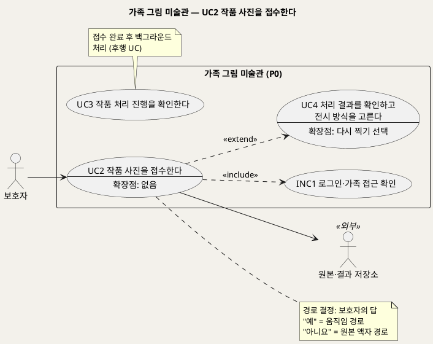
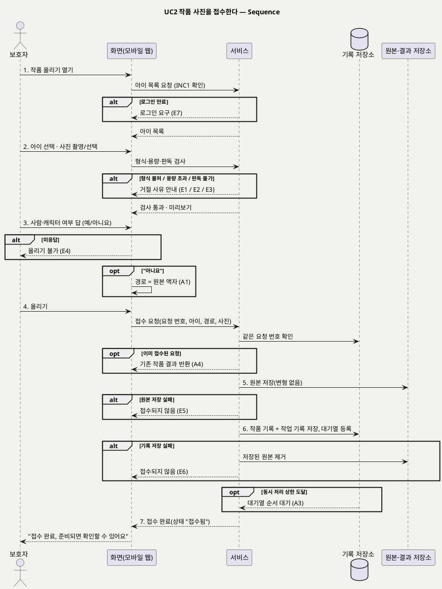

# UseCase 명세 — #2 작품 사진을 접수한다 (가족 그림 미술관 P0)
**가족 그림 미술관 · UC2 · UML 2.5.1 표준 (UseCase Diagram + UseCase 기술 + Sequence Diagram)**

---

> **문서 식별**: `design/UC_02_작품사진접수.md`
> **작성일**: 2026-09-23 · **표준**: UML 2.5.1 (OMG)
> **원천(SoT)**: `.specify/features/가족-그림-미술관/spec.md` — FR-2, FR-3, FR-6(다시 찍기), FR-15 · 보조 원천 `Intent-Specify.md` [핵심 활동] 3·4
> **다이어그램**: 모든 PlantUML 소스는 렌더 검증 완료(HTTP 200). 아래 링크로 브라우저에서 열 수 있다.

---

## 목차

1. [범위·개요](#1-범위개요)
2. [UseCase Diagram](#2-usecase-diagram)
3. [Actor 카탈로그](#3-actor-카탈로그)
4. [UseCase 목록 (원천 매핑)](#4-usecase-목록-원천-매핑)
5. [UseCase 기술 + Sequence Diagram](#5-usecase-기술--sequence-diagram)
6. [업무규칙 종합](#6-업무규칙business-rules-종합)
7. [UML 표준 준수 노트](#7-uml-표준-준수-노트)

---

## 1. 범위·개요

보호자가 휴대폰으로 찍은 그림 사진을 올리고, "사람이나 팔다리가 있는 캐릭터 그림인가요?"에 답한다. 이 답이 처리 경로를 정한다. "예"면 움직임 경로, "아니요"면 원본 액자 경로다. 시스템은 형식·용량·판독 가능 여부를 먼저 검사한다. 그다음 **원본, 작품 기록, 처리 작업 기록이 모두 저장된 경우에만** "접수 완료"로 응답한다. 이것이 **내구 접수**다. 하나라도 실패하면 접수하지 않은 것으로 보고, 일부만 저장된 흔적도 남기지 않는다.

접수 완료 뒤의 처리는 백그라운드에서 진행되며 UC3에서 다룬다. 결과 확인(UC4)에서 "다시 찍기"를 고르면 이 UC가 확장으로 다시 시작되고, 새 사진은 새 작품으로 접수된다.

| 항목 | 값 |
|---|---|
| 대상 시스템 | 가족 그림 미술관 (P0) |
| 상위 프로세스 | 아이 등록(UC1) → **작품 접수(UC2)** → 처리(UC3) → 확인(UC4) |
| 원천 근거 | spec FR-2 · FR-3 · FR-6 · FR-15 · Scenario 2, 6, 7 · Intent [핵심 활동] 3·4 |
| 핵심 UseCase | 1개 (UC2) + 공통 1개 (INC1) + 확장 관계 1개 (EXT2: UC2 ··> UC4 «extend») |
| 주요 액터 | 보호자 · 원본·결과 저장소(보조) |

---

## 2. UseCase Diagram

**[「UC2 작품 접수 UseCase Diagram」 PlantUML 뷰어로 열기](https://plantuml.sumzip.com/plantuml/svg/eNqFU19r01AUf7-f4lBftoeObd3TmGU4HPgiA_GtUO7atAtLE0lu0SFC1DAq3aDTVdttKRm6DWFgt06Xh_riR_Ex9-Q7eG6S6gaKb-Ge3zm_P-dk2RHcFs2GAc1KucYburFVrnPD0Oyt8uw8czZ18wm3eQPWeWWzbltNs7piGZYNd1YLq3P3791AOBu8aj3VzTrUuOFozNBqAoQFtl7fEFDVba0idMtkQheGBtHQxeMLiK5DeToG-SXEVhBdufDT3YfHK_OAg734bQvw1Tmeeeh7gMEetnpx90i2PzHGK4JE5OToKu6FOOjkgDuwxm3NFJMaHnbkKPxxHV0Oo9GY-l0cnOD2TgJ9RBANlpawH8pvbrHImJLHzTpJy_1L29Ta7HQOnjOApqNVuEPQ_0otmfl8yYz7XUUedBYBP2yjn4qg5puzHjxcmQN5fES86CvhqQyaFl2PQY3ww6RPAW-LWAC87MnTc0jNypMJPu72olFQMjHwsH0EcvgZ277SSK_yJPybQHpTUBzuRuEQ0Avi134md-E2a-G39ZSc7Mfv36jpE3KVQNZbYC8YSzcE-XwxMa_Sm5kpJoZgkdahmxWjWdVoH5OS8qYq2jOhmdWsoPqTDTJmWkLLTsyqZYlGl98pRpUFBl0yNDkS9Hvk7ishcthr5eAu4KGLZy9x4GU9SanryXYLD_ZTgDoiwO4x9U9AJAQUb0q-bglhNVL2Ag1Itw_Y9-THHYgPPUr9Qt2SP8aDK_lOkWSBTVGVEqPG6T9Dl-mLfshfpte2jQ==)** — 클릭 시 브라우저로 연결됩니다.

#### 다이어그램 쉽게 읽기 (유저 관점)

- **누가 쓰나** — 보호자가 사진을 올린다. 원본·결과 저장소는 원본을 보관하는 외부 구성요소다.
- **무슨 순서로** — 아이를 고르고, 사진을 올리고, "사람 그림인가요?"에 답한다. 접수가 완료되면 처리는 뒤에서(UC3) 진행되므로 화면을 떠나도 된다.
- **«include» = 항상 함께** — 사진을 올릴 때마다 "로그인·가족 접근 확인"을 거친다.
- **«extend» = 특정 상황에서만** — 결과 확인(UC4)에서 "다시 찍기"를 고를 때만 사진 접수가 다시 시작된다. 이때 이전 원본은 그대로 두고 새 작품으로 받는다.
- **Generalization(◁)** — 이 UC에는 없다. 움직임 경로와 원본 액자 경로는 UC를 나누지 않고, 같은 접수 흐름에서 경로 값만 다르게 기록한다.

| 기호 | 의미 |
|---|---|
| 사람 모양(actor) | 시스템을 쓰는 사람 또는 외부 구성요소(`<<외부>>`) |
| 타원(usecase) | 액터가 이루려는 목표. `--` 아래는 확장점 |
| 사각형(rectangle) | 시스템 경계 |
| 점선 `<<include>>` | 항상 함께 수행되는 하위 행위 |
| 점선 `<<extend>>` | 확장점 조건일 때만 기반 UC(UC4)에 끼어드는 행위 |

---

## 3. Actor 카탈로그

| 구분 | 액터 | 이 UC에서의 역할 | 원천 근거 |
|:--:|---|---|---|
| Primary | 보호자 | 아이를 고르고, 사진을 올리고, 사람·캐릭터 여부에 답한다 | spec Target Users · FR-2 · FR-3 |
| Secondary | 원본·결과 저장소 | 올린 원본을 변형 없이 보관한다. 실제 제품은 미확정 | spec Dependencies · Intent [핵심 이네이블러] 파일 |

---

## 4. UseCase 목록 (원천 매핑)

| UC ID | 유스케이스명 | 관계 | 원천 근거 |
|:--:|---|---|---|
| UC2 | 작품 사진을 접수한다 | 본 문서 | spec FR-2 · FR-3 · FR-15 |
| INC1 | 로그인·가족 접근 확인 | UC2가 «include» | spec FR-9 |
| UC4 | 처리 결과를 확인하고 전시 방식을 고른다 | UC2가 UC4를 «extend»(EXT2, 확장점: 다시 찍기 선택) | spec FR-6 "다시 찍기를 고르면 … 새 올리기가 시작된다" |
| UC3 | 작품 처리 진행을 확인한다 | 후행 | spec FR-4 |

---

## 5. UseCase 기술 + Sequence Diagram

### 5.1 UC2 작품 사진을 접수한다

> **쉽게 말하면** — 아이 그림을 휴대폰으로 찍어 올리고 "사람이나 캐릭터 그림인가요?"에 답합니다. 사진과 기록이 모두 안전하게 저장돼야 "접수 완료"가 뜹니다. 그 뒤로는 화면을 닫아도 처리가 계속됩니다.

#### 유스케이스 기술

| 속성 | 내용 |
|---|---|
| **ID** | UC2 (spec FR-2, FR-3, FR-15) |
| **유스케이스명** | 작품 사진을 접수한다 |
| **액터** | 주: 보호자 · 보조: 원본·결과 저장소 |
| **사전조건** | (1) 보호자가 로그인되어 있다(INC1). (2) 가족 공간에 아이가 1명 이상 등록되어 있다(UC1). (3) 보호자 기기에 올릴 그림 사진이 있거나 촬영할 수 있다 |
| **사후조건** | (1) 성공 시 원본이 변형 없이 저장되고, 작품 기록과 처리 작업 기록(요청 번호·경로·상태 "접수됨")이 함께 저장된다. (2) 작품이 처리 대기열에 오르고, 보호자에게 "접수 완료"가 표시된다. (3) 실패 시 원본·작품 기록·작업 기록 어느 것도 남지 않는다. (4) 어떤 경우에도 기존 작품의 원본은 덮어쓰이지 않는다 |
| **기본흐름** | ↓ 별도 기본흐름표 |
| **대체흐름** | A1. 원본 액자 경로 — 3단계에서 "아니요"를 고르면 경로를 "원본 액자"로 기록한다. 이후 흐름은 같고, UC3에서 엔진을 시도하지 않는다(spec FR-3). A2. 다시 찍기로 진입(EXT2) — UC4에서 "다시 찍기"를 고르면 이 UC가 1단계부터 시작된다. 아이는 이전 작품의 아이로 미리 선택된다. 새 사진은 새 작품·새 작업으로 접수되고, 이전 원본은 덮어쓰지 않는다(spec FR-6). [추론] 아이 미리 선택은 설계 판단이다. A3. 동시 처리 상한 도달 — 접수는 정상 완료된다. 작품은 거절되지 않고 대기열에서 순서를 기다리며, 상태는 "접수됨"으로 유지된다(spec FR-15). A4. 같은 요청의 중복 전송 — 네트워크 문제로 같은 올리기 요청이 다시 오면, 새 작품을 만들지 않고 이미 접수된 작품의 결과를 돌려준다(spec FR-2) |
| **예외흐름** | E1. 허용되지 않는 형식 — 접수 전에 거절하고 "지원하지 않는 사진 형식이에요"라고 안내한다(spec FR-2). E2. 용량 초과 — 접수 전에 거절하고 상한을 안내한다(spec FR-2, FR-15). E3. 판독 불가 — 허용 형식이지만 이미지로 열리지 않는 깨진 파일이면 "사진을 열 수 없어요"라고 안내한다(spec Edge Cases). E4. 사람·캐릭터 질문 미응답 — 답하기 전에는 올리기를 마칠 수 없다(spec FR-3). E5. 원본 저장 실패 — "접수되지 않았어요, 다시 올려 주세요"라고 안내한다. 작품 기록과 작업 기록을 만들지 않는다(spec FR-2). E6. 작품·작업 기록 저장 실패 — 이미 저장된 원본을 제거하고 E5와 같이 안내한다. 목록에 작품이 나타나지 않는다(spec Scenario 6). E7. 로그인 만료 — INC1에 따라 다시 로그인하게 하고, 접수는 이뤄지지 않는다(spec FR-9) |
| **포함/확장** | «include» INC1 로그인·가족 접근 확인 · «extend» UC4(EXT2, 확장점: 보호자가 "다시 찍기" 선택) |
| **우선순위** | High — 모든 가족 경험의 입구다. 원천 [핵심 활동] 3이 "원본·작품·작업 기록 성공 뒤에만 접수"를 핵심 활동으로 명시한다 |
| **사용빈도** | `자료 없음 — 확인 필요`. 원천은 P0 동시 사용자를 10명 이하로 가정하지만(spec Assumptions) 작품 업로드 빈도는 제시하지 않는다 |
| **업무규칙** | BR-INT-01, BR-INT-02, BR-INT-03, BR-INT-04, BR-INT-05, BR-PRC-07, BR-APR-03, BR-ACC-01, BR-PRV-01 |
| **특별 요구사항** | 허용 형식·용량 기본값: JPEG·PNG·HEIC, 한 장 20MB 이하. 계획 단계에서 조정할 수 있다(spec Assumptions). 신뢰성: 접수 완료된 작품은 서버 재시작이나 처리 담당 실패에도 사라지지 않고 최종 상태에 도달한다(spec FR-2). 응답성: 접수 완료 응답은 엔진 처리를 기다리지 않는다(spec FR-4). 사용성: 질문 옆에 사람·캐릭터 예시와 동물·사물·풍경 예시를 보여 준다(spec FR-3). 개인정보: 운영 로그에 이미지·저장 위치 키를 남기지 않는다(spec FR-14) |
| **비고** | 원천 추적: spec FR-2(수용기준 5개: 사전 거절 / 부분 저장 금지 / 접수 후 소실 금지 / 중복 전송 1건 / 원본 불변) · FR-3(질문 필수 / "아니요" 엔진 미시도 / 예시 안내) · FR-6 다시 찍기 · FR-15 대기열 · Scenario 2, 6, 7 · Edge Cases "허용 형식이지만 깨진 파일", "같은 요청의 중복 전송", "동시 처리 상한 도달" · Intent [핵심 활동] 3 "입력 형식·용량·디코딩을 검사하고 원본·작품·작업 기록 성공 뒤에만 접수한다", 4 "부모의 사람/캐릭터 답으로 경로를 정한다". 원본 액자 경로가 엔진 없이 동작하는 것은 UC3에서 검증한다 |

#### 기본흐름 (Basic Flow)

| 단계 | 액터 행위 | 시스템 행위 |
|:--:|---|---|
| 1 | 보호자가 "작품 올리기"를 연다 | INC1로 로그인과 가족 공간을 확인하고, 등록된 아이 목록을 보여 준다 |
| 2 | 보호자가 아이를 고르고 사진을 찍거나 기기에서 고른다 | 사진의 형식·용량·판독 가능 여부를 검사하고, 통과하면 미리보기를 보여 준다 |
| 3 | 보호자가 "사람이나 캐릭터 그림인가요?"에 예/아니요로 답한다 | 예시 안내를 함께 보여 주고, 답을 처리 경로(움직임/원본 액자)로 정한다 |
| 4 | 보호자가 "올리기"를 누른다 | 요청 번호로 같은 요청이 이미 접수됐는지 확인한다 |
| 5 | — | 원본을 원본·결과 저장소에 변형 없이 저장한다 |
| 6 | — | 작품 기록과 처리 작업 기록(요청 번호·경로·상태 "접수됨")을 함께 저장하고 처리 대기열에 올린다 |
| 7 | 보호자가 "접수 완료" 안내를 확인하고, 화면을 떠나거나 계속 머문다 | "접수 완료, 준비되면 확인할 수 있어요"를 표시하고 작품 목록에 "접수됨" 상태로 보여 준다 |

#### Sequence Diagram

**[「UC2 작품 접수 Sequence」 PlantUML 뷰어로 열기](https://plantuml.sumzip.com/plantuml/svg/eNqNVU1PE1EU3c-vuKmbNkKxIJKYaBDExI0xIbglI4zYUFpohxh3o1Qy0iYUpTLFtkJEvlJjKYUWoxt-isu-O__BMzOvLVNcuGkz886995x7z30zmtLVpL68EKOUtjT9Ql2Ixl5Pz6mxmJZ8PX1rUEnNR-OLalJdoOfqzPxcMrEcnx1PxBJJuvFo6FFkYuwKIvVSnU28isbn6IUaS2mKHtVjGk2NDxKXN-wPJvHbCh-kuZQm3tlg07LzRZHZoz_GJk1qS8tafEZTFHVGR_aAOK3bVpPLuQCpKXqqJrW4rqCOHp2JLqpxnQJ2YVMc1YPi-FBUN7n0i_jzRchFTz32IzldFBdpXttzTyefjSuzqq4-V1MaBVrNqtgtgZDB5W-8mnUhD8d6EnzOidPmZaNVq7ZOf_WAJ8EXvD2K1H8f5ekuRcId1VZF7FdQh3irjj8F50CBBmCcRz_qJI6PXBbbm1z7TsHHT8YjZBfyXGqGFDWmk9gtthpNPJI4yIqvWYXc-P52te45UrTOKhScGAkpWnxW8cF81a5RHgy3AZzesVdKdNmQIyOuV9h6M-C99wmwrTxnSpcN3j4SX95fNuxsTqy_o1bNQKjL3UOQODftLZMGyEMipen0coBkBM5bVaNXWOukyjuec4o7oGeKt3WIiyBuYtD5GfqHTK842atnTgWoED-aGAEs5bS_V_ZQ2EkvylmI-JkT-9_ttDOqijg3SGTOKMiWOYDGiIyJ5sp5_ECzN3AKvk43kEtmvXtl3p4k0L3tkUwsOl5qZwrI2A7p35gi3SPPbNC6C_dT8EHEC-6lfTvcreS3lLtb0ktBaSlRM7FOfXLAfbJan5xvyOvffRjfYVItcMkgX6R0oysBCaBf1hG5okReG12zyrv19hbI1RFVyy5YUCVb0i7sLhGChsMd_e6SBcWpAQNhHqtcynrN9wGIM3t29rC3eJucxQdQkl9DMOYw7C_qqr3TWVR5Fdx0nnnrHfmuhj4SWcORtIX9-Xji7I_DxYfp4dJV5R27rWpzL8LZ_0f6Ttc8Yr3AGSSpWZg78cob3KB4CUNVkAty-jsu6LJls4gLUL5A54euNqFdeiTc8U0hjQsm6CRfKcKuktNhIKT0Oj3gC4GZ9gzcs-CPe1kaxs5jax1I2eRPddf1o6iOD85ffiQXAg==)** — 클릭 시 브라우저로 연결됩니다.

기본흐름 1~7단계는 시퀀스의 번호 붙은 주요 메시지 `1.`~`7.`과 1:1로 대응한다.

---

## 6. 업무규칙(Business Rules) 종합

| BR ID | 규칙 | 적용 UC | 근거 |
|---|---|---|---|
| BR-INT-01 | 형식·용량·판독 검사를 통과한 사진만 접수한다. 실패하면 사유(형식/용량/판독 불가)를 안내한다 | UC2 | spec FR-2 수용기준 1 · Intent [핵심 활동] 3 |
| BR-INT-02 | 원본·작품 기록·작업 기록이 모두 저장에 성공해야 "접수 완료"다. 하나라도 실패하면 일부 저장분까지 제거하고 미접수로 처리한다 | UC2 | spec FR-2 수용기준 2 · Scenario 6 · Intent [핵심 활동] 3 |
| BR-INT-03 | 같은 올리기 요청이 중복 전송되어도 작품은 하나만 생긴다 | UC2 | spec FR-2 수용기준 4 |
| BR-INT-04 | 원본은 올린 그대로 보존한다. 어떤 후속 처리도 원본을 덮어쓰거나 변형하지 않는다 | UC2, UC3, UC4 | spec FR-2 수용기준 5 · Constraints 원본 불변 |
| BR-INT-05 | 사람·캐릭터 질문에 답해야 올리기를 마칠 수 있다. "예"는 움직임 경로, "아니요"는 원본 액자 경로다 | UC2, UC3 | spec FR-3 · Intent [핵심 활동] 4 |
| BR-PRC-07 | 동시 처리 상한에 도달해도 새 작품은 거절하지 않고 대기열에서 순서를 기다린다 | UC2, UC3 | spec FR-15 |
| BR-APR-03 | 결과물은 처음 만든 것을 보관하고, 같은 원본으로 다시 만들지 않는다. 다시 찍기는 새 작품·새 작업이다 | UC2, UC4 | spec FR-6 · Intent [핵심 데이터] "결과물은 처음 만든 것을 보관하고 다시 만들지 않는다" |
| BR-ACC-01 | 가족 공간의 아이·작품·원본·결과·이야기는 해당 가족만 조회할 수 있다 | UC1~UC7 | spec FR-9 |
| BR-PRV-01 | 운영 로그에는 이미지, 저장 위치 키, 자유 입력 텍스트, 오류 원문을 남기지 않는다 | 전 UC | spec FR-14 |

---

## 7. UML 표준 준수 노트

| 항목 | 적용 |
|---|---|
| 액터 | 원본·결과 저장소는 시스템이 기대는 외부 구성요소라서 Secondary actor(`<<외부>>`)로 경계 밖에 뒀다 |
| «extend» | UC2 → UC4. 확장 UC(UC2)가 기반 UC(UC4)의 확장점 "다시 찍기 선택"에서 끼어든다. 화살표는 확장 UC에서 기반 UC로 향한다 |
| 확장점 표기 | 기반 UC 타원 안 `--` 아래에 확장점 이름을 적었다 |
| 경로 분기 | 움직임/원본 액자는 같은 목표(접수)의 변형이라 UC를 나누지 않았다. 대체흐름 A1로 표현했다 |
| Sequence | 원본·결과 저장소를 별도 participant로 분리했다. 예외는 `alt`, 선택적 경로는 `opt`에 E·A 번호를 붙였다 |

---

*가족 그림 미술관 P0 · UC2 · 2026-09-23 · 원천: spec.md FR-2, FR-3, FR-6, FR-15*
