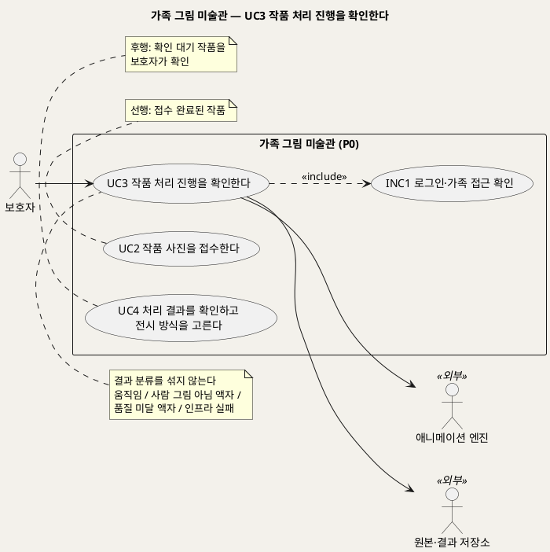
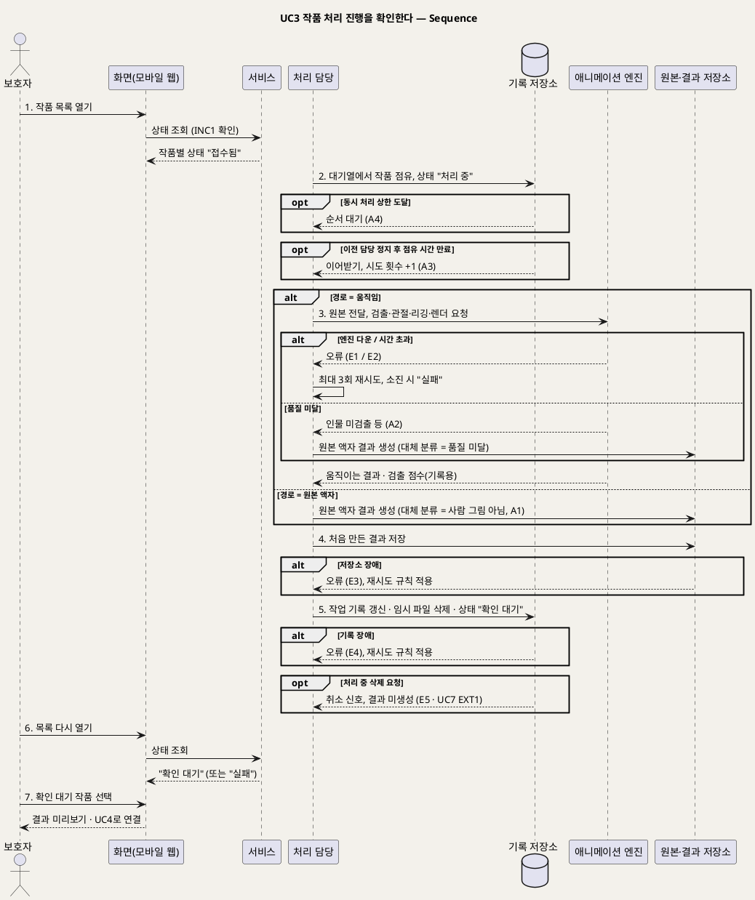

# UseCase 명세 — #3 작품 처리 진행을 확인한다 (가족 그림 미술관 P0)
**가족 그림 미술관 · UC3 · UML 2.5.1 표준 (UseCase Diagram + UseCase 기술 + Sequence Diagram)**

---

> **문서 식별**: `design/UC_03_처리진행확인.md`
> **작성일**: 2026-09-23 · **표준**: UML 2.5.1 (OMG)
> **원천(SoT)**: `.specify/features/가족-그림-미술관/spec.md` — FR-4, FR-5, FR-11, FR-15 · 보조 원천 `Intent-Specify.md` [핵심 활동] 3·4 · [핵심 장벽] 품질·인프라
> **다이어그램**: 모든 PlantUML 소스는 렌더 검증 완료(HTTP 200). 아래 링크로 브라우저에서 열 수 있다.

---

## 목차

1. [범위·개요](#1-범위개요)
2. [UseCase Diagram](#2-usecase-diagram)
3. [Actor 카탈로그](#3-actor-카탈로그)
4. [UseCase 목록 (원천 매핑)](#4-usecase-목록-원천-매핑)
5. [UseCase 기술 + Sequence Diagram](#5-usecase-기술--sequence-diagram)
6. [업무규칙 종합](#6-업무규칙business-rules-종합)
7. [UML 표준 준수 노트](#7-uml-표준-준수-노트)

---

## 1. 범위·개요

접수된 작품은 올리기 요청과 분리되어 백그라운드의 **처리 담당**이 처리한다. 보호자는 기다리지 않고 화면을 떠나도 되며, 나중에 작품 목록에서 진행 상태를 확인한다. 이 UC의 목표는 "내 작품이 어떻게 되고 있는지 알고, 준비되면 확인하러 가는 것"이다.

처리 결과는 네 가지로 나뉘며 **서로 섞이지 않게** 기록한다. 이 분리가 이 UC의 핵심 규칙이다(spec FR-5).

| 결과 | 조건 | 기록 |
|---|---|---|
| 움직이는 작품 | 엔진이 정상 결과를 만듦 | 결과 종류 = 움직임 |
| 원본 액자(정상) | 보호자가 "아니요"로 답함, 엔진 미시도 | 대체 분류 = 사람 그림 아님 |
| 원본 액자(품질 대체) | 엔진 결과가 품질 기준 미달, 재시도 없음 | 대체 분류 = 품질 미달 |
| 실패 | 인프라 장애가 제한 재시도 후에도 계속됨 | 오류 분류 = 엔진 다운 / 시간 초과 / 저장소 / 기록(DB) |

| 항목 | 값 |
|---|---|
| 대상 시스템 | 가족 그림 미술관 (P0) |
| 상위 프로세스 | 작품 접수(UC2) → **처리·상태 확인(UC3)** → 결과 확인(UC4) |
| 원천 근거 | spec FR-4 · FR-5 · FR-11 · FR-15 · Scenario 2, 4, 5 · Intent [핵심 활동] 3·4 · [핵심 장벽] |
| 핵심 UseCase | 1개 (UC3) + 공통 1개 (INC1) |
| 주요 액터 | 보호자 · 애니메이션 엔진(보조) · 원본·결과 저장소(보조) |

---

## 2. UseCase Diagram

**[「UC3 처리 진행 UseCase Diagram」 PlantUML 뷰어로 열기](https://plantuml.sumzip.com/plantuml/svg/eNqNU01r20AUvO-veLiX9pDvnEIwoSaBXkqg9FYIG1t2RGQpSGtKKAW1qMWNfHCK3TrENjKN4wYCdeOQ6OBTf0qP2uf_0LeS4sSHlt4k7czOvJmnDUdwW1TKBlTyO0Ve1o3DnRI3DM0-3FlcYc6-bh5wm5dhl-f3S7ZVMQs5y7BseLS1srW0-fQBwtnjBeu1bpagyA1HY4ZWFCAssPXSnoCCbmt5oVsmE7owNIiGLvZ-QnQbyvMxyB8hVoPo2oXfbgNe5lYAu8eTz1XAq5Y8vwQceJMvn7DjweSkiZ1w0mxL_4wxnhfkJSNH15NWiN16BrgD29zWTHF3hs1A-lV50cDONX5oAX5t0G0xcNMs6aYG6-t4EsobN5udck7rchT-uo2uhtFoDBi42O3jx1rMekGQGRJTk3GzRFNl_jbW4-3FJxl4wwAqjpbnDkH_d8pYlMAPuc-e55ZA9tqkQzgymshicBzdjlN2zFPAWdHlqej7SxJUakTDamtGbXmWtHpnMUlE9sdTi61oFLwyMfDQb4McXqDfUXfSV9kP7y9cZW8ZS5qBublsPJBKYH4-G5uENYpUN_NGpaBRpupIwZKKpq9x9oyZltBotQ7AKqbJpE3JG0_2W8oeel0cuIDNI3nUULsCgKcuDt5h14MFNbzs1u56wqYnfVqNZo92CBYISwHhoKoKlP7l9ADUxA1Pdojin01q35lmFkC5SSztWkJY5cSVShC9gApdSwMGPPHkt5qst9MK_sFeVR5OvZidJA2y5kbhMKVSxISY7j31n8Lu79ygJ_qx_wDeSN5C)** — 클릭 시 브라우저로 연결됩니다.

#### 다이어그램 쉽게 읽기 (유저 관점)

- **누가 쓰나** — 보호자가 작품 목록에서 진행 상태를 본다. 애니메이션 엔진은 그림을 움직이게 만드는 외부 구성요소이고, 원본·결과 저장소는 파일을 보관한다.
- **무슨 순서로** — 사진을 올린 뒤(UC2) 뒤에서 처리가 진행된다. 상태가 "확인 대기"로 바뀌면 보호자가 결과를 확인하러 간다(UC4).
- **«include» = 항상 함께** — 상태를 볼 때마다 "로그인·가족 접근 확인"을 거친다. 내 가족의 작품만 보인다.
- **«extend» = 특정 상황에서만** — 이 UC에는 확장 관계가 없다. 처리 중에 삭제하는 경우는 UC7의 "실행 중 처리 취소"가 맡는다.
- **Generalization(◁)** — 없다. 네 가지 결과는 UC를 나누지 않고 흐름 안에서 갈라진다.

| 기호 | 의미 |
|---|---|
| 사람 모양(actor) | 시스템을 쓰는 사람 또는 외부 구성요소(`<<외부>>`) |
| 타원(usecase) | 액터가 이루려는 목표 |
| 사각형(rectangle) | 시스템 경계 |
| 점선 `<<include>>` | 항상 함께 수행되는 하위 행위 |
| 노트 | 규칙·선후 관계 보충 |

---

## 3. Actor 카탈로그

| 구분 | 액터 | 이 UC에서의 역할 | 원천 근거 |
|:--:|---|---|---|
| Primary | 보호자 | 작품별 진행 상태를 확인하고, 확인 대기 작품을 골라 결과 확인(UC4)으로 간다 | spec FR-4 |
| Secondary | 애니메이션 엔진 | 움직임 경로 작품의 검출·관절 추정·리깅·렌더를 수행한다. Meta Animated Drawings(MIT, 2025-09-03 보관 처리), 모델 실행 구성요소는 TorchServe(2025-08-07 보관 처리). 내부 네트워크로 격리 | spec Dependencies · FR-14 · FR-16 |
| Secondary | 원본·결과 저장소 | 원본을 제공하고, 처음 만든 결과와 임시 파일을 보관한다 | spec Dependencies |

[추론] "처리 담당"(백그라운드 작업자)은 시스템 내부 구성요소라서 액터가 아니다. 시퀀스에서만 lifeline으로 나타낸다.

---

## 4. UseCase 목록 (원천 매핑)

| UC ID | 유스케이스명 | 관계 | 원천 근거 |
|:--:|---|---|---|
| UC3 | 작품 처리 진행을 확인한다 | 본 문서 | spec FR-4 · FR-5 · FR-11 · FR-15 |
| INC1 | 로그인·가족 접근 확인 | UC3가 «include» | spec FR-9 |
| UC2 | 작품 사진을 접수한다 | 선행 | spec FR-2 |
| UC4 | 처리 결과를 확인하고 전시 방식을 고른다 | 후행 | spec FR-6 |

---

## 5. UseCase 기술 + Sequence Diagram

### 5.1 UC3 작품 처리 진행을 확인한다

> **쉽게 말하면** — 사진을 올린 뒤 기다릴 필요 없이 다른 일을 해도 됩니다. 나중에 목록을 열면 "처리 중", "확인 대기", "처리하지 못했어요" 같은 상태가 보입니다. 움직이게 만들 수 없는 그림은 원본 액자로 준비되고, 서버 문제는 몇 번 다시 시도한 뒤에도 안 되면 솔직하게 알려 줍니다.

#### 유스케이스 기술

| 속성 | 내용 |
|---|---|
| **ID** | UC3 (spec FR-4, FR-5, FR-11, FR-15) |
| **유스케이스명** | 작품 처리 진행을 확인한다 |
| **액터** | 주: 보호자 · 보조: 애니메이션 엔진, 원본·결과 저장소 |
| **사전조건** | (1) 보호자가 로그인되어 있다(INC1). (2) UC2에서 접수 완료된 작품이 1건 이상 있고, 작업 기록에 경로(움직임/원본 액자)가 정해져 있다. (3) 원본이 원본·결과 저장소에 저장되어 있다 |
| **사후조건** | (1) 작품이 "확인 대기" 또는 "실패" 중 하나의 최종 처리 상태에 도달한다. (2) 작업 기록에 결과 종류, 대체 분류 또는 오류 분류, 진단 이유(정해진 코드), 엔진 검출 점수(기록용), 단계별 소요 시간, 시도 횟수, 엔진 버전이 남는다. (3) 결과물은 처음 만든 것 하나만 저장된다. (4) 처리 중 생긴 임시 파일이 남아 있지 않다. (5) 원본은 변형되지 않았다. (6) 작품은 아직 전시되지 않았다 |
| **기본흐름** | ↓ 별도 기본흐름표 (움직임 경로의 정상 결과 기준) |
| **대체흐름** | A1. 원본 액자 경로 — 경로가 "원본 액자"면 3~4단계에서 엔진을 부르지 않는다. 원본으로 액자 결과를 만들고 대체 분류를 "사람 그림 아님"으로 기록한다. 엔진이 멈춘 상태에서도 이 경로는 확인 대기까지 진행된다(spec FR-3, Scenario 2). A2. 모델 품질 미달 — 엔진이 인물을 찾지 못하거나 관절 추정·렌더 결과가 없으면, 재시도하지 않고 원본 액자로 대체한다. 대체 분류는 "품질 미달"이고 오류 분류는 비운다. 보호자에게 "움직임을 만들 수 없어 액자로 준비했어요"라고 안내한다(spec FR-5, Scenario 4). A3. 처리 담당 중도 정지 — 담당이 멈추면 정해진 점유 시간이 지난 뒤 다른 담당이 이어받는다. 이어받기도 시도 횟수에 포함하고, 상한을 넘으면 실패로 처리한다(spec FR-4, Edge Cases). A4. 대기열 대기 — 동시 처리 상한에 도달하면 작품은 "접수됨" 상태로 순서를 기다린다. 대기 시간도 미리보기 시간 p95에 포함한다(spec FR-15, Edge Cases). A5. 보호자 부재 — 보호자가 화면을 떠나 있어도 처리는 계속된다. 다음에 목록을 열 때 바뀐 상태가 보인다(spec FR-4) |
| **예외흐름** | 공통 규칙: 인프라 장애는 "품질 미달"로 바꾸지 않는다. 작품당 최대 3회까지 시도하며 시도 사이 간격을 점점 늘린다. 재시도를 다 쓰면 상태를 "실패"로 바꾸고 보호자에게 "처리하지 못했어요"와 UC4의 선택지(액자로 걸기 / 다시 찍기)를 보여 준다. 해당 건은 결과 미도달로 집계한다(spec FR-5, Assumptions, Scenario 5). E1. 엔진 다운 — 엔진이 응답하지 않는다. 오류 분류 = 엔진 다운. E2. 시간 초과 — 작업당 처리 시간 상한(기본 10분)을 넘긴다. 오류 분류 = 시간 초과(spec FR-15, Assumptions). E3. 저장소 장애 — 원본을 읽거나 결과를 쓸 수 없다. 오류 분류 = 저장소. 원본까지 읽을 수 없으면 UC4에서 "액자로 걸기"를 비활성화한다(spec Edge Cases). E4. 기록 장애 — 작업 기록을 갱신할 수 없다. 오류 분류 = 기록(DB). E5. 처리 중 삭제 요청 — 보호자가 UC7로 작품을 삭제하면 이 처리는 EXT1(실행 중 처리 취소)에 따라 멈추고, 이후 결과 파일을 만들지 않는다(spec FR-10). E6. 임시 파일 잔존 — 처리 담당이 비정상 종료해 남은 임시 파일은 다음 정리 주기에 지운다(spec FR-11) |
| **포함/확장** | «include» INC1 로그인·가족 접근 확인 |
| **우선순위** | High — 품질 미달과 인프라 실패의 분리가 서비스 팀의 개선 우선순위와 결과 미도달 추적의 기반이다(spec Business Value · Intent [가치제안] "정상 액자와 품질 미달, 인프라 실패를 섞지 않는다") |
| **사용빈도** | 접수 1건당 처리 1회. 상태 확인 빈도는 `자료 없음 — 확인 필요` |
| **업무규칙** | BR-INT-04, BR-INT-05, BR-PRC-01, BR-PRC-02, BR-PRC-03, BR-PRC-04, BR-PRC-05, BR-PRC-06, BR-PRC-07, BR-PRC-08, BR-APR-01, BR-APR-03, BR-ENG-01, BR-ENG-02, BR-PRV-01 |
| **특별 요구사항** | 성능(잠정 검증 목표): 팀 서버 단일 처리 조건에서 접수부터 확인 대기까지 p95 3분 이내. 원본 액자 경로는 p95 30초 이내(spec Success Criteria). 1차 개인 PC 실측은 CPU 4코어·메모리 3.8GB·그래픽 카드 없이 한 장 53~62초(렌더 약 40초), 모델 서버 약 3.1GB였다(Intent [핵심 장벽] 인프라). 신뢰성: 결과 미도달 0건이 목표다. 보안: 엔진은 외부 네트워크에서 직접 접근할 수 없고, 관리 기능과 외부 포트를 닫은 고정 실행 환경에서 돈다(spec FR-14, FR-16). 품질: 엔진 검출 점수는 기록만 하고 승인 근거로 쓰지 않는다. 1차 시험에서 집 그림이 사람 점수 0.946(사람 그림 0.997)으로 잡혀 벽에 관절이 붙은 사례가 있다(Intent [핵심 장벽] 적용 범위·품질) |
| **비고** | 원천 추적: spec FR-4(수용기준 4개: 즉시 응답 / 상태 전이 / 중복 처리 금지·이어받기 / 상태 반영) · FR-5(표 4행과 수용기준 5개 전부) · FR-11(임시 파일 정리 2개) · FR-15(시간 상한·대기열) · Scenario 2, 4, 5 · Edge Cases "처리 담당의 중도 정지", "엔진만 멈춘 상태", "엔진이 사람 점수는 높지만 사람이 아닌 그림" · Intent [핵심 활동] 3 "워커가 별도로 처리하고 상태를 조회할 수 있게 한다", 4 "비인물·모델 품질 미달은 원본 액자, 인프라 장애는 제한 재시도·실패로 분리". 오인 움직임(사물을 사람으로 처리)은 시스템이 판정할 수 없어 예외로 두지 않았다. 이는 UC4의 부모 확인이 거른다. 품질 미달 판정 기준(임계값)은 `자료 없음 — 확인 필요`이며, 계획 단계에서 평가 그림 세트(UC9)로 정한다(spec Assumptions) |

#### 기본흐름 (Basic Flow)

| 단계 | 액터 행위 | 시스템 행위 |
|:--:|---|---|
| 1 | 보호자가 작품 목록을 연다 | INC1로 로그인과 가족 공간을 확인하고, 작품별 상태("접수됨")를 보여 준다 |
| 2 | — | 처리 담당이 대기열에서 작품 하나를 점유하고(다른 담당과 중복 처리 금지) 상태를 "처리 중"으로 바꾼다 |
| 3 | — | 경로가 "움직임"이므로 원본을 애니메이션 엔진에 보내 검출·관절 추정·리깅·렌더를 요청한다(시간 상한 적용) |
| 4 | — | 엔진 결과가 정상이면 처음 만든 움직이는 결과를 원본·결과 저장소에 저장한다. 검출 점수는 기록만 한다 |
| 5 | — | 작업 기록에 결과 종류·단계별 시간·시도 횟수·엔진 버전을 남기고, 임시 파일을 지우고, 상태를 "확인 대기"로 바꾼다 |
| 6 | 보호자가 목록을 다시 연다 | 바뀐 상태 "확인 대기"를 보여 준다 |
| 7 | 보호자가 확인 대기 작품을 고른다 | 결과 미리보기와 함께 결과 확인 화면(UC4)으로 연결한다 |

#### Sequence Diagram

**[「UC3 처리 진행 Sequence」 PlantUML 뷰어로 열기](https://plantuml.sumzip.com/plantuml/svg/eNqlVVFv2mYUffevuPJeQKNslHSVKnVqQ6nUl2lSlm1vkZu4GQqBFBxNfSONU7Ha08gKhRCbORotSUU1SrwCUvaSn7JHvuv_sPt9tiFAqz7syZJ97r3n3Hvu9Z2iphS03e0sFNXHa4-U7Uz2ydqmks2qhSdrXyal4lYmt6MUlG14qKxvbRbyu7mNVD6bL8Bn95P3E-nlK4jiT8pG_udMbhMeKdmiKmkZLavCaioJ2Dr0fi8D9hvsdRewo3svf0FbB--ohvbQq1nMaMO_pSqsqI931dy6KknKukZFZHbueo0htioyKEX4VimoOU2iclpmPbOj5DSQvaMqO3Mj7M0p61XRvgA8HkUFevXBLBJ1i410fN4WX1e-T8199tkxw2XGSEB-yBe21IK0oWjKQ6Wogjwe9tiJDeiUsPUKn5kCdW95Lk_NYUaZnREZFw8agPUqKRbQdG4zk1Pn4McVdj68HIz7vfH5xVzuFWoCNcPXDde-Jk1wCxLxsKPszZkgVHeJmkQfCULCCIP7e96-BXjS85omRB58k0oE7Y5KHHEtTOZnYud6GCKjc4jlBqucypLkt4CnvbdM4OtxYGaJalFFrFeoo5PZOhW0nNg0STDr9qEs5Xc0YL8doWFNLEComkUvdWZ0JeDJOaGgGpEqWzy3Xwsid5eikprbEIl4Vx09GBOVrWGnBN6xHjAAqjLu0feOyf40P5Sa4l-6rHdMmWMcTSTAa_5BkuHzBNVK-rUkJavBuP8PO7HgNpmqhJ09bOmUcdoTf56UNEkTEXMkFlxSjCJL-N6isboldMqXA1I9Hh3Q0zHZr1XAZhX7bykZr-I7hCS1senCF6EEdMvkCMJAWGhWSKPNXjUgkk5QSPp6VACn3Ka4vy3qIyS5D7DV9RWT8mcmL8qHIqPR9kwaN4BKiws0T-yQuf4a-tP5SH17yLoXHOVrBfbiHbVvgYjwMMcHDaqd0DpDaPd9G3UKI4bYd4G917mm27MUeEY-ko_w8Edju-x5NUx7OQgGIFxRbkT8zcXmGQ2XS7wy2CuspP_NG592WcuE8WDIXhOqRmZoxOBuIvDUYvalON8JtE3h2BcOzNwBYcLJSQD-qDnE0o_-sB2S0dh0zsTEwtER5dgj8fMkxE7fENcE6wcQnLdx7x0aDu8h-Z37wzNNcVifvkXHEu-DJfcPSrCmsr8xwYkMmS6sX0hz6RM0xa5PjkhYfLI3C3kHp6JDhkP_i1jYRfJPOKn0Dc58NXUT0j9-F85j7rB-FQ8vKt9Ffq4-cVhnT-lcP8gdjQo3Zbhf0YWCN-MwEzO5prrj7duiLkGDoFtXVFFb6NfII4SoJW5mrPcIIN0hZfRD_w-wVMhJ)** — 클릭 시 브라우저로 연결됩니다.

기본흐름 1~7단계는 시퀀스의 번호 붙은 주요 메시지 `1.`~`7.`과 1:1로 대응한다. 대체흐름 A1·A2와 예외흐름 E1~E5는 `alt`/`opt` 프래그먼트로 표시했다. E6(임시 파일 주기 정리)은 이 요청 흐름 밖의 주기 작업이라 시퀀스에 넣지 않았다.

---

## 6. 업무규칙(Business Rules) 종합

| BR ID | 규칙 | 적용 UC | 근거 |
|---|---|---|---|
| BR-INT-04 | 원본은 올린 그대로 보존하고, 어떤 후속 처리도 덮어쓰거나 변형하지 않는다 | UC2, UC3, UC4 | spec FR-2 · Constraints |
| BR-INT-05 | "예"는 움직임 경로, "아니요"는 원본 액자 경로다 | UC2, UC3 | spec FR-3 |
| BR-PRC-01 | "아니요"로 답한 작품은 엔진을 한 번도 거치지 않는다. 원본 액자 경로는 엔진 없이 동작한다 | UC3 | spec FR-3 수용기준 2·3 |
| BR-PRC-02 | 모델 품질 미달은 재시도하지 않고 곧바로 원본 액자로 대체한다 | UC3 | spec FR-5 수용기준 2 |
| BR-PRC-03 | 인프라 장애는 품질 미달로 바꾸지 않는다. 작품당 최대 3회 시도(간격 증가) 뒤 실패로 알리고 결과 미도달로 집계한다 | UC3, UC8 | spec FR-5 수용기준 1·3 · Assumptions 재시도 기본값 |
| BR-PRC-04 | 엔진 검출 점수는 기록만 하고 자동 전시나 승인의 근거로 쓰지 않는다 | UC3, UC4 | spec FR-5 수용기준 5 · Intent [핵심 장벽] 0.946 사례 |
| BR-PRC-05 | 한 작품을 두 처리 담당이 동시에 처리하지 않는다. 담당이 멈추면 점유 시간 만료 뒤 다른 담당이 이어받고, 이어받기도 시도 횟수에 포함한다 | UC3 | spec FR-4 수용기준 3 · Edge Cases |
| BR-PRC-06 | 작업당 처리 시간 상한(기본 10분)을 넘기면 "시간 초과"로 분류하고 재시도 규칙을 따른다 | UC3 | spec FR-15 · Assumptions |
| BR-PRC-07 | 동시 처리 상한에 도달하면 새 작품은 대기열에서 순서를 기다린다 | UC2, UC3 | spec FR-15 |
| BR-PRC-08 | 처리가 끝나면(성공·품질 대체·실패·취소) 임시 파일을 지우고, 비정상 종료로 남은 임시 파일은 주기적으로 정리한다 | UC3, UC7 | spec FR-11 |
| BR-APR-01 | 보호자 승인 전에는 어떤 결과도 전시하지 않는다 | UC3, UC4, UC6 | spec FR-6 · Constraints |
| BR-APR-03 | 결과물은 처음 만든 것을 보관하고 다시 만들지 않는다 | UC2, UC3, UC4 | spec FR-6 · Intent [핵심 데이터] |
| BR-ENG-01 | 엔진은 외부 네트워크에서 직접 접근할 수 없고, 관리 기능·외부 포트를 닫은 고정 실행 환경으로 격리한다 | UC3, UC9 | spec FR-14 · FR-16 · Intent [핵심 장벽] 서빙 의존성 |
| BR-ENG-02 | 처리 작업마다 엔진 버전을 기록한다 | UC3, UC9 | spec FR-16 |
| BR-PRV-01 | 운영 로그에는 이미지, 저장 위치 키, 자유 입력, 오류 원문을 남기지 않는다. 분류 코드와 요청 번호만 남긴다 | 전 UC | spec FR-14 |

---

## 7. UML 표준 준수 노트

| 항목 | 적용 |
|---|---|
| 주액터 선정 | 처리 자체는 시스템이 수행한다. 하지만 이 UC가 달성하는 액터 목표는 보호자의 "진행 확인"이라서 보호자를 주액터로 뒀다. 기본흐름 1·6·7단계에 액터 행위가 있다 |
| 외부 구성요소 | 애니메이션 엔진과 원본·결과 저장소는 Secondary actor(`<<외부>>`)로 경계 밖에 뒀다. 시퀀스에서도 별도 participant로 분리했다 |
| 내부 구성요소 | 처리 담당은 액터가 아니라 시스템 내부 lifeline으로만 표현했다 |
| 분기 | 경로(움직임/원본 액자)는 `alt`, 품질 미달과 인프라 장애는 중첩 `alt`, 조건부 상황은 `opt`로 표현하고 A·E 번호를 붙였다 |
| 최종 상태 | 사후조건에 "확인 대기 또는 실패"라는 두 최종 처리 상태를 명시했다(spec FR-2 "최종 상태에 도달") |

---

*가족 그림 미술관 P0 · UC3 · 2026-09-23 · 원천: spec.md FR-4, FR-5, FR-11, FR-15*
