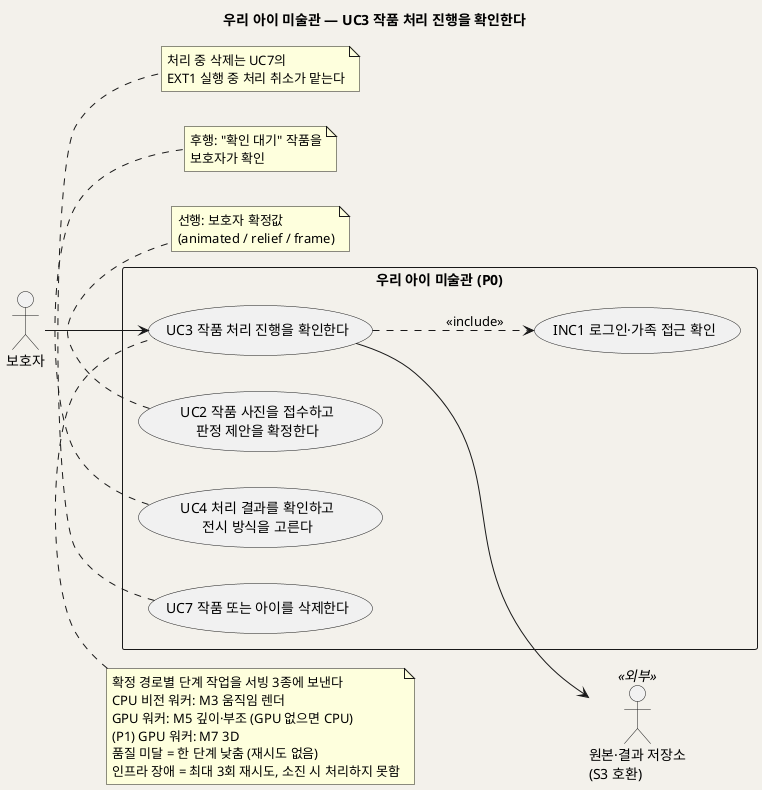
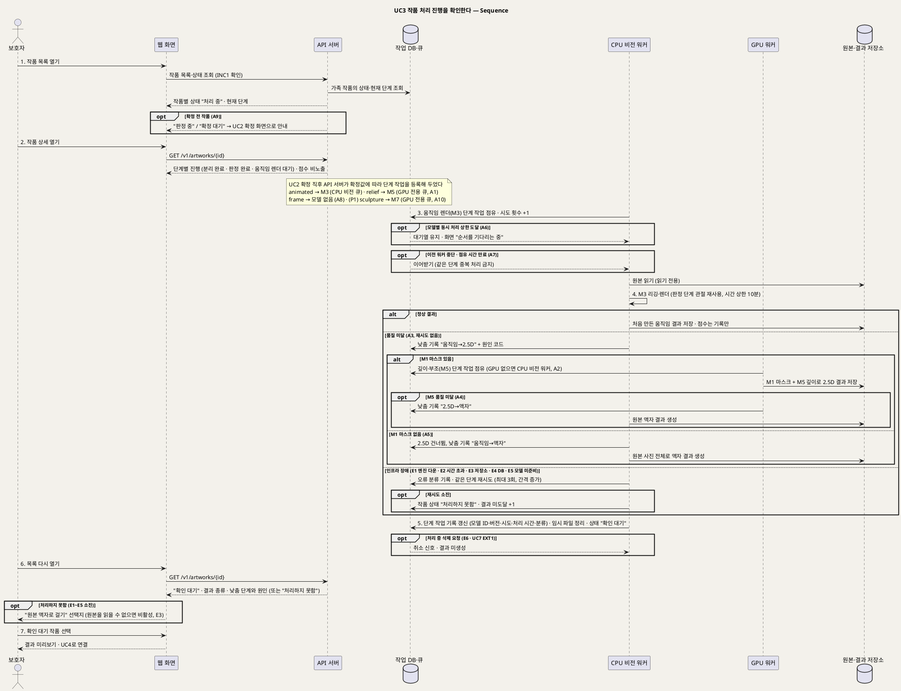

# UseCase 명세 — #3 작품 처리 진행을 확인한다 (우리 아이 미술관 P0)
**우리 아이 미술관 · UC3 · UML 2.5.1 표준 (UseCase Diagram + UseCase 기술 + Sequence Diagram)**

---

> **문서 식별**: `design/UC_03_처리진행확인.md`
> **작성일**: 2026-09-23 · **개정**: 2026-09-28 — 모델 조합 기준으로 다시 씀. 확정 경로별 단계 작업(M3·M5·(P1) M7)과 서빙 3종, 낮춤 체인(움직임→2.5D→액자), 인프라 재시도 분리, 단계 작업 응답 ↔ 작업 기록 분류 대응표를 넣었다. 옛 UC10(모델 API 변환)의 워커↔모델 호출 내용을 이 문서로 흡수했다 · **표준**: UML 2.5.1 (OMG)
> **원천(SoT)**: `Intent-Specify.md` (2026-09-28 기획 기준안) — [개요] · [미션] 서빙 지표 · [핵심 활동] 5·6 · [핵심 장벽] · [부정적 영향] · [핵심 이네이블러] · [핵심 데이터] 처리 작업 · `.specify/features/우리-아이-미술관/spec.md` v2.0 — FR-4, FR-5, FR-11, FR-15, FR-22, FR-23, FR-25 · 재작성 공통 기준(2026-09-28) §2·§3·§5·§8
> **다이어그램**: 모든 PlantUML 소스는 렌더 검증 완료(HTTP 200). 아래 링크로 브라우저에서 열 수 있다. `plantuml.sumzip.com` 은 사내 SSO 로그인 뒤 열린다.
> **표기**: `[추론]` = 원천에 직접 없는 설계 판단 · `자료 없음 — 확인 필요` = 원천에 근거가 없는 항목 · U1~U15 = 공통 미해결 번호

---

> **개정 (2026-09-30, 통합 결정 D34 — 이제민)**: 보호자에게 보이는 진행은 **세 단계**뿐이다 — "올리는 중 → 액자에 담는 중 → 걸었어요". 원본 액자는 올리기 트랜잭션에서 바로 걸리므로(처리 작업 없음) 이 UC의 처리 진행은 **걸린 뒤 권유로 고른 다시 만들기(움직임 · 입체)**에만 해당한다. 그동안 작품은 원본 액자로 계속 전시된다. 내부 상태 이름 · G번호 · 모델 단계 · 파일 크기는 보호자 화면에 쓰지 않는다. 세부: `docs/B/B_D34_설계반영안_2026-09-30.md` §3.

## 목차

1. [범위·개요](#1-범위개요)
2. [UseCase Diagram](#2-usecase-diagram)
3. [Actor 카탈로그](#3-actor-카탈로그)
4. [UseCase 목록 (원천 매핑)](#4-usecase-목록-원천-매핑)
5. [UseCase 기술 + Sequence Diagram](#5-usecase-기술--sequence-diagram)
6. [업무규칙 종합](#6-업무규칙business-rules-종합)
7. [UML 표준 준수 노트](#7-uml-표준-준수-노트)

---

## 1. 범위·개요

보호자가 UC2에서 판정 제안을 확정하면, API 서버는 확정값에 따라 단계 작업을 서빙 3종에 나눠 보낸다. 움직임은 CPU 비전 워커가 M3(Animated Drawings)로 렌더하고, 2.5D 부조는 GPU 워커가 M1 마스크와 M5(Depth Anything V2 Small) 깊이로 만든다(GPU가 없으면 CPU 비전 워커가 M5를 돌린다). P1의 3D 조각은 GPU 워커의 M7이 맡는다. 보호자는 기다리지 않고 화면을 떠나도 되며, 작품 목록과 상세에서 단계별 진행과 낮춤 여부를 확인한다. 결과가 나오면 상태가 "확인 대기"로 바뀌고 UC4로 넘어간다.

이 UC의 핵심은 두 종류의 실패를 섞지 않는 것이다. **품질 미달**은 재시도하지 않고 낮춤 체인으로 한 단계 낮춘 결과를 돌려주며, 어느 단계에서 어디로 낮췄는지 기록하고 보호자에게 보여 준다. **인프라 장애**(엔진 다운·시간 초과·저장소·DB·모델 미준비)는 낮춤이 아니다. 같은 단계를 최대 3회까지 시도하고, 소진되면 "처리하지 못함"으로 알리고 결과 미도달로 집계한다. 이때 보호자는 모델이 필요 없는 원본 액자로 걸기를 고를 수 있다.

| 확정값 | 단계 작업 (서빙군 · 모델) | 품질 미달 시 낮춤 | 마스크 출처 |
|---|---|---|---|
| 움직임(`animated`) | 움직임 렌더 (CPU 비전 워커 · M3, 판정 단계의 관절 결과 재사용) | 움직임 → 2.5D 부조 → 원본 액자 | 2.5D로 낮출 때 M1 마스크 |
| 2.5D 부조(`relief`) | 깊이·부조 (GPU 워커 · M5, GPU 없으면 CPU 비전 워커) | 2.5D 부조 → 원본 액자 | M1 마스크 |
| 원본 액자(`frame`) | 모델 호출 없음(M3·M5 미호출) | 낮춤 없음 | 해당 없음 |
| (P1) 3D 조각(`sculpture`) | 3D (GPU 워커 · M7 → GLB). GPU 확인 전에는 비노출 | 3D 조각 → 2.5D 부조 → 원본 액자 | 2.5D로 낮출 때 M1 마스크 |

M1 마스크가 없으면(분리 단계 품질 미달) 2.5D를 건너뛰고 원본 사진 전체를 액자로 건다(BR-FBK-02).

보호자가 보는 단계별 진행 [추론 — 표시 문구는 화면 설계에서 확정]

| 단계 작업 | 보이는 상태 | 낮춤 표시 예 |
|---|---|---|
| 분리(M1) | 완료 / 결과 없음 | "작품을 잘라 내지 못해 원본 사진으로 준비해요" |
| 판정(M2+M3 관절+M4) | 완료 (UC2에서 끝남) | 제안 문구만. 점수 비노출 |
| 움직임 렌더(M3) | 대기 / 진행 중 / 완료 / 다시 시도 중 / 처리하지 못함 | "움직임을 만들 수 없어 입체 부조로 준비했어요" |
| 깊이·부조(M5) | 대기 / 진행 중 / 완료 / 다시 시도 중 / 처리하지 못함 | "입체 부조를 만들 수 없어 액자로 준비했어요" |
| (P1) 3D(M7) | 대기 / 진행 중 / 완료 / 다시 시도 중 / 처리하지 못함 | "3D 조각을 만들 수 없어 입체 부조로 준비했어요" |

| 항목 | 값 |
|---|---|
| 대상 시스템 | 우리 아이 미술관 (P0, 3D 조각은 P1) |
| 상위 프로세스 | 접수·판정 제안·확정(UC2) → **처리 진행 확인(UC3)** → 결과 확인·승인(UC4) |
| 원천 근거 | Intent [핵심 활동] 5·6 · [핵심 장벽] 서빙 기반·자원·모델 품질 미측정 · [부정적 영향] 어색하거나 왜곡된 결과·자원 과소비 · [핵심 데이터] 처리 작업 · spec FR-4 · FR-5 · FR-11 · FR-15 · FR-22 · FR-23 · FR-25 |
| 핵심 UseCase | 1개 (UC3) + 공통 1개 (INC1) |
| 주요 액터 | 보호자 · 원본·결과 저장소(보조) |
| 결과 파일 형식 | 움직임·2.5D 결과의 서비스 파일 형식은 미정(U9) |

---

## 2. UseCase Diagram

**[「UC3 처리 진행 확인 UseCase Diagram」 PlantUML 뷰어로 열기](https://plantuml.sumzip.com/plantuml/svg/eNqNVN9P02AUfe9fcTNfRiIIDENCkBARjA8aEiTxgYSUrRsNpSVdF2OMySSFTDbjIFQ29iPFDAcGdTJkI-ALf4qP_W7_B-_XdpM9SHxq0-_cc88993ydTBqibqRWFUhFF7WUvhhdlpXYYkJUFEl_tTgYEZIrsrom6uIqLInRlYSupdTYlKZoOtyZicwMTT-8gUguizHtpawmIC4qSUlQpLgBhga6nFg2ICbrUtSQNVUwZEORAPcb7PMJoGVi5QzY9zZmbOcsDb_TuzA_FQGsbrs7GcDTggerm-7Hd1gxwS1aWGm7Vplla4IgRg3SEmLNM7fQxmo-BGISZkVdUo3OGZbyrNm-bjmnDad5BWinsXqIm7kFNTwXASpzi4U-r26O8BKMj2Oxzc7TExOCwCWLaoLkhv6lNzw7SNWvBYBUUoqKSYL-r3yvKYFv1j55NjUE7KDstNqEI9WNNB78INXbTusqqPbqOLC36XC36foJNeTdqAwzBdcqOE17QXVzebQt-lhGK9MRY1s9YoZ7OUc6E_juscOr7gQ-J9omZsvAGseYrXBO-soO238JR3oJRzsiWSHPtnYDPzkvrn8lZT1iRoU3guBvE_r7JzyvuLkDAxPe_DBG25LVqJKKSbQufsRh3h4FQdUMifK3Blo8cNmfl2b5RQ6zpgkse-TQgyTh3oZnmFlmF0WI4KcN3MsD5Yqt82GoeGp2HtiFSQMDlnJ4WRuDp7TnUhrrb7FKXHaOvd8l4GMCdhH3wbnYogmvWxQpPGhA2Dve28TyFTs-46x9VBOeHerrLRyFyCMueSeD9QzPG8uewAMgfzqq2fo3PK9BGKsntAL2wfRoKznOxze0a7IK2Upht2yqxJ9llktDxN3PQbfkLtBNoLAAX6K_atos1tPAvly61pEgqTHgRvpuLmmGoa36hvKkoGlTrsege_8Ci53GDh9KVOVV0ZBicA90SZGlOL3E6Vch9d3CywPjlkyPN-SHDUi4026EguzQogjT7UlXJAjlLayjXG1wGWvbQdh4AOkIKwU6nX7xfIhsqFFjHxKgW0dkEe_B6gdUwMPQbTNJb_T7_AOwhpXh)** — 클릭 시 브라우저로 연결됩니다.

#### 다이어그램 쉽게 읽기 (유저 관점)

- **누가 쓰나** — 보호자가 작품 목록과 상세에서 처리 진행을 본다. 원본·결과 저장소는 원본을 내주고 결과를 보관하는 바깥 저장소다. 그림을 움직이거나 입체로 만드는 모델(M3·M5·M7)은 서비스 안의 부품이라 그림에 사람 모양으로 나오지 않는다.
- **무슨 순서로** — 사진을 올리고 전시 방식을 확정하면(UC2) 뒤에서 처리가 진행된다. 상태가 "확인 대기"로 바뀌면 보호자가 결과를 보러 간다(UC4).
- **«include» = 항상 함께** — 진행을 볼 때마다 "로그인·가족 접근 확인"을 거친다. 내 가족의 작품만 보인다.
- **«extend» = 특정 상황에서만** — 이 UC에는 확장 관계가 없다. 처리 중에 작품을 지우는 경우는 UC7의 "실행 중 처리 취소"가 맡는다.
- **Generalization(◁)** — 없다. 움직임·2.5D·액자·(P1) 3D는 UC를 나누지 않고 흐름 안에서 갈라진다.

| 기호 | 의미 |
|---|---|
| 사람 모양(actor) | 시스템을 쓰는 사람 또는 바깥 시스템(`<<외부>>`) |
| 타원(usecase) | 액터가 이루려는 목표 |
| 사각형(rectangle) | 시스템 경계 |
| 점선 `<<include>>` | 항상 함께 수행되는 하위 행위 |
| 노트 | 규칙·선후 관계 보충 |

---

## 3. Actor 카탈로그

| 구분 | 액터 | 이 UC에서의 역할 | 원천 근거 |
|:--:|---|---|---|
| Primary | 보호자 | 작품별 상태와 단계별 진행·낮춤 원인을 확인하고, "확인 대기" 작품을 골라 UC4로 간다. "처리하지 못함"이면 원본 액자로 걸기를 고를 수 있다 | spec FR-4 · FR-23 · Intent [가치제안] "어떤 사진이든 결과가 돌아온다" |
| Secondary | 원본·결과 저장소(S3 호환) | 원본을 읽기 전용으로 내주고, 마스크·깊이·처음 만든 결과·임시 파일을 보관한다 | Intent [핵심 이네이블러] 기반 · 공통 기준 §6 |

[추론] CPU 비전 워커·GPU 워커·모델 M1~M7·작업 DB·큐는 시스템 내부 구성요소라 액터가 아니다(공통 기준 §6). 시퀀스에서만 lifeline으로 나타낸다. LLM 서버(M6)는 이 UC에서 쓰지 않는다.

---

## 4. UseCase 목록 (원천 매핑)

| UC ID | 유스케이스명 | 관계 | 원천 근거 |
|:--:|---|---|---|
| UC3 | 작품 처리 진행을 확인한다 | 본 문서 | spec FR-4 · FR-5 · FR-11 · FR-15 · FR-22 · FR-23 · FR-25 |
| INC1 | 로그인·가족 접근 확인 | UC3이 «include» | 공통 기준 §6 · BR-ACC-01·02 |
| UC2 | 작품 사진을 접수하고 판정 제안을 확정한다 | 선행 (확정값이 처리 경로를 정한다) | spec FR-2 · FR-3 · FR-20 · FR-21 |
| UC4 | 처리 결과를 확인하고 전시 방식을 고른다 | 후행 ("확인 대기" 작품) | spec FR-6 · FR-23 |
| UC7 | 작품 또는 아이를 삭제한다 | EXT1(실행 중 처리 취소)이 이 UC의 단계 작업을 멈춘다 | spec FR-10 · FR-11 |

---

## 5. UseCase 기술 + Sequence Diagram

### 5.1 UC3 작품 처리 진행을 확인한다

> **쉽게 말하면** — 사진을 올리고 전시 방식을 고른 뒤에는 기다리지 않아도 됩니다. 나중에 목록을 열면 "작품 잘라 내기 완료, 움직임 만드는 중"처럼 단계별 진행이 보입니다. 움직임이 어려우면 입체 부조로, 그것도 어려우면 원본 액자로 한 단계 낮춰 준비하고 그 사실을 숨기지 않으며, 서버 문제로 끝내 못 만들면 솔직하게 알리고 원본 액자로 걸 수 있게 합니다.

#### 유스케이스 기술

| 속성 | 내용 |
|---|---|
| **ID** | UC3 (spec FR-4, FR-5, FR-11, FR-15, FR-22, FR-23, FR-25) |
| **유스케이스명** | 작품 처리 진행을 확인한다 |
| **액터** | 주: 보호자 · 보조: 원본·결과 저장소 |
| **사전조건** | (1) 보호자가 로그인되어 있고 가족 공간에 접근할 수 있다(INC1). (2) UC2에서 접수된 작품이 1건 이상 있다. (3) 기본흐름 기준 작품은 보호자 확정을 마쳐 상태가 "처리 중"이고, API 서버가 확정값에 따른 단계 작업을 작업 DB·큐에 등록했다(움직임 → CPU 비전 큐, 2.5D·(P1) 3D → GPU 전용 큐, 액자 → 모델 없음). (4) 분리(M1)·판정 단계 작업이 끝나 있어 M1 마스크와 M3 관절 결과(있으면)를 재사용할 수 있다. (5) 원본이 원본·결과 저장소에 있다. (6) 호출할 모델의 활성 버전이 매니페스트에 있다(BR-MDL-01·07) |
| **사후조건** | (1) 작품이 "확인 대기" 또는 "처리하지 못함" 중 하나에 도달한다(처리 중 삭제되면 "삭제 중"). (2) 단계 작업마다 모델 ID·버전·상태·시도 횟수·처리 시간과 낮춤 원인 또는 오류 분류가 기록된다. (3) 결과 종류(움직임/2.5D/액자/(P1) 3D)와 결과 원인 분류(보호자 선택·모델 낮춤·인프라 실패·결과 미도달)가 섞이지 않게 기록된다. (4) 결과물은 처음 만든 것만 저장된다. (5) 임시 파일이 남아 있지 않다. (6) 원본은 변형되지 않았다. (7) 모델 점수는 기록만 되고 화면에 보이지 않는다. (8) 작품은 아직 전시되지 않았다 |
| **기본흐름** | ↓ 별도 기본흐름표 (움직임 확정 · 정상 결과 기준) |
| **대체흐름** | A1 2.5D 부조 확정 경로 · A2 GPU 없음(M5를 CPU로) · A3 움직임 품질 미달 → 2.5D · A4 2.5D 품질 미달 → 액자 · A5 M1 마스크 없음 → 2.5D 건너뛰고 액자 · A6 대기열 대기 · A7 워커 중단 뒤 이어받기 · A8 원본 액자 확정 경로 · A9 확정 전 작품 · A10 (P1) 3D 조각 확정 경로 · A11 보호자 부재 (↓ 별도 대체흐름표) |
| **예외흐름** | 공통: 인프라 장애는 낮춤으로 바꾸지 않고 같은 단계를 최대 3회 시도한다. 소진되면 "처리하지 못함"·결과 미도달로 집계하고 보호자에게 원본 액자로 걸기를 보인다. E1 엔진 다운 · E2 시간 초과 · E3 저장소 장애 · E4 기록(DB) 장애 · E5 모델 미준비 · E6 처리 중 삭제 요청 · E7 임시 파일 잔존 (↓ 별도 예외흐름표) |
| **포함/확장** | «include» INC1 로그인·가족 접근 확인. UC7의 EXT1(실행 중 처리 취소)이 이 UC의 단계 작업을 멈춘다 |
| **우선순위** | High — "어떤 사진이든 결과가 돌아온다"는 서비스 약속과 모델별 낮춤률·결과 미도달 지표가 이 UC의 분류 기록에서 나온다(Intent [미션] 서비스 팀 미션 · [가치제안]) |
| **사용빈도** | 확정 1건당 단계 작업 1~3개(낮춤 체인 길이만큼). 인프라 장애 시 단계당 최대 3회 시도. 보호자의 진행 확인 횟수는 `자료 없음 — 확인 필요` |
| **업무규칙** | BR-INT-04, BR-INT-05, BR-PRC-01, BR-PRC-02, BR-PRC-03, BR-PRC-04, BR-PRC-05, BR-PRC-06, BR-PRC-07, BR-PRC-08, BR-FBK-01, BR-FBK-02, BR-FBK-03, BR-FBK-04, BR-SRV-01, BR-SRV-02, BR-SRV-03, BR-SRV-04, BR-MDL-01, BR-MDL-02, BR-MDL-05, BR-MDL-06, BR-MDL-07, BR-API-01, BR-API-02, BR-APR-01, BR-APR-03, BR-ACC-01, BR-ACC-02, BR-OPS-03, BR-PRV-01 |
| **특별 요구사항** | 성능(잠정): 팀 서버 단일 처리 조건에서 접수부터 확인 대기까지 p95 3분 이내, 원본 액자 경로 p95 30초 이내(spec Success Criteria 기존값, v2.0에서 낮춤 체인 포함 여부 재확인 필요). 1차 개인 PC 실측은 애니메이션 한 장 53~62초(렌더 약 40초)이고, M5·M7의 처리 시간은 미측정이다(U2·U6). 시간 상한: 움직임 렌더 10분(기존값), 다른 단계는 `자료 없음 — 확인 필요`(U6). 서빙: CPU 비전 비동기 큐, GPU 전용 큐(모델 상주), 모델별 동시 처리 상한은 `자료 없음 — 확인 필요`(U6). 보안: 모델 런타임(TorchServe 등) 포트는 내부망에만 두고, 보관 처리된 엔진은 고정 이미지·체크섬으로 격리한다. 개인정보: 운영 로그에 이미지·객체 키·자유 입력·오류 원문을 남기지 않는다. 신뢰성: 결과 미도달 목표 0건. 결과 파일 형식은 U9 |
| **비고** | 원천 추적: Intent [개요] "어느 모델이 실패해도 한 단계 낮춘 결과가 돌아온다" · [핵심 활동] 5 낮춤 체인·인프라 장애는 제한 재시도, 6 서빙 3종 분리 · [핵심 장벽] 서빙 기반(치명)·자원(GPU 미확인)·모델 품질 미측정 · [부정적 영향] 자원 과소비 · [핵심 데이터] 처리 작업(단계 작업별 모델 ID·버전·상태·시도 횟수·처리 시간·낮춤 원인 또는 오류 분류) · spec FR-4(백그라운드 처리·상태 조회) · FR-5(결과 종류 4종 + 낮춤·인프라 실패 분리) · FR-11(임시 파일 정리) · FR-15(시간 상한·대기열) · FR-22(2.5D·마스크 출처) · FR-23(낮춤 체인·원인 기록·표시) · FR-25(서빙 3종) · 공통 기준 §2·§3·§5·§8. 옛 UC10 "모델 API로 그림을 움직이는 작품으로 변환한다"는 없어졌다. 그 워커↔모델 호출과 결과·오류 분류 대응표는 이 UC의 시스템 행위(기본흐름 3~5단계)와 §6.2 대응표(BR-API-02)로 흡수했고, 외부 클라이언트용 모델 기능 호출은 UC12로 옮겼다. UC10 번호는 이제 "키워드로 작품 설명 초안을 만들고 승인한다"(P0.5)가 쓴다. 옛 BR 대응: BR-ENG-01 → BR-MDL-06, BR-ENG-02 → BR-MDL-01, 옛 UC10의 BR-API-03(결과·오류 분류 1:1) → BR-API-02. 워커와 모델 어댑터 사이 호출 이름·응답 코드는 원천에 없어 [추론]이며 `/speckit.plan`에서 확정한다(U8). 품질 미달 판정 임계값은 `자료 없음 — 확인 필요`(U5). 오인 결과(사물을 움직임으로 만든 경우)는 시스템이 판정하지 못하므로 예외로 두지 않고 UC4의 보호자 확인이 거른다 |

#### 기본흐름 (Basic Flow)

| 단계 | 액터 행위 | 시스템 행위 |
|:--:|---|---|
| 1 | 보호자가 작품 목록을 연다 | INC1로 로그인과 가족 공간을 확인하고, 가족의 작품만 골라 상태("처리 중")와 현재 단계를 보여 준다 |
| 2 | 보호자가 처리 중인 작품의 상세를 연다 | `GET /v1/artworks/{id}`로 단계별 진행(분리 완료 · 판정 완료 · 움직임 렌더 대기)을 보여 준다. 모델 점수는 보이지 않는다 |
| 3 | — (보호자는 화면을 떠나 있어도 된다) | CPU 비전 워커가 CPU 비전 큐에서 움직임 렌더(M3) 단계 작업을 점유한다. 같은 단계는 한 워커만 처리하고, 시도 횟수와 시작 시각을 기록하고, 원본을 읽기만 한다 |
| 4 | — | M3 어댑터가 판정 단계의 관절 결과를 재사용해 리깅·렌더를 한다(시간 상한 10분). 품질 검사를 통과하면 처음 만든 움직임 결과를 원본·결과 저장소에 저장하고, 모델 점수는 기록만 한다 |
| 5 | — | 단계 작업 기록(모델 ID·버전·상태·시도 횟수·처리 시간·응답 분류)을 갱신하고, 결과 종류 "움직임"·원인 "보호자 선택"을 남기고, 임시 파일을 지우고, 작품 상태를 "확인 대기"로 바꾼다 |
| 6 | 보호자가 목록을 다시 연다 | 바뀐 상태 "확인 대기"와 결과 종류, 낮춤이 있었다면 낮춘 단계와 원인을 보여 준다 |
| 7 | 보호자가 확인 대기 작품을 고른다 | 결과 미리보기와 함께 결과 확인 화면(UC4)으로 연결한다 |

#### 대체흐름 (Alternative Flow)

| ID | 조건 | 흐름 |
|:--:|---|---|
| A1 | 2.5D 부조로 확정 | 3~4단계에서 GPU 워커가 GPU 전용 큐의 깊이·부조(M5) 단계 작업을 점유한다. M1 마스크와 M5 깊이로 2.5D 결과를 만들어 저장한다. 원인 = 보호자 선택(spec FR-22) |
| A2 | GPU가 없음 | M5 단계 작업은 CPU 비전 워커가 실행한다. 처리 시간이 늘 수 있고 수치는 미측정이다(U2·U6). M7(3D)은 확정 선택지에 나오지 않는다(BR-SRV-02) |
| A3 | 움직임 렌더 품질 미달(관절·렌더 결과 없음 등) | 재시도하지 않는다. 단계 작업에 낮춤 원인 "움직임→2.5D"와 원인 코드를 기록하고, M1 마스크가 있으면 깊이·부조(M5) 단계 작업을 새로 등록해 A1처럼 진행한다. 결과 원인 = 모델 낮춤. 화면에 "움직임을 만들 수 없어 입체 부조로 준비했어요" [추론 문구]를 보인다(BR-FBK-01·03) |
| A4 | 2.5D 품질 미달 | 재시도하지 않는다. 낮춤 원인 "2.5D→액자"를 기록하고 모델 없이 원본 액자 결과를 만든다 [추론: 액자 합성은 CPU 비전 워커가 맡는다]. 결과 원인 = 모델 낮춤 |
| A5 | M1 마스크 없음(분리 단계 품질 미달) | 2.5D를 건너뛴다. 움직임 확정이면 "움직임→액자", 2.5D 확정이면 "2.5D→액자"로 기록하고 원본 사진 전체로 액자 결과를 만든다(BR-FBK-02) |
| A6 | 모델별 동시 처리 상한 도달 | 단계 작업은 대기열에서 순서를 기다린다. 화면에 "순서를 기다리는 중"을 보인다. 대기 시간도 처리 시간 p95와 큐 적체 지표에 포함한다(BR-PRC-07) |
| A7 | 워커 중도 정지 | 점유 시간이 지나면 다른 워커가 같은 단계 작업을 이어받는다. 이어받기도 시도 횟수에 넣고, 상한을 넘으면 인프라 실패 소진으로 처리한다(BR-PRC-05) |
| A8 | 원본 액자로 확정 | M3·M5를 부르지 않는다(BR-PRC-01). 원본으로 액자 결과를 만들어 저장하고 원인 = 보호자 선택으로 기록한다. 모델 런타임이 멈춰 있어도 이 경로는 "확인 대기"까지 간다 |
| A9 | 확정 전 작품 | 상태가 "접수됨"·"판정 중"·"확정 대기"면 단계 작업을 시작하지 않고, "확정 대기"면 UC2의 확정 화면으로 안내한다. 제안이 늦거나 판정 단계가 실패해도 보호자는 직접 확정할 수 있다(BR-SUG-05 [추론], UC2 소관) |
| A10 | (P1) 3D 조각으로 확정 | GPU 워커가 M7로 GLB를 만든다. 품질 미달이면 "3D→2.5D"로 낮춰 A1로, 그것도 미달이면 액자로 간다(BR-FBK-01). 팀 서버 GPU 확인 전에는 이 경로가 화면에 없다(U2) |
| A11 | 보호자 부재 | 보호자가 화면을 떠나 있어도 처리는 계속된다. 다음에 목록이나 상세를 열 때 바뀐 상태가 보인다 |

#### 예외흐름 (Exception Flow)

공통 규칙(BR-PRC-03): 인프라 장애는 품질 미달로 바꾸지 않는다. 같은 단계 작업을 시도 간격을 늘려 가며 최대 3회까지 시도하고, 그동안 화면에는 "다시 시도하는 중"을 보인다. 소진되면 작품 상태를 "처리하지 못함"으로 바꾸고 결과 미도달로 집계한다. 화면에는 "처리하지 못했어요"와 "원본 액자로 걸기" 선택지를 보인다. 보호자가 이를 고르면 모델 없이 액자 결과를 만들어 UC4로 넘긴다 [추론: 결정은 `frame`으로 남기되 원인은 인프라 실패·결과 미도달 그대로 두고 보호자 전환으로 세지 않는다(BR-FBK-04, UC4 A5와 같은 기준)].

| ID | 조건 | 처리 | 오류 분류 |
|:--:|---|---|---|
| E1 | 엔진 다운 — 모델 런타임(TorchServe 등)이나 워커가 응답하지 않음 | 공통 규칙대로 재시도 | 엔진 다운 |
| E2 | 시간 초과 — 단계 시간 상한을 넘김(움직임 렌더 10분, 다른 단계 U6) | 해당 시도를 끊고 공통 규칙대로 재시도(BR-PRC-06) | 시간 초과 |
| E3 | 저장소 장애 — 원본을 읽거나 결과·마스크를 쓸 수 없음 | 공통 규칙대로 재시도. 원본까지 읽을 수 없으면 "원본 액자로 걸기"도 비활성화한다 | 저장소 |
| E4 | 기록(DB) 장애 — 단계 작업 기록이나 작품 상태를 갱신할 수 없음 | 공통 규칙대로 재시도. 기록이 안 된 결과는 "확인 대기"로 내보내지 않는다 [추론] | 기록(DB) |
| E5 | 모델 미준비 — `/ready`에서 해당 모델이 준비되지 않았거나 활성 버전이 없음(라이선스 미확인 모델 비활성 포함, BR-MDL-07) | 공통 규칙대로 재시도. 낮춤으로 바꾸지 않는다 | 모델 미준비 |
| E6 | 처리 중 삭제 요청 | UC7의 EXT1(실행 중 처리 취소)이 새 단계 작업 등록을 막고 실행 중인 단계를 멈춘다. 이후 결과 파일을 만들지 않는다(BR-DEL-01) | 취소 [추론] |
| E7 | 임시 파일 잔존 — 워커 비정상 종료 | 다음 정리 주기에 지운다(BR-PRC-08, spec FR-11) | 해당 없음 |

#### Sequence Diagram

**[「UC3 처리 진행 확인 Sequence」 PlantUML 뷰어로 열기](https://plantuml.sumzip.com/plantuml/svg/eNqdV89PG0cUvu9fMXIvtuKaGENoOVThVyIOVEgJUm9ogzeJFccmtklUVa1MsiA3OIpJ7GDAdk3rBIhIa4wDRiEX_pQcPbP_Q783s2t7DemhF5bdefPme9_73nvj68mUnkgtPYyypPFoPr6UmF-4H4mG5-_p0aiR-Hn-akhLPojEFvWE_pDd0Rce3EvEl2LhiXg0nmDf3AjdCE6N91gk7-vh-JNI7B67q0eThpaKpKIGm5sIMVFZt15lmGgU-bsDJnZN683vomwya7Mgyi2rUOJrNfYlnWe3jEdLRmzB0DR9IYVDPPyoaRVbopLzMD3JZvWEEUtpOC4VWYgs6rEU84jtU_jJ8_2mNJmbdi-PzU4zYZZ4w5TLeNXCekq_oycN7K2si40VNjl-fmItqyMmx937J2bnGD81RdVkYjsrPtWkFb66zW7CrGcdr73HbOf4Uev8pN2ot4_OmKimReWtWM1K01uIE_Gq0Ni3PyACNsqCAYc0_n6f75SZ2Gi2W3UNizChoEbdBucn4tmy9azExE7d2soy7_SPE0GbYJ9GG7Bvchzb2vW02Dm0d4tykamNoKBoisoB42t77SPT9qN2OqjUHk6r6jCPk9LauoednzCXCy2-mJIIqgUm-VN4vWPf-zTGXI49VjYnzcjPAF7VLp5NI2gP-7L6CjoadJypdIvSGd9BvIUMf9rUjFj4AomDHRIBV5ity0i8OXWbDTwODiCZT-KJB8mBXyLhX91Rq2hk1FK5zMuPTRn1psn_ysq4bfidD2I7LXaXRcVkvJrlL_J2KD65Vs2JTJFUxVda4rikabF4ymDxx0aCQPlJg6w3Xniytk3WlTJSaK-166_ERo7xfJ2Xzzqpk7KmAuOvD6ENq9BkfD0nNjKoM7jWY5GHesoIS15nQszbI3LUgQSZMKIR466yGGZeqe-qKbb2ycLPxoKUw7soe0Pa8Pd7_AURvCrKEN_Yd9KJdzboY8mFpehiaimhDGdGLnN21UcJZMSDphEaR6yhwAUqvTMhnztSyWipKrldK_GXiGLrD6L4SlBqUIGjBPKXm7DoNCKIuFDCR5OvHQD0NYoJx1LmCcSonTXIhsG_2E3LXEv1QfqZEmXj7RmDCYiFR_48LyUs1Ugni3Kz2zloCbgdCQAwsLTrQLWbJdl4x0YuACAHb5q8vo0zmLdd3xTldCd4uDv66ATTbmUAUPLoMChbCzmR_Qe-Pksv9lNlwNfhWx04FCBFwGH7dOX8xBav19a3fXC7mRZVFFXlQDw9gA-_E4hNaPAqCsSn6VEQUC3gI1OdD8H1I2sUSS9EwOtqT6ZdnbJbM8Qvkb1Txg7NwJBh1MN20QT_aakchvwSl5KBkqOve67UFH_6tziu2Y6oO9unQp6DgeFJD7tCjKFvMvE5z1-XqGIQykwQODPiec1ahnQqaJ1ZrDDq9d3eevocGQNvx-ixde_M8FeUqkoA6NDDoKULQwY1Mejr9e4Q5gJxhUpTHUmdkMC7mZMeSIew6ydqSPl34--jhjyCFVHYoQls239FXNKmc_yzsjAP5QbSI_5SrtwMOq1iWAHpzZCK5LDJzQwvpf3_lbFebF9BBo3umlLujaaaGJdCJaASJl1J8ib1UxrTBWRrKgi4efKCOhdbTVLk1GBH9c0MOaJvoe5wl-9DFA_9M-x0SPAvamkku1-VoljjbzEVMFrwsEPF1r6a72jbKz6W0J5YCFPaDyuz3dhn4l0Zs4Fcy-7TLYTVLNBf4Lk7HXuGuVUoUqfj7z9ZhT051W2mSDqqVaKv2nzR1O31OBzoE7wdSLt-KNbApM3C9CRqpEGCx71FQsTTbsqSVCohIkINzIpJXdvKZgUlpVogO_pu41a3HOe2oBpv516C_H8QVWR9Ky8aH5DLa7R1bmKETf10O3ix4Z7sUfIAFvdOd_C2Ui67aVwLOPc0EghNmP910-iLpOd48ecKyQIf7FpQLIvNtNOrvLyYo_54aRZ9PaS4Vkjbv0GdSiDExpzCYwc46txe7aqh-mkftiQ6YVYtUAJfXmVDNw4MF_nA9O32N8jd2sS0PPSjRHyXMjgSYK7gO9qUh2j9qHokibF7RGSrtA7JCt-ow0C7joPw6-ZfrqxY0w==)** — 클릭 시 브라우저로 연결됩니다.

기본흐름 1~7단계는 시퀀스의 번호 붙은 주요 메시지 `1.`~`7.`과 1:1로 대응한다. 등록 노트는 UC2 확정 직후의 상태를 보여 준다. 대체흐름 A2~A7·A9와 예외흐름 E1~E6은 `alt`/`opt` 프래그먼트로 표시했다. A1·A8·A10은 등록 노트에서 경로만 가리켰고, E7(임시 파일 주기 정리)은 이 요청 흐름 밖의 주기 작업이라 시퀀스에 넣지 않았다.

---

## 6. 업무규칙(Business Rules) 종합

### 6.1 적용 업무규칙

| BR ID | 규칙 | 적용 UC | 근거 |
|---|---|---|---|
| BR-INT-04 | 원본 불변. 모든 모델은 원본을 읽기만 한다 | UC2, UC3, UC4 | Intent [핵심 데이터] · 공통 기준 §9 원본 불변 |
| BR-INT-05 | 처리 경로는 판정 제안이 아니라 보호자 확정값으로 정한다 | UC2, UC3 | spec FR-3 · Intent [핵심 활동] 4 |
| BR-PRC-01 | 액자로 확정하면 M3·M5를 부르지 않는다 | UC3 | spec FR-3 · FR-5 |
| BR-PRC-02 | 품질 미달은 재시도하지 않고 낮춤 체인으로 한 단계 낮춘다 | UC3 | spec FR-23 · Intent [핵심 활동] 5 |
| BR-PRC-03 | 인프라 장애는 낮춤이 아니다. 같은 단계를 최대 3회 재시도하고, 소진 시 "처리하지 못함"·결과 미도달로 집계 | UC3, UC8 | spec FR-5 · Intent [핵심 활동] 5 · [미션] 결과 미도달 수 |
| BR-PRC-04 | 모델 점수는 기록만 하고 승인 근거로 쓰지 않는다 | UC3, UC4 | Intent [핵심 장벽] 판정 정확도(집 그림 0.946) |
| BR-PRC-05 | 같은 단계 작업의 중복 처리 금지, 워커 중단 시 이어받기 | UC3 | spec FR-4 |
| BR-PRC-06 | 단계 작업마다 시간 상한(움직임 렌더 10분 기존값, 다른 모델은 `자료 없음 — 확인 필요`) | UC3 | spec FR-15 · Assumptions |
| BR-PRC-07 | 모델별 동시 처리 상한에 닿으면 대기열에 둔다 | UC2, UC3 | spec FR-15 · FR-25 |
| BR-PRC-08 | 단계가 끝나면 임시 파일을 정리한다 | UC3, UC7 | spec FR-11 |
| BR-FBK-01 | 낮춤 체인 고정: 움직임→2.5D→액자 · 3D(P1)→2.5D→액자 · LLM 설명→템플릿→직접 입력(UC10) | UC3, UC10 | spec FR-23 · Intent [가치제안] |
| BR-FBK-02 | 2.5D 마스크는 M1 결과가 기본 출처. M1 실패 시 2.5D를 건너뛰고 원본 액자 | UC3 | spec FR-22 · Intent [핵심 이네이블러] 배경·작품 분리 |
| BR-FBK-03 | 낮춤 원인(어느 단계에서 어디로)을 단계 작업에 기록하고 보호자에게 표시한다. 실패를 성공처럼 꾸미지 않는다 | UC3, UC4 | spec FR-23 · Intent [가치제안] |
| BR-FBK-04 | 결과 원인 5분류(보호자 선택·모델 낮춤·보호자 전환·인프라 실패·결과 미도달)를 섞지 않는다 | UC3, UC4, UC8 | spec FR-5 · Intent [혜택] 서비스 팀 |
| BR-SRV-01 | 서빙 3종 분리: CPU 비전 비동기 큐 · GPU 전용 큐(모델 상주) · LLM 짧은 동기·스트리밍 | UC3, UC10 | spec FR-25 · Intent [핵심 활동] 6 |
| BR-SRV-02 | GPU가 없으면 M5는 CPU로 실행하고 M7(3D)은 비노출 | UC2, UC3, UC6 | spec FR-25 · Intent [핵심 장벽] 자원 |
| BR-SRV-03 | 모델별 시간 상한·동시 처리·재시도 횟수 제한 | UC3 | spec FR-25 · Intent [부정적 영향] 자원 과소비 |
| BR-SRV-04 | TorchServe·Ollama 등 모델 런타임 포트는 내부망에만 | UC3, UC8 | Intent [핵심 이네이블러] 외부 사용 |
| BR-MDL-01 | 모델 7종은 버전을 고정하고 매니페스트를 둔다(단계 작업에 모델 ID·버전 기록) | UC3, UC9 | Intent [핵심 데이터] 모델 매니페스트 · spec FR-24 |
| BR-MDL-02 | 모델마다 어댑터를 둔다. API 서버는 모델을 import하지 않는다 | UC3, UC9, UC12 | Intent [핵심 이네이블러] API 서버 연결 |
| BR-MDL-05 | 모델을 바꿔도 가족 흐름과 API 계약은 바뀌지 않는다 | UC3, UC9 | spec FR-24 |
| BR-MDL-06 | 보관 처리된 엔진은 내부망 격리·고정 이미지·체크섬으로 운영 | UC3, UC9 | Intent [핵심 장벽] 서빙 기반(치명) |
| BR-MDL-07 | 라이선스 조건이 확인되지 않은 모델은 활성화하지 않는다 | UC3, UC9 | Intent [핵심 장벽] 라이선스 |
| BR-API-01 | 모델 기능 API는 Python 가상환경 + uvicorn으로 띄운다(R3). 보호자 앱 API는 접수·상태·권한을 맡는다 | UC3, UC11, UC12 | 추가 요구 R3 · spec FR-30 |
| BR-API-02 | 단계 작업 응답 분류와 작업 기록 분류를 1:1로 맞춘다(§6.2) | UC3, UC8 | spec FR-5 · FR-23 · Intent [핵심 데이터] 처리 작업 |
| BR-APR-01 | 보호자 승인 전 비전시 | UC3, UC4, UC6 | 공통 기준 §9 승인 전 비전시 |
| BR-APR-03 | 처음 만든 결과를 보관한다. 다시 찍기는 새 작품으로 접수 | UC3, UC4 | Intent [핵심 데이터] |
| BR-ACC-01 | 가족 단위 격리 | UC1~UC7 | 공통 기준 §6 INC1 |
| BR-ACC-02 | 비로그인 차단 | UC1~UC7 | 공통 기준 §6 INC1 |
| BR-OPS-03 | 원인별 분리 집계(BR-FBK-04) | UC3, UC8 | Intent [미션] 서빙 지표 |
| BR-PRV-01 | 운영 로그에 이미지·객체 키·자유 입력·오류 원문 금지 | 전 UC | Intent [부정적 영향] 아동 이미지 유출 |

### 6.2 단계 작업 응답 분류 ↔ 작업 기록 분류 대응표 (BR-API-02)

워커가 모델 어댑터에서 받은 응답을 단계 작업 기록과 작품 상태로 옮기는 규칙이다. 응답 코드 이름은 [추론]이며 `/speckit.plan`에서 OpenAPI로 확정한다(U8). 품질 미달은 오류 코드로 돌려주지 않는다.

| 어댑터 응답 [추론] | 단계 작업 기록 | 낮춤 원인 / 오류 분류 | 다음 행동 | 결과 원인 분류 (BR-FBK-04) | 작품 상태 |
|---|---|---|---|---|---|
| `done` · `ok` | 완료 | — | 결과 저장 → 확인 대기 | 보호자 선택 (낮춤이 앞서 있었으면 모델 낮춤 유지) | 확인 대기 |
| `done` · `quality_below` (M3) | 완료(낮춤) | 낮춤 "움직임→2.5D" + 원인 코드 | M1 마스크 있으면 M5 등록, 없으면 액자 | 모델 낮춤 | 처리 중 |
| `done` · `quality_below` (M5) | 완료(낮춤) | 낮춤 "2.5D→액자" + 원인 코드 | 액자 결과 생성 | 모델 낮춤 | 처리 중 → 확인 대기 |
| `done` · `quality_below` (P1 M7) | 완료(낮춤) | 낮춤 "3D→2.5D" + 원인 코드 | M5 등록(마스크 없으면 액자) | 모델 낮춤 | 처리 중 |
| `done` · `quality_below` (M1, 판정 단계에서 기록) | 완료(낮춤) | 마스크 없음 | 2.5D 건너뜀 | 모델 낮춤 | 처리 중 |
| `failed` · `engine_down` | 재시도 대기 | 엔진 다운 | 같은 단계 재시도(최대 3회) | 인프라 실패(재시도 중) | 처리 중 |
| `failed` · `timeout` | 재시도 대기 | 시간 초과 | 같은 단계 재시도 | 인프라 실패(재시도 중) | 처리 중 |
| `failed` · `storage` | 재시도 대기 | 저장소 | 같은 단계 재시도 | 인프라 실패(재시도 중) | 처리 중 |
| (워커 감지) DB 갱신 실패 | 재시도 대기 | 기록(DB) | 같은 단계 재시도 | 인프라 실패(재시도 중) | 처리 중 |
| `failed` · `model_not_ready` | 재시도 대기 | 모델 미준비 | 같은 단계 재시도 | 인프라 실패(재시도 중) | 처리 중 |
| 인프라 실패 3회 소진 | 실패 | 마지막 오류 분류 유지 | 원본 액자로 걸기 선택지 표시 | 결과 미도달 | 처리하지 못함 |
| `cancelled` (UC7 EXT1) | 취소 | 취소 [추론] | 결과 미생성, 임시 파일 정리 | 집계 제외 [추론] | 삭제 중 |

`failed` · `invalid_input`(입력 형식 오류)은 원천의 오류 분류 5종(엔진 다운·시간 초과·저장소·DB·모델 미준비)에 없다. UC2 검사를 통과한 원본이면 일어나지 않아야 하므로 분류와 처리는 `자료 없음 — 확인 필요`로 둔다.

---

## 7. UML 표준 준수 노트

| 항목 | 적용 |
|---|---|
| 주액터 선정 | 처리 자체는 시스템이 하지만 이 UC가 이루는 액터 목표는 보호자의 "진행 확인"이다. 기본흐름 1·2·6·7단계에 액터 행위가 있다 |
| 외부 구성요소 | 원본·결과 저장소만 Secondary actor(`<<외부>>`)로 경계 밖에 뒀다 |
| 내부 구성요소 | 모델 M1~M7은 시스템 내부 구성요소라 UseCase Diagram에 액터로 두지 않고, 시퀀스에서 서빙군 lifeline(CPU 비전 워커 / GPU 워커)으로만 나타냈다. 메시지에 모델 ID를 적었다 |
| 옛 UC10 흡수 | 옛 UC10은 모델 API 서버를 경계로 따로 잡았다. 새 기준에서는 모델이 내부 구성요소이므로 별도 UC를 두지 않고 이 UC의 시스템 행위로 옮겼다 |
| 분기 | 결과(정상·품질 미달·인프라 장애)는 `alt`, 낮춤 안의 마스크 유무는 중첩 `alt`, 조건부 상황은 `opt`로 표현하고 A·E 번호를 붙였다 |
| 최종 상태 | 사후조건에 "확인 대기 / 처리하지 못함" 두 처리 종료 상태를 적었다 |

---

*우리 아이 미술관 P0 · UC3 · 작성 2026-09-23 · 개정 2026-09-28 · 원천: Intent-Specify.md (2026-09-28), spec v2.0 FR-4, FR-5, FR-11, FR-15, FR-22, FR-23, FR-25*
