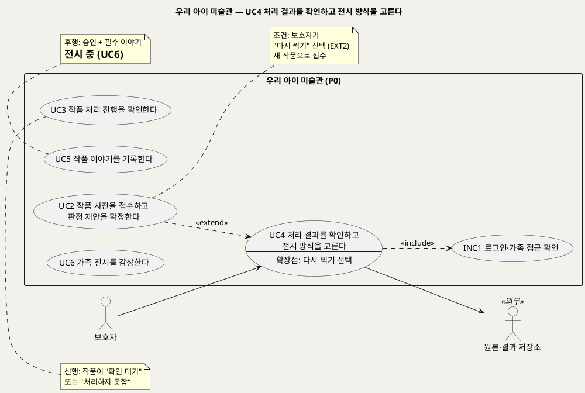
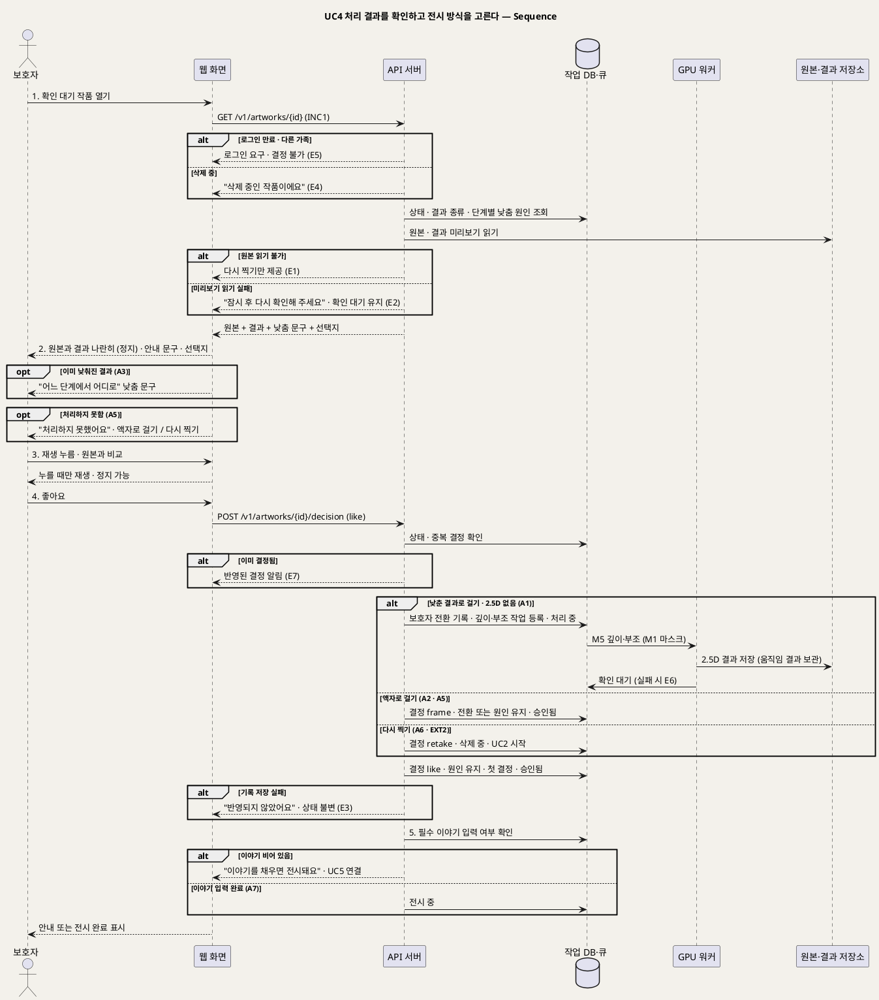

# UseCase 명세 — #4 처리 결과를 확인하고 전시 방식을 고른다 (우리 아이 미술관 P0)
**우리 아이 미술관 · UC4 · UML 2.5.1 표준 (UseCase Diagram + UseCase 기술 + Sequence Diagram)**

---

> **문서 식별**: `design/UC_04_결과확인승인.md`
> **작성일**: 2026-09-23 · **표준**: UML 2.5.1 (OMG)
> **개정 (2026-09-28)**: 모델 조합 기준으로 다시 썼다. 결과 종류를 4종(움직임 / 2.5D 부조 / 원본 액자 / P1 3D 조각)으로 넓히고, 낮춤 표시(BR-FBK-03), 선택지 "낮춘 결과로 걸기"(BR-APR-02), 결정의 원인 분류(BR-APR-04 · BR-FBK-04), 엔드포인트 `POST /v1/artworks/{id}/decision`을 넣었다. 옛 이름("가족 그림 미술관") 판을 대체한다.
> **원천(SoT)**: `Intent-Specify.md` (2026-09-28 기획 기준안) — [개요] · [미션] 서빙 지표 · [핵심 활동] 5 · [가치제안] · [부정적 영향] "어색하거나 왜곡된 결과" · `.specify/features/우리-아이-미술관/spec.md` v2.0 — FR-6, FR-23 (FR 번호는 재작성 공통 기준 §7)
> **다이어그램**: 모든 PlantUML 소스는 렌더 검증 완료(HTTP 200). 아래 링크로 브라우저에서 열 수 있다. `plantuml.sumzip.com` 은 사내 SSO 로그인 뒤 열린다.
> **표기**: `[추론]` = 원천에 직접 없는 설계 판단 · `자료 없음 — 확인 필요` = 원천에 근거가 없는 항목 · U1~U15 = 공통 미해결 번호

---

## 목차

1. [범위·개요](#1-범위개요)
2. [UseCase Diagram](#2-usecase-diagram)
3. [Actor 카탈로그](#3-actor-카탈로그)
4. [UseCase 목록 (원천 매핑)](#4-usecase-목록-원천-매핑)
5. [UseCase 기술 + Sequence Diagram](#5-usecase-기술--sequence-diagram)
6. [업무규칙 종합](#6-업무규칙business-rules-종합)
7. [UML 표준 준수 노트](#7-uml-표준-준수-노트)

---

## 1. 범위·개요

모든 결과는 **보호자가 확인해야만 전시된다.** 모델 조합은 판정을 제안까지만 하고, 움직임·2.5D 부조가 어색하게 나올 수 있다(1차 시험: 엔진이 집 그림에 사람 점수 0.946을 줬다). 이 UC는 그런 결과가 걸러지는 마지막 관문이다. 보호자는 "확인 대기" 작품의 **원본과 결과를 나란히** 보고, 모델이 품질 미달로 결과를 낮췄다면 **어느 단계에서 어디로 낮췄는지** 문구로 본다. 실패를 성공처럼 꾸미지 않는다(BR-FBK-03). 점수는 보이지 않는다.

보호자에게 보이는 선택지(BR-APR-02)는 결과 종류에 따라 다르다. 결정은 `POST /v1/artworks/{id}/decision` 한 번으로 보낸다(`like` / `use_lower` / `frame` / `retake`).

| 지금 결과 | 보이는 선택지 | 비고 |
|---|---|---|
| 움직임 | **좋아요** / **낮춘 결과로 걸기**(2.5D) / **액자로 걸기** / **다시 찍기** | "낮춘 결과로 걸기"는 M1 작품 마스크가 있을 때만 보인다 [추론] |
| 2.5D 부조 (보호자 선택 또는 모델 낮춤) | **좋아요** / **액자로 걸기** / **다시 찍기** | 2.5D 아래 단계는 액자뿐이라 "낮춘 결과로 걸기"를 따로 두지 않는다 [추론] |
| 원본 액자 (보호자 선택 또는 모델 낮춤) | **좋아요(이대로 걸기)** / **다시 찍기** | |
| (P1) 3D 조각 | **좋아요** / **낮춘 결과로 걸기**(2.5D) / **액자로 걸기** / **다시 찍기** | GPU 확인 전 비노출(U2). "뒷면은 AI가 추정했어요" 표시 |
| 처리하지 못함 (인프라 재시도 소진) | **액자로 걸기** / **다시 찍기** | 원본이 있으므로 모델 없이 원본 액자로 걸 수 있다 |

결정은 원인 5분류(보호자 선택 · 모델 낮춤 · 보호자 전환 · 인프라 실패 · 결과 미도달)와 섞이지 않게 기록한다. 결과 확인에서 다른 결과로 바꾸면 **보호자 전환**이다(BR-APR-04). 첫 결정은 서빙 지표 **첫 결과 승인율 = 좋아요 / 결과 확인 건**(Intent [미션], BR-OPS-02)의 원천이 된다. 승인된 작품은 필수 이야기가 채워지면 가족 전시(UC6)에 걸린다. 이야기 입력은 UC5에서 다룬다.

| 항목 | 값 |
|---|---|
| 대상 시스템 | 우리 아이 미술관 (P0, 3D 조각 결과 확인만 P1) |
| 상위 프로세스 | 접수·확정(UC2) → 처리 진행(UC3) → **결과 확인·승인(UC4)** → 이야기(UC5) → 전시(UC6) |
| 원천 근거 | spec v2.0 FR-6 · FR-23 · Intent [핵심 활동] 5 · [미션] 서빙 지표 · [가치제안] "실패를 성공처럼 꾸미지 않고" · [부정적 영향] "어색하거나 왜곡된 결과" |
| 핵심 UseCase | 1개 (UC4) + 공통 1개 (INC1) + 확장 1개 (EXT2: UC2 ··> UC4) |
| 주요 액터 | 보호자 · 원본·결과 저장소(보조) |
| 엔드포인트 [추론] | `GET /v1/artworks/{id}` (결과·낮춤 표시 조회) · `POST /v1/artworks/{id}/decision` (결정) — 이름·형식은 `/speckit.plan`에서 확정(U8) |

---

## 2. UseCase Diagram

**[「UC4 결과 확인·승인 UseCase Diagram」 PlantUML 뷰어로 열기](https://plantuml.sumzip.com/plantuml/svg/eNqFVF1L22AUvs-vOGQ3yqj4fSGuyERhN0PYBrsolJjGGoyJJG_Zxhhks4z6MajDSJ2NpKBzG8KiLTNjvdpP2WVy8h923qRRM5BdtbzneZ7znOecds5ikslq6xrU5LJRM8vyqqpVylVJ0xTzVXl0UrDWVH1DMqV1WJbktapp1PTKvKEZJtxbnFgcW3h4C2GtShXjhapXYUXSLEXQlBUGzABTra4yqKimIjPV0AWmMk0B_ORHn88BnTq6PYi-B9jwwp4Nf-x9eDY_CXjZ4vXw0g-7_ei0D_Ghg24QO62w6wF6ddxpQ-R_xR0X3TrQY3QaRDsngiDJjPyJUbcXtwI8boogWbAkmYrOshoeNaNu8PsqVSc1G49P8f1uAn1CEAVmZ_EwiH7YxaIgcOeSXiXX4l22h5ZGh0V4LQDULEWWLIL-d4qSfvcYJb1QKOkcTca85gzQG4ei_yEMfMC6F2-6iV1qc7vro8fzYxB12uFVQI1oRN_GzgWNuBdeZe0THgfm7Y4DHu_FHxuA787xrM79EA0brcxuvNtEz6HHNjoNXuZynhM7bXI3MDOe15y41kyTIN34YCvj8iRucSfy3KlrrttDp09z8wT5R8fN8abyvGm4HprHm5D8Jm6-zZGmhTeCkJ4FFArFJEe-spGRYpINzNANqLqs1SoKHQGPh5c4hFeUl0zRK0lhMuEnZyMIusGUwckbK4M8sOOHFz3aYXaS5I-exdxOxcFSYWjh-dPxYU7bbAwSwHafVjrYhkB9gbdJezFjI-3E0-MSB1szGY1OVExzhmjX5k0IE7Wa0fY-nXKyEdotntkQffsVO1_Ef7SXDcaM9VSehxwf1VP57Z9c8z7E9DtotG4WRJgH2Y8TT_ZgiHIevhGdo2_0d_MXv00n5Q==)** — 클릭 시 브라우저로 연결됩니다.

#### 다이어그램 쉽게 읽기 (유저 관점)

- **누가 쓰나** — 보호자가 결과를 보고 고른다. 원본·결과 저장소는 원본 사진과 결과 미리보기를 꺼내 주는 외부 구성요소다. 모델(M1~M7)은 시스템 안쪽 부품이라 여기엔 그리지 않는다.
- **무슨 순서로** — 처리 진행(UC3)이 끝나 "확인 대기"가 되면 → 원본과 결과를 나란히 보고 → 좋아요 / 낮춘 결과로 걸기 / 액자로 걸기 / 다시 찍기 중 하나를 고르고 → 이야기를 채우면(UC5) → 가족 전시에 걸린다(UC6).
- **«include» = 항상 함께** — 결과를 볼 때마다 "로그인·가족 접근 확인"을 거친다. 다른 가족의 작품은 열리지 않는다.
- **«extend» = 특정 상황에서만** — "다시 찍기"를 고를 때만 사진 접수(UC2)가 끼어들어 새 사진을 새 작품으로 받는다.
- **Generalization(◁)** — 없다. 결과 종류(움직임·2.5D·액자·P1 3D·처리하지 못함)별 선택지는 같은 목표의 변형이라 대체흐름으로 다룬다.

| 기호 | 의미 |
|---|---|
| 사람 모양(actor) | 시스템을 쓰는 사람 또는 외부 구성요소(`<<외부>>`) |
| 타원(usecase) | 액터가 이루려는 목표. `--` 아래는 확장점 |
| 사각형(rectangle) | 시스템 경계 |
| 실선 | 액터와 UC의 연결 |
| 점선 `<<include>>` | 항상 함께 수행되는 하위 행위 (UC4 → INC1) |
| 점선 `<<extend>>` | 확장점 조건일 때만 끼어드는 행위 (UC2 → UC4) |
| note | 선행·후행 조건과 확장 조건 |

---

## 3. Actor 카탈로그

| 구분 | 액터 | 이 UC에서의 역할 | 원천 근거 |
|:--:|---|---|---|
| Primary | 보호자 | 원본과 결과를 비교하고 좋아요 / 낮춘 결과로 걸기 / 액자로 걸기 / 다시 찍기를 고른다 | spec FR-6 · Intent [핵심 활동] 5 |
| Secondary | 원본·결과 저장소(S3 호환) | 원본, 결과 미리보기(움직임·2.5D·P1 GLB), 작품 마스크를 제공한다 | Intent [핵심 이네이블러] 기반 · 공통 기준 §6 |

GPU 워커(M5 · P1 M7)는 "낮춘 결과로 걸기"로 2.5D를 새로 만들 때만 시퀀스에 나온다. 시스템 내부 구성요소라 액터로 두지 않는다(공통 기준 §6).

---

## 4. UseCase 목록 (원천 매핑)

| UC ID | 유스케이스명 | 관계 | 원천 근거 |
|:--:|---|---|---|
| UC4 | 처리 결과를 확인하고 전시 방식을 고른다 | 본 문서 | spec FR-6 · FR-23 |
| INC1 | 로그인·가족 접근 확인 | UC4가 «include» | 공통 기준 §6 · BR-ACC-01·02 |
| UC2 | 작품 사진을 접수하고 판정 제안을 확정한다 | UC4를 «extend» (EXT2, 확장점: "다시 찍기" 선택) | spec FR-6 · BR-APR-03 |
| UC3 | 작품 처리 진행을 확인한다 | 선행 (확인 대기 · 처리하지 못함을 만든다) | spec FR-5 · FR-23 |
| UC5 | 작품 이야기를 기록한다 | 후행 (전시 조건) | spec FR-7 · BR-EXH-01 |
| UC6 | 가족 전시를 감상한다 | 후행 | spec FR-8 |
| UC8 | 서비스 상태와 모델별 운영 지표를 확인한다 | 지표 소비 (첫 결과 승인율 · 원인별 집계) | spec FR-13 · FR-26 · BR-OPS-02·03 |

---

## 5. UseCase 기술 + Sequence Diagram

### 5.1 UC4 처리 결과를 확인하고 전시 방식을 고른다

> **쉽게 말하면** — 결과가 준비되면 보호자가 먼저 봅니다. 원본 옆에 결과가 나란히 놓이고, 모델이 한 단계 낮춘 결과라면 "움직임이 어려워 입체 부조로 만들었어요"처럼 솔직하게 알려 줍니다. 마음에 들면 "좋아요", 움직임이 어색하면 "낮춘 결과로 걸기"나 "액자로 걸기", 사진이 흐리면 "다시 찍기"를 누릅니다. 보호자가 고르기 전에는 가족 전시에 아무것도 걸리지 않습니다.

#### 유스케이스 기술

| 속성 | 내용 |
|---|---|
| **ID** | UC4 (spec v2.0 FR-6 · FR-23) |
| **유스케이스명** | 처리 결과를 확인하고 전시 방식을 고른다 |
| **액터** | 주: 보호자 · 보조: 원본·결과 저장소 |
| **사전조건** | (1) 보호자가 로그인되어 있고 작품이 보호자 가족 공간에 속한다(INC1). (2) 작품 상태가 "확인 대기"(결과 도달) 또는 "처리하지 못함"(인프라 재시도 소진)이다(UC3). (3) 작품에 아직 결정이 기록되지 않았다. (4) 작품이 "삭제 중"이 아니다. (5) 원본은 원본·결과 저장소에 올린 그대로 있다(BR-INT-04) |
| **사후조건** | (1) 결정(`like` / `use_lower` / `frame` / `retake`)이 작품과 해당 단계 작업의 결과 종류·낮춤 원인에 연결되어 한 번만 기록된다. 결과 확인에서 다른 결과로 바꾼 결정은 "보호자 전환"으로 기록되고, 모델 낮춤·인프라 실패 원인은 덮어쓰지 않는다(BR-APR-04 · BR-FBK-04). (2) `like` / `frame`(또는 이미 있는 낮춘 결과로 `use_lower`)이면 상태가 "승인됨"이 되고, 필수 이야기가 채워져 있으면 "전시 중"이 된다. 비어 있으면 승인만 기록되고 전시는 보류된다(BR-EXH-01). (3) `use_lower`로 낮춘 결과를 새로 만들어야 하면 깊이·부조 단계 작업이 등록되고 상태가 "처리 중"으로 돌아간다 [추론]. (4) `retake`이면 이 작품은 전시되지 않고 삭제 규칙에 따라 정리되며(BR-APR-05), UC2가 새 작품 접수를 시작한다. (5) 원본은 바뀌지 않고, 처음 만든 결과는 보관된다(BR-APR-03). (6) 첫 결정이 첫 결과 승인율 집계 이벤트로 남는다(BR-OPS-02). 승인 전에는 어디에도 전시되지 않는다(BR-APR-01) |
| **기본흐름** | ↓ 별도 기본흐름표 (결과 = 움직임, 낮춤 없음, "좋아요" 기준) |
| **대체흐름** | ↓ 별도 대체흐름표 A1~A8 — A1 낮춘 결과로 걸기 · A2 액자로 걸기(전환) · A3 이미 낮춰진 결과 · A4 원본 액자 결과 · A5 처리하지 못함 · A6 다시 찍기(EXT2) · A7 이야기가 이미 채워짐 · A8 (P1) 3D 조각 결과 |
| **예외흐름** | ↓ 별도 예외흐름표 E1~E7 — E1 원본 읽기 불가 · E2 결과 미리보기 불러오기 실패 · E3 결정 기록 저장 실패 · E4 삭제 중인 작품 · E5 로그인 만료·가족 불일치 · E6 낮춘 결과 생성 실패 · E7 중복 결정 |
| **포함/확장** | «include» INC1 로그인·가족 접근 확인 · «extend» UC2가 이 UC를 확장(EXT2, 확장점: 보호자가 "다시 찍기" 선택) |
| **우선순위** | High — "승인 전 전시하지 않는다"는 Intent [부정적 영향] "어색하거나 왜곡된 결과"의 핵심 통제이며, 판정 정확도 미측정(Intent [핵심 장벽] 상 — 판정 정확도)으로 생긴 어색한 결과를 거르는 유일한 관문이다 |
| **사용빈도** | 결과가 도달했거나 처리하지 못한 작품 1건당 첫 결정 1회. "낮춘 결과로 걸기"로 2.5D를 새로 만든 작품은 1회 더 확인한다. 가족당·월간 건수는 `자료 없음 — 확인 필요` |
| **업무규칙** | BR-APR-01, BR-APR-02, BR-APR-03, BR-APR-04, BR-APR-05, BR-FBK-01, BR-FBK-02, BR-FBK-03, BR-FBK-04, BR-PRC-02, BR-PRC-03, BR-PRC-04, BR-SRV-02, BR-EXH-01, BR-EXH-03, BR-EXH-04, BR-EXH-06, BR-INT-04, BR-OPS-02, BR-OPS-03, BR-ACC-01, BR-ACC-02, BR-PRV-01 |
| **특별 요구사항** | 표현: 결과 옆에 원본을 늘 함께 보인다. 모델 점수·판정 점수를 보이지 않는다(BR-PRC-04). 낮춤 문구는 "어느 단계에서 어디로"를 담는다 — 예: "움직임을 만들기 어려워 입체 부조로 바꿨어요", "입체 부조가 어려워 원본 액자로 걸었어요" [추론 문구, U10과 함께 확정]. 원본 액자·2.5D에 "실패" 딱지를 붙이지 않고 완성된 작품으로 대한다(BR-EXH-04). 재생: 움직임 재생·2.5D 시차 효과·(P1) 회전은 보호자가 누를 때만 하고 정지할 수 있다. 자동 재생 없음(BR-EXH-03). 사용성: 처리 대기를 빼고 작품 한 점 올리기·확인·이야기 입력까지 3분 이내(spec v1.0 Success Criteria "부모 조작 시간", 잠정 — v2.0 확인 필요). 전환은 한 번 누르면 끝난다. 무결성: 결정은 작품당 한 번만 반영한다(E7). 개인정보: 로그에는 결정 코드·원인 분류만 남기고 이미지·객체 키·자유 입력은 남기지 않는다(BR-PRV-01). 결과 파일 형식(GIF/MP4/깊이맵+셰이더)은 U9 |
| **비고** | 원천 추적: Intent-Specify [핵심 활동] 5 "인프라 장애는 낮춤이 아니라 제한 재시도" · [미션] 서빙 지표 "첫 결과 승인율 = 좋아요 / 결과 확인 건" · [가치제안] "실패를 성공처럼 꾸미지 않고, 어떤 단계로 낮췄는지 기록한다", "재생·시차 효과는 보호자가 고를 때만" · [부정적 영향] "어색하거나 왜곡된 결과: 승인 전 전시하지 않고, 낮춘 결과·원본 액자·재촬영을 고를 수 있다", "3D의 추정 면(P1)" · [핵심 데이터] 작품 "낮춤 원인·보호자 결정·승인 시각" · spec v2.0 FR-6(결과 확인·승인) · FR-23(낮춤 체인·원인 기록·표시) · 관련 FR-13·FR-26(지표) · FR-22(2.5D) · FR-29(P1 3D) · 공통 기준 §4(엔드포인트) · §5(상태 모델·낮춤 체인·원인 5분류) · §8(BR). 추가 요구 R1~R4는 이 UC에 직접 걸리지 않는다(모델 호출은 UC3 계약을 따른다). [추론] 판단: (a) "낮춘 결과로 걸기"는 지금 결과가 움직임(또는 P1 3D)이고 M1 작품 마스크가 있을 때만 보인다. 기본 처리 흐름은 움직임이 성공하면 2.5D를 미리 만들지 않으므로(낮춤 체인은 품질 미달일 때만 내려간다, BR-FBK-01) 대부분 새로 만들어야 한다. 이때 원본과 M1 마스크를 재사용해 깊이·부조 단계 작업(M5)을 새로 등록하고, 처음 만든 움직임 결과는 지우지 않고 보관한다. 새 사진을 요구하지 않는다. 2.5D를 미리 만들어 두는 안은 GPU 유무(U2)·처리 시간(U6)이 정해진 뒤 다시 검토한다. (b) 지금 결과가 2.5D면 아래 단계는 액자뿐이라 "낮춘 결과로 걸기"를 "액자로 걸기"로 합친다. (c) 지금 결과가 원본 액자면 "좋아요(이대로 걸기)"를 `like`로 기록한다 — 전환이 아니므로 원인은 보호자 선택 또는 모델 낮춤 그대로다. (d) "처리하지 못함"에서 "액자로 걸기"는 결정 `frame`으로 남기되 원인은 인프라 실패·결과 미도달 그대로 두고 보호자 전환으로 세지 않는다(BR-FBK-04). 옛 판의 미결("실패 건 액자 = 부모 선택?")은 이 판단으로 대신한다. (e) 첫 결과 승인율의 "결과 확인 건"은 결과가 도달한 작품의 첫 결정(`like`·`use_lower`·`frame`·`retake`)이며 "처리하지 못함"은 제외한다. `use_lower` 뒤의 두 번째 확인은 첫 결과로 세지 않는다. (f) 다시 찍기로 닫힌 작품은 별도 상태를 두지 않고 "삭제 중"으로 넘긴다(공통 기준 §5 상태 모델에 "다시 찍기로 닫힘"이 없음). 옛 BR 대응: 옛 BR-APR-04 "액자 전환 = 부모 선택"은 새 BR-APR-04 "보호자 전환"으로 바뀌었다. 관련 미해결: U8(엔드포인트·응답 형식), U9(결과 파일 형식), U10(문구), U2·U6(2.5D 생성 시간) |

#### 기본흐름 (Basic Flow)

| 단계 | 액터 행위 | 시스템 행위 |
|:--:|---|---|
| 1 | 보호자가 처리 진행(UC3) 목록이나 알림에서 "확인 대기" 작품을 연다 | `GET /v1/artworks/{id}`로 INC1 가족 접근을 확인하고, 작업 DB에서 상태·결과 종류·단계 작업의 낮춤 원인을 읽는다. 원본·결과 저장소에서 원본과 결과 미리보기를 불러와 나란히, 정지 상태로 보여 준다 |
| 2 | 보호자가 결과 안내 문구와 선택지를 읽는다 | 결과 종류와 낮춤 여부를 문구로만 보여 준다(여기서는 "움직이는 그림으로 만들었어요"). 점수는 보이지 않는다. 결과 종류에 맞는 선택지 — 좋아요 / 낮춘 결과로 걸기 / 액자로 걸기 / 다시 찍기 — 를 보여 준다(BR-APR-02) |
| 3 | 보호자가 "재생"을 눌러 움직임을 보고 원본과 비교한다 | 누를 때만 재생하고 언제든 정지할 수 있게 한다. 원본은 옆에 그대로 둔다(BR-EXH-03) |
| 4 | 보호자가 "좋아요"를 누른다 | 웹 화면이 `POST /v1/artworks/{id}/decision` (`like`)을 보낸다. API 서버가 상태·가족·중복 결정을 확인하고, 결정·원인 분류(원래 원인 유지)·첫 결정 여부·승인 시각을 한 트랜잭션으로 기록한 뒤 상태를 "승인됨"으로 바꾼다. 첫 결과 승인율 집계 이벤트를 남긴다(BR-OPS-02) |
| 5 | 보호자가 안내를 보고 이야기 입력(UC5)으로 가거나 전시를 확인한다 | 필수 이야기(제목·제작일·제작 당시 연령)가 채워졌는지 확인한다. 비어 있으면 "이야기를 채우면 전시돼요"라고 안내하고 UC5로 연결한다. 채워져 있으면 상태를 "전시 중"으로 바꾼다(BR-EXH-01) |

#### 대체흐름 (Alternative Flow)

| ID | 분기 지점 | 흐름 |
|:--:|:--:|---|
| A1 | 4단계 | **낮춘 결과로 걸기** — 지금 결과가 움직임이고 M1 마스크가 있을 때 보호자가 "낮춘 결과로 걸기"를 누른다(`use_lower`). 결정을 "보호자 전환(움직임 → 2.5D)"으로 기록한다(BR-APR-04). 2.5D 결과가 이미 있으면 바로 "승인됨"이 되고 5단계로 간다. 없으면 [추론] 원본과 M1 마스크로 깊이·부조 단계 작업(M5)을 GPU 워커 전용 큐에 등록하고 상태를 "처리 중"으로 바꾼다(GPU가 없으면 M5를 CPU에서 실행, BR-SRV-02). 처음 만든 움직임 결과는 보관한다(BR-APR-03). 2.5D가 도달하면 다시 "확인 대기"가 되고, 보호자는 1단계부터 2.5D 결과를 확인한다. 이 두 번째 확인은 첫 결과 승인율에 세지 않는다 |
| A2 | 4단계 | **액자로 걸기(전환)** — 지금 결과가 움직임·2.5D·(P1) 3D일 때 보호자가 "액자로 걸기"를 누른다(`frame`). 모델을 부르지 않고 원본을 액자로 승인한다. 결정을 "보호자 전환(… → 액자)"으로 기록하고, 만든 결과는 전시하지 않되 보관한다. 5단계로 간다 |
| A3 | 2단계 | **이미 낮춰진 결과** — 처리 중 품질 미달로 낮춤 체인이 동작했으면(BR-PRC-02 · BR-FBK-01) 단계 작업의 낮춤 원인을 읽어 "움직임을 만들기 어려워 입체 부조로 바꿨어요"처럼 **어느 단계에서 어디로** 낮췄는지 보여 준다(BR-FBK-03). M1 분리가 품질 미달이라 2.5D를 건너뛰고 원본 액자가 된 경우도 그대로 알린다(BR-FBK-02). 선택지는 지금 결과 종류를 따른다. "좋아요"를 누르면 원인은 "모델 낮춤" 그대로 두고 보호자 전환으로 세지 않는다 |
| A4 | 2단계 | **원본 액자 결과** — 확정 때 보호자가 액자를 골랐거나(보호자 선택) 모델 낮춤으로 액자가 된 경우 선택지는 "좋아요(이대로 걸기) / 다시 찍기"다. "좋아요"는 `like`로 기록하고 원인은 바꾸지 않는다 [추론] |
| A5 | 1단계 | **처리하지 못함** — 인프라 장애로 같은 단계를 3회 재시도하고도 소진된 작품(BR-PRC-03)이면 "처리하지 못했어요"와 함께 "액자로 걸기 / 다시 찍기"만 보여 준다. 결과를 꾸며 보이지 않는다. "액자로 걸기"는 모델 없이 원본으로 승인하고 `frame`으로 기록하되, 원인은 인프라 실패·결과 미도달 그대로 둔다(BR-FBK-04). 첫 결과 승인율 분모에서 뺀다 [추론] |
| A6 | 4단계 | **다시 찍기 (EXT2)** — 보호자가 "다시 찍기"를 누르면(`retake`) 결정을 기록하고, 이 작품은 전시하지 않은 채 "삭제 중"으로 넘겨 삭제 규칙(BR-DEL-01 순서)대로 원본·마스크·결과를 지우고 집계 필드만 남긴다(BR-APR-05). 이어서 UC2 사진 접수를 시작한다. 새 사진은 새 작품·새 작업이며 이전 원본을 덮어쓰지 않는다(BR-APR-03). 새 사진을 올리지 않고 나가도 이전 작품은 되살리지 않는다 |
| A7 | 5단계 | **이야기가 이미 채워짐** — UC5에서 필수 이야기를 먼저 입력해 둔 작품이면 승인과 동시에 "전시 중"이 된다 |
| A8 | 2단계 | **(P1) 3D 조각 결과** — GPU가 확인되어 3D가 노출된 경우에만(U2 · BR-SRV-02) 만들기 작품의 GLB 미리보기를 원본 사진과 함께 보이고 "뒷면은 AI가 추정했어요"를 표시한다(BR-EXH-06). 회전은 보호자가 조작할 때만 한다. "낮춘 결과로 걸기"는 2.5D로(3D → 2.5D → 액자, BR-FBK-01) A1과 같이 처리한다 |

#### 예외흐름 (Exception Flow)

| ID | 발생 지점 | 흐름 |
|:--:|:--:|---|
| E1 | 1단계 | **원본 읽기 불가** — 저장소 장애가 계속돼 원본을 읽을 수 없으면 원본 비교와 "액자로 걸기"를 비활성화하고 "다시 찍기"만 제공한다. 결정 전이면 상태는 그대로 둔다(옛 spec Edge Cases "실패 건에서 원본까지 읽을 수 없는 경우") |
| E2 | 1단계 | **결과 미리보기 불러오기 실패** — 결과 파일을 일시적으로 읽지 못하면 "잠시 후 다시 확인해 주세요"라고 안내하고 선택지를 누를 수 없게 한다. 상태는 "확인 대기"로 유지한다. 승인 전 비전시(BR-APR-01)에 따라 보지 못한 결과는 승인받지 않는다 [추론] |
| E3 | 4단계 | **결정 기록 저장 실패** — 작업 DB 저장이 실패하면 "반영되지 않았어요"라고 안내하고 상태·전시를 바꾸지 않는다. 로그에는 오류 분류 코드만 남긴다(BR-PRV-01). 보호자는 다시 누를 수 있다 |
| E4 | 1·4단계 | **삭제 중인 작품** — 다른 화면에서 삭제(UC7)를 요청한 작품이면 결정을 받지 않고 "삭제 중인 작품이에요"라고 안내한 뒤 목록으로 돌아간다 |
| E5 | 1·4단계 | **로그인 만료·가족 불일치** — INC1이 실패하면 결정을 기록하지 않고 다시 로그인하게 한다. 다른 가족의 작품이면 존재 여부도 알리지 않는다(BR-ACC-01·02) |
| E6 | A1 | **낮춘 결과 생성 실패** — 새로 등록한 깊이·부조 단계가 품질 미달이면 낮춤 체인대로 원본 액자로 한 단계 낮추고 "입체 부조가 어려워 원본 액자로 걸었어요"를 보인다(BR-PRC-02 · BR-FBK-03). 인프라 장애면 최대 3회 재시도하고, 소진되면 [추론] 처음 결과(움직임)를 둔 채 "확인 대기"로 되돌리고 "입체 부조를 만들지 못했어요"라고 알린다. 단계 작업에는 인프라 실패로 기록한다(BR-PRC-03). 결과가 이미 한 번 도달했으므로 결과 미도달로 세지 않는다 |
| E7 | 4단계 | **중복 결정** — 두 번 누르거나 다른 기기에서 이미 결정한 작품이면 첫 결정만 반영하고, 나중 요청에는 이미 반영된 결정을 알려 준다 [추론]. 지표에 두 번 세지 않는다 |

#### Sequence Diagram

**[「UC4 결과 확인·승인 Sequence」 PlantUML 뷰어로 열기](https://plantuml.sumzip.com/plantuml/svg/eNp1VktvGlcU3s-vOKIbUBS7YJNIXkTxg0RepLHkWOrOmsDEQSbgAG5UVZWwPY4QUBW3EOMYEE7wI63bYoNtrLgb_5Qu5575Dz33MRgGezn3nud3vvPdeZxK68n06psYpIy3i4nV5GL4dTQWWVzSYzEj-ePit-NaajkaX9GT-ht4qYeXl5KJ1XhkOhFLJOGbJ2NP_KGpPovUaz2SeBeNL8ErPZYytHQ0HTNgYXoc8LTCDo7BOm1Z7Su2fwX2ThlrXbtcsdoNwIaJ-Sqw1hfM17BmAh2y_S7LN-G_TAnmjberRjxsaJoeTlNiD2t37EoX60UP6CmY05NGPK1RCeloOLqix9Pgwd1LSlFiXzrCZGF28HpybhbQrLJTU1zTpxbR0_pLPWWQb30LtzdhZur6wl6TKWamBv2fzi0A7hbwa1Nc06c7fZG1u9cXsl_qL4P1fXxfENbz1AP1IsuG-4-oOpgA_4jCBFghY3VbQGXYv2UBtzv0pZENWfK6J-Bp6AWM_uAfpYzvEsnl1OhP0cjP4J39btrv0_RYGthe1broiliHBfa5ANcXQGASpGC1Mrh3ooEIdd9JfuOAH0vW2TF3oNqxUQZ2niUf8IaCPs2goQKu_4WNKmBzyx3Fc3MlQokGsNbB7SKF9VCMcYoRj2jC6xGhSk64sWZvVFVCAdanTbZfkSUfWW2TtU1g63_jeZMgL4rAey37Y8GJIuDkgQTmfYHYP13iHHFFoFn7l8PI0VGG8kT1NwRIvskZia1fyIZApBFWrfYZteBXMNwSHTDftAtHw7DUGzyYvWs6cR32dwA_X6HZFfBQ5S4GVBt4yKEP9MHmRFVd3HO6veeAxI67fIL3iOANe6NGETTBHnJUlJuAwIjy554OXOsVVs_Y9Sx4ae7k5uMVYTnL1jtOUH7Qi5pYISxrHQJCpm7hoekE806O-QgHd14PfuiwXFFNlvPCJJDprFQiCnoGWxA9iyRCPEgrOBrsj692-YgSBG9P4Lb9kKX4Dr5Y3iPVoFRgnXQ5xKODkxYp3Zs5RmDVj3GjBixrsgNTBOqhxy5N66w4hDA3JZlj5YJgj_TnjgJavoYstz-UapxSfcpj2aSCB1Z-7vn8LTs_GjHC0VQ0EQdvLLps-O5YLNpHRtxVCy05JjdBTk9esOIQc1mrgpU1Vqw6vkjtHNB0Qw8lI4XY8JlVHGm_gZYSB0aCMyRg77FWoIH5fU58VWFPxvkDYO9QDNq1PQGTdZmj4q4v2DnJldBCLsns9xN1r94TKUIUjEJyTZ6AZ0G3r_eZn2Qwi7mmvXbMS-CGfbohihwQalqA3QwermG9x2e-551Mn7doYHBdvXL9gdMp9MBRSzfjvJMB3oCkbz8aCuJX9JAakikCE1YpslypJ31SEvh17pIO-NCkHPXTmJI84Dah718E7kiTNNL6sszTE23-tTAd4A0Q4ENKrTw509QKuCo6_dOxGaiPk0RNVuF7h046dBO7i-Uc0hb37a7kM-k1a3NRHJMUHCgxSI8oLU-2wqmN5Sv5jm6yBuXcPiZCuNivTGiHKRFZ0mtVGJZvx44vNJ7Qbrbov0L9tLBfr5wCF6aDlKVFEKjRD5WwY_LH2Dv50D0U9QPE6cx7couJI8KKCspYRrO3qvSlPSY_-o_7H6_l0nY=)** — 클릭 시 브라우저로 연결됩니다.

기본흐름 1~5단계는 시퀀스의 번호 붙은 주요 메시지 `1.`~`5.`와 1:1로 대응한다. 4단계의 `alt`는 대체흐름 A1·A2·A5·A6의 결정 분기이고, 기본흐름("좋아요")은 그 뒤의 `결정 like` 기록이다. 5단계는 이야기 입력 여부에 따라 두 갈래 중 하나로만 실행된다. GPU 워커(M5)는 A1에서 2.5D를 새로 만들 때만 등장한다.

---

## 6. 업무규칙(Business Rules) 종합

| BR ID | 규칙 | 적용 UC | 근거 |
|---|---|---|---|
| BR-APR-01 | 보호자 승인 전에는 어떤 결과도 전시하지 않는다(확인 대기·처리하지 못함·처리 중·삭제 중 작품은 전시 화면에 없음) | UC3, UC4, UC6 | Intent [부정적 영향] "어색하거나 왜곡된 결과" · spec FR-6 |
| BR-APR-02 | 결과 확인 선택지: 좋아요 / 낮춘 결과로 걸기(해당 시) / 액자로 걸기 / 다시 찍기. 결과 종류별 노출은 §1 표 | UC4 | Intent [부정적 영향] "낮춘 결과·원본 액자·재촬영을 고를 수 있다" · spec FR-6 |
| BR-APR-03 | 처음 만든 결과를 보관한다. 다시 찍기는 새 작품으로 접수한다 | UC2, UC4 | Intent 핵심 원칙 "원본 불변" · spec FR-6 |
| BR-APR-04 | 결과 확인에서 다른 결과로 바꾸면 "보호자 전환"으로 기록한다 | UC4, UC8 | Intent [핵심 데이터] "보호자 결정" · spec FR-23 |
| BR-APR-05 | 다시 찍은 이전 작품은 삭제 규칙을 따른다 | UC4, UC7 | spec FR-6 · FR-10 |
| BR-FBK-01 | 낮춤 체인 고정: 움직임→2.5D→액자 · 3D(P1)→2.5D→액자 · LLM 설명→템플릿→직접 입력 | UC3, UC4 | Intent [핵심 활동] 5 · spec FR-23 |
| BR-FBK-02 | 2.5D 마스크는 M1 결과가 기본 출처. M1 실패 시 2.5D를 건너뛰고 원본 액자 | UC3, UC4 | Intent [핵심 이네이블러] "2.5D 마스크의 기본 출처" · spec FR-22 |
| BR-FBK-03 | 낮춤 원인(어느 단계에서 어디로)을 단계 작업에 기록하고 보호자에게 표시한다. 실패를 성공처럼 꾸미지 않는다 | UC3, UC4 | Intent [가치제안] · spec FR-23 |
| BR-FBK-04 | 결과 원인 5분류(보호자 선택·모델 낮춤·보호자 전환·인프라 실패·결과 미도달)를 섞지 않는다 | UC3, UC4, UC8 | Intent [혜택] 서비스 팀 "낮춤률과 인프라 실패를 분리" · spec FR-23 |
| BR-PRC-02 | 품질 미달은 재시도하지 않고 낮춤 체인으로 한 단계 낮춘다 | UC3, UC4(E6) | Intent [핵심 활동] 5 |
| BR-PRC-03 | 인프라 장애는 낮춤이 아니다. 같은 단계를 최대 3회 재시도하고, 소진 시 "처리하지 못함"·결과 미도달로 집계 | UC3, UC4(A5·E6) | Intent [핵심 활동] 5 · spec FR-5 |
| BR-PRC-04 | 모델 점수는 기록만 하고 승인 근거로 쓰지 않는다 | UC3, UC4 | Intent [부정적 영향] "판정의 강요" · spec FR-5 |
| BR-SRV-02 | GPU가 없으면 M5는 CPU로 실행하고 M7(3D)은 비노출 | UC3, UC4(A1·A8) | Intent [핵심 장벽] 자원 · [핵심 활동] 6 |
| BR-EXH-01 | 전시 조건 = 승인 + 필수 이야기 | UC4, UC5, UC6 | spec FR-6 · FR-7 |
| BR-EXH-03 | 재생·시차 효과·(P1) 회전은 보호자가 고를 때만. 무한 피드 금지 | UC4, UC6 | Intent [가치제안] 경험 원칙 |
| BR-EXH-04 | 액자·2.5D도 완성된 작품으로 동등하게 대한다. 점수·비교 금지 | UC4, UC6 | Intent [가치제안] "원본 액자도 완성된 작품으로" · [부정적 영향] "비교·평가 오용" |
| BR-EXH-06 | (P1) 3D 조각은 "뒷면은 AI가 추정했어요"를 표시하고 원본 사진을 함께 보여 준다. 평면 그림에는 쓰지 않는다 | UC4(A8), UC6 | Intent [부정적 영향] "3D의 추정 면(P1)" · spec FR-29 |
| BR-INT-04 | 원본 불변. 모든 모델은 원본을 읽기만 한다 | UC2, UC3, UC4 | Intent 핵심 원칙 · spec FR-2 |
| BR-OPS-02 | 지표 정의: 첫 결과 승인율(= 좋아요 / 결과 확인 건) 외. 정의·검증 계획이며 실적 아님 | UC4, UC8 | Intent [미션] 서빙 지표 · spec FR-13 · FR-26 |
| BR-OPS-03 | 원인별 분리 집계(BR-FBK-04) | UC4, UC8 | Intent [혜택] 서비스 팀 · spec FR-26 |
| BR-ACC-01 | 가족 단위 격리 | UC1~UC7, UC10 | Intent [부정적 영향] 아동 이미지 유출 · spec FR-9 |
| BR-ACC-02 | 비로그인 차단 | UC1~UC7, UC10 | spec FR-9 |
| BR-PRV-01 | 운영 로그에 이미지·객체 키·자유 입력·오류 원문 금지 | 전 UC | Intent [부정적 영향] 아동 이미지 유출 · spec FR-14 |

---

## 7. UML 표준 준수 노트

| 항목 | 적용 |
|---|---|
| «extend» 방향 | 확장 UC(UC2)에서 기반 UC(UC4)로 점선 화살표를 그렸다. 확장점 "다시 찍기 선택"은 기반 UC 타원 안에 적고, 조건은 note로 붙였다 |
| «include» | 로그인·가족 접근 확인(INC1)은 결과를 열 때마다 항상 수행되므로 include로 두었다 |
| 결과 종류 분기 | 움직임·2.5D·액자·P1 3D·처리하지 못함은 같은 목표(전시 방식 결정)의 변형이라 UC나 Generalization으로 나누지 않고 대체흐름 A3~A5·A8로 표현했다 |
| 낮춘 결과 새로 만들기 | A1의 2.5D 생성은 UC3과 같은 단계 작업 계약을 쓰지만, 보호자의 결정에서 시작되는 흐름이라 UC4의 대체흐름에 두었다. 별도 UC로 나누지 않았다 [추론] |
| 전시 조건 | 승인과 이야기 입력은 서로 다른 목표라 UC4와 UC5로 나눴다. 전시 조건은 BR-EXH-01로 두 UC에 걸었다 |
| 액터 | 모델(M1~M7)은 시스템 내부 구성요소라 UseCase Diagram에 두지 않고, 시퀀스에서만 서빙군 lifeline(GPU 워커)으로 그렸다 |
| Sequence | 기본흐름 1~5단계를 번호 붙은 메시지로 옮겼다. 4단계의 결정 분기(A1·A2·A5·A6)와 5단계의 이야기 여부를 `alt`로, 낮춤 표시(A3)·처리하지 못함(A5)을 `opt`로 표현했다. 예외 E1~E7은 해당 지점에 번호를 붙였다 |

---

*우리 아이 미술관 P0 · UC4 · 작성 2026-09-23 · 개정 2026-09-28 · 원천: Intent-Specify.md (2026-09-28) · spec v2.0 FR-6 · FR-23*
