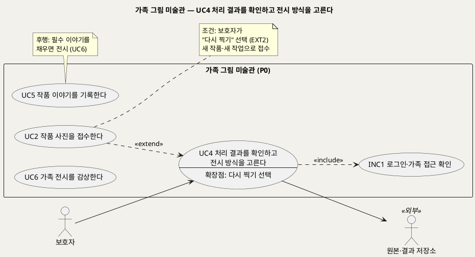
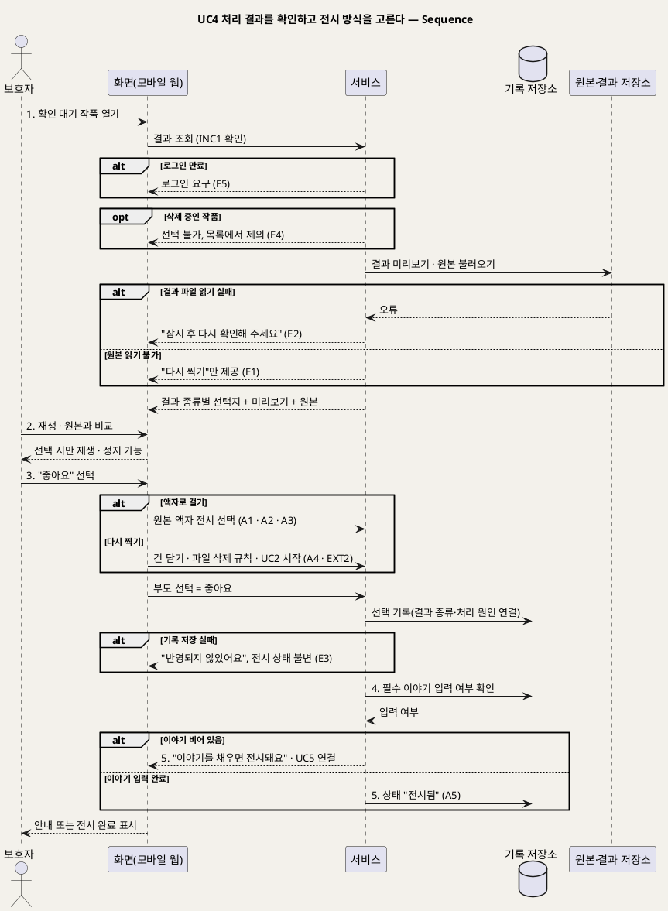

# UseCase 명세 — #4 처리 결과를 확인하고 전시 방식을 고른다 (가족 그림 미술관 P0)
**가족 그림 미술관 · UC4 · UML 2.5.1 표준 (UseCase Diagram + UseCase 기술 + Sequence Diagram)**

---

> **문서 식별**: `design/UC_04_결과확인승인.md`
> **작성일**: 2026-09-23 · **표준**: UML 2.5.1 (OMG)
> **원천(SoT)**: `.specify/features/가족-그림-미술관/spec.md` — FR-6, FR-5(결과 종류), FR-13(첫 결과 승인율) · 보조 원천 `Intent-Specify.md` [핵심 활동] 5 · [부정적 영향] 어색하거나 왜곡된 움직임
> **다이어그램**: 모든 PlantUML 소스는 렌더 검증 완료(HTTP 200). 아래 링크로 브라우저에서 열 수 있다.

---

## 목차

1. [범위·개요](#1-범위개요)
2. [UseCase Diagram](#2-usecase-diagram)
3. [Actor 카탈로그](#3-actor-카탈로그)
4. [UseCase 목록 (원천 매핑)](#4-usecase-목록-원천-매핑)
5. [UseCase 기술 + Sequence Diagram](#5-usecase-기술--sequence-diagram)
6. [업무규칙 종합](#6-업무규칙business-rules-종합)
7. [UML 표준 준수 노트](#7-uml-표준-준수-노트)

---

## 1. 범위·개요

모든 결과는 **보호자가 확인해야만 전시된다.** 엔진이 사물을 사람으로 잘못 잡아 어색하게 움직이는 경우가 있다(1차 시험: 집 그림 사람 점수 0.946). 그런 결과가 걸러지는 마지막 관문이 이 UC다. 보호자에게 보이는 선택지는 결과 종류에 따라 다르다.

| 결과 | 선택지 |
|---|---|
| 움직이는 작품 | **좋아요**(움직이는 작품으로 전시) / **액자로 걸기**(원본 액자로 전시) / **다시 찍기** |
| 원본 액자(정상·품질 대체) | **액자로 걸기** / **다시 찍기** |
| 실패 | **액자로 걸기**(원본이 있으므로 원본 액자로 전시) / **다시 찍기** |

승인된 작품은 제목·제작일·제작 당시 연령이 채워지면 가족 전시(UC6)에 걸린다. 이야기 입력은 UC5에서 다룬다.

| 항목 | 값 |
|---|---|
| 대상 시스템 | 가족 그림 미술관 (P0) |
| 상위 프로세스 | 처리(UC3) → **부모 확인(UC4)** → 이야기(UC5) → 전시(UC6) |
| 원천 근거 | spec FR-6 · FR-5 · FR-13 · Scenario 1, 3, 5, 7, 10 · Intent [핵심 활동] 5 |
| 핵심 UseCase | 1개 (UC4) + 공통 1개 (INC1) + 확장 1개 (EXT2: UC2 ··> UC4) |
| 주요 액터 | 보호자 · 원본·결과 저장소(보조) |

---

## 2. UseCase Diagram

**[「UC4 부모 확인 UseCase Diagram」 PlantUML 뷰어로 열기](https://plantuml.sumzip.com/plantuml/svg/eNqFU1Fr01AUfr-_4hBftoeOrW57GKMMywa-yEAFHwblrk27sDSR5BYdIlQXpTKFTqx2riktuMlgYLoWm4c-7af4mJz8B89N07k8DJ9yuef7zved79xs2IJbolbVoVYslHlV0w8KFa7rqnVQWFxm9r5mPOcWr8IuL-5XLLNmlPKmblpwb-v-1tLmg1sIe4-XzBeaUYEy122V6WpZgDDB0ip7AkqapRaFZhpMaEJXIfDq2B9AMPbD8wmEv3xs9IJRHf7Uv8DT_DLgVTs8v4TgyguGk_BsAtFJC10_arWDYQ-w5-BRB0LvAo9cdB2gy_DMD49-MMaLgvwp4XAUtX3sNhXgNmxzSzXErIanzXDoX4-n3albHbtn-P5jDH1MEBXW1_HED3_XcznGpHNuVMi1cpftue3FeQVeMYCarRa5TdD_TrFj3D3GjpHJ7BgSTcZ6zTWgOwlF71Pge4BOLzp0Y7skc1v14aP8EoT9DjkkIRpxahh7x8F4Jh_zJDBtNwvYPY4-NwDfXuJPR_ohGjbaUatD8olaNk1auSG5I2xNyJwcU376boq3kuatwo0zmUFM8pp4-CZFWmWvGZvuDjKZXDyszHVhIRcPAGu0KM0o6rWSSpuSM8iShMiK-lKoRikuLMf8eLeMGaZQk3dplpOZsO8FgxEFPXs35I-ulVTwSpI8zG0-e5Kdl7TDRpLA9Tg547d32JnQDpL4GHkAKTnV3TWFMKtTYRlKdOpEXz-sQdRyCJzKUfYfOPjdCy9Gszc_R6nM_2u5QSf6ff8CJsnP4Q==)** — 클릭 시 브라우저로 연결됩니다.

#### 다이어그램 쉽게 읽기 (유저 관점)

- **누가 쓰나** — 보호자가 결과를 보고 고른다. 원본·결과 저장소는 미리보기와 원본을 꺼내 오는 외부 구성요소다.
- **무슨 순서로** — 결과를 보고 → 좋아요 / 액자로 걸기 / 다시 찍기 중 하나를 고르고 → 이야기를 채우면(UC5) → 가족 전시에 걸린다(UC6).
- **«include» = 항상 함께** — 결과를 볼 때마다 "로그인·가족 접근 확인"을 거친다.
- **«extend» = 특정 상황에서만** — "다시 찍기"를 고를 때만 사진 접수(UC2)가 끼어들어 새 사진을 받는다.
- **Generalization(◁)** — 없다. 결과 종류별 선택지는 같은 UC 안의 대체흐름으로 다룬다.

| 기호 | 의미 |
|---|---|
| 사람 모양(actor) | 시스템을 쓰는 사람 또는 외부 구성요소(`<<외부>>`) |
| 타원(usecase) | 액터가 이루려는 목표. `--` 아래는 확장점 |
| 사각형(rectangle) | 시스템 경계 |
| 점선 `<<include>>` | 항상 함께 수행되는 하위 행위 |
| 점선 `<<extend>>` | 확장점 조건일 때만 끼어드는 행위(UC2 → UC4) |

---

## 3. Actor 카탈로그

| 구분 | 액터 | 이 UC에서의 역할 | 원천 근거 |
|:--:|---|---|---|
| Primary | 보호자 | 결과를 보고 좋아요 / 액자로 걸기 / 다시 찍기를 고른다 | spec FR-6 |
| Secondary | 원본·결과 저장소 | 결과 미리보기와 원본을 제공한다 | spec Dependencies |

---

## 4. UseCase 목록 (원천 매핑)

| UC ID | 유스케이스명 | 관계 | 원천 근거 |
|:--:|---|---|---|
| UC4 | 처리 결과를 확인하고 전시 방식을 고른다 | 본 문서 | spec FR-6 |
| INC1 | 로그인·가족 접근 확인 | UC4가 «include» | spec FR-9 |
| UC2 | 작품 사진을 접수한다 | UC4를 «extend»(EXT2) | spec FR-6 다시 찍기 |
| UC5 | 작품 이야기를 기록한다 | 후행(전시 조건) | spec FR-7 · Edge Cases "이야기를 입력하지 않고 승인만 누름" |
| UC6 | 가족 전시를 감상한다 | 후행 | spec FR-8 |

---

## 5. UseCase 기술 + Sequence Diagram

### 5.1 UC4 처리 결과를 확인하고 전시 방식을 고른다

> **쉽게 말하면** — 결과가 준비되면 보호자가 먼저 봅니다. 마음에 들면 "좋아요", 움직임이 어색하면 "액자로 걸기", 사진이 흐리면 "다시 찍기"를 누릅니다. 보호자가 고르기 전에는 가족 전시에 아무것도 걸리지 않습니다.

#### 유스케이스 기술

| 속성 | 내용 |
|---|---|
| **ID** | UC4 (spec FR-6) |
| **유스케이스명** | 처리 결과를 확인하고 전시 방식을 고른다 |
| **액터** | 주: 보호자 · 보조: 원본·결과 저장소 |
| **사전조건** | (1) 보호자가 로그인되어 있다(INC1). (2) 작품이 UC3를 거쳐 "확인 대기" 또는 "실패" 상태다. (3) 작품이 삭제 중이 아니다 |
| **사후조건** | (1) 보호자의 선택(좋아요/액자로 걸기/다시 찍기)이 해당 작업의 결과 종류·처리 원인과 연결되어 기록된다. (2) 좋아요 또는 액자로 걸기를 골랐고 필수 이야기가 채워져 있으면 상태가 "전시됨"이 된다. 이야기가 비어 있으면 승인만 기록되고 전시는 보류된다. (3) 다시 찍기를 고르면 건이 "다시 찍기로 닫힘"이 되고 전시되지 않는다. (4) 원본은 변형되지 않고, 결과를 다시 만들지 않는다 |
| **기본흐름** | ↓ 별도 기본흐름표 (움직이는 작품 + 좋아요 기준) |
| **대체흐름** | A1. 액자로 걸기(움직이는 결과) — 3단계에서 "액자로 걸기"를 고르면 원본을 액자로 전시한다. 이미 만든 움직이는 결과는 전시하지 않고, 대체 분류를 "부모 선택"으로 기록한다(spec FR-6, Scenario 3). A2. 원본 액자 결과 — 결과가 원본 액자(사람 그림 아님·품질 미달)면 "액자로 걸기 / 다시 찍기"만 보여 준다. 액자로 걸면 기존 대체 분류를 유지한다(spec FR-6 표). [추론] 이때 "부모 선택"으로 덮어쓰지 않는 것은 원인 분리 원칙(FR-13)을 따른 판단이다. A3. 실패 건 — "처리하지 못했어요"와 함께 "액자로 걸기 / 다시 찍기"를 보여 준다. 액자로 걸면 원본을 액자로 전시하고, 오류 분류는 그대로 둔다(spec FR-6, Scenario 5). A4. 다시 찍기 — 건을 "다시 찍기로 닫힘"으로 바꾸고, 원본과 결과는 삭제 규칙(UC7)과 같은 방식으로 지워 집계 필드만 남긴다. 이어서 EXT2로 UC2 사진 접수를 시작한다. 새 사진은 새 작품·새 작업이다(spec FR-6, Scenario 7, Assumptions). A5. 이야기 입력 완료 상태 — 필수 이야기가 이미 채워져 있으면 선택 즉시 "전시됨"이 된다(spec FR-7 "부모 확인 전후 언제든 입력") |
| **예외흐름** | E1. 원본 읽기 불가 — 저장소 장애가 계속돼 원본을 읽을 수 없으면 "액자로 걸기"를 비활성화하고 "다시 찍기"만 제공한다(spec Edge Cases). E2. 미리보기 불러오기 실패 — 결과 파일을 일시적으로 읽을 수 없으면 "잠시 후 다시 확인해 주세요"라고 안내하고, 선택지를 누를 수 없게 한다. 상태는 확인 대기로 유지한다. [추론] 원천은 미리보기 실패 처리를 따로 적지 않았다. 승인 전 비전시 원칙(FR-6)에 따라 보류로 설계했다. E3. 선택 기록 저장 실패 — 선택이 저장되지 않으면 "반영되지 않았어요"라고 안내한다. 전시 상태를 바꾸지 않고, 로그에는 분류 코드만 남긴다(spec FR-6 · FR-14). E4. 삭제 중인 작품 — 다른 화면에서 삭제를 요청한 작품이면 선택을 받지 않고 목록에서 사라졌다고 안내한다(spec FR-10). E5. 로그인 만료 — INC1에 따라 다시 로그인하게 하고, 선택은 기록하지 않는다(spec FR-9) |
| **포함/확장** | «include» INC1 로그인·가족 접근 확인 · «extend» UC2가 이 UC를 확장(EXT2, 확장점: 보호자가 "다시 찍기" 선택) |
| **우선순위** | High — "승인 전 전시하지 않는다"는 원천 [개요]와 [핵심 활동] 5의 핵심 통제다. 오인 움직임을 거르는 유일한 관문이다(Intent [핵심 장벽] 적용 범위·품질) |
| **사용빈도** | 처리가 끝난 작품 1건당 1회. 월간 건수는 `자료 없음 — 확인 필요` |
| **업무규칙** | BR-APR-01, BR-APR-02, BR-APR-03, BR-APR-04, BR-APR-05, BR-EXH-01, BR-PRC-04, BR-INT-04, BR-OPS-02, BR-ACC-01, BR-PRV-01 |
| **특별 요구사항** | 품질 통제: 엔진 검출 점수를 선택지 노출이나 자동 승인에 쓰지 않는다(spec FR-5). 사용성: 부모 조작 시간은 처리 대기를 빼고 작품 한 점 올리기·확인·이야기 입력까지 3분 이내(spec Success Criteria, 잠정). 액자 전환은 한 번의 선택으로 끝난다. 표현: 원본 액자에 "실패"나 "대체" 표시를 붙이지 않는다(spec FR-8). 측정: 첫 결과 승인율 = 좋아요 ÷ (좋아요 + 액자 전환 + 다시 찍기)이며, 첫 결과가 움직이는 작품인 건만 대상이다(spec FR-13, Assumptions) |
| **비고** | 원천 추적: spec FR-6(선택지 표 3행, 수용기준 5개: 승인 전 비전시 / 액자로 걸기 = 부모 선택 / 다시 찍기 = 새 작품 / 결과 재생성 금지 / 선택 기록) · FR-13 첫 결과 승인율 · Scenario 1, 3, 5, 7, 10 · Edge Cases "이야기를 입력하지 않고 승인만 누름", "다시 찍기 후 새 사진을 올리지 않음", "실패 건에서 원본까지 읽을 수 없는 경우" · Assumptions "다시 찍기로 닫힌 건의 파일", "실패 건의 액자 선택" · Intent [핵심 활동] 5 "부모 확인(좋아요·액자로 걸기·다시 찍기) … 원본을 덮어쓰거나 승인 전 전시하지 않는다" · Intent [부정적 영향] "어색하거나 왜곡된 움직임: 부모 승인 전 전시하지 않고 액자 전환·재촬영을 제공한다". 미결: 실패 건에서 액자로 걸 때 대체 분류를 "부모 선택"으로 기록할지, 오류 분류만 둘지 원천에 명시가 없다 — `자료 없음 — 확인 필요` |

#### 기본흐름 (Basic Flow)

| 단계 | 액터 행위 | 시스템 행위 |
|:--:|---|---|
| 1 | 보호자가 확인 대기 작품을 연다 | INC1로 접근을 확인하고, 원본·결과 저장소에서 결과 미리보기와 원본을 불러와 결과 종류에 맞는 선택지를 보여 준다 |
| 2 | 보호자가 움직이는 결과를 재생하고 원본과 비교한다 | 선택할 때만 재생하고 정지할 수 있게 하며, 원본을 나란히 보여 준다 |
| 3 | 보호자가 "좋아요"를 누른다 | 부모 선택을 작업의 결과 종류·처리 원인과 연결해 기록한다 |
| 4 | — | 이 작품의 필수 이야기(제목·제작일·제작 당시 연령)가 채워졌는지 확인한다 |
| 5 | 보호자가 안내에 따라 이야기 입력(UC5)으로 가거나 전시를 확인한다 | 이야기가 비어 있으면 "이야기를 채우면 전시돼요"라고 안내하고 UC5로 연결한다. 채워져 있으면 상태를 "전시됨"으로 바꾼다 |

#### Sequence Diagram

**[「UC4 부모 확인 Sequence」 PlantUML 뷰어로 열기](https://plantuml.sumzip.com/plantuml/svg/eNplVU1vElEU3c-vuMENjbYRSjcmGlusiRtjUmvcNWM7ViKFCtMYd2hHQwpGahg7WECqoK1inAqVaYKb_hSX8-78B-9784bPDYGZ-3HOuedebmZ1NaPvbCUhqz1be6xuJZIv1jbVZFLLvFi7GlOyTxOpbTWjbsEjdf3pZia9k9qIp5PpDFy6PX87srw0EpF9om6knydSm_BYTWY1RU_oSQ1W4zHA3xb72gb3t-12-qzVB69iYs3xTMvtNAAbBhaqwOwTLNSwZgA9ZC2HFZrwL1eGFe3ZjpZa1xRFXdepcYh1up7lYL0UAjUL99SMltIVgqAn1hPbakqHkFcps5NumH0_ZnYZa33Aw_MZEb16ZzwSjSo7N3CvKd6uPIgrG6quPlKzGoRcx2ZHNYKXw3oL3xRFyK2liQKHJdZxLno-t4ngFcJLuH2IMHuD2sM1iMxJ_sCKOWoCWN_33ucBD7r0S6EYiiQoFBpUPbK9j0UI37kbj8jcGUVN6sCOqm7PEaW-FdmXogIicTZoNXyPH8vuWRvCywszipbaUNLbOuCrn9ioAjb3RYRAMVkBjYa3WwP2J-_auSvAvp-QJnhQIuGIbBUrDtWM-TVF4g2f9RA8--XQ8GlonOpFD3zFeEX2qY1Wk3PmXGS4VyyKidX-CmkKTa94zEGJorMDZSiRtaxJtCGsN7iXvEMDyD_iq7RaF_BLHw2HhAgR5ChBJpMGaGQ7n-ZUVVkK7bcUFCKpOXW3c0Z1IiPUg_hgap9fE0TWMaSI-C0Hl8fluCz7T3kkOkfzaCMpP1BMaHluuGclYRGKlDmDIRFGgW2Y2DB5U6LE9lpTPebnSK_PBTQNoYlfRIwCzSNaLzIPuKcOnw_AqCsDzURUsL4SQ3gxwjsvRsXnvFR5TMCJau5pl97_kO4Ixu9b0-1V8bzCn6_Go5wfmZRaxPiT5Yf3o774o9XYnxytfYDmOgwIBu68tTQUzN_w8Ni8LnryWhFLsRYHNr33123sIox4c9wstoXWS1ayuPRo7qFp4Ycul_jKQKvdl95uVaxAJ0cmmvd5jEGM0ZUg4HmLvNlFs-8fitesQY0P2kRTOluh6JG1GI1Q_GEO0vml-0B7UM9jbepULHA3BKH8RuMpyWbTHZWo2bu-8IkYxoLURS7RFMKKMXKNJCPqIImHZMXSMa3i4sJwimOmNvPsFVnDKrG98kA5URi8_Sr9Um5SHv13_QcQXk_l)** — 클릭 시 브라우저로 연결됩니다.

기본흐름 1~5단계는 시퀀스의 번호 붙은 주요 메시지 `1.`~`5.`와 1:1로 대응한다. 5단계는 이야기 입력 여부에 따라 `alt`의 두 갈래 중 하나로만 실행된다.

---

## 6. 업무규칙(Business Rules) 종합

| BR ID | 규칙 | 적용 UC | 근거 |
|---|---|---|---|
| BR-APR-01 | 보호자 승인 전에는 어떤 결과도 전시하지 않는다(확인 대기·실패·다시 찍기로 닫힘은 전시 화면에 나타나지 않음) | UC3, UC4, UC6 | spec FR-6 수용기준 1 · Scenario 10 · Constraints |
| BR-APR-02 | 선택지는 결과 종류로 정한다. 움직임 = 좋아요/액자로 걸기/다시 찍기, 원본 액자·실패 = 액자로 걸기/다시 찍기 | UC4 | spec FR-6 표 |
| BR-APR-03 | 결과물은 처음 만든 것을 보관하고 다시 만들지 않는다. 다시 찍기는 새 작품·새 작업이며 이전 원본을 덮어쓰지 않는다 | UC2, UC3, UC4 | spec FR-6 수용기준 3·4 |
| BR-APR-04 | 움직이는 결과에서 "액자로 걸기"를 고르면 원본 액자로 전시하고 대체 분류를 "부모 선택"으로 기록한다 | UC4 | spec FR-6 수용기준 2 |
| BR-APR-05 | 다시 찍기로 닫힌 건의 원본·결과는 삭제 규칙과 같은 방식으로 지우고 집계 필드만 남긴다 | UC4, UC7 | spec Assumptions "다시 찍기로 닫힌 건의 파일" |
| BR-EXH-01 | 전시 조건은 보호자 승인(좋아요 또는 액자로 걸기)과 필수 이야기(제목·제작일·제작 당시 연령) 입력 완료를 모두 갖추는 것이다 | UC4, UC5, UC6 | spec FR-6 · FR-7 수용기준 1 · Edge Cases |
| BR-PRC-04 | 엔진 검출 점수는 기록만 하고 자동 전시나 승인의 근거로 쓰지 않는다 | UC3, UC4 | spec FR-5 |
| BR-INT-04 | 원본은 올린 그대로 보존한다 | UC2, UC3, UC4 | spec FR-2 · Constraints |
| BR-OPS-02 | 첫 결과 승인율 = 좋아요 ÷ (좋아요 + 액자 전환 + 다시 찍기). 첫 결과가 움직이는 작품인 건만 대상이다 | UC4, UC8 | spec FR-13 · Assumptions · Intent [미션] 서빙 지표 |
| BR-ACC-01 | 가족 공간의 작품·원본·결과·이야기는 해당 가족만 조회할 수 있다 | UC1~UC7 | spec FR-9 |
| BR-PRV-01 | 운영 로그에는 이미지, 저장 위치 키, 자유 입력, 오류 원문을 남기지 않는다 | 전 UC | spec FR-14 |

---

## 7. UML 표준 준수 노트

| 항목 | 적용 |
|---|---|
| «extend» 방향 | 확장 UC(UC2)에서 기반 UC(UC4)로 점선 화살표를 그렸다. 확장점 "다시 찍기 선택"은 기반 UC 타원 안에 적었다 |
| 결과 종류 분기 | 움직임·원본 액자·실패는 같은 목표(전시 방식 결정)의 변형이라 UC를 나누지 않았다. 대체흐름 A1~A3으로 표현했다 |
| 전시 조건 | 승인과 이야기 입력은 서로 다른 목표라서 UC4와 UC5로 나눴다. 전시 조건은 BR-EXH-01로 두 UC에 걸었다 |
| Sequence | 3단계의 선택 분기(액자로 걸기·다시 찍기)와 5단계의 이야기 입력 여부를 `alt`로 표현했다. 예외 E1~E5는 해당 지점에 번호를 붙였다 |

---

*가족 그림 미술관 P0 · UC4 · 2026-09-23 · 원천: spec.md FR-6*
