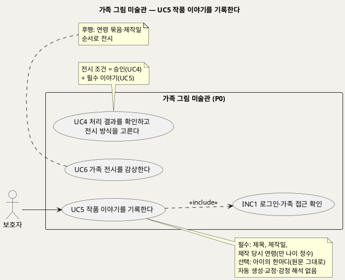
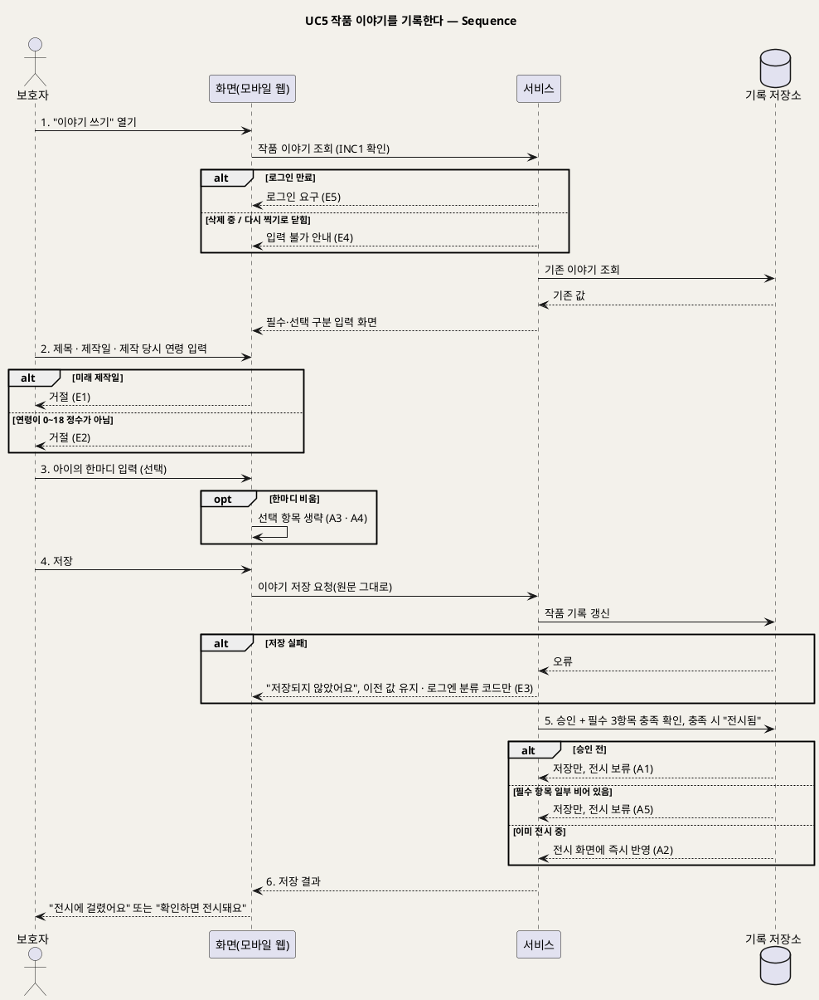

# UseCase 명세 — #5 작품 이야기를 기록한다 (가족 그림 미술관 P0)
**가족 그림 미술관 · UC5 · UML 2.5.1 표준 (UseCase Diagram + UseCase 기술 + Sequence Diagram)**

---

> **문서 식별**: `design/UC_05_작품이야기기록.md`
> **작성일**: 2026-09-23 · **표준**: UML 2.5.1 (OMG)
> **원천(SoT)**: `.specify/features/가족-그림-미술관/spec.md` — FR-7, FR-6(전시 조건) · 보조 원천 `Intent-Specify.md` [핵심 활동] 5 · [핵심 데이터] 작품 · [부정적 영향] 과잉 수집·기억의 재작성
> **다이어그램**: 모든 PlantUML 소스는 렌더 검증 완료(HTTP 200). 아래 링크로 브라우저에서 열 수 있다.

---

## 목차

1. [범위·개요](#1-범위개요)
2. [UseCase Diagram](#2-usecase-diagram)
3. [Actor 카탈로그](#3-actor-카탈로그)
4. [UseCase 목록 (원천 매핑)](#4-usecase-목록-원천-매핑)
5. [UseCase 기술 + Sequence Diagram](#5-usecase-기술--sequence-diagram)
6. [업무규칙 종합](#6-업무규칙business-rules-종합)
7. [UML 표준 준수 노트](#7-uml-표준-준수-노트)

---

## 1. 범위·개요

보호자는 작품마다 **제목, 제작일, 제작 당시 연령**을 입력하고, 원하면 **아이의 한마디**를 덧붙인다. 입력한 말은 **그대로** 저장하고 그대로 보여 준다. 시스템은 문장을 만들거나, 고치거나, 감정을 해석하지 않는다. 이 원칙은 후속 범위인 키워드 기반 설명 생성과 P0를 가르는 경계이기도 하다. P0는 **직접 입력**만 다룬다.

아이의 생년월일을 받지 않으므로, 나이는 작품마다 "제작 당시 연령"으로 받는다. 이 값이 가족 전시(UC6)의 연령별 묶음 기준이 된다. 필수 세 항목이 채워지고 보호자가 승인(UC4)해야 작품이 전시된다.

| 항목 | 값 |
|---|---|
| 대상 시스템 | 가족 그림 미술관 (P0) |
| 상위 프로세스 | 부모 확인(UC4) ↔ **이야기 기록(UC5)** → 전시(UC6). UC4와 순서가 바뀌어도 된다 |
| 원천 근거 | spec FR-7 · FR-6 · Edge Cases · Intent [핵심 활동] 5 · [핵심 데이터] 작품 |
| 핵심 UseCase | 1개 (UC5) + 공통 1개 (INC1) |
| 주요 액터 | 보호자 |

---

## 2. UseCase Diagram

**[「UC5 이야기 기록 UseCase Diagram」 PlantUML 뷰어로 열기](https://plantuml.sumzip.com/plantuml/svg/eNqNU19L21AUf7-f4tC9tExFWeuDuCIrE_YyfNnbQK5tWoNpMpJbhoxBt4bRrYJ12K1iIy1MxSEsarem0Cc_yh5zT77Dzk2LtQ8bezrJPb9zfn9usuYIbotK2YBKfrPIy7qxu1nihqHZu5uLGebs6OYrbvMybPH8Tsm2KmYhZxmWDQ_WH60vPX1yD-Fs84L1WjdLUOSGozFDKwoQFth6aVtAQbe1vNAtkwldGBqEfhV7VxAOAnk2AvkjwHo37Ffhd_UQXuQygCcH0ec6oNfH1igMfHk6AlV6XtTqyMY3xnhekI6EvOlH7QBPmgngDmxwWzMFY4qMmyUiSvyNKbmxmErAGwZQcbQ8dwj6P8QxDQHvzz17nlsC2esQB3rB7WBCid2DcDCC6KhFp_GcAs4SpgGv2_LsEsJrP7wZKbYxPmq1w5vuSxO7LjY6IP0LbHjouUCn8jSYKknPLlyGO3Y1GMv3m1h7NyN_mb1lbBwWzM9nY0PK_cJCNhYJK7C6qpt5o1LQslnGTEtok5u0ihP7UcvFenuFiDry-8WcqhQeeqM5ao5fQDaGSj1-9WV3mJTneyDftylb6rdoOKWQbjeqebSG1lHoXhuU0vO6PDxM4nFTXgbx3e1VKeAYf9KU-0eANQ_dK8r6Z5N2qcxVpdk-uh4RfkBvj2lmAZT0sf4tSwirPDaQjjXG0WLPD6_68Bjw05CCT1JT8TycGJx-CtTJpP6xc1mFcuxGXz6uTByDvPxFOm4Hd9ko2noH3Q65mQiYblyjJ_oX_wChUcDe)** — 클릭 시 브라우저로 연결됩니다.

#### 다이어그램 쉽게 읽기 (유저 관점)

- **누가 쓰나** — 보호자가 작품의 제목, 그린 날, 그때 나이, 아이가 한 말을 적는다.
- **무슨 순서로** — 결과 확인(UC4) 전이든 후든 언제든 적을 수 있다. 승인과 필수 이야기가 둘 다 갖춰지면 가족 전시(UC6)에 걸린다.
- **«include» = 항상 함께** — 이야기를 쓸 때마다 "로그인·가족 접근 확인"을 거친다.
- **«extend» = 특정 상황에서만** — 이 UC에는 확장 관계가 없다.
- **Generalization(◁)** — 없다. 움직이는 작품과 원본 액자는 같은 이야기 항목을 가진다.

| 기호 | 의미 |
|---|---|
| 사람 모양(actor) | 시스템을 쓰는 사람 |
| 타원(usecase) | 액터가 이루려는 목표 |
| 사각형(rectangle) | 시스템 경계 |
| 점선 `<<include>>` | 항상 함께 수행되는 하위 행위 |
| 노트 | 입력 규칙·전시 조건 보충 |

---

## 3. Actor 카탈로그

| 구분 | 액터 | 이 UC에서의 역할 | 원천 근거 |
|:--:|---|---|---|
| Primary | 보호자 | 작품의 이야기(제목·제작일·제작 당시 연령·아이의 한마디)를 입력하고 수정한다 | spec FR-7 |
| 이해관계자 | 아이 | 한마디의 화자. 시스템을 직접 조작하지 않는다 | spec Target Users |

---

## 4. UseCase 목록 (원천 매핑)

| UC ID | 유스케이스명 | 관계 | 원천 근거 |
|:--:|---|---|---|
| UC5 | 작품 이야기를 기록한다 | 본 문서 | spec FR-7 |
| INC1 | 로그인·가족 접근 확인 | UC5가 «include» | spec FR-9 |
| UC4 | 처리 결과를 확인하고 전시 방식을 고른다 | 전시 조건을 함께 구성(순서 무관) | spec FR-6 · FR-7 수용기준 4 |
| UC6 | 가족 전시를 감상한다 | 후행 | spec FR-8 |

---

## 5. UseCase 기술 + Sequence Diagram

### 5.1 UC5 작품 이야기를 기록한다

> **쉽게 말하면** — 그림 제목과 그린 날, 그때 아이 나이를 적습니다. 아이가 그림을 보며 한 말이 있으면 한마디로 남깁니다. 적은 말은 한 글자도 바뀌지 않고 그대로 전시에 나옵니다.

#### 유스케이스 기술

| 속성 | 내용 |
|---|---|
| **ID** | UC5 (spec FR-7) |
| **유스케이스명** | 작품 이야기를 기록한다 |
| **액터** | 주: 보호자 · 보조: 없음 |
| **사전조건** | (1) 보호자가 로그인되어 있다(INC1). (2) 대상 작품이 접수 완료되어 있고(UC2), 삭제 중이거나 다시 찍기로 닫힌 상태가 아니다 |
| **사후조건** | (1) 제목·제작일·제작 당시 연령과(입력한 경우) 아이의 한마디가 입력한 그대로 저장된다. (2) 보호자가 이미 승인했고 필수 세 항목이 모두 채워졌으면 상태가 "전시됨"이 되고, 수정 내용은 전시 화면에 곧바로 반영된다. (3) 시스템이 만들거나 바꾼 문장은 없다 |
| **기본흐름** | ↓ 별도 기본흐름표 (승인이 끝난 작품에 처음 입력하는 경우 기준) |
| **대체흐름** | A1. 승인 전 입력 — 확인 대기 상태에서 먼저 입력하면 저장만 하고, 전시는 UC4에서 승인할 때 이뤄진다(spec FR-7 수용기준 4). A2. 전시 후 수정 — 이미 전시된 작품의 이야기를 고치면 전시 화면에 곧바로 반영한다(spec FR-7 수용기준 4). A3. 한마디 생략 — 한마디를 비워도 필수 세 항목만으로 전시 조건을 만족한다(spec FR-7 수용기준 1). A4. 한마디 지우기 — 수정에서 한마디를 비우면 저장된 한마디를 지운다. [추론] 원천은 선택 입력만 명시한다. 삭제 가능은 선택 입력의 당연한 귀결로 판단했다. A5. 필수 항목 일부만 입력 — 일부만 채워 저장하면 입력한 값은 저장하되 전시하지 않는다. 비어 있는 항목을 표시하고 "이야기를 채우면 전시돼요"라고 안내한다. [추론] 원천은 "모두 채워야 전시"만 적었다. 부분 저장 허용은 "언제든 입력·수정"(FR-7)에 맞춘 설계 판단이다 |
| **예외흐름** | E1. 미래 제작일 — 오늘보다 뒤의 날짜면 거절하고 "그린 날은 오늘 이후일 수 없어요"라고 안내한다(spec FR-7 수용기준 2, Edge Cases). E2. 연령 범위 밖 — 만 나이 정수 0~18세가 아니면 거절하고 허용 범위를 안내한다(spec FR-7 수용기준 2, Assumptions). E3. 저장 실패 — 기록 저장소 장애로 저장하지 못하면 "저장되지 않았어요"라고 안내하고 이전 값을 유지한다. 로그에는 입력 문장 없이 분류 코드만 남긴다(spec FR-14 · Intent [핵심 장벽] 인프라). E4. 삭제 중이거나 닫힌 작품 — 삭제 중이거나 다시 찍기로 닫힌 작품이면 입력을 받지 않고 안내한다(spec FR-10 · FR-6). E5. 로그인 만료 — INC1에 따라 다시 로그인하게 한다. [추론] 입력 중이던 내용의 임시 보존 여부는 `자료 없음 — 확인 필요` |
| **포함/확장** | «include» INC1 로그인·가족 접근 확인 |
| **우선순위** | High — 원천 [미션]의 "아이의 그림과 그날의 말을 함께 간직"을 실현하는 기능이고, 전시의 필수 조건이다(spec FR-7) |
| **사용빈도** | 작품 1건당 최초 입력 1회 + 수정 수시. 수정 빈도는 `자료 없음 — 확인 필요` |
| **업무규칙** | BR-STY-01, BR-STY-02, BR-STY-03, BR-EXH-01, BR-CHD-01, BR-ACC-01, BR-PRV-01 |
| **특별 요구사항** | 기억 왜곡 금지: 한마디에 자동 요약·교정·감정 태그를 붙이지 않는다. 입력에 없는 사건·감정·발달 상태를 만들지 않는다(spec FR-7, Constraints · Intent [부정적 영향] 기억의 재작성). 최소 수집: 생년월일·출생연도 대신 작품별 제작 당시 연령만 받는다(Intent [부정적 영향] 과잉 수집). [추론] 출생연도가 없으므로 작품 간 연령·제작일의 앞뒤가 맞는지는 검사하지 않는다. 개인정보: 한마디와 제목은 자유 입력이므로 운영 로그와 지표에 남기지 않는다(spec FR-13, FR-14) |
| **비고** | 원천 추적: spec FR-7(수용기준 5개 전부: 필수 3·선택 1 / 제작일·연령 검증 / 원문 그대로 / 전후 언제든 입력·즉시 반영 / 결과 종류 무관 동일 항목) · FR-6(전시 조건) · Edge Cases "이야기를 입력하지 않고 승인만 누름", "미래 제작일 또는 범위 밖 연령" · Assumptions "제작 당시 연령", "이야기 필수 항목" · Key Entities "작품" · Intent [핵심 활동] 5 "제목·제작일·제작 당시 연령·선택형 한마디" · Intent [핵심 데이터] 작품 · Intent [가치제안] "작품과 실제 말이 먼저 보인다". 후속 범위(키워드·설명 초안·부모 승인본 구분)는 spec Out of Scope이므로 다루지 않는다 |

#### 기본흐름 (Basic Flow)

| 단계 | 액터 행위 | 시스템 행위 |
|:--:|---|---|
| 1 | 보호자가 작품의 "이야기 쓰기"를 연다(UC4 안내 또는 작품 상세에서) | INC1로 접근을 확인하고, 필수 항목(제목·제작일·제작 당시 연령)과 선택 항목(아이의 한마디)을 구분한 입력 화면을 보여 준다 |
| 2 | 보호자가 제목, 제작일, 제작 당시 연령을 입력한다 | 제작일이 오늘 이후가 아닌지, 연령이 만 나이 정수 0~18인지 바로 검사한다 |
| 3 | 보호자가 원하면 아이의 한마디를 입력한다 | 입력한 글자를 그대로 받는다. 자동 요약·교정·감정 태그는 제안하지 않는다 |
| 4 | 보호자가 "저장"을 누른다 | 입력값을 원문 그대로 작품 기록에 저장한다 |
| 5 | — | 보호자 승인과 필수 세 항목이 모두 갖춰졌는지 확인하고, 갖춰졌으면 상태를 "전시됨"으로 바꾼다 |
| 6 | 보호자가 저장 결과를 확인한다 | "전시에 걸렸어요"(또는 승인 전이면 "확인하면 전시돼요")를 보여 준다 |

#### Sequence Diagram

**[「UC5 이야기 기록 Sequence」 PlantUML 뷰어로 열기](https://plantuml.sumzip.com/plantuml/svg/eNqVVc9PE1EQvr-_YlIvbQS0FIzxYMQKCRdjYvRKFlixsbTYLjFeTNXVVFpjhS4s0N1sY7GAELdaS5vUi3-Kx32z_4Pz9gdQakw8ve7OvG_m--ab7a28IuWU1eU05OWnc4-k5VT6-dySlE7LuedzVydZ_kkqsyLlpGWYlxaeLOWyq5nFZDadzcGlmcRMfPr2uYz8Y2kx-yyVWYJHUjovMyWlpGV4kJwEND-660VAo41a3-nafK8P4qgbrlbjpQb8LlThvvx0Vc4syIxJCwoViPDvbVfvolmJgJSHe1JOziiMSimphdSKlFEg4m5X-UE7yg_3uV1Fow-424t52Q9mBzNRrfGeimsNL3r_YZItSoo0L-VliPidAFoFNPfwbdlLuXObMb8kjN4kOLgB8THCCSkAbth0RAC32nQyyqA8AqbEi3QB67a7U4bo7N1kHNxtDY1ujElpBXi95px06RF4s8w_lRl4EKNhybM47lSdH0cQnZ6MMZnUBXx1jFYNsPERrgBpiCV6sN97ZGr04otr6hfh0HzDrT3gnaJjFwC1In_VJsgJgswsMi_1JjGnTILBenuIAqPg6CnPIMmx19lAGVdTsaj_OkHVcl8bQH3zjhoW92c2JO74GA2gxg8P4NeJ-EUaioGePhCjnkdxy-ZWLwDzNfza5aZ-dodIi2EQcFCCGm3ZaBWJaTwUz0MhdnD1Rfw63dWoYV8TlZf0f0GM-2Jd7D8xJu4KvQwdhKubRV6thqSjvhQxll1RzkWFJXcLQbVwRr5ornYsxMDXBjd_QHQqIaSYmvh78YmxwL2DNjwbnhcUHsJvx1HcrfCjLpCxeLlAZokNTD4wb7AUjt3CkuXpHIKUGm55n3oesALqDb435LeIf4dXdGwKbddQ03GzTX1ERrz2LFW4B7BmiQRiGBh-i7TpqIQI-LPKN0gv2p7pRMD-fLuTRH2tJzbkcuA7SITadQ6w3gr2bSR8FCaivlQ6eWU_4lPzEejtEC-fQLM8Av4doK-S6Cs6FXopqBoWNfq8U_Amu0n7YxbRKP8H6Ol2G23ydRimJR_G8CL-NuFWBfDzOw_J1lF_SUjj58UKB3ItNAo432zne59dtHmgjAB0Wl1udYNxAdcrfK0qPrlCTVfTqWzQBP_QFynsFtWjf5I_WMkIPA==)** — 클릭 시 브라우저로 연결됩니다.

기본흐름 1~6단계는 시퀀스의 번호 붙은 주요 메시지 `1.`~`6.`과 1:1로 대응한다.

---

## 6. 업무규칙(Business Rules) 종합

| BR ID | 규칙 | 적용 UC | 근거 |
|---|---|---|---|
| BR-STY-01 | 제목·제작일·제작 당시 연령은 전시에 필요한 필수 항목이고, 아이의 한마디는 선택 항목이다 | UC5 | spec FR-7 수용기준 1 · Assumptions "이야기 필수 항목" · Intent [부정적 영향] "아이의 한마디는 선택 입력" |
| BR-STY-02 | 제작일은 오늘보다 뒤일 수 없다. 제작 당시 연령은 만 나이 정수 0~18세만 받는다 | UC5 | spec FR-7 수용기준 2 · Assumptions "제작 당시 연령" |
| BR-STY-03 | 아이의 한마디는 입력한 글자 그대로 저장·표시한다. 자동 요약·교정·감정 해석을 하지 않고, 입력에 없는 사건·감정·발달 상태를 만들지 않는다 | UC5, UC6 | spec FR-7 수용기준 3 · Constraints 기억 왜곡 금지 · Intent [부정적 영향] 기억의 재작성 |
| BR-EXH-01 | 전시 조건은 보호자 승인(좋아요 또는 액자로 걸기)과 필수 이야기 입력 완료를 모두 갖추는 것이다 | UC4, UC5, UC6 | spec FR-6 · FR-7 · Edge Cases |
| BR-CHD-01 | 아이의 실명·생년월일·출생연도는 받지 않는다. 나이는 작품별 제작 당시 연령으로만 받는다 | UC1, UC5 | spec FR-1 · Intent [핵심 데이터] · [부정적 영향] 과잉 수집 |
| BR-ACC-01 | 가족 공간의 작품·이야기는 해당 가족만 조회할 수 있다 | UC1~UC7 | spec FR-9 |
| BR-PRV-01 | 운영 로그에는 자유 입력 텍스트(제목·한마디 등)를 남기지 않는다 | 전 UC | spec FR-14 |

---

## 7. UML 표준 준수 노트

| 항목 | 적용 |
|---|---|
| UC 분리 | 승인(UC4)과 이야기 기록(UC5)은 둘 다 전시 조건이지만 목표와 수행 시점이 달라서 별도 UC로 뒀다. 순서 의존이 없으므로 include나 extend로 묶지 않았다 |
| 추상수준 | 제목·제작일·연령·한마디 필드는 UC가 아니라 기본흐름 단계로 내렸다 |
| 선택 항목 | 한마디 생략은 정상 경로의 변형이라 대체흐름(A3)으로 처리했다 |
| Sequence | 입력 검증은 화면 단에서 `alt`로 표현했고, 전시 전환 조건(승인 전·부분 입력·전시 중)도 `alt`로 나눴다 |

---

*가족 그림 미술관 P0 · UC5 · 2026-09-23 · 원천: spec.md FR-7*
