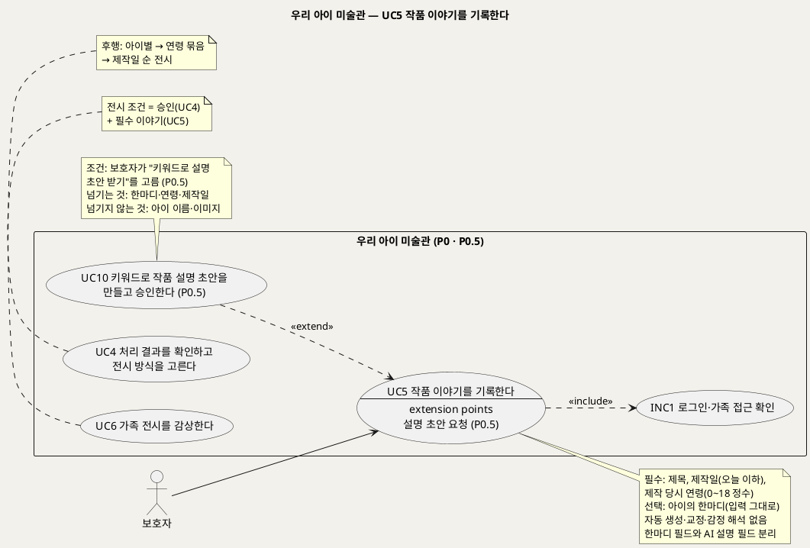
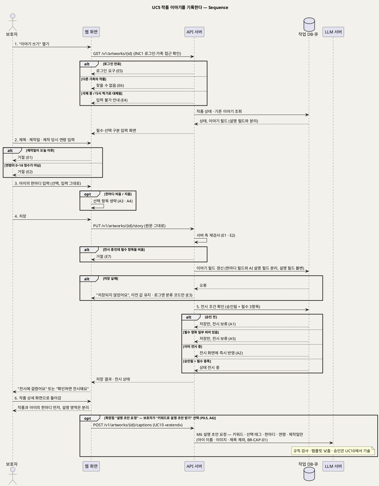

# UseCase 명세 — #5 작품 이야기를 기록한다 (우리 아이 미술관 P0)
**우리 아이 미술관 · UC5 · UML 2.5.1 표준 (UseCase Diagram + UseCase 기술 + Sequence Diagram)**

---

> **문서 식별**: `design/UC_05_작품이야기기록.md`
> **작성일**: 2026-09-23 · **개정**: 2026-09-28 — 서비스 이름을 "우리 아이 미술관"으로 변경, P0.5 확장점 "설명 초안 요청"(UC10 «extend») 추가, 아이의 한마디와 AI 설명의 저장 필드·화면 분리, UC10에 넘길 수 있는 입력 범위(BR-CAP-01) 명시 · **표준**: UML 2.5.1 (OMG)
> **원천(SoT)**: `Intent-Specify.md` (2026-09-28 기획 기준안) — [핵심 데이터] 작품·작품 설명 · [가치제안] 경험 원칙 · [부정적 영향] 과잉 수집·기억의 재작성 · [핵심 장벽] 기억 왜곡 · `.specify/features/우리-아이-미술관/spec.md` v2.0 — FR-7(본 UC), FR-6(전시 조건), FR-27(P0.5 확장)
> **다이어그램**: 모든 PlantUML 소스는 렌더 검증 완료(HTTP 200). 아래 링크로 브라우저에서 열 수 있다. `plantuml.sumzip.com` 은 사내 SSO 로그인 뒤 열린다.
> **표기**: `[추론]` = 원천에 직접 없는 설계 판단 · `자료 없음 — 확인 필요` = 원천에 근거가 없는 항목 · U1~U15 = 공통 미해결 번호

---

> **개정 (2026-09-30, 통합 결정 D34 — 이제민)**: **이야기는 전시의 선행 조건이 아니다.** 올리기 때 시스템이 먼저 채운다 — 그린 날 = 사진 촬영일(브라우저가 EXIF에서 날짜만 보냄, 없으면 올린 날), 나이 = 그 아이의 가장 최근 기록(없으면 비움 = "나이 미정"), 제목 = "제목 없는 그림 N"(자동 제목 표시). 보호자는 걸린 뒤 언제든 고친다. 걸린 작품의 제목 · 그린 날은 비울 수 없고(E7 유지), 나이는 비울 수 있다. 아이의 한마디 · 감상평은 지금처럼 선택. 세부: `docs/B/B_D34_설계반영안_2026-09-30.md` §4.

## 목차

1. [범위·개요](#1-범위개요)
2. [UseCase Diagram](#2-usecase-diagram)
3. [Actor 카탈로그](#3-actor-카탈로그)
4. [UseCase 목록 (원천 매핑)](#4-usecase-목록-원천-매핑)
5. [UseCase 기술 + Sequence Diagram](#5-usecase-기술--sequence-diagram)
6. [업무규칙 종합](#6-업무규칙business-rules-종합)
7. [UML 표준 준수 노트](#7-uml-표준-준수-노트)

---

## 1. 범위·개요

보호자는 작품마다 **제목, 제작일, 제작 당시 연령**을 입력하고, 원하면 **아이의 한마디**를 덧붙인다. 한마디는 **입력한 글자 그대로** 저장하고 그대로 보여 준다. 시스템은 이 UC에서 문장을 만들거나 고치거나 감정을 해석하지 않으며, 모델(M1~M7)도 부르지 않는다. 아이의 생년월일을 받지 않으므로 나이는 작품마다 "제작 당시 연령"으로 받고, 이 값이 가족 전시(UC6)의 연령 묶음 기준이 된다. 보호자 승인(UC4)과 필수 세 항목이 모두 갖춰져야 작품이 `전시 중`이 된다.

> **개정 (2026-09-29, D25 — 이제민)**: 선택 항목 **보호자 감상평**을 더한다. 보호자가 작품을 본 느낌을 적는 칸으로, 아이의 한마디와 따로 입력 그대로 저장하고(BR-STY-04) 전시 월 라벨에 "보호자 감상평"으로 보인다. 전시 조건(G12)이 아니고, P0.5 설명 초안(UC10) 입력에도 넣지 않는다 — 작품 해설은 아이 기준이다.

P0.5부터는 이 UC에 **확장점 "설명 초안 요청"**이 생긴다. 보호자가 "키워드로 설명 초안 받기"를 고르면 UC10(키워드로 작품 설명 초안을 만들고 승인한다)이 이 UC를 «extend»한다. 이때 여기서 입력한 한마디·제작 당시 연령·제작일은 설명 생성의 입력이 될 수 있지만, 아이 이름(별칭)과 작품 이미지는 넘기지 않는다(BR-CAP-01). 아이의 한마디(실제 말)와 AI 설명은 **저장 필드도, 화면 영역도 따로** 둔다(BR-STY-03, BR-EXH-05). AI 설명이 한마디 칸을 채우거나 덮어쓰는 일은 없다.

| 항목 | 값 |
|---|---|
| 대상 시스템 | 우리 아이 미술관 (P0, 확장점은 P0.5) |
| 상위 프로세스 | 접수(UC2) → 결과 확인·승인(UC4) ↔ **이야기 기록(UC5)** → 전시(UC6). UC4와 순서가 바뀌어도 된다. P0.5: UC5 → (선택) UC10 설명 초안 |
| 원천 근거 | spec v2.0 FR-7 · FR-6 · FR-27 · Intent [핵심 데이터] 작품 · [가치제안] 경험 원칙 "작품과 실제 말이 먼저 보인다" · [부정적 영향] 과잉 수집·기억의 재작성 |
| 핵심 UseCase | 1개 (UC5) + 공통 1개 (INC1) + 확장 1개 (UC10, P0.5) |
| 주요 액터 | 보호자 |

---

## 2. UseCase Diagram

**[「UC5 이야기 기록 UseCase Diagram」 PlantUML 뷰어로 열기](https://plantuml.sumzip.com/plantuml/svg/eNqNVEFLG1EQvr9fMaSXSFUiVSnBiq1U8FK8eBPCmqxxcd2V3Q1tKS1pXSVVodEmbdSsRIiKYumqqYmQkz_F477Z_9B5u5sYD5YewgtvZr75vvnm7YRpSYaVW1Yhl07pOSOVXlTUTCorqapsvE8lRpi5pGgrkiEtw7yUXsoaek7LTOqqbsCTqWdTQ69f9WSYi1JGf6toWViQVFNmqrxggaWDoWQXLcgohpy2FF1jlmKpMuCey4_PAcs2Og3gv1tYqHmNPNzlSzA7OQJ4sO3vFICCWG57LZcftUEch45frvLNOmNS2iIeMX7V8CstPCjGQDJhRjJkzWJMNJO0LDWKPdYpPpOA2ybMJAZH-mLwgQHkTDktmXLQn7Bi_8VjYIDJ7yxZM0kbrOiKZpkM7To_WwNsFLBMtXslvPwl-olOPX1i028mh4AfVr1mC53WbdNz83h4AVjb9ppt8HfLdBvIEom9hbOTQwnwv9Rxf4t_rxJCl2dvZ3TsOY2fUErdu6oBbtwQXki7w0aAC7CH4MOAlxUxNO_S9a7aQnNIxi9XCGlOw5qNm1Xg7iluOtQG6JYftQg4Qhx-CDgKXWmiMBiiW8TVzyGbqGiUfWQsdBAGBsaFD0x4MDg4HkwAkjA2pmhpNZeRx8dZMAQREzkiFPiQoQjTdEuOFk9fCHAAfFqAQiVJFKr87LRfnDQ0dNpxrNT5RkV4TPr6-ik3jAHfvBEy8afLazfxxKeh5xQpE0qfyLFr_qqTjBYLnQoIMScFXirF8WCN146AfOVbebInyD8o8m-7gKsO2hfk9Z8iYQnPxUm1DbQdarWOzlbANsISvMlj3M3Dy-mOv-Ed8GubXGIkGoTiUPa8bln6cqg7MBYPXe-ikYTuSyEvIPZwewJYkRuuLHf3acljgU_k7LEd7QtlcLsi9n-jRMuxmrznedsMx0RnZ7DdbDzJ05g2ukXRW6QfQVMBnfQsT_L_UDIcuBJsXagHXkQLHaegIPY0cvj-rVKEKD-OOSrmvG_7P752KPErG-7WdyLHgZ9fh24Edx1ZgIVqxOUefIL-0Zf0L3V0pIk=)** — 클릭 시 브라우저로 연결됩니다.

#### 다이어그램 쉽게 읽기 (유저 관점)

- **누가 쓰나** — 보호자가 작품의 제목, 그린 날, 그때 나이, 아이가 한 말을 적는다.
- **무슨 순서로** — 결과 확인(UC4) 전이든 후든 언제든 적을 수 있다. 승인과 필수 이야기가 둘 다 갖춰지면 가족 전시(UC6)에 걸린다.
- **«include» = 항상 함께** — 이야기를 쓸 때마다 "로그인·가족 접근 확인"을 거친다.
- **«extend» = 특정 상황에서만** — P0.5부터, 보호자가 "키워드로 설명 초안 받기"를 고를 때만 UC10이 끼어든다. 고르지 않으면 이 UC는 직접 입력만으로 끝난다. 화살표가 UC10에서 UC5로 향하는 것은 "UC10이 UC5에 덧붙는다"는 뜻이다.
- **Generalization(◁)** — 없다. 움직임·2.5D 부조·원본 액자 어느 결과든 같은 이야기 항목을 가진다.

| 기호 | 의미 |
|---|---|
| 사람 모양(actor) | 시스템을 쓰는 사람 |
| 타원(usecase) | 액터가 이루려는 목표 |
| 타원 안 `extension points` | 다른 UC가 덧붙을 수 있는 지점 |
| 사각형(rectangle) | 시스템 경계 |
| 점선 `<<include>>` | 항상 함께 수행되는 하위 행위 |
| 점선 `<<extend>>` | 조건이 맞을 때만 덧붙는 행위 (확장 UC → 기본 UC) |
| 노트 | 입력 규칙·확장 조건·전시 조건 보충 |

---

## 3. Actor 카탈로그

| 구분 | 액터 | 이 UC에서의 역할 | 원천 근거 |
|:--:|---|---|---|
| Primary | 보호자 | 작품의 이야기(제목·제작일·제작 당시 연령·아이의 한마디)를 입력하고 수정한다. P0.5에서 설명 초안 받기를 고를 수 있다 | spec FR-7 · FR-27 · Intent [가치제안] 지금의 보호자 |
| 이해관계자 | 아이 | 한마디의 화자. 시스템을 직접 조작하지 않으므로 액터로 두지 않는다 | 공통 기준 §6 액터 |

자체 호스팅 모델(M1~M7)은 시스템 내부 구성요소라 액터가 아니다. 이 UC의 기본흐름은 어떤 모델도 부르지 않는다. 확장점에서 쓰는 M6(LLM 서버)과 조건부 보조 액터 "과정 제공 LLM"은 UC10 문서에서 다룬다.

---

## 4. UseCase 목록 (원천 매핑)

| UC ID | 유스케이스명 | 관계 | 원천 근거 |
|:--:|---|---|---|
| UC5 | 작품 이야기를 기록한다 | 본 문서 | spec FR-7 · Intent [핵심 데이터] 작품 |
| INC1 | 로그인·가족 접근 확인 | UC5가 «include» | 공통 기준 §6 · BR-ACC-01·02 |
| UC10 | 키워드로 작품 설명 초안을 만들고 승인한다 (P0.5) | UC5를 «extend» (확장점: 설명 초안 요청) | spec FR-27 · Intent [가치제안] "P0.5부터는 키워드로 설명 초안도 받는다" |
| UC4 | 처리 결과를 확인하고 전시 방식을 고른다 | 전시 조건을 함께 구성(순서 무관) | spec FR-6 · BR-EXH-01 |
| UC6 | 가족 전시를 감상한다 | 후행 | spec FR-8 · BR-EXH-02 |

---

## 5. UseCase 기술 + Sequence Diagram

### 5.1 UC5 작품 이야기를 기록한다

> **쉽게 말하면** — 그림 제목과 그린 날, 그때 아이 나이를 적습니다. 아이가 그림을 보며 한 말이 있으면 한마디로 남기고, 그 말은 한 글자도 바뀌지 않고 그대로 전시에 나옵니다. P0.5부터는 원하면 키워드로 설명 초안을 따로 받을 수 있지만, 그 설명은 "AI 작성" 칸에 따로 놓이고 아이의 말과 섞이지 않습니다.

#### 유스케이스 기술

| 속성 | 내용 |
|---|---|
| **ID** | UC5 (spec v2.0 FR-7) |
| **유스케이스명** | 작품 이야기를 기록한다 |
| **액터** | 주: 보호자 · 보조: 없음 (모델·외부 시스템을 부르지 않는다) |
| **사전조건** | (1) 보호자가 로그인되어 있고 대상 작품이 자기 가족의 작품이다(INC1, BR-ACC-01·02). (2) 대상 작품이 접수 완료되어 있다(UC2, BR-INT-02). 상태는 `접수됨`~`전시 중` 또는 `처리하지 못함` 중 하나이고 `삭제 중`이 아니다. (3) 다시 찍기로 대체된 이전 작품이 아니다 [추론] |
| **사후조건** | (1) 제목·제작일·제작 당시 연령과(입력한 경우) 아이의 한마디가 입력한 그대로 작품 기록의 이야기 필드에 저장된다. (2) 한마디 필드는 AI 설명 필드와 분리되어 있고, 이 UC는 설명 필드를 만들거나 바꾸지 않는다. (3) 작품이 `승인됨`이고 필수 세 항목이 모두 채워졌으면 상태가 `전시 중`이 되고, 이미 `전시 중`이면 수정 내용이 전시 화면에 곧바로 반영된다. (4) 시스템이 만들거나 바꾼 문장은 없다. (5) 운영 로그에는 자유 입력(제목·한마디)이 남지 않는다 |
| **기본흐름** | ↓ 별도 기본흐름표 (승인이 끝난 작품에 처음 입력하는 경우 기준) |
| **대체흐름** | A1. 승인 전 입력 — `확인 대기` 이전 상태에서 먼저 입력하면 저장만 하고, 전시는 UC4에서 승인할 때 이뤄진다(BR-APR-01, BR-EXH-01). A2. 전시 후 수정 — `전시 중`인 작품의 이야기를 고치면 전시 화면에 곧바로 반영한다(spec FR-7). A3. 한마디 생략 — 한마디를 비워도 필수 세 항목만으로 전시 조건을 만족한다(BR-STY-01). A4. 한마디 지우기 — 수정에서 한마디를 비우면 저장된 한마디를 지운다. [추론] 원천은 선택 입력만 명시하며, 삭제 가능은 선택 입력의 귀결로 판단했다. A5. 필수 항목 일부만 입력 — 전시 전 작품에서 일부만 채워 저장하면 입력한 값은 저장하되 전시하지 않는다. 비어 있는 항목을 표시하고 "이야기를 채우면 전시돼요"라고 안내한다 [추론 — "언제든 입력·수정"에 맞춘 부분 저장 허용]. A6. 설명 초안 요청 (P0.5, 확장점) — 보호자가 설명 영역의 "키워드로 설명 초안 받기"를 고르면 UC10이 «extend»로 이어진다. UC10에 넘길 수 있는 이 UC의 값은 아이의 한마디·제작 당시 연령·제작일뿐이고, 아이 이름(별칭)·작품 이미지는 넘기지 않는다(BR-CAP-01). 제목은 BR-CAP-01 허용 입력 목록에 없으므로 넘기지 않는다 [추론]. 초안은 설명 필드에만 저장되고 한마디 필드는 바뀌지 않는다(BR-STY-03). P0에서는 이 선택지를 화면에 보이지 않는다. A7. 승인된 AI 설명이 있는 작품의 이야기 수정 (P0.5) — 한마디·연령·제작일을 고쳐도 승인된 설명은 고정이라 자동으로 다시 만들지 않는다(BR-CAP-04). "승인한 설명은 그대로 남아요"라고 안내한다 [추론 문구]. 승인 뒤 설명을 바꾸는 경로는 `자료 없음 — 확인 필요`. A8. `처리하지 못함` 작품 — 인프라 실패로 결과가 없는 작품에도 이야기를 먼저 적어 둘 수 있다. 보호자가 원본 액자로 걸기를 골라 승인하면 전시 조건을 채운다 [추론] |
| **예외흐름** | E1. 미래 제작일 — 오늘보다 뒤의 날짜면 거절하고 "그린 날은 오늘 이후일 수 없어요"라고 안내한다(BR-STY-02). 화면과 API 서버가 모두 검사한다 [추론]. E2. 연령 범위 밖 — 만 나이 정수 0~18이 아니면 거절하고 허용 범위를 안내한다(BR-STY-02). E3. 저장 실패 — DB 장애로 저장하지 못하면 "저장되지 않았어요"라고 안내하고 이전 값을 유지한다. 입력 중인 값은 화면에 남겨 다시 저장할 수 있게 한다 [추론]. 로그에는 입력 문장 없이 오류 분류 코드만 남긴다(BR-PRV-01 · Intent [핵심 데이터] 오류 분류 "DB"). E4. 삭제 중이거나 대체된 작품 — `삭제 중`이거나 다시 찍기로 대체된 이전 작품이면 입력을 받지 않고 안내한다(BR-DEL-01 새 작업 차단, BR-APR-05). E5. 로그인 만료 — INC1에 따라 다시 로그인하게 한다. 입력 중이던 내용의 임시 보존 여부는 `자료 없음 — 확인 필요`. E6. 다른 가족의 작품 — 가족 격리에 따라 작품이 없는 것처럼 거절한다(BR-ACC-01) [추론 — 존재 여부를 드러내지 않는 응답]. E7. 전시 중 작품의 필수 항목 비우기 — `전시 중`인 작품에서 제목·제작일·연령을 비우고 저장하면 거절하고 "전시 중인 작품은 제목·그린 날·나이를 비울 수 없어요"라고 안내한다 [추론 — 전시 조건이 저장만으로 깨지지 않게 함] |
| **포함/확장** | «include» INC1 로그인·가족 접근 확인 · «extend» UC10 키워드로 작품 설명 초안을 만들고 승인한다 → UC5 (확장점: 설명 초안 요청 — 보호자가 "키워드로 설명 초안 받기" 선택, P0.5) |
| **우선순위** | High — Intent [미션]의 "아이의 작품과 그날의 말을 가족이 함께 간직"을 실현하고, 전시의 필수 조건이다(spec FR-7, BR-EXH-01) |
| **사용빈도** | 작품 1건당 최초 입력 1회 + 수정 수시. 작품 등록 빈도·수정 빈도는 `자료 없음 — 확인 필요` |
| **업무규칙** | BR-STY-01, BR-STY-02, BR-STY-03, BR-EXH-01, BR-EXH-05, BR-CAP-01, BR-CAP-04, BR-CHD-01, BR-APR-01, BR-APR-05, BR-DEL-01, BR-ACC-01, BR-ACC-02, BR-PRV-01 |
| **특별 요구사항** | 기억 왜곡 금지: 한마디에 자동 요약·교정·감정 태그를 붙이지 않고, 입력에 없는 사건·감정·발달 상태를 만들지 않는다(Intent [부정적 영향] 기억의 재작성 · 경험 원칙). 필드 분리: 한마디(실제 말)와 AI 설명은 저장 필드와 화면 영역을 나눈다. 화면에서는 작품과 한마디를 먼저 보이고, AI 설명은 "AI 작성" 표시와 함께 별도 영역에 둔다(BR-STY-03, BR-EXH-05). 최소 수집: 생년월일·출생연도 대신 작품별 제작 당시 연령만 받는다(BR-CHD-01). [추론] 출생연도가 없으므로 작품 간 연령·제작일의 앞뒤가 맞는지는 검사하지 않는다. 결과 종류 무관: 움직임·2.5D 부조·원본 액자 모두 같은 이야기 항목을 가진다(BR-EXH-04). 개인정보: 제목·한마디는 자유 입력이므로 운영 로그·지표 라벨에 남기지 않는다(BR-PRV-01, BR-OPS-04). 외부 전달 금지: 이 UC의 입력을 외부 업체·외부 모델 API로 보내지 않는다(BR-PRV-02) |
| **비고** | 원천 추적: spec v2.0 FR-7(필수 3·선택 1 / 제작일·연령 검증 / 원문 그대로 / 승인 전후 언제든 입력·즉시 반영 / 결과 종류 무관 동일 항목) · FR-6(전시 조건) · FR-27(P0.5 확장 UC10) · Intent [핵심 데이터] 작품 "제목·제작일·제작 당시 연령·아이의 한마디(선택, 입력 그대로)", 작품 설명 "보호자 키워드·선택한 태그·초안·출처…승인 후 고정" · [가치제안] 경험 원칙 "작품과 실제 말이 먼저 보인다", "AI가 쓴 설명은 'AI 작성'으로 표시하고 아이의 실제 말과 섞지 않는다" · [부정적 영향] 과잉 수집 "설명 생성 입력에 이미지와 아이 이름을 넣지 않는다", 기억의 재작성 · [핵심 장벽] 상 — 기억 왜곡 · 공통 기준 §4(`PUT /v1/artworks/{id}/story`, `POST /v1/artworks/{id}/captions`), §5(상태 모델), §6(확장 관계), §8(BR). 추가 요구 R1~R4는 이 UC에 직접 해당하지 않는다. 미해결: U1(가족 접근 계정 모델 — 공동 보호자가 있으면 누가 이야기를 쓰고 동시 수정을 어떻게 처리할지 미정), E5 임시 보존 여부, A7 승인 뒤 설명 변경 경로, U3·U11(확장점 쪽 M6 실행 방식·규칙 검사는 UC10에서 다룸), U8(엔드포인트 이름은 [추론]) |

#### 기본흐름 (Basic Flow)

| 단계 | 액터 행위 | 시스템 행위 |
|:--:|---|---|
| 1 | 보호자가 작품의 "이야기 쓰기"를 연다(UC4 안내 또는 작품 상세에서) | INC1로 로그인·가족 접근을 확인하고, 작품 상태와 기존 이야기를 불러와 필수 항목(제목·제작일·제작 당시 연령)과 선택 항목(아이의 한마디)을 구분한 입력 화면을 보여 준다 |
| 2 | 보호자가 제목, 제작일, 제작 당시 연령을 입력한다 | 제작일이 오늘 이후가 아닌지, 연령이 만 나이 정수 0~18인지 바로 검사한다 |
| 3 | 보호자가 원하면 아이의 한마디를 입력한다 | 입력한 글자를 그대로 받는다. 자동 요약·교정·감정 태그를 제안하지 않고, 한마디 칸은 AI 설명 칸과 따로 둔다 |
| 4 | 보호자가 "저장"을 누른다 | `PUT /v1/artworks/{id}/story`로 받은 값을 다시 검사한 뒤, 원문 그대로 이야기 필드에 저장한다. 설명 필드는 건드리지 않는다 |
| 5 | 보호자가 저장 결과 안내를 확인한다 | `승인됨`과 필수 세 항목 충족을 확인해 상태를 `전시 중`으로 바꾸고 "전시에 걸렸어요"(승인 전이면 "확인하면 전시돼요")를 보여 준다 |
| 6 | 보호자가 작품 상세 화면으로 돌아간다 | 작품과 아이의 한마디를 먼저 보이고, 설명 영역은 분리해 둔다. P0.5에서는 이 영역에 확장점 "키워드로 설명 초안 받기"를 둔다 |

#### Sequence Diagram

**[「UC5 이야기 기록 Sequence」 PlantUML 뷰어로 열기](https://plantuml.sumzip.com/plantuml/svg/eNqVVl1vGlcQfd9fMaIvWPUXsZ1WeYiCnaSKlLRWU79Vsjb21kEm4MA6aVS1Iva6ojZRcAIBx4BABX-kdrt2iFmrtJH8U_q4d_Y_dO7HYjBWpb4Ay50798yZM-fujaSpJ8zlR1FIGo9n48uJ2bmHkej87IIejRqJZ7OjE1pyMRJb0hP6I3igzy0uJOLLsfmpeDSegE9uj90O3Zrsikg-1OfjTyOxBfhOjyYNzYyYUQNmpiYAK5veqzRguYn5tuvYrNEG_lUre_kS26jDP6kc3DceLxuxOUPT9DmTDgiw902v6GAlGwA9CdN6woiZGh1lRuYiS3rMhABun4K3lWP7TREyc6d3OTx9B9AqsWNLLNOjNq-b-gM9adDeyiYW1uDm5FnLey6PuDnZu__u3Xvd--lR0yQMGLpOp8E1CA1TJr8swNc2fQUAC0361iiC4jiKa_DFrW9g5ElohPI_jScWkyM_ROZ_hOCdL6dCwGolt-Vg2TlruXYKa0eA1U231aba8vTvgKZHzfMgYLsZ9mtGA5F5yEdyvo5vc-6HAwjemhjQDGoEEMOs4YDMjeWi6sfFDGj_jWULME0BhZ-xnKEUV1UKXDnEagmwvgkjPB9u0IP9QjSxBCyTwuMmy-71payssWoD2EmaDgfMp9lKk7KOU9bYvCZCrxPtIlJKZPW5t1qCsxbXB9aa0EVuzfbeZjSKHuqwKsMHu6K8vMVelyCIVp29W1OPuJUiDBbbORjQevDRMpV71kKr6q2WgWijMB-1VFZfy68MU3tK7N0-R0m_uJDK7fMHoudU0FOwWfVUJRMt7AQTXMBina0XOXJv2yLeZiQsddg1cI9srKaJrJDfApGPbx39KfQ5JcsTdEmrxTaK_5XiiuT7YiVjw3wv5440wSdxN81yOb_8oCRl0H8mdVGfqd0DWnzJ7IpnpxZup0gXuJuiHwqIrwDJrJc_5IzhaplVPkAwPMb5Co9fjmucM5zCSqNngqZnLpmgkSRZxTPCup1lB043RiUupRMxxYBOjao5cI9TuMIHJMRRcHZkdyzRtjp1yGEvbCUOBZ1Phiz0osY7LH92iaov6tK1j3CjCsFz9s4VGuZu1aVaJdnBvn_T7H3Kx8xpAtyoexk-fL3DQQprFC_CDcg9LFukdlH_1zFfxDdNMo2AnKOqRShfAZaqPIAIUs5SyAlADdLsXzkCQjZERY-pFnZXPTHcIbNmu0dN5WPUpfVTzm12Dz712R2T9KpyxDrf3FeLBL2bGfRT0-3AsQTD_nz0tIsqabOTlGjZGxq2Spr87H8k9a2TCGF_OF3a6M8hVqRXYCELuPOLyGQXsficMl3xM_XXjif7ZMh9GaUFdh3ZUVVnqGTb3WPbfa-cRwaLrdpFHwjIZY7OPXJY1VH9BlbMsvUcBGR_vHyRalC52Ms2D-mbzavDXVaNluNXXmqLi-BlhhzFtbN9GOQmDvcyy2F7baqpo3RiDguHWPZdW5OOQygrDaxmqSAV10zTncIvPDw-DIi3iM5LA3fGgLdSx-0MFyuB693E7G15V0uDCk6PDk8MQpguPN-_lO18df8y35nTl8xIPJaE4MxUaBTOfjO-N6lPZ38O-AN3nb8wUIJ7V-EyuAJtB59oorLKVT5u_I9zfviqvE667xxS7rexoORTKHXHEutCs2p41VXF92w5gzD59dBUeHpoNMRhxuKmAfEnRkIhdVslPN0CZY8cwFrJy2XYzkdgK7_jSV0kFDrmveGFk6bIW8Vlna4Kod6gD3ql_BekcQ7E)** — 클릭 시 브라우저로 연결됩니다.

기본흐름 1~6단계는 시퀀스의 번호 붙은 주요 메시지 `1.`~`6.`과 1:1로 대응한다. 기본흐름에는 모델 호출이 없다. `LLM 서버` lifeline은 P0.5 확장점(`opt`)에서만 나타나며, 그 뒤의 처리는 UC10 문서가 정의한다.

---

## 6. 업무규칙(Business Rules) 종합

| BR ID | 규칙 | 적용 UC | 근거 |
|---|---|---|---|
| BR-STY-01 | 제목·제작일·제작 당시 연령은 필수, 아이의 한마디는 선택이다 | UC5 | spec FR-7 · Intent [핵심 데이터] 작품 |
| BR-STY-02 | 제작일은 오늘 이하, 제작 당시 연령은 0~18 정수다 | UC5 | spec FR-7 |
| BR-STY-03 | 아이의 한마디는 입력 그대로 저장한다. 자동 해석을 하지 않고, AI 설명과 저장 필드·화면을 분리한다 | UC5, UC6, UC10 | Intent [핵심 데이터] "아이의 한마디(선택, 입력 그대로)" · [가치제안] 경험 원칙 · [부정적 영향] 기억의 재작성 |
| BR-EXH-01 | 전시 조건은 보호자 승인과 필수 이야기 입력 완료다 | UC4, UC5, UC6 | spec FR-6 · FR-7 |
| BR-EXH-05 | 작품과 아이의 실제 말을 먼저 보이고, AI 설명은 "AI 작성" 표시와 함께 분리해 보인다 | UC5, UC6, UC10 | Intent [가치제안] 경험 원칙 "작품과 실제 말이 먼저 보인다", "AI 작성으로 표시하고 아이의 실제 말과 섞지 않는다" |
| BR-CAP-01 | (P0.5) 설명 생성 입력은 보호자 키워드·선택 태그·아이의 실제 발언·제작 당시 나이·제작일만이다. 이미지와 아이 이름은 넣지 않는다 | UC5(확장점), UC10 | Intent [부정적 영향] 과잉 수집 · spec FR-27 |
| BR-CAP-04 | (P0.5) 설명은 보호자가 수정·승인해야 전시에 붙는다. 승인 후 고정·재생성 금지 | UC5(A7), UC10 | Intent [핵심 데이터] 작품 설명 "승인 후 고정" · [부정적 영향] 기억의 재작성 |
| BR-CHD-01 | 아이는 별칭만 받는다. 실명·생년월일·출생연도를 받지 않는다 | UC1, UC5 | Intent [부정적 영향] 과잉 수집 · spec FR-1 |
| BR-APR-01 | 보호자 승인 전에는 전시하지 않는다 | UC4, UC5 | Intent [미션]·경험 원칙 · spec FR-6 |
| BR-APR-05 | 다시 찍은 이전 작품은 삭제 규칙을 따른다 | UC4, UC5(E4), UC7 | spec FR-6 · FR-10 |
| BR-DEL-01 | 삭제가 시작되면 새 작업을 차단한다 | UC5(E4), UC7 | spec FR-10 |
| BR-ACC-01 | 가족 단위로 격리한다 | UC1~UC7, UC10 | spec FR-9 |
| BR-ACC-02 | 비로그인 요청을 차단한다 | UC1~UC7, UC10 | spec FR-9 |
| BR-PRV-01 | 운영 로그에 이미지·객체 키·자유 입력·오류 원문을 남기지 않는다 | 전 UC | spec FR-14 · Intent [핵심 데이터] 운영 지표 |

---

## 7. UML 표준 준수 노트

| 항목 | 적용 |
|---|---|
| UC 분리 | 승인(UC4)과 이야기 기록(UC5)은 둘 다 전시 조건이지만 목표와 수행 시점이 달라 별도 UC로 뒀다. 순서 의존이 없으므로 include나 extend로 묶지 않았다 |
| «extend» 방향 | 설명 초안 생성(UC10)은 보호자가 고를 때만 일어나는 조건부 행위이고 UC5는 그것 없이 완결된다. 그래서 UC10 → UC5 «extend»로 그리고, UC5 타원에 확장점 "설명 초안 요청 (P0.5)"을 적었다. 확장 조건은 노트로 보충했다 |
| 모델 비노출 | M6은 시스템 내부 구성요소라 UseCase Diagram에 액터로 두지 않았다. 시퀀스에서만 `LLM 서버` lifeline으로, 확장점 `opt` 안에 한정해 나타낸다 |
| 추상수준 | 제목·제작일·연령·한마디 필드는 UC가 아니라 기본흐름 단계로 내렸다 |
| 선택 항목 | 한마디 생략·지우기는 정상 경로의 변형이라 대체흐름(A3·A4)으로 처리했다 |
| Sequence | 입력 검증은 화면(`alt`)과 API 서버 재검사로, 전시 전환 조건(승인 전·부분 입력·전시 중·충족)은 `alt`로 나눴다. 예외·대체 ID를 메시지에 병기했다 |

---

## 8. 개정 — 2026-09-30 (D34 · D46, 이제민 결정 "② 미술관 규칙 — 전부 고정 + 큐레이션")

> **쉽게 말하면** — 이야기는 이제 올릴 때 함께 적고, 올린 뒤에는 고칠 수 없습니다. 이야기 화면은 보기만 하는 화면이 되고, 느낌은 가족 댓글(걸린 뒤 7일)로 남깁니다.

| 바뀐 곳 | 새 흐름 | 근거 |
|---|---|---|
| 유스케이스 범위 | 이야기 입력은 UC2 기본흐름 2-1(올리기)로 옮긴다. UC5는 이야기 **보기** · 큐레이션 설명 보기 · 가족 댓글로 바뀐다 | D46 ①②⑦ |
| 기본흐름 | S6은 읽기 전용(제목 · 그린 날 · 나이 · 한마디 · 부모 감상을 적은 그대로) + 안내 "미술관처럼, 걸린 작품은 바꾸지 않아요. 설명은 큐레이터가 해 드려요. 내리고 싶으면 작품을 지울 수 있어요." [저장] 없음 | D46 |
| API | `PUT /v1/artworks/{id}/story` → 내 가족 작품이면 409 `artwork_locked`(G11), 아니면 404 | D46 ① |
| 댓글 (새) | 가족 보호자(공동 보호자 포함)가 댓글을 단다 — 500자, 자기 것만 지움, 이웃 방문에는 없음. **걸린 때(없으면 올린 때)부터 7일** 동안만 쓰고 지운다. 그 뒤 보기만 — `POST`/`DELETE …/comments` 409 `comments_closed`. `GET`은 `{items, open, openUntil, days}` | D46 ④⑧ |
| 전시 전환 | 올릴 때 이미 걸렸으므로(D34) 이야기 저장으로 전시가 되는 흐름은 없다 | D34 |
| 폐기 | 부분 저장 · 동시 수정 충돌(`story_conflict`) · 세션 만료 임시 저장은 쓰지 않는다(저장이 없음) | D46 |
---

*우리 아이 미술관 P0 · UC5 · 2026-09-23 작성 · 2026-09-28 개정 · 원천: Intent-Specify.md (2026-09-28) · spec.md v2.0 FR-7*
