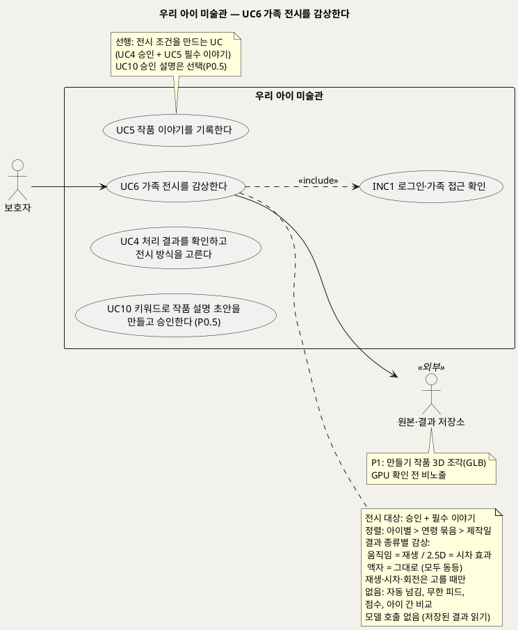
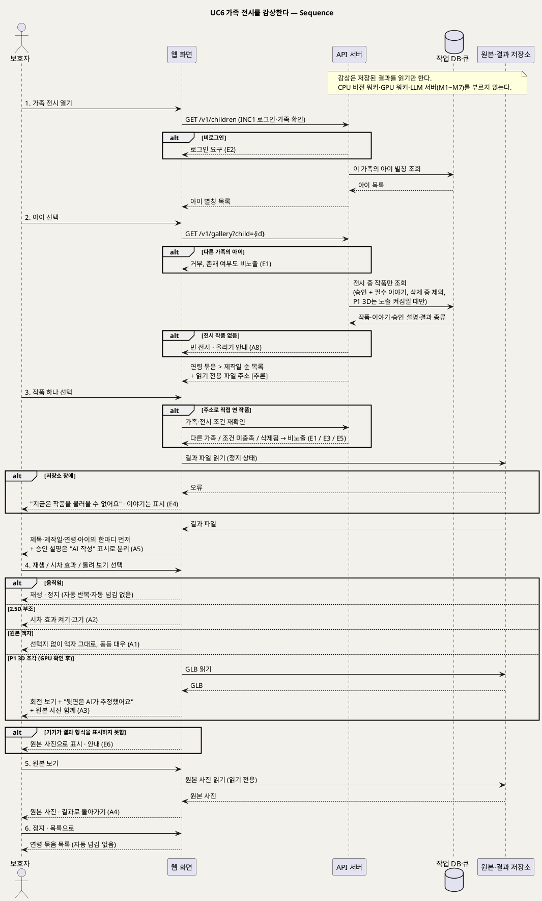

# UseCase 명세 — #6 가족 전시를 감상한다 (우리 아이 미술관 P0)
**우리 아이 미술관 · UC6 · UML 2.5.1 표준 (UseCase Diagram + UseCase 기술 + Sequence Diagram)**

---

> **문서 식별**: `design/UC_06_가족전시감상.md`
> **작성일**: 2026-09-23 · **개정**: 2026-09-28 — 결과 종류 3종(움직임·2.5D 부조·원본 액자)별 감상, 시차 효과는 고를 때만, AI 설명 "AI 작성" 분리 표시(P0.5), 만들기 작품 3D 조각 회전 보기(P1 대체흐름, GPU 확인 전 비노출)를 반영하고 lifeline을 공통 기준으로 바꿨다 · **표준**: UML 2.5.1 (OMG)
> **개정 (2026-09-29, D25 — 이제민)**: 가족 전시는 로그인 뒤 **홈 "{별칭}의 미술관"**이 된다(나이별 "N세관", 평면 안내도, 흑백 액자·명패, 작품 앞 월 라벨 — SD_02 §17-2). 월 라벨에는 아이의 한마디 · 보호자 감상평(BR-STY-04) · 승인된 AI 해설(아이 기준)을 서로 다른 칸으로 보인다.
> **개정 (2026-09-30, D31 — 신지현)**: 홈은 **걸어 다니는 미술관**이 된다(SD_02 §17-6). 입구 회랑 → 걷기 전환 → 회랑 벽의 작품 · 명패 → 갈림길의 "N살 전시실" → 방에서 작품을 누르면 크게 보기 + 한마디. 두 번째 방문부터는 마지막으로 본 방에서 시작하고, [건너뛰기] · [작품 올리기] · [한눈에 보기]가 늘 있다. 벽 색은 보호자가 고른다(이 기기에 저장). 전시 데이터 · 규칙(UX3 낮춤 표시 없음 · UX4 움직임은 누를 때만)은 그대로다.
> **원천(SoT)**: `Intent-Specify.md` (2026-09-28 기획 기준안) [미션] P0 경험 검증 · [가치제안] 경험 원칙 · [부정적 영향] 3D의 추정 면·비교·평가 오용 · [핵심 장벽] 자원 + `.specify/features/우리-아이-미술관/spec.md` v2.0 — FR-8, FR-9, FR-29 · 재작성 공통 기준 §2·§4·§5·§8
> **다이어그램**: 모든 PlantUML 소스는 렌더 검증 완료(HTTP 200). 아래 링크로 브라우저에서 열 수 있다. `plantuml.sumzip.com` 은 사내 SSO 로그인 뒤 열린다.

---

## 목차

1. [범위·개요](#1-범위개요)
2. [UseCase Diagram](#2-usecase-diagram)
3. [Actor 카탈로그](#3-actor-카탈로그)
4. [UseCase 목록 (원천 매핑)](#4-usecase-목록-원천-매핑)
5. [UseCase 기술 + Sequence Diagram](#5-usecase-기술--sequence-diagram)
6. [업무규칙 종합](#6-업무규칙business-rules-종합)
7. [UML 표준 준수 노트](#7-uml-표준-준수-노트)

---

## 1. 범위·개요

가족은 **승인되고 필수 이야기가 채워진 작품만** 모인 전시 화면에서 작품을 **한 점씩 골라** 감상한다. 전시는 아이별로 나뉘고, 한 아이 안에서는 제작 당시 연령별로 묶이며, 묶음 안에서는 제작일 순서로 놓인다(BR-EXH-02). 작품을 고르면 결과가 정지 상태로 먼저 보이고 제목·제작일·제작 당시 연령·아이의 한마디가 함께 보인다. 결과 종류에 따라 감상 방식이 다르다. 움직이는 그림은 재생, 2.5D 부조는 시차 효과, 원본 액자는 그대로 본다. 재생과 시차 효과는 보호자가 고를 때만 켜지고, 다음 작품으로 저절로 넘어가지 않는다(BR-EXH-03). 어느 결과에서든 원본 사진으로 바꿔 볼 수 있다.

감상은 **이미 만든 결과를 저장소에서 읽기만** 한다. 이 UC는 모델(M1~M7)을 부르지 않으므로 CPU 비전 워커·GPU 워커·LLM 서버의 상태와 상관없이 열린다. P0.5에서는 보호자가 승인한 작품 설명이 "AI 작성" 표시와 함께 아이의 실제 말과 떨어진 자리에 붙는다(BR-EXH-05). P1에서 팀 서버 GPU가 확인되면 만들기 작품(점토·종이 공작)의 3D 조각을 돌려 볼 수 있고, 이때 "뒷면은 AI가 추정했어요"와 원본 사진을 함께 보여 준다(BR-EXH-06). GPU 확인 전에는 3D 조각을 화면에 드러내지 않는다(BR-SRV-02).

| 항목 | 값 |
|---|---|
| 대상 시스템 | 우리 아이 미술관 (P0, P0.5 설명 표시, P1 3D 조각 대체흐름) |
| 상위 프로세스 | 결과 확인·승인(UC4) + 이야기 기록(UC5) [+ 설명 승인(UC10, P0.5)] → **감상(UC6)** |
| 원천 근거 | spec FR-8 · FR-9 · FR-29 · Intent [가치제안] 경험 원칙 · [부정적 영향] 3D의 추정 면·비교·평가 오용 · [미션] P0 경험 검증 |
| 핵심 UseCase | 1개 (UC6) + 공통 1개 (INC1) |
| 주요 액터 | 보호자 · 원본·결과 저장소(보조) · 아이(이해관계자, 계정 없이 함께 감상) |
| 엔드포인트 | `GET /v1/gallery?child={id}` (공통 기준 §4, 이름·형식은 [추론] — U8) |
| 호출 모델 | 없음. 결과 생성(M3·M5·M7)과 설명 생성(M6)은 UC3·UC10에서 이미 끝났다 |

---

## 2. UseCase Diagram

**[「UC6 가족 전시 UseCase Diagram」 PlantUML 뷰어로 열기](https://plantuml.sumzip.com/plantuml/svg/eNqFVN9r02AUfc9fcakvHc7ZqttD0SLOHwgiBdnbYGRt1gW7RNIUEREyl0l1FTu3uG5LSiubTimY2bqmUF_2p_iY7-Z_8H5J6lZBfGqT79x7zz3nfLlZ1kVNr6yUoJJfqGjygigvFMVSSdKeLaRmhPJjWXkiauIKLIr5x0VNrSiFWbWkanDh7tW76Tu3ziHKy2JBfSorRVgSS2VJKElLOugqaHJxWYeCrEl5XVYVQZf1kgS457JPHUDLRKcH7JuH1ZbfM-CXsQ1zszPguwa2jwFbJm7Y7HBIL-q4thpYNts4EAQxrxOJBOv2goaHzXoCxDLkRE1S9NEZ7tdZ1zvt-99dvzukTgY2D_FVLYQ-IogE16_jrsdOjGxWEDg9USkStcQ_uCXguQBQKUt5sUyo_7IMBxHqfNH9h7NpYG3b73vocHKjBpt-fwjBrkVvwzoOHJ92DfB7g_OKFuLTInxgNfxua16JWABzv-CGg44J9JYdemdMro03nAZsbgbvq0BbojX0PTfcgH7aztgG0-N16RQELw9wv8a2bFrlTxfzgH1dB-xV0arS-HmFfSbIAbEAfDMIifKmkMylpqYn4t7plPBCECLn4NKlbCgYl3ZqKhuKABmySVbypUpBIp_4EYeFBgqCoupSnDB1KRZ7pEPNICsy8Wy4CAH5WW2cbRtCLdbqZGKrWdeELOCOy1oDYJ0TdGr8uWXThugMCT_K0sd1dtjg8MjvDB0B7hv4eRWbJtwgSTq45sBluDI1fZs_b9joHkGwd0TlIdhqU2rphIJARLmMSfb1iG3Wgb3bZVvHE5xd2OW0H1Wf9oO9Gt_NMSJnh8CsGmnMkTuviCzt0axTOTCz4Q-MSdqhR5pDsD0kqybDfeskweQo2r5rAhuY_o86nfHxbz3g9-nEjjtCMro2rG7_2d35SdpNCJJSAK5-ZMGiquvqSuQBjwuareDD68zIC2y7_nGPZzLMhM3e8FtOuGSY65FDPJN_u8SFCDMXo6KYcRH4jDUnStM_6UQ5AcilMxDn0XNHkb16O2TmribvPbjFB93LzcWXijPn2rB1LsdZ-5v0jz6XvwGWW5eu)** — 클릭 시 브라우저로 연결됩니다.

#### 다이어그램 쉽게 읽기 (유저 관점)

- **누가 쓰나** — 보호자가 전시 화면을 연다. 아이는 곁에서 함께 보지만 계정이 없어 액터로 그리지 않았다. 원본·결과 저장소는 작품 파일(원본 사진, 움직이는 그림, 2.5D 부조, P1 3D 조각)을 꺼내 오는 외부 구성요소다.
- **무슨 순서로** — 보호자가 결과를 승인하고(UC4) 이야기를 채운(UC5) 작품만 여기에 걸린다. 아이를 고르고, 나이별로 묶인 작품 중 한 점을 골라 본다. 움직이는 그림은 재생을, 입체 부조는 시차 효과를 눌러야 움직인다.
- **«include» = 항상 함께** — 전시를 열 때마다 "로그인·가족 접근 확인"을 거친다. 다른 가족의 전시는 볼 수 없다.
- **«extend» = 특정 상황에서만** — 이 UC에는 확장 관계가 없다. 설명 보기(P0.5)와 3D 조각 돌려 보기(P1)는 같은 목표 안의 대체흐름으로 다룬다.
- **Generalization(◁)** — 없다. 움직임·2.5D·액자는 서로 우열이 없는 같은 대우의 작품이라 상속으로 나누지 않았다.

| 기호 | 의미 |
|---|---|
| 사람 모양(actor) | 시스템을 쓰는 사람 또는 외부 구성요소(`<<외부>>`) |
| 타원(usecase) | 액터가 이루려는 목표 |
| 사각형(rectangle) | 시스템 경계 |
| 점선 `<<include>>` | 항상 함께 수행되는 하위 행위 |
| 노트 | 전시 규칙·선후 관계·P1 조건 보충 |

---

## 3. Actor 카탈로그

| 구분 | 액터 | 이 UC에서의 역할 | 원천 근거 |
|:--:|---|---|---|
| Primary | 보호자 | 전시를 열고, 아이와 작품을 골라 재생·시차 효과·(P1) 회전을 켜고 끄며, 원본과 이야기를 함께 본다 | spec FR-8 · Intent [가치제안] 지금의 보호자 |
| Secondary | 원본·결과 저장소(S3 호환) | 원본 사진과 결과 파일(움직임·2.5D·P1 GLB)을 읽기 전용으로 내준다 | 공통 기준 §3·§6 · Intent [핵심 이네이블러] |
| 이해관계자 | 아이 | 계정 없이 보호자와 함께 자기 작품을 본다. 조작 주체가 아니다 | Intent [가치제안] 지금의 아이 · 공통 기준 §6 |
| 이해관계자 | 성장한 아이 | 훗날 작품과 그날의 말을 다시 만난다. 장기 보존·권한 이전은 후속 | Intent [가치제안] 성장한 아이 |

주의: 공동 보호자나 감상 전용 가족이 별도 계정으로 전시를 볼 수 있는지는 미해결 U1(가족 접근 계정 모델)이다 — `자료 없음 — 확인 필요`. 이 문서는 보호자 계정 하나로 가족이 같은 화면을 함께 보는 경우를 기준으로 쓴다.

자체 호스팅 모델(M1~M7)은 시스템 내부 구성요소이고, 이 UC에서는 호출되지 않는다.

---

## 4. UseCase 목록 (원천 매핑)

| UC ID | 유스케이스명 | 관계 | 원천 근거 |
|:--:|---|---|---|
| UC6 | 가족 전시를 감상한다 | 본 문서 | spec FR-8 · FR-9 · FR-29 |
| INC1 | 로그인·가족 접근 확인 | UC6가 «include» | spec FR-9 · BR-ACC-01·02 |
| UC4 | 처리 결과를 확인하고 전시 방식을 고른다 | 선행(승인) | spec FR-6 · BR-APR-01 |
| UC5 | 작품 이야기를 기록한다 | 선행(필수 이야기) | spec FR-7 · BR-EXH-01 |
| UC10 | 키워드로 작품 설명 초안을 만들고 승인한다 | 선행(선택, P0.5 승인 설명) | spec FR-27 · BR-CAP-04 |

---

## 5. UseCase 기술 + Sequence Diagram

### 5.1 UC6 가족 전시를 감상한다

> **쉽게 말하면** — 가족이 모여 앉아 아이의 작품을 나이별로 넘겨 봅니다. 그림을 누르면 제목과 그날 아이가 한 말이 먼저 보이고, 재생을 눌러야 그림이 움직이거나 입체 부조가 살짝 떠오릅니다. 저절로 다음 작품으로 넘어가지 않으니 천천히 골라 볼 수 있고, 언제든 원본 사진으로 바꿔 볼 수 있습니다.

#### 유스케이스 기술

| 속성 | 내용 |
|---|---|
| **ID** | UC6 (spec FR-8, FR-9, FR-29 · 엔드포인트 `GET /v1/gallery?child={id}`) |
| **유스케이스명** | 가족 전시를 감상한다 |
| **액터** | 주: 보호자 · 보조: 원본·결과 저장소 · 이해관계자: 아이(계정 없이 함께 봄) |
| **사전조건** | (1) 보호자가 로그인되어 있고 가족 공간이 확인된다(INC1). (2) 가족 공간에 아이가 1명 이상 등록되어 있다(UC1). (3) 전시 대상은 상태 `전시 중` 작품, 곧 보호자 승인(UC4)과 필수 이야기(제목·제작일·제작 당시 연령, UC5)를 모두 갖춘 작품이다(BR-EXH-01). (4) (P1) 3D 조각은 팀 서버 GPU가 확인되어 3D 노출이 켜진 경우에만 대상이 된다(BR-SRV-02, U2) |
| **사후조건** | (1) 보호자는 이 가족의 `전시 중` 작품만 보았다. (2) `확인 대기`·`처리하지 못함`·다시 찍기로 넘어간 작품·`삭제 중` 작품과 승인 전 설명은 어디에도 노출되지 않았다. (3) 원본·결과·이야기·설명은 바뀌지 않았다(읽기만, BR-INT-04). (4) 어떤 모델도 호출되지 않았고 단계 작업도 새로 생기지 않았다. (5) 감상 행위 자체(조회 기록)를 저장할지는 `자료 없음 — 확인 필요`. 재열람 관찰은 Intent [미션] P0 경험 검증의 직접 사용 관찰로 수행한다 |
| **기본흐름** | ↓ 별도 기본흐름표 (움직이는 그림 감상 기준) |
| **대체흐름** | A1. 원본 액자 작품 — 재생·시차 선택지 없이 액자로 보여 준다. 움직임·2.5D와 같은 크기·대우이며 "실패"·"대체" 표시가 없다(BR-EXH-04). 보호자가 확정 때 고른 액자, 모델 낮춤으로 된 액자, 결과 확인에서 바꾼 액자 모두 전시 화면에서는 구분하지 않는다 [추론]. A2. 2.5D 부조 작품 — 정지 부조로 먼저 보이고, 보호자가 "시차 효과"를 켤 때만 화면 기울임·끌기에 따라 입체감이 움직인다. 끄면 정지 부조로 돌아간다(BR-EXH-03). 시차 효과의 입력 방식(기기 기울기 센서·손가락 끌기)과 파일 형식은 U9 — `자료 없음 — 확인 필요`. A3. (P1) 만들기 작품 3D 조각 — GPU가 확인되어 3D 노출이 켜진 경우에만 나타난다. 정지 상태로 먼저 보이고, 보호자가 "돌려 보기"를 고를 때만 GLB를 회전해 볼 수 있다. 3D 화면에는 늘 "뒷면은 AI가 추정했어요"를 표시하고 원본 사진을 나란히 보여 준다(BR-EXH-06). 평면 그림에는 이 경로가 없다. 3D 노출이 꺼져 있으면 3D 조각 결과를 목록에 싣지 않는다(BR-SRV-02) — 그때 해당 작품을 무엇으로 보여 줄지는 [추론] 원본 액자로 보여 주고 U2 결정 때 확정. A4. 원본 보기 전환 — 결과 화면과 원본 사진 화면을 언제든 서로 바꿔 볼 수 있다. 원본은 읽기만 하며 손대지 않은 그대로 보인다(BR-INT-04). A5. (P0.5) 승인된 작품 설명 — 보호자가 UC10에서 승인한 설명이 있으면 작품·이야기 아래 따로 구분된 자리에 "AI 작성" 표시와 함께 보인다. 아이의 한마디 칸과 섞지 않는다(BR-EXH-05, BR-STY-03). 승인 전 초안·폐기본은 보이지 않는다(BR-CAP-04). 출처가 보호자 직접 입력이면 "AI 작성" 표시를 붙이지 않고, 템플릿 출처의 표시 문구는 [추론] "AI 작성"과 같게 두되 확정 필요(BR-CAP-03). A6. 작품 다시 찾기 — 보호자가 제목이나 제작일로 검색해 특정 작품을 연다(spec FR-8). 검색 조건 전달 방식은 [추론] `GET /v1/gallery` 질의 인자 — U8. A7. 다른 아이로 전환 — 다른 아이를 고르면 그 아이의 연령 묶음으로 바뀐다. A8. 전시할 작품이 없음 — 고른 아이에게 `전시 중` 작품이 없으면 빈 전시를 보여 주고 작품 올리기(UC2)로 안내한다 [추론] |
| **예외흐름** | E1. 다른 가족 자료 직접 접근 — 다른 가족의 아이 id로 `GET /v1/gallery?child={id}`를 부르거나 작품·파일 주소를 직접 입력하면 거부하고, 원본·결과·이야기·설명 어느 것도 노출하지 않는다. 존재 여부도 드러내지 않는다 [추론](BR-ACC-01). E2. 비로그인 접근 — 어떤 작품도 보여 주지 않고 로그인을 요구한다(BR-ACC-02). E3. 전시 조건 미충족 작품 직접 접근 — `확인 대기`·`처리하지 못함`·필수 이야기 미입력 작품, 승인 전 설명은 목록과 상세 어디에도 나오지 않는다. 주소로 접근해도 전시 화면으로 보여 주지 않는다(BR-APR-01, BR-EXH-01, BR-CAP-04). E4. 저장소 장애 — 원본·결과 저장소에서 파일을 못 읽으면 "지금은 작품을 불러올 수 없어요" [추론 문구]로 안내하고, DB에서 읽은 제목·제작일·연령·아이의 한마디는 그대로 보여 준다. 이는 인프라 장애이며 낮춤이 아니다. 감상 중에는 결과를 다시 만들지 않고, 보호자가 다시 불러오기를 누를 수 있다 [추론](Intent [핵심 장벽] · 공통 기준 §5). E5. 삭제 중·삭제된 작품 — 삭제가 요청된 작품은 곧바로 목록에서 빠지고, 열려 있던 상세는 "더 이상 없는 작품이에요" [추론 문구]로 바뀐다(BR-DEL-01, BR-ACC-04). E6. 결과 파일 재생·표시 불가 — 기기가 결과 형식(움직임 파일·2.5D 깊이 결과·P1 GLB)을 표시하지 못하면 원본 사진으로 보여 주고 결과를 표시할 수 없다고 알린다 [추론]. 결과 파일 형식은 U9. E7. (P1) 3D 노출 전 3D 경로 접근 — GPU 확인 전 3D 조각 결과나 회전 보기 주소를 직접 요청하면 거부하고 노출하지 않는다(BR-SRV-02, U2) |
| **포함/확장** | «include» INC1 로그인·가족 접근 확인. «extend» 없음. P0.5 설명 표시와 P1 3D 회전 보기는 대체흐름 A5·A3 |
| **우선순위** | High — Intent [미션] "아이의 작품과 그날의 말을 가족이 함께 간직하고 다시 만나는 기록"과 [가치제안] 공동 감상을 직접 실현하는 마지막 단계다(spec FR-8). P1 3D 대체흐름은 GPU 확인 뒤에만 활성 |
| **사용빈도** | `자료 없음 — 확인 필요`. 재열람 행동은 P0 검증 관찰 대상이다(Intent [미션] P0 경험 검증 "아이가 자기 작품을 알아보는지, 가족이 원본과 결과를 함께 보는지 확인"). 수요·재방문은 검증 전이다(Intent [가치제안]) |
| **업무규칙** | BR-EXH-01, BR-EXH-02, BR-EXH-03, BR-EXH-04, BR-EXH-05, BR-EXH-06, BR-APR-01, BR-STY-03, BR-CAP-03, BR-CAP-04, BR-INT-04, BR-SRV-02, BR-ACC-01, BR-ACC-02, BR-ACC-03, BR-ACC-04, BR-DEL-01, BR-API-06, BR-PRV-01 |
| **특별 요구사항** | 경험: 작품과 아이의 실제 말이 먼저 보인다. 재생·시차 효과·(P1) 회전은 보호자가 고를 때만 켜지고 끌 수 있다. 자동 넘김·자동 반복·무한 피드가 없다. 과도한 필터·꾸밈 효과·자동 감정 해석·발달 점수·아이 간 비교 표시가 없다(Intent [가치제안] 경험 원칙 · [부정적 영향] 비교·평가 오용). 모델 비호출: 감상 요청은 작업 DB·큐와 원본·결과 저장소만 읽고 CPU 비전 워커·GPU 워커·LLM 서버를 거치지 않는다. 따라서 GPU 워커나 LLM 서버가 멈춰도 전시는 열린다 [추론]. 사용성: 전시 작품 20점 이상 중 지정 작품을 30초 안에 찾는다(spec 성공 기준, 잠정 — v2.0 유지 여부 확인 필요). 보안: 가족 간 교차 접근 시험에서 노출 0건(spec 성공 기준). 운영자·팀원은 전시 이미지·이야기를 볼 수 없다(BR-ACC-03). 외부 클라이언트 API 키로는 `/v1/gallery`에 접근할 수 없다(BR-API-06). 파일 읽기 주소는 [추론] 짧게 유효한 읽기 전용 주소로 내주고 운영 로그에 객체 키를 남기지 않는다(BR-PRV-01). 응답 시간 목표: `자료 없음 — 확인 필요`. 기기: 모바일 웹(spec Assumptions) |
| **비고** | 원천 추적: Intent [가치제안] 경험 원칙 "작품과 실제 말이 먼저 보인다. 재생·시차 효과는 보호자가 고를 때만 한다 … AI가 쓴 설명은 'AI 작성'으로 표시하고 아이의 실제 말과 섞지 않는다" · [가치제안] 지금의 아이 "원본 액자도 완성된 작품으로 대한다" · [부정적 영향] 3D의 추정 면(P1), 비교·평가 오용, 아동 이미지 유출 · [핵심 장벽] 자원(GPU 없으면 3D는 P1 비노출) · [핵심 이네이블러] 3D 조각(P1) TripoSR → GLB, 화면에서 회전 보기 · [미션] P0 경험 검증 · spec FR-8(아이별·연령 묶음·제작일, 결과+이야기, 원본 보기, 선택 재생, 액자 동등 대우, 필터·점수·비교 없음, 다시 찾기) · FR-9(가족 격리·비로그인 차단·운영자 비열람) · FR-29(P1 3D 조각, 뒷면 추정 표시, GPU 확인 후) · FR-27(P0.5 AI 작성 표시·승인 후 고정, 표시 측면만) · 공통 기준 §2 M5·M7, §4 `GET /v1/gallery?child={id}`, §5 상태 모델·결과 종류, §8 BR-EXH-01~06·BR-SRV-02, §10 U1·U2·U8·U9. 추가 요구 R1~R4와는 직접 관련 없다. 개정 전 문서의 lifeline "서비스·기록 저장소"는 공통 기준 이름 "API 서버·작업 DB·큐"로 바꿨다 |

#### 기본흐름 (Basic Flow)

| 단계 | 액터 행위 | 시스템 행위 |
|:--:|---|---|
| 1 | 보호자가 가족 전시를 연다 | INC1로 로그인과 가족 공간을 확인하고, 이 가족의 아이 별칭 목록을 보여 준다 |
| 2 | 보호자가 아이를 고른다 | `GET /v1/gallery?child={id}`로 그 아이의 `전시 중` 작품만 골라 제작 당시 연령별로 묶고, 묶음 안은 제작일 순서로 정지 상태 목록을 보여 준다. 결과 종류(움직임·2.5D·액자)를 같은 크기로 싣는다 |
| 3 | 보호자가 아이와 함께 볼 작품 하나를 고른다 | 원본·결과 저장소에서 결과 파일을 읽어 정지 상태로 보여 주고, 제목·제작일·제작 당시 연령·아이의 한마디(입력 그대로)를 먼저 보여 준다. 승인된 설명이 있으면 "AI 작성" 표시로 따로 보여 준다(A5) |
| 4 | 보호자가 재생을 누른다 | 움직이는 그림을 재생하고 정지 조작을 제공한다. 자동 반복·자동 넘김은 없다. 2.5D는 시차 효과(A2), 액자는 그대로(A1), P1 3D는 돌려 보기(A3) |
| 5 | 보호자가 "원본 보기"를 누른다 | 원본·결과 저장소에서 원본 사진을 읽어 보여 주고, 결과 화면으로 돌아갈 수 있게 한다(A4) |
| 6 | 보호자가 정지하고 목록으로 돌아간다 | 재생을 멈추고, 다음 작품으로 저절로 넘어가지 않고 연령 묶음 목록으로 돌아간다 |

#### Sequence Diagram

**[「UC6 가족 전시 Sequence」 PlantUML 뷰어로 열기](https://plantuml.sumzip.com/plantuml/svg/eNp9VltPG1cQft9fMXJfbAGm5tYKqTTcgpCgQkp5KhXagEusOCaxTaqqamVgQRZY4lI7GFi7dmtqQI5qgoNt4b7wU_LoM_sfMueyxjdVQnj3nDkz33zzzZx9EgrrwfDGKz-EvG-WN4K-Zd23vKb7_d7gL8tfjmihl77Aaz2ov4Ln-srLteD6RmB1ct2_HoQvng4-9UxPNFmEXuir6z_7Amvwk-4PebWwL-z3wuLkCNSLEczeAGYM3DfZRY0WDnF700qYbD8HnyJxeOZ9s-ENrHg1TV8Jk3cHuy1ZyQqmDx2gh2BBD3oDYY3ihH0rvtd6IAwOPK-CdRpnVyVhsjjbuj2-MAtomOyDIbbpVVvVw_pzPeSls-kjPNmBqYmHsrUpQ0xNtLs_ZLeVh3L9Q7F-WyPsEUxf4G5MGD8jjIQ1sB72wvpbb5C771WroLLDVESdYocmSDc8d0z9V68UWT4GMn83nZhcWARWNYggwPMY3uceyjO0ZD_Pzc2rXJzznt_nv3JxP-wuwi5KmKcoiT22FxeuvIFV4Kg0TVIGfWPEDIyCx91aBcCTEsHQaJNMOFmjMDP9PfS_9fSvvPD5V-k0OGe_m_QAy5r1cgVTnAzpwjpN0KtL0_1hDrthQJlwT3120MYG4Fm8_rEAzukBF8eoCbMxIp2sMFVS2DCVpGQMvsBuDay-B8wWrbOYRnZ9DZi2xfUVy6a0loCth5VFOxUDbtsOjYy1nerKgeqBbwUX3_zqW_1NZrufYxeVDrjtiddvilSeXoJfwnSBuC7wah0Ygq2dCt6ZRIWnCxWqNrkjIIlax1EuE8nBUsCJe1XOZQ8Jx8BokhOHiRpVkQJtvceMOpgx8bTSuxRY8MDgFAkDVESsmZg_xBRJJxEjx642WkXAh3LDKz3KgGjk2PXOYyv8tcMukoIOG684SmnuYirWIYJq1LZ7KAMmC-yfAnkn5qJsqwTO8a-beGgU8qTIMlVghTvyCGMiKepZwo5RUxV2KdCjmkn4P7sCKxYTJn_XqFHhB7yLs2zmxw4BDLptxFYiybaStg5ERuIsCRcwv4mZI45EWVNizUqRGiCSFAfZYv2GJJUuyO7ooKFZOdBv27N_qTZXakkUkR1ewqfd41ap0O70IP83LMmSQMTA4VBkYez0JSdOzCTEdKBBu226VL3UFAP-k8gQSOnjkfhkjhdXpkqLirpRGoj5SL0SFVNN0IEpkvNdlP1ZoJqC0CPV_12JWt0hKm3riEvQOjI5Sc7pIYm_LWpLAlp7aE7K9RVnWomAHoU-6Fe0H29EPkzzURYnuV_WKE-hjmb9cuSO8VmOHo0bh4LEK83uDNIkKZHIbdfKENdKAbdTvD77JhYvwTq75GD7gR3EWCZH06YkNNgkovMIV0_a6MKj8sYJkvVx0iXHDk6BFZPs9iOlpF6NZL0aUT1FpNGNSpNreIrPfdJON88t8KjbRQ-zTUOoYXxAOZEXG7VfliJ1cyPyEMrhsUvKEmiSs1iE-OqlxE_ZHzdAr3jGXXuUazFxhLKLm-DkN5jsBbDODVejfWzVzsxNKK12ypD2ukCjMcivSEV4D30lHJfp_ueVHZ-lzgLqeGLVehdVOhQiUPluFTBvkEwu6_dJwjwohcjLRc74H523dZhM4H6KC1yKhMYE54Nd39PxbpQ1h0CzxkWlFM_rrAbd9IgM2S6xYbftQCbW1tyt-BvN3Tz4XO391HJG-1-4HKH6OOGtcBCjliIqpGaGOhtixG0Llw7KQSwz7gzTMsOl6aPaW-X9hIihr9DPa7cwnA==)** — 클릭 시 브라우저로 연결됩니다.

기본흐름 1~6단계는 시퀀스의 번호 붙은 주요 메시지 `1.`~`6.`과 1:1로 대응한다. A6(제목·제작일로 다시 찾기)과 A7(다른 아이로 전환)은 2단계를 대신하는 진입 경로라서 시퀀스에서 생략했다. E7(3D 노출 전 직접 접근)은 E1·E3과 같은 "주소로 직접 연 작품" 분기에서 거부된다.

---

## 6. 업무규칙(Business Rules) 종합

| BR ID | 규칙 | 적용 UC | 근거 |
|---|---|---|---|
| BR-EXH-01 | 전시 조건은 보호자 승인과 필수 이야기(제목·제작일·제작 당시 연령)를 모두 갖춘 것이다 | UC4, UC5, UC6 | spec FR-6·FR-7 · 공통 기준 §5 `전시 중` |
| BR-EXH-02 | 전시는 아이별로 나누고, 한 아이 안에서 제작 당시 연령별로 묶고, 묶음 안에서 제작일 순서로 놓는다 | UC6 | spec FR-8 |
| BR-EXH-03 | 재생·시차 효과·(P1) 회전은 보호자가 고를 때만 켜지고 끌 수 있다. 자동 넘김·자동 반복·무한 피드를 두지 않는다 | UC6 | Intent [가치제안] 경험 원칙 · spec FR-8 |
| BR-EXH-04 | 원본 액자와 2.5D 부조도 움직이는 그림과 같은 크기·대우의 완성된 작품으로 전시한다. 점수·아이 간 비교·"실패"·"대체" 표시를 두지 않는다 | UC4, UC6 | Intent [가치제안] 지금의 아이 · [부정적 영향] 비교·평가 오용 · spec FR-8 |
| BR-EXH-05 | 작품과 아이의 실제 말을 먼저 보이고, AI 설명은 "AI 작성" 표시와 함께 분리해 보인다 | UC6, UC10 | Intent [가치제안] 경험 원칙 · spec FR-27 |
| BR-EXH-06 | (P1) 3D 조각은 "뒷면은 AI가 추정했어요"를 표시하고 원본 사진을 함께 보여 준다. 평면 그림에는 쓰지 않는다 | UC6 | Intent [부정적 영향] 3D의 추정 면 · spec FR-29 |
| BR-APR-01 | 보호자 승인 전에는 어떤 결과도 전시하지 않는다 | UC3, UC4, UC6 | Intent [부정적 영향] 어색하거나 왜곡된 결과 · spec FR-6 |
| BR-STY-03 | 아이의 한마디는 입력 그대로 표시하고 AI 설명과 저장 필드·화면을 분리한다 | UC5, UC6, UC10 | Intent [핵심 데이터] 작품 · [가치제안] 경험 원칙 |
| BR-CAP-03 | 설명에 "AI 작성" 표시와 출처(LLM/템플릿/직접)를 기록한다 | UC6, UC10 | Intent [핵심 데이터] 작품 설명 · spec FR-27 |
| BR-CAP-04 | 보호자가 승인한 설명만 전시에 붙는다. 승인 후 고정 | UC6, UC10 | Intent [부정적 영향] 기억의 재작성 · spec FR-27 |
| BR-INT-04 | 원본은 바뀌지 않는다. 감상의 원본 보기도 읽기만 한다 | UC2~UC6 | Intent [핵심 데이터] · 공통 기준 §9 원본 불변 |
| BR-SRV-02 | GPU가 없으면 M7(3D)은 비노출이다. 3D 조각 결과와 회전 보기도 전시에 드러내지 않는다 | UC6 | Intent [핵심 장벽] 자원 · spec FR-29 |
| BR-ACC-01 | 가족 단위로 격리한다. 목록·상세·직접 주소 모두 해당 가족만 조회한다 | UC1~UC7, UC10 | spec FR-9 |
| BR-ACC-02 | 로그인하지 않은 사용자는 어떤 작품도 볼 수 없다 | UC1~UC7, UC10 | spec FR-9 |
| BR-ACC-03 | 운영자·팀원은 가족 이미지·이야기에 접근하지 못한다 | UC6, UC8 | spec FR-9 · Intent [부정적 영향] 아동 이미지 유출 |
| BR-ACC-04 | 삭제는 보호자만 한다. 삭제된 작품은 전시에서 곧바로 빠진다 | UC6, UC7 | spec FR-9·FR-10 |
| BR-DEL-01 | 삭제는 새 작업 차단 → 단계 작업 종료 확인 → 파일 삭제 순이다. 삭제 중 작품은 전시하지 않는다 | UC6, UC7 | Intent [부정적 영향] 동의 오판·삭제 누락 |
| BR-API-06 | 외부 클라이언트는 가족 데이터(`/v1/gallery` 포함)에 접근하지 못한다 | UC6, UC12 | Intent [부정적 영향] 외부 엔드포인트 남용 |
| BR-PRV-01 | 운영 로그에 이미지·객체 키·자유 입력·오류 원문을 남기지 않는다 | UC6 외 전체 | Intent [부정적 영향] 아동 이미지 유출 |

---

## 7. UML 표준 준수 노트

| 항목 | 적용 |
|---|---|
| 액터 | 아이는 계정 없이 함께 보는 이해관계자라 actor로 그리지 않았다. 원본·결과 저장소는 경계 밖 secondary actor다. 모델(M1~M7)은 내부 구성요소이며 이 UC에서 호출되지 않아 lifeline을 두지 않았다 |
| 선후 관계 | UC4·UC5(필수)와 UC10(선택, P0.5)은 전시 조건을 만드는 선행 UC이며 include/extend 관계가 아니라서 노트로 표시했다 |
| 대체 진입 | 결과 종류별 감상(A1 액자·A2 2.5D·A3 P1 3D)은 같은 목표 안의 다른 경로라 «extend»가 아닌 대체흐름으로 처리했다. 3D는 구간(P1)과 GPU 조건만 다르다 |
| Generalization | 결과 종류를 상속으로 나누지 않았다. 동등 대우 원칙(BR-EXH-04)상 우열·하위 유형 관계가 없다 |
| Sequence | lifeline 이름은 공통 기준 §3을 따랐다. 접근 차단(E1·E2·E3·E5)과 저장소 장애(E4), 표시 불가(E6)를 `alt`로, 결과 종류 4가지를 `alt`로 나눴다. 결과·원본 파일은 [추론] API 서버가 내준 읽기 전용 주소로 웹 화면이 저장소에서 직접 읽는다 |

---

*우리 아이 미술관 P0 · UC6 · 작성 2026-09-23 · 개정 2026-09-28 · 원천: Intent-Specify.md (2026-09-28), spec.md v2.0 FR-8, FR-9, FR-29*
