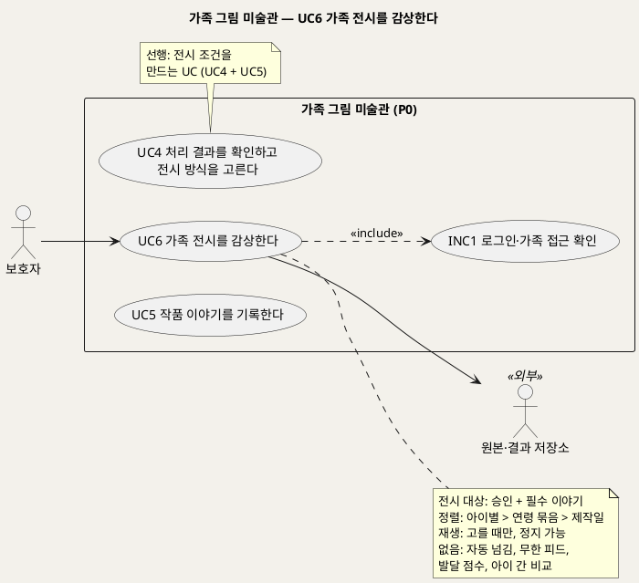
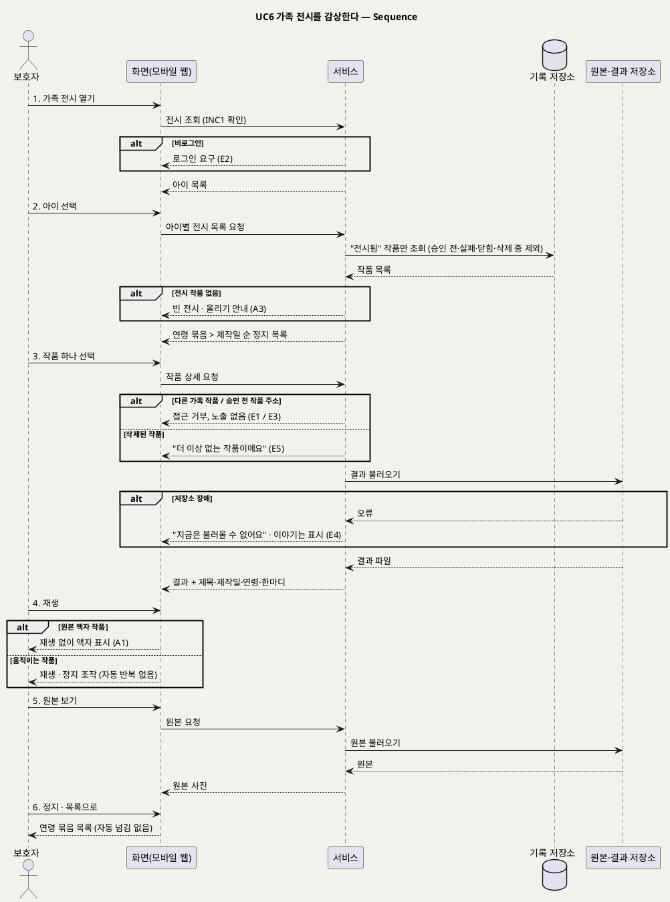

# UseCase 명세 — #6 가족 전시를 감상한다 (가족 그림 미술관 P0)
**가족 그림 미술관 · UC6 · UML 2.5.1 표준 (UseCase Diagram + UseCase 기술 + Sequence Diagram)**

---

> **문서 식별**: `design/UC_06_가족전시감상.md`
> **작성일**: 2026-09-23 · **표준**: UML 2.5.1 (OMG)
> **원천(SoT)**: `.specify/features/가족-그림-미술관/spec.md` — FR-8, FR-9, FR-6(승인 전 비전시) · 보조 원천 `Intent-Specify.md` [가치제안] 경험 원칙 · [부정적 영향] 과도한 화면 소비·비교·평가 오용
> **다이어그램**: 모든 PlantUML 소스는 렌더 검증 완료(HTTP 200). 아래 링크로 브라우저에서 열 수 있다.

---

## 목차

1. [범위·개요](#1-범위개요)
2. [UseCase Diagram](#2-usecase-diagram)
3. [Actor 카탈로그](#3-actor-카탈로그)
4. [UseCase 목록 (원천 매핑)](#4-usecase-목록-원천-매핑)
5. [UseCase 기술 + Sequence Diagram](#5-usecase-기술--sequence-diagram)
6. [업무규칙 종합](#6-업무규칙business-rules-종합)
7. [UML 표준 준수 노트](#7-uml-표준-준수-노트)

---

## 1. 범위·개요

가족은 **승인된 작품만** 모인 2D 전시 화면에서 작품을 **한 점씩 골라** 감상한다. 전시는 아이별로 나뉘고, 한 아이 안에서는 제작 당시 연령별로 묶이며, 묶음 안에서는 제작일 순서로 놓인다. 작품을 고르면 결과(움직이는 작품 또는 원본 액자)와 함께 제목, 제작일, 제작 당시 연령, 아이의 한마디가 보인다. 움직이는 작품에서도 원본 사진을 볼 수 있다.

원천의 경험 원칙이 화면 규칙을 정한다. 작품과 실제 말이 먼저 보이고, 과도한 필터·자동 감정 해석·발달 평가·비교가 없다. 자동 반복이나 무한 피드 대신 가족이 골라서 본다. 움직이지 않는 원본 액자도 완성된 작품으로 대한다.

| 항목 | 값 |
|---|---|
| 대상 시스템 | 가족 그림 미술관 (P0) |
| 상위 프로세스 | 승인(UC4) + 이야기(UC5) → **감상(UC6)** |
| 원천 근거 | spec FR-8 · FR-9 · FR-6 · Scenario 1, 9, 10 · Intent [가치제안] 경험 원칙 |
| 핵심 UseCase | 1개 (UC6) + 공통 1개 (INC1) |
| 주요 액터 | 보호자 · 원본·결과 저장소(보조) · 아이(이해관계자, 함께 감상) |

---

## 2. UseCase Diagram

**[「UC6 가족 전시 UseCase Diagram」 PlantUML 뷰어로 열기](https://plantuml.sumzip.com/plantuml/svg/eNqFU1FL21AUfr-_4tC9KFZRpj4UKbIyYS9DGHsbyLVNazBNRnLLkDHIMIjTgnUzs7KmpLAqg8Ki7WwKedpP2WPuzX_YuYlFfRh7SnLPd77zfd-5WbcYNVmjrkGjvFWldVXb26pRTVPMva3FVWLtqvpbatI6bNPybs00GnqlZGiGCU82nm4sPX_2AGHt0IrxTtVrUKWapRBNqTJgBphqbYdBRTWVMlMNnTCVaQrEgS161xCPQ34ZAf8ZikM_Htnwxz6D16XVaV34jjju8H6EBy2x_zFxO_z4OyG0zFBEjg9HSTsU3VYOqAWb1FR0Nq2Jby0-DH-P45sgHkbIZItuXxw0U-grhCiwtiYuQn5rF4uESHlUr6G03L-0zWwuzubgPQFoWEqZWgj9r9R0GqIeNr14WVoC3uvgAOFJhVOC03gcQXLh4mnaJ4GPpy2DuGnzywFkruS0DJ-47Xjov9EzFcCDH-LYE54DeMr74b2S5ceEKyC6p8nnQxDeSLhRHAapA3z0vEcOVsgHQrKEYX6-mHqS7hcWiqlOKGCcql7WGhUF85QlCUuDJkQ3mHJ3E4zqXR5TqU0b0yqAOJqgD5iDxHXEYfteUAp1uT9ADJa8ER86UARxHnB_AnxwK7ym_PY7aEV4kcR3B2LfK2TmcYVuk18185JGXNlyYfyoL2HnB9iLtN0WP7kA7rTjiZ1HyhFah-Qs4l86ecTxAIMYYHsLheXvVCCNA3zixL9aRNErIC1mPrcNxox6ZlTGLRw_-fqpMDUsekF8PcLdSOarJs7gR_LSw4zc75zMevaecR3f8P_8C_MfxJQ=)** — 클릭 시 브라우저로 연결됩니다.

#### 다이어그램 쉽게 읽기 (유저 관점)

- **누가 쓰나** — 보호자가 화면을 연다. 아이는 곁에서 함께 보지만 계정이 없어 액터로 그리지 않았다. 원본·결과 저장소는 작품 파일을 꺼내 오는 외부 구성요소다.
- **무슨 순서로** — 보호자가 승인하고(UC4) 이야기를 채운(UC5) 작품만 여기에 걸린다. 아이를 고르고, 나이별로 묶인 작품 중 한 점을 골라 본다.
- **«include» = 항상 함께** — 전시를 열 때마다 "로그인·가족 접근 확인"을 거친다. 다른 가족의 전시는 볼 수 없다.
- **«extend» = 특정 상황에서만** — 이 UC에는 확장 관계가 없다.
- **Generalization(◁)** — 없다. 움직이는 작품과 원본 액자는 같은 대우로 전시된다.

| 기호 | 의미 |
|---|---|
| 사람 모양(actor) | 시스템을 쓰는 사람 또는 외부 구성요소(`<<외부>>`) |
| 타원(usecase) | 액터가 이루려는 목표 |
| 사각형(rectangle) | 시스템 경계 |
| 점선 `<<include>>` | 항상 함께 수행되는 하위 행위 |
| 노트 | 전시 규칙·선후 관계 보충 |

---

## 3. Actor 카탈로그

| 구분 | 액터 | 이 UC에서의 역할 | 원천 근거 |
|:--:|---|---|---|
| Primary | 보호자 | 전시를 열고, 아이와 작품을 골라 재생·정지하고, 원본과 이야기를 함께 본다 | spec FR-8 · Target Users |
| Secondary | 원본·결과 저장소 | 전시할 결과와 원본을 제공한다 | spec Dependencies |
| 이해관계자 | 아이 | 보호자와 함께 자기 그림을 본다. 조작 주체가 아니다 | spec Target Users |

주의: 가족 구성원(공동 보호자, 감상 전용 가족)이 별도 계정으로 전시를 볼 수 있는지는 spec FR-9 [NEEDS CLARIFICATION]으로 미확정이다 — `자료 없음 — 확인 필요`.

---

## 4. UseCase 목록 (원천 매핑)

| UC ID | 유스케이스명 | 관계 | 원천 근거 |
|:--:|---|---|---|
| UC6 | 가족 전시를 감상한다 | 본 문서 | spec FR-8 · FR-9 |
| INC1 | 로그인·가족 접근 확인 | UC6가 «include» | spec FR-9 |
| UC4 | 처리 결과를 확인하고 전시 방식을 고른다 | 선행(승인) | spec FR-6 |
| UC5 | 작품 이야기를 기록한다 | 선행(필수 이야기) | spec FR-7 |

---

## 5. UseCase 기술 + Sequence Diagram

### 5.1 UC6 가족 전시를 감상한다

> **쉽게 말하면** — 가족이 모여 앉아 아이의 작품을 나이별로 넘겨 봅니다. 마음에 드는 그림을 누르면 그림이 움직이고, 그날 아이가 한 말이 함께 보입니다. 저절로 다음 작품으로 넘어가지 않으니 천천히 골라 볼 수 있습니다.

#### 유스케이스 기술

| 속성 | 내용 |
|---|---|
| **ID** | UC6 (spec FR-8, FR-9) |
| **유스케이스명** | 가족 전시를 감상한다 |
| **액터** | 주: 보호자 · 보조: 원본·결과 저장소 |
| **사전조건** | (1) 보호자가 로그인되어 있다(INC1). (2) 가족 공간에 아이가 1명 이상 등록되어 있다(UC1) |
| **사후조건** | (1) 보호자는 이 가족의 "전시됨" 작품만 보았다. (2) 승인 전·실패·다시 찍기로 닫힘·삭제 중인 작품은 어디에도 노출되지 않았다. (3) 작품·이야기·원본은 바뀌지 않았다. [추론] 감상 행위 자체(조회 기록)를 저장할지는 `자료 없음 — 확인 필요`. 재열람 관찰은 spec FR-18의 관찰 기록으로 수행한다 |
| **기본흐름** | ↓ 별도 기본흐름표 (움직이는 작품 감상 기준) |
| **대체흐름** | A1. 원본 액자 작품 — 고른 작품이 원본 액자면 재생 없이 액자로 보여 준다. 움직이는 작품과 같은 크기·대우이며 "실패"·"대체" 표시가 없다(spec FR-8). A2. 작품 다시 찾기 — 보호자가 제목이나 제작일로 검색해 특정 작품을 연다(spec FR-8 수용기준 7). A3. 전시할 작품이 없음 — 선택한 아이에게 전시된 작품이 없으면 빈 전시를 보여 주고 작품 올리기(UC2)로 안내한다. [추론] 빈 상태 화면은 원천에 없다. A4. 이야기 수정 반영 — UC5에서 이야기를 고친 작품은 다음 조회부터 수정 내용으로 보인다(spec FR-7 수용기준 4). A5. 다른 아이로 전환 — 보호자가 다른 아이를 고르면 그 아이의 연령 묶음으로 바뀐다(spec FR-8 수용기준 1) |
| **예외흐름** | E1. 다른 가족 작품 직접 접근 — 다른 가족의 작품 주소를 직접 입력하면 접근을 거부하고, 원본·결과·이야기를 어느 것도 노출하지 않는다(spec FR-9, Scenario 9). E2. 비로그인 접근 — 로그인하지 않았으면 어떤 작품도 보여 주지 않고 로그인을 요구한다(spec FR-9). E3. 승인 전 작품 직접 접근 — 확인 대기·실패·닫힘 작품은 전시 목록과 상세 어디에도 나오지 않는다. 주소로 접근해도 전시 화면으로는 보여 주지 않는다(spec FR-6 수용기준 1, Scenario 10). E4. 파일 불러오기 실패 — 원본·결과 저장소 장애로 파일을 못 불러오면 "지금은 작품을 불러올 수 없어요"라고 안내한다. 목록의 이야기는 그대로 보여 준다. [추론] 원천은 전시 중 저장소 장애 처리를 따로 적지 않았다. Intent [핵심 장벽] 인프라 "저장소·DB 장애 분리"를 근거로 설계했다. E5. 삭제된 작품 — 삭제 요청된 작품은 곧바로 전시에서 사라지고, 열려 있던 상세는 "더 이상 없는 작품이에요"로 바뀐다(spec FR-10 수용기준 1) |
| **포함/확장** | «include» INC1 로그인·가족 접근 확인 |
| **우선순위** | High — 원천 [미션]의 "가족이 함께 간직하고 다시 만나는 기록"과 [가치제안] 공동 감상을 직접 실현한다(spec FR-8) |
| **사용빈도** | `자료 없음 — 확인 필요`. 재열람 행동은 P0 검증 관찰 대상이다(Intent [미션] P0 경험 검증 "재열람 행동·이유를 관찰") |
| **업무규칙** | BR-APR-01, BR-EXH-01, BR-EXH-02, BR-EXH-03, BR-EXH-04, BR-STY-03, BR-ACC-01, BR-ACC-02, BR-ACC-03 |
| **특별 요구사항** | 경험: 자동 넘김·무한 피드·자동 반복 없이 고를 때만 재생하고 정지할 수 있다. 과도한 필터·꾸밈 효과·발달 점수·아이 간 비교 표시가 없다(spec FR-8 · Intent [부정적 영향] 과도한 화면 소비·비교·평가 오용). 사용성: 전시 작품 20점 이상 중 지정 작품을 30초 안에 찾는다(spec Success Criteria, 잠정). 접근: 가족 간 교차 접근 시험에서 노출 0건(spec Success Criteria). 기기: 모바일 웹(spec Assumptions). 보호: 운영자는 전시 이미지를 볼 수 없다(spec FR-9) |
| **비고** | 원천 추적: spec FR-8(수용기준 7개 전부: 아이별·연령 묶음·제작일 / 결과+이야기 표시 / 원본 보기 / 선택 재생·정지·무한 피드 없음 / 원본 액자 동등 대우 / 필터·점수·비교 없음 / 제목·제작일로 다시 찾기) · FR-9(수용기준 1·2·3) · FR-6 수용기준 1 · Scenario 1, 9, 10 · Success Criteria "다시 찾기", "접근 차단" · Intent [가치제안] 경험 원칙 "작품과 실제 말이 먼저 보인다 … 가족이 한 점씩 꺼내 보고" · Intent [부정적 영향] "과도한 화면 소비", "비교·평가 오용". 공동 감상의 계정 모델은 spec FR-9 미결 |

#### 기본흐름 (Basic Flow)

| 단계 | 액터 행위 | 시스템 행위 |
|:--:|---|---|
| 1 | 보호자가 가족 전시를 연다 | INC1로 로그인과 가족 공간을 확인하고, 이 가족의 아이 목록을 보여 준다 |
| 2 | 보호자가 아이를 고른다 | 그 아이의 "전시됨" 작품만 제작 당시 연령별로 묶고, 묶음 안은 제작일 순서로 정지 상태 목록을 보여 준다 |
| 3 | 보호자가 아이와 함께 볼 작품 하나를 고른다 | 원본·결과 저장소에서 결과를 불러와 제목·제작일·제작 당시 연령·아이의 한마디와 함께 보여 준다 |
| 4 | 보호자가 재생을 누른다 | 움직이는 작품을 재생하고 정지 조작을 제공한다(자동 반복·자동 넘김 없음) |
| 5 | 보호자가 "원본 보기"를 누른다 | 원본 사진을 보여 준다 |
| 6 | 보호자가 정지하고 목록으로 돌아간다 | 재생을 멈추고, 다음 작품으로 저절로 넘어가지 않고 연령 묶음 목록으로 돌아간다 |

#### Sequence Diagram

**[「UC6 가족 전시 Sequence」 PlantUML 뷰어로 열기](https://plantuml.sumzip.com/plantuml/svg/eNp1VUtPGlEU3s-vOKEbTCstvhYujI9q4qZpYuzWjDpaIqLCmMYd6tQQoSk0UEcFCikWtZigoAwJK35Kl3PP_IeeOzMXBXSlznl9j3OukxFVDqu7m0GIKDtLa_JmILi3tC4Hg0p4b-ndmBTZCIS25bC8CcvyysZ6eGs3tDqzFdwKw6u54Tn_7PSTjMhneXXrSyC0DmtyMKJIakANKrA4MwZmNYrFW8CChvEsu2jRhyQe7luZLIuX4F80DQvKzq4SWlEkSV5RqbuH1eqWbmA-6QE5Ah_lsBJSJZqjBlYC23JIBY91mmZXdS-7vmTVNOZagOfNATt7cb47E7Usa2p4XLKjC59mpFVZlZfliAIe06iyYo6gRTF_gUcJO-X9dE-D8ySrGe2GeVc1a62e5AXCS7gdiDA4QeNhHPy-btaAJ3WaJVGQUggD5YhIsWqdJcA7_2HGD9ZpBnPGgCQHVSDQrJg1GwZ9kcAuGhT9OwHAs7R5XwHv7NCApIRWpa40zGiYqwO7viKWfSCHfCIBtYJ1mOtGZ0dYTRM4nSZ8Ht7dOGMmSCpK9bjOJi89gPmU9SPGyokOLzxu2jgLWruB8ZKVuGw3WPyvldfp74MbLJAEpRTFs3hKzKnj4CMIu5vAz0URojkBPDnCXKJPnGZM5LUbgHqF_amQ-EQpxg7q4J0afk6qkyorNIFVHqgjTNh48il7sWI0r5DBcvQlIYd9ApCV0dmB_qyeLuLDfdQMoaJtc7zELozOujhpb-FRtk7p7xYtXS9ZLKTMBp3UbZU9RN8A-2rgQ9YVhrbCT61mOV86SXDkZkmhX28vD_uWBnKdQPIO7DjtJvJvJ0kC7aGWo0_Um3D2n2rd42APMfargnqJb7tjmHstwH9kCnymXfLEZZ0U0PvAkOCmQaOjnaYV8kK3uf2s22C4vQQt0-J3TGitVJa77p0dcTH2THJBWokEGdvtvxt6zY0nm2k3xQLQr_ZutBv8xSrHWDrdtwEjfAMqeOguqf1g0L4V6QV71JqvAxW4peNuheNVXWQLClN-Ydp5FMv7_BY7drzciwvirCqdHyXT-eWT7PspsKrOavfuXjji9HIY9Qng9Pr2PVYupa7rF96Lsqfe95ls5_TcnNv0oIJlrQ_PmE9wIVbO5WG2RS-f1Ee-63bdh6rDXNPNZrTDfJKo0z-8_yhJV5E=)** — 클릭 시 브라우저로 연결됩니다.

기본흐름 1~6단계는 시퀀스의 번호 붙은 주요 메시지 `1.`~`6.`과 1:1로 대응한다. A2(제목·제작일 검색)는 2단계를 대신하는 진입 경로라서 시퀀스에서 생략했다.

---

## 6. 업무규칙(Business Rules) 종합

| BR ID | 규칙 | 적용 UC | 근거 |
|---|---|---|---|
| BR-APR-01 | 보호자 승인 전에는 어떤 결과도 전시하지 않는다 | UC3, UC4, UC6 | spec FR-6 · Scenario 10 |
| BR-EXH-01 | 전시 대상은 승인과 필수 이야기 입력을 모두 갖춘 작품("전시됨")뿐이다 | UC4, UC5, UC6 | spec FR-6 · FR-7 |
| BR-EXH-02 | 전시는 아이별로 나누고, 한 아이 안에서 제작 당시 연령별로 묶고, 묶음 안에서 제작일 순서로 놓는다 | UC6 | spec FR-8 수용기준 1 |
| BR-EXH-03 | 움직이는 작품은 고를 때만 재생하고 정지할 수 있다. 자동 넘김·자동 반복·무한 피드를 두지 않는다 | UC6 | spec FR-8 수용기준 4 · Constraints · Intent [부정적 영향] 과도한 화면 소비 |
| BR-EXH-04 | 원본 액자는 움직이는 작품과 같은 크기·대우로 전시하고 "실패"·"대체" 표시를 붙이지 않는다. 필터·꾸밈 효과·발달 점수·아이 간 비교를 두지 않는다 | UC4, UC6 | spec FR-8 수용기준 5·6 · Intent [부정적 영향] 비교·평가 오용 · [가치제안] |
| BR-STY-03 | 아이의 한마디는 입력한 글자 그대로 표시한다 | UC5, UC6 | spec FR-7 수용기준 3 |
| BR-ACC-01 | 가족 공간의 작품·원본·결과·이야기는 해당 가족만 조회할 수 있다(목록·상세·직접 주소 모두) | UC1~UC7 | spec FR-9 수용기준 1 |
| BR-ACC-02 | 로그인하지 않은 사용자는 어떤 작품도 볼 수 없다 | UC6 외 보호자 UC 전체 | spec FR-9 수용기준 2 |
| BR-ACC-03 | 서비스 운영자는 운영 화면·지표에서 가족의 원본·결과 이미지를 볼 수 없다 | UC6, UC8 | spec FR-9 수용기준 3 · Assumptions 운영자 권한 |

---

## 7. UML 표준 준수 노트

| 항목 | 적용 |
|---|---|
| 액터 | 아이는 함께 보는 이해관계자이지만 시스템과 직접 상호작용하지 않아 actor로 그리지 않았다. 대신 노트와 카탈로그에 기록했다 |
| 선후 관계 | UC4·UC5는 전시 조건을 만드는 선행 UC이며 include/extend 관계가 아니라서 노트로 표시했다 |
| 대체 진입 | 검색으로 찾는 경로(A2)는 같은 목표의 다른 진입이라 대체흐름으로 처리했다 |
| Sequence | 접근 차단(E1·E3·E5)과 저장소 장애(E4)를 `alt`로 표현하고, 결과 종류(원본 액자/움직임)도 `alt`로 나눴다 |

---

*가족 그림 미술관 P0 · UC6 · 2026-09-23 · 원천: spec.md FR-8, FR-9*
