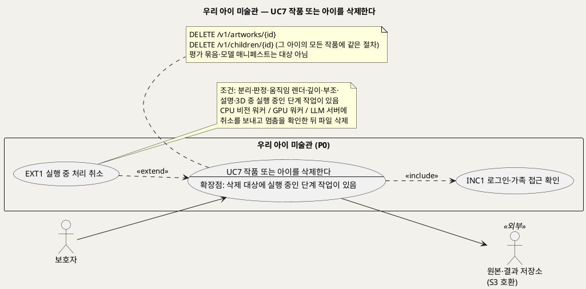
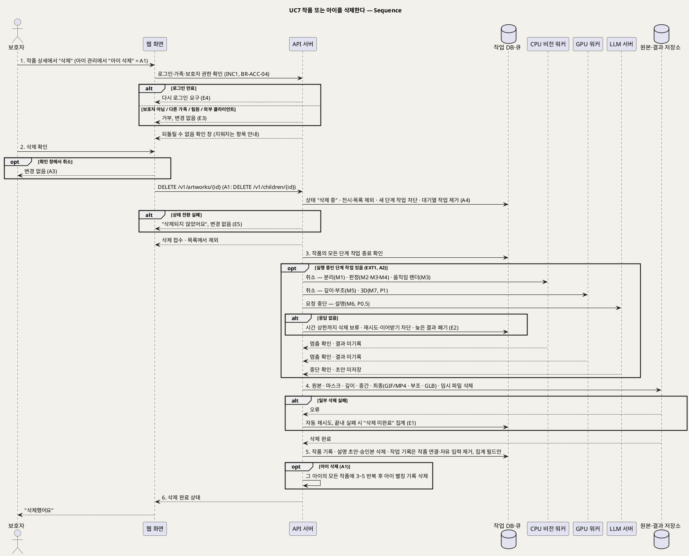

# UseCase 명세 — #7 작품 또는 아이를 삭제한다 (우리 아이 미술관 P0)
**우리 아이 미술관 · UC7 · UML 2.5.1 표준 (UseCase Diagram + UseCase 기술 + Sequence Diagram)**

---

> **문서 식별**: `design/UC_07_작품아이삭제.md`
> **작성일**: 2026-09-23 · **개정**: 2026-09-28 — 모델 7종·서빙 3종 기준으로 다시 씀. 삭제 대상에 마스크·깊이·부조·GLB·설명 초안·승인본을 넣고, 실행 중 처리 취소를 CPU 비전 워커·GPU 워커·LLM 서버 각각에 보내도록 바꿈(옛 이름 "가족 그림 미술관") · **표준**: UML 2.5.1 (OMG)
> **원천(SoT)**: `Intent-Specify.md` (2026-09-28 기획 기준안) [부정적 영향] 동의 오판·삭제 누락 · [핵심 데이터] 삭제 시 처리 · [핵심 장벽] 서빙 기반 + `.specify/features/우리-아이-미술관/spec.md` v2.0 — FR-10, FR-11 · 재작성 공통 기준 §3·§4·§5·§8·§10
> **다이어그램**: 모든 PlantUML 소스는 렌더 검증 완료(HTTP 200). 아래 링크로 브라우저에서 열 수 있다. `plantuml.sumzip.com` 은 사내 SSO 로그인 뒤 열린다.
> **표기**: `[추론]` = 원천에 직접 없는 설계 판단 · `자료 없음 — 확인 필요` = 원천에 근거가 없는 항목 · U1~U15 = 공통 미해결 번호

---

## 목차

1. [범위·개요](#1-범위개요)
2. [UseCase Diagram](#2-usecase-diagram)
3. [Actor 카탈로그](#3-actor-카탈로그)
4. [UseCase 목록 (원천 매핑)](#4-usecase-목록-원천-매핑)
5. [UseCase 기술 + Sequence Diagram](#5-usecase-기술--sequence-diagram)
6. [업무규칙 종합](#6-업무규칙business-rules-종합)
7. [UML 표준 준수 노트](#7-uml-표준-준수-노트)

---

## 1. 범위·개요

보호자는 작품 하나, 또는 아이 한 명(그 아이의 모든 작품 포함)을 삭제한다. 아이 작품 사진에는 이름·유치원·얼굴이 담길 수 있고, 한 장의 사진은 여러 모델을 거치며 마스크·깊이·움직임·부조·설명 같은 파생 결과를 여러 개 남긴다. 그래서 삭제는 **빠짐없이, 정해진 순서로** 이뤄져야 한다(BR-DEL-01).

1. 새 작업을 막는다.
2. 그 작품의 모든 단계 작업(분리·판정·움직임 렌더·깊이·부조·설명·3D)이 끝났거나 취소됐음을 확인한다. 단계 작업은 서빙 3종(CPU 비전 워커·GPU 워커·LLM 서버)에 흩어져 있다.
3. 원본·마스크·깊이·중간·최종 결과·설명 초안과 승인본·임시 파일을 지운다.
4. 작업 기록에서 작품 연결과 자유 입력을 제거하고 **집계 필드만** 남긴다(BR-DEL-02).

실행 중인 단계 작업이 있으면 **EXT1 실행 중 처리 취소**가 끼어든다. 백업에 남는 사본은 P0 범위 밖이며 운영 전에 정한다(BR-DEL-04, U15).

| 항목 | 값 |
|---|---|
| 대상 시스템 | 우리 아이 미술관 (P0) |
| 상위 프로세스 | 모든 작품 상태에서 언제든(`접수됨`·`판정 중`·`확정 대기`·`처리 중`·`확인 대기`·`승인됨`·`전시 중`·`처리하지 못함`) |
| 원천 근거 | Intent [부정적 영향] 동의 오판·삭제 누락 · [핵심 데이터] 삭제 시 처리 · spec FR-10 · FR-11 |
| 엔드포인트 | `DELETE /v1/artworks/{id}` · `DELETE /v1/children/{id}` ([추론] 이름·형식은 `/speckit.plan`에서 확정, U8) |
| 핵심 UseCase | 1개 (UC7) + 공통 1개 (INC1) + 확장 1개 (EXT1) |
| 주요 액터 | 보호자 · 원본·결과 저장소(보조) |

삭제 범위는 아래와 같다.

| 구분 | 항목 | 근거 |
|---|---|---|
| 지운다 — 저장소 | 원본 사진 · 작품 마스크·컷아웃(M1) · 깊이 결과(M5) · 중간 결과(판정용 관절 좌표 등, M3·M4) · 최종 결과(움직임 GIF/MP4(M3) · 2.5D 부조 · P1 GLB(M7)) · 임시 파일 | Intent [핵심 데이터] · [비용] 저장 항목 · BR-DEL-01 |
| 지운다 — 기록 | 작품 기록(제목·제작일·제작 당시 연령·아이의 한마디·판정 제안과 확정값·결과 종류·보호자 결정) · 작품 설명(키워드·선택 태그·초안·승인본, P0.5) · 아이 삭제면 아이 별칭 | Intent [핵심 데이터] · BR-DEL-01 |
| 남긴다 — 집계 필드 | 단계 종류 · 모델 ID·버전 · 상태 · 시도 횟수 · 처리 시간 · 낮춤 원인 또는 오류 분류 · 결과 종류 · 결과 원인 분류. [추론] 판정 수정률 계산용 "수정 여부"도 남긴다 | BR-DEL-02 · BR-OPS-02 · BR-FBK-04 |
| 대상 아님 | 모델 평가 묶음(팀원이 만든 작품) · 모델 매니페스트 · 운영 지표(라벨에 작품 번호 없음) · 외부 모델 엔드포인트 입력(처음부터 보관하지 않음) · 백업 사본(P0 밖) | BR-MDL-04 · BR-MDL-01 · BR-OPS-04 · BR-API-05 · BR-DEL-04 |

---

## 2. UseCase Diagram

**[「UC7 삭제 UseCase Diagram」 PlantUML 뷰어로 열기](https://plantuml.sumzip.com/plantuml/svg/eNqNVFFL22AUfc-vuLgXfdAqPggiIqt1DNwQdLAHQWIbazAmI0nnhgjVxVHbulVnZzubEiFOJ45VW5rKfOpP2WO-m_-w-6V16x4GvqW599x7zrmnmTJMUTdT6wqk4ktaSl9akxPGUlJUFEl_uzQ8JhhrsvpK1MV1WBbja0ldS6mJqKZoOjyaGZ0ZiT3u6TBWxYS2IatJWBEVQxIUacUEUwNdTq6akJB1KW7KmiqYsqlIgF9q7OsVYNFCuwHsRwszjt9Iw6_0EbyIjgFWD4LDDLBSgWWPum3s7A5w5zs6laBYYTlXEMS4SVz6WL0RlFpYLfSBaMCcqEuqeV_DkwKrt9qef1Pz64R30lg9w_f5RbV_fhQIFpRLAyFunvolmJjAcos105OTgsApi2qS6Pb9j2__3DChNwWAlCHFRYNaH0p_UR0cXFSDcpETcgrj3SKwfBrfbeNxATDnBp_3AN0DtFvAchd-3eKj8XiXs8BqBu18yJ129lJ4-jw6Auy04nstQpL4WhpPr0n8ge_dAV9pt0Icb-wFxl4ujPSsBbwphbK9C7IsRPAOYUsQOi7D4OBkuJyLHhqaDAfCOLkoq3EllZDIxnAmr_EeXpLemJKaoAp_wQeEzguCqplSNy7aSmcRAJ7W_OvGOLCmRUzaXpAvoFNse3iSxvNtrFrAnDzbPyKRt1lype3R8QjU9jjYctnlbtsbne6oeYifBIvOvQB2a6FD1ZM8_nQhAk_o3Z8fs7PPaHaF3Vh0Jr4n9IcfmKLIdhp-3QH2LYNNF22r6zcdHdihC0E-j_Z9EgQyArjujvhlzTS1da6-c9Dp2GxsIQaR1yMR-qNuaPqaEdmUE1v_luKrspKga4Ql6KejdxOHdgnY5QX75HQDyUPl18popykLGaxdDNCk4OMe5QPYVZPUk30E2Cd3zl2WywQfSph1g2yLx7gTTD6b5Up_mU_RE31DhN-qfBut)** — 클릭 시 브라우저로 연결됩니다.

#### 다이어그램 쉽게 읽기 (유저 관점)

- **누가 쓰나** — 보호자만 삭제할 수 있다. 운영자나 팀원은 지울 수 없다. 원본·결과 저장소에서 사진과 결과 파일이 실제로 지워진다.
- **무슨 순서로** — 삭제를 누르면 작품이 곧바로 화면에서 사라진다. 그 뒤 시스템이 돌아가던 처리를 모두 멈추게 하고, 사진·결과·설명·기록을 정리한다.
- **«include» = 항상 함께** — 삭제할 때마다 "로그인·가족 접근 확인"을 거친다. 내 가족의 작품과 아이만 지울 수 있다.
- **«extend» = 특정 상황에서만** — 지우려는 작품이 아직 처리 중일 때만 "실행 중 처리 취소"가 끼어든다. 움직임을 만드는 중이든, 입체 부조를 만드는 중이든, 설명을 쓰는 중이든 모두 멈춘 것을 확인한 뒤에 파일을 지운다.
- **Generalization(◁)** — 없다. 작품 삭제와 아이 삭제는 같은 규칙을 쓰고, 아이 삭제는 그 아이의 모든 작품에 같은 절차를 반복한다(대체흐름 A1).

| 기호 | 의미 |
|---|---|
| 사람 모양(actor) | 시스템을 쓰는 사람 또는 외부 구성요소(`<<외부>>`) |
| 타원(usecase) | 액터가 이루려는 목표. `--` 아래는 확장점 |
| 사각형(rectangle) | 시스템 경계 |
| 점선 `<<include>>` | 항상 함께 수행되는 하위 행위(UC7 → INC1) |
| 점선 `<<extend>>` | 확장점 조건일 때만 기반 UC에 끼어드는 행위(EXT1 → UC7) |
| 메모(note) | 확장 조건과 엔드포인트·대상 범위 보충 |

---

## 3. Actor 카탈로그

| 구분 | 액터 | 이 UC에서의 역할 | 원천 근거 |
|:--:|---|---|---|
| Primary | 보호자 | 작품이나 아이의 삭제를 요청하고 확인한다. 삭제 권한은 보호자에게만 있다 | spec FR-10 · 공통 기준 §6 · BR-ACC-04 |
| Secondary | 원본·결과 저장소(S3 호환) | 원본·마스크·깊이·중간·최종 결과·임시 파일을 실제로 지운다 | Intent [핵심 이네이블러] 기반 · 공통 기준 §6 |

자체 호스팅 모델(M1~M7)과 서빙 3종(CPU 비전 워커·GPU 워커·LLM 서버)은 시스템 내부 구성요소다. 액터로 두지 않고, 취소 신호를 받는 시퀀스 lifeline으로만 표현한다(공통 기준 §6). 서비스 운영자는 이 UC의 액터가 아니다. "삭제 미완료" 집계는 UC8에서 본다.

---

## 4. UseCase 목록 (원천 매핑)

| UC ID | 유스케이스명 | 관계 | 원천 근거 |
|:--:|---|---|---|
| UC7 | 작품 또는 아이를 삭제한다 | 본 문서 | spec FR-10 · FR-11 · Intent [부정적 영향] 삭제 누락 |
| INC1 | 로그인·가족 접근 확인 | UC7이 «include» | 공통 기준 §6 · BR-ACC-01 · BR-ACC-02 |
| EXT1 | 실행 중 처리 취소 | UC7을 «extend»(확장점: 삭제 대상에 처리 중인 단계 작업이 있음) | spec FR-10 · Intent [부정적 영향] "실행 작업 종료 확인" |
| UC4 | 처리 결과를 확인하고 전시 방식을 고른다 | 다시 찍은 이전 작품이 이 삭제 규칙을 따른다(BR-APR-05) | 공통 기준 §8 |
| UC8 | 서비스 상태와 모델별 운영 지표를 확인한다 | 삭제 미완료 집계를 운영자가 본다(BR-DEL-03) | spec FR-10 · FR-26 |

---

## 5. UseCase 기술 + Sequence Diagram

### 5.1 UC7 작품 또는 아이를 삭제한다

> **쉽게 말하면** — 보호자가 "삭제"를 누르면 작품이 바로 화면에서 사라집니다. 뒤에서 움직임·입체 부조·설명을 만들던 작업은 모두 멈추고, 원본 사진과 잘라 낸 그림, 깊이 정보, 결과물, 설명, 임시 파일이 모두 지워집니다. 운영 통계용 숫자만 남고, 누구의 어떤 그림이었는지는 남지 않습니다.

#### 유스케이스 기술

| 속성 | 내용 |
|---|---|
| **ID** | UC7 (spec FR-10, FR-11) |
| **유스케이스명** | 작품 또는 아이를 삭제한다 |
| **액터** | 주: 보호자 · 보조: 원본·결과 저장소 |
| **사전조건** | (1) 보호자가 로그인되어 있다(INC1). (2) 삭제 대상 작품이나 아이가 이 가족 공간에 있다(BR-ACC-01). (3) 요청자가 보호자 역할이다(BR-ACC-04). (4) 대상 작품이 이미 `삭제 중`이 아니다(이미 `삭제 중`이면 같은 삭제를 이어 간다 [추론]) |
| **사후조건** | (1) 대상 작품은 전시·목록 어디에도 없다. (2) 그 작품의 새 단계 작업은 등록되지 않고, 실행 중이던 단계 작업(분리·판정·움직임 렌더·깊이·부조·설명·3D)은 모두 멈췄으며 멈춘 뒤 새 결과가 생기지 않았다. (3) 원본·마스크·깊이·중간·최종 결과(GIF/MP4·부조·GLB)·임시 파일이 저장소에 남아 있지 않다. (4) 작품 기록과 설명 초안·승인본이 없다. (5) 남은 작업 기록에는 작품·아이 연결, 저장 위치, 자유 입력이 없고 집계 필드만 있다(BR-DEL-02). (6) 아이 삭제였다면 그 아이의 모든 작품에 (1)~(5)가 적용되고 아이 기록(별칭)도 없다. (7) 끝내 완료하지 못한 삭제는 식별 정보 없이 "삭제 미완료"로 집계된다(BR-DEL-03). (8) 모델 평가 묶음·매니페스트·운영 지표는 바뀌지 않는다 |
| **기본흐름** | ↓ 별도 기본흐름표 (작품 하나를 삭제하는 경우 기준. 실행 중인 단계 작업이 있으면 3단계에서 EXT1) |
| **대체흐름** | A1. 아이 삭제 — 보호자가 아이 관리 화면에서 아이를 삭제하면(`DELETE /v1/children/{id}`) 확인 창에 그 아이의 작품 수를 함께 보여 준다 [추론]. 확인하면 그 아이의 모든 작품을 한꺼번에 `삭제 중`으로 바꿔 전시에서 빼고, 작품마다 3~5단계를 반복한 뒤 아이 기록(별칭)을 지운다(spec FR-10). 처리 중인 작품이 섞여 있으면 작품마다 A2를 거친다. A2. 실행 중인 단계 작업 있음(EXT1) — 3단계에서 실행 중인 단계 작업을 찾으면 그 작업이 속한 서빙군에 취소를 보낸다. CPU 비전 워커에는 분리(M1)·판정(M2·M3·M4)·움직임 렌더(M3)를, GPU 워커에는 깊이·부조(M5)와 P1 3D(M7)를, LLM 서버에는 설명(M6, P0.5) 요청 중단을 보낸다. 각 서빙군이 멈춤을 확인하면 4단계로 간다. 멈춘 작업은 결과를 저장소에 쓰지 않고, 임시 파일은 BR-PRC-08에 따라 정리 대상이 된다. [추론] 워커는 결과를 쓰기 직전에 작품이 `삭제 중`인지 다시 확인한다. A3. 삭제 확인 취소 — 확인 창에서 "취소"를 누르면 아무것도 바뀌지 않는다. [추론] 되돌릴 수 없는 작업이라 확인 단계를 두는 것은 설계 판단이다. A4. 대기열에만 있는 단계 작업 — 아직 워커가 가져가지 않은 단계 작업은 2단계에서 대기열에서 빼고 취소로 표시한다. 취소 신호를 보낼 필요가 없다 [추론]. A5. 다시 찍은 이전 작품 — 결과 확인에서 "다시 찍기"(UC4, EXT2)로 닫힌 이전 작품을 지울 때도 같은 절차를 따른다(BR-APR-05) |
| **예외흐름** | E1. 저장소 파일 일부 삭제 실패 — 원본·마스크·깊이·결과·임시 파일 중 일부를 지우지 못하면 자동으로 다시 시도한다. 끝내 완료되지 않은 건은 "삭제 미완료"로 집계하되 이미지·객체 키·작품 번호를 넣지 않는다(BR-DEL-03, BR-OPS-04, BR-PRV-01). 보호자 화면에서는 이미 사라진 상태를 유지한다. 재시도 횟수·간격은 `자료 없음 — 확인 필요`. E2. 취소 무응답 — 서빙군이 취소에 응답하지 않으면(예: 보관 처리된 TorchServe 기반 M3 엔진이 멈춤, Intent [핵심 장벽] 서빙 기반) 그 단계의 시간 상한(BR-PRC-06, BR-SRV-03)이 지날 때까지 파일 삭제를 미룬다. 그동안 그 단계의 재시도와 다른 워커의 이어받기를 막는다(BR-PRC-05 예외). 시간 상한 뒤에 늦게 도착한 결과는 저장하지 않고 버린다. 이 대기는 인프라 실패로 집계하지 않는다 [추론]. 움직임 렌더 외 시간 상한은 `자료 없음 — 확인 필요`(U6). E3. 권한 없는 요청 — 다른 가족의 보호자, 서비스 운영자·팀원, 외부 클라이언트(API 키)가 삭제를 요청하면 거부하고 아무것도 바꾸지 않는다(BR-ACC-01, BR-ACC-03, BR-ACC-04, BR-API-06). E4. 로그인 만료 — INC1에 따라 다시 로그인하게 하고 삭제는 시작하지 않는다(BR-ACC-02). E5. `삭제 중` 전환 실패 — 작업 DB 장애로 `삭제 중` 전환 자체가 실패하면 "삭제되지 않았어요"라고 안내하고 아무것도 바꾸지 않는다. [추론] 부분 삭제를 막기 위한 판단이다. E6. 삭제 중 작품에 대한 다른 요청 — `삭제 중`인 작품에 확정(`/confirm`)·결과 선택(`/decision`)·이야기(`/story`)·설명 생성(`/captions`) 요청이 오면 받지 않는다. 새 작업 차단(BR-DEL-01)의 일부다 [추론]. E7. 백업 사본 — 백업에 남는 사본의 보존·삭제는 P0 범위 밖이다. 운영 전에 정할 항목으로 남기고, 화면에 "백업까지 지웠다"고 표시하지 않는다(BR-DEL-04, U15) |
| **포함/확장** | «include» INC1 로그인·가족 접근 확인 · «extend» EXT1 실행 중 처리 취소(확장점: 삭제 대상에 처리 중인 단계 작업이 있음) |
| **우선순위** | High — 아동 정보 통제의 마지막 수단이다. Intent [부정적 영향] "동의 오판·삭제 누락"이 순서를 못 박았고, 모델 7종이 파생 결과를 여러 개 남기므로 누락 위험이 옛 설계보다 크다 |
| **사용빈도** | `자료 없음 — 확인 필요` (사용 관찰 전. 다시 찍기로 닫힌 이전 작품 정리까지 포함하면 접수 건수에 비례할 수 있다 [추론]) |
| **업무규칙** | BR-DEL-01, BR-DEL-02, BR-DEL-03, BR-DEL-04, BR-ACC-01, BR-ACC-02, BR-ACC-03, BR-ACC-04, BR-API-06, BR-APR-05, BR-CAP-04, BR-PRC-05, BR-PRC-06, BR-PRC-08, BR-SRV-03, BR-OPS-04, BR-PRV-01 |
| **특별 요구사항** | 완전성: 삭제 시험(서빙 3종 각각에서 처리 중 삭제 포함)에서 삭제 완료 뒤 남은 원본·마스크·깊이·결과·GLB·임시 파일 0건, 남은 설명 초안·승인본 0건, 남은 작업 기록의 작품 연결·저장 위치·자유 입력 0건. 즉시성: 요청 즉시 전시·목록에서 사라진다. 비동기성: 파일 삭제는 요청 응답을 기다리게 하지 않는다(`202` 수락 [추론]). 개인정보: "삭제 미완료" 집계와 로그에 이미지·객체 키·별칭·제목·한마디·키워드가 없다(BR-PRV-01, BR-OPS-04). 권한: 삭제는 보호자만 할 수 있다(BR-ACC-04). 설명 승인본의 "승인 후 고정"(BR-CAP-04)은 재생성·수정을 막는 규칙이며 삭제를 막지 않는다 [추론] |
| **비고** | 원천 추적: Intent [부정적 영향] "동의 오판·삭제 누락: 삭제는 새 작업 차단→실행 작업 종료 확인→원본·중간·최종·임시 파일 삭제 순" · Intent [핵심 데이터] "삭제 시 원본·마스크·중간·최종 결과·임시 파일을 지우고 작업의 작품 연결과 자유 입력을 제거한 뒤 집계 필드만 남긴다" · Intent [핵심 장벽] 서빙 기반(보관 처리 엔진) · Intent [비용] 저장 항목(원본·마스크·GIF/MP4·깊이 결과·GLB) · spec FR-10(즉시 제외·새 처리 금지 / 실행 중 취소 후 삭제 / 파일 0 / 집계 필드만 / 자동 재시도·미완료 집계 / 아이 삭제 전파 / 백업 범위 밖) · FR-11(임시 파일) · 공통 기준 §3(서빙 3종·lifeline) · §4(엔드포인트) · §5(`삭제 중` 상태·단계 작업) · §8(BR) · §10(U1·U6·U8·U15). 개정: 옛 문서의 lifeline "처리 담당"은 서빙 3종으로, "엔진 버전" 집계 필드는 "모델 ID·버전"으로 바꿨다. 미결: 공동 보호자 모델이면 누가 삭제할 수 있는지 달라질 수 있다(U1) |

#### 기본흐름 (Basic Flow)

| 단계 | 액터 행위 | 시스템 행위 |
|:--:|---|---|
| 1 | 보호자가 작품 상세에서 "삭제"를 누른다 | INC1로 로그인·가족 접근과 보호자 권한을 확인하고, 되돌릴 수 없다는 확인 창에 지워지는 항목(사진·결과·이야기·설명)을 보여 준다 |
| 2 | 보호자가 삭제를 확인한다 | `DELETE /v1/artworks/{id}`를 받아 작품 상태를 `삭제 중`으로 바꾸고, 전시·목록에서 즉시 빼고, 새 단계 작업 등록을 막고, 대기열에만 있던 단계 작업을 뺀다. 삭제 접수를 응답한다 |
| 3 | 보호자는 목록으로 돌아가 작품이 빠진 것을 본다(기다리지 않는다) | 그 작품의 모든 단계 작업(분리·판정·움직임 렌더·깊이·부조·설명·3D)이 끝났는지 작업 DB에서 확인한다. 실행 중인 작업이 있으면 EXT1(A2) |
| 4 | 보호자는 다른 작품을 보거나 화면을 닫아도 된다. 삭제는 계속된다 | 원본·결과 저장소에서 원본·마스크·깊이·중간·최종 결과(GIF/MP4·부조·GLB)·임시 파일을 지운다 |
| 5 | 보호자 추가 조작 없음. 같은 아이의 다른 작품 전시는 그대로 볼 수 있다 | 작품 기록(이야기·판정 제안과 확정값)과 설명 초안·승인본을 지우고, 작업 기록에서 작품·아이 연결과 저장 위치·자유 입력을 제거해 집계 필드만 남긴다 |
| 6 | 보호자가 삭제 완료 안내를 확인한다 | "삭제했어요"를 보여 준다. [추론] 화면은 삭제 상태 조회로 완료를 안다(U8) |

#### Sequence Diagram

**[「UC7 삭제 Sequence」 PlantUML 뷰어로 열기](https://plantuml.sumzip.com/plantuml/svg/eNqVVt1PIlcUf5-_4oS-QOIXomtiUrOKSEykMd016ZuZFeoSWXABu2maNrCOGwrTCF0RLB_BFkWNpqygQOq--Kf0ce6d_2HPvXMHBuxLH0yYez7uOb_f75zr81hcjsb33oQgFni7GdmLbu4E_bHNbTkUCkR_3Jyak2I7wfCuHJXfwCt5a2c7GtkL-92RUCQKX624VpyeJYtH7LXsj7wLhrfhezkUC0jxYDwUgA33HNBqTv89BaSYJekjoHmFVtrk7AHo-xtaK-v5MsnU4d_EEbwIvN0LhLcCkiRvxfESG2m19WKXVrM2kGOwLkcD4biE18WDW8FdORwHGy31QD85Ipdt7rKxOmxeXF8FqpTJrcLN-Cn55bj8So4FMLaao4UDWF567OhJ44rlpeF49_oGkJ5CawrQkkr_qXMvPB1286Kbxe4dta-t-axl4Ke1jFKWtLqPHe22qbUQlVqCVs_oB5W7vkAcEA-jdRhfwA5hHpwTJqh0P0mVLi1kMT2m4ojawG6ADFo7Qc6v-1bj0HT6GhadDgnzYVaG0zyQ07LW6dIKK6aZoKefHjt9BkC7V5EqBDuPDmBf_cbtHIOlb8cX3e7xqRmHJIfigwRAGir5S5WAZx4360aiaaZscaN_HGl312D3YIIAqgYG92G1JFOESRZEzrpgVITfuppAyPAHPemS-wToyTapPGBn9Lirp7ujd2qfmug1hpkT2u1noIUPtKLijS68MeyXhuvLFsmhSs4RpFTRdBUd0-ZnxLWRYDw3EkzJev6GXF1ioSnyvu14QtL0hIBaZJAiu3FLMsEK7Vwg11j0hlGHSDI_Wu-iqNfK17JnzfPSA5M_OCdRbe8i0Z3Y5E9B_8_o7Ryybr0OhvyYl1sdRs8LKHbMgQLS9_vSAVrP2eCxgypUkCnk_-qSnFbws4xoc8M-TnLmQmspIOaHNi_wgNmImtC6TVpo9021MsKP5Qh9iMswuX6C-GbqunoxypeoBKlAmBHcNM0X6XEblWJ7SuLsf5BodlLLMRJZWbwHE2_eiTSEgcscJ1opovcF-Vgb7fHPA5SzlUhW_PGvDC8u92Hvasoo77uXOCOL0w6zxwW2OliJnHS-88i9giNq9zkdrFRdzdJa3u6bfuz4XPg3w09pKUEbSVpVgNRU8tuR3eeypPSOptR6aZwG5O4eJ6Zp983yJK5lu29uDNadllC2l-bZENLbG9YK45FloEqdXB3Yfc_Qf2pilkVw-irocSfQx7N-HkNJmbLWVDjH-bLWUzl9Bhc41eSMc0Gr1-hHDpXHDp_YNmmWUDNWEaXPaSUBYhvqh1lmtns4iIxr4BiOD5bWZYre183BwgQikvzdxUgkHiO8_zuCITOIENAMImg7hWPPIox1zVVoaorvbIyaQVnx3c7baqRouq4nr_mFnCGeqJ5joLFfd2VUmd27ujLpW5_hIZw_9su7tmQIocqmElWi0or5fhqDVXlgq9CUvjlYRiWWPoq4SovSCG_VLDk8GTCDU5as4EYTaRiv_fXAGj5RcBRsQBs5Jnm7x2nM4JO7RC3cfXjeZvvPl4E3b41LTgCL4kj3EGqGncjDu-fTZcQwjZhvYKGJDGJMNUvLNTw9ILUzsXvGzDp1fE4-lvFZMqbX-hSydWkZCqN8fKCEl2UpiC1RyILrl1kgzSJp3YFeUsx8pKXQ3o3ZleBnIA1zQz2bGEZH7EVp9AkQqOvHKbEApeeYDP9hk74AbWW5NQ==)** — 클릭 시 브라우저로 연결됩니다.

기본흐름 1~6단계는 시퀀스의 번호 붙은 주요 메시지 `1.`~`6.`과 1:1로 대응한다. EXT1(실행 중 처리 취소)은 3단계 뒤 `opt` 프래그먼트로 표현했고, 취소는 모델이 속한 서빙군 lifeline마다 따로 보낸다. 모델 평가 묶음과 매니페스트는 가족 데이터가 아니므로 시퀀스에 나오지 않는다.

---

## 6. 업무규칙(Business Rules) 종합

| BR ID | 규칙 | 적용 UC | 근거 |
|---|---|---|---|
| BR-DEL-01 | 새 작업 차단 → 모든 단계 작업 종료 확인 → 원본·마스크·깊이·중간·최종·설명·GLB·임시 파일 삭제. 서빙 3종 어디에서 돌던 작업이든 멈춤을 확인한 뒤에 지우고, 멈춘 뒤에는 결과가 새로 생기지 않는다 | UC7 | Intent [부정적 영향] 동의 오판·삭제 누락 · spec FR-10 |
| BR-DEL-02 | 작업의 작품 연결·자유 입력을 제거하고 집계 필드(단계·모델 ID·버전·상태·시도 횟수·처리 시간·낮춤 원인 또는 오류 분류·결과 종류)만 남긴다 | UC7, UC8 | Intent [핵심 데이터] · spec FR-10 |
| BR-DEL-03 | 삭제 실패는 자동 재시도하고, 끝내 완료되지 않은 건은 "삭제 미완료"로 집계한다 | UC7, UC8 | spec FR-10 |
| BR-DEL-04 | 백업 사본 정책은 P0 밖(운영 전 결정, U15) | UC7 | spec FR-10 · Intent [부정적 영향] |
| BR-ACC-01 | 가족 단위 격리. 다른 가족의 작품·아이는 지울 수 없다 | UC1~UC7, UC10 | 공통 기준 §8 |
| BR-ACC-02 | 비로그인 차단 | UC1~UC7, UC10 | 공통 기준 §8 |
| BR-ACC-03 | 운영자·팀원은 가족 이미지·이야기에 접근하지 못한다(삭제 요청도 못 한다) | UC7, UC8, UC9, UC11 | 공통 기준 §8 |
| BR-ACC-04 | 삭제는 보호자만 | UC7 | 공통 기준 §8 · spec FR-10 |
| BR-API-06 | 외부 클라이언트는 가족 데이터(`/v1/artworks…`)에 접근하지 못한다 | UC7, UC12 | Intent [부정적 영향] 외부 엔드포인트 남용 |
| BR-APR-05 | 다시 찍은 이전 작품은 삭제 규칙을 따른다 | UC4, UC7 | 공통 기준 §8 |
| BR-CAP-04 | 설명은 승인 후 고정·재생성 금지. 고정은 삭제를 막지 않는다 [추론] | UC5, UC7, UC10 | Intent [부정적 영향] 기억의 재작성 |
| BR-PRC-05 | 같은 단계 작업의 중복 처리 금지, 워커 중단 시 이어받기. `삭제 중` 작품의 작업은 이어받지 않는다 [추론] | UC3, UC7 | 공통 기준 §8 |
| BR-PRC-06 | 단계 작업마다 시간 상한(움직임 렌더 10분 기존값, 다른 모델은 `자료 없음 — 확인 필요`). 취소 무응답 시 삭제 보류의 끝이 된다 | UC3, UC7 | 공통 기준 §8 · U6 |
| BR-PRC-08 | 단계가 끝나면(취소 포함) 임시 파일을 정리한다 | UC3, UC7 | spec FR-11 |
| BR-SRV-03 | 모델별 시간 상한·동시 처리·재시도 횟수 제한 | UC3, UC7, UC8 | Intent [부정적 영향] 자원 과소비 |
| BR-OPS-04 | 지표 라벨에 이미지·작품 번호·식별 정보 금지("삭제 미완료" 집계 포함) | UC7, UC8 | Intent [핵심 데이터] 운영 지표 |
| BR-PRV-01 | 운영 로그에 이미지·객체 키·자유 입력·오류 원문 금지 | 전 UC | Intent [부정적 영향] 아동 이미지 유출 |

---

## 7. UML 표준 준수 노트

| 항목 | 적용 |
|---|---|
| «include» | INC1은 모든 삭제에서 항상 수행된다. 화살표는 UC7 → INC1 방향이다 |
| «extend» | EXT1은 기반 UC(UC7)의 확장점 "삭제 대상에 실행 중인 단계 작업이 있음"에서만 끼어든다. 화살표는 EXT1 → UC7 방향이고 조건은 note로 적었다 |
| 작품/아이 삭제 | 두 삭제는 같은 목표(내 가족의 기록 지우기)의 변형이라 Generalization 대신 대체흐름 A1(반복)로 표현했다 |
| 내부 구성요소 | 모델 M1~M7과 서빙 3종은 액터가 아니라 시퀀스 lifeline이다. 메시지에 모델 ID를 적어 어느 서빙군에 취소가 가는지 보인다 |
| 시스템 단계 | 3~5단계는 시스템이 주로 일하지만 액터 열에 보호자가 기다리지 않는다는 사실을 적어 시스템 독백을 피했다 |
| Sequence | 기본흐름 1~6과 메시지 `1.`~`6.`이 1:1로 대응한다. 대체·예외는 `alt`/`opt`에 A·E 번호를 붙였다 |

---

*우리 아이 미술관 P0 · UC7 · 2026-09-23 작성 · 2026-09-28 개정 · 원천: Intent-Specify.md (2026-09-28), spec.md v2.0 FR-10, FR-11*
