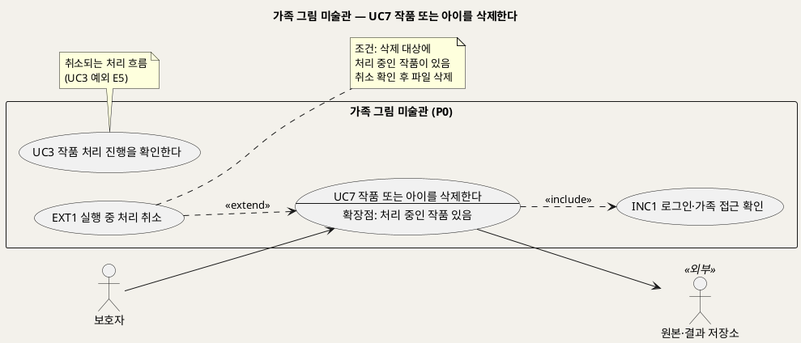
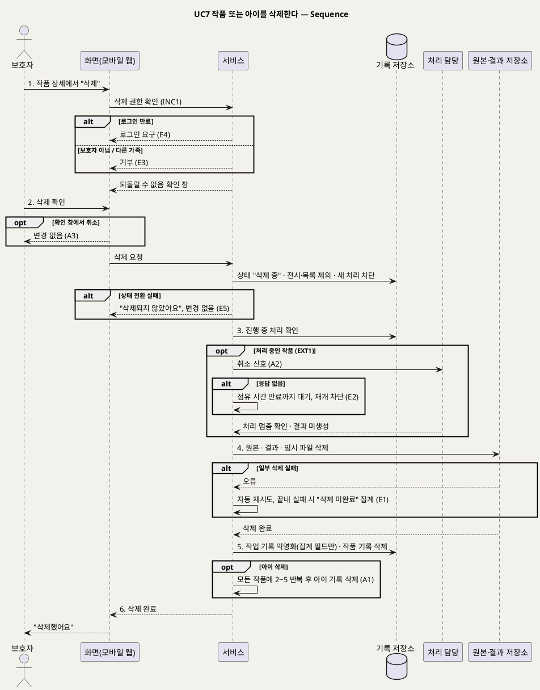

# UseCase 명세 — #7 작품 또는 아이를 삭제한다 (가족 그림 미술관 P0)
**가족 그림 미술관 · UC7 · UML 2.5.1 표준 (UseCase Diagram + UseCase 기술 + Sequence Diagram)**

---

> **문서 식별**: `design/UC_07_작품아이삭제.md`
> **작성일**: 2026-09-23 · **표준**: UML 2.5.1 (OMG)
> **원천(SoT)**: `.specify/features/가족-그림-미술관/spec.md` — FR-10, FR-11, FR-9 · 보조 원천 `Intent-Specify.md` [부정적 영향] 삭제 누락 · [핵심 데이터] 삭제 시 처리 · [핵심 활동] 6
> **다이어그램**: 모든 PlantUML 소스는 렌더 검증 완료(HTTP 200). 아래 링크로 브라우저에서 열 수 있다.

---

## 목차

1. [범위·개요](#1-범위개요)
2. [UseCase Diagram](#2-usecase-diagram)
3. [Actor 카탈로그](#3-actor-카탈로그)
4. [UseCase 목록 (원천 매핑)](#4-usecase-목록-원천-매핑)
5. [UseCase 기술 + Sequence Diagram](#5-usecase-기술--sequence-diagram)
6. [업무규칙 종합](#6-업무규칙business-rules-종합)
7. [UML 표준 준수 노트](#7-uml-표준-준수-노트)

---

## 1. 범위·개요

보호자는 작품 하나, 또는 아이 한 명(그 아이의 모든 작품 포함)을 삭제한다. 아동의 그림과 사진에는 이름·유치원·얼굴이 담길 수 있으므로, 삭제는 **빠짐없이, 정해진 순서로** 이뤄져야 한다.

1. 새 처리를 막는다.
2. 진행 중인 처리가 끝났거나 취소됐음을 확인한다.
3. 원본, 결과, 임시 파일을 지운다.
4. 작업 기록에서 작품과의 연결, 저장 위치, 자유 입력을 제거하고 **집계 필드만** 남긴다.

처리 중인 작품이면 **EXT1 실행 중 처리 취소**가 끼어든다. 백업에 남는 사본은 P0 범위 밖이며 운영 전에 정한다.

| 항목 | 값 |
|---|---|
| 대상 시스템 | 가족 그림 미술관 (P0) |
| 상위 프로세스 | 모든 작품 상태에서 언제든(접수됨·처리 중·확인 대기·실패·전시됨) |
| 원천 근거 | spec FR-10 · FR-11 · FR-9 수용기준 4 · Scenario 8 · Intent [부정적 영향] 삭제 누락 · [핵심 데이터] |
| 핵심 UseCase | 1개 (UC7) + 공통 1개 (INC1) + 확장 1개 (EXT1) |
| 주요 액터 | 보호자 · 원본·결과 저장소(보조) |

---

## 2. UseCase Diagram

**[「UC7 삭제 UseCase Diagram」 PlantUML 뷰어로 열기](https://plantuml.sumzip.com/plantuml/svg/eNqNk89qE1EUxvf3KQ5x0y5SGoIUQgnFkIIbKajgolBuJ5N06GRGZm7QIsKoQaLNYlIaTWkmJJBGF4ppE8wssvJRXM498w7eO39qBAV3w5zvnO93vjOzYzNqsUZdh4ZyUKV1TT85qFFdV62Tg80tYh9rxlNq0TocUuW4ZpkNo1IyddOCO7v53Vz53orCPqIV85lm1KBKdVslulplwEywtNoRg4pmqQrTTIMwjekqBFMHR9cQLHw-WQL_5mNrGMwd-Omcw-PSFuCgE561gPdc_v4csNtEb86vloCvv-KwH3b7_HRMCFWYYMnw2Tzs-ThwM0Bt2KOWarC0hpcun_k_FsHNNJiJ_qGDgyt8246kD4VEhe1tvPD5d6dYJERSUqMmCDP_Qlzb21zPwAsC0LBVhdpC-r_E-0Y2u2-EF13JMHQLgDc9PvkCOO6g56cjcNBCLwYUg1d97j8o5YCP-oJJ6MVSMSIOO8FiCXKu50d9UrjaWH7yKAd4Og4_vJNmt76Lz2kUUvHnSvlbnkT8qSna0WsmRvFKCWaevCQkTh6y2WIELlPZ2ChGMFAQMWuGojcqqsg54pE1qZEl9TlTjYqoyBdyQHQaQgyTqcknZFZTSBxNg-t5IYkWeNvBN6_woytLfwlUHCLJVAqilZMVILwU27Tb6KV3IoICpGnsfGgyZtaltVwx7eZuL7px7BV6Lp80RXEtyqzXEl8TlO-u_x61I57EP_YLjsqaAQ==)** — 클릭 시 브라우저로 연결됩니다.

#### 다이어그램 쉽게 읽기 (유저 관점)

- **누가 쓰나** — 보호자만 삭제할 수 있다. 원본·결과 저장소에서 파일이 실제로 지워진다.
- **무슨 순서로** — 삭제를 누르면 작품이 곧바로 화면에서 사라진다. 그 뒤 시스템이 처리 중단을 확인하고 파일과 기록을 정리한다.
- **«include» = 항상 함께** — 삭제할 때마다 "로그인·가족 접근 확인"을 거친다. 내 가족의 작품만 지울 수 있다.
- **«extend» = 특정 상황에서만** — 지우려는 작품이 아직 처리 중일 때만 "실행 중 처리 취소"가 끼어든다. 이때 처리가 멈춘 것을 확인한 뒤에 파일을 지운다.
- **Generalization(◁)** — 없다. 작품 삭제와 아이 삭제는 같은 규칙을 쓰고, 아이 삭제는 그 아이의 모든 작품에 같은 절차를 반복한다(대체흐름 A1).

| 기호 | 의미 |
|---|---|
| 사람 모양(actor) | 시스템을 쓰는 사람 또는 외부 구성요소(`<<외부>>`) |
| 타원(usecase) | 액터가 이루려는 목표. `--` 아래는 확장점 |
| 사각형(rectangle) | 시스템 경계 |
| 점선 `<<include>>` | 항상 함께 수행되는 하위 행위 |
| 점선 `<<extend>>` | 확장점 조건일 때만 기반 UC에 끼어드는 행위(EXT1 → UC7) |

---

## 3. Actor 카탈로그

| 구분 | 액터 | 이 UC에서의 역할 | 원천 근거 |
|:--:|---|---|---|
| Primary | 보호자 | 작품이나 아이의 삭제를 요청하고 확인한다. 삭제 권한은 보호자에게만 있다 | spec FR-9 수용기준 4 · FR-10 |
| Secondary | 원본·결과 저장소 | 원본, 결과, 임시 파일을 실제로 지운다 | spec Dependencies · FR-10 |

[추론] 처리 담당(백그라운드 작업자)은 취소 신호를 받는 시스템 내부 구성요소라서 시퀀스 lifeline으로만 표현한다.

---

## 4. UseCase 목록 (원천 매핑)

| UC ID | 유스케이스명 | 관계 | 원천 근거 |
|:--:|---|---|---|
| UC7 | 작품 또는 아이를 삭제한다 | 본 문서 | spec FR-10 · FR-11 |
| INC1 | 로그인·가족 접근 확인 | UC7이 «include» | spec FR-9 |
| EXT1 | 실행 중 처리 취소 | UC7을 «extend»(확장점: 처리 중인 작품 있음) | spec FR-10 수용기준 2 · Scenario 8 |
| UC3 | 작품 처리 진행을 확인한다 | 취소되는 처리 흐름(UC3 E5) | spec FR-4 · FR-10 |

---

## 5. UseCase 기술 + Sequence Diagram

### 5.1 UC7 작품 또는 아이를 삭제한다

> **쉽게 말하면** — 보호자가 "삭제"를 누르면 작품이 바로 화면에서 사라집니다. 뒤에서 처리 중이던 작업은 멈추고, 원본 사진과 결과물, 임시 파일이 모두 지워집니다. 운영 통계용 숫자만 남고, 누구의 어떤 그림이었는지는 남지 않습니다.

#### 유스케이스 기술

| 속성 | 내용 |
|---|---|
| **ID** | UC7 (spec FR-10, FR-11) |
| **유스케이스명** | 작품 또는 아이를 삭제한다 |
| **액터** | 주: 보호자 · 보조: 원본·결과 저장소 |
| **사전조건** | (1) 보호자가 로그인되어 있다(INC1). (2) 삭제 대상 작품이나 아이가 이 가족 공간에 있다. (3) 요청자가 보호자 역할이다(spec FR-9 수용기준 4) |
| **사후조건** | (1) 대상 작품은 전시·목록 어디에도 없다. (2) 그 작품의 새 처리는 시작되지 않으며, 진행 중이던 처리는 멈췄다. (3) 원본, 결과, 임시 파일이 남아 있지 않다. (4) 남은 작업 기록에는 작품·아이 연결, 저장 위치, 자유 입력이 없고 집계 필드(경로, 결과 종류, 분류, 단계별 시간, 시도 횟수, 엔진 버전)만 있다. (5) 아이 삭제였다면 그 아이의 모든 작품에 (1)~(4)가 적용되고 아이 기록도 없다. (6) 끝내 완료하지 못한 삭제는 운영자에게 "삭제 미완료"로 집계된다 |
| **기본흐름** | ↓ 별도 기본흐름표 (처리 중이 아닌 작품 하나를 삭제하는 경우 기준) |
| **대체흐름** | A1. 아이 삭제 — 보호자가 아이 관리 화면에서 아이를 삭제하면, 그 아이의 모든 작품에 2~5단계를 반복한 뒤 아이 기록(별칭)을 지운다(spec FR-10 수용기준 6). A2. 처리 중인 작품(EXT1) — 3단계에서 진행 중인 처리가 있으면 처리 담당에 취소 신호를 보내고, 처리가 멈춘 것을 확인한 뒤 4단계로 간다. 취소 이후 결과 파일은 새로 생기지 않는다(spec FR-10 수용기준 2, Scenario 8). 아이 삭제에 처리 중인 작품이 섞여 있으면 작품마다 취소를 확인한다(spec Edge Cases). A3. 삭제 확인 취소 — 확인 창에서 "취소"를 누르면 아무것도 바뀌지 않는다. [추론] 되돌릴 수 없는 작업이라 확인 단계를 두는 것은 설계 판단이다 |
| **예외흐름** | E1. 파일 일부 삭제 실패 — 원본·결과·임시 파일 중 일부를 지우지 못하면 자동으로 다시 시도한다. 끝내 완료되지 않은 건은 운영자에게 "삭제 미완료"로 집계된다(이미지와 식별 정보 제외). 보호자 화면에서는 이미 사라진 상태를 유지한다(spec FR-10 수용기준 5, Edge Cases). E2. 취소 확인 지연 — 처리 담당이 취소 신호에 응답하지 않으면 점유 시간이 만료될 때까지 파일 삭제를 미룬다. 그 뒤 처리 재개를 막은 상태에서 삭제를 진행한다. [추론] 원천은 "취소 확인 뒤 삭제"만 명시하고 무응답 처리는 적지 않았다. UC3 A3(점유 시간 만료)를 근거로 설계했다. E3. 권한 없는 요청 — 보호자가 아닌 계정(예: 서비스 운영자)이나 다른 가족이 삭제를 요청하면 거부한다(spec FR-9 수용기준 1·4). E4. 로그인 만료 — INC1에 따라 다시 로그인하게 하고, 삭제는 시작하지 않는다(spec FR-9). E5. 삭제 상태 전환 실패 — 기록 저장소 장애로 "삭제 중" 전환 자체가 실패하면 "삭제되지 않았어요"라고 안내하고 아무것도 바꾸지 않는다. [추론] 원천에 명시가 없다. 부분 삭제를 막기 위한 판단이다. E6. 백업 사본 — 백업에 남는 사본의 보존·삭제는 P0 범위 밖이다. 운영 전에 정할 항목으로 남긴다(spec FR-10 수용기준 7) |
| **포함/확장** | «include» INC1 로그인·가족 접근 확인 · «extend» EXT1 실행 중 처리 취소(확장점: 삭제 대상에 처리 중인 작품이 있음) |
| **우선순위** | High — 아동 정보 통제의 마지막 수단이다. 원천 [부정적 영향] "삭제 누락"과 [핵심 활동] 6 "권한·삭제·실행 중 취소·임시 파일 정리"가 필수 항목으로 명시한다 |
| **사용빈도** | `자료 없음 — 확인 필요` |
| **업무규칙** | BR-DEL-01, BR-DEL-02, BR-DEL-03, BR-DEL-04, BR-ACC-01, BR-ACC-04, BR-APR-05, BR-PRC-08, BR-PRV-01 |
| **특별 요구사항** | 완전성: 삭제 시험(처리 중 삭제 포함)에서 삭제 완료 후 남은 원본·결과·임시 파일 0건, 남은 작업 기록의 작품 연결·저장 위치·자유 입력 0건(spec Success Criteria). 즉시성: 요청 즉시 전시·목록에서 사라진다(spec FR-10 수용기준 1). 개인정보: "삭제 미완료" 집계와 로그에 이미지·저장 위치·별칭·제목·한마디가 없다(spec FR-13, FR-14). 권한: 삭제는 보호자만 할 수 있다(spec FR-9) |
| **비고** | 원천 추적: spec FR-10(수용기준 7개 전부: 즉시 제외·새 처리 금지 / 실행 중 취소 후 삭제 / 파일 0 / 집계 필드만 / 자동 재시도·미완료 집계 / 아이 삭제 전파 / 백업 범위 밖) · FR-11(임시 파일) · FR-9 수용기준 4 · Scenario 8 · Edge Cases "삭제 중 일부 파일 삭제 실패", "아이 삭제 시 처리 중인 작품 포함" · Intent [부정적 영향] "삭제 누락: 새 작업을 막고 실행 작업의 종료·취소를 확인한 뒤 원본·결과·임시 파일을 지운다. 백업 보존 정책은 운영 전 결정한다" · Intent [핵심 데이터] "삭제 시 원본·결과·임시 파일을 지우고 작업의 작품 연결과 저장 위치·자유 입력을 제거한 뒤 집계 필드만 남긴다". 미결: 공동 보호자 모델(spec FR-9 [NEEDS CLARIFICATION])이면 누가 삭제할 수 있는지 달라질 수 있다 |

#### 기본흐름 (Basic Flow)

| 단계 | 액터 행위 | 시스템 행위 |
|:--:|---|---|
| 1 | 보호자가 작품 상세에서 "삭제"를 누른다 | INC1로 접근과 보호자 권한을 확인하고, 되돌릴 수 없다는 확인 창을 보여 준다 |
| 2 | 보호자가 삭제를 확인한다 | 작품 상태를 "삭제 중"으로 바꾸고, 전시·목록에서 즉시 빼고, 새 처리 시작을 막는다 |
| 3 | — | 이 작품에 진행 중인 처리가 없는지 확인한다(있으면 EXT1) |
| 4 | — | 원본·결과 저장소에서 원본, 결과, 임시 파일을 지운다 |
| 5 | — | 작업 기록에서 작품·아이 연결, 저장 위치, 자유 입력을 제거해 집계 필드만 남기고, 작품 기록을 지운다 |
| 6 | 보호자가 목록에서 작품이 사라진 것을 확인한다 | "삭제했어요"를 보여 준다 |

#### Sequence Diagram

**[「UC7 삭제 Sequence」 PlantUML 뷰어로 열기](https://plantuml.sumzip.com/plantuml/svg/eNptVV9P21YUf_enOMpeglTYAqWV9oC6Mir1ZZpEu-4NueCyiJDQxGjqyxQat2LEEskawBl2FLRQAqKaIYEYib7wUfboc_wddnx9nSbeXn3P-Z3fn3OvH5V0tahvruegpL1eeqWuZ3NvllbVXE4rvln65qFSWsvmN9Siug4v1eW11WJhM78yX8gVivDVk5knmYXHIxWlX9SVwq_Z_Cq8UnMlTdGzek6D5_MPgVr14I9tQKuGOw2gPYOcPh7fAr39RG072LOx2oF_yg1Y1F5vavllTVHUZZ2HpLDXDyyPWrUUqCX4US1qeV3hcXp2Obuh5nVIBc0GnvbTeNZFt0EOgx7eTIjq50_HK8mw8cagnY44XfxpXllRdfWlWtIg5XsuHjlA7TK1jum9KUq-f5wAuLTw4zlgtY_VG1HxolBc04qJqsMa9ry7gX_p-r3bBOQiq2J1kRCYnGOS8C1kpmKLqLJFhkcHNSbLUMKflMJFXMqMuTb6Bv61yb5B0Nwjx4P00x_mMxOKmtMBj2x_4IUf8cTEv0wFRONkPOvLOf3Z8K_OIb1wf0LRODAYmh1GhFULvmatHTz2wHfLdHSRhPIvXLwuM8AMA-RXlPE5NQt3TfzYB9q2gA7ek2PGdMn9_B8PpqdiaVGRUtjQR-qlJTTospVMJLSEWyUIj-uV_cvP8Zz0d5LS_zjHsunyU0R2jjMOTypbQWXoN1CnnoK7AUdnUNW-G-DZabQcNjU9cVDhpKJlILeL1a5wXqJwV9BkxdVOYHaTlskRbA6dlNnmHdqzaL_PnFL3khoWZiMNY1Rn2KYTI9j_PWQZkxhxLKbVqQvjoq1KL_z8jNdDcpmTaxsKF3Yy1zYHz65Nh0VCi1PH6pWkwt-GrdLKdo3sNvfZvmvIRfNvzFATmmW-TPd49Lnv2tIfZiCgQzkQj5_8Aicv1uk2XXfi0NlneYXwb48qDhkXY3aIq8TN99kRceVGOsKMWmF4EJimeBSE7VFMzm24tXHWw5gE3AgnizffUpLCWzXcbYbiGBx3DQ5ty8G3fYkTOjJco5B202BnUhxZ3e8Z7EJG3pTkMElGlI8HPiveBjp4B_Eb5Vzh2Tt-9tISNeDL-sHmECYi3SLyuDjSLTZDPLvxl4Su8Pn80JbNfNdg-rdZQNfC3hUEh0bcPIbK-5IZ3dB4xx9MJfQk76o0KNjflquvPGIU_gn9C-E2Hmc=)** — 클릭 시 브라우저로 연결됩니다.

기본흐름 1~6단계는 시퀀스의 번호 붙은 주요 메시지 `1.`~`6.`과 1:1로 대응한다. EXT1(실행 중 처리 취소)은 3단계 뒤 `opt` 프래그먼트로 표현했다.

---

## 6. 업무규칙(Business Rules) 종합

| BR ID | 규칙 | 적용 UC | 근거 |
|---|---|---|---|
| BR-DEL-01 | 삭제 순서는 새 작업 차단 → 진행 중 처리의 종료·취소 확인 → 원본·결과·임시 파일 삭제다. 취소 이후 결과 파일은 새로 생기지 않는다 | UC7 | spec FR-10 수용기준 1·2 · Intent [부정적 영향] 삭제 누락 |
| BR-DEL-02 | 삭제 후 작업 기록에는 작품·아이 연결, 저장 위치, 자유 입력을 남기지 않고 집계 필드만 남긴다 | UC7, UC8 | spec FR-10 수용기준 4 · Intent [핵심 데이터] |
| BR-DEL-03 | 삭제 도중 일부가 실패하면 자동 재시도하고, 끝내 완료되지 않은 건은 이미지·식별 정보 없이 "삭제 미완료"로 집계한다 | UC7, UC8 | spec FR-10 수용기준 5 |
| BR-DEL-04 | 백업 사본의 보존·삭제는 P0 범위 밖이며 운영 전에 결정한다 | UC7 | spec FR-10 수용기준 7 · Intent [부정적 영향] |
| BR-ACC-01 | 가족 공간의 작품·아이는 해당 가족만 조회·조작할 수 있다 | UC1~UC7 | spec FR-9 |
| BR-ACC-04 | 작품 삭제와 아이 삭제는 보호자만 할 수 있다 | UC7 | spec FR-9 수용기준 4 |
| BR-APR-05 | 다시 찍기로 닫힌 건의 원본·결과도 이 삭제 규칙으로 지운다 | UC4, UC7 | spec Assumptions |
| BR-PRC-08 | 처리가 끝나거나 취소되면 임시 파일을 지우고, 비정상 종료로 남은 임시 파일은 주기적으로 정리한다 | UC3, UC7 | spec FR-11 |
| BR-PRV-01 | 운영 로그에는 이미지, 저장 위치 키, 자유 입력, 오류 원문을 남기지 않는다 | 전 UC | spec FR-14 |

---

## 7. UML 표준 준수 노트

| 항목 | 적용 |
|---|---|
| «extend» | EXT1은 기반 UC(UC7)의 확장점 "처리 중인 작품 있음"에서만 끼어든다. 화살표는 EXT1 → UC7 방향이다 |
| 작품/아이 삭제 | 두 삭제는 같은 목표(내 가족의 기록 지우기)의 변형이라 Generalization 대신 대체흐름 A1(반복)으로 표현했다 |
| 시스템 단계 | 3~5단계는 시스템 행위만 있지만, 1·2·6단계에 액터 행위가 있어 시스템 독백이 아니다 |
| Sequence | 처리 담당을 별도 lifeline으로 두고, 취소 신호와 멈춤 확인을 EXT1 `opt` 안에 넣었다 |

---

*가족 그림 미술관 P0 · UC7 · 2026-09-23 · 원천: spec.md FR-10, FR-11*
