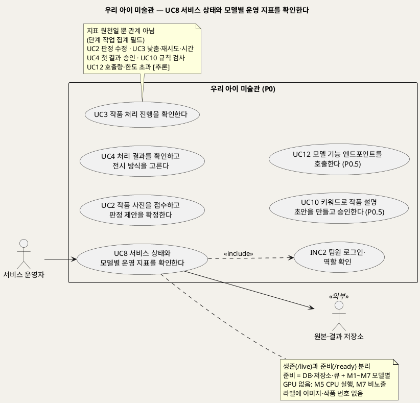
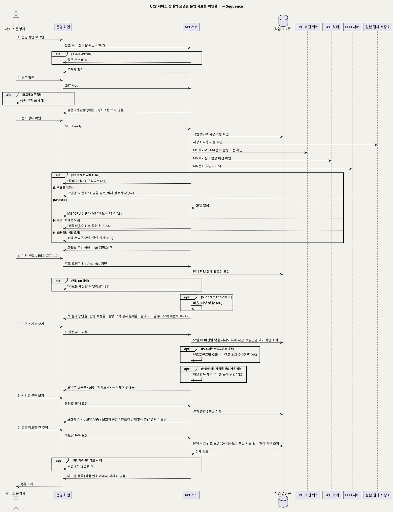

# UseCase 명세 — #8 서비스 상태와 모델별 운영 지표를 확인한다 (우리 아이 미술관 P0)
**우리 아이 미술관 · UC8 · UML 2.5.1 표준 (UseCase Diagram + UseCase 기술 + Sequence Diagram)**

---

> **문서 식별**: `design/UC_08_운영상태지표확인.md`
> **작성일**: 2026-09-23 · **표준**: UML 2.5.1 (OMG)
> **개정 (2026-09-28)**: 모델 조합 기준으로 다시 썼다. 준비 상태를 모델 M1~M7별로 나누고, 지표를 모델별 낮춤률·처리 시간 p95·재시도율·서빙 3종별 큐 적체·판정 수정률·설명 규칙 검사 실패율로 바꿨으며, 원인 분류를 5분류로 맞추고 팀원 로그인·역할 확인(INC2)을 포함했다. 옛 이름 판 문서를 대체한다.
> **원천(SoT)**: `Intent-Specify.md` (2026-09-28 기획 기준안) [미션] 서빙 지표 · [핵심 활동] 3·6 · [핵심 자원] · [핵심 데이터] 운영 지표 · [핵심 장벽] · [부정적 영향] — `.specify/features/우리-아이-미술관/spec.md` v2.0 FR-12, FR-13, FR-14, FR-26 (v2.0 개정 중, FR 번호는 재작성 공통 기준 §7)
> **다이어그램**: 모든 PlantUML 소스는 렌더 검증 완료(HTTP 200). 아래 링크로 브라우저에서 열 수 있다. `plantuml.sumzip.com` 은 사내 SSO 로그인 뒤 열린다.

---

## 목차

1. [범위·개요](#1-범위개요)
2. [UseCase Diagram](#2-usecase-diagram)
3. [Actor 카탈로그](#3-actor-카탈로그)
4. [UseCase 목록 (원천 매핑)](#4-usecase-목록-원천-매핑)
5. [UseCase 기술 + Sequence Diagram](#5-usecase-기술--sequence-diagram)
6. [업무규칙 종합](#6-업무규칙business-rules-종합)
7. [UML 표준 준수 노트](#7-uml-표준-준수-노트)

---

## 1. 범위·개요

서비스 운영자는 두 가지를 확인한다. 첫째는 API 서버가 살아 있는지(**생존**, `/live`)와 작품을 받아 처리할 준비가 됐는지(**준비**, `/ready`)다. 준비는 작업 DB·큐와 원본·결과 저장소, 그리고 모델 M1~M7 각각의 상태로 나눠 보여 준다. GPU가 없어 M5(깊이)를 CPU로 돌리는 상태나 M7(3D)을 노출하지 않는 상태도 "고장"과 구분해 표시한다. 둘째는 `/metrics` 에 기반한 서빙 지표다. 이 UC의 목표는 **가족의 이미지·이야기를 보지 않고도** 모델 품질 문제(낮춤)와 인프라 장애(재시도·결과 미도달)를 구분하고, 어느 모델·어느 서빙군에서 문제가 나는지 찾는 것이다(Intent [미션] "어떤 사진을 올려도 결과가 돌아오게 하는 것").

| 지표 | 정의 | 분리 단위 | 원천 |
|---|---|---|---|
| 첫 결과 승인율 | 좋아요 ÷ 결과 확인 건 | 결과 종류(움직임·2.5D·액자) [추론] | Intent [미션] |
| 판정 수정률 | 보호자가 제안과 다르게 고른 건 ÷ 제안 제시 건. 제안 없이 직접 확정한 건(BR-SUG-05)은 분모에서 뺀다 [추론] | 제안 문구 종류 [추론] | Intent [미션] · [핵심 활동] 4 |
| 모델별 낮춤률 | 움직임→2.5D, 2.5D→액자, 설명→템플릿 건 ÷ 해당 모델 시도. P1 3D→2.5D는 M7 노출 뒤에만 센다 | 모델 ID·버전, 낮춤 구간(어느 단계→어디로) | Intent [미션] · 공통 기준 §5 |
| 설명 규칙 검사 실패율 (P0.5) | 규칙 검사에서 걸린 생성 ÷ M6 생성 시도 [추론 분모] | 모델 버전, 출처(LLM/템플릿) | Intent [미션] |
| 모델별 처리 시간 p95 | 단계 작업 처리 시간의 95백분위 | 모델 ID·버전, 서빙군 | Intent [미션] |
| 재시도율 | 인프라 재시도가 1회 이상 난 단계 작업 ÷ 해당 모델 단계 작업 [추론 정의] | 모델 ID, 오류 분류 | Intent [핵심 데이터] 운영 지표 |
| 큐 적체 | 서빙군별 대기 중 단계 작업 수. CPU 비전 큐·GPU 전용 큐는 대기 작업 수, LLM 서버는 동시 처리 상한에 걸려 기다리는 요청 수 [추론] | 서빙 3종 | Intent [미션] · [핵심 활동] 6 |
| 결과 미도달 수 | 같은 단계를 3회 재시도하고도 실패해 `처리하지 못함` 이 된 건. **목표 0** | 모델 ID, 오류 분류 | Intent [미션] · 공통 기준 §5 |
| (보조) 삭제 미완료 수 | 자동 재시도 뒤에도 끝나지 않은 삭제 건 | — | 공통 기준 BR-DEL-03 |
| (보조, P0.5) 외부 엔드포인트 호출량·한도 초과 수 | `/v1/models/{…}` 엔드포인트별 호출 수와 요청 한도·크기 제한 초과 거부 수 [추론] | 엔드포인트 | Intent [핵심 장벽] 외부 엔드포인트 · [핵심 자원] 운영 시 |

원천은 이 지표들이 **정의와 검증 계획이며 달성 실적이 아니다**라고 명시한다(Intent [미션]). 결과 미도달 0건 외의 비율 지표에는 목표값을 두지 않고 기준선으로만 쓴다. 지표 라벨에는 이미지·작품 번호·식별 정보를 넣지 않는다(Intent [핵심 데이터]).

| 항목 | 값 |
|---|---|
| 대상 시스템 | 우리 아이 미술관 (P0, 일부 지표 P0.5) |
| 상위 프로세스 | 운영 감시(가족 흐름 UC2~UC7·UC10, 외부 호출 UC12와 병행) |
| 원천 근거 | Intent [미션] 서빙 지표 · [핵심 활동] 3(`/live`·`/ready`·`/metrics`)·6(서빙 3종) · [핵심 자원] API 서버 연결·외부 사용·기반(Prometheus·구조화 로그) · [핵심 데이터] 처리 작업·운영 지표 · [핵심 장벽] 서빙 기반·자원·외부 엔드포인트 · [부정적 영향] 아동 이미지 유출 · spec v2.0 FR-12·13·14·26 |
| 핵심 UseCase | 1개 (UC8) + 포함 1개 (INC2) |
| 주요 액터 | 서비스 운영자 · 원본·결과 저장소(보조) |

---

## 2. UseCase Diagram

**[「UC8 운영 상태·모델별 지표 UseCase Diagram」 PlantUML 뷰어로 열기](https://plantuml.sumzip.com/plantuml/svg/eNqNVF1P02AUvu-vOMEbFgX5jMQoMaIYL1ASw5UYUrcyGktruk5jjKZAIYPNuCmVoR2WZDhU1GUsW0lITPZTvOx7-h88bzvGRyTxat37Pufp85zznN5IGaJupOcVSMdntLQ-E5-TlcRMUlQUSX8x0zcipJ7I6lNRF-fhsRh_ktS1tJoY0xRNhwvjg-P9t2-eQKTmxIT2XFaTMCsqKUlQpFkDDA10OTlnQELWpbgha6pgyIYiAX6ssi97gLaFpTqwXx5mXL9uwh9zHabGRgAthx1YuFYGXFoIlhzcNIF922VvPLZvUXUdiwuAFTMoOGznEIJNG0teYDssWxYEMW6QxK4THCEet_JdIKbg_tNUB_Ipz_a9VtOvVf39Q0DXxK0dXMmFuAcEkeDaNdz0WMMcHRUE7kFUk6S_6zwD3ZN9sS54KQCkU1JcTBH0HD_T6n8aCsUQyUnOu_fGBiDImWQA2LbjNz2Ct5rTKm78CGy3XR9WcuhpOQOAW4XgXQZwcQ8rZIAEuAXMFAO76O-702qQy6Nr06GDdoZfczrXPiXnDOdgh7NWDBtTsYIPq0e1Z6wMnq4dOiqKxnDSf6QHXQuzDrDqV8yWOCedsh3vmHDoNGF_HwSLZfyUY-8d6k5HmlVm35aJrp5p-2IVgpSJDXDtoKOSD7F3ONbm7u87Qz7QTiL4XpWt7QBurNN7grd7nGDNI_nUwaKHDeefdAPCK0GgDEJPz2g4Vp6P3t7RcFBwlQInq3ElnZAocfyKw8IoCoKqGVJ7obTZdiRwqYTb9e7LivxMioUhLpsUte7LuiQmXsSANSxqLQeG53Adbt1sNTtJbzWDhTxchIn-1xNXjleM8Hcmp8jaCpZyV2FiGMb432yZhnoJOPLAYsvcIyFZ6ZDVdnEjD7QLfBUqJr0h6jmrZagXbSJBUhPATUROHmuGoc1HVngkovgDZRprDpYOgf3OAy2VzzfEtli2SKBult0ND7YKuLFMNQX-L6Dr906M7qfCxYjymynyn1aT8wNb_ImNMhe2R2Fiby16zDp-1QqLeAa_w9F3IAxDVEhZ8psOHmzSpUkLE6IpA9GE2edV6qDN6YBixYsfYmOdbbuPjs3eoCf6zP4FheK6sw==)** — 클릭 시 브라우저로 연결됩니다.

#### 다이어그램 쉽게 읽기 (유저 관점)

- **누가 쓰나** — 서비스 운영자(팀원)가 쓴다. 원본·결과 저장소는 "쓸 수 있는 상태인지" 확인받는 대상이다. 모델 M1~M7은 시스템 안의 구성요소라 사람 모양으로 그리지 않고, 시퀀스에서 CPU 비전 워커·GPU 워커·LLM 서버로 나눠 보여 준다.
- **무슨 순서로** — 팀원 계정으로 들어와 운영자 역할을 확인받고, 서비스가 살아 있는지 → 모델별로 준비됐는지 → 기간별 지표 → 모델별 지표 → 원인별 분해 순서로 본다. 결과가 닿지 못한 건이 있으면 작업 단위로 추적한다.
- **«include» = 항상 함께** — 운영 화면을 열 때마다 "팀원 로그인·역할 확인(INC2)"이 함께 일어난다. 보호자용 로그인(INC1)과는 다르다.
- **«extend» = 특정 상황에서만** — 없다. GPU 없음·P0.5 미가동 같은 상황은 같은 화면 안의 표시 차이라 대체흐름으로 다룬다.
- **Generalization(◁)** — 없다. 아래쪽 UC2·UC3·UC4·UC10·UC12는 지표 숫자가 나오는 곳을 보여 줄 뿐, UC8과 선으로 이어진 관계가 아니다.

| 기호 | 의미 |
|---|---|
| 사람 모양(actor) | 시스템을 쓰는 사람 또는 외부 구성요소(`<<외부>>`) |
| 타원(usecase) | 액터가 이루려는 목표 |
| 사각형(rectangle) | 시스템 경계 |
| 실선 | 액터·외부 구성요소와 UC의 연결 |
| 점선 화살표 `<<include>>` | 기준 UC가 항상 함께 수행하는 하위 행위 |
| 노트 | 규칙·데이터 출처 보충 |

---

## 3. Actor 카탈로그

| 구분 | 액터 | 이 UC에서의 역할 | 원천 근거 |
|:--:|---|---|---|
| Primary | 서비스 운영자 | 생존·준비 상태와 모델별 지표를 확인하고 결과 미도달 건을 추적한다. 가족의 이미지·이야기에는 접근하지 못한다 | Intent [핵심 활동] 3 · [핵심 데이터] 운영 지표 · 공통 기준 §6 액터 · BR-ACC-03 |
| Secondary | 원본·결과 저장소(S3 호환) | 준비 상태 확인 대상. 사용 불가면 "준비 안 됨" | Intent [핵심 자원] 기반 · 공통 기준 §6 액터 |
| (내부 구성요소) | CPU 비전 워커(M1~M4) · GPU 워커(M5·M7) · LLM 서버(M6) | 모델별 준비 상태와 처리 기록의 출처. 액터로 두지 않고 시퀀스 lifeline으로만 둔다 | 공통 기준 §2·§3·§6 |

---

## 4. UseCase 목록 (원천 매핑)

| UC ID | 유스케이스명 | 관계 | 원천 근거 |
|:--:|---|---|---|
| UC8 | 서비스 상태와 모델별 운영 지표를 확인한다 | 본 문서 | spec v2.0 FR-12 · FR-13 · FR-14 · FR-26 · Intent [미션] · [핵심 활동] 3 |
| INC2 | 팀원 로그인·역할 확인 | UC8이 «include» | 공통 기준 §6 · BR-ACC-05 |
| UC2 | 작품 사진을 접수하고 판정 제안을 확정한다 | 데이터 원천(제안값·확정값·수정 여부 → 판정 수정률) | FR-21 · BR-SUG-03 |
| UC3 | 작품 처리 진행을 확인한다 | 데이터 원천(단계 작업의 모델·버전·시도 횟수·처리 시간·낮춤 원인·오류 분류) | FR-5 · FR-23 · FR-25 |
| UC4 | 처리 결과를 확인하고 전시 방식을 고른다 | 데이터 원천(좋아요·보호자 전환 → 첫 결과 승인율) | FR-6 · BR-APR-04 |
| UC10 | 키워드로 작품 설명 초안을 만들고 승인한다 (P0.5) | 데이터 원천(규칙 검사 결과·출처 → 설명 규칙 검사 실패율, 설명→템플릿 낮춤) | FR-27 · BR-CAP-03 |
| UC12 | 모델 기능 엔드포인트를 호출한다 (P0.5) | 데이터 원천(호출량·한도 초과 수) [추론] | FR-28 · BR-API-04 |

---

## 5. UseCase 기술 + Sequence Diagram

### 5.1 UC8 서비스 상태와 모델별 운영 지표를 확인한다

> **쉽게 말하면** — 운영 담당 팀원이 서비스와 모델 7종이 제대로 돌고 있는지 확인합니다. "그림이 움직이기 어려워 2.5D로 낮춘 것"과 "서버가 고장 나서 결과가 못 간 것"이 따로 집계되어, 어느 모델을 먼저 손봐야 할지 알 수 있습니다. 가족의 그림·이야기·아이 별칭은 운영 화면에 나오지 않습니다.

#### 유스케이스 기술

| 속성 | 내용 |
|---|---|
| **ID** | UC8 (spec v2.0 FR-12, FR-13, FR-14, FR-26) |
| **유스케이스명** | 서비스 상태와 모델별 운영 지표를 확인한다 |
| **액터** | 주: 서비스 운영자 · 보조: 원본·결과 저장소. 내부 구성요소(액터 아님): 작업 DB·큐, CPU 비전 워커(M1~M4), GPU 워커(M5·M7), LLM 서버(M6) |
| **사전조건** | (1) 운영자가 팀원 계정을 갖고 있고 운영자 역할이 부여돼 있다(INC2). 팀원 인증 방식은 `자료 없음 — 확인 필요`(U8). (2) API 서버가 `/live`·`/ready`·`/metrics` 를 제공한다(엔드포인트 이름·형식은 [추론], U8). (3) 단계 작업 기록에 모델 ID·버전·상태·시도 횟수·처리 시간·낮춤 원인 또는 오류 분류가 쌓여 있다(없으면 A6). (4) 모델 7종의 매니페스트에 활성 버전이 정해져 있다(BR-MDL-01) |
| **사후조건** | (1) 운영자는 생존과 준비 상태를 따로 확인했고, 준비는 DB·저장소·큐와 모델 M1~M7별로 확인했다. (2) 운영자는 지정 기간의 서비스 지표, 모델별 지표, 서빙 3종별 큐 적체, 결과 원인 5분류 집계, 결과 미도달·삭제 미완료 건수를 확인했다. (3) 이 과정에서 이미지, 객체 키, 작품 번호, 별칭, 제목, 아이의 한마디, 자유 입력, 오류 원문은 노출되지 않았다. (4) 이 UC는 가족 데이터와 모델 매니페스트를 바꾸지 않는다(읽기 전용) |
| **기본흐름** | ↓ 별도 기본흐름표 |
| **대체흐름** | A1. 준비 안 됨 — 작업 DB·큐나 원본·결과 저장소 중 하나라도 쓸 수 없으면 "준비 안 됨"과 해당 구성요소를 표시한다. 접수도 받을 수 없는 상태다. A2. 일부 모델 미준비 — 특정 모델(예: M3)만 준비되지 않았으면 전체를 "준비 안 됨"으로 뭉뚱그리지 않고 해당 모델을 "미준비"로, 영향받는 경로(예: 움직임)를 함께 표시한다. 모델이 필요 없는 원본 액자 경로와 접수는 계속 동작한다고 알린다 [추론]. 미준비 중 들어온 단계 작업은 낮춤이 아니라 인프라 재시도로 집계된다(BR-PRC-03). A3. GPU 없음 — GPU 워커가 GPU를 찾지 못하면 M5는 "CPU 실행"(속도 미측정, U2·U6), M7은 "비노출(P1)"로 표시한다. 둘 다 장애가 아니라 정해진 운영 상태로 구분한다(BR-SRV-02). A4. 활성화 금지 모델 — 라이선스 조건이 확인되지 않아 활성화하지 않은 모델(예: AGPL 예비 모델, 조건 미확인 M6)은 "비활성(라이선스 확인 전)"으로 표시하고 "미준비"와 섞지 않는다 [추론](BR-MDL-07, U4). A5. P0.5 외부 엔드포인트 지표 — P0.5가 가동 중이면 `/v1/models/{segment\|classify\|pose\|relief\|caption}` 엔드포인트별 호출 수와 요청 한도·크기 제한 초과 거부 수를 함께 보여 준다. 라벨은 엔드포인트 이름까지만 쓰고 입력은 남기지 않는다 [추론](BR-API-04, BR-API-05, U12). A6. 해당 없음 — 선택 기간에 분모가 0이거나 P0.5가 가동 전이면(설명 규칙 검사 실패율·설명→템플릿 낮춤률·외부 호출 지표) 비율을 "해당 없음"으로 표시한다 [추론]. A7. 삭제 미완료 확인 — 자동 재시도 뒤에도 끝나지 않은 삭제 건수를 이미지·식별 정보 없이 보여 준다(BR-DEL-03) |
| **예외흐름** | E1. 작업 DB 장애 — 지표 계산용 단계 작업 기록을 읽을 수 없으면 "지표를 계산할 수 없어요"라고 표시한다. 생존·준비 결과는 별개로 보여 준다(준비 = 준비 안 됨). 원천: Intent [핵심 데이터] 처리 작업 오류 분류(DB). E2. 가족 데이터 접근 시도 — 운영 화면에서 결과 미도달 건의 원본·결과 이미지·이야기·설명을 열려고 하면 제공하지 않는다. 운영 화면에는 그런 경로가 없다(BR-ACC-03). 원천: Intent [부정적 영향] 아동 이미지 유출. E3. 역할 없는 접근 — INC2에서 운영자 역할이 확인되지 않으면(보호자 계정, 다른 팀원 역할 등) 운영 화면과 지표 조회를 거부한다(BR-ACC-05). 평가 담당·연동 개발 팀원에게 지표를 읽기로 열지는 `자료 없음 — 확인 필요`. E4. 생존 확인 무응답 — API 서버 프로세스가 응답하지 않으면 생존 실패로 표시된다. 이 경우 운영 화면 자체가 열리지 않을 수 있다. 외부 감시 수단은 `자료 없음 — 확인 필요`. E5. 서빙군 응답 시간 초과 — 준비 확인 중 CPU 비전 워커·GPU 워커·LLM 서버 가운데 응답하지 않는 서빙군이 있으면 그 서빙군의 모델을 "확인 불가"로 표시하고 "준비됨"으로 보지 않는다 [추론]. 원천: Intent [핵심 장벽] 치명 — 서빙 기반(보관 처리된 Animated Drawings·TorchServe, 보안 수정 없음). E6. 라벨 규칙 위반 — 지표 수집 중 라벨에 이미지·작품 번호·객체 키·자유 입력이 들어간 항목이 발견되면 그 항목을 화면에 싣지 않고 "라벨 규칙 위반"으로 표시한다 [추론](BR-OPS-04, BR-PRV-01) |
| **포함/확장** | «include» INC2 팀원 로그인·역할 확인. 확장 없음. 보호자용 INC1은 포함하지 않는다 |
| **우선순위** | Medium — 가족이 직접 쓰지 않는 기능이다. 하지만 Intent [미션] "어떤 사진을 올려도 결과가 돌아오게" 하는 서빙 목표와 "결과 미도달 0"을 확인하는 유일한 수단이다 |
| **사용빈도** | `자료 없음 — 확인 필요`. [추론] 정기 점검과 장애 신고 때 연다 |
| **업무규칙** | BR-OPS-01, BR-OPS-02, BR-OPS-03, BR-OPS-04, BR-FBK-03, BR-FBK-04, BR-PRC-03, BR-SRV-01, BR-SRV-02, BR-SRV-03, BR-MDL-01, BR-MDL-07, BR-SUG-03, BR-CAP-03, BR-API-05, BR-DEL-02, BR-DEL-03, BR-ACC-03, BR-ACC-05, BR-PRV-01 |
| **특별 요구사항** | 개인정보: 운영 화면·지표·라벨에 이미지, 객체 키, 작품 번호, 별칭, 제목, 아이의 한마디, 자유 입력, 오류 원문이 없다. 라벨은 모델 ID·버전·서빙군·단계·낮춤 구간·원인 분류·오류 분류·(P0.5) 엔드포인트 이름으로 한정한다 [추론]. 운영 로그 표본 점검에서 위 항목 0건이 목표다. 정확성: 장애 주입 시험(워커 정지·시간 초과·저장소 장애·DB 장애·모델 미준비)에서 인프라 장애가 "모델 낮춤"으로 집계되는 건수 0건이 목표다(옛 spec Success Criteria "원인 분리 정확도" — v2.0 반영 여부 확인 필요). 상태 표시: GPU 없음(M5 CPU 실행·M7 비노출)과 라이선스 전 비활성은 장애와 다른 표시로 보여 준다. 보안: TorchServe·Ollama 등 모델 런타임 포트는 내부망에만 두고 운영 화면은 API 서버를 거쳐서만 상태를 읽는다(BR-SRV-04). `/metrics`·`/ready` 의 외부 노출 범위는 `자료 없음 — 확인 필요`(U8). 목표값: 결과 미도달 0건 외에는 목표값 없이 기준선으로만 쓴다(Intent [미션]). 시간 상한·처리 시간 기준은 M3 외 미측정이다(U6) |
| **비고** | 원천 추적: Intent-Specify.md [미션] 서빙 지표(첫 결과 승인율·판정 수정률·모델별 낮춤률·설명 규칙 검사 실패율·p95·큐 적체·결과 미도달)와 "지표는 정의와 검증 계획이며 달성 실적이 아니다" · [핵심 활동] 3(운영용 `/live`·`/ready`·`/metrics`)·6(서빙 3종) · [핵심 자원] 외부 사용(`/ready`(모델별)) · 기반(Prometheus·구조화 로그) · [핵심 데이터] 처리 작업(오류 분류: 엔진 다운·시간 초과·저장소·DB·모델 미준비) · 운영 지표(재시도율 포함, "이미지·작품 번호는 라벨에 넣지 않는다") · [핵심 장벽] 서빙 기반·자원(GPU)·외부 엔드포인트 · [부정적 영향] 아동 이미지 유출. spec v2.0 FR-12(생존·준비 분리), FR-13(지표 — Intent [미션] 서빙 지표 전체), FR-14(로그 규칙), FR-26(모델별 지표). 연관 FR-25(서빙 3종), FR-28(P0.5 외부 엔드포인트). 옛 spec FR-9 수용기준 3(운영자 이미지 차단)은 BR-ACC-03으로 옮겼다. 공통 기준 §2(모델)·§3(서빙·lifeline)·§4(엔드포인트)·§5(상태·원인 5분류)·§6(INC2)·§8(BR)·§10(U2·U4·U6·U8·U12). 추가 요구 R1~R4 중 직접 해당 없음(R4 'API활용' 메뉴는 UC11). 옛 문서의 지표 6종(비인물 액자율·모델 품질 대체율·미리보기 시간 p95 포함)은 모델별 지표로 바뀌었다. 재시도율은 Intent [미션] 목록에는 없고 [핵심 데이터] 운영 지표와 공통 기준 BR-OPS-02에 있다 |

#### 기본흐름 (Basic Flow)

| 단계 | 액터 행위 | 시스템 행위 |
|:--:|---|---|
| 1 | 운영자가 팀원 계정으로 운영 화면에 로그인한다 | 팀원 로그인·역할 확인(INC2)으로 운영자 역할을 확인하고 운영 화면을 연다 |
| 2 | 운영자가 생존 상태를 확인한다 | `/live` 로 API 서버 프로세스가 응답하는지만 확인해 "생존"을 표시한다. 의존 구성요소는 보지 않는다 |
| 3 | 운영자가 준비 상태를 확인한다 | `/ready` 로 작업 DB·큐와 원본·결과 저장소 사용 가능 여부, CPU 비전 워커(M1~M4)·GPU 워커(M5·M7)·LLM 서버(M6)의 모델별 준비 상태와 활성 버전을 확인해 "준비됨 / 준비 안 됨 / 모델별 미준비 / CPU 실행 / 비노출"로 표시한다 |
| 4 | 운영자가 기간을 고르고 서비스 지표를 연다 | `/metrics` 로 모은 단계 작업 집계 필드만으로 첫 결과 승인율, 판정 수정률, 설명 규칙 검사 실패율(P0.5), 결과 미도달 수, 삭제 미완료 수를 계산해 보여 준다 |
| 5 | 운영자가 모델별 지표를 연다 | 모델 ID·버전별 낮춤률(움직임→2.5D, 2.5D→액자, 설명→템플릿), 처리 시간 p95, 재시도율과 서빙 3종별 큐 적체를 보여 준다 |
| 6 | 운영자가 원인별 분해를 연다 | 보호자 선택, 모델 낮춤(어느 단계에서 어디로), 보호자 전환, 인프라 실패(오류 분류별: 엔진 다운·시간 초과·저장소·DB·모델 미준비), 결과 미도달을 서로 다른 항목으로 보여 준다 |
| 7 | 운영자가 결과 미도달 건을 추적한다 | 단계 작업 번호, 모델 ID·버전, 오류 분류, 시도 횟수, 처리 시간만 보여 준다. 작품 번호·이미지·객체 키·자유 입력·오류 원문은 없다 [추론: 추적 키는 작품 번호가 아닌 단계 작업 번호] |

#### Sequence Diagram

**[「UC8 운영 상태·모델별 지표 Sequence」 PlantUML 뷰어로 열기](https://plantuml.sumzip.com/plantuml/svg/eNqNV11PG0cUfd9fceW-2AqQ8GGSIjVKQghCCi1SmqeqQhtwEysOENu0ypuBJaLYFaa1g03WdGnt4qSmNcaxjeq-8FPyuDP7H3rvzK7tXZuoDwhm5879OOfcO8OdWFyNxtdfRCAWerm4uh5dXHoWjiwvPlUjkVD01eKNW0rseXhlTY2qL-CJuvT8aXR1fWV5ejWyGoXPHow_GJ2512MRe6Yur_4QXnkK36mRWEiJh-OREDyevgVc09mFxneLwLc2rC2d5xPA3pfZTy12rgE_rPPcBvCThLWvs1IbrHyWF1pWVmfJInxMZOBR6OV6aGUppCjqUhxj-3ocisP8KO0DNQZfrcUUTCYeXgqvqStxNJS-rXyGvatLk8dzbpO7C3MiwZom9nGpLKtx9YkaC-H5o31-sA337102rQ0Z4_499_nphcdAyRhYydsU_6corPCr22wWzXr2Z737Dx_O96aBS08lb9PsvHXZNGtV87wN3EjwoxJ_nRLWjxAVRAfLh-HbVCJMwegIuKoHdqybzRYiq5AB2lHlU2ClEui7u3vZ5AenVtawaQD_3JfTYwFFjcS7YINtwrMaS-YUEK6GO6G5sW8222CeVVkjAf6Z8YASWllWPEYdZzKQJ_0xTH-rwI_rzrYr6dmZr-F6JPx9SORlZTRMn2stUgSr1HlhnyU_YFriDLlEz1OOP54sWqkyoNh4UsfsJgZmJ22_AOnLypbBzws5-mZ-qHDtjB9mEH22mwF2XkftIha7vJAKeMoYxzKKCdSHLf2rq4mG1OVXMovbKDLKwSU-4JsVfvgOzGqC7ZYcP7a9EIBA3pbFJ61JslMwP3rZnB_Dn3H8mbDTxFB5RPIMUIgkaffBWXkwiAdu_q8DpGo8MOmA4Ghq4cZIUGrKqY7l0gRmtwDW2MHk-7Tlc-DM7gBLl31wzUUI-O-OIp84f5C5NslPDhpgf7fkyT6P3Unk6xiRW1Sn9aYEZu1fFNcQBjwmscolsL080oPRxuxoor8PXqMEMAAthrv09m65Y88H5QAhTb750QeXTUBkfZgB227xhu5fGA34MMq4HYUV2rxQ55pBSrfBJNRlDf1goSNJj_-Kk8L7hIMYjdW8-aFqqx7T0s0qYl3fwZnT593K1lnyoueUDbXPdi8ZxAAzwUEt1nMDuDrkmtBERwhCHp6umhgBs1UVqWmGtVUY6r1ixD1CXYkm7j6zt0gptVO_9BAYgusvQvFoeClGPlk15-pBliyblKFsRX6yTysLx94vOjvBLjuuWocpORydbgXKO2sMUG7nhkMnfLMqJuhOTmjjTR2zIqhGJVSra3HET0OM4IbTG9Q0oqH38kSdE8CpjurXy4i-TYtQHNE7OXDA1f4E5y7ZvUC66CzKz0qluZGlvPAXKxn0jWtF9n4bzKbOL_J4KoHDxR6j9inbE_YP28MroSLqopObp9zQRfPlNfZ7Snz3373pHZPBkV45XM1gn5Hk0k2ZVOHc_cumnElkzjb_4o0iyuqogqLGJPHPWo79UbE1PtSVsTBPJTB2h3bJMnEiOOD5Fk0WfpBBGVh7FXqt7LZsary0eKzIu5Wj3nYwoofOntNk4uM3vJFhx8a3iFSwRw44z2plfoA3QaFOiJ4kqJ5962echLUddErLNNdRVUfbzCh5M7GFYWVP2ft3qCB8h7WGcEYIvw67XNewB0iJk59uWomorZC1z4OCbgddR0x0bRkbvFb3S3hhnP-27SV_Eu_It2mER7htaJjn4PbtGNl9OIB8R9LCFILUQqWcbe8t5bxORNBrRgwRuN65K0RptO6aGDhIc_iJWMTnRqFtN4BfhsCsArjr7QNPpTdH-jvFPMMnSSODMHmk3rFAtthxYaDUXdPJEUFfA6AuckXCQeaKS0ESWIe_otw8neCoHQMM90zOnsEn1NirQbxXsm3RLwd1dpQC6X7As1A3z_Eples-l1BmYwNl5i3e7xV6N7xZLaDAwNos2jMvoLjffbYL-eBT7mA0_J_nP2yQbEg=)** — 클릭 시 브라우저로 연결됩니다.

기본흐름 1~7단계는 시퀀스의 번호 붙은 주요 메시지 `1.`~`7.`과 1:1로 대응한다.

---

## 6. 업무규칙(Business Rules) 종합

| BR ID | 규칙 | 적용 UC | 근거 |
|---|---|---|---|
| BR-OPS-01 | 생존(`/live`)과 준비(`/ready`)를 분리하고, 준비는 DB·저장소·큐와 모델 M1~M7별로 표시한다 | UC8 | Intent [핵심 활동] 3 · [핵심 자원] 외부 사용 · FR-12 |
| BR-OPS-02 | 지표 정의: 첫 결과 승인율 · 판정 수정률 · 모델별 낮춤률 · 설명 규칙 검사 실패율(P0.5) · 모델별 처리 시간 p95 · 재시도율 · 큐 적체 · 결과 미도달 수(목표 0). 정의·검증 계획이며 실적이 아니다(정의는 §1 표) | UC8 | Intent [미션] 서빙 지표 · [핵심 데이터] 운영 지표 · FR-13 · FR-26 |
| BR-OPS-03 | 결과 원인을 분리해 집계한다(BR-FBK-04의 5분류) | UC8 | Intent [가치제안] "실패를 성공처럼 꾸미지 않고" · 공통 기준 §5 |
| BR-OPS-04 | 지표 라벨에 이미지·작품 번호·식별 정보를 넣지 않는다 | UC8 | Intent [핵심 데이터] 운영 지표 |
| BR-FBK-03 | 낮춤 원인(어느 단계에서 어디로)을 단계 작업에 기록한다. 모델별 낮춤률의 원천이다 | UC3, UC4, UC8 | Intent [가치제안] · FR-23 |
| BR-FBK-04 | 결과 원인 5분류(보호자 선택·모델 낮춤·보호자 전환·인프라 실패·결과 미도달)를 섞지 않는다 | UC3, UC4, UC8 | 공통 기준 §5 · FR-23 |
| BR-PRC-03 | 인프라 장애(모델 미준비 포함)는 낮춤이 아니다. 같은 단계를 최대 3회 재시도하고, 소진 시 결과 미도달로 집계한다 | UC3, UC8 | Intent [핵심 활동] 5 · FR-5 |
| BR-SRV-01 | 서빙 3종(CPU 비전 비동기 큐 · GPU 전용 큐 · LLM 짧은 동기·스트리밍)을 분리한다. 큐 적체를 서빙 3종별로 보는 근거다 | UC3, UC8 | Intent [핵심 활동] 6 · FR-25 |
| BR-SRV-02 | GPU가 없으면 M5는 CPU로 실행하고 M7은 비노출한다. 준비 상태에서 장애와 구분해 표시한다 | UC3, UC6, UC8 | Intent [핵심 장벽] 자원 |
| BR-SRV-03 | 모델별 시간 상한·동시 처리·재시도 횟수를 제한한다. 처리 시간 p95·재시도율·큐 적체를 읽는 기준이다 | UC3, UC8 | FR-25 · U6 |
| BR-MDL-01 | 모델 7종은 버전을 고정하고 매니페스트를 둔다. 준비 상태와 모델별 지표는 모델 ID·활성 버전 단위로 보여 준다 | UC8, UC9 | Intent [핵심 활동] 2 · FR-24 |
| BR-MDL-07 | 라이선스 조건이 확인되지 않은 모델은 활성화하지 않는다. 준비 상태에서 "비활성"으로 구분한다 | UC8, UC9 | Intent [핵심 장벽] 라이선스 |
| BR-SUG-03 | 제안값·확정값·수정 여부를 기록한다. 판정 수정률의 원천이다 | UC2, UC8 | Intent [핵심 활동] 4 · FR-21 |
| BR-CAP-03 | (P0.5) 설명의 출처·규칙 검사 결과·생성 횟수를 기록한다. 설명 규칙 검사 실패율의 원천이다 | UC10, UC8 | Intent [핵심 데이터] 작품 설명 · FR-27 |
| BR-API-05 | (P0.5) 외부 호출 입력은 보관하지 않고 로그에도 남기지 않는다. 호출량 지표는 건수만 센다 | UC12, UC8 | Intent [부정적 영향] 외부 엔드포인트 남용 · FR-28 |
| BR-DEL-02 | 삭제 후 작업 기록에는 집계 필드만 남는다. 지표는 이 필드로만 계산한다 | UC7, UC8 | Intent [핵심 데이터] 삭제 |
| BR-DEL-03 | 끝내 완료되지 않은 삭제는 "삭제 미완료"로 집계한다 | UC7, UC8 | 공통 기준 §8 |
| BR-ACC-03 | 운영자·팀원은 가족 이미지·이야기에 접근하지 못한다 | UC6, UC8 | Intent [부정적 영향] 아동 이미지 유출 |
| BR-ACC-05 | 팀원 역할(운영자·평가 담당·연동 개발)을 분리한다. UC8은 운영자 역할만 연다 | UC8, UC9, UC11 | 공통 기준 §6 INC2 |
| BR-PRV-01 | 운영 로그에 이미지·객체 키·자유 입력·오류 원문을 남기지 않는다 | 전 UC | Intent [부정적 영향] · FR-14 |

---

## 7. UML 표준 준수 노트

| 항목 | 적용 |
|---|---|
| 액터 | 서비스 운영자는 보호자와 다른 Primary actor다. 보호자용 INC1이 아니라 팀원용 INC2를 «include»한다 |
| 외부 구성요소 | 원본·결과 저장소는 준비 확인 대상이라 Secondary actor로 경계 밖에 뒀다. 모델 M1~M7은 시스템 내부 구성요소라 액터로 두지 않았다 |
| 데이터 의존 | UC2·UC3·UC4·UC10·UC12는 지표 데이터의 출처일 뿐 include/extend 관계가 아니다. 선을 긋지 않고 노트로 표시했다 |
| Sequence | lifeline은 공통 기준 §3의 이름을 썼다. 모델은 서빙군 lifeline(CPU 비전 워커·GPU 워커·LLM 서버)에 모델 ID를 적어 표현했고, 준비 확인 결과와 예외는 `alt`/`opt`로 나눴다. 기본흐름 7단계와 번호 메시지 7개가 1:1로 대응한다 |
| 추상수준 | 지표 화면의 차트·필드 배치는 다루지 않는다. 엔드포인트 이름은 [추론]이며 `/speckit.plan`에서 확정한다(U8) |

---

*우리 아이 미술관 P0 · UC8 · 작성 2026-09-23 · 개정 2026-09-28 · 원천: Intent-Specify.md (2026-09-28), spec.md v2.0 FR-12, FR-13, FR-14, FR-26*
