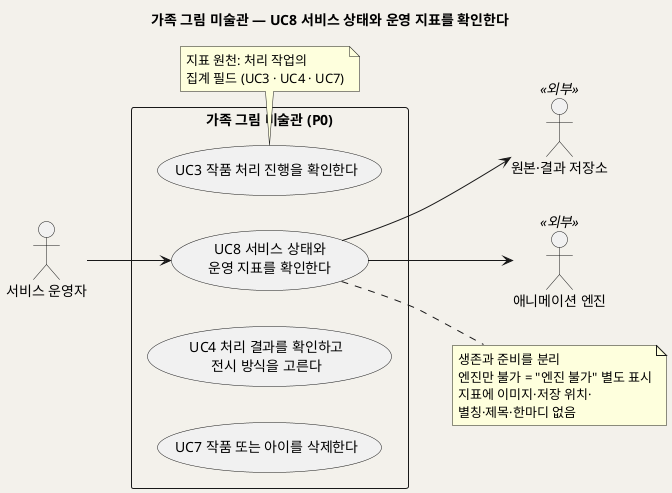
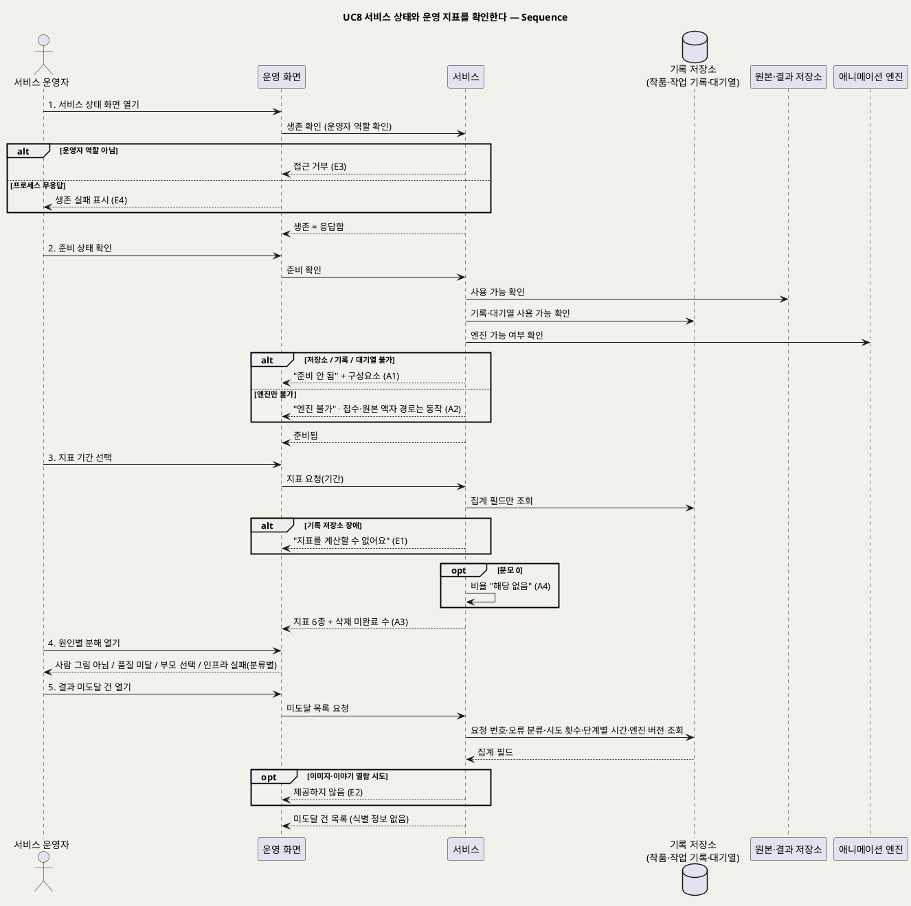

# UseCase 명세 — #8 서비스 상태와 운영 지표를 확인한다 (가족 그림 미술관 P0)
**가족 그림 미술관 · UC8 · UML 2.5.1 표준 (UseCase Diagram + UseCase 기술 + Sequence Diagram)**

---

> **문서 식별**: `design/UC_08_운영상태지표확인.md`
> **작성일**: 2026-09-23 · **표준**: UML 2.5.1 (OMG)
> **원천(SoT)**: `.specify/features/가족-그림-미술관/spec.md` — FR-12, FR-13, FR-14, FR-9(운영자 이미지 차단) · 보조 원천 `Intent-Specify.md` [미션] 서빙 지표 · [핵심 데이터] 운영 지표 · [핵심 활동] 6
> **다이어그램**: 모든 PlantUML 소스는 렌더 검증 완료(HTTP 200). 아래 링크로 브라우저에서 열 수 있다.

---

## 목차

1. [범위·개요](#1-범위개요)
2. [UseCase Diagram](#2-usecase-diagram)
3. [Actor 카탈로그](#3-actor-카탈로그)
4. [UseCase 목록 (원천 매핑)](#4-usecase-목록-원천-매핑)
5. [UseCase 기술 + Sequence Diagram](#5-usecase-기술--sequence-diagram)
6. [업무규칙 종합](#6-업무규칙business-rules-종합)
7. [UML 표준 준수 노트](#7-uml-표준-준수-노트)

---

## 1. 범위·개요

서비스 운영자는 두 가지를 확인한다. 첫째는 서비스가 살아 있는지(**생존**)와 작품을 받아 처리할 준비가 됐는지(**준비**)다. 둘째는 서빙 지표다. 이 UC의 목표는 **이미지를 보지 않고도** 모델 품질 문제와 인프라 장애를 구분하고, 결과가 보호자에게 닿지 못한 건을 찾는 것이다(spec Target Users 서비스 운영자).

| 지표 | 정의 (spec FR-13 · Intent [미션]) |
|---|---|
| 첫 결과 승인율 | 좋아요 ÷ (좋아요 + 액자 전환 + 다시 찍기). 첫 결과가 움직이는 작품인 건만 대상 |
| 비인물 액자율 | 엔진을 시도하지 않은 액자 ÷ 접수 완료 |
| 모델 품질 대체율 | 품질 미달 액자 ÷ 엔진 시도 |
| 재시도율 | 인프라 재시도가 1회 이상 발생한 작업 ÷ 엔진 시도 |
| 미리보기 시간 p95 | 접수 완료부터 확인 대기까지 걸린 시간의 95백분위 |
| 결과 미도달 수 | 재시도를 다 쓴 건. 목표 0 |

원천은 이 지표들이 **정의와 검증 계획이며 달성 실적이 아니다**라고 명시한다(Intent [미션]).

| 항목 | 값 |
|---|---|
| 대상 시스템 | 가족 그림 미술관 (P0) |
| 상위 프로세스 | 운영 감시(가족 흐름 UC2~UC7과 병행) |
| 원천 근거 | spec FR-12 · FR-13 · FR-14 · FR-9 수용기준 3 · Scenario 11 · Intent [미션] 서빙 지표 · [핵심 데이터] 운영 지표 |
| 핵심 UseCase | 1개 (UC8) |
| 주요 액터 | 서비스 운영자 · 원본·결과 저장소(보조) · 애니메이션 엔진(보조) |

---

## 2. UseCase Diagram

**[「UC8 운영 상태·지표 UseCase Diagram」 PlantUML 뷰어로 열기](https://plantuml.sumzip.com/plantuml/svg/eNp9U19L21AUf7-f4tC96IPgqFAZrshEXzcYexuU2KYxmCaSpAwZg7hG6WzBdmvXuCWlglockzlbbAt96kfZY-7pd9i5qVYLc09Jzj2_c35_blYtWzLtfE6DfDqVlXKqtptSJE2Tzd3U4jKztlV9RzKlHGxK6W3FNPJ6Zs3QDBOebMQ3nq6_eNBhbUkZ452qK5CVNEtmmpy1wTbAVJUtGzKqKadt1dCZrdqaDOGVgye_Iez1-fkQ-K8-Flth14E_Tg3erC0Duj4fuHh4CljYGxd8PHYAv3XR2wNsO-Oqz8-GMD6uY9Af131eOmVMSttELPYAGfVjsxIDyYKXO9a05XuFd_qjXnh9FXaGgC0Hm2d4UI76XlOLDCsreNznN04yOQXVW7xU5Bc1DLq47wE2ath2I8i6rqj6DIYJtZKukNLYY1LnXi3Ox-A9A8hbclqyqPUR5W_1_0qPOBB0dlIcsFkdfy4CXnv8_Cdh3fHXTxi4_8LGZ7FLd6CJQw8XemGnRXxaLpZ84FcXWArETKrys_79wKXZgYk7Mtyr8MMaYN0lG8Vc_HiJLX-GTIJ9YIzigoWFZKRL2CLeo2imXxPXGdMNW769ZUb21gcsBHjSjcI9dchOsYnfuCRJHEbJ8XaZSkVKB55TulHtthAD3nH5ETlV9UmmgETGY6MCgjZF2HZGvcm9AfRdHHijHrURDAeX4sTnPy5GPSGrXeQ1Etw4wKDMZD0Dgu-E9KZh20Zuwjo-3QJ0PfHafzYNrlnFxj4GXtRRDTvEq-7yLz7MiZRHPWH35JGYv9-wSm_0Y_8FvbLvPg==)** — 클릭 시 브라우저로 연결됩니다.

#### 다이어그램 쉽게 읽기 (유저 관점)

- **누가 쓰나** — 서비스 운영자(팀원)가 쓴다. 저장소와 애니메이션 엔진은 "준비됐는지" 확인하는 대상이다.
- **무슨 순서로** — 먼저 서비스가 살아 있고 준비됐는지 보고, 다음에 기간별 지표를 본다. 결과가 닿지 못한 건이 있으면 요청 번호로 하나씩 추적한다.
- **«include» = 항상 함께** — 이 UC에는 포함 관계가 없다. 보호자용 가족 접근 확인(INC1)은 운영자에게 적용되지 않는다. 운영자 인증 방식은 원천에 없다.
- **«extend» = 특정 상황에서만** — 없다.
- **Generalization(◁)** — 없다. 지표 숫자는 UC3(처리)·UC4(부모 선택)·UC7(삭제)이 남긴 집계 기록에서 나온다.

| 기호 | 의미 |
|---|---|
| 사람 모양(actor) | 시스템을 쓰는 사람 또는 외부 구성요소(`<<외부>>`) |
| 타원(usecase) | 액터가 이루려는 목표 |
| 사각형(rectangle) | 시스템 경계 |
| 실선 | 액터·외부 구성요소와 UC의 연결 |
| 노트 | 규칙·데이터 출처 보충 |

---

## 3. Actor 카탈로그

| 구분 | 액터 | 이 UC에서의 역할 | 원천 근거 |
|:--:|---|---|---|
| Primary | 서비스 운영자 | 생존·준비 상태와 지표를 확인하고 결과 미도달 건을 추적한다. 가족의 이미지·이야기에는 접근하지 않는다 | spec Target Users · FR-9 수용기준 3 · Assumptions 운영자 권한 |
| Secondary | 원본·결과 저장소 | 준비 상태 확인 대상 | spec FR-12 수용기준 2 |
| Secondary | 애니메이션 엔진 | 준비 상태에서 "엔진 불가"를 따로 표시하기 위한 확인 대상 | spec FR-12 수용기준 3 |

---

## 4. UseCase 목록 (원천 매핑)

| UC ID | 유스케이스명 | 관계 | 원천 근거 |
|:--:|---|---|---|
| UC8 | 서비스 상태와 운영 지표를 확인한다 | 본 문서 | spec FR-12 · FR-13 · FR-14 |
| UC3 | 작품 처리 진행을 확인한다 | 데이터 원천(결과·분류·시간·시도 횟수) | spec FR-5 · FR-13 |
| UC4 | 처리 결과를 확인하고 전시 방식을 고른다 | 데이터 원천(부모 선택 → 첫 결과 승인율) | spec FR-6 · FR-13 |
| UC7 | 작품 또는 아이를 삭제한다 | 데이터 원천(삭제 미완료) | spec FR-10 수용기준 5 |

---

## 5. UseCase 기술 + Sequence Diagram

### 5.1 UC8 서비스 상태와 운영 지표를 확인한다

> **쉽게 말하면** — 운영 담당 팀원이 서비스가 제대로 돌고 있는지 확인합니다. "그림이 이상하게 나와서 액자가 된 것"과 "서버가 고장 나서 실패한 것"이 따로 집계되어 무엇부터 고칠지 알 수 있습니다. 가족의 그림이나 아이 이름은 운영 화면에 나오지 않습니다.

#### 유스케이스 기술

| 속성 | 내용 |
|---|---|
| **ID** | UC8 (spec FR-12, FR-13, FR-14) |
| **유스케이스명** | 서비스 상태와 운영 지표를 확인한다 |
| **액터** | 주: 서비스 운영자 · 보조: 원본·결과 저장소, 애니메이션 엔진 |
| **사전조건** | (1) 운영자가 운영자 역할로 운영 화면에 접근했다. 운영자 인증 방식은 `자료 없음 — 확인 필요`. (2) 처리 작업 기록에 집계 필드가 쌓여 있다(없으면 A4) |
| **사후조건** | (1) 운영자는 생존과 준비 상태를 따로 확인했다. (2) 운영자는 지정 기간의 여섯 지표와 원인별 분해, 결과 미도달·삭제 미완료 건수를 확인했다. (3) 이 과정에서 이미지, 저장 위치, 별칭, 제목, 한마디는 노출되지 않았다. (4) 이 UC는 가족 데이터를 바꾸지 않는다 |
| **기본흐름** | ↓ 별도 기본흐름표 |
| **대체흐름** | A1. 준비 안 됨 — 원본 저장소, 작품·작업 기록 저장소, 처리 대기열 중 하나라도 쓸 수 없으면 "준비 안 됨"과 해당 구성요소를 표시한다(spec FR-12 수용기준 2). A2. 엔진만 불가 — 애니메이션 엔진만 멈췄으면 "엔진 불가"를 따로 표시한다. 이때 접수와 원본 액자 경로는 계속 동작한다고 알린다(spec FR-12 수용기준 3, Edge Cases). A3. 삭제 미완료 확인 — 끝내 완료되지 않은 삭제 건수를 요청 번호로 확인한다(이미지·식별 정보 없음)(spec FR-10 수용기준 5). A4. 데이터 없음 — 선택 기간에 해당 건이 없어 분모가 0이면 비율을 "해당 없음"으로 표시한다. [추론] 원천에 명시가 없다 |
| **예외흐름** | E1. 기록 저장소 장애 — 지표 계산용 기록을 읽을 수 없으면 "지표를 계산할 수 없어요"라고 표시한다. 생존·준비 결과는 별개로 보여 준다(준비 = 준비 안 됨)(spec FR-12 · Intent [핵심 장벽] 인프라 "저장소·DB 장애 분리"). E2. 가족 데이터 접근 시도 — 운영 화면에서 결과 미도달 건의 이미지·원본·이야기를 열려고 하면 제공하지 않는다. 운영 화면에는 그런 경로가 없다(spec FR-9 수용기준 3, FR-13 수용기준 4). E3. 권한 없는 접근 — 운영자 역할이 아닌 계정(보호자 등)은 운영 화면에 접근할 수 없다. [추론] 원천은 운영자 역할의 존재만 전제한다. 역할 분리 방식은 `자료 없음 — 확인 필요`. E4. 생존 확인 무응답 — 서비스 프로세스가 응답하지 않으면 생존 확인이 실패로 표시된다. 이 경우 운영 화면 자체도 열리지 않을 수 있다. [추론] 외부 감시 수단은 `자료 없음 — 확인 필요` |
| **포함/확장** | 없음. [추론] 보호자용 INC1은 운영자에게 적용하지 않는다 |
| **우선순위** | Medium — 가족이 직접 쓰지 않는 기능이다. 하지만 원천 [미션]의 서빙 지표와 [가치제안] "정상 액자와 품질 미달, 인프라 실패를 섞지 않는다"를 검증하는 수단이다 |
| **사용빈도** | `자료 없음 — 확인 필요` |
| **업무규칙** | BR-OPS-01, BR-OPS-02, BR-OPS-03, BR-OPS-04, BR-PRC-03, BR-DEL-02, BR-DEL-03, BR-ACC-03, BR-PRV-01 |
| **특별 요구사항** | 개인정보: 지표 화면과 지표 데이터에 이미지, 저장 위치, 별칭, 제목, 한마디가 없다. 운영 로그 표본 점검에서 이미지·저장 위치 키·자유 입력·오류 원문 0건이 목표다(spec FR-13 수용기준 4, Success Criteria). 정확성: 장애 주입 시험(엔진 정지·시간 초과·저장소 장애·기록 장애)에서 인프라 장애가 "품질 미달"로 집계되는 건수 0건이 목표다(spec Success Criteria). 목표값: 결과 미도달 0건 외 비율 지표에는 목표값을 두지 않는다. 기준선으로만 쓴다(spec Success Criteria) |
| **비고** | 원천 추적: spec FR-12(수용기준 3개: 생존 / 준비(저장소·기록·대기열) / 엔진 불가 분리) · FR-13(지표 표 6행, 수용기준 4개: 기간별 / 원인별 분리 / 요청 번호 추적 / 식별 정보 없음) · FR-14 · FR-9 수용기준 3 · Scenario 11 · Success Criteria "원인 분리 정확도", "로그 정보 보호" · Intent [미션] 서빙 지표 5종과 "지표는 정의와 검증 계획이며 달성 실적이 아니다" · Intent [핵심 데이터] 운영 지표 "이미지는 포함하지 않는다" · Intent [핵심 활동] 6 "생존/준비 상태·운영 지표를 검증한다". 참고: Intent [미션]은 서빙 지표 5종을 정의하고, 재시도율은 Intent [핵심 데이터] 운영 지표에 있다. spec FR-13은 둘을 합쳐 6종으로 정리했다 |

#### 기본흐름 (Basic Flow)

| 단계 | 액터 행위 | 시스템 행위 |
|:--:|---|---|
| 1 | 운영자가 서비스 상태 화면을 연다 | 운영자 역할을 확인하고, 서비스 프로세스의 응답 여부(생존)를 보여 준다 |
| 2 | 운영자가 준비 상태를 확인한다 | 원본 저장소, 작품·작업 기록 저장소, 처리 대기열을 쓸 수 있는지 확인하고, 애니메이션 엔진 가능 여부를 따로 확인해 "준비됨 / 준비 안 됨 / 엔진 불가"를 표시한다 |
| 3 | 운영자가 지표 화면에서 기간을 고른다 | 처리 작업의 집계 필드만으로 여섯 지표와 삭제 미완료 건수를 계산해 보여 준다 |
| 4 | 운영자가 원인별 분해를 연다 | 정상 액자(사람 그림 아님), 품질 미달 액자, 부모 선택 액자, 인프라 실패(오류 분류별)를 서로 다른 항목으로 보여 준다 |
| 5 | 운영자가 결과 미도달 건을 연다 | 요청 번호, 오류 분류, 시도 횟수, 단계별 시간, 엔진 버전만 보여 준다(이미지·저장 위치·자유 입력 없음) |

#### Sequence Diagram

**[「UC8 운영 상태·지표 Sequence」 PlantUML 뷰어로 열기](https://plantuml.sumzip.com/plantuml/svg/eNp9VU1vGlcU3c-vuCIbUGU3jpMoitQotuNIXXURpatI1sSeuCh4cGCsKruJPY6QBykmZWoggzu0uOAIqxgmhkh045_S5bw7_6H3vTcYM6ZdAX7nfp1z7vXjvKHmjJ2tDOS1N2uv1K105u3apprJaLm3a7cfKPnXaX1bzalb8FJdf72Zy-7oGyvZTDYHt54uPl1YXb6GyP-kbmR_Tuub8ErN5DXFSBsZDZ6vPAC0XPbVwoMm4N67cM_FqglY87HyDrBlhiWXnYwgrDpYH4aOy-wm_GOW4Zn2ZkfT1zVFUdcNqpi4lkYE4_FhAtQ8_LCdV6gFI72e3lZ1g4Ayd1gts1NfQp5_H4OMc4nnZz-uKBuqob5U8xokgmGXNeqAnonHJ_i--EJP4nEp_Fi4HNAnHu2DRFwOWNGkr3jkp0SaJ8uxIp8OWX94OQh63aA_miSUNWkmLYZ3PGYX2GkZ6z7uVwCPytiyBHpV30zrRAXNCnOP-DzwEBbmb1AbDU2hPnWmcBzBaT6C414dG35ENCSvSCTwWeh40UNKUTMG3HhEx2J2RQGRa-6qBfRKwWAEwXmXXZiQXF1MKRqJD2HZYg0XrSFvjXV8rJeY_YXCRUc8nAa5agntZlhsAzkBbZey3KUs-oYSKyWx34HMFTrtGB13iI6mSXRMuOADxUiQiOhJVHgkteCPux2snULQNdnBSQzzZJkAN4T_3xApGs8rhByD8KjDyYqwgu2xM-DbqAR9mdRgFwUKvcF9YjytUwB22E7ANxB86aB1jrUyz5VcWojUkPVZq_jfqWSH8jkBlwOuLBYqZHlhYirS4G4Ien-TruygDOxDlbaBityZKZZojbqKabQ4H608nzPoUvOWF-7VYxpJBB-jd5aUwNSUDtgqBX1SkUz5i8vnwkY3rBUFmfH1Bf7heDNmvro9lAt3u8LmBb527_FXn6onyIoLcrrstkHkWOxzG26PM43b5QvotiEROj6zv4rwOu14cmm2jeVw9_H3fRIMd8_Qc4H9NcSqxf4oigaSS7RG07zdJd4-HZJfWJ-rZFGtqR2fbNRuhx0XIRgM2Z-jaGvJTHS9sFXgdZjd4ea6MPkskn36zU8vrWx9FO1ikg97UqFq8U7uzUN0z3iyDxbPF5zPvjgTBPt8KkQRkk5LKf4ErFcIK3QrsdKkuiDL00_bpQwQ1n4TZmR2m7TiHNADuYIAkXF7FnrW2AaUeO6am655RQhJ55UT3jIpnC6tM6LGef-cOFlwxp1zgz7dnApFEasHpDCZY6b1p2mJBk-iXRdtew7r-5FHUspjCqf_vv8Care1Iw==)** — 클릭 시 브라우저로 연결됩니다.

기본흐름 1~5단계는 시퀀스의 번호 붙은 주요 메시지 `1.`~`5.`와 1:1로 대응한다.

---

## 6. 업무규칙(Business Rules) 종합

| BR ID | 규칙 | 적용 UC | 근거 |
|---|---|---|---|
| BR-OPS-01 | 생존(프로세스 응답)과 준비(원본 저장소·기록 저장소·처리 대기열 사용 가능)를 분리해 확인한다. 엔진만 멈추면 "엔진 불가"를 따로 표시한다 | UC8 | spec FR-12 |
| BR-OPS-02 | 지표 정의는 첫 결과 승인율, 비인물 액자율, 모델 품질 대체율, 재시도율, 미리보기 시간 p95, 결과 미도달 수의 여섯 가지다(정의는 §1 표) | UC4, UC8 | spec FR-13 · Intent [미션] 서빙 지표 · [핵심 데이터] 운영 지표 |
| BR-OPS-03 | 정상 액자(사람 그림 아님), 품질 미달 액자, 부모 선택 액자, 인프라 실패를 서로 다른 항목으로 집계한다 | UC8 | spec FR-13 수용기준 2 · Intent [가치제안] |
| BR-OPS-04 | 지표 화면과 지표 데이터에는 이미지, 저장 위치, 별칭, 제목, 한마디가 없다. 결과 미도달 건은 요청 번호로만 추적한다 | UC8 | spec FR-13 수용기준 3·4 · Intent [핵심 데이터] |
| BR-PRC-03 | 인프라 장애는 품질 미달로 바꾸지 않는다. 재시도를 다 쓴 건은 결과 미도달로 집계한다 | UC3, UC8 | spec FR-5 |
| BR-DEL-02 | 삭제 후 작업 기록에는 집계 필드만 남는다. 지표는 이 필드로만 계산한다 | UC7, UC8 | spec FR-10 수용기준 4 |
| BR-DEL-03 | 끝내 완료되지 않은 삭제는 이미지·식별 정보 없이 "삭제 미완료"로 집계한다 | UC7, UC8 | spec FR-10 수용기준 5 |
| BR-ACC-03 | 서비스 운영자는 운영 화면·지표에서 가족의 원본·결과 이미지를 볼 수 없다 | UC6, UC8 | spec FR-9 수용기준 3 |
| BR-PRV-01 | 운영 로그에는 이미지, 저장 위치 키, 자유 입력, 오류 원문을 남기지 않는다. 분류 코드와 요청 번호만 남긴다 | 전 UC | spec FR-14 |

---

## 7. UML 표준 준수 노트

| 항목 | 적용 |
|---|---|
| 액터 | 운영자는 보호자와 다른 Primary actor다. 보호자용 INC1을 포함하지 않는다 |
| 외부 구성요소 | 저장소와 엔진은 준비 확인의 대상이라 Secondary actor로 경계 밖에 뒀다 |
| 데이터 의존 | UC3·UC4·UC7은 지표 데이터의 출처일 뿐 include/extend 관계가 아니다. 노트로 표시했다 |
| Sequence | 준비 확인에서 저장소·기록·엔진을 각각 별도 lifeline으로 확인하고, 결과를 `alt`로 나눴다 |

---

*가족 그림 미술관 P0 · UC8 · 2026-09-23 · 원천: spec.md FR-12, FR-13, FR-14*
