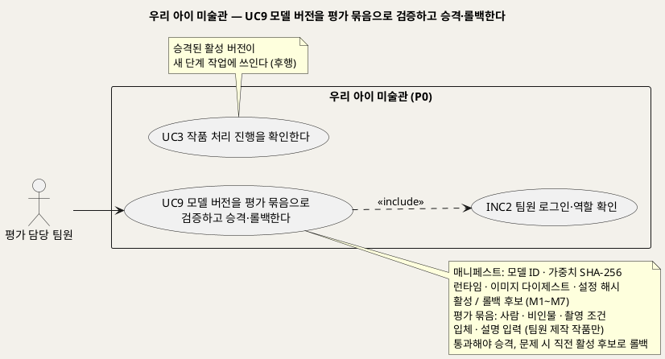
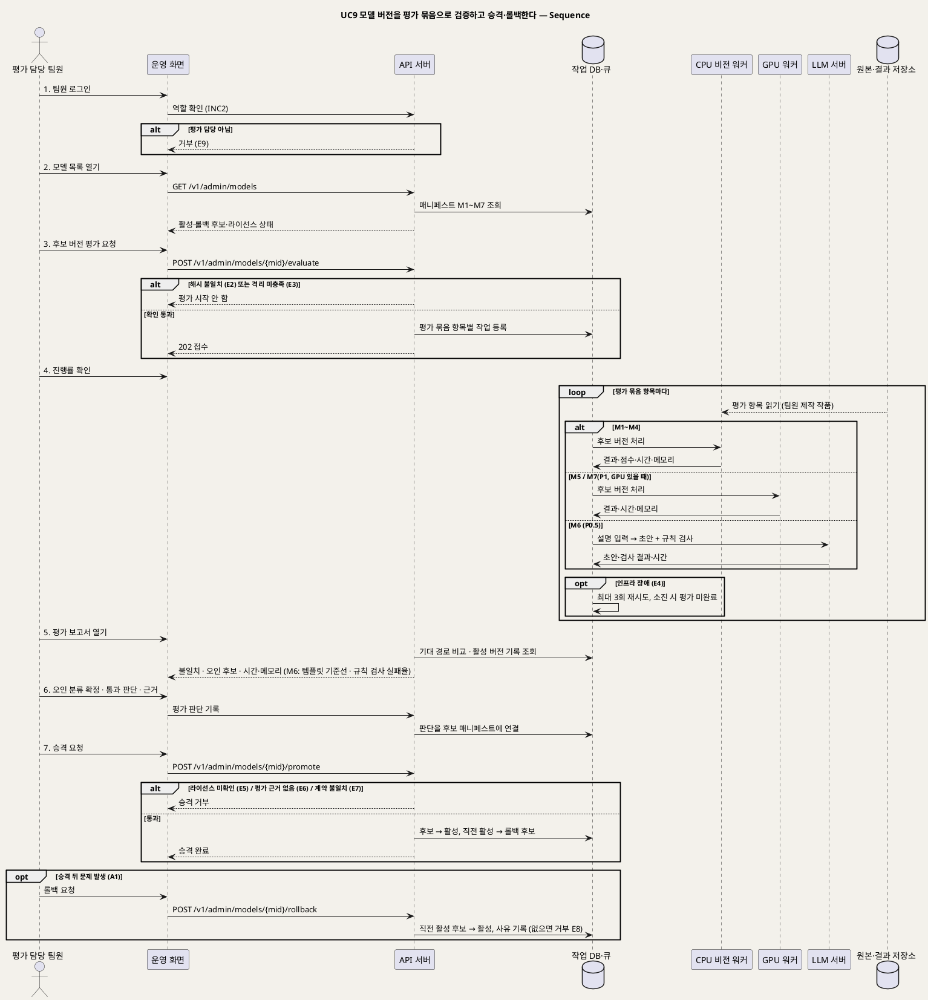

# UseCase 명세 — #9 모델 버전을 평가 묶음으로 검증하고 승격·롤백한다 (우리 아이 미술관 P0)
**우리 아이 미술관 · UC9 · UML 2.5.1 표준 (UseCase Diagram + UseCase 기술 + Sequence Diagram)**

---

> **문서 식별**: `design/UC_09_모델평가검증.md` (옛 파일 `design/UC_09_엔진평가검증.md` 대체)
> **작성일**: 2026-09-23 · **개정**: 2026-09-28 — 애니메이션 엔진 하나의 검증에서 모델 7종(M1~M7)의 버전 매니페스트·평가 묶음 재평가·승격·롤백으로 넓혔다(서비스 이름을 "우리 아이 미술관"으로 변경) · **표준**: UML 2.5.1 (OMG)
> **원천(SoT)**: `Intent-Specify.md` (2026-09-28 기획 기준안) [핵심 활동] 2·7 · [핵심 장벽] 서빙 기반·판정 정확도·모델 품질 미측정·라이선스 · [핵심 데이터] 모델 매니페스트·평가 묶음 · [혜택] 서비스 팀 + `.specify/features/우리-아이-미술관/spec.md` v2.0 — FR-16, FR-17, FR-24
> **다이어그램**: 모든 PlantUML 소스는 렌더 검증 완료(HTTP 200). 아래 링크로 브라우저에서 열 수 있다. `plantuml.sumzip.com` 은 사내 SSO 로그인 뒤 열린다.

---

## 목차

1. [범위·개요](#1-범위개요)
2. [UseCase Diagram](#2-usecase-diagram)
3. [Actor 카탈로그](#3-actor-카탈로그)
4. [UseCase 목록 (원천 매핑)](#4-usecase-목록-원천-매핑)
5. [UseCase 기술 + Sequence Diagram](#5-usecase-기술--sequence-diagram)
6. [업무규칙 종합](#6-업무규칙business-rules-종합)
7. [UML 표준 준수 노트](#7-uml-표준-준수-노트)

---

## 1. 범위·개요

우리 아이 미술관은 공개 사전학습 모델 7종(M1~M7)을 새로 학습하지 않고 이어 붙여 서빙한다. 그중 관절·리깅 엔진(M3, Meta Animated Drawings)은 2025-09-03에, 그 실행 구성요소(TorchServe)는 2025-08-07에 보관 처리되어 보안 수정이 없다. 나머지 모델은 아이 그림·책상 배경·점토 공작에서의 품질을 아직 재지 않았다. 그래서 모든 모델은 **버전을 고정한 매니페스트**로 관리하고, 후보 버전은 **평가 묶음 전체를 다시 돌려 통과해야만 승격**하며, 문제가 생기면 **직전 활성 후보로 롤백**한다(spec FR-16·FR-17·FR-24 · Intent [핵심 활동] 2·7 · [혜택] 서비스 팀 "모델 교체를 매니페스트 승격·롤백으로 안전하게").

평가 담당 팀원은 운영 화면에서 모델별 매니페스트(모델 ID·가중치 SHA-256·런타임·이미지 다이제스트·설정 해시·활성/롤백 후보)를 보고, 후보 버전을 **팀원이 직접 만든 작품만으로 구성한 평가 묶음**(사람·비인물·촬영 조건·입체·설명 입력)으로 재평가한다. 시스템은 항목별로 기대 경로 대비 결과, 오인 사례, 처리 시간, 메모리를 기록한다. 설명 생성(M6, P0.5)은 템플릿 기준선과 비교하고 규칙 검사 실패율을 잰다. 모델을 바꿔도 보호자 흐름(UC1~UC7)과 API 계약은 그대로여야 한다. 승격 기준 수치는 아직 없다(U5) — 첫 평가 묶음 측정 뒤에 정한다.

| 항목 | 값 |
|---|---|
| 대상 시스템 | 우리 아이 미술관 (P0) — 모델 버전 관리·평가 영역 (M6은 P0.5, M7은 P1부터 대상) |
| 상위 프로세스 | 모델 재현·매니페스트 등록 → **평가 묶음 재평가·승격·롤백(UC9)** → 운영 단계 작업(UC2·UC3·UC10) → 모델별 지표 확인(UC8) |
| 원천 근거 | Intent [핵심 활동] 2·7 · [핵심 장벽] · [핵심 데이터] 모델 매니페스트·평가 묶음 · [혜택] 서비스 팀 · spec FR-16·FR-17·FR-24 · 공통 기준 §2·§3·§4·§8 |
| 핵심 UseCase | 1개 (UC9) + 공통 INC2 |
| 주요 액터 | 평가 담당 팀원 (모델 M1~M7은 시스템 내부 구성요소라 액터가 아니다) |

---

## 2. UseCase Diagram

**[「UC9 모델 평가 UseCase Diagram」 PlantUML 뷰어로 열기](https://plantuml.sumzip.com/plantuml/svg/eNqNk1FP01AUx9_7KU7mCySCwKIGQhYUIfKAMTG-mSxlK6OhtKbtNMZoBhQz2FRQK0O6WZLKkMw4tuq6ZE98FB97z_0O3tt1ER6MvvW25_8_v_M_tzOGKepmfk2BfCad1-W0KKdzoqJI-rP02KRgrMrqY1EX12BJzKzmdC2vZmc1RdPhynxyfnzu9oUKY0XMak9lNQfLomJIgiItm2BqoMu5FROysi5lTFlTBVM2FQnwU5McNwBtC6s-kO8BFt3QL8Cvwgd4ODsJ5PSEvA6AtCx0WYkF9O122CwAafzEahmdHjlyIGwV8LhK7UrYdgF3umHr63mHHHmkeUZth5Q8QRAzJqNNDNQln5S6QMsFPNxNgGjA3BNREQTOJqo5xpX4G9jQ_bHhBDwXAPKGlBENVvq_nI_Uf4JGLMzvov3CvdmJGBWYS9gJsBqcd3D_G7VdoAc2O0Y6XniZKwlY26PvioCtSjRN3aIftyO8SHapaVJ4IQg8BxgZSUUQfLDR0VRkDFMwPS2rGSWflVIpQVA1U4p3qi3HyKTukVKRvqngjkd3gqlBKgt34LwDLA709rBbgQd3b41MXL_BFZ-bdLOANYsXsKB5znW-H48d0HX6RtFHy0PXBmr7WHKYkh44aJ3BNejHB_TQIm0fhhbHXy7eHOYFFxcwBbjRILUydyJdtqCANHqRrd_AyjrgUTM885kKa1vY8uOG5HSLvyDuFxiKF8CZantxrKRejjq9-hG2e5zM7sVbvcr6BqwWGCxLfZ1digFxH5Rf2z65IKlZ4Gn2I13STFNb62ea5ECRH9l1BvrBFYtoN4ssq5OwbXEi3N_CfYb4vsnnK3kM-pDve_hPixn2xP7y31h7BnI=)** — 클릭 시 브라우저로 연결됩니다.

#### 다이어그램 쉽게 읽기 (유저 관점)

- **누가 쓰나** — 평가 담당 팀원이 쓴다. 보호자는 이 기능을 보지 못한다. 배경 분리·종류 판정·관절·깊이·설명·3D 모델은 사람이 아니라 시스템 안의 부품이라 그림에 액터로 두지 않았다.
- **무슨 순서로** — 팀원이 모델별 현재 버전과 후보 버전을 확인하고, 후보 버전으로 시험용 작품 묶음을 전부 다시 돌린다. 기대와 다른 결과·잘못 잡은 사례·처리 시간·메모리를 보고 통과하면 승격한다. 승격 뒤 문제가 보이면 바로 이전 버전으로 되돌린다. 승격된 버전은 이후 가족 작품 처리(UC3)에 쓰인다.
- **«include» = 항상 함께** — INC2 팀원 로그인·역할 확인. 평가 담당 역할이 있는 팀원만 평가·승격·롤백을 할 수 있다.
- **«extend» = 특정 상황에서만** — 없다. 롤백·M6 비교·보류는 같은 목표 안의 대체흐름으로 다룬다.
- **Generalization(◁)** — 없다. 7종 모델과 예비 모델 후보는 모두 같은 매니페스트·평가 절차를 거친다.

| 기호 | 의미 |
|---|---|
| 사람 모양(actor) | 시스템을 쓰는 사람 |
| 타원(usecase) | 액터가 이루려는 목표 |
| 사각형(rectangle) | 시스템 경계 |
| 실선 화살표 | 액터와 UC의 연결 |
| 점선 `<<include>>` | 항상 함께 일어나는 하위 행위 |
| 노트 | 매니페스트·평가 규칙·선후 관계 보충 |

---

## 3. Actor 카탈로그

| 구분 | 액터 | 이 UC에서의 역할 | 원천 근거 |
|:--:|---|---|---|
| Primary | 평가 담당 팀원 | 평가 묶음을 관리하고, 후보 버전 평가를 실행·검토하고, 오인 사례를 분류하고, 승격·보류·롤백을 결정한다 | Intent [핵심 활동] 7 · spec FR-17·FR-24 · 공통 기준 §6 액터 |
| 내부 구성요소(액터 아님) | 모델 M1~M7 (CPU 비전 워커: M1·M2·M3·M4 / GPU 워커: M5·M7 / LLM 서버: M6) | 평가 대상. 시퀀스에서 서빙군 lifeline으로만 나타난다 | 공통 기준 §2·§3·§6 · Intent [핵심 이네이블러] |

---

## 4. UseCase 목록 (원천 매핑)

| UC ID | 유스케이스명 | 관계 | 원천 근거 |
|:--:|---|---|---|
| UC9 | 모델 버전을 평가 묶음으로 검증하고 승격·롤백한다 | 본 문서 | spec FR-16 · FR-17 · FR-24 · Intent [핵심 활동] 2·7 |
| INC2 | 팀원 로그인·역할 확인 | UC9가 «include» | 공통 기준 §6 · BR-ACC-05 |
| UC3 | 작품 처리 진행을 확인한다 | 후행(승격된 활성 버전이 단계 작업에 쓰이고, 단계 작업이 모델 ID·버전을 기록) | 공통 기준 §5 단계 작업 |
| UC8 | 서비스 상태와 모델별 운영 지표를 확인한다 | 참고(승격 뒤 모델별 낮춤률·p95를 보고 롤백을 판단하는 근거) | spec FR-26 · Intent [혜택] 서비스 팀 |
| UC11 | API활용 메뉴에서 엔드포인트·가이드라인·매뉴얼을 확인한다 | 참고(EXT3 시험 호출은 평가 묶음 작품만 쓴다, BR-API-09) | 공통 기준 §6 EXT3 |

---

## 5. UseCase 기술 + Sequence Diagram

### 5.1 UC9 모델 버전을 평가 묶음으로 검증하고 승격·롤백한다

> **쉽게 말하면** — 서비스가 쓰는 7가지 모델의 새 버전을, 팀원들이 직접 만든 시험용 작품 묶음으로 전부 다시 돌려 봅니다. 기대와 달라진 작품, 잘못 잡은 사례, 걸린 시간과 메모리를 이전 버전과 나란히 보고 괜찮을 때만 실제 서비스에 올립니다. 올린 뒤 문제가 보이면 바로 이전 버전으로 되돌리고, 그래도 보호자 화면과 API는 달라지지 않습니다.

#### 유스케이스 기술

| 속성 | 내용 |
|---|---|
| **ID** | UC9 (spec FR-16, FR-17, FR-24) |
| **유스케이스명** | 모델 버전을 평가 묶음으로 검증하고 승격·롤백한다 |
| **액터** | 주: 평가 담당 팀원 · 보조 액터 없음(모델 M1~M7은 내부 구성요소로 CPU 비전 워커·GPU 워커·LLM 서버에서 실행된다) |
| **사전조건** | (1) 평가 담당 팀원이 로그인했고 평가 담당 역할이 확인됐다(INC2). (2) 평가할 후보 버전이 팀 서버에 설치되어 있고 매니페스트(모델 ID·가중치 SHA-256·런타임·이미지 다이제스트·설정 해시)가 등록돼 있다(BR-MDL-01). 모델 파일 경로는 `자료 없음 — 확인 필요`(U14). (3) 후보 버전의 어댑터가 있어 API 서버가 모델을 직접 import하지 않고 작업 계약으로 부른다(BR-MDL-02). (4) 보관 처리된 엔진(M3의 Animated Drawings·TorchServe)은 내부망 격리·고정 이미지·체크섬 조건을 갖췄다(BR-MDL-06). (5) 평가 묶음에 대상 모델에 맞는 항목(사람·비인물·촬영 조건·입체·설명 입력)과 항목별 기대 경로가 있다(BR-MDL-04) |
| **사후조건** | (1) 후보 버전으로 평가 묶음 전체를 돌린 평가 기록이 그 버전의 매니페스트에 연결되어 남는다. 기록에는 항목별 기대 경로 대비 결과, 확정된 오인 사례 분류, 처리 시간, 메모리가 들어간다(M6은 템플릿 기준선 대비 결과와 규칙 검사 실패율 포함). (2) 승격했으면 후보가 활성 버전이 되고, 직전 활성 버전은 롤백 후보가 된다. 이후 새 단계 작업은 새 활성 버전으로 처리되고 단계 작업에 모델 ID·버전이 기록된다. (3) 롤백했으면 직전 활성 후보가 다시 활성 버전이 되고 롤백 사유가 남는다. (4) 보호자 흐름(UC1~UC7)·엔드포인트·응답 분류는 바뀌지 않는다(BR-MDL-05). (5) 평가 기록과 운영 로그에 가족 작품 이미지·자유 입력이 들어가지 않는다(BR-ACC-03, BR-PRV-01) |
| **기본흐름** | ↓ 별도 기본흐름표 (후보 버전 평가 → 승격 기준) |
| **대체흐름** | A1. 롤백 — 승격 뒤 모델별 지표(UC8: 낮춤률·처리 시간 p95·재시도율)나 보호자 신고로 문제가 보이면, 팀원이 `POST /v1/admin/models/{mid}/rollback`을 요청한다. 시스템은 직전 활성 후보를 활성으로 되돌리고, 문제가 된 버전을 롤백 후보에서 뺀 채 사유를 기록한다(BR-MDL-03). [추론] 롤백 대상은 이미 평가를 통과해 활성이었던 버전이므로 재평가 없이 즉시 되돌린다. 이미 실행 중인 단계 작업은 시작할 때의 버전으로 끝내고 새 단계 작업부터 되돌린 버전을 쓴다 [추론]. A2. 보류 — 평가 결과가 기준에 못 미치거나 판단이 서지 않으면 승격하지 않고 보류 사유만 기록한다. 활성 버전은 그대로다. A3. 설명 생성 모델(M6, P0.5) 평가 — 설명 입력 세트(키워드·선택 태그·아이의 실제 발언 형식의 팀원 작성 문장·나이·제작일)로 LLM 서버에서 초안을 만들고, 같은 입력의 템플릿 기준선 설명과 나란히 비교한다. 규칙 검사(입력에 없는 사건·감정·발달 상태) 실패율과 재생성 횟수를 잰다(BR-CAP-02). 과정 제공 LLM으로 대체할지는 U3이며, 쓰게 되더라도 평가 묶음의 설명 입력만 보낸다(BR-CAP-05). A4. 3D 조각 모델(M7, P1) 평가 — 입체 항목(팀원이 만든 점토·종이 공작)으로 GPU 워커에서 평가한다. GPU가 없으면(U2) 평가하지 않고 M7은 비노출로 둔다(BR-SRV-02). A5. 예비 모델 후보 평가 — 그림 전용 YOLOv8 자세 모델(M3 예비, 가중치 AGPL-3.0)도 같은 묶음·같은 절차로 평가할 수 있다. 다만 서비스 소스 공개 결정 전에는 승격하지 않는다(BR-MDL-07, U4). A6. 평가 묶음 항목 추가 — 팀원이 직접 만든 작품을 종류·기대 경로와 함께 등록만 하고 평가는 실행하지 않는다. 항목을 추가하면 이후 평가부터 반영하고, 활성 버전을 새 묶음으로 다시 평가할지는 팀원이 정한다 [추론] |
| **예외흐름** | E1. 허용되지 않는 평가 항목 — 팀원이 직접 만들지 않은 작품(실제 가족 작품·공개 이미지 등)이나 기대 경로가 없는 항목은 평가 묶음에 넣지 않고 등록을 거부한다(BR-MDL-04, BR-ACC-03). 제작자 확인 방식은 `자료 없음 — 확인 필요`. E2. 매니페스트 불일치 — 설치된 가중치의 SHA-256이나 이미지 다이제스트·설정 해시가 매니페스트와 다르면 평가를 시작하지 않고 불일치 항목을 보여 준다(BR-MDL-01, Intent [핵심 장벽] 서빙 기반). E3. 격리 조건 미충족 — 보관 엔진이나 모델 런타임(TorchServe·Ollama)의 포트가 내부망 밖에 열려 있으면 평가를 시작하지 않고 격리 조치를 요구한다(BR-MDL-06, BR-SRV-04). E4. 평가 중 인프라 장애 — 워커 중단·모델 미준비·저장소 오류는 품질 결과가 아니다. 해당 항목을 최대 3회 재시도하고, 소진되면 그 항목을 "평가 미완료"로 표시한다. 미완료 항목이 남은 평가는 "전체 재평가"가 아니므로 승격 근거가 되지 않는다(BR-PRC-03, BR-MDL-03) [추론: 운영의 재시도 규칙을 평가에 적용]. 시간 상한을 넘긴 항목은 "시간 초과"로 기록하고 나머지 항목은 계속한다(BR-PRC-06). E5. 라이선스 미확인 — OpenCLIP 가중치·Qwen3·TRELLIS 의존성처럼 라이선스 조건이 확인되지 않은 버전은 평가 결과와 관계없이 승격을 거부한다(BR-MDL-07, U4). E6. 평가 근거 없는 승격 요청 — 해당 버전의 매니페스트 해시와 일치하는 전체 재평가 기록이 없거나, 팀원이 통과로 판단하지 않은 버전은 승격을 거부한다(BR-MDL-03). E7. 계약 불일치 — 후보 어댑터의 응답 분류가 작업 기록 분류와 1:1로 맞지 않거나 결과 종류가 기존 계약(움직임/2.5D/액자, P1 3D)과 다르면 승격을 거부한다(BR-MDL-05, BR-API-02). E8. 롤백 후보 없음 — 직전 활성 후보가 없으면(첫 버전) 롤백을 거부하고 현재 활성 버전을 유지한다. 그다음 조치(모델 비활성 등)는 `자료 없음 — 확인 필요`. E9. 권한 없음 — 평가 담당 역할이 없는 팀원(운영자·연동 개발)이 평가·승격·롤백을 요청하면 거부한다(BR-ACC-05) |
| **포함/확장** | «include» INC2 팀원 로그인·역할 확인. «extend» 없음 |
| **우선순위** | Medium — 가족 기능은 아니지만, 원천이 서빙 기반을 "치명", 판정 정확도·모델 품질 미측정·라이선스를 "상" 장벽으로 두므로 모델을 운영에 올리기 전 필수 관문이다(Intent [핵심 장벽]) |
| **사용빈도** | 모델 버전을 바꿀 때마다 해당 모델에 대해 평가 묶음 전체 재평가 1회(Intent [핵심 데이터] 평가 묶음 "모델 버전이 바뀔 때 재평가"). 롤백은 문제 발생 시에만. 버전 교체 주기와 평가 묶음 규모는 `자료 없음 — 확인 필요` |
| **업무규칙** | BR-MDL-01, BR-MDL-02, BR-MDL-03, BR-MDL-04, BR-MDL-05, BR-MDL-06, BR-MDL-07, BR-SUG-04, BR-PRC-03, BR-PRC-04, BR-PRC-06, BR-CAP-02, BR-CAP-05, BR-SRV-02, BR-SRV-04, BR-API-02, BR-ACC-03, BR-ACC-05, BR-PRV-01 |
| **특별 요구사항** | 보안: 모델 런타임 포트는 내부망에만 두고, 보관 엔진은 고정 이미지·체크섬으로 운영한다(BR-MDL-06, BR-SRV-04). 관리 엔드포인트(`/v1/admin/models…`)는 팀원 역할 확인 뒤에만 열린다. 기록: 평가 기록은 모델 ID·버전(매니페스트 해시)에 연결하고, 항목별 결과 경로·오인 사례·처리 시간·메모리를 남긴다(spec FR-16·FR-17). 모델 점수는 기록만 하고 통과 판단의 단독 근거로 쓰지 않는다(BR-PRC-04, BR-SUG-04). 첫 기록: Intent [개요]·[핵심 장벽]이 밝힌 1차 개인 PC 실측을 M3의 첫 평가 기록으로 인용한다 — 한 장 53~62초(대부분 렌더, 렌더 약 40초), 보관 저장소 기반 빌드 약 36분, 설치 크기 32.9GB, 집 그림이 사람 점수 0.946으로 잡힘(사람 그림 0.997). 이 수치는 팀 서버 측정이 아니며 M1·M2·M4·M5·M6·M7은 미측정이다(U6). 승격 기준: 모델별 품질 임계값과 승격 기준 수치는 원천에 없다 — 평가 묶음 1차 측정 뒤 정한다(U5). 자원: GPU 유무(U2)에 따라 M5는 CPU로 평가하고 M7은 평가·노출하지 않는다 |
| **비고** | 원천 추적: Intent [핵심 활동] 2 "모델 7종을 버전 고정해 재현한다 … 모델마다 매니페스트와 처리 시간·메모리를 기록한다", 7 "평가 묶음(사람·비인물·촬영 조건·입체·설명 입력)과 템플릿 기준선으로 모델별 품질을 재고" · [핵심 장벽] 서빙 기반(치명)·판정 정확도·모델 품질 미측정·자원·라이선스 · [핵심 데이터] 모델 매니페스트·평가 묶음 · [혜택] 서비스 팀 · [핵심 이네이블러] "모델마다 어댑터와 버전 매니페스트" · spec v2.0 FR-16(모델 7종 재현)·FR-17(평가 묶음)·FR-24(어댑터·매니페스트·평가 후 승격·롤백) · 공통 기준 §2 모델 카탈로그, §3 서빙 구조, §4 엔드포인트([추론] 이름은 `/speckit.plan`에서 확정, U8), §8 BR-MDL-*. 옛 BR 대응: BR-ENG-01→BR-MDL-06, BR-ENG-02→BR-MDL-01, BR-ENG-03→BR-MDL-03, BR-ENG-04→BR-MDL-04, BR-ENG-05→BR-MDL-05. 평가를 운영 화면 안에서 할지 별도 도구로 할지는 옛 문서의 미확정 사항이었고, 이번 개정은 공통 기준 §4의 관리 엔드포인트를 쓰는 운영 화면으로 정했다 [추론] |

#### 기본흐름 (Basic Flow)

| 단계 | 액터 행위 | 시스템 행위 |
|:--:|---|---|
| 1 | 평가 담당 팀원이 운영 화면에 로그인한다 | 팀원 역할을 확인하고(INC2), 평가 담당이 아니면 모델 관리 기능을 열지 않는다(E9) |
| 2 | 팀원이 모델 목록을 연다 | `GET /v1/admin/models`로 모델 7종의 매니페스트(모델 ID·가중치 SHA-256·런타임·이미지 다이제스트·설정 해시·활성/롤백 후보)와 구간(M6 P0.5, M7 P1)·서빙군·라이선스 확인 상태를 보여 준다 |
| 3 | 팀원이 모델 하나의 후보 버전을 골라 평가를 요청한다 | `POST /v1/admin/models/{mid}/evaluate`를 받아 설치본과 매니페스트 해시의 일치(E2)와 격리 조건(E3)을 확인하고, 평가 묶음 전체를 항목별 평가 작업으로 작업 DB·큐에 등록한다 |
| 4 | 팀원이 평가 진행률을 확인한다 | 해당 서빙군(CPU 비전 워커 M1~M4 / GPU 워커 M5·M7 / LLM 서버 M6)이 후보 버전으로 항목마다 처리하고, 결과 경로·모델 점수(기록용)·처리 시간·메모리를 기록한다. 인프라 장애는 재시도하고 소진 시 "평가 미완료"로 표시한다(E4) |
| 5 | 팀원이 평가 보고서를 연다 | 기대 경로와 비교한 불일치 목록, 오인 사례 후보(예: 집 그림을 사람으로 잡아 관절을 붙인 경우), 처리 시간·메모리를 현재 활성 버전의 기록과 나란히 보여 준다. M6이면 템플릿 기준선 비교와 규칙 검사 실패율을 함께 보여 준다(A3) |
| 6 | 팀원이 오인 사례의 분류를 확정하고 통과 여부와 근거를 적는다 | 분류·판단·근거를 후보 버전의 매니페스트에 연결해 평가 기록으로 보관한다 |
| 7 | 팀원이 후보 버전의 승격을 요청한다 | `POST /v1/admin/models/{mid}/promote`를 받아 전체 재평가 통과 기록(E6)·라이선스 확인(E5)·계약 일치(E7)를 확인하고, 후보를 활성으로, 직전 활성 버전을 롤백 후보로 바꾼다. 이후 새 단계 작업부터 새 버전을 쓴다 |

#### Sequence Diagram

**[「UC9 모델 평가 Sequence」 PlantUML 뷰어로 열기](https://plantuml.sumzip.com/plantuml/svg/eNqVVltPG1cQft9fMaIvtprYGHMpeYgSiIOQ4haJ8ow2eEutrG3iS6qoamXCghzsNobaxcAaGdVcjEA1tsFGBVXip-Rxz-x_6Jy9EK9xqvYFsztz5vLNN9_ZJ4mkGE-mIjIkpNfzqXh4XgzPL4qyLMXfzg-OC4lX4eiSGBcj8FJceLUYj6WiocmYHIvDF8_9z32BiS6PxPdiKPZDOLoI34lyQhKS4aQswdzkOLCTY_ZLB1hDwYqCZQX0D--1ehrY6SWWc6hes30VtEYaD8t6saQ1K4DrV1qjdttm-1VWP9eLKstW4WO6ALPS65QUXZAEQVxIUhkDdqhsi2WvQM-lcTc_AGICAm9EWaDKkuGF8JIYTcIA7rSwtAz6doHVWobP3LTT4-nMNKCiUqGGmR6FkJgUX4oJiY7vbeDWKjybuG3ry2aOZxPO85Mzc8CueJeAuzn8q2p40Vun2xS5ddmneu0vXgS7y6DH7jJ286zZuW1rjbrWvAaspHHvANdyhuusXxB44_DwMTUHj8DnsTABwlhrd7DcEchAZt7rI8CtM71YIUyKZAHX9NeTQ25BlJPgxBWLCsuWBDBOPbSDa-d1dpkGV2DcLUjRUE_qIc_d4E9qbL9MuVpap-5IPxX4FrxvfF4xFAlHvZFYSJITgpHjMYFLDuyoyrIZ_dcSrlf19Q4EfT8HxwD36_pOTnAUo2-rqJzblAF9V2HNFj2Wr7HcQqVCAQBXlvUVtadOv8dytghqt447BWycOcqd-Wb2fr3eHyPh0E9eiWKmxKRkoldsYVYFdplByn9VIoyG3MBKebZeIKbX2OEpsD87eFnD_XMy-t292NpFZFXiHeGfoZjHAqWT7GHpaxdEAPuchZdjs-jIGce-SXQ0yct-O6dJ9OYaGhwiHm1gptRnjMMewCNF__09O7B5Isix2FL_VEcZ2lSKP-s3wvOFuCvKdAEs3xANwGXxEitmh3sb-maGw8Dx42Mepv-Bd_UpjmNM2CgRjIYTN9sImHtx28ZKnhqi36yq1RUiQq3A6WicMGAMjoAXgmOuGd8DMDZyL8O1iRVz7q7MU_-eeapf5s9mHAXXzKBnpDs-33VaQ6XKTlaphFVWOYCPa5uArQwf-pegtVW82jbk8Z2Zkx-xc5puXA24uacEnpfmCRBbShLsHb2g0DoA1wvaeVdguLsQM9yFynJp8NN2kdsphWEflAdA8kIc4GS8mzqRd1thf-SsHPd5M-K58222SNNJ0GwF6CYsPfOMWuOGXwIkntpFHm7b1jrbiHMvriB99v7TjtEpLFWN1TDHxV_0zgJcwVGa56qqF3Ls8G8eGatp0gfu7cCazlb13DGqx-6e1kY9diJ2qbCDkrEWlaJRtrGUpLl5lj02Q16TTDpUxF4H08dszYGJaTEuSot3ThXELVqbrToNu6ewMY91c_5f8VqKxyIxS7sciklztu-GwIibFsYq3myLqljjy-8KjHKb1lSweONQvbF7wmYVaN4dlqD1VTKzdb4LJheIhkfLhj6b1OAWh9h_JpPFU4OhxiKYr9kmdXfaIfkBVldxpQyupz5erQNRK4EFJ8B_BTQek2X-ydTTlLODfi2-O0W1YvPdxfGlz6Nay75rA1-ZV-0T-kOfbf8Ai4qTHQ==)** — 클릭 시 브라우저로 연결됩니다.

기본흐름 1~7단계는 시퀀스의 번호 붙은 주요 메시지 `1.`~`7.`과 1:1로 대응한다. 4단계의 항목별 처리는 `loop` 안에서 서빙군별 `alt`로 나눴고, 모델은 서빙군 lifeline(CPU 비전 워커·GPU 워커·LLM 서버)에 모델 ID를 적어 표현했다. 롤백(A1)은 마지막 `opt` 프래그먼트다. 평가 항목은 GPU 워커·LLM 서버도 같은 저장소에서 읽지만 그림을 줄이려고 CPU 비전 워커 한 줄로만 그렸다.

---

## 6. 업무규칙(Business Rules) 종합

| BR ID | 규칙 | 적용 UC | 근거 |
|---|---|---|---|
| BR-MDL-01 | 모델 7종은 버전을 고정하고 매니페스트(모델 ID·가중치 SHA-256·런타임·이미지 다이제스트·설정 해시·활성/롤백 후보)를 둔다 | UC3, UC9 | Intent [핵심 활동] 2 · [핵심 데이터] 모델 매니페스트 · spec FR-16·FR-24 |
| BR-MDL-02 | 모델마다 어댑터를 둔다. API 서버는 모델을 import하지 않는다 | UC9 (UC2·UC3·UC10·UC12 공통) | Intent [핵심 이네이블러] API 서버 연결 · spec FR-24 |
| BR-MDL-03 | 버전을 바꾸면 평가 묶음 전체를 재평가하고 통과해야 승격한다. 롤백은 직전 활성 후보로 | UC9 | Intent [핵심 데이터] 평가 묶음 · [혜택] 서비스 팀 · spec FR-17·FR-24 |
| BR-MDL-04 | 평가 묶음(사람·비인물·촬영 조건·입체·설명 입력)은 팀원이 직접 만든 작품만 | UC9, UC11 | Intent [핵심 활동] 7 · [핵심 데이터] 평가 묶음 · spec FR-17 |
| BR-MDL-05 | 모델을 바꿔도 가족 흐름과 API 계약은 바뀌지 않는다 | UC9 (UC1~UC7에 영향 없음) | Intent [핵심 장벽] 서빙 기반 "교체 가능한 어댑터" · spec FR-16 |
| BR-MDL-06 | 보관 처리된 엔진은 내부망 격리·고정 이미지·체크섬으로 운영 | UC3, UC9 | Intent [핵심 장벽] 서빙 기반(치명) |
| BR-MDL-07 | 라이선스 조건이 확인되지 않은 모델은 활성화하지 않는다 | UC9 | Intent [핵심 장벽] 라이선스 · [핵심 파트너] |
| BR-SUG-04 | 엔진 사람 점수 단독으로 움직임을 제안하지 않는다(집 그림 0.946 사례) | UC2, UC9 | Intent [핵심 장벽] 판정 정확도 |
| BR-PRC-03 | 인프라 장애는 낮춤이 아니다. 같은 단계를 최대 3회 재시도하고, 소진 시 결과 미도달로 집계(UC9에서는 "평가 미완료") | UC3, UC9 | Intent [핵심 활동] 5 · 공통 기준 §5 |
| BR-PRC-04 | 모델 점수는 기록만 하고 승인 근거로 쓰지 않는다 | UC3, UC4, UC9 | Intent [핵심 장벽] 판정 정확도 |
| BR-PRC-06 | 단계 작업마다 시간 상한(움직임 렌더 10분 기존값, 다른 모델은 `자료 없음 — 확인 필요`) | UC3, UC9 | Intent [부정적 영향] 자원 과소비 · U6 |
| BR-CAP-02 | 설명 생성 뒤 규칙 검사: 입력에 없는 사건·감정·발달 상태가 있으면 재생성, 상한 초과 시 템플릿 | UC10, UC9(A3) | Intent [핵심 장벽] 기억 왜곡 · [부정적 영향] 기억의 재작성 |
| BR-CAP-05 | 외부 LLM API로 아이 데이터를 보내지 않는다. 과정 제공 LLM은 조건 확인 뒤에만 | UC10, UC9(A3) | Intent [부정적 영향] 아동 이미지 유출 · U3 |
| BR-SRV-02 | GPU가 없으면 M5는 CPU로 실행하고 M7(3D)은 비노출 | UC6, UC9(A4) | Intent [핵심 장벽] 자원 · [핵심 활동] 6 |
| BR-SRV-04 | TorchServe·Ollama 등 모델 런타임 포트는 내부망에만 | UC8, UC9 | Intent [핵심 이네이블러] 외부 사용 |
| BR-API-02 | 단계 작업 응답 분류와 작업 기록 분류를 1:1로 맞춘다 | UC3, UC9(E7) | spec FR-24 · 공통 기준 §5 |
| BR-ACC-03 | 운영자·팀원은 가족 이미지·이야기에 접근하지 못한다 | UC8, UC9, UC11 | Intent [부정적 영향] 아동 이미지 유출 |
| BR-ACC-05 | 팀원 역할(운영자·평가 담당·연동 개발) 분리 | UC8, UC9, UC11 | 공통 기준 §6 INC2 |
| BR-PRV-01 | 운영 로그에 이미지·객체 키·자유 입력·오류 원문 금지 | 전 UC | Intent [부정적 영향] 아동 이미지 유출 |

---

## 7. UML 표준 준수 노트

| 항목 | 적용 |
|---|---|
| 시스템 경계 | 모델 관리(매니페스트·평가·승격·롤백)는 같은 시스템의 관리 엔드포인트로 두어 경계 안에 넣었다 [추론]. 모델 M1~M7은 시스템 내부 구성요소라 경계 밖 액터로 그리지 않았다(공통 기준 §6) |
| 액터 | 평가 담당 팀원만 Primary다. 옛 문서의 Secondary actor "애니메이션 엔진"은 내부 구성요소로 바꿔 시퀀스의 서빙군 lifeline으로 옮겼다 |
| «include» | INC2 팀원 로그인·역할 확인은 매번 일어나므로 include로 표현했다 |
| 대체흐름 vs «extend» | 롤백·보류·M6·M7·예비 모델 평가는 같은 목표(버전을 안전하게 운영에 올리기) 안의 경로라 extend로 떼지 않고 대체흐름 A1~A6으로 뒀다 |
| 후행 관계 | UC3과는 데이터(활성 버전) 선후 관계일 뿐 include/extend가 아니다 |
| Sequence | 항목별 처리는 `loop`, 서빙군 분기는 그 안의 `alt`, 인프라 재시도는 `opt`, 평가 시작 거부·승격 거부는 각 단계의 `alt`, 롤백은 마지막 `opt`로 표현했다. 예외흐름 ID(E2~E9)와 대체흐름 ID(A1)를 메시지에 병기했다 |

---

*우리 아이 미술관 P0 · UC9 · 작성 2026-09-23 · 개정 2026-09-28 · 원천: Intent-Specify.md (2026-09-28), spec.md v2.0 FR-16, FR-17, FR-24*
