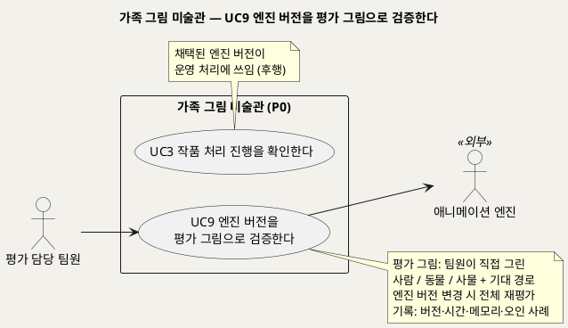
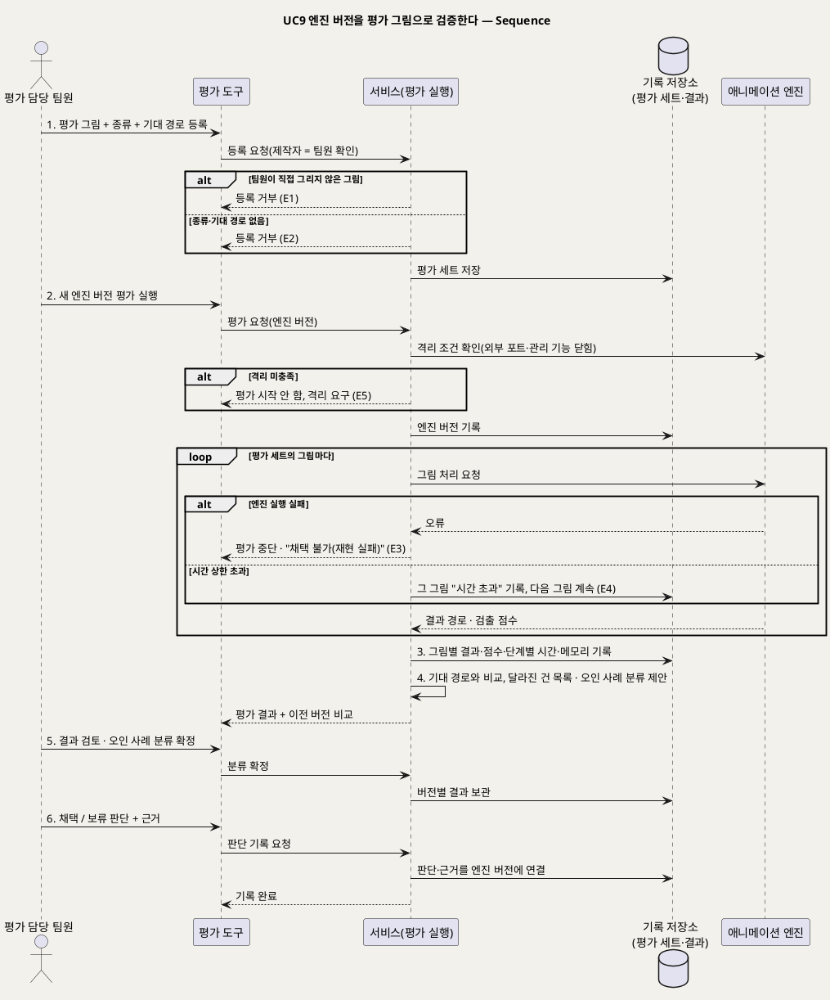

# UseCase 명세 — #9 엔진 버전을 평가 그림으로 검증한다 (가족 그림 미술관 P0)
**가족 그림 미술관 · UC9 · UML 2.5.1 표준 (UseCase Diagram + UseCase 기술 + Sequence Diagram)**

---

> **문서 식별**: `design/UC_09_엔진평가검증.md`
> **작성일**: 2026-09-23 · **표준**: UML 2.5.1 (OMG)
> **원천(SoT)**: `.specify/features/가족-그림-미술관/spec.md` — FR-16, FR-17, FR-14 · 보조 원천 `Intent-Specify.md` [핵심 활동] 2·7 · [핵심 장벽] 엔진 재현·서빙 의존성·적용 범위 · [핵심 데이터] 평가 그림 · [핵심 파트너]
> **다이어그램**: 모든 PlantUML 소스는 렌더 검증 완료(HTTP 200). 아래 링크로 브라우저에서 열 수 있다.

---

## 목차

1. [범위·개요](#1-범위개요)
2. [UseCase Diagram](#2-usecase-diagram)
3. [Actor 카탈로그](#3-actor-카탈로그)
4. [UseCase 목록 (원천 매핑)](#4-usecase-목록-원천-매핑)
5. [UseCase 기술 + Sequence Diagram](#5-usecase-기술--sequence-diagram)
6. [업무규칙 종합](#6-업무규칙business-rules-종합)
7. [UML 표준 준수 노트](#7-uml-표준-준수-노트)

---

## 1. 범위·개요

핵심 애니메이션 엔진(Meta Animated Drawings)은 2025-09-03에 보관 처리됐다. 모델 실행 구성요소(TorchServe)도 2025-08-07에 보관 처리되어 보안 수정이 없다. 따라서 엔진은 **조건부로 채택**하고, 팀 서버에서 반복 재현해 검증하며, 언제든 **교체할 수 있어야** 한다(spec FR-16 · Intent [핵심 장벽]).

평가 담당 팀원은 **팀원이 직접 그린** 사람·동물·사물 그림과 각 그림의 기대 경로(움직임/원본 액자)를 평가 세트로 관리한다. 엔진 버전이 바뀔 때마다 전체를 다시 평가한다. 기대와 달라진 건과 오인 사례(예: 사물을 사람으로 잡아 관절을 붙인 경우)를 기록해 버전 채택 여부를 판단한다(spec FR-17).

| 항목 | 값 |
|---|---|
| 대상 시스템 | 가족 그림 미술관 (P0) — 엔진 검증 영역 |
| 상위 프로세스 | 엔진 재현 → **평가 세트 재평가(UC9)** → 버전 채택 → 운영 처리(UC3) |
| 원천 근거 | spec FR-16 · FR-17 · FR-14 · Intent [핵심 활동] 2·7 · [핵심 장벽] · [핵심 데이터] 평가 그림 |
| 핵심 UseCase | 1개 (UC9) |
| 주요 액터 | 평가 담당 팀원 · 애니메이션 엔진(보조) |

---

## 2. UseCase Diagram

**[「UC9 엔진 평가 UseCase Diagram」 PlantUML 뷰어로 열기](https://plantuml.sumzip.com/plantuml/svg/eNqFU19r01AUf7-f4lBfNmQ46dPGKMOxPfvim1Du2jQLSxNJbpUhQqYROlpYp61rXVJaGPUPBbtYXIX64kfxMffkO3huE3EVxacc7vmd8_tzyLYruCNqVRNqpWKFVw3zqKhz09Sco-L6BnMPDesRd3gV9nnpUHfsmlXesU3bgVt7-b27u_duINwDXrafGJYOFW66GjO1igBhg2PoBwLKhqOVhGFbTBjC1CCeeDi8gvh6JkdzkJ9mWB_EUw9-eG14sLMBeN7Gdz7IyMeBj6EPyekJzWQDGMzlMIA48nAUJp1ANi4Z4yVBwnIZUDamsvEVkqaHF60ccBd2H3PzFwg7A9moyw9tDKf4spvRpTBLNywNtrawN5NfvEKBMSWdWzrJzv1L98r99dUcPGUANVcrcZegf7Px0Pqfj4UGGl3elAfsnyWv6oBRV47GQEuTNyeLXHodDGdLs3n2jDHlFtbWCotdSoqqU2-MWbbQssPYlYxtSdhmFhzFQ1zHODhLGxMC4vOx7DfhDsjTnhzPqVAvVNyGeDaRTdoRfSNbCnrTPsjPHnUAGwGoNCJa3R-ntIRVs8NwMwN_vyZYPKEvHUl-fE-m6al7SV4XdEOPaVYZlJHUzb4thF1N7eQV9ZWfvAhlK_jzBlPVfDvF7nEWJp63AF9PsO_DSnKhcl39vXubKvo9fgJNg5ZL)** — 클릭 시 브라우저로 연결됩니다.

#### 다이어그램 쉽게 읽기 (유저 관점)

- **누가 쓰나** — 평가 담당 팀원이 쓴다. 애니메이션 엔진은 시험을 받는 외부 구성요소다.
- **무슨 순서로** — 팀원이 직접 그린 평가 그림과 "이 그림은 움직여야 한다/액자여야 한다"는 기대를 등록한다. 엔진 버전이 바뀌면 전체를 다시 돌려 기대와 달라진 그림을 찾는다. 통과한 버전만 실제 가족 작품 처리(UC3)에 쓴다.
- **«include» = 항상 함께** — 없다. 보호자용 가족 접근 확인은 적용되지 않는다.
- **«extend» = 특정 상황에서만** — 없다.
- **Generalization(◁)** — 없다. 현재 엔진과 예비 엔진 후보는 같은 평가 절차를 거친다(대체흐름 A1).

| 기호 | 의미 |
|---|---|
| 사람 모양(actor) | 시스템을 쓰는 사람 또는 외부 구성요소(`<<외부>>`) |
| 타원(usecase) | 액터가 이루려는 목표 |
| 사각형(rectangle) | 시스템 경계 |
| 실선 | 액터·외부 구성요소와 UC의 연결 |
| 노트 | 평가 규칙·선후 관계 보충 |

---

## 3. Actor 카탈로그

| 구분 | 액터 | 이 UC에서의 역할 | 원천 근거 |
|:--:|---|---|---|
| Primary | 평가 담당 팀원 | 평가 그림과 기대 경로를 등록하고, 엔진 버전별 평가를 실행·검토하고, 채택 여부를 판단한다 | spec Target Users · FR-17 |
| Secondary | 애니메이션 엔진 | 평가 대상. 현재 엔진은 Meta Animated Drawings(코드·가중치 MIT). 예비안은 그림 전용 자세 모델(가중치 AGPL-3.0)과 rtmlib(Apache-2.0) | spec Dependencies · FR-16 · Intent [핵심 장벽] |

---

## 4. UseCase 목록 (원천 매핑)

| UC ID | 유스케이스명 | 관계 | 원천 근거 |
|:--:|---|---|---|
| UC9 | 엔진 버전을 평가 그림으로 검증한다 | 본 문서 | spec FR-16 · FR-17 |
| UC3 | 작품 처리 진행을 확인한다 | 후행(채택 버전이 운영 처리에 쓰임) | spec FR-16 수용기준 2·3 |

---

## 5. UseCase 기술 + Sequence Diagram

### 5.1 UC9 엔진 버전을 평가 그림으로 검증한다

> **쉽게 말하면** — 팀원들이 직접 그린 시험용 그림으로 엔진을 시험합니다. 사람 그림은 움직이고 집이나 동물 그림은 걸러지는지 버전이 바뀔 때마다 똑같이 확인합니다. 결과가 달라진 그림과 잘못 움직인 그림을 기록해서, 그 버전을 써도 되는지 판단합니다.

#### 유스케이스 기술

| 속성 | 내용 |
|---|---|
| **ID** | UC9 (spec FR-16, FR-17) |
| **유스케이스명** | 엔진 버전을 평가 그림으로 검증한다 |
| **액터** | 주: 평가 담당 팀원 · 보조: 애니메이션 엔진 |
| **사전조건** | (1) 평가 대상 엔진 버전이 팀 서버의 고정 실행 환경에 설치되어 있고, 외부 포트와 관리 기능이 닫혀 있다(spec FR-16 수용기준 4). (2) 평가 세트에 팀원이 직접 그린 그림이 종류별로 있다. (3) 평가 담당 팀원이 평가 도구에 접근할 수 있다. [추론] 평가를 제품 안의 화면으로 할지, 별도 도구로 할지는 `자료 없음 — 확인 필요` |
| **사후조건** | (1) 이 엔진 버전으로 평가 세트 전체를 실행한 결과가 버전에 연결되어 남는다. 결과에는 그림별 결과 경로, 검출 점수(기록용), 단계별 시간, 메모리가 들어간다. (2) 기대 경로와 달라진 건의 목록과 분류된 오인 사례가 남는다. (3) 채택/보류 판단과 근거가 버전에 연결되어 기록된다. (4) 운영 중인 가족 작품과 그 처리에는 영향이 없다 |
| **기본흐름** | ↓ 별도 기본흐름표 (새 엔진 버전 재평가 기준) |
| **대체흐름** | A1. 예비 엔진 후보 평가 — 그림 전용 자세 모델이나 rtmlib 기반 후보도 같은 평가 세트·같은 절차로 평가한다. 교체하더라도 가족 흐름(접수·부모 확인·이야기·전시·삭제)과 화면은 바뀌지 않아야 한다(spec FR-16 수용기준 3 · Intent [핵심 장벽]). [추론] 예비안 가중치의 AGPL-3.0 라이선스 영향은 채택할 때 검토한다(spec Dependencies). A2. 평가 그림 추가 — 2단계 이후를 실행하지 않고 1단계(그림·기대 경로 등록)만 한다(spec FR-17). A3. 재현 기록 — 새 환경에 엔진을 설치할 때 버전, 빌드 시간, 설치 크기, 우회 사항을 함께 기록한다. 참고로 1차 재현은 원본 그대로 설치되지 않았다. 기반 시스템 저장소가 내려가 보관 저장소로 우회했고, 빌드 약 36분, 설치 크기 32.9GB였다(spec FR-16 수용기준 1 · Intent [핵심 장벽] 엔진 재현) |
| **예외흐름** | E1. 허용되지 않는 평가 그림 — 팀원이 직접 그리지 않은 그림(공개 이미지, 실제 아동 그림 등)은 평가 세트에 넣지 않는다. 등록 시 제작자(팀원) 확인을 받는다(spec FR-17 · Intent [핵심 파트너] "시연 데이터는 팀원이 직접 그린 그림만 사용"). [추론] 제작자 확인 방식은 `자료 없음 — 확인 필요`. E2. 기대 경로 미입력 — 종류나 기대 경로가 없는 그림은 등록을 거부한다(spec FR-17 수용기준 1). E3. 엔진 실행·설치 실패 — 엔진이 뜨지 않거나 평가 도중 멈추면 평가를 중단하고, 실패 단계를 기록하고, 해당 버전을 "채택 불가(재현 실패)"로 표시한다(spec FR-16 · Intent [핵심 장벽] 엔진 재현). E4. 그림 단위 시간 초과 — 특정 그림이 처리 시간 상한을 넘기면 그 그림을 "시간 초과"로 기록하고 나머지 그림은 계속 평가한다. [추론] 운영의 시간 상한(BR-PRC-06)을 평가에도 적용하는 판단이다. E5. 격리 조건 미충족 — 평가 전에 엔진의 외부 포트나 관리 기능이 열려 있으면 평가를 시작하지 않고 격리 조치를 요구한다(spec FR-16 수용기준 4 · FR-14) |
| **포함/확장** | 없음 |
| **우선순위** | Medium — 가족 기능은 아니다. 하지만 원천이 엔진 재현을 "상" 등급 장벽으로, 서빙 의존성을 "치명" 등급으로 분류하므로 운영 전 필수 검증이다(Intent [핵심 장벽]) |
| **사용빈도** | 엔진 버전을 바꿀 때마다 1회 전체 재평가(Intent [핵심 데이터] 평가 그림 "엔진 버전 변경 때 재평가"). 평가 그림 추가 빈도는 `자료 없음 — 확인 필요` |
| **업무규칙** | BR-ENG-01, BR-ENG-02, BR-ENG-03, BR-ENG-04, BR-ENG-05, BR-PRC-04, BR-PRC-06 |
| **특별 요구사항** | 보안: 엔진은 외부 네트워크에서 직접 접근할 수 없고, 검증된 고정 실행 환경으로 격리한다(spec FR-14, FR-16). 기록: 버전, 소요 시간, 메모리, 오인 사례를 남긴다(spec FR-16 수용기준 1). 기준 정보: 1차 개인 PC 실측은 CPU 4코어·메모리 3.8GB·그래픽 카드 없이 한 장 53~62초(렌더 약 40초), 모델 서버 약 3.1GB였다. 팀 서버 수치와 동시 처리량은 미측정이다(Intent [핵심 장벽] 인프라). 품질 판정: 검출 점수만으로 통과를 판정하지 않는다. 1차 시험에서 집 그림이 사람 점수 0.946(사람 그림 0.997)으로 잡혀 벽에 관절이 붙은 사례가 있다(Intent [핵심 장벽] 적용 범위·품질). 품질 미달 판정 기준(임계값)은 이 평가 결과로 계획 단계에서 정한다(spec Assumptions) |
| **비고** | 원천 추적: spec FR-16(수용기준 4개: 팀 서버 재현·기록 / 작업별 엔진 버전 / 교체 시 가족 흐름 불변 / 관리 기능·외부 포트 차단·고정 환경) · FR-17(수용기준 3개: 종류·기대 경로 / 버전 변경 시 전체 재평가·달라진 건 목록 / 오인 사례 분류) · FR-14 · Key Entities "평가 그림" · Success Criteria Qualitative "평가 세트 결과" · Intent [핵심 활동] 2 "Animated Drawings를 재현하고 버전·시간·메모리·오인 사례를 기록한다 … 팀 서버에서 반복 검증한다", 7 "팀원 그림으로 품질을 평가" · Intent [핵심 장벽] 엔진 재현·서빙 의존성·적용 범위·인프라 · Intent [핵심 데이터] 평가 그림. 참고: 평가 결과로 채택 기준(몇 건까지 허용할지)을 정하는 수치는 원천에 없다 — `자료 없음 — 확인 필요` |

#### 기본흐름 (Basic Flow)

| 단계 | 액터 행위 | 시스템 행위 |
|:--:|---|---|
| 1 | 평가 담당 팀원이 직접 그린 평가 그림을 종류(사람/동물/사물)·기대 경로와 함께 등록한다 | 종류·기대 경로·제작자(팀원) 확인이 있는지 검사하고 평가 세트에 저장한다 |
| 2 | 팀원이 새 엔진 버전으로 평가 실행을 요청한다 | 엔진의 격리 조건을 확인하고, 엔진 버전을 기록한 뒤, 평가 세트 전체를 차례로 엔진에 보낸다 |
| 3 | — | 그림마다 결과 경로(움직임/품질 미달), 검출 점수(기록용), 단계별 시간, 메모리를 기록한다 |
| 4 | — | 기대 경로와 비교해 달라진 건의 목록을 만들고, 오인 사례를 유형별로 분류해 제안한다 |
| 5 | 팀원이 결과를 검토하고 오인 사례의 분류를 확정한다 | 버전별 결과를 보관하고, 이전 버전 결과와 나란히 보여 준다 |
| 6 | 팀원이 이 버전의 채택/보류를 판단하고 근거를 적는다 | 판단과 근거를 엔진 버전에 연결해 기록한다 |

#### Sequence Diagram

**[「UC9 엔진 평가 Sequence」 PlantUML 뷰어로 열기](https://plantuml.sumzip.com/plantuml/svg/eNqFVV9vElsQf99PMeG-QK5Fa-tNNNEYa_0Cen0yadZ2rcTt0sLWG9_Qrg0WTGku3FJlyaLUFsUIFIEm3Jd-FB_3zH4H5-w5C12w8Qly5jczv_nNn72dNtWUubmmQ1rbWHqiriX0F0urqq5rqRdLV64r6WcJY11NqWvwWF1-tppKbhorC0k9mYI_7s3dm128cw6RfqquJP9JGKvwRNXTmmImTF2DvxeuA-4X8cgC1rHQsdC2wNt947Yy4PYH7NMQK0NWq4DbyeAn2ytVWK4OPzJFuK9tbGrGsqYo6rJJGSPSi-W6LHcKXj6D7wsRUNOw-FzVFSJhJpYT66phjqG7lvu96WMeJJMTGLQq7NTCnXpUojFX9_57E_Ph9x8uKCuqqT5W0xpE3EGL1WxAJ4PVQ9zOPzJGPtbA2xmc9d1Oyz0ZCt-7dyYSlRyWy7JGEe0uvi5LOQRzYzVhUIW8Api55bOEGzAbD0sEfwJ-eM0Oy_SHc8mTofM_V4392yZmiu9H_kSb3MUj4Lsidr5G0algdQ-rBbgpRQPvoIT2IKaouimfiBrg0Ut09kTKJh5RcaUdtAMOCvjRZ8YsZRq33WK9DEQXZ2OKRo2XVEmTEFPc30Y7__soVymKsaL4qFukJUFCWssuTGl2NQ64lQ3PGoQ6O6FSYJMqnfeLBelFfwjsdhokCmCt5ba7Ur8oHgw4Z2-3KWagm-EYXvbOIY3pF69aFhpLb_ZtgL0G1trTKoyI8l6R8FnwSseXRmnfFWmOSZxr0-KECxaTqujJ5HpYNrTLspHsKEsrFlA4X6OYNeyUZU7ShWC8AJlE6Oj_5I_JBIHzzEhVLNep-b7tghLreyx3DGd9Woy25W3ZwHpZMkSx2vTKlgxOmxRdnItRHDFSuYrbItvWSzoQgN0sLds4h1SC-Ac1RAIHHxmRslyiptRpCAOUe2Lh9ltKNO8nImF_UZDY7GCKiTY_VD0i4RQwW_bbEerHXDzQ-cSSzmd9AT7rU-WUlFsEQXppFNnn42BuqHVBMJF9Ph5eeDygq3ZKV63Ai2kye8j7wmeSfW7wPSKC1AKaTsBXTVYjdM_ih4NfgVJWRp9qiiySzgydKGc0TSLT5KZdi49FyXjbzoU5-Zo4pcnjFLKdV04kHcsG7KRLOzW16X_RpovJucwhfrR8gQ8VXcf-kC7J5KYLa3DFxWCHDowPoA32vdnhcOKTtV-ghxaxmpQvCHlgsY955TYNA31LfwKxCKgv)** — 클릭 시 브라우저로 연결됩니다.

기본흐름 1~6단계는 시퀀스의 번호 붙은 주요 메시지 `1.`~`6.`과 1:1로 대응한다. 2단계의 그림별 처리는 `loop` 프래그먼트로 표현했다.

---

## 6. 업무규칙(Business Rules) 종합

| BR ID | 규칙 | 적용 UC | 근거 |
|---|---|---|---|
| BR-ENG-01 | 엔진은 외부 네트워크에서 직접 접근할 수 없다. 관리 기능과 외부 포트를 닫은 검증된 고정 실행 환경으로 격리한다 | UC3, UC9 | spec FR-14 · FR-16 수용기준 4 · Intent [핵심 장벽] 서빙 의존성 |
| BR-ENG-02 | 처리 작업과 평가 결과마다 엔진 버전을 기록한다 | UC3, UC9 | spec FR-16 수용기준 2 |
| BR-ENG-03 | 엔진 버전을 바꾸면 평가 세트 전체를 다시 실행하고, 기대 경로와 달라진 건을 목록으로 남긴다 | UC9 | spec FR-17 수용기준 2 · Intent [핵심 데이터] 평가 그림 |
| BR-ENG-04 | 평가와 시연에는 팀원이 직접 그린 그림만 쓴다 | UC9 | spec FR-17 · Intent [핵심 파트너] |
| BR-ENG-05 | 엔진을 예비안으로 바꿔도 접수·부모 확인·이야기·전시·삭제 흐름과 화면은 바뀌지 않는다 | UC9 (UC2~UC7에 영향 없음) | spec FR-16 수용기준 3 |
| BR-PRC-04 | 엔진 검출 점수는 기록만 하고 승인·통과의 단독 근거로 쓰지 않는다 | UC3, UC4, UC9 | spec FR-5 · Intent [핵심 장벽] 0.946 사례 |
| BR-PRC-06 | 작업당 처리 시간 상한(기본 10분)을 넘기면 "시간 초과"로 분류한다 | UC3, UC9 | spec FR-15 · Assumptions |

---

## 7. UML 표준 준수 노트

| 항목 | 적용 |
|---|---|
| 시스템 경계 | [추론] 평가 도구는 가족용 화면과 분리될 수 있다. 하지만 엔진 버전·평가 기록을 같은 시스템이 관리하므로 경계 안에 뒀다. 별도 도구 여부는 미확정이다 |
| 액터 | 평가 담당 팀원은 Primary, 엔진은 평가 대상인 Secondary actor다 |
| 후행 관계 | UC3과는 데이터(채택 버전) 선후 관계일 뿐 include/extend가 아니다 |
| Sequence | 그림별 반복은 `loop`, 실행 실패·시간 초과는 그 안의 `alt`, 등록 거부와 격리 미충족은 각 단계의 `alt`로 표현했다 |

---

*가족 그림 미술관 P0 · UC9 · 2026-09-23 · 원천: spec.md FR-16, FR-17*
