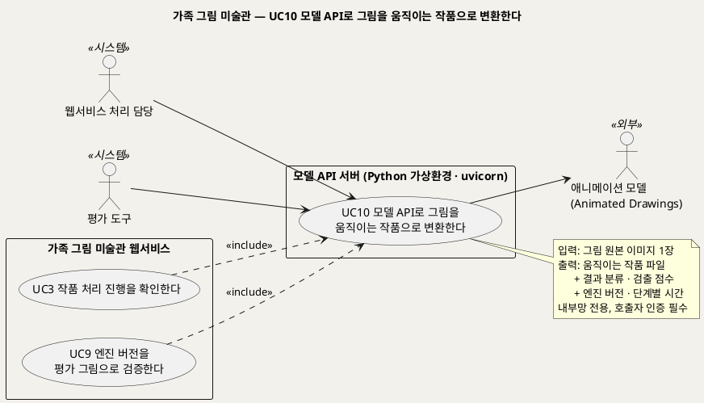
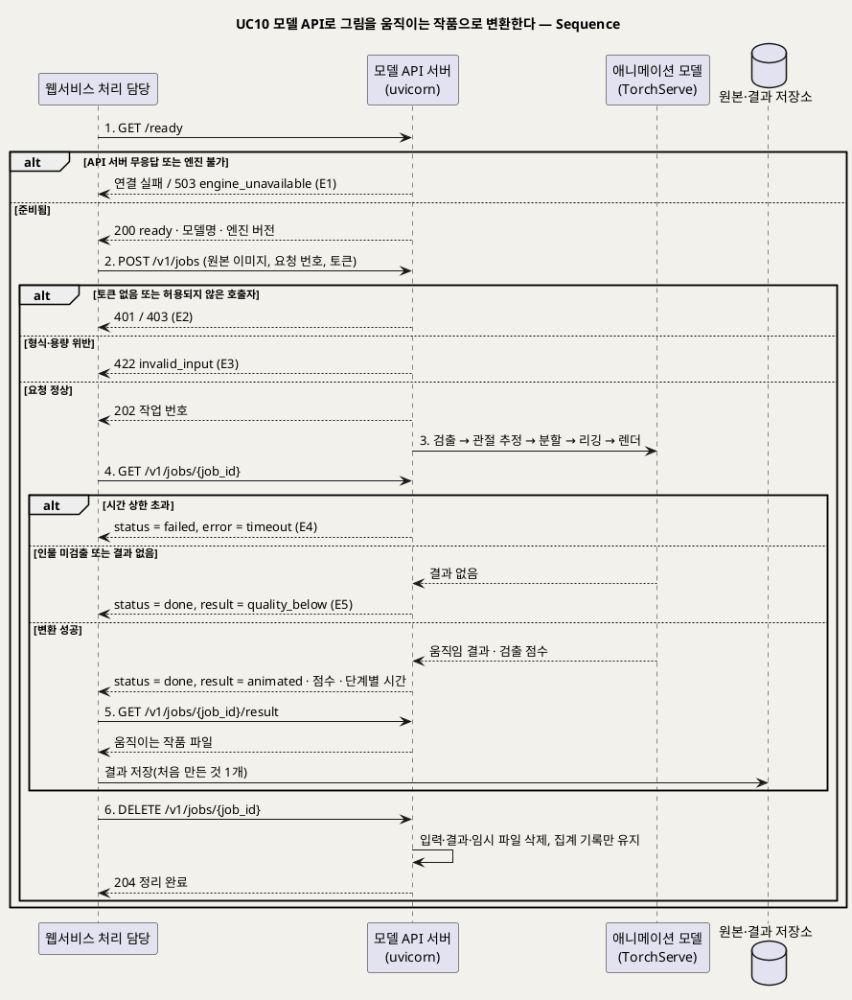

# UseCase 명세 — #10 모델 API로 그림을 움직이는 작품으로 변환한다 (가족 그림 미술관 P0)
**가족 그림 미술관 · UC10 · UML 2.5.1 표준 (UseCase Diagram + UseCase 기술 + Sequence Diagram)**

---

> **문서 식별**: `design/UC_10_모델API변환.md`
> **작성일**: 2026-09-28 (추가 요구 R1~R4 반영) · **표준**: UML 2.5.1 (OMG)
> **원천(SoT)**: 추가 요구 R1·R2·R3 (2026-09-28) · `.specify/features/가족-그림-미술관/spec.md` — FR-3, FR-4, FR-5, FR-11, FR-14, FR-15, FR-16 · 보조 원천 `Intent-Specify.md` [핵심 이네이블러] FastAPI·TorchServe·엔진 어댑터 · [핵심 장벽] 서빙 의존성·인프라
> **정본**: `UC_ALL_가족그림미술관_통합명세.md` §7.10. 이 문서는 같은 내용을 UC별 문서 형식으로 옮긴 것이다. 모델 정의·API 서버 구성·'API활용' 메뉴 구성은 통합 명세 §2.2~§2.5에 있다.
> **다이어그램**: 모든 PlantUML 소스는 렌더 검증 완료(HTTP 200). 아래 링크로 브라우저에서 열 수 있다.
> **표기**: `[추론]` = 원천에 직접 없는 설계 판단 · `자료 없음 — 확인 필요` = 원천에 근거가 없는 항목

---

## 목차

1. [범위·개요](#1-범위개요)
2. [UseCase Diagram](#2-usecase-diagram)
3. [Actor 카탈로그](#3-actor-카탈로그)
4. [UseCase 목록 (원천 매핑)](#4-usecase-목록-원천-매핑)
5. [UseCase 기술 + Sequence Diagram](#5-usecase-기술--sequence-diagram)
6. [업무규칙 종합](#6-업무규칙business-rules-종합)
7. [UML 표준 준수 노트](#7-uml-표준-준수-노트)

---

## 1. 범위·개요

애니메이션 모델(Meta Animated Drawings)은 웹서비스 안에서 직접 돌리지 않는다. **Python 가상환경에서 uvicorn으로 띄운 모델 API 서버**가 모델을 감싸고, 웹서비스는 이 API만 부른다(R3). 이 UC는 웹서비스의 처리 담당이 움직임 경로 작품 1건을 API 서버에 맡기고, 결과를 받아 오고, 작업을 정리하기까지를 다룬다.

보호자가 직접 이 UC를 쓰지는 않는다. 보호자가 UC2에서 "예"라고 답한 작품을 UC3이 처리할 때 이 UC가 **항상 포함**된다(«include»). UC9의 평가 도구도 같은 API를 같은 방식으로 부른다.

| 항목 | 값 |
|---|---|
| 대상 시스템 | 모델 API 서버 (Python 가상환경 · uvicorn · FastAPI [추론]) |
| 상위 프로세스 | 작품 접수(UC2) → 처리(UC3) → **모델 변환(UC10)** → 결과 확인(UC4) |
| 원천 근거 | R1 · R2 · R3 · spec FR-3 · FR-4 · FR-5 · FR-11 · FR-14 · FR-16 · Intent [핵심 이네이블러] · [핵심 장벽] 서빙 의존성 |
| 핵심 UseCase | 1개 (UC10) |
| 주요 액터 | 웹서비스 처리 담당(시스템) · 평가 도구(시스템) · 애니메이션 모델(보조) |

---

## 2. UseCase Diagram

**[「UC10 모델 API 변환 UseCase Diagram」 PlantUML 뷰어로 열기](https://plantuml.sumzip.com/plantuml/svg/eNqNlFFL21AUx9_vpzh0L8qmWHxyiOicwt58mOxFkLs0rcH03pGkGzKEuEWoxqEb7VZnKhXU6hDm2q5GcC_7KHvMvfkOO7eJW2UKy1Puzf-c_M__d5NJ26GWUyqaUNIW87RomCuLBWqaurWymB0h9rLBXlCLFuE51ZYLFi-x3DQ3uQX3ZkdnszOP-hT2Es3xVwYrQJ6atk5MPe-Aw8EyCksO5AxL1xyDM-IYjqlDdO7Kg28QXYTi-ArE11CWG1HHhV9uBeansyMgvpyIdyFMzT0RB0Gqk3UP5J4rm2uy3hGbFZD77-MPZRlcKY1ou_FuLa4Gwj8khGoO2szIvUvpBeLSk5uHIFs1cXwGwu8I_zID1IZn3FrWLRgfl36Aing9mJi4Lo23N9AliG0v-n7WUz_l3LxdK6sN4ZfFaQWNyfVa6n6BDUwxo0gdPQePLarCsQd7nWZYwWC66rUbiq6LjYjKh7ICZpO5K5z-YTLwmgCUbF2jNpbMT4-maVxPKZte_HFDRRbvVmU9TILpvR3FN2vHQH6qYAGIlicbHhYtsHT8NPkk4qjlyuP6jU5jZLXf-l9soKy2PBiYW3GWOOsRf7uGhKLWD_h5AaWXhsYtNvjPIHfDX2D_Rz-1hgd4lZAU8dDQRLLVg_hnpXIbHk4W8BCBGEwzSzkdiahY7nyEW6pHwpEQxh09Pek8n3QG9LcuGkcPrznKvR3RDkGZR6JNF7Jy_0jJukFPdstsEG9tyfoVipLrPhI4j9p4JrqeOKqpGBWSbgCysSPLtT7hDaBKKPyTqO2JNn5CfhCde6gVbzp4-ESzDgr659MHENdC7Cb3d9BmiKghrnqqr85yoGYkk3iHv4vfXugJkg==)** — 클릭 시 브라우저로 연결됩니다.

#### 다이어그램 쉽게 읽기 (유저 관점)

- **누가 쓰나** — 사람이 아니라 웹서비스의 처리 담당과 평가 도구가 쓴다. 애니메이션 모델은 API 서버 뒤에 숨어 있는 외부 구성요소다.
- **무슨 순서로** — 처리 담당이 그림을 보낸다 → API 서버가 모델로 움직임을 만든다 → 처리 담당이 결과를 받아 저장한다 → API 서버의 임시 파일을 지운다.
- **«include» = 항상 함께** — UC3(움직임 경로 처리)와 UC9(엔진 평가)는 모델이 필요할 때 반드시 이 UC를 거친다. 웹서비스가 모델을 직접 부르는 길은 없다.
- **«extend» = 특정 상황에서만** — 없다. 처리 중 취소는 UC7의 EXT1이 이 UC의 `DELETE` 호출로 수행한다.
- **Generalization(◁)** — 없다. 현재 모델과 예비 모델은 같은 API 규격을 따른다.

| 기호 | 의미 |
|---|---|
| 사람 모양(actor) | 시스템을 쓰는 외부 시스템(`<<시스템>>`) 또는 외부 구성요소(`<<외부>>`) |
| 타원(usecase) | 액터가 이루려는 목표 |
| 사각형(rectangle) | 시스템 경계. 웹서비스와 모델 API 서버를 따로 그렸다 |
| 점선 `<<include>>` | 기반 UC가 항상 포함하는 하위 행위 |
| 노트 | 입력·출력과 접근 제약 |

---

## 3. Actor 카탈로그

| 구분 | 액터 | 이 UC에서의 역할 | 원천 근거 |
|:--:|---|---|---|
| Primary | 웹서비스 처리 담당 | 움직임 경로 작품의 원본을 API에 보내고, 상태를 조회하고, 결과를 받아 원본·결과 저장소에 저장하고, 작업을 정리한다 | R3 · spec FR-4 · Intent [핵심 활동] 3 |
| Primary | 평가 도구 | UC9에서 평가 그림을 같은 API로 보낸다 | spec FR-16 · FR-17 |
| Secondary | 애니메이션 모델 | Meta Animated Drawings. TorchServe로 서빙되며, API 서버에서만 호출된다 | R1 · spec Dependencies |

[추론] 이 UC의 시스템 경계는 모델 API 서버다. 그래서 웹서비스의 처리 담당은 경계 밖의 시스템 액터가 된다. UC3에서 처리 담당을 액터로 두지 않은 것(내부 구성요소)과 관점이 다르다.

---

## 4. UseCase 목록 (원천 매핑)

| UC ID | 유스케이스명 | 관계 | 원천 근거 |
|:--:|---|---|---|
| UC10 | 모델 API로 그림을 움직이는 작품으로 변환한다 | 본 문서 | R2 · R3 |
| UC3 | 작품 처리 진행을 확인한다 | UC3이 «include» (움직임 경로일 때) | spec FR-4 · FR-5 |
| UC9 | 엔진 버전을 평가 그림으로 검증한다 | UC9가 «include» | spec FR-16 · FR-17 |
| UC7 | 작품 또는 아이를 삭제한다 | EXT1(실행 중 처리 취소)이 이 UC의 작업 정리를 부른다 | spec FR-10 |
| UC8 | 서비스 상태와 운영 지표를 확인한다 | 준비 확인이 API 서버의 `/ready`를 읽는다 | spec FR-12 |
| UC11 | API활용 메뉴에서 엔드포인트·가이드라인·매뉴얼을 확인한다 | 이 UC의 API 규격을 문서로 보여 준다 | R4 |

> **쉽게 말하면** — 그림을 움직이게 만드는 모델은 별도의 작은 서버 안에 들어 있습니다. 서비스는 그 서버에 "이 그림 움직여 줘"라고 부탁하고, 다 되면 결과를 받아 옵니다. 움직일 수 없는 그림이면 서버가 그렇다고 알려 주고, 서비스는 원본 액자로 바꿉니다.

---

## 5. UseCase 기술 + Sequence Diagram

### 5.1 UC10 모델 API로 그림을 움직이는 작품으로 변환한다

#### 유스케이스 기술

| 속성 | 내용 |
|---|---|
| **ID** | UC10 (R1, R2, R3 · spec FR-4, FR-5, FR-16) |
| **유스케이스명** | 모델 API로 그림을 움직이는 작품으로 변환한다 |
| **액터** | 주: 웹서비스 처리 담당, 평가 도구 · 보조: 애니메이션 모델 |
| **사전조건** | (1) 모델 API 서버가 가상환경에서 uvicorn으로 떠 있고, 내부망 주소에만 바인딩되어 있다(BR-API-02). (2) 모델 파일이 설정된 모델 경로에 있고 체크섬이 맞다. 모델 경로는 `자료 없음 — 확인 필요`(§2.2). (3) 호출자가 유효한 토큰을 갖고 있다. (4) 보낼 작품은 UC2에서 접수 완료되었고 경로가 "움직임"이다(BR-PRC-01) |
| **사후조건** | (1) 작업이 결과 분류(움직임 / 품질 미달) 또는 오류 분류(엔진 다운 / 시간 초과 / 연동 오류) 중 하나로 끝난다. (2) 응답에 엔진 버전, 검출 점수(기록용), 단계별 소요 시간이 담긴다. (3) 성공이면 움직이는 작품 파일 1개가 웹서비스의 원본·결과 저장소에 저장된다. (4) API 서버에 입력 이미지·결과·임시 파일이 남아 있지 않다. (5) 원본은 변형되지 않았다 |
| **기본흐름** | ↓ 별도 기본흐름표 (움직임 결과 성공 기준) |
| **대체흐름** | A1. 평가 호출 — UC9의 평가 도구가 평가 그림으로 같은 흐름을 밟는다. 결과는 가족 저장소가 아니라 평가 결과 기록에 남는다(spec FR-17). A2. 처리 대기 — API 서버의 동시 처리 상한에 도달하면 작업은 `queued` 상태로 기다린다. 처리 담당은 같은 간격으로 상태를 계속 조회한다(spec FR-15). 동시 처리 상한은 `자료 없음 — 확인 필요`. A3. 시험 호출 — UC11의 EXT3에서 팀원이 평가 그림으로 API를 불러 본다. 결과는 화면에만 보이고 가족 저장소에 쓰지 않는다(BR-API-09) |
| **예외흐름** | E1. API 서버 무응답·엔진 불가 — 연결이 안 되거나 `/ready`가 `503 engine_unavailable`이면 작업을 보내지 않는다. 오류 분류 = 엔진 다운. 웹서비스는 UC3의 재시도 규칙(최대 3회)을 따른다(BR-PRC-03). E2. 인증 실패 — 토큰이 없거나 허용되지 않은 호출자면 `401`/`403`. [추론] 설정 문제이므로 재시도하지 않고 운영자에게 알린다. E3. 입력 오류 — 형식·용량이 맞지 않으면 `422 invalid_input`. UC2 검사를 통과한 원본이면 일어나지 않아야 하므로 연동 오류로 기록한다. E4. 시간 초과 — 작업당 시간 상한(기본 10분)을 넘기면 `failed` + `timeout`. 오류 분류 = 시간 초과(BR-PRC-06). E5. 품질 미달 — 모델이 인물을 찾지 못하거나 관절 추정·렌더 결과가 없으면 `done` + `quality_below`. 오류가 아니다. 웹서비스는 재시도 없이 원본 액자로 대체한다(BR-PRC-02). E6. 처리 중 취소 — UC7의 EXT1이 `DELETE`를 보내면 처리를 멈추고 결과 파일을 만들지 않는다(BR-API-06) |
| **포함/확장** | UC3·UC9가 이 UC를 «include». 이 UC에는 포함·확장 대상이 없다 |
| **우선순위** | High — 움직임 경로의 유일한 모델 호출 통로다. 원천이 서빙 의존성을 "치명" 등급으로 분류했고, 격리와 교체 가능성이 이 경계에서 보장된다(Intent [핵심 장벽]) |
| **사용빈도** | 움직임 경로 작품 1건당 1회(재시도 포함 최대 3회). 평가 때는 평가 세트 그림 수만큼. 정량값은 `자료 없음 — 확인 필요` |
| **업무규칙** | BR-API-01, BR-API-02, BR-API-03, BR-API-04, BR-API-05, BR-API-06, BR-PRC-01, BR-PRC-02, BR-PRC-03, BR-PRC-04, BR-PRC-06, BR-ENG-01, BR-ENG-02, BR-ENG-05, BR-PRV-01 |
| **특별 요구사항** | 성능: 1차 실측은 한 장 53~62초(렌더 약 40초), 모델 서버 약 3.1GB다(Intent [핵심 장벽] 인프라). 그래서 비동기 작업형으로 둔다. 움직임 경로 p95 3분 이내 목표(spec Success Criteria)에는 API 대기 시간도 포함된다. 보안: API 서버는 내부망 전용이고 토큰으로 호출자를 확인한다. TorchServe는 localhost에만 열고 관리 API를 닫는다(spec FR-14, FR-16). 개인정보: 입력 이미지와 결과는 작업 정리 때 지우고, 학습에 다시 쓰지 않는다. 로그에는 요청 번호와 분류 코드만 남긴다(spec FR-14). 고정 환경: 가상환경 패키지는 잠금 파일로, 엔진은 고정 이미지와 체크섬으로 관리한다(Intent [핵심 이네이블러]) |
| **비고** | 원천 추적: 추가 요구 R1(모델 정의: 용도·입력·출력·경로) · R2(모델을 움직임 경로 기능으로 활용) · R3(가상환경 uvicorn API 서버로 구성해 웹서비스와 연동) · spec FR-3 수용기준 2·3 · FR-4 · FR-5 표·수용기준 · FR-11 · FR-14 · FR-15 · FR-16 수용기준 2·3·4 · Dependencies · Intent-Specify [핵심 이네이블러] "FastAPI", "내부 TorchServe + Docker 고정 이미지·체크섬·엔진 어댑터" · [핵심 장벽] 서빙 의존성·인프라. 엔드포인트 이름·응답 형식·포트·인증 방식은 원천에 없어 모두 [추론]이며 plan 단계에서 확정한다. 모델 경로는 `자료 없음 — 확인 필요` |

#### 기본흐름 (Basic Flow)

| 단계 | 액터 행위 | 시스템 행위 |
|:--:|---|---|
| 1 | 처리 담당이 API 서버의 준비 상태를 묻는다(`GET /ready`) | 모델 적재와 엔진 응답을 확인하고, 모델명·엔진 버전과 함께 "준비됨"을 돌려준다 |
| 2 | 처리 담당이 원본 이미지와 요청 번호를 토큰과 함께 보낸다(`POST /v1/jobs`) | 호출자·형식·용량을 검사하고 작업 번호를 발급해 `202`로 접수한다 |
| 3 | — | 모델로 사람 형태 검출 → 관절 추정 → 분할 → 리깅 → 렌더를 하고, 단계별 시간을 기록한다 |
| 4 | 처리 담당이 작업 상태를 조회한다(`GET /v1/jobs/{job_id}`) | `done` + `animated`와 검출 점수(기록용)·엔진 버전·단계별 시간을 돌려준다 |
| 5 | 처리 담당이 결과 파일을 받아(`GET …/result`) 원본·결과 저장소에 저장한다 | 움직이는 작품 파일을 돌려준다 |
| 6 | 처리 담당이 작업 정리를 요청한다(`DELETE /v1/jobs/{job_id}`) | 입력 이미지·결과·임시 파일을 지우고 집계 기록만 남긴 뒤 `204`를 돌려준다 |

#### Sequence Diagram

**[「UC10 모델 API 변환 Sequence」 PlantUML 뷰어로 열기](https://plantuml.sumzip.com/plantuml/svg/eNqVVV1v2mYUvudXHHU3RErCR8guKqXq1tFp0qRVSqbdTEIv8Db1YuzGNlTRNIksJmKBSqQDhbbAXC0NaZVqDGhCJK7yU3rp9_g_7PjFtFkGF7vAwvY5z_s8z_nwXdNihpXPqWDy7dRDllPUndQmU1Vu7KRi0ZC5pWiPmcFykGaZrU1Dz2vZe7qqG_DZ_ZX7seSX1yLMRyyrP1G0TXjIVJOHLMVSOXx_LxYF8fZUPB3BFw--Ea9a4F6MxMkY2zbgyyJ2d7E9FAd1wM6h96yMrbEfIwZF73nTa7RE5Rg-FOuwzrfzXMvwUIhOs5SM8phpFtzCl5dot8SljQfHgP2mODkDURmKyuUtYCb8oBtb3Ph3yicy4Kf27R-1cL6gZHRDW5BJ9ObGIQ1HVMriTZ2YYqkZyKG0Dd3IPFrnRoFPMpPapqLxUJZZLM1M7tOricHo6sLt99zBGNApYuc17ldl9LqlG6RnwhGW7khKtyG2DF8nNyBicJbdCTHVukYVxNkQ24ei8h5EsyZdO6pjl56fl91eMQQydomwAtTbFNCj0wErx171FCKwGl0BLnmm8horMEVlaapTOBlbCHGqG-BxkfwUtdNZaPFoFCQxuLoIfBBvS_7NlEjfRsem1Juy4svw4Lt10lWIRX7S0yaEJ-aAX_6_RtgtLgK-qGP_HWGUveZoEbx9x9vtLRCY78Lkjs7Zx3Z1Kt87KuOLN6LWpHzAxgG2i0C5eN7CTo0SZ0hIRGNkQ4JsCCfjPrhU7TUbWGlfXfhof_wG2LJFrzkHIB4HRSswVcmmqPnzFgGtfAQKNKDTwL3d2QDxaNzvdjwqBVI_hd0JeoiiVpbB7RdJCXzYfwbusIhOGfC8TsjyiTi3vYYz-Xty5l6WJn-dqnhal4A3K5AIGisoQORnuqaU7C8y2HcYKy23R1O5t0uDBzgsU8_KlzM00OKw8ias0bArKs8uAjcMWgtrYCk5rktPEgsyeeJKeyTOxkCFDjQF9ZsOhixqcFbgwNJH4rOC5hPK6hpfpCY18yRpDbbzVChrJ5Xmqv6EWK1eYzXZMjRbf7uD9_NOD5ZUx57yoGYPRKBTw3Lz_zJimpJjFs_KqZEIcpgqp-7AFgM7KEOAerOIq3OKGJnAz-MyY9OCV61ie_yfc-Rauua63Flh2q1y7LpV8btD7_Yg5vZagZdadmbDfb4MXyW_TW4k5_Rc0PGBzZ2ScF5PVyUNYscmIwKSgL--Q6dFG6J7SC6BO-qJV20iQ4Pq0OjPm7OEP4f-NwGf2-JPv3d8rv7vLl3ou_cPpuACyQ==)** — 클릭 시 브라우저로 연결됩니다.

기본흐름 1~6단계는 시퀀스의 번호 붙은 주요 메시지 `1.`~`6.`과 1:1로 대응한다. 품질 미달(E5)과 시간 초과(E4)도 6단계의 작업 정리를 거친다.

---

## 6. 업무규칙(Business Rules) 종합

| BR ID | 규칙 | 적용 UC | 근거 |
|---|---|---|---|
| BR-API-01 | 모델 기능은 웹서비스와 분리된 모델 API 서버로만 제공한다. API 서버는 Python 가상환경에서 uvicorn으로 구동한다. 웹서비스와 평가 도구는 모델을 직접 부르지 않고 HTTP API로만 부른다. 모델을 바꿔도 API 규격은 유지한다 | UC3, UC9, UC10 | 추가 요구 R3 · spec FR-16 수용기준 3 · Intent [핵심 장벽] 교체 가능한 엔진 어댑터 |
| BR-API-02 | API 서버는 내부망 주소에만 바인딩하고, 토큰으로 호출자(웹서비스 처리 담당·평가 도구)를 확인한다. 엔진(TorchServe)은 API 서버 호스트의 localhost에만 열고 관리 API를 닫는다 | UC10, UC11 | spec FR-14 · FR-16 수용기준 4 · BR-ENG-01 |
| BR-API-03 | API 응답의 결과 분류(움직임 / 품질 미달)와 오류 분류(엔진 다운 / 시간 초과 / 연동 오류)는 웹서비스 작업 기록의 분류와 1:1로 맞춘다. 품질 미달은 오류 코드로 돌려주지 않는다 | UC3, UC8, UC10 | spec FR-5 · FR-13 수용기준 2 |
| BR-API-04 | 모든 작업 응답에 엔진 버전, 검출 점수(기록용), 단계별 소요 시간을 담는다 | UC3, UC9, UC10 | spec FR-5 · FR-16 수용기준 2 |
| BR-API-05 | API 서버는 작업 정리 때 입력 이미지·결과·임시 파일을 지우고, 이미지를 학습이나 다른 목적에 쓰지 않는다. 로그에는 요청 번호·작업 번호·분류 코드만 남긴다 | UC10 | spec FR-11 · FR-14 · BR-PRV-01 |
| BR-API-06 | 처리 중인 작업에 정리(취소) 요청이 오면 처리를 멈추고, 이후 결과 파일을 만들지 않는다 | UC7, UC10 | spec FR-10 수용기준 2 |
| BR-PRC-01 | "아니요"로 답한 작품은 엔진을 한 번도 거치지 않는다. 원본 액자 경로는 엔진 없이 동작한다 | UC3 | spec FR-3 수용기준 2·3 |
| BR-PRC-02 | 모델 품질 미달은 재시도하지 않고 곧바로 원본 액자로 대체한다 | UC3 | spec FR-5 수용기준 2 |
| BR-PRC-03 | 인프라 장애는 품질 미달로 바꾸지 않는다. 작품당 최대 3회 시도(간격 증가) 뒤 실패로 알리고 결과 미도달로 집계한다 | UC3, UC8 | spec FR-5 수용기준 1·3 · Assumptions 재시도 기본값 |
| BR-PRC-04 | 엔진 검출 점수는 기록만 하고 자동 전시나 승인의 근거로 쓰지 않는다 | UC3, UC4, UC9 | spec FR-5 수용기준 5 · Intent [핵심 장벽] 0.946 사례 |
| BR-PRC-06 | 작업당 처리 시간 상한(기본 10분)을 넘기면 "시간 초과"로 분류하고 재시도 규칙을 따른다 | UC3, UC9 | spec FR-15 · Assumptions |
| BR-ENG-01 | 엔진은 외부 네트워크에서 직접 접근할 수 없다. 관리 기능과 외부 포트를 닫은 검증된 고정 실행 환경으로 격리한다 | UC3, UC9, UC10 | spec FR-14 · FR-16 수용기준 4 · Intent [핵심 장벽] 서빙 의존성 |
| BR-ENG-02 | 처리 작업과 평가 결과마다 엔진 버전을 기록한다 | UC3, UC9 | spec FR-16 수용기준 2 |
| BR-ENG-05 | 엔진을 예비안으로 바꿔도 접수·부모 확인·이야기·전시·삭제 흐름과 화면은 바뀌지 않는다 | UC9 (UC2~UC7에 영향 없음) | spec FR-16 수용기준 3 |
| BR-PRV-01 | 운영 로그에는 이미지, 저장 위치 키, 자유 입력 텍스트, 오류 원문을 남기지 않는다. 분류 코드와 요청 번호만 남긴다 | 전 UC | spec FR-14 · Intent [부정적 영향] 아동 그림·사진 유출 |

---

## 7. UML 표준 준수 노트

| 항목 | 적용 |
|---|---|
| 시스템 경계 | 이 UC만 경계를 "모델 API 서버"로 잡았다. 웹서비스와 API 서버를 다른 경계로 그려 R3의 분리 요구를 드러냈다 |
| 액터 | 처리 담당과 평가 도구는 사람 아닌 Primary actor(`<<시스템>>`), 모델은 Secondary actor다 |
| 포함 관계 | UC3·UC9 → UC10 «include». 경계를 넘는 포함이지만, 두 UC가 모델을 쓸 때 반드시 거친다는 뜻을 우선했다 [추론] |
| Sequence | 준비 실패·인증·입력 오류는 바깥 `alt`, 처리 결과(시간 초과·품질 미달·성공)는 안쪽 `alt`로 나눴다. 예외흐름 ID를 메시지에 병기했다 |

---

*가족 그림 미술관 P0 · UC10 · 2026-09-28 · 원천: 추가 요구 R1~R3 · spec FR-4, FR-5, FR-16*
