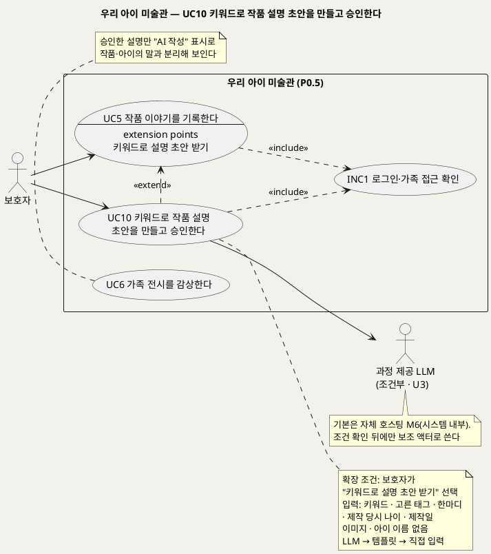
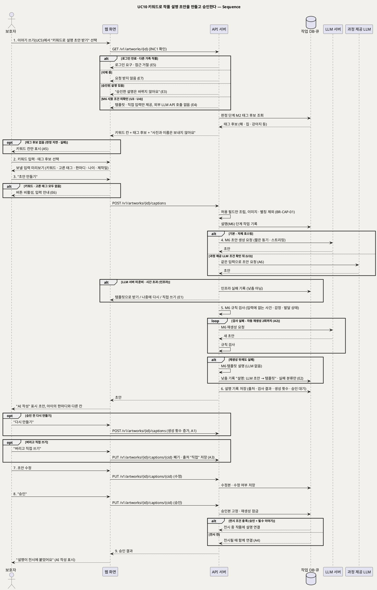

# UseCase 명세 — #10 키워드로 작품 설명 초안을 만들고 승인한다 (우리 아이 미술관 P0.5)
**우리 아이 미술관 · UC10 · UML 2.5.1 표준 (UseCase Diagram + UseCase 기술 + Sequence Diagram)**

---

> **문서 식별**: `design/UC_10_작품설명생성.md` (옛 `UC_10_모델API변환.md` 대체)
> **작성일**: 2026-09-23 · **개정**: 2026-09-28 — UC10을 "모델 API로 그림을 움직이는 작품으로 변환한다"에서 P0.5 "키워드로 작품 설명 초안을 만들고 승인한다"로 새로 썼다. 옛 내용(모델 API 호출·움직임 변환)은 UC3·UC12로 옮겼다 · **표준**: UML 2.5.1 (OMG)
> **원천(SoT)**: `Intent-Specify.md` (2026-09-28 기획 기준안) — [미션] 서빙 지표 · [핵심 활동] 3·5 · [핵심 장벽] 기억 왜곡·라이선스 · [가치제안] 경험 원칙 · [부정적 영향] 아동 이미지 유출·과잉 수집·기억의 재작성 · [핵심 이네이블러] 작품 설명 · [핵심 데이터] 작품 설명 · [혜택] 보호자 — 와 `.specify/features/우리-아이-미술관/spec.md` v2.0 FR-27 (개정 중, 번호는 공통 기준 §7)
> **다이어그램**: 모든 PlantUML 소스는 렌더 검증 완료(HTTP 200). `plantuml.sumzip.com` 은 사내 SSO 로그인 뒤 열린다.
> **표기**: `[추론]` = 원천에 직접 없는 설계 판단 · `자료 없음 — 확인 필요` = 원천에 근거가 없는 항목 · `U1~U15` = 공통 미해결 번호

---

## 목차

1. [범위·개요](#1-범위개요)
2. [UseCase Diagram](#2-usecase-diagram)
3. [Actor 카탈로그](#3-actor-카탈로그)
4. [UseCase 목록 (원천 매핑)](#4-usecase-목록-원천-매핑)
5. [UseCase 기술 + Sequence Diagram](#5-usecase-기술--sequence-diagram)
6. [업무규칙 종합](#6-업무규칙business-rules-종합)
7. [UML 표준 준수 노트](#7-uml-표준-준수-노트)

---

## 1. 범위·개요

보호자가 작품 이야기(UC5)를 쓰다가 **"키워드로 설명 초안 받기"**를 고르면 이 UC가 시작된다(UC10 «extend» UC5). 보호자는 키워드를 적거나, 판정 단계에서 종류 판정 모델(M2)이 뽑아 둔 태그 후보(해·집·강아지 등) 가운데 맞는 것을 고른다. 시스템은 LLM 서버(M6, Qwen3-4B 자체 호스팅)로 짧은 설명 초안을 만들고, 규칙 검사를 거친 초안만 **"AI 작성"** 표시와 함께 보여 준다. 보호자가 고치고 승인해야 전시에 붙는다.

설명 생성에 넣는 입력은 다섯 가지뿐이다: 보호자 키워드, 보호자가 고른 태그, 아이의 실제 발언(한마디), 제작 당시 나이, 제작일. **이미지와 아이 이름(별칭)은 넣지 않는다.** 아이 데이터는 외부 LLM API로 보내지 않는다.

LLM 초안이 규칙 검사를 계속 통과하지 못하면 LLM 없이 입력 칸을 채우는 **템플릿 설명**으로 한 단계 낮추고, 그것도 원하지 않으면 보호자가 **직접 입력**한다(낮춤 체인 LLM → 템플릿 → 직접 입력). 승인한 설명은 고정되어 다시 만들지 않는다. AI 설명은 아이의 한마디와 다른 칸에 저장하고 다른 자리에 보여 준다.

| 항목 | 값 |
|---|---|
| 대상 시스템 | 우리 아이 미술관 (P0.5) |
| 상위 프로세스 | 결과 확인(UC4) ↔ 이야기 기록(UC5) ⇢ **설명 초안(UC10, 선택)** → 전시(UC6) |
| 원천 근거 | spec FR-27 · Intent [핵심 활동] 5 · [핵심 이네이블러] 작품 설명 · [핵심 데이터] 작품 설명 · [부정적 영향] 기억의 재작성 · 공통 기준 §2(M2·M6) · §3(LLM 서버) · §4 · §5(낮춤 체인) |
| 핵심 UseCase | 1개 (UC10) + 기반 UC 1개 (UC5) + 공통 1개 (INC1) |
| 주요 액터 | 보호자 · (조건부) 과정 제공 LLM |
| 쓰는 모델 | M6 설명 생성·규칙 검사·템플릿 기준선(LLM 서버) · M2 태그(판정 단계에서 이미 만든 결과를 재사용, 이 UC에서 다시 부르지 않음) |
| 엔드포인트 [추론] | `POST /v1/artworks/{id}/captions` (초안 생성·재생성) · `PUT /v1/artworks/{id}/captions/{cid}` (수정·승인·폐기). 이름·형식은 `/speckit.plan`에서 확정(U8) |

---

## 2. UseCase Diagram

**[「UC10 작품 설명 생성 UseCase Diagram」 PlantUML 뷰어로 열기](https://plantuml.sumzip.com/plantuml/svg/eNqFlEFLG1EQx-_7KYbtRQ8Gg-hBJNiGCoIWL94EWZM1LsZd2d3QllKIupGgOURN0NbdkEBioBQam62JECj4UTzue_sdOvOSaHKwnjbvzbx5__nN_2XRshXTzuylIZPYNDLmZkpJp1Xz82Z0WrJ2NX1fMZU92FISuynTyOjJuJE2THizNLMUff9uJMPaUZLGR01PwbaStlQprW7bYBtgaqkdG5KaqSZszdAlW7PTKvDvLXbzE3jZ4Z4P7FeX56uBn4XHbAnW49FpCA_r_LrALlxWc4FXzsLzPHCnzn7kgPt5Xs5zzwHWxIx60K4CP7nnXjcsu-y0LklKwkaNMmv74VWXV4oyKBasKaaq28NY0O7xahl41Q3af2BlZXVDn-C1VnDrs7ssPHRgfWZSHItjTJJIvaKnULn8kvSJtenILJ75IgFkLDWhWCq2Mks1ZPoOm_B8Xu4F3RZr9IA-NW8ge2pKUj_Zqm4hJtg3NN22pHEMo_0Da13jcXnkNvkVchv6a-hEx1RltOryh3gUsFjQ6WLiQydoZXntFtGdBZ0ehN_KuCsOUuK4nDl4Snb4qStabhX50cHYdXPSV0nqjwempmJEbXyJeohgJBITd8A8LCxoeiKdSaqxmCS6_m9MlBQRATg5DFD1_nx1w1YHVjW2hwSotUoD-raYhyc7YU8YlV-fDe5WwyMPk3klx6qN-efhkMWQPmt0ITwitLRBVJp5VirhCVyiOXF-wE7vkR2wwysy3NM-93pU2PPJgk3h2YEnae_GAX55zL0C5mCH8Hh8DmHODUsFdvNXrHjzAEc4UCYhFSAIfRJbhm0be4RC4AFh1DaOP4v5Rf7bByJxUg8LOVidm0B5tMiRSHo_kxFSJrAN_AHsvM4vi-g6wogh1FoLnZZAd-GT_V9SQP6AZ5cOSFMl-e0yGZw7tzKEZy4ZrOYK2GT6h04fB_eu0O1FfPDA7hx8umHZFyK87ti1i_gL_walf_YifnI=)** — 클릭 시 브라우저로 연결됩니다.

#### 다이어그램 쉽게 읽기 (유저 관점)

- **누가 쓰나** — 보호자가 작품 이야기를 쓰다가, 짧은 작품 설명을 AI에게 초안으로 받아 고치고 승인한다.
- **무슨 순서로** — 이야기 쓰기(UC5) 화면에서 "키워드로 설명 초안 받기"를 누른다 → 키워드를 적거나 태그를 고른다 → 초안을 받는다 → 고치고 승인한다 → 전시(UC6)에 "AI 작성" 표시와 함께 붙는다.
- **«include» = 항상 함께** — 설명을 만들거나 승인할 때마다 "로그인·가족 접근 확인"을 거친다.
- **«extend» = 특정 상황에서만** — 보호자가 설명 초안을 원할 때만 UC5에 끼어든다. 누르지 않으면 UC5만으로 전시가 끝난다(설명은 전시 조건이 아니다).
- **과정 제공 LLM** — 기본은 우리 서버 안의 LLM이라 액터가 아니다. 과정에서 제공하는 LLM 엔드포인트를 쓰기로 조건을 확인한 경우에만 바깥 보조 액터가 된다.
- **Generalization(◁)** — 없다. LLM 초안·템플릿·직접 입력은 같은 설명 기록의 "출처" 값으로 구분한다.

| 기호 | 의미 |
|---|---|
| 사람 모양(actor) | 시스템을 쓰는 사람 또는 바깥 시스템 |
| 타원(usecase) | 액터가 이루려는 목표 |
| 사각형(rectangle) | 시스템 경계 |
| 점선 `<<include>>` | 항상 함께 수행되는 하위 행위 |
| 점선 `<<extend>>` | 확장점 조건이 맞을 때만 기반 UC에 끼어드는 행위(화살표는 확장 UC → 기반 UC) |
| `extension points` 칸 | 기반 UC(UC5)에서 확장이 끼어드는 지점 |
| 노트 | 확장 조건·입력 범위·전시 방식 보충 |

---

## 3. Actor 카탈로그

| 구분 | 액터 | 이 UC에서의 역할 | 원천 근거 |
|:--:|---|---|---|
| Primary | 보호자 | 키워드를 적고 태그 후보를 고른다. 초안을 읽고 고치고 승인하거나, 다시 만들거나, 버리고 직접 쓴다 | spec FR-27 · Intent [핵심 활동] 5 · [혜택] 보호자 |
| Secondary(조건부) | 과정 제공 LLM | 과정 제공 LLM 엔드포인트가 있고 데이터 처리 조건이 확인된 경우에만 M6 초안 생성을 대신한다. 조건이 확인되기 전에는 부르지 않는다 | Intent [핵심 파트너] · 공통 기준 §6 · U3 |
| 이해관계자 | 아이 · 성장한 아이 | 한마디의 화자이자 설명의 대상. 기억이 AI 문장으로 바뀌지 않아야 하는 당사자. 시스템을 직접 조작하지 않는다 | Intent [부정적 영향] 기억의 재작성 |

자체 호스팅 LLM(M6)은 시스템 내부 구성요소라 액터로 두지 않는다. 시퀀스에서 `LLM 서버` lifeline으로만 나타난다.

---

## 4. UseCase 목록 (원천 매핑)

| UC ID | 유스케이스명 | 관계 | 원천 근거 |
|:--:|---|---|---|
| UC10 | 키워드로 작품 설명 초안을 만들고 승인한다 | 본 문서 · UC5를 «extend» (확장점: "키워드로 설명 초안 받기", P0.5) | spec FR-27 · Intent [핵심 활동] 5 |
| UC5 | 작품 이야기를 기록한다 | 기반 UC. 한마디·제작 당시 나이·제작일을 입력으로 제공 | spec FR-7 |
| INC1 | 로그인·가족 접근 확인 | UC10이 «include» | 공통 기준 §6 |
| UC6 | 가족 전시를 감상한다 | 후행. 승인한 설명을 "AI 작성" 표시로 분리해 보인다 | spec FR-8 · BR-EXH-05 |
| UC2 | 작품 사진을 접수하고 판정 제안을 확정한다 | 선행. 판정 단계에서 M2 태그 후보가 만들어진다 | spec FR-21 · 공통 기준 §2 중간 결과 재사용 |
| UC8 | 서비스 상태와 모델별 운영 지표를 확인한다 | 관련. 설명 규칙 검사 실패율·설명→템플릿 낮춤률을 본다 | spec FR-26 |

---

## 5. UseCase 기술 + Sequence Diagram

### 5.1 UC10 키워드로 작품 설명 초안을 만들고 승인한다

> **쉽게 말하면** — 작품 이야기를 쓰다가 "키워드로 설명 초안 받기"를 누르고, "해, 집, 강아지"처럼 떠오르는 말을 적거나 추천 태그를 고릅니다. AI가 짧은 설명을 써 주면 읽어 보고 고친 뒤 승인합니다. 사진과 아이 이름은 AI에게 보내지 않고, 입력에 없는 사건이나 감정을 지어낸 문장은 걸러집니다. AI가 쓴 설명은 "AI 작성"으로 표시되고 아이가 한 말과 섞이지 않습니다. 마음에 들지 않으면 다시 만들거나 직접 쓸 수 있고, 승인한 설명은 바뀌지 않습니다.

#### 유스케이스 기술

| 속성 | 내용 |
|---|---|
| **ID** | UC10 (spec FR-27, P0.5) |
| **유스케이스명** | 키워드로 작품 설명 초안을 만들고 승인한다 |
| **액터** | 주: 보호자 · 보조(조건부): 과정 제공 LLM(U3 조건 확인 뒤에만) · 내부 구성요소: LLM 서버(M6) |
| **사전조건** | (1) 보호자가 로그인되어 있고 대상 작품이 보호자 가족의 것이다(INC1). (2) 보호자가 대상 작품의 이야기 쓰기(UC5) 화면에 있다. (3) 작품이 접수 완료되어 있고 `삭제 중`이 아니다. (4) 이 작품에 승인된 설명이 아직 없다. (5) P0.5 설명 기능이 켜져 있고 M6의 사용 조건(Qwen3 라이선스, 과정 제공 LLM을 쓰면 그 조건)이 확인되어 있다(BR-MDL-07, U3·U4). 확인 전이면 E4 |
| **사후조건** | (1) 작품 설명 기록 1건이 남는다: 보호자 키워드 · 고른 태그 · 초안 · 출처(LLM/템플릿/직접) · 규칙 검사 결과 · 생성 횟수 · 승인본(Intent [핵심 데이터] 작품 설명, BR-CAP-03). (2) 승인했으면 승인본이 고정되고 재생성이 잠긴다(BR-CAP-04). 작품이 전시 조건(승인 + 필수 이야기)을 갖췄으면 전시에 "AI 작성" 표시와 함께 붙고, 아니면 전시될 때 함께 붙는다. (3) 아이의 한마디는 한 글자도 바뀌지 않는다(BR-STY-03). (4) 설명(M6) 단계 작업에 모델 ID·버전·상태·시도 횟수·처리 시간·낮춤 원인 또는 오류 분류가 남는다. (5) 이미지·아이 이름은 어떤 LLM에도 보내지지 않았고, 운영 로그에는 키워드·초안 문장 없이 분류 코드만 남는다(BR-CAP-01, BR-PRV-01) |
| **기본흐름** | ↓ 별도 기본흐름표 (자체 호스팅 LLM 초안이 첫 규칙 검사를 통과하고, 보호자가 고쳐 승인하는 경우 기준) |
| **대체흐름** | A1. 승인 전 다시 만들기 — 보호자가 초안이 마음에 들지 않아 "다시 만들기"를 누르면 같은 입력(또는 고친 키워드·태그)으로 새 초안을 만든다. 생성 횟수를 늘려 기록하고 이전 미승인 초안은 새 초안으로 대체한다(BR-CAP-04). [추론] 보호자 요청 재생성 횟수의 상한은 `자료 없음 — 확인 필요`(U11). A2. 규칙 검사 실패 후 재생성 통과 — 첫 초안이 입력에 없는 사건·감정·발달 상태 표현을 담으면 보호자에게 보이지 않고 자동으로 다시 만든다. [추론] 자동 재생성 상한 2회 안에서 통과하면 기본흐름 6단계로 돌아간다. 실패 분류(사건/감정/발달)와 생성 횟수를 기록한다(BR-CAP-02, BR-CAP-03). A3. 버리고 직접 입력 — 보호자가 초안(LLM 또는 템플릿)을 "버리고 직접 쓰기"로 폐기하면 빈 설명 칸을 열고, 보호자가 쓴 문장을 출처 "직접"으로 저장한다. 직접 쓴 설명에는 "AI 작성" 표시를 붙이지 않고, 아이의 한마디 칸과도 분리한다(BR-FBK-01 셋째 단계, BR-STY-03). A4. 전시 전 승인 — 작품이 아직 결과 승인(UC4)이나 필수 이야기(UC5)를 갖추지 못했으면 설명 승인본만 고정해 두고, 작품이 전시될 때 함께 붙인다(BR-EXH-01). A5. 태그 후보 없음 — 판정 단계가 늦거나 실패해 M2 태그가 없으면 키워드 칸만 보여 주고 키워드만으로 진행한다. [추론] BR-SUG-05와 같은 취지로 태그가 없어도 설명 기능을 막지 않는다. A6. 과정 제공 LLM 사용 — U3 조건(데이터 보관·학습 재사용 여부 등)이 확인되어 설정된 경우에만 LLM 서버 대신 과정 제공 LLM에 같은 입력을 보낸다. 입력 범위·규칙 검사·표시·승인은 기본흐름과 같다(BR-CAP-05) |
| **예외흐름** | E1. LLM 서버 미준비·시간 초과(인프라) — 낮춤이 아니므로 규칙 검사 재생성 횟수에 넣지 않고 인프라 실패로 기록한다(BR-PRC-03). [추론] 동기 요청이라 보호자를 오래 기다리게 하지 않도록 시간 상한 안에서 짧게 재시도(최대 3회)한 뒤에도 실패하면 "지금은 AI 초안을 만들 수 없어요"라고 알리고 "기본 문장(템플릿)으로 받기 / 나중에 다시 시도 / 직접 쓰기"를 고르게 한다. 템플릿을 바로 대신 내주지 않고 보호자가 고르게 한 것은, 인프라 장애를 모델 낮춤처럼 보이게 하지 않기 위해서다(BR-FBK-04 취지). 이 경우 템플릿 출처 기록은 설명→템플릿 낮춤률에 넣지 않는다. 시간 상한 값은 `자료 없음 — 확인 필요`(BR-PRC-06, U6). E2. 규칙 검사 반복 실패 — 자동 재생성 2회 [추론] 뒤에도 규칙 검사에 걸리면 LLM 초안을 버리고 템플릿 설명으로 한 단계 낮춘다(BR-CAP-02, BR-FBK-01). "AI 초안이 입력에 없는 내용을 넣어 기본 문장으로 바꿨어요"라고 낮춘 사실을 보여 주고, 낮춤 원인("설명: LLM 초안 → 템플릿, 규칙 검사 반복 실패")을 단계 작업에 기록한다(BR-FBK-03). 걸린 초안 원문은 보호자에게 보이지 않고 저장하지 않으며 실패 분류만 남긴다 [추론]. 보호자는 템플릿을 고쳐 승인하거나 A3으로 직접 쓸 수 있다. E3. 승인된 설명 재생성 요청 — 승인본이 있는 작품에 초안 생성·재생성을 요청하면 거절하고 "승인한 설명은 바뀌지 않아요"라고 안내한다(BR-CAP-04). [추론] 응답은 409 계열. 승인본을 내리거나 바꾸는 절차는 원천에 없어 `자료 없음 — 확인 필요`. E4. M6 사용 조건 미확인 — Qwen3 라이선스(U4)나 과정 제공 LLM 조건(U3)이 확인되지 않아 M6가 비활성이면 "키워드로 설명 초안 받기" 대신 템플릿과 직접 입력만 보여 준다. 외부 상용 LLM API로 대신 보내지 않는다(BR-MDL-07, BR-CAP-05, BR-PRV-02). E5. 로그인 만료·다른 가족 작품 — INC1에 따라 다시 로그인하게 하거나 접근을 거절한다(BR-ACC-01, BR-ACC-02). E6. 입력 없음 — 키워드도 고른 태그도 없으면 "초안 만들기"를 누를 수 없게 하고 "키워드를 하나 이상 적거나 골라 주세요"라고 안내한다. [추론] 원천은 최소 입력 조건을 정하지 않았다. 키워드 개수·길이 상한은 `자료 없음 — 확인 필요`. E7. 작품 삭제 중 — 삭제가 시작된 작품이면 요청을 받지 않는다. 진행 중이던 초안 요청의 결과는 저장하지 않고 설명 기록도 삭제 대상에 넣는다(BR-DEL-01) |
| **포함/확장** | «include» INC1 로그인·가족 접근 확인 · «extend» UC5 작품 이야기를 기록한다 — 확장점 "키워드로 설명 초안 받기"(조건: 보호자가 선택, P0.5 기능 활성) |
| **우선순위** | Medium — P0.5. 설명은 전시 조건이 아니며 보호자의 정리 수고를 덜어 주는 선택 기능이다. 다만 기억 왜곡 위험이 "상" 장벽이라 규칙 검사·승인·표시는 기능과 함께 반드시 들어가야 한다(Intent [핵심 장벽] 기억 왜곡) |
| **사용빈도** | 작품 1건당 0~1회 승인. 초안 생성은 승인 전 재생성을 포함해 여러 번일 수 있다. 실제 사용 비율은 `자료 없음 — 확인 필요`(설명 초안 승인율로 확인할 가설) |
| **업무규칙** | BR-CAP-01, BR-CAP-02, BR-CAP-03, BR-CAP-04, BR-CAP-05, BR-CAP-06, BR-FBK-01, BR-FBK-03, BR-FBK-04, BR-STY-03, BR-EXH-01, BR-EXH-05, BR-CHD-01, BR-PRC-03, BR-PRC-06, BR-SRV-01, BR-SRV-03, BR-SRV-04, BR-MDL-02, BR-MDL-07, BR-ACC-01, BR-ACC-02, BR-DEL-01, BR-PRV-01, BR-PRV-02, BR-OPS-02, BR-OPS-04 |
| **특별 요구사항** | 기억 왜곡 금지: 규칙 검사는 초안의 사건·감정·발달 상태 표현이 입력(키워드·태그·한마디·나이·제작일)에 근거하는지 본다. 금지어 목록·사건 판별 방식은 U11. [추론] 규칙 검사는 LLM에게 스스로 판단하게 하지 않고 M6 어댑터의 규칙 코드로 한다. [추론] 초안이 아이의 한마디를 옮겨 적거나 바꿔 쓰지 않는지도 검사 대상에 넣을지 U11과 함께 정한다(BR-STY-03). 스트리밍: [추론] 스트리밍은 "쓰는 중" 진행 표시에만 쓰고, 문장은 규칙 검사를 통과한 뒤 한 번에 보여 준다. 걸릴 문장이 잠깐이라도 화면에 나오지 않게 하기 위해서다. 템플릿 기준선: LLM 없이 입력 칸을 채우는 문장이다. 예: "{제작 당시 나이}살 때 그린 작품이에요. {키워드·고른 태그}을(를) 그렸어요." [추론 문구]. [추론] 템플릿은 LLM 서버가 멈춰도 쓸 수 있도록 API 서버 쪽 M6 어댑터에서 만든다. [추론] 템플릿 설명도 보호자가 쓰지 않은 자동 문장이므로 "AI 작성" 표시 자리에 같은 표시를 붙이고 출처를 "템플릿"으로 기록한다. [추론] 보호자가 LLM 초안을 고쳐 승인해도 출처는 LLM, "AI 작성" 표시는 유지하고 수정 여부를 함께 기록한다. 최소 수집·보안: 입력은 허용 필드만 서버에서 다시 조립한다(화면이 보낸 여분 필드는 버린다 [추론]). Ollama/vLLM 포트는 내부망에만 둔다(BR-SRV-04). 성능: LLM 서버는 짧은 동기 요청 또는 스트리밍으로 동작하고 시간 상한·동시 처리 상한을 둔다(BR-SRV-01, BR-SRV-03). 값은 `자료 없음 — 확인 필요`(U6). 지표: 설명 규칙 검사 실패율 = 검사에 걸린 초안 / 생성한 LLM 초안, 설명→템플릿 낮춤률 = 규칙 검사 반복 실패로 템플릿이 된 건 / M6 시도, 설명 초안 승인율 = 승인한 설명 / 초안을 받은 작품 [추론 정의]. 라벨에 작품 번호·문장을 넣지 않는다(BR-OPS-04). 지표는 정의와 검증 계획이며 실적이 아니다 |
| **비고** | 원천 추적: spec v2.0 FR-27(키워드 기반 작품 설명 생성·규칙 검사·템플릿 기준선·AI 작성 표시·승인 후 고정) · FR-26(설명 규칙 검사 실패율) · FR-23(낮춤 체인) · Intent [미션] 서빙 지표 "모델별 낮춤률(설명→템플릿)", "설명 규칙 검사 실패율(P0.5)" · [핵심 활동] 3·5 · [핵심 파트너] 과정 제공 LLM 보조 액터 · [핵심 장벽] 기억 왜곡·라이선스 · [가치제안] 경험 원칙 "AI가 쓴 설명은 AI 작성으로 표시하고 아이의 실제 말과 섞지 않는다" · [부정적 영향] 아동 이미지 유출("외부 LLM API로 아이 데이터를 보내지 않는다")·과잉 수집("설명 생성 입력에 이미지와 아이 이름을 넣지 않는다")·기억의 재작성("승인 후에는 다시 생성하지 않는다") · [핵심 이네이블러] 작품 설명 Qwen3-4B + 규칙 검사 + 템플릿 기준선 · [핵심 데이터] 작품 설명 · [혜택] 보호자 "설명 초안 승인율" · 공통 기준 §2(M2 태그 → M6 키워드 후보), §3(LLM 서버), §4(엔드포인트), §5(낮춤 체인·인프라 분리), §6(UC10 «extend» UC5, 과정 제공 LLM 조건부 보조 액터), §10(U3·U4·U6·U8·U11). 추가 요구 R3(모델 기능은 Python 가상환경 + uvicorn)는 M6 어댑터·LLM 서버 배치에 적용. 옛 UC10(모델 API 변환)의 내용은 UC3·UC12로 옮겼고 이 문서와 무관하다 |

#### 기본흐름 (Basic Flow)

| 단계 | 액터 행위 | 시스템 행위 |
|:--:|---|---|
| 1 | 보호자가 이야기 쓰기(UC5) 화면에서 "키워드로 설명 초안 받기"를 누른다 | INC1로 접근을 확인하고, 승인된 설명이 없는지·M6가 준비됐는지 확인한다. 판정 단계에서 M2가 만든 태그 후보를 불러와 키워드 칸, 태그 후보 칩, "사진과 아이 이름은 보내지 않아요" 안내를 보여 준다 |
| 2 | 보호자가 키워드를 적고 태그 후보 가운데 맞는 것을 고른다(예: 해·집·강아지) | 고른 태그만 입력으로 넣는다(BR-CAP-06). AI에 보낼 입력(키워드·고른 태그·아이의 한마디·제작 당시 나이·제작일)을 미리 보여 준다 |
| 3 | 보호자가 "초안 만들기"를 누른다 | `POST /v1/artworks/{id}/captions`를 받아 허용 필드만으로 입력을 다시 조립한다(이미지·별칭 제외, BR-CAP-01). 설명(M6) 단계 작업을 기록한다 |
| 4 | 보호자가 "쓰는 중" 표시를 보며 기다린다 | LLM 서버(M6)에 짧은 동기 요청(또는 스트리밍)으로 초안을 요청하고 받는다 |
| 5 | — | 초안에 입력에 없는 사건·감정·발달 상태 표현이 있는지 규칙 검사를 하고, 통과를 확인한다(BR-CAP-02) |
| 6 | 보호자가 초안을 읽는다 | 초안을 출처(LLM)·규칙 검사 결과·생성 횟수와 함께 "승인 대기"로 저장하고(BR-CAP-03), "AI 작성" 표시를 붙여 아이의 한마디와 다른 칸에 보여 준다(BR-STY-03) |
| 7 | 보호자가 초안 문장을 고친다 | `PUT /v1/artworks/{id}/captions/{cid}`로 수정본을 저장하고 수정 여부를 기록한다 |
| 8 | 보호자가 "승인"을 누른다 | 승인본을 고정하고 재생성을 잠근다(BR-CAP-04). 작품이 전시 조건을 갖췄으면 전시에 설명을 연결한다(BR-EXH-01, BR-EXH-05) |
| 9 | 보호자가 결과를 확인한다 | "설명이 전시에 붙었어요(AI 작성 표시)"(전시 전이면 "전시될 때 함께 보여요")를 보여 준다 |

#### Sequence Diagram

**[「UC10 작품 설명 생성 Sequence」 PlantUML 뷰어로 열기](https://plantuml.sumzip.com/plantuml/svg/eNqdV11PG0cUfd9fcbV9WStgYgik5SGKcUiFFFrUlOdoA26K4tjENo2qqJIDS2SBq9iJXWywqVHNRyLSGOwYW6WqlJ-Sx53Z_9B7Z2b9sdCo7ZPZ3Zk79557zpnLzUTSjCdXHkUgEX58L7YSv_fAjETC8R_vBa5qiYdL0WUzbj6C--bCwwfx2Ep0MRSLxOLw2e2x24Hpqb4Vie_NxdiTpegD-M6MJMJacikZCcN8KHAVnNUa38mwV2W2Vwa-m3NepoFbNfZmHXgzzQtpXrGAHeKKmt2oAt_o8ErbKZTZZg0-pvJwN_x4JRxdCGuauZDEw3XWaDrFNt_N6mAmYM6Mh6NJDdNILi0sLZvRJOh8pwNOKc9eN8WS-ZnBz8G5GcygzE4t8RkftUUzad43E2Hcu5vjW-twa-rDmfNMHnFranD_nTuz_fvxcfC73Tjn1QLwatluvKfPYlmI1mkyXRi-gVnBJAT8wCtNXji323Xgr-r4Y8yHxn18K4sngD4IXj9qwOo7uFrHt1VnraJhOAxKpU3Cl9PfwsgPgRFM6kks_jAx8nRp8ScwZr4KBRCXAuLr08xIEjCofdbGR4H_bxn4cAYIO9tvg11P8b0T1S8NROBhN-vePr6dt98f0z5ezdln52Cf1Hk1Dcb0uE8LIxOAr75FIIDXct4ouJefvqU6-GEKeGGDVzK48bq7URCBZXt17yJVMt4oepcwah2vpDBmnqUybtiChUfpGHpMhZ6dwLSO-fZr4Ht1-6QJ7F1b4gLG_BhVM3_N5z3IWS87-Qw7-EtUe_gMC8aU1ll1H8FTzR4CXmqzVoqaLnYTUVuY2dZzWRyGDUcXNRH4BhKL4mayxBa2eWQ3LJgdBWeN0AVnx0KmU4bOdkbDpcPd_g6uMJxCU-aUox-7XqCKsXb26sSnDdbg0gl4pw1XPIGuIJgIy6GFBCZasgNLgNlostXmIJhabDnpTVTVqOrB9XyrLvLarDmZI8JzXqaiNOBJh1B0cmW-WQYjOC5x8spl1N-_R4BPJ3gS6Qmi_zBRxrm7CzvODo7xHQnP6AUlABtVUoAKSuHRjA7TLJ8X-lgtIjSS8WUyi8q570KeY36EUslUOhsqVUjuEyexN0csl1U4XoIW-o2zcQ6sYzmlMrdOhtxa8BhsELJrQqLWbwVzX9-9xAtGFszl5FIsmnCZqHi1lSZROAWLHIdYvVdnB38OCTK8axMFCIGGxTtvRfklFMzUN8Oh4Nzw1YBvgNZSjMbshM-ltnJWhILtVTSBBv3daMMwfsvy06aQywayZd0V3w2hpEm45heilZDytQqW7_qHwQ8PBU1flKiX1BgMsSHaW_-ZaEcheuKRQaQRXHBq1xCUG7CXNXIEXy-dkMzHrpfoTNkAXj4X9qyyU2kFJ2hb6PLDsUtUf-8mIULyWgqbKyVTtusWrSYpGuRveYsR07qJSJDdD0pkClww2OrvvFVDZlhss_jPVqYyl1cJjAhy17BLWboGSIkjXacTdxNyLKCUOUCccdEe-6zMOyWwT1NoI5i1BGdLUJpt5MlzCVvhUcIjiEx1vOiPsaXPUAU-LRKLLbsBVEmCHNhc_DlWnR9FR7Q7wt-N4KjPSxZiSnetbMdFFqyl3WZ0d8svA1V0O9ULiJzAmtgLSyXo3Y-n964KdXUZotFC2N4Wqk6pxulyw6RkhiTUx-cvexH1nqMCa1lsv0g6NaZHB9siQk_43fNVdF5N8d197EyrzE-LohESavu0TkSj0LJIZ_tXni5KMXWEEjIpDOK5ThSAXqPSgzNC7NaJ7jq6XDlEhKR5p1LsmSovpdyhA28BcbGoM3nVcnnYdVFEz-O1uneJrrzzX1ogwjFQMz-o4PAzBEHFdEoIBYp2IsbTfjlclszlKy_kNP-plEaeLtDA5rzIuo4mG6bLmHq3kcGxy-_J6_6uG6WLqDTtP59tyI0eTxfvyLEpJ_GArD6mgUdmdCGRz_3ugKb_nxzETk8OcizEHBBkZSJ9at-t2u20VGzVEsyThs5br2meVSFp9EEmUrfd6Zt0OTBkuftrOTUFCydTo-hWHSWj5lS1rmpdHoFlq8AKONsUjuw_imortq5_FHTh-sLvcl8q8qK03Bm3qaILr26VON7cvzTlmNtVnxKfT7uJB-E_edrfdliwhw==)** — 클릭 시 브라우저로 연결됩니다.

기본흐름 1~9단계는 시퀀스의 번호 붙은 주요 메시지 `1.`~`9.`와 1:1로 대응한다. 규칙 검사와 템플릿은 API 서버 쪽 M6 어댑터가, 초안 생성은 LLM 서버(M6)가 맡는다 [추론]. 과정 제공 LLM은 U3 조건이 확인된 경우에만 쓰는 조건부 lifeline이다.

---

## 6. 업무규칙(Business Rules) 종합

| BR ID | 규칙 | 적용 UC | 근거 |
|---|---|---|---|
| BR-CAP-01 | (P0.5) 설명 생성 입력은 보호자 키워드·고른 태그·아이의 실제 발언·제작 당시 나이·제작일만. 이미지와 아이 이름은 넣지 않는다 | UC10 | Intent [부정적 영향] 과잉 수집 · spec FR-27 |
| BR-CAP-02 | 생성 뒤 규칙 검사: 입력에 없는 사건·감정·발달 상태 표현이 있으면 재생성하고, 상한을 넘으면 템플릿 설명으로 낮춘다. [추론] 재생성 상한 2회 | UC10 | Intent [핵심 장벽] 기억 왜곡 · [부정적 영향] 기억의 재작성 |
| BR-CAP-03 | "AI 작성" 표시, 출처(LLM/템플릿/직접)·규칙 검사 결과·생성 횟수를 기록한다 | UC10, UC6 | Intent [핵심 데이터] 작품 설명 · [가치제안] 경험 원칙 |
| BR-CAP-04 | 보호자가 수정·승인해야 전시에 붙는다. 승인 전 재생성은 허용, 승인 후 고정·재생성 금지 | UC10 | Intent [부정적 영향] 기억의 재작성 · spec FR-27 |
| BR-CAP-05 | 외부 LLM API로 아이 데이터를 보내지 않는다. 과정 제공 LLM은 조건 확인 뒤에만 쓴다 | UC10 | Intent [부정적 영향] 아동 이미지 유출 · [핵심 파트너] |
| BR-CAP-06 | M2 태그는 키워드 후보로만 제안하고, 보호자가 골라야 입력이 된다 | UC10 | Intent [핵심 이네이블러] 종류 판정·태그 · 공통 기준 §2 |
| BR-FBK-01 | 낮춤 체인 고정 — 설명은 LLM 초안 → 템플릿 → 보호자 직접 입력 | UC3, UC4, UC10 | Intent [핵심 활동] 5 |
| BR-FBK-03 | 낮춤 원인(어느 단계에서 어디로)을 단계 작업에 기록하고 보호자에게 표시한다. 실패를 성공처럼 꾸미지 않는다 | UC3, UC4, UC10 | spec FR-23 |
| BR-FBK-04 | 결과 원인(보호자 선택·모델 낮춤·보호자 전환·인프라 실패·결과 미도달)을 섞지 않는다 | UC3, UC4, UC8, UC10 | Intent [미션] 서빙 지표 · spec FR-23 |
| BR-STY-03 | 아이의 한마디는 입력 그대로 저장한다. 자동 해석 금지. AI 설명과 저장 필드·화면을 분리한다 | UC5, UC6, UC10 | Intent [가치제안] 경험 원칙 |
| BR-EXH-01 | 전시 조건 = 승인 + 필수 이야기. 설명은 전시 조건이 아니다 | UC4, UC5, UC6, UC10 | spec FR-6 · FR-7 |
| BR-EXH-05 | 작품과 아이의 실제 말을 먼저 보이고, AI 설명은 "AI 작성" 표시와 함께 분리해 보인다 | UC6, UC10 | Intent [가치제안] 경험 원칙 |
| BR-CHD-01 | 아이는 별칭만 받는다. 별칭도 설명 생성 입력에 넣지 않는다 | UC1, UC10 | Intent [부정적 영향] 과잉 수집 |
| BR-PRC-03 | 인프라 장애는 낮춤이 아니다. 같은 단계를 최대 3회 재시도하고, 소진 시 인프라 실패로 알린다 | UC3, UC10 | Intent [핵심 활동] 5 |
| BR-PRC-06 | 단계 작업마다 시간 상한. 설명(M6) 값은 `자료 없음 — 확인 필요` | UC3, UC10 | spec FR-25 · U6 |
| BR-SRV-01 | 서빙 3종 분리 — LLM은 짧은 동기·스트리밍 요청 | UC10 | Intent [핵심 이네이블러] API 서버 연결 |
| BR-SRV-03 | 모델별 시간 상한·동시 처리·재시도 횟수 제한 | UC3, UC10 | spec FR-25 |
| BR-SRV-04 | Ollama 등 모델 런타임 포트는 내부망에만 | UC10 | Intent [핵심 이네이블러] 외부 사용 |
| BR-MDL-02 | 모델마다 어댑터를 둔다. API 서버는 모델을 import하지 않는다 | UC10 외 | spec FR-24 |
| BR-MDL-07 | 라이선스 조건이 확인되지 않은 모델(Qwen3 포함)은 활성화하지 않는다 | UC9, UC10 | Intent [핵심 장벽] 라이선스 |
| BR-ACC-01 | 가족 단위 격리 | UC1~UC7, UC10 | spec FR-9 |
| BR-ACC-02 | 비로그인 차단 | UC1~UC7, UC10 | spec FR-9 |
| BR-DEL-01 | 삭제 시 새 작업 차단 → 단계 작업 종료 확인 → 설명을 포함한 모든 산출물 삭제 | UC7, UC10 | spec FR-10 |
| BR-PRV-01 | 운영 로그에 이미지·객체 키·자유 입력(키워드·초안·한마디)·오류 원문 금지 | 전 UC | spec FR-14 |
| BR-PRV-02 | 가족 기록을 외부 업체·외부 모델 API로 자동 전달하지 않는다 | UC10 외 | Intent [핵심 파트너] |
| BR-OPS-02 | 지표 정의에 설명 규칙 검사 실패율(P0.5)을 포함한다. 정의·검증 계획이며 실적 아님 | UC8, UC10 | Intent [미션] 서빙 지표 |
| BR-OPS-04 | 지표 라벨에 이미지·작품 번호·식별 정보 금지 | UC8, UC10 | Intent [핵심 데이터] 운영 지표 |

---

## 7. UML 표준 준수 노트

| 항목 | 적용 |
|---|---|
| «extend» 방향 | 확장 UC(UC10)에서 기반 UC(UC5)로 점선 화살표를 그렸다. 기반 UC5에 `extension points` 칸으로 확장점 "키워드로 설명 초안 받기"를 적고, 확장 조건은 노트로 달았다. UC5는 UC10 없이도 완결된다 |
| 액터 연결 | 보호자가 UC10을 직접 조작하므로 UC10에도 주액터 연결을 뒀다. 자체 호스팅 LLM(M6)은 시스템 내부 구성요소라 액터로 그리지 않았고, 과정 제공 LLM만 경계 밖 조건부 보조 액터로 뒀다 |
| 낮춤 체인 표현 | LLM 초안·템플릿·직접 입력을 별도 UC나 Generalization으로 나누지 않았다. 목표(설명을 붙인다)가 같고 출처만 다르므로 대체흐름(A2·A3)과 예외흐름(E1·E2)으로 처리했다 |
| 추상수준 | 키워드·태그·출처·생성 횟수 같은 필드는 UC가 아니라 기본흐름 단계와 시퀀스 메시지로 내렸다 |
| Sequence | 모델은 서빙군 lifeline(`LLM 서버`)으로 표현하고 메시지에 M6를 적었다. 진입 조건(E3·E4·E5·E7)과 인프라 실패(E1)·과정 제공 LLM(A6)은 `alt`, 규칙 검사 재생성은 `loop`, 선택 행위(A1·A3·A5)는 `opt`로 나눴다 |

---

*우리 아이 미술관 P0.5 · UC10 · 2026-09-23 작성 · 2026-09-28 개정 · 원천: Intent-Specify.md (2026-09-28) · spec.md v2.0 FR-27*
