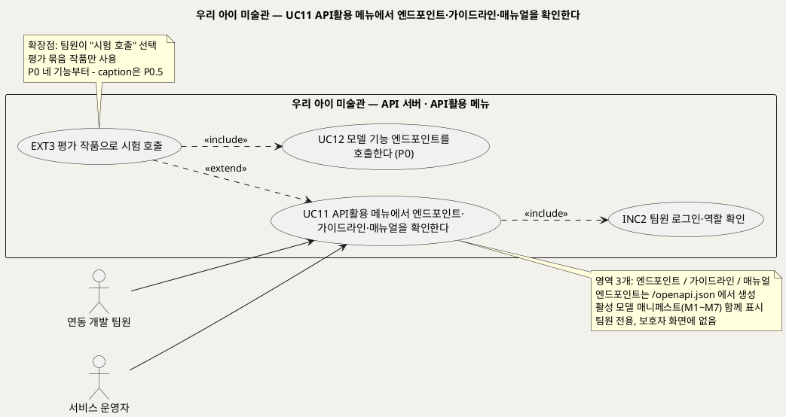
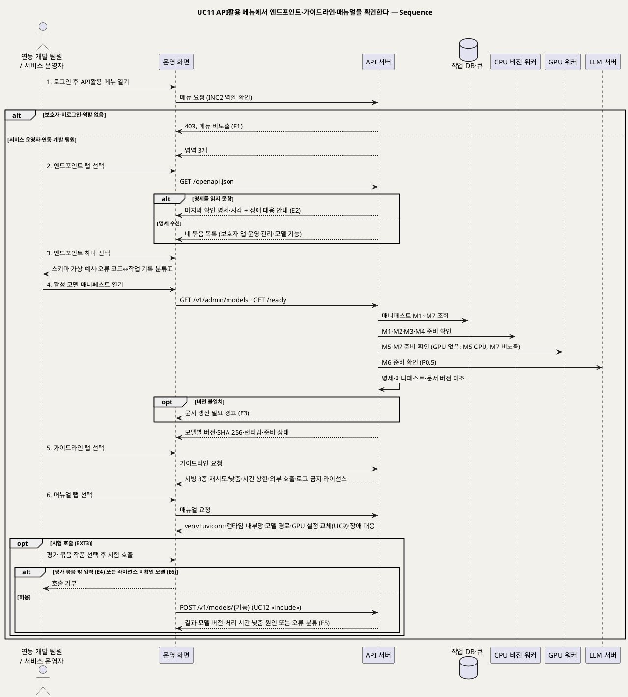

# UseCase 명세 — #11 API활용 메뉴에서 엔드포인트·가이드라인·매뉴얼을 확인한다 (우리 아이 미술관 P0)
**우리 아이 미술관 · UC11 · UML 2.5.1 표준 (UseCase Diagram + UseCase 기술 + Sequence Diagram)**

---

> **문서 식별**: `design/UC_11_API활용메뉴.md`
> **작성일**: 2026-09-23 · **표준**: UML 2.5.1 (OMG)
> **개정 (2026-09-28)**: 모델 1종(애니메이션 엔진) 기준 메뉴를 모델 7종(M1~M7)·서빙 3종 기준으로 다시 썼다. 엔드포인트 탭을 보호자 앱용·운영용·관리용·외부 모델 기능 네 묶음과 활성 모델 매니페스트로 넓히고, 시험 호출(EXT3)이 UC10 대신 UC12를 «include»하도록 바꿨다. 서비스 이름을 우리 아이 미술관으로 고쳤다.
> **개정 2 (2026-09-28, 통합 결정 D17)**: 외부 모델 기능 엔드포인트 절충안을 반영했다. `segment`·`classify`·`pose`·`relief` 네 기능은 P0, `caption`과 외부 API 약관은 P0.5다. 호출자를 팀 밖 외부 클라이언트까지 넓힌다. 다만 팀 밖 클라이언트 키는 U12(한도·약관) 확정 뒤 발급하고, 그 전에는 팀·과정 내부 키만 발급한다(이제민 조건부 승인). 단 `pose`는 팀 내부 키 전용이다(보관 처리돼 보안 수정이 없는 M3(Animated Drawings·TorchServe)를 팀 밖 요청이 간접 호출하지 않도록, 외부 키는 403). 요청 한도는 예시값(U12, 확정 아님)이다. `classify`는 라이선스 확정 기록(A2) 뒤에 활성한다.
> **원천(SoT)**: `Intent-Specify.md` (2026-09-28 기획 기준안) — [핵심 활동] 3 · [핵심 이네이블러] API 서버 연결·외부 사용 · [핵심 장벽] 서빙 기반·외부 엔드포인트·라이선스 · [부정적 영향] 아동 이미지 유출·외부 엔드포인트 남용 · `.specify/features/우리-아이-미술관/spec.md` v2.0 — FR-30 · 추가 요구 R3·R4 (2026-09-28) · 보조 원천 `Intent-Plan.md` (웹스택 후보, 미확정)
> **다이어그램**: 모든 PlantUML 소스는 렌더 검증 완료(HTTP 200). 아래 링크로 브라우저에서 열 수 있다. 렌더 서버 plantuml.sumzip.com 은 사내 SSO 로그인 뒤 열린다.
> **표기**: `[추론]` = 원천에 직접 없는 설계 판단 · `자료 없음 — 확인 필요` = 원천에 근거가 없는 항목 · U1~U15 = 공통 미해결 번호

---

## 목차

1. [범위·개요](#1-범위개요)
2. [UseCase Diagram](#2-usecase-diagram)
3. [Actor 카탈로그](#3-actor-카탈로그)
4. [UseCase 목록 (원천 매핑)](#4-usecase-목록-원천-매핑)
5. [UseCase 기술 + Sequence Diagram](#5-usecase-기술--sequence-diagram)
6. [업무규칙 종합](#6-업무규칙business-rules-종합)
7. [UML 표준 준수 노트](#7-uml-표준-준수-노트)

---

## 1. 범위·개요

우리 아이 미술관은 공개 사전학습 모델 7종(M1~M7)을 API 서버 뒤에서 서빙한다. 팀원이 이 서버와 연동하거나 운영하려면 어떤 엔드포인트가 있고, 어떤 규칙으로 불러야 하며, 서버와 모델 런타임을 어떻게 띄우고 바꾸는지 알아야 한다. 추가 요구 R4에 따라 이 정보를 **'API활용' 메뉴** 하나에 모은다. 메뉴는 **엔드포인트 · 가이드라인 · 매뉴얼** 세 영역으로 이루어지고(BR-API-07), 팀원만 들어올 수 있으며 보호자 화면에는 나타나지 않는다.

엔드포인트 탭은 손으로 쓴 목록이 아니라 API 서버의 `/openapi.json`에서 만들어, 실제 API와 모델 버전이 문서와 어긋나지 않게 한다(BR-API-08). 팀원이 평가 묶음 작품으로 모델 기능 엔드포인트를 직접 불러 보는 **시험 호출**(EXT3)은 선택 기능이며, 실행하면 UC12(모델 기능 엔드포인트를 호출한다)를 그대로 거친다. 시험 호출은 UC12와 같은 구간을 따른다. P0에서는 `segment`·`classify`·`pose`·`relief` 네 기능을(시험 키는 팀 내부 키라 `pose`도 부를 수 있다), P0.5부터 `caption`을 시험 호출할 수 있다(D12·D17) [추론].

| 항목 | 값 |
|---|---|
| 대상 시스템 | 우리 아이 미술관 API 서버 — 'API활용' 메뉴(운영 화면에서 연다) |
| 상위 프로세스 | 모델 7종 재현·API 서버 구축 → **API 규격·호출 규칙·기동 절차 확인(UC11)** → 연동 구현 · 운영(UC8) · 모델 평가·승격(UC9) · 외부 호출(UC12) |
| 원천 근거 | 추가 요구 R4·R3 · spec v2.0 FR-30 · Intent [핵심 활동] 3 · [핵심 이네이블러] API 서버 연결·외부 사용·기반 · 공통 기준 §3·§4 |
| 핵심 UseCase | 1개 (UC11) + 공통 1개 (INC2) + 확장 1개 (EXT3, 실행 시 UC12 «include») |
| 주요 액터 | 연동 개발 팀원 · 서비스 운영자 |
| 구간 | P0 (시험 호출과 `/v1/models/…` 묶음도 P0부터. 단 `caption`은 P0.5부터, D17) |

### 1.1 세 영역이 담는 것

| 영역 | 내용 | 근거 BR |
|---|---|---|
| 엔드포인트 | `/openapi.json`에서 만든 네 묶음: 보호자 앱용(`/v1/children`, `/v1/artworks…`, `/v1/gallery`) · 운영용(`/live`, `/ready` 모델별, `/metrics`) · 관리용(`/v1/admin/models…`) · 외부 모델 기능(P0 네 기능, `caption`은 P0.5)(`/v1/models/{segment\|classify\|pose\|relief\|caption}`). 엔드포인트마다 요청·응답 스키마와 가상 값 예시, 오류 코드와 작업 기록 분류 대응표(§1.2), 현재 활성 모델 매니페스트(§1.3) | BR-API-08, BR-API-02, BR-MDL-01, BR-OPS-01 |
| 가이드라인 | 서빙 3종 구분과 호출 방식 · 인프라 재시도(최대 3회)와 품질 낮춤의 구분 · 단계별 시간 상한 · 외부 호출의 인증·요청 한도·크기 제한·입력 비보존·가족 데이터 차단 · 로그 금지 항목 · 라이선스 주의 | BR-SRV-01, BR-PRC-02, BR-PRC-03, BR-PRC-06, BR-API-03~06, BR-PRV-01, BR-MDL-07 |
| 매뉴얼 | Python 가상환경 + uvicorn 기동 · 모델 런타임(TorchServe, Ollama/vLLM) 내부망 기동 · 모델 파일 경로 · GPU 유무에 따른 설정 · 모델 교체 시 UC9 절차 · 장애 대응 | BR-API-01, BR-SRV-04, BR-MDL-06, BR-SRV-02, BR-MDL-03 |

엔드포인트 이름·응답 형식·포트·인증 방식은 공통 기준 §4의 [추론]이며 `/speckit.plan`에서 OpenAPI로 확정한다(U8). 메뉴는 확정된 명세를 읽어 보여 줄 뿐 스스로 이름을 정하지 않는다.

### 1.2 오류 코드와 작업 기록 분류 대응 (엔드포인트 탭)

단계 작업의 응답 분류와 작업 기록 분류를 1:1로 맞춘다(BR-API-02). 품질 미달은 오류가 아니라 낮춤이므로 정상 응답에 낮춤 원인을 싣는다(BR-PRC-02, BR-FBK-03). HTTP 코드 배정은 모두 [추론]이며 U8에서 확정한다.

| 작업 기록 분류 | 결과 원인 분류(BR-FBK-04) | 응답 [추론] | 재시도 |
|---|---|---|---|
| 엔진 다운 | ④ 인프라 실패 | `503` + 분류 코드 | 같은 단계 최대 3회(BR-PRC-03) |
| 시간 초과 | ④ 인프라 실패 | `504` + 분류 코드 | 같은 단계 최대 3회 |
| 저장소 | ④ 인프라 실패 | `503` + 분류 코드 | 같은 단계 최대 3회 |
| DB | ④ 인프라 실패 | `503` + 분류 코드 | 같은 단계 최대 3회 |
| 모델 미준비 | ④ 인프라 실패 | `503` + 분류 코드, `/ready`에 모델별 표시 | 같은 단계 최대 3회 |
| 재시도 소진 | ⑤ 결과 미도달 | 작품 상태 `처리하지 못함` | 없음. 보호자는 원본 액자로 걸기를 고를 수 있다 |
| 품질 미달(낮춤) | ② 모델 낮춤 | `200` + 낮춤 원인(어느 단계에서 어디로) | 재시도하지 않는다(BR-PRC-02) |
| 형식·용량·판독 오류 | 접수 거부(작품 미생성) | `400` · `413` | 없음(BR-INT-01) |
| 인증 실패 · 요청 한도 초과 | 외부 호출 거부 | `401` · `429` | 클라이언트가 한도 뒤 다시 요청 |
| 권한 없음 | 접근 거부 | `403` | 없음(BR-ACC-01, BR-API-06) |

### 1.3 활성 모델 매니페스트 (엔드포인트 탭)

`GET /v1/admin/models`가 돌려주는 매니페스트를 그대로 보여 준다(BR-MDL-01). 버전·가중치 SHA-256·이미지 다이제스트·설정 해시의 실제 값은 모델 재현 뒤 매니페스트에 기록되며 지금은 `자료 없음 — 확인 필요`다.

| ID | 역할 | 채택 | 서빙군 | 구간 | 메뉴 표시 |
|:--:|---|---|:--:|:--:|---|
| M1 | 배경·작품 분리 | BiRefNet | CPU 비전 | P0 | 활성 버전 · 롤백 후보 · 준비 상태 |
| M2 | 종류 판정·태그 | OpenCLIP | CPU 비전 | P0 | 가중치 라이선스 확인 전에는 "비활성(라이선스 확인 전)"(BR-MDL-07, U4) |
| M3 | 관절·리깅·렌더 | Animated Drawings (내부 TorchServe) / 예비 YOLOv8 자세 모델 | CPU 비전 | P0 | 보관 처리 엔진 표시(BR-MDL-06). 예비 모델은 AGPL이라 소스 공개 결정 전 비활성 |
| M4 | 판정 보조 규칙(모델 아님) | 관절 기하 규칙 | CPU 비전 | P0 | 규칙 설정 해시 |
| M5 | 2.5D 부조 깊이 | Depth Anything V2 Small | GPU (없으면 CPU) | P0 | 실행 장치(GPU/CPU) 표시(BR-SRV-02) |
| M6 | 작품 설명 생성 | Qwen3-4B (Ollama/vLLM) | LLM | P0.5 | P0에서는 "P0.5 예정". 조건 확인 전 비활성(U3, U4) |
| M7 | 3D 조각 | TripoSR(채택 5종 밖, P1 후보) / 대안 TRELLIS | GPU | P1 | GPU 확인 전 "비노출"(U2) |

### 1.4 매뉴얼 탭 기동 예시 [추론]

아래 명령은 매뉴얼 탭이 보여 줄 기동 절차의 형태를 보이는 [추론] 예시다. 파일 이름·경로·환경 변수 이름은 원천에 없으며 `/speckit.plan`에서 확정한다(U7, U8, U14). API 서버 포트는 9541로 확정했다(D19). 모든 주소는 내부망 주소다(BR-SRV-04).

```bash
# [추론] 예시 — 이름·경로는 확정 전이다 (U7, U8, U14). API 서버 포트 9541은 확정(D19)

# 1) 모델 런타임을 내부망에만 띄운다 (BR-SRV-04, BR-MDL-06)
#    M3: 고정 이미지 + 다이제스트로 TorchServe 실행, 관리 API는 열지 않는다
docker run -d --name m3-torchserve -p <내부망 주소>:<추론 포트>:<추론 포트> <고정 이미지>@sha256:<다이제스트>
#    M6 (P0.5): Ollama 또는 vLLM을 내부망 주소에만 바인딩
OLLAMA_HOST=<내부망 주소>:<포트> ollama serve

# 2) Python 가상환경을 만들고 잠금 파일로 설치한다 (R3, BR-API-01)
python3 -m venv .venv
source .venv/bin/activate
pip install -r requirements.lock

# 3) 모델 파일 경로와 GPU 유무를 설정한다
export MODEL_ROOT=<모델 파일 경로>      # 자료 없음 — 확인 필요 (U14)
export GPU_ENABLED=false               # false면 M5는 CPU 실행, M7은 비노출 (BR-SRV-02, U2)

# 4) 워커와 API 서버를 띄운다
python -m workers.cpu_vision &         # M1·M2·M3·M4 비동기 큐
python -m workers.gpu &                # M5(·M7) 전용 큐, 모델 상주
uvicorn app.main:app --host <내부망 주소> --port 9541

# 5) 생존·준비를 확인한다 (BR-OPS-01)
curl http://<내부망 주소>:9541/live
curl http://<내부망 주소>:9541/ready     # 모델별 준비 상태
```

---

## 2. UseCase Diagram



**[「UC11 API활용 메뉴 UseCase Diagram」 PlantUML 뷰어로 열기](https://plantuml.sumzip.com/plantuml/svg/eNqVVF1P01AYvu-veDNvIJHBIMaEkAVFSLhAudDEC5KldGVUSru0nR8xmqmNgYEydHMD22UmQ8CMWHRhNXLFT_Fy55z_4HvaDkhNjN6dj-d9zvu8z5MzaVqiYRVWVShImYKhZEQlkxNVVTaeZFIpwVxRtLxoiKuwKEorOUMvaNkpXdUNuDIzNpOavnkJYS6LWf2RouVgSVRNWVDlJQssHQwlt2xBVjFkyVJ0TbAUS5WB7nrkcxto1aZuB8hXn641e50i_CpW4N5UKgU35mfZjkN3D4EcVsh6h9bK1HaA1irkvcO22tT1Wck_6_a8IjLgGXFP8eysS_ZbHP4BdzawnSoHVh2y0RIEUbKw9QSteWRrB3qeQzwH2GaRfiwnQDThlvzwHGM75IdNSy3stEPrL2gjhNzJm4LApYhaDmUk_qYDJQDn-WbDWfcPQQl4KgAUTFkSTST6L9EL2r_LDtrm7Jdfm709NRopB_LJ6XX9gITWjli1GZUHhRx4uXD6_t0xYFvr-D7QxjZ7t0adU2QAuuGwWh1Y3acnTlDKoTGFo0C-HJA3PvR8j5T24sLI3umCFjKEvcPA_MhgX8Co8EwQ0CIYGkqHgtCMi00wwGQyHbQM4zAxoWiSWsjK6bQQdM3vAhC_kx9bspaNXcXLBE235CjA-lJ_iDwNtSMYw_yMxxXAMMScwZNza3hxTHGpAsN6XtbEvJJ8YOoa9C1_5VL7GAt4Huzj_tw41cYae1vHZGL5wFzq-dz1QWDVg95PHP62gzbwotBZ2rQxS1eBfO_wqTbKyFYhhzxW-M5r6m4KOATgKkOpi7pl6atca2QeT0JjjzbL4xEnT3ki5jW1m-yVy9FhLkj7BKmjeJB9XL1sYx8ImB8BYrci98lJkdkeDIEk5vnPQN0iApLXLnqaxBX-Tb8BmAZMGw==)** — 클릭 시 브라우저로 연결됩니다.

#### 다이어그램 쉽게 읽기 (유저 관점)

- **누가 쓰나** — 모델 API와 연동하는 개발 팀원과 서버를 운영하는 운영자가 쓴다. 보호자는 이 메뉴를 볼 수 없다. 그림을 그리는 모델들은 서버 안의 부품이라 사람 모양(액터)으로 그리지 않았다.
- **무슨 순서로** — 로그인하고 'API활용' 메뉴를 연다 → 엔드포인트 탭에서 API 목록·오류 코드·지금 쓰는 모델 버전을 본다 → 가이드라인 탭에서 부르는 규칙을 본다 → 매뉴얼 탭에서 서버를 켜고 바꾸고 고치는 방법을 본다.
- **«include» = 항상 함께** — 메뉴를 열 때마다 "팀원 로그인·역할 확인"(INC2)을 거친다. 시험 호출을 하면 UC12(모델 기능 호출)를 반드시 거친다.
- **«extend» = 특정 상황에서만** — 팀원이 "시험 호출"을 누를 때만 EXT3이 끼어든다. 이때 쓸 수 있는 그림은 팀원이 직접 만든 평가 묶음 작품뿐이다.
- **Generalization(◁)** — 없다. 개발 팀원과 운영자는 같은 메뉴를 같은 범위로 읽는다 [추론].

| 기호 | 의미 |
|---|---|
| 사람 모양(actor) | 시스템을 쓰는 사람 |
| 타원(usecase) | 액터가 이루려는 목표 |
| 사각형(rectangle) | 시스템 경계 |
| 점선 `<<include>>` | 항상 함께 수행되는 하위 행위 |
| 점선 `<<extend>>` | 확장점 조건일 때만 끼어드는 행위 |
| 노트 | 확장점 조건과 메뉴 구성 설명 |

---

## 3. Actor 카탈로그

| 구분 | 액터 | 이 UC에서의 역할 | 원천 근거 |
|:--:|---|---|---|
| Primary | 연동 개발 팀원 | 엔드포인트 규격·오류 코드 대응·가이드라인으로 보호자 앱·평가 도구·외부 연동을 구현하고, 필요하면 시험 호출로 응답을 확인한다 | 추가 요구 R4 · 공통 기준 §6 액터 |
| Primary | 서비스 운영자 | 매뉴얼로 API 서버·워커·모델 런타임을 기동·점검하고, 매니페스트와 모델별 준비 상태로 장애에 대응한다 | 추가 요구 R3·R4 · Intent [핵심 장벽] 서빙 기반 · 공통 기준 §6 액터 |

보조 액터는 없다. 모델 M1~M7과 모델 런타임(TorchServe, Ollama/vLLM)은 시스템 내부 구성요소라 다이어그램 액터로 두지 않고, 시퀀스에서만 서빙군 lifeline(CPU 비전 워커 / GPU 워커 / LLM 서버)으로 나눈다(공통 기준 §6). 평가 담당 팀원은 UC9의 주액터이며, 이 메뉴에서는 모델 교체 절차가 UC9로 이어진다는 안내만 받는다.

---

## 4. UseCase 목록 (원천 매핑)

| UC ID | 유스케이스명 | 관계 | 원천 근거 |
|:--:|---|---|---|
| UC11 | API활용 메뉴에서 엔드포인트·가이드라인·매뉴얼을 확인한다 | 본 문서 | 추가 요구 R4 · spec FR-30 |
| INC2 | 팀원 로그인·역할 확인 | UC11이 «include» | BR-ACC-05 · 공통 기준 §6 |
| EXT3 | 평가 작품으로 시험 호출 | UC11을 «extend» (확장점: 팀원이 "시험 호출" 선택). 실행 시 UC12를 «include» | 추가 요구 R4 [추론] · BR-API-09 |
| UC12 | 모델 기능 엔드포인트를 호출한다 | EXT3이 «include» (P0 네 기능, caption은 P0.5) | spec FR-28 · Intent [핵심 이네이블러] 외부 사용 |
| UC8 | 서비스 상태와 모델별 운영 지표를 확인한다 | 매뉴얼 장애 대응 절이 지표 확인으로 연결(관계선 없음) | spec FR-12~14, FR-26 |
| UC9 | 모델 버전을 평가 묶음으로 검증하고 승격·롤백한다 | 매뉴얼 모델 교체 절이 이 절차로 연결(관계선 없음) | spec FR-24 · BR-MDL-03 |

---

## 5. UseCase 기술 + Sequence Diagram

### 5.1 UC11 API활용 메뉴에서 엔드포인트·가이드라인·매뉴얼을 확인한다

> **쉽게 말하면** — 팀원이 모델 서버를 쓰고 관리할 때 펼쳐 보는 안내 메뉴입니다. 어떤 주소로 무엇을 보내면 무엇이 돌아오는지, 지금 어떤 모델 버전이 켜져 있는지, 부를 때 지킬 규칙과 서버를 켜고 바꾸고 고치는 방법을 한곳에서 봅니다. 가족에게는 보이지 않고, 가족의 사진이나 이야기도 나오지 않습니다.

#### 유스케이스 기술

| 속성 | 내용 |
|---|---|
| **ID** | UC11 (추가 요구 R4 · spec FR-30) |
| **유스케이스명** | API활용 메뉴에서 엔드포인트·가이드라인·매뉴얼을 확인한다 |
| **액터** | 주: 연동 개발 팀원, 서비스 운영자 · 보조: 없음(모델과 런타임은 내부 구성요소) |
| **사전조건** | (1) 팀원이 팀원 계정으로 로그인했고 역할(서비스 운영자 또는 연동 개발 팀원)이 부여되어 있다(INC2, BR-ACC-05). (2) API 서버가 Python 가상환경에서 uvicorn으로 떠 있고 `/openapi.json`을 내놓는다(BR-API-01). (3) 가이드라인·매뉴얼 문서가 대상 API 버전을 적은 채 API 서버에 함께 배포되어 있다 [추론]. (4) 모델 매니페스트(M1~M7)가 작업 DB에 기록되어 있다(BR-MDL-01) |
| **사후조건** | (1) 팀원이 현재 API 버전의 엔드포인트 네 묶음, 오류 코드와 작업 기록 분류 대응, 활성 모델 매니페스트, 호출 규칙, 기동·교체·장애 대응 절차를 확인했다. (2) 명세·매니페스트·문서 버전이 서로 다르면 그 사실이 경고로 남았다(BR-API-08). (3) 가족의 이미지·별칭·이야기는 조회되지도 기록되지도 않았다(BR-ACC-03). (4) 시험 호출(EXT3)을 했다면 평가 묶음 작품만 쓰였고, 입력은 처리 뒤 보관되지 않았으며 가족 저장소에 아무것도 남지 않았다(BR-API-09, BR-API-05) |
| **기본흐름** | ↓ 별도 기본흐름표 |
| **대체흐름** | A1 시험 호출(EXT3) · A2 P0 구간 표시 · A3 GPU 없는 환경 표시 · A4 매뉴얼에서 상태 확인 · A5 모델 교체 절차 안내 · A6 문서 갱신 — ↓ 별도 대체흐름표 |
| **예외흐름** | E1 권한 없음 · E2 API 서버 명세를 읽지 못함 · E3 명세·매니페스트·문서 버전 불일치 · E4 평가 묶음 밖 입력으로 시험 호출 · E5 시험 호출 대상 모델 미준비·인프라 실패 · E6 라이선스 미확인 모델 호출 시도 — ↓ 별도 예외흐름표 |
| **포함/확장** | «include» INC2 팀원 로그인·역할 확인 · «extend» EXT3 평가 작품으로 시험 호출(확장점: 팀원이 "시험 호출" 선택). EXT3은 실행 시 UC12 모델 기능 엔드포인트를 호출한다를 «include» |
| **우선순위** | Medium — 가족이 쓰는 기능은 아니지만 추가 요구 R4가 API 서버의 필수 구성으로 요구했고(FR-30), 연동 구현·모델 교체·장애 대응의 기준 문서가 된다 |
| **사용빈도** | 연동 구현, API·모델 버전 변경, 장애 대응 때마다. 팀원 수와 정량 빈도는 `자료 없음 — 확인 필요` |
| **업무규칙** | BR-API-07, BR-API-08, BR-API-09, BR-API-01, BR-API-02, BR-API-03, BR-API-04, BR-API-05, BR-API-06, BR-ACC-02, BR-ACC-03, BR-ACC-05, BR-MDL-01, BR-MDL-03, BR-MDL-04, BR-MDL-05, BR-MDL-06, BR-MDL-07, BR-SRV-01, BR-SRV-02, BR-SRV-03, BR-SRV-04, BR-PRC-02, BR-PRC-03, BR-PRC-06, BR-FBK-03, BR-FBK-04, BR-OPS-01, BR-PRV-01 |
| **특별 요구사항** | 정확성: 엔드포인트 탭은 `/openapi.json`에서 만들고 매니페스트와 대조해, 손으로 쓴 문서와 실제 API·모델 버전이 어긋나지 않게 한다(BR-API-08). 보안: 메뉴는 팀원 역할에만 보이고 보호자·비로그인 사용자는 `403`으로 막는다. API 키·토큰 값은 화면에 평문으로 보이지 않는다 [추론]. 모델 런타임 주소는 내부망 주소로만 적는다(BR-SRV-04). 개인정보: 예시 요청·응답에는 가상 값만 쓰고 가족의 이미지·별칭·이야기·객체 키를 쓰지 않는다(BR-ACC-03, BR-PRV-01). 안정성: API 서버가 응답하지 않아도 마지막으로 확인한 명세와 매뉴얼 장애 대응 절은 열린다 [추론]. 사용성: 매뉴얼 명령은 복사해 바로 쓸 수 있는 코드 블록으로 보여 준다 [추론] |
| **비고** | 원천 추적: 추가 요구 R4("API 서버는 엔드포인트·가이드라인·매뉴얼을 담은 'API활용' 메뉴") · R3(Python 가상환경 + uvicorn) · spec v2.0 FR-30 · Intent [핵심 활동] 3(보호자 앱용·외부 모델 기능·운영용 엔드포인트) · [핵심 이네이블러] API 서버 연결(서빙 3종, 어댑터·매니페스트), 외부 사용(TorchServe·Ollama 포트 내부망), 기반 · [핵심 장벽] 서빙 기반·외부 엔드포인트·라이선스 · [부정적 영향] 아동 이미지 유출·외부 엔드포인트 남용 · 공통 기준 §2~§4·§6·§8. 시험 호출(EXT3)·메뉴 위치(API 서버가 제공하고 운영 화면에서 연다)·문서의 API 동봉 배포는 [추론]. 관련 미해결 U2·U3·U4·U6·U7·U8·U12·U14. 옛 BR-ENG-04는 BR-MDL-04로 옮겼다 |

#### 기본흐름 (Basic Flow)

| 단계 | 액터 행위 | 시스템 행위 |
|:--:|---|---|
| 1 | 팀원이 로그인한 뒤 운영 화면에서 'API활용' 메뉴를 연다 | INC2로 역할(서비스 운영자·연동 개발 팀원)을 확인하고 엔드포인트·가이드라인·매뉴얼 세 영역을 보여 준다(BR-API-07) |
| 2 | 팀원이 엔드포인트 탭을 고른다 | `/openapi.json`을 읽어 보호자 앱용·운영용·관리용·외부 모델 기능 네 묶음으로 엔드포인트 목록을 만든다(BR-API-08) |
| 3 | 팀원이 엔드포인트 하나를 고른다 | 요청·응답 스키마, 가상 값 예시, 오류 코드와 작업 기록 분류 대응표(§1.2)를 보여 준다(BR-API-02) |
| 4 | 팀원이 활성 모델 매니페스트를 연다 | 작업 DB에서 M1~M7 매니페스트를 읽고 서빙군별 준비 상태(`/ready`)를 확인해, 명세·매니페스트·문서 버전을 대조한 뒤 모델별 버전·SHA-256·런타임·활성/롤백 후보·준비 상태를 보여 준다(BR-MDL-01, BR-OPS-01) |
| 5 | 팀원이 가이드라인 탭을 고른다 | 서빙 3종과 호출 방식, 인프라 재시도 3회와 품질 낮춤의 구분, 시간 상한, 외부 호출 조건, 로그 금지 항목, 라이선스 주의를 보여 준다 |
| 6 | 팀원이 매뉴얼 탭을 고른다 | 가상환경·uvicorn 기동, 모델 런타임 내부망 기동, 모델 파일 경로, GPU 유무 설정, 모델 교체(UC9), 장애 대응 절차를 코드 블록과 함께 보여 준다 |

#### 대체흐름 (Alternative Flow)

| ID | 분기 시점 | 흐름 |
|:--:|:--:|---|
| A1 | 3단계 이후 | **시험 호출(EXT3)** — 팀원이 외부 모델 기능 엔드포인트 하나(`segment`·`classify`·`pose`·`relief`·`caption`)에서 "시험 호출"을 누르고 평가 묶음 작품(caption은 평가 묶음의 설명 입력 세트)을 고른다. 메뉴가 팀원용 시험 키로 UC12 흐름을 실행하고, 응답(결과·모델 ID와 버전·처리 시간·낮춤 원인 또는 오류 분류)을 보여 준다. 입력은 처리 뒤 보관하지 않고 결과는 가족 저장소에 쓰지 않는다(BR-API-09, BR-API-05, BR-MDL-04). 시험 키 발급 방식은 [추론]이며 U12에서 정한다 |
| A2 | 2단계 | **P0 구간** — `/v1/models/caption`과 `/v1/artworks/{id}/captions…`는 명세에 있어도 "P0.5 예정"으로 표시하고 그 기능의 시험 호출 버튼을 숨긴다. 나머지 네 기능은 P0부터 시험 호출할 수 있다(D17) [추론] |
| A3 | 4단계 | **GPU 없는 환경** — 매니페스트에서 M5의 실행 장치를 "CPU"로, M7을 "비노출(GPU 확인 전, P1)"로 표시한다. 매뉴얼의 GPU 설정 절이 같은 상태를 가리킨다(BR-SRV-02, U2) |
| A4 | 6단계 | **매뉴얼에서 상태 확인** — 운영자가 장애 대응 절에서 `/live`·`/ready` 결과를 바로 보고, 모델별 처리 시간·낮춤률·재시도율·큐 적체는 UC8로 이동해 확인한다(BR-OPS-01) |
| A5 | 6단계 | **모델 교체 안내** — 운영자가 모델 교체 절을 열면 "평가 묶음 전체 재평가 → 통과 시 승격 → 문제 시 직전 활성 후보로 롤백"을 안내하고 UC9로 연결한다. 이 메뉴에서는 승격·롤백을 실행하지 않는다(BR-MDL-03, BR-MDL-05) [추론] |
| A6 | 4단계 이후 | **문서 갱신** — 운영자가 API·모델 버전을 바꾼 뒤 가이드라인·매뉴얼을 고쳐 새 API 버전과 함께 배포한다. 문서에 대상 API 버전을 적어 명세와 대조할 수 있게 한다(BR-API-08) [추론] |

#### 예외흐름 (Exception Flow)

| ID | 발생 조건 | 처리 | 근거 |
|:--:|---|---|---|
| E1 | 보호자·비로그인 사용자·역할 없는 계정이 메뉴 주소로 들어온다 | `403`으로 막고 보호자 화면에는 메뉴를 두지 않는다 | BR-API-07, BR-ACC-02, BR-ACC-05 |
| E2 | API 서버가 응답하지 않아 `/openapi.json`을 읽지 못한다 | "API 서버 연결 불가"와 마지막으로 확인한 명세의 버전·시각을 보여 주고 매뉴얼 장애 대응 절로 안내한다 [추론] | Intent [핵심 장벽] 서빙 기반 |
| E3 | 명세 버전, 활성 매니페스트, 가이드라인·매뉴얼의 대상 버전이 서로 다르다 | "문서 갱신 필요" 경고를 띄우고 어긋난 항목(모델 ID·버전)을 표시한다. 옛 정보를 최신처럼 보이지 않는다 | BR-API-08, BR-MDL-01 |
| E4 | 시험 호출에 평가 묶음 밖 입력(가족 작품·실제 아동 사진·공개 이미지)을 쓰려 한다 | 호출을 거부하고 평가 묶음에서 고르도록 안내한다. 거부 사실은 분류 코드로만 로그에 남긴다 | BR-API-09, BR-MDL-04, BR-PRV-01 · Intent [부정적 영향] 아동 이미지 유출 |
| E5 | 시험 호출 대상 모델이 준비되지 않았거나 호출 중 인프라 실패가 난다 | `/ready`에서 해당 모델이 준비되지 않았으면 버튼을 비활성화한다. 호출 중 실패는 UC12 응답의 오류 분류(엔진 다운·시간 초과·모델 미준비 등)를 그대로 보여 주고 매뉴얼 장애 대응 절로 안내한다 | BR-API-02, BR-PRC-03, BR-OPS-01 |
| E6 | 라이선스가 확인되지 않은 모델(OpenCLIP 가중치·Qwen3·AGPL 예비 모델 등)을 시험 호출하려 한다 | 매니페스트에 "비활성(라이선스 확인 전)"으로 표시하고 호출을 막는다 | BR-MDL-07 · Intent [핵심 장벽] 라이선스 · U4 |

#### Sequence Diagram



**[「UC11 API활용 메뉴 Sequence」 PlantUML 뷰어로 열기](https://plantuml.sumzip.com/plantuml/svg/eNp1VttOG1cUffdXbKUvthLsGANReagSCKFIoUUiSH2ohCb2lLoxY-ILUVS1MjBE5tJiWjs2YFNTmRJSaAfj2kaBF39KHn3O_EPXmRnfBudhLM05a9_W3nuNH0ZjUiQWXwxRVH45H48E56Xg_IIUCsmR1_NeryP6IqgsSRFpkZ5L_hcLkXBcCYyHQ-EIffbE98Q7MdaFiH4vBcKvgsoCfSeForIjFoyFZJob93rp0cyUvpfn-6fETtNso8KzKa7miWfT7Pe8vnPGC3V9s96oNbUEL1RwxgrXOGvU2ElJwN_iTSV9LyOAmTzbKtHHRJpm5ZdxWfHLDofkjyGnOzyrsZ09amp5puVJ307wg9S3iocQjF2pfLNEfL_Ccyv8MHWHpCg9lpcdSD4W9AeXJCUGB8Y1IqXZacWAzE31IlCK4a6sGtd4dQSkmPRcisowP9zl2XV6PNao6StWiLFe-_GZORK5FFXiB9v8Q8lA4bQXNglY1_2k_f7p0-nuNPDqcKAaGvgCGdMoed3EjvLNWh2MkX6g3moByK8065oDaNiIqkbbN_tpXj4n59RX44OAneuZosW9yyGFYsQuK3quDg7Rnyu1HaZRs7A8-4YXth1keB1oZTR033evFUGYrdd5NU_OCa_LIWNc-vVIeLzdULtjgc2ekw8gXHWTMOi2jxjpa-eIVNTXCsB21z458Yw84SVZkZaC7h-iYQX3RrHv17laZ8fXxAs3_CSBgw965h1ubWmwkySu2cmGxZVliRq28k1the4SPzzmoIehisIu8UySrVZAwKALzgwKTAviyRzfKvaJoJaInVXBLZCn7KhAznYr4O4CoQzmsEeVBPvrDO15_479Uif0mW0eG2GUgI0jXx-OMjm2muulCXBhBbY3S_pqCcWa27q2Av6TKBHBcyV2DLMb4e3jm7S1DCI4UmVVFbf6rr1HQ24Sc6lekJWsWPmtpP5rTkRCNtac9unWstcjBRaDimcxHAB_1KiZ5xFZCrxuTQnyHjO60-t12vvz9APiR5q-v92BiuUcxV2jNj2Ix4dniHgpgcG0utrBTprYYWAe9GLIaWyvsQUCIdzeI6DaY-_quBGLDNCI3cXMffdwF8xaUGukbNXg4KwuBBVyIIRFTNiRoCy8FGufVZMconqV6zNXpnFTu8DYofsqBICa5ZvmZRHj6evMTa-V0S52qVoRGrXZLx8NDA6PIJs_NH0twQ9xZlWFOdHX7K0fdpNN8D-9nnagqVG3pEBoyB75-J_rCH14hrlkO6qHrf7DqyVrE81kMmJg9-qsmiCxQFW8mkKGeRV7jFcRqIJkwLEt8RE3tT9Mn065A-mf7LKsLN-NLwf94YjSxRlBFZAWOyl09rd8g-QaNWOs1BIvZrB8_6V4ueKcG__cJUrtUhar7yhWz-as6tDHb54ZneytRN_ZALMtVcHG6r8lrWqMr0aPE8NaaGKvFdPewnKdFY8RZchFLJdim2nq5o_Yv_W2KholOSdGzGxs8mKl27zQwIEBMJRRzybx6eoyaJE88_WsqQSmBnh-NLXuJwIz3kFq_B1U_KF4QG58aIXr6UGzrDUvr9tEtyaZl3PQTzLnBbfG_OB7nDIqMOuz5M7UNdQzbAYwN0X8iuchfvDv6n8CYox-)** — 클릭 시 브라우저로 연결됩니다.

기본흐름 1~6단계는 시퀀스의 번호 붙은 주요 메시지 `1.`~`6.`과 1:1로 대응한다. 시험 호출(EXT3)은 번호 없는 `opt` 프래그먼트로 두었고, 모델 기능 호출 안쪽(인증·한도·서빙군 처리·입력 폐기)은 UC12 시퀀스를 따른다.

---

## 6. 업무규칙(Business Rules) 종합

| BR ID | 규칙 | 적용 UC | 근거 |
|---|---|---|---|
| BR-API-07 | 'API활용' 메뉴는 엔드포인트·가이드라인·매뉴얼 3영역으로 이루어지고 팀원 전용이다. 보호자 화면에 없다 | UC11 | 추가 요구 R4 · spec FR-30 |
| BR-API-08 | 엔드포인트 탭은 `/openapi.json`에서 생성해 실제 API·모델 버전과 어긋나지 않게 한다 | UC11 | 추가 요구 R4 · 공통 기준 §4 |
| BR-API-09 | 시험 호출에는 평가 묶음 작품만 쓴다 | UC11, UC12 | Intent [핵심 활동] 7 평가 묶음 · [부정적 영향] 아동 이미지 유출 |
| BR-API-01 | 모델 기능 API는 Python 가상환경 + uvicorn으로 띄운다. 보호자 앱 API는 접수·상태·권한을 맡는다 | UC11(매뉴얼), UC12 | 추가 요구 R3 · Intent [핵심 이네이블러] API 서버 연결 |
| BR-API-02 | 단계 작업 응답 분류와 작업 기록 분류를 1:1로 맞춘다 | UC3, UC11, UC12 | Intent [핵심 데이터] 처리 작업 오류 분류 |
| BR-API-03 | 외부 모델 기능 엔드포인트는 API 키 인증 필수 | UC11(가이드라인), UC12 | Intent [핵심 장벽] 외부 엔드포인트 · [부정적 영향] 외부 엔드포인트 남용 |
| BR-API-04 | 요청 한도·요청 크기 제한(한도 수치는 U12 예시값, 확정 아님) | UC11(가이드라인), UC12 | Intent [부정적 영향] 외부 엔드포인트 남용 |
| BR-API-05 | 외부 호출 입력은 처리 뒤 보관하지 않고 로그에도 남기지 않는다 | UC11, UC12 | Intent [핵심 데이터] · [부정적 영향] 외부 엔드포인트 남용 |
| BR-API-06 | 외부 클라이언트는 가족 데이터(`/v1/artworks…`, `/v1/gallery`)에 접근하지 못한다 | UC11(가이드라인), UC12 | Intent [핵심 파트너] 외부 자동 전달 금지 |
| BR-ACC-02 | 비로그인 차단(가입 UC13·찾기 UC14는 예외) | UC1~UC15 | Intent [부정적 영향] 아동 이미지 유출 |
| BR-ACC-03 | 운영자·팀원은 가족 이미지·이야기에 접근하지 못한다 | UC8, UC9, UC11 | Intent [부정적 영향] 아동 이미지 유출 |
| BR-ACC-05 | 팀원 역할(운영자·평가 담당·연동 개발) 분리 | UC8, UC9, UC11 | 공통 기준 §6 액터 · 추가 요구 R4 |
| BR-MDL-01 | 모델 7종은 버전을 고정하고 매니페스트(모델 ID·가중치 SHA-256·런타임·이미지 다이제스트·설정 해시·활성/롤백 후보)를 둔다 | UC9, UC11 | Intent [핵심 데이터] 모델 매니페스트 · [핵심 활동] 2 |
| BR-MDL-03 | 버전을 바꾸면 평가 묶음 전체를 재평가하고 통과해야 승격한다. 롤백은 직전 활성 후보로 | UC9, UC11(매뉴얼) | Intent [핵심 데이터] 평가 묶음 · [혜택] 서비스 팀 |
| BR-MDL-04 | 평가 묶음은 팀원이 직접 만든 작품만 | UC9, UC11 | Intent [핵심 데이터] 평가 묶음 |
| BR-MDL-05 | 모델을 바꿔도 가족 흐름과 API 계약은 바뀌지 않는다 | UC9, UC11 | Intent [핵심 이네이블러] 작업 계약 하나 뒤 서빙 3종 |
| BR-MDL-06 | 보관 처리된 엔진은 내부망 격리·고정 이미지·체크섬으로 운영 | UC9, UC11(매뉴얼) | Intent [핵심 장벽] 치명 — 서빙 기반 |
| BR-MDL-07 | 라이선스 조건이 확인되지 않은 모델은 활성화하지 않는다(AGPL 예비 모델은 소스 공개 결정 전 비활성) | UC9, UC11 | Intent [핵심 장벽] 라이선스 |
| BR-SRV-01 | 서빙 3종 분리: CPU 비전 비동기 큐 · GPU 전용 큐(모델 상주) · LLM 짧은 동기·스트리밍 | UC3, UC11(가이드라인) | Intent [핵심 활동] 6 · [핵심 이네이블러] API 서버 연결 |
| BR-SRV-02 | GPU가 없으면 M5는 CPU로 실행하고 M7은 비노출 | UC3, UC6, UC11 | Intent [핵심 장벽] 자원 |
| BR-SRV-03 | 모델별 시간 상한·동시 처리·재시도 횟수 제한 | UC3, UC11(가이드라인) | Intent [부정적 영향] 자원 과소비 |
| BR-SRV-04 | TorchServe·Ollama 등 모델 런타임 포트는 내부망에만 | UC11(매뉴얼), UC12 | Intent [핵심 이네이블러] 외부 사용 |
| BR-PRC-02 | 품질 미달은 재시도하지 않고 낮춤 체인으로 한 단계 낮춘다 | UC3, UC11(가이드라인) | Intent [핵심 활동] 5 |
| BR-PRC-03 | 인프라 장애는 낮춤이 아니다. 같은 단계를 최대 3회 재시도하고 소진 시 "처리하지 못함"·결과 미도달 | UC3, UC11(가이드라인) | Intent [핵심 활동] 5 |
| BR-PRC-06 | 단계 작업마다 시간 상한(움직임 렌더 10분 기존값, 다른 모델은 `자료 없음 — 확인 필요`) | UC3, UC11(가이드라인) | Intent [부정적 영향] 자원 과소비 · U6 |
| BR-FBK-03 | 낮춤 원인(어느 단계에서 어디로)을 기록·표시하고 실패를 성공처럼 꾸미지 않는다 | UC3, UC4, UC11(오류 대응표) | Intent [가치제안] 어떤 사진이든 결과가 돌아온다 |
| BR-FBK-04 | 결과 원인 5분류를 섞지 않는다 | UC3, UC8, UC11(오류 대응표) | Intent [핵심 활동] 5 · [혜택] 서비스 팀 |
| BR-OPS-01 | 생존(`/live`)과 준비(`/ready`) 분리, 준비는 모델별로 표시 | UC8, UC11 | Intent [핵심 활동] 3 운영용 엔드포인트 |
| BR-PRV-01 | 운영 로그에 이미지·객체 키·자유 입력·오류 원문 금지 | 전 UC | Intent [부정적 영향] 아동 이미지 유출 |

---

## 7. UML 표준 준수 노트

| 항목 | 적용 |
|---|---|
| 시스템 경계 | API 서버와 그 안의 'API활용' 메뉴를 한 경계로 그렸다. 모델 M1~M7은 내부 구성요소라 경계 밖 액터로 두지 않았다 |
| 액터 | 연동 개발 팀원과 서비스 운영자는 둘 다 Primary actor다. 두 액터 사이에 Generalization을 두지 않았다 [추론] |
| 포함 관계 | UC11 → INC2 «include»(메뉴를 열 때마다 역할 확인). EXT3 → UC12 «include»(시험 호출은 항상 모델 기능 호출을 거친다) |
| 확장 관계 | EXT3 → UC11 «extend». 확장점 조건("시험 호출" 선택, 평가 묶음 작품만, P0 네 기능부터·caption은 P0.5)을 note로 적었다 |
| Sequence | 권한 분기는 바깥 `alt`, 명세 수신 여부는 안쪽 `alt`, 버전 불일치 경고는 `opt`, 시험 호출은 `opt` 안의 `alt`로 표현했다. 서빙군은 CPU 비전 워커 / GPU 워커 / LLM 서버 lifeline으로 나누고 메시지에 모델 ID를 적었다. 예외흐름 ID(E1~E6)를 메시지에 병기했다 |
| 1:1 대응 | 기본흐름 1~6단계 = 번호 붙은 메시지 `1.`~`6.` |

---

*우리 아이 미술관 P0 · UC11 · 작성 2026-09-23 · 개정 2026-09-28 · 원천: Intent-Specify.md (2026-09-28) · spec v2.0 FR-30 · 추가 요구 R3·R4*
