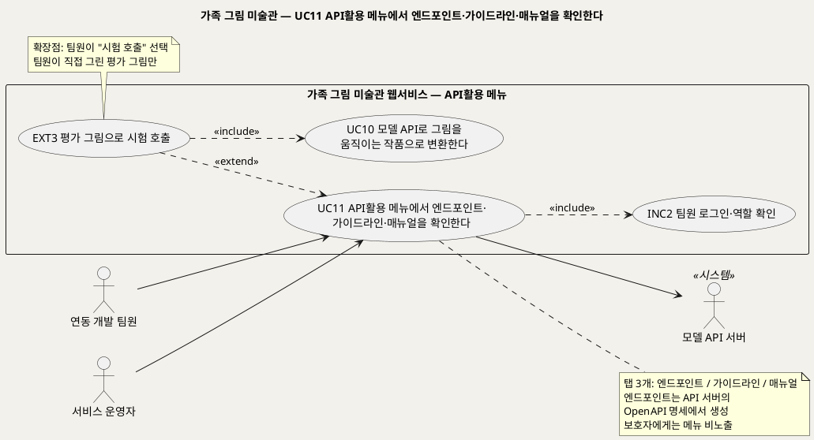
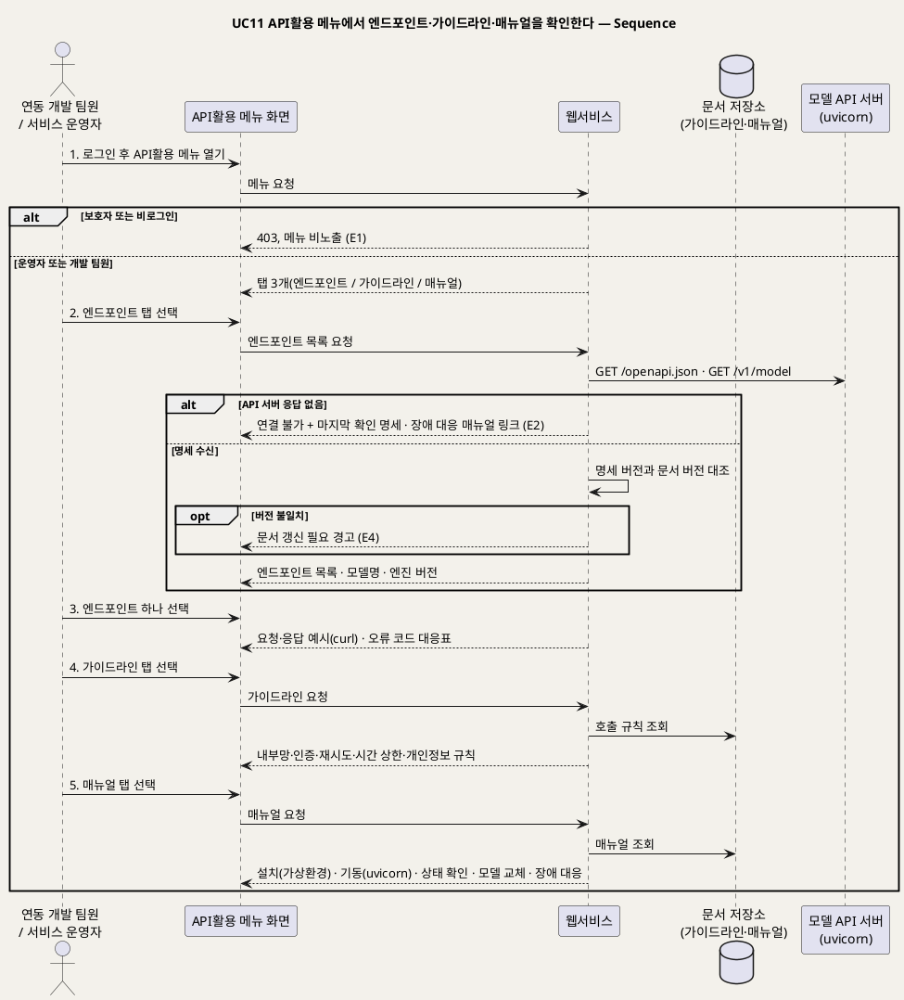

# UseCase 명세 — #11 API활용 메뉴에서 엔드포인트·가이드라인·매뉴얼을 확인한다 (가족 그림 미술관 P0)
**가족 그림 미술관 · UC11 · UML 2.5.1 표준 (UseCase Diagram + UseCase 기술 + Sequence Diagram)**

---

> **문서 식별**: `design/UC_11_API활용메뉴.md`
> **작성일**: 2026-09-28 (추가 요구 R1~R4 반영) · **표준**: UML 2.5.1 (OMG)
> **원천(SoT)**: 추가 요구 R4·R3 (2026-09-28) · `.specify/features/가족-그림-미술관/spec.md` — FR-9, FR-12, FR-14, FR-16, FR-17 · 보조 원천 `Intent-Specify.md` [핵심 파트너]
> **정본**: `UC_ALL_가족그림미술관_통합명세.md` §7.11. 이 문서는 같은 내용을 UC별 문서 형식으로 옮긴 것이다. 모델 정의·API 서버 구성·'API활용' 메뉴 구성은 통합 명세 §2.2~§2.5에 있다.
> **다이어그램**: 모든 PlantUML 소스는 렌더 검증 완료(HTTP 200). 아래 링크로 브라우저에서 열 수 있다.
> **표기**: `[추론]` = 원천에 직접 없는 설계 판단 · `자료 없음 — 확인 필요` = 원천에 근거가 없는 항목

---

## 목차

1. [범위·개요](#1-범위개요)
2. [UseCase Diagram](#2-usecase-diagram)
3. [Actor 카탈로그](#3-actor-카탈로그)
4. [UseCase 목록 (원천 매핑)](#4-usecase-목록-원천-매핑)
5. [UseCase 기술 + Sequence Diagram](#5-usecase-기술--sequence-diagram)
6. [업무규칙 종합](#6-업무규칙business-rules-종합)
7. [UML 표준 준수 노트](#7-uml-표준-준수-노트)

---

## 1. 범위·개요

모델 API 서버(UC10)를 연동하고 운영하려면 어떤 엔드포인트가 있는지, 어떤 규칙으로 불러야 하는지, 어떻게 설치·기동·교체하는지 알아야 한다. 이 정보를 웹서비스의 **'API활용' 메뉴**에 모은다(R4). 메뉴는 **엔드포인트 · 가이드라인 · 매뉴얼** 세 탭으로 이루어진다. 팀원이 평가 그림으로 API를 직접 불러 보는 **시험 호출**은 선택 기능(EXT3)이다.

이 메뉴는 서비스 운영자와 연동 개발 팀원만 쓴다. 가족의 이미지나 이야기는 이 메뉴에 나타나지 않는다(BR-ACC-03).

| 항목 | 값 |
|---|---|
| 대상 시스템 | 가족 그림 미술관 웹서비스 — API활용 메뉴 |
| 상위 프로세스 | API 서버 구축(UC10) → **API 규격·규칙·운영 절차 확인(UC11)** → 연동 구현 · 운영(UC8) · 평가(UC9) |
| 원천 근거 | R4 · R3 · spec FR-9 수용기준 3 · FR-12 · FR-14 · FR-16 · FR-17 |
| 핵심 UseCase | 1개 (UC11) + 공통 1개 (INC2) + 확장 1개 (EXT3) |
| 주요 액터 | 연동 개발 팀원 · 서비스 운영자 · 모델 API 서버(보조) |

---

## 2. UseCase Diagram

**[「UC11 API활용 메뉴 UseCase Diagram」 PlantUML 뷰어로 열기](https://plantuml.sumzip.com/plantuml/svg/eNqVVE9LG0EUv8-neKRnrak3kdDWKnipPbTQgyBrsomLm13ZnbSVUoi4gv-KsY1Norshgq1VKo0a6gqe_Cg9Zt58h77ZrEYXCu0tM_N77_3-vM1jl2sOLxVNKGVn8lrRMBdnCppp6s7iTDrN3HnDWtAcrQizWna-4NglKzdmm7YDDyaGJ9LjT-8g3DktZ781rALkNdPVmannOXAbHKMwxyFnOHqWG7bFuMFNHbrtMu6fQvciFN-uQPwMcbXV7ZThd7kKr8bSaXjyYlI2fNw9AnFUFWsdrFXQ8wFrVfHZl1s_MAjlenh9oRoFHboTwRXdXV-IwwMF_0InD2RjRwF3fLFxwJiW5UQ9hbW22GoQBV-0fZCbZdyrpEBz4Zn-5hbj-eLSw_UDwN0O1pew2YNMLbg3EHH8XXwMFVFQ6DMvAqjj6Chu-FQrV_xMhjGlXLMKpDr1N9m4d9mfqDxIyk_BewZQcvWs5lKf_7Jo2vp3kyINqvvdaZPPxx7FPoHY94l91ARrJ3KnFZdHhQp4t3D89cthkFtrND_WjP4VdQDyR9bqIOsh_vKjUgVNKByCvsWqKO4QeNMW7pXxcElpWq8CNrflp9W4szgvy0b9vpgh9oExChcGBjI9cRRj_xCZOTiYiejDCMVnWFmzlNMpvEiBeotA6k1_x3Url3gaSpRFaDWAqDNm2VyPvwM7f-OuXD6BYdrBkWRg8BASedHNbWBUmcArC_pLiEGdIFMLuqXuxPEKeuHNYiwH6J3SqzjvKOebFXronm2qBr0NAtpAsaIyYaQRFO8e-Vmbc7uo2Mc5qdCbX7FVGYkXg_jSV3M_VvRacjlQ6FuISq213YuyfX81xOFmf-pj-kV_S38A6a1KzA==)** — 클릭 시 브라우저로 연결됩니다.

#### 다이어그램 쉽게 읽기 (유저 관점)

- **누가 쓰나** — API를 연동하는 개발 팀원과 서비스를 운영하는 운영자가 쓴다. 보호자는 이 메뉴를 볼 수 없다.
- **무슨 순서로** — 로그인하고 'API활용' 메뉴를 연다 → 엔드포인트 탭에서 API 목록과 예시를 본다 → 가이드라인 탭에서 호출 규칙을 본다 → 매뉴얼 탭에서 설치·기동·장애 대응 방법을 본다.
- **«include» = 항상 함께** — 메뉴를 열 때마다 "팀원 로그인·역할 확인"(INC2)을 거친다.
- **«extend» = 특정 상황에서만** — 팀원이 "시험 호출"을 고를 때만 EXT3이 끼어들고, 이때 UC10(모델 API 변환)을 실제로 부른다.
- **Generalization(◁)** — 없다. 개발 팀원과 운영자는 같은 메뉴를 같은 권한으로 본다 [추론].

| 기호 | 의미 |
|---|---|
| 사람 모양(actor) | 시스템을 쓰는 사람 또는 외부 시스템(`<<시스템>>`) |
| 타원(usecase) | 액터가 이루려는 목표 |
| 사각형(rectangle) | 시스템 경계 |
| 점선 `<<include>>` | 항상 함께 수행되는 하위 행위 |
| 점선 `<<extend>>` | 확장점 조건일 때만 끼어드는 행위 |

---

## 3. Actor 카탈로그

| 구분 | 액터 | 이 UC에서의 역할 | 원천 근거 |
|:--:|---|---|---|
| Primary | 연동 개발 팀원 | 엔드포인트 규격과 예시로 웹서비스·평가 도구의 연동을 구현한다 | R4 · [추론] 원천에 없는 새 액터 |
| Primary | 서비스 운영자 | 매뉴얼로 API 서버를 설치·기동·교체하고 장애에 대응한다 | spec Target Users · FR-12 |
| Secondary | 모델 API 서버 | 자기 명세(`/openapi.json`)와 모델 정보(`/v1/model`)를 제공한다 | R3 |

---

## 4. UseCase 목록 (원천 매핑)

| UC ID | 유스케이스명 | 관계 | 원천 근거 |
|:--:|---|---|---|
| UC11 | API활용 메뉴에서 엔드포인트·가이드라인·매뉴얼을 확인한다 | 본 문서 | R4 |
| INC2 | 팀원 로그인·역할 확인 | UC11이 «include» | spec FR-9 수용기준 3 · Assumptions 운영자 권한 |
| EXT3 | 평가 그림으로 시험 호출 | UC11을 «extend» (확장점: 팀원이 "시험 호출" 선택) | R4 [추론] |
| UC10 | 모델 API로 그림을 움직이는 작품으로 변환한다 | 문서 대상 · EXT3이 «include» | R3 |
| UC8 | 서비스 상태와 운영 지표를 확인한다 | 매뉴얼의 상태 확인 절차와 연결 | spec FR-12 |

> **쉽게 말하면** — 팀원이 모델 서버를 쓰고 관리할 때 보는 안내 메뉴입니다. 어떤 주소로 무엇을 보내면 무엇이 돌아오는지, 지켜야 할 규칙은 무엇인지, 서버를 어떻게 켜고 고치는지를 한곳에서 봅니다. 가족에게는 보이지 않습니다.

---

## 5. UseCase 기술 + Sequence Diagram

### 5.1 UC11 API활용 메뉴에서 엔드포인트·가이드라인·매뉴얼을 확인한다

#### 유스케이스 기술

| 속성 | 내용 |
|---|---|
| **ID** | UC11 (R4) |
| **유스케이스명** | API활용 메뉴에서 엔드포인트·가이드라인·매뉴얼을 확인한다 |
| **액터** | 주: 연동 개발 팀원, 서비스 운영자 · 보조: 모델 API 서버 |
| **사전조건** | (1) 팀원이 운영자 또는 개발 팀원 역할로 로그인되어 있다(INC2). (2) 가이드라인과 매뉴얼 문서가 문서 저장소에 등록되어 있다. (3) 모델 API 서버의 명세 주소(`/openapi.json`)가 웹서비스 설정에 있다 |
| **사후조건** | (1) 팀원이 현재 API 서버 버전의 엔드포인트, 호출 규칙, 운영 절차를 확인했다. (2) 명세 버전과 문서 버전이 다르면 그 사실이 경고로 남는다. (3) 가족 데이터는 조회되지도 기록되지도 않았다. (4) 시험 호출(EXT3)을 했다면 그 결과는 가족 저장소에 남지 않았다 |
| **기본흐름** | ↓ 별도 기본흐름표 |
| **대체흐름** | A1. 시험 호출(EXT3) — 팀원이 평가 세트에서 그림을 골라 "시험 호출"을 누르면, 웹서비스가 UC10 흐름으로 API를 부르고 응답(상태·결과 분류·검출 점수·엔진 버전·단계별 시간)과 결과 파일을 화면에 보여 준다. 결과는 작업 정리로 지운다(BR-API-09). A2. 매뉴얼 절차 중 상태 확인 — 운영자가 매뉴얼의 "상태 확인" 절에서 바로 `/health`·`/ready` 결과를 본다. 자세한 지표는 UC8로 간다(spec FR-12). A3. 문서 갱신 — 운영자가 모델·API 버전을 바꾼 뒤 가이드라인·매뉴얼을 고쳐 올린다. 문서에 API 버전을 적어 명세와 대조할 수 있게 한다(BR-API-08) |
| **예외흐름** | E1. 권한 없음 — 보호자나 비로그인 사용자가 메뉴 주소로 들어오면 `403`으로 막고, 보호자 화면에는 메뉴를 보여 주지 않는다(BR-API-07 · spec FR-9). E2. API 서버 응답 없음 — 명세를 읽지 못하면 "API 서버 연결 불가"와 마지막으로 확인한 명세(버전·시각)를 보여 주고, 매뉴얼의 장애 대응 절로 안내한다. E3. 허용되지 않는 시험 이미지 — 시험 호출에 평가 세트 밖의 이미지(실제 아동 그림, 공개 이미지)를 쓰려 하면 거부한다(BR-API-09 · BR-ENG-04). E4. 명세·문서 불일치 — API 서버의 명세 버전과 가이드라인·매뉴얼의 버전이 다르면 경고를 띄운다(BR-API-08) |
| **포함/확장** | «include» INC2 팀원 로그인·역할 확인 · «extend» EXT3 평가 그림으로 시험 호출(EXT3은 UC10을 «include») |
| **우선순위** | Medium — 가족 기능은 아니지만, R4가 API 서버의 필수 구성으로 요구했다. 연동 구현과 엔진 교체 절차의 기준 문서가 된다 |
| **사용빈도** | 연동 구현·API 버전 변경·장애 대응 때. 정량값은 `자료 없음 — 확인 필요` |
| **업무규칙** | BR-API-07, BR-API-08, BR-API-09, BR-ACC-03, BR-ENG-04, BR-PRV-01 |
| **특별 요구사항** | 정확성: 엔드포인트 탭은 API 서버의 OpenAPI 명세에서 생성해 손으로 쓴 문서와 실제 API가 어긋나지 않게 한다. 보안: 메뉴는 팀원 역할에만 보이고, 토큰 값은 화면에 평문으로 보여 주지 않는다 [추론]. 개인정보: 메뉴 어디에도 가족의 이미지·별칭·이야기가 나오지 않는다(spec FR-9 수용기준 3). 사용성: 가이드라인과 매뉴얼은 명령 예시를 복사해 바로 쓸 수 있게 코드 블록으로 보여 준다 [추론] |
| **비고** | 원천 추적: 추가 요구 R4("API server는 endpoint와 가이드라인 및 매뉴얼을 포괄하는 'API활용' 메뉴로 구성") · R3 · spec FR-9 수용기준 3(운영자의 이미지 접근 차단) · FR-12(생존·준비) · FR-14 · FR-16(엔진 교체·재현 기록) · FR-17(평가 그림) · Intent [핵심 파트너] "시연 데이터는 팀원이 직접 그린 그림만 사용". "연동 개발 팀원" 액터와 시험 호출(EXT3)은 원천에 없는 설계 판단([추론])이다. 메뉴를 웹서비스 운영 화면 안에 둘지, API 서버의 `/docs`와 연결할지는 `자료 없음 — 확인 필요` |

#### 기본흐름 (Basic Flow)

| 단계 | 액터 행위 | 시스템 행위 |
|:--:|---|---|
| 1 | 팀원이 로그인한 뒤 'API활용' 메뉴를 연다 | 역할(운영자·개발 팀원)을 확인하고 엔드포인트·가이드라인·매뉴얼 세 탭을 보여 준다 |
| 2 | 팀원이 엔드포인트 탭을 고른다 | API 서버에서 명세와 모델 정보를 읽어, 명세 버전을 문서 버전과 대조한 뒤 엔드포인트 목록·모델명·엔진 버전을 보여 준다 |
| 3 | 팀원이 엔드포인트 하나를 고른다 | 요청·응답 예시(curl)와 오류 코드–작업 기록 분류 대응표를 보여 준다 |
| 4 | 팀원이 가이드라인 탭을 고른다 | 호출 규칙(내부망·토큰·재시도·시간 상한·작업 정리·개인정보·시험 그림 제한)을 보여 준다 |
| 5 | 팀원이 매뉴얼 탭을 고른다 | 설치(가상환경)·기동(uvicorn)·상태 확인·모델 경로 설정과 교체·장애 대응 절차를 보여 준다 |

#### Sequence Diagram

**[「UC11 API활용 메뉴 Sequence」 PlantUML 뷰어로 열기](https://plantuml.sumzip.com/plantuml/svg/eNp1VU1PGlEU3c-vuLEbTCsWsRsXxtZq466JtSsTM8JoqeMMwmDjDmU0KDRiCnXQGYMJ1mI0mSLCmNSNP6XLeW_-Q-88vkfcAL537r3nnnvedSqu8DElsS5CXNhYWuHXI-LW0iovikJsaykQ4OJrESnKx_h1WOZDa6sxOSGFp2VRjsGL2eBsYOZdDyL-hQ_L3yLSKqzwYlzglIgiCrAwHQjA249zTlGnJxUglTzZr9HjHFV1oMd58kN3Dq-pYTkH1mPDNpPUqOEZMf7i2WODXJZd-E_8SwWnWHCBBZ1kyvAvmYd5YSMhSCGB4_iQgpyG6LFJDotgmzoxdXCySXqaW5RGAYuRe5UelIGe1Ki2Tc9yQ8DH4b2wySF5JRKKRHlJgSEvUayZJ5UaAy_M9WPp6X0nLwPMf57mwrzCL_NxAYbItcV6LCXp2QXdyy5KvufbG27SkUP9JcjVb_LdcuVjLVRVTJLYjITkmNSMwBuOwy5gZBL5wQQE_EDOdbthYX5wTtUn0qPoNdsyOURjDFLGoPbNSZ5WbzheVIDc1hzNQpmAaDlykAdss5OXAxY30q45_jr4qp3Dxe1atK6DbyYwzAlohK7m7WR98_Fmc1I3EESEz-MOGAWPfnjSFRDT9Oow5ve6iyWmaslJGYjtbd8LJFcVcm605WjRm2RTmIAPM59gVI4KEh-N-L_GZQkeG83DzcDouhwWRIxwJewODahxRDJ3WGePGlm89nSMrrWrJpB6GhuEl9hUml4myeV-y_FIaJeqllvItVKhBASVM4663eOvbWf7GjUfc4VgqreCaFqjmVK3aGfmzWukR0uqfYspmn5tHrAK5yYLk6NK57Sepij9vcYuPG20EtjmHywITkFFAcGuPti3JSQ2PsxiBCk8SICBA8B-mw8AubLmj_P0Um1x4dq5eqceHDD1gkZ2tO7g-wuzET822gPS0jSj-0KJmDjMCmplcoGxD27KlujOke4pOu5_YsxnreYFej2GG8B9Ahp7QXZDp_dFwDk4J1kvdbJTI3U0ieGyt-gv9_vsGumTQxV_ZnTbROOltnFduntVd0GlAr7rVlpPE2_8PW56ln4XMph4z_1A0lQto3nYHkRmRQ3dwYTGhYR7u7PamPYISOntF9CxAth3OVqtPXkLnGuGKfzA_2X_ATM0YtE=)** — 클릭 시 브라우저로 연결됩니다.

기본흐름 1~5단계는 시퀀스의 번호 붙은 주요 메시지 `1.`~`5.`와 1:1로 대응한다. 시험 호출(EXT3)은 UC10 시퀀스를 그대로 따르므로 여기서는 그리지 않았다.

---

## 6. 업무규칙(Business Rules) 종합

| BR ID | 규칙 | 적용 UC | 근거 |
|---|---|---|---|
| BR-API-07 | 'API활용' 메뉴는 엔드포인트·가이드라인·매뉴얼 세 영역으로 구성한다. 서비스 운영자와 개발 팀원에게만 보이고, 보호자 화면에는 나타나지 않으며, 가족의 이미지·이야기를 보여 주지 않는다 | UC11 | 추가 요구 R4 · spec FR-9 수용기준 3 |
| BR-API-08 | 엔드포인트 탭은 API 서버의 OpenAPI 명세에서 생성한다. 가이드라인·매뉴얼에는 대상 API 버전을 적고, 명세와 버전이 다르면 경고한다 | UC11 | 추가 요구 R4 [추론] |
| BR-API-09 | 시험 호출에는 평가 세트의 팀원이 직접 그린 그림만 쓴다. 결과는 가족 저장소에 쓰지 않고 작업 정리로 지운다 | UC10, UC11 | spec FR-17 · Intent [핵심 파트너] · BR-ENG-04 |
| BR-ACC-03 | 서비스 운영자는 운영 화면·지표에서 가족의 원본·결과 이미지를 볼 수 없다 | UC6, UC8 | spec FR-9 수용기준 3 · Assumptions 운영자 권한 |
| BR-ENG-04 | 평가와 시연에는 팀원이 직접 그린 그림만 쓴다 | UC9 | spec FR-17 · Intent [핵심 파트너] |
| BR-PRV-01 | 운영 로그에는 이미지, 저장 위치 키, 자유 입력 텍스트, 오류 원문을 남기지 않는다. 분류 코드와 요청 번호만 남긴다 | 전 UC | spec FR-14 · Intent [부정적 영향] 아동 그림·사진 유출 |

---

## 7. UML 표준 준수 노트

| 항목 | 적용 |
|---|---|
| 시스템 경계 | 메뉴는 웹서비스 안에 있고, 모델 API 서버는 경계 밖의 보조 액터(`<<시스템>>`)로 그렸다 |
| 액터 | 연동 개발 팀원과 서비스 운영자는 Primary actor다. 연동 개발 팀원은 이번 추가 요구로 새로 둔 액터다 |
| 확장 관계 | EXT3은 UC11을 확장하고, 실행할 때 UC10을 포함한다 |
| Sequence | 권한 분기는 바깥 `alt`, API 서버 연결 여부는 안쪽 `alt`, 버전 불일치 경고는 `opt`로 표현했다 |

---

*가족 그림 미술관 P0 · UC11 · 2026-09-28 · 원천: 추가 요구 R4 · spec FR-9, FR-12, FR-16*
