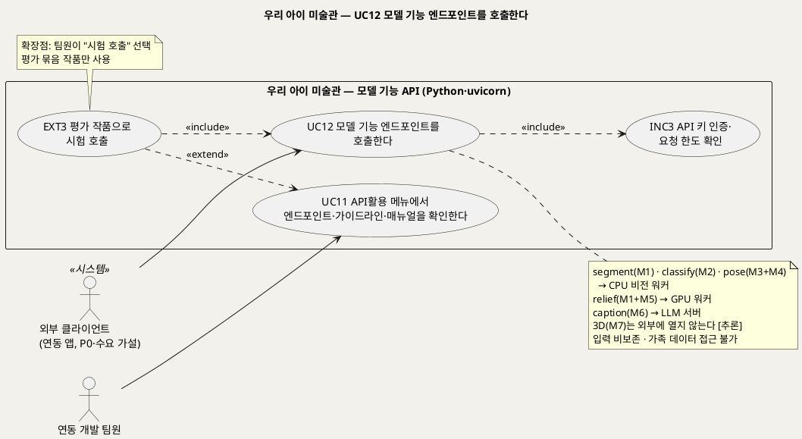
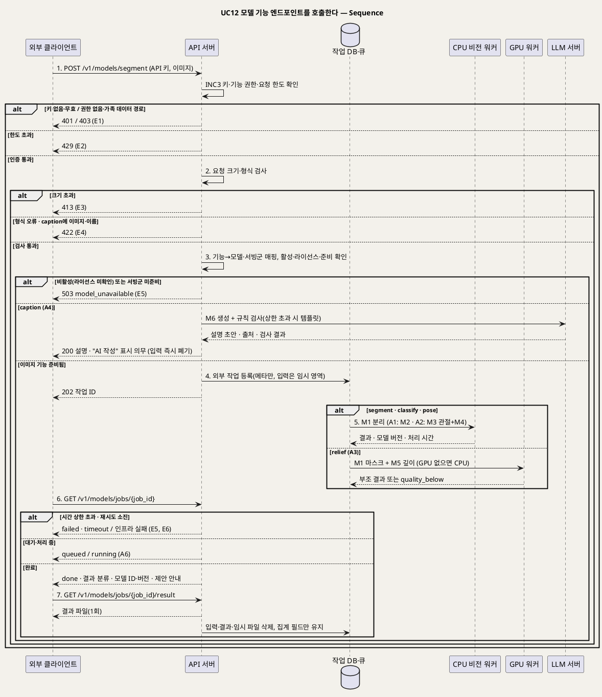

# UseCase 명세 — #12 모델 기능 엔드포인트를 호출한다 (우리 아이 미술관 P0 · caption은 P0.5)
**우리 아이 미술관 · UC12 · UML 2.5.1 표준 (UseCase Diagram + UseCase 기술 + Sequence Diagram)**

---

> **문서 식별**: `design/UC_12_모델기능호출.md`
> **작성일**: 2026-09-28 (신규 문서) · **개정**: 2026-09-28 — 옛 UC10(모델 API 변환)에서 내부 워커 호출은 UC3으로 옮기고, 외부 클라이언트의 모델 기능 호출만 이 UC로 새로 세웠다 · **개정 2**: 2026-09-28 — 절충안(D17)에 따라 네 기능은 P0, `caption`은 P0.5로 나누고, 호출자를 팀 밖 외부 클라이언트까지 연다. 요청 한도는 예시값(U12) · **표준**: UML 2.5.1 (OMG)
> **개정 2 (2026-09-28, 통합 결정 D17)**: 외부 모델 기능 엔드포인트 절충안을 반영했다. `segment`·`classify`·`pose`·`relief` 네 기능은 P0, `caption`과 외부 API 약관은 P0.5다. 호출자를 팀 밖 외부 클라이언트까지 넓힌다. 다만 팀 밖 클라이언트 키는 U12(한도·약관) 확정 뒤 발급하고, 그 전에는 팀·과정 내부 키만 발급한다(이제민 조건부 승인). 단 `pose`는 팀 내부 키 전용이다(보관 처리돼 보안 수정이 없는 M3(Animated Drawings·TorchServe)를 팀 밖 요청이 간접 호출하지 않도록, 외부 키는 403). 요청 한도는 예시값(U12, 확정 아님)이다. `classify`는 라이선스 확정 기록(A2) 뒤에 활성한다.
> **원천(SoT)**: `Intent-Specify.md` (2026-09-28 기획 기준안) [핵심 활동] 3 · [핵심 이네이블러] 외부 사용(엔드포인트) · [핵심 장벽] 외부 엔드포인트·라이선스 · [부정적 영향] 외부 엔드포인트 남용 · [혜택] 외부 개발자(P0.5) · [수익] 연동 수익 가설 · `.specify/features/우리-아이-미술관/spec.md` v2.0 — FR-28 · 재작성 공통 기준(2026-09-28) §2·§3·§4·§8·§10
> **다이어그램**: 모든 PlantUML 소스는 렌더 검증 완료(HTTP 200). 아래 링크로 브라우저에서 열 수 있다. `plantuml.sumzip.com` 은 사내 SSO 로그인 뒤 열린다.
> **표기**: `[추론]` = 원천에 직접 없는 설계 판단 · `자료 없음 — 확인 필요` = 원천에 근거가 없는 항목

---

## 목차

1. [범위·개요](#1-범위개요)
2. [UseCase Diagram](#2-usecase-diagram)
3. [Actor 카탈로그](#3-actor-카탈로그)
4. [UseCase 목록 (원천 매핑)](#4-usecase-목록-원천-매핑)
5. [UseCase 기술 + Sequence Diagram](#5-usecase-기술--sequence-diagram)
6. [업무규칙 종합](#6-업무규칙business-rules-종합)
7. [UML 표준 준수 노트](#7-uml-표준-준수-노트)

---

## 1. 범위·개요

우리 아이 미술관은 보호자 앱 뒤에서 쓰는 모델 기능 가운데 다섯 가지를 **외부 클라이언트용 모델 기능 엔드포인트** `POST /v1/models/{segment|classify|pose|relief|caption}` 로 연다. **P0**에는 `segment`·`classify`·`pose`·`relief` 네 기능을 열고(`pose`는 팀 내부 키 전용), `caption`은 **P0.5**에 연다(D17). 외부 클라이언트는 유치원·알림장 앱 같은 연동 앱을 가정한다. 다만 연동 수요는 **가설**이고, 지금은 시연·포트폴리오용이며 **상품화하지 않는다**(Intent [수익]). 권한·동의·계약 검증 전에는 판매 가능한 제품으로 표시하지 않는다.

이 UC는 외부 클라이언트가 API 키로 인증하고(INC3), 요청 한도·크기 검사를 통과해, 기능별 서빙군(CPU 비전 워커 / GPU 워커 / LLM 서버)에서 결과를 받아 가기까지를 다룬다. 외부 입력은 처리 뒤 보관하지 않고 로그에도 남기지 않는다. 외부 클라이언트는 가족 데이터(`/v1/artworks…`, `/v1/gallery`)에 접근하지 못한다. 보호자 작품의 내부 처리(UC3)와는 같은 모델·어댑터를 쓰지만 작업 기록·저장소·권한이 분리된다 [추론].

| 기능(경로 끝) | 모델 | 서빙군 | 입력 | 출력 | 응답 방식 |
|---|---|---|---|---|---|
| `segment` | M1 배경·작품 분리 | CPU 비전 워커 | 이미지 1장 | 작품 마스크·컷아웃 | 비동기 작업(202 → 조회) [추론] |
| `classify` | M2 제로샷 종류 판정·태그 | CPU 비전 워커 | 이미지 1장 | 종류 제안 문구·태그 후보(점수 비노출) [추론] | 비동기 작업 [추론] |
| `pose` (팀 내부 키 전용) | M3 관절 + M4 기하 규칙 | CPU 비전 워커 | 이미지 1장 | 관절 좌표·기하 규칙 결과(움직임 가능성 제안) | 비동기 작업 |
| `relief` | M1 마스크 + M5 깊이 | GPU 워커(없으면 CPU) | 이미지 1장 | 2.5D 부조 결과(마스크·깊이) | 비동기 작업 |
| `caption` (P0.5) | M6 설명 생성 + 규칙 검사 | LLM 서버 | 키워드·아이의 발언·제작 당시 나이·제작일(이미지·이름 금지) | 설명 초안 + 출처(LLM/템플릿) + "AI 작성" 표시 의무 | 동기 응답 |
| (열지 않음) | M7 3D 조각 | GPU 워커 | — | — | 외부 비공개 [추론] |

| 항목 | 값 |
|---|---|
| 대상 시스템 | 우리 아이 미술관 — 모델 기능 API(Python 가상환경 + uvicorn, 추가 요구 R3) |
| 상위 프로세스 | (연동 앱) 모델 기능 호출 → INC3 인증·한도 → 서빙군 처리 → 결과 수령 → 입력·결과 즉시 폐기 · (팀 내부) UC11 API활용 메뉴 → EXT3 시험 호출 → **UC12** |
| 원천 근거 | Intent [핵심 활동] 3 · [핵심 이네이블러] 외부 사용(엔드포인트) · [핵심 장벽] 외부 엔드포인트·라이선스 · [부정적 영향] 외부 엔드포인트 남용 · [혜택] 외부 개발자(P0.5) · [수익] · spec FR-28 |
| 핵심 UseCase | 1개 (UC12) + 공통 1개 (INC3) · UC11의 EXT3이 이 UC를 «include» |
| 주요 액터 | 외부 클라이언트(연동 앱, P0, 수요는 가설) · (EXT3 경유) 연동 개발 팀원 |

---

## 2. UseCase Diagram

**[「UC12 모델 기능 호출 UseCase Diagram」 PlantUML 뷰어로 열기](https://plantuml.sumzip.com/plantuml/svg/eNqNVE1LG1EU3c-vuKSbBKs0ph8gEmyjFsEUFxUKtcg4mcTBOCMzE1sphdSOJUYlahPjx0QiJFpLSqMNSUpd5ae4zLvzH3rfJFp1Ubqb9865X-e8O0OGKepmYj4OCWk6oSvTojLt7xeMOUVdEHVxHmZEaS6mawk1EtLimg73RgOj_pFnNxjGrBjR3ipqDKJi3JCFuBw1wdRAV2KzJkQUXZZMRVMFUzHjMuB-lR1XAHMWFmrAfjQxVWzXknCZzMJkyN8P7NtXttGEdrPK0mXAfJZ9sZ1MBQtNJ91k5QtwdptYt52czdZKgiBKJnXlwb0mqyfB-VhjhQvKjDucPqV6MV9lmT2qd3YfJh60Gpjaxf0stKtJtEo-D4gGhOKKrJowOIhrNqZLzoodDF7n7YS3qzar2uCsJ_Fg0w0alhcFgY8mqjEay_OvuW6P9HRiDLwTS-asprYaiUVF0nSVGnkvACQMWRINyvZfSkypN6Vwu-JxN_OMvQgF3ILOcgkoEI8LrcaUSgrg-XfggRkLnL0cQW4859_pw8_jnT0b90-BnWbZag3zm2jZlOV2R60GF7VQozvXA7pgJyXO36HTVZnbzfpvFht59TIATmaV0gAebjnbKbQv2BGvtGY7-d2u824s5wofBKHrXW9vsDM72XJ18Auuin19QXcsGCCHFVWKJyIy-esW45g7Isfkd6asRu5A_XfCBFUz5e7T1qJXehtybJ7a8Ib9Pmg1QIqLhqFEl7zhfve8oBmyNxzoCT_0ERng8vM2hCYmgf2ysGgBHqzj7xIhukzTRClLT_iRz2U9J9Y1LIkLfJG84ccdcHw8DGQEO7cIDAx7w098LJ2FziqQSfRkanhCWubSdE-qw2usZ9lR8Q3x8XCFFcu8Bfazhkc13if37-gM2EaVbHSsKmBxq924AFZPESSQOsDH72gwo5mmNs9FcL0A19_DMhY3B7p7whfBc8c6tIrOpwJnd3xmlToW1rt2sxP6Wq7QS_tba4i-6Pf0BxipNFk=)** — 클릭 시 브라우저로 연결됩니다.

#### 다이어그램 쉽게 읽기 (유저 관점)

- **누가 쓰나** — 사람이 아니라 다른 앱(외부 클라이언트)이 쓴다. 예를 들어 알림장 앱이 "이 그림에서 작품만 잘라 줘"라고 부탁하는 식이다. 팀 안에서는 연동 개발 팀원이 API활용 메뉴에서 같은 기능을 시험해 볼 수 있다.
- **무슨 순서로** — 앱이 API 키와 함께 요청을 보낸다 → 서비스가 키와 사용량을 확인한다 → 크기·형식을 검사한다 → 알맞은 모델 서버로 보낸다 → 앱이 결과를 받아 간다 → 서비스는 받은 사진과 결과를 바로 지운다.
- **«include» = 항상 함께** — UC12는 매번 INC3(API 키 인증·요청 한도 확인)를 거친다. 키 없이는 어떤 모델 기능도 부를 수 없다. EXT3(시험 호출)도 실행되면 UC12를 그대로 거친다.
- **«extend» = 특정 상황에서만** — 팀원이 API활용 메뉴에서 "시험 호출"을 누를 때만 EXT3이 UC11에 끼어든다.
- **Generalization(◁)** — 없다. 다섯 기능은 같은 계약(인증·한도·크기 제한·입력 비보존)을 따르고 경로 끝의 기능 이름만 다르다.

| 기호 | 의미 |
|---|---|
| 사람 모양(actor) | 시스템을 쓰는 사람 또는 외부 시스템(`<<시스템>>`) |
| 타원(usecase) | 액터가 이루려는 목표 |
| 사각형(rectangle) | 시스템 경계(모델 기능 API) |
| 점선 `<<include>>` | 기반 UC가 항상 포함하는 하위 행위 |
| 점선 `<<extend>>` | 확장점 조건이 맞을 때만 기반 UC에 끼어드는 행위 |
| 노트 | 기능별 서빙군과 접근 제약, 확장점 조건 |

---

## 3. Actor 카탈로그

| 구분 | 액터 | 이 UC에서의 역할 | 원천 근거 |
|:--:|---|---|---|
| Primary | 외부 클라이언트(연동 앱) | API 키로 모델 기능 엔드포인트를 불러 결과를 받아 간다. 유치원·알림장 앱은 확장 가설이며 현재 계약·확보된 파트너는 없다 | Intent [핵심 파트너] "유치원·알림장 앱과 인화 업체는 확장 가설" · [혜택] 외부 개발자(P0.5) · [수익] 연동 수익 가설 |
| Primary(간접) | 연동 개발 팀원 | UC11에서 EXT3 시험 호출을 고르면 평가 묶음 작품으로 이 UC를 실행한다 | 공통 기준 §6 EXT3 · 추가 요구 R4 |
| 내부 구성요소 | CPU 비전 워커 · GPU 워커 · LLM 서버 | M1~M6을 서빙한다. 액터가 아니며 시퀀스에서만 lifeline으로 나눈다 | 공통 기준 §3 · Intent [핵심 활동] 6 |

과정 제공 LLM(U3)을 쓰게 되면 `caption` 기능이 외부 시스템 보조 액터를 거치게 된다. [추론] 외부 클라이언트가 보낸 입력을 과정 제공 LLM으로 다시 넘기는 것은 BR-CAP-05·BR-PRV-02의 취지와 맞지 않으므로, 조건 확인 전에는 `caption`을 자체 호스팅 M6로만 서빙하고 과정 제공 LLM은 이 UC의 액터로 두지 않는다.

---

## 4. UseCase 목록 (원천 매핑)

| UC ID | 유스케이스명 | 관계 | 원천 근거 |
|:--:|---|---|---|
| UC12 | 모델 기능 엔드포인트를 호출한다 | 본 문서 | Intent [핵심 활동] 3 · [핵심 이네이블러] 외부 사용 · spec FR-28 |
| INC3 | API 키 인증·요청 한도 확인 | UC12가 «include» | Intent [핵심 장벽] 외부 엔드포인트 · [부정적 영향] 외부 엔드포인트 남용 · BR-API-03·04 |
| UC11 | API활용 메뉴에서 엔드포인트·가이드라인·매뉴얼을 확인한다 | EXT3의 기반 UC. 엔드포인트 탭이 이 UC의 계약을 `/openapi.json`으로 보여 준다 | 추가 요구 R4 · spec FR-30 |
| EXT3 | 평가 작품으로 시험 호출 | UC11을 «extend», 실행 시 UC12를 «include» | 공통 기준 §6 · BR-API-09 |
| UC3 | 작품 처리 진행을 확인한다 | 같은 모델·어댑터를 쓰는 보호자 작품 내부 처리. 작업 기록·저장소는 분리 [추론] | spec FR-4 · FR-25 |
| UC9 | 모델 버전을 평가 묶음으로 검증하고 승격·롤백한다 | 여기서 활성화된 모델 버전만 이 UC에서 응답한다 | spec FR-24 · BR-MDL-03 |

> **쉽게 말하면** — 다른 앱이 우리 서비스의 그림 기능(작품 잘라 내기, 무엇을 그렸는지 제안, 관절 찾기, 입체 부조 만들기, 키워드로 설명 쓰기)을 빌려 쓰는 통로입니다. 발급받은 열쇠(API 키)가 있어야 하고, 정해진 횟수와 크기만큼만 쓸 수 있습니다. 보낸 사진과 결과는 돌려준 뒤 바로 지우며, 가족들의 미술관 자료는 이 통로로 볼 수 없습니다.

---

## 5. UseCase 기술 + Sequence Diagram

### 5.1 UC12 모델 기능 엔드포인트를 호출한다

> **쉽게 말하면** — 연동 앱이 API 키를 붙여 "이 그림에서 작품만 잘라 줘" 같은 요청을 보내면, 서비스가 키·사용량·크기를 확인하고 알맞은 모델 서버에 일을 맡깁니다. 앱은 작업 번호로 진행을 묻다가 결과를 받아 가고, 서비스는 그 즉시 사진과 결과를 지웁니다. 판정 결과는 "제안"일 뿐이라는 안내가 함께 갑니다.

#### 유스케이스 기술

| 속성 | 내용 |
|---|---|
| **ID** | UC12 (spec FR-28 · Intent [핵심 활동] 3 · 추가 요구 R3) |
| **유스케이스명** | 모델 기능 엔드포인트를 호출한다 |
| **액터** | 주: 외부 클라이언트(연동 앱, P0, 수요는 가설) · 간접: 연동 개발 팀원(EXT3 경유) · 보조: 없음(CPU 비전 워커·GPU 워커·LLM 서버는 내부 구성요소) |
| **사전조건** | (1) 외부 클라이언트가 유효한 API 키를 갖고 있다. 키 발급 주체와 절차는 확정 전이며 예시값(서비스 운영자가 'API활용' 메뉴에서 발급·폐기)을 쓴다. 약관은 P0.5(U12). U12 확정 전에는 팀·과정 내부 키만 발급하고, 팀 밖 클라이언트 키는 U12 확정 뒤 발급한다(D17). (2) 모델 기능 API가 Python 가상환경 + uvicorn으로 떠 있고(BR-API-01), 모델 런타임(TorchServe·Ollama) 포트는 내부망에만 열려 있다(BR-SRV-04). (3) 호출할 기능의 모델이 매니페스트에서 활성 버전이고 라이선스 조건이 확인되어 있다(BR-MDL-01·07). (4) 기능이 필요로 하는 서빙군이 `/ready`에서 준비 상태다(BR-OPS-01). (5) 요청 한도·요청 크기 상한이 설정되어 있다. 수치는 확정 전 예시값: 키당 분당 30건 · 키당 하루 1,000건 · 키당 동시 진행 작업 2건(U12, [추론]). (6) 호출한 기능이 현재 구간에 열려 있다. P0는 네 기능, `caption`은 P0.5부터다(D17) |
| **사후조건** | (1) 요청은 결과(성공 또는 품질 미달 분류) 또는 오류 분류(401/403/413/422/429/503/시간 초과) 중 하나로 끝난다. (2) 성공 시 응답에 모델 ID·버전·처리 시간이 담기고, `classify`·`pose` 응답에는 "판정은 제안이며 확정은 호출 측 사용자가 한다"는 안내가 붙는다 [추론 문구]. (3) 결과를 돌려준 뒤 입력·중간·결과·임시 파일이 남아 있지 않다(BR-API-05·BR-PRC-08). (4) 작업 기록에는 기능·모델 버전·결과 분류·처리 시간·키 식별자만 남고, 운영 로그에는 이미지·자유 입력·오류 원문이 없다(BR-PRV-01). (5) 가족 데이터는 조회되지도 변경되지도 않았다(BR-API-06). (6) 요청 한도 사용량이 1건 차감되었다 |
| **기본흐름** | ↓ 별도 기본흐름표 (`segment` 비동기 호출 성공 기준) |
| **대체흐름** | A1. `classify`(M2) — 같은 CPU 비전 경로를 밟는다. 응답은 "사람 그림 / 동물 / 집 / 사물" 종류 제안 문구와 태그 후보이며 점수는 노출하지 않는다 [추론, BR-SUG-02 준용]. 제안임을 안내한다. A2. `pose`(M3 관절 + M4 기하 규칙) — CPU 비전 워커가 관절 좌표와 팔다리 길이·좌우 대칭·몸통 비율 규칙 결과를 돌려준다. 리깅·렌더(움직이는 그림 생성)는 하지 않는다 [추론]. 엔진 사람 점수만으로 "움직일 수 있음"을 제안하지 않는다(BR-SUG-04). A3. `relief`(M1 + M5) — GPU 워커 전용 큐로 보낸다. M1 마스크를 먼저 만들고 M5 깊이로 부조를 만든다(BR-FBK-02). GPU가 없으면 M5를 CPU에서 실행하며 처리 시간이 길어진다(BR-SRV-02, U2). M1 분리가 품질 미달이면 부조를 만들지 않고 `quality_below`로 끝낸다. 오류 코드가 아니다(BR-API-02). 외부 호출에는 액자 낮춤이 의미가 없으므로 낮춤 체인을 적용하지 않는다 [추론]. A4. `caption`(M6) — LLM 서버로 짧은 동기 요청을 보낸다. 입력은 키워드·태그·아이의 발언·제작 당시 나이·제작일만 받는다(BR-CAP-01). 생성 뒤 규칙 검사를 같게 적용해 입력에 없는 사건·감정·발달 상태 표현이 있으면 재생성하고, 상한(2회 [추론], U11)을 넘으면 템플릿 설명을 돌려준다(BR-CAP-02). 응답에 출처(LLM/템플릿)·규칙 검사 결과·생성 횟수와 "AI 작성" 표시 의무를 담는다(BR-CAP-03). 동기 200으로 끝나고 입력·결과를 즉시 버린다. A5. 동기 응답 — [추론] `segment`·`classify`는 처리 시간이 미측정(U6)이라 기본을 비동기(202)로 둔다. 1차 측정 뒤 동기 대기 상한 안에 끝나는 기능은 200 동기 응답으로 바꿀 수 있으며, 이때 4~7단계가 한 응답으로 합쳐진다. 동기·비동기 선택은 U8에서 확정한다. A6. 대기 — 모델별 동시 처리 상한에 닿으면 작업은 `queued`로 기다리고, 6단계 조회에 `queued`/`running`을 돌려준다(BR-PRC-07). A7. 시험 호출(EXT3) — 연동 개발 팀원이 UC11에서 평가 묶음 작품을 골라 호출한다. 흐름은 기본흐름과 같고, 팀원용 시험 키를 쓰며 [추론] 결과는 화면에만 보이고 가족 저장소에 쓰지 않는다(BR-API-09). A8. 키 종류(D17) — 팀·과정 내부 키와 팀 밖 클라이언트 키를 구분한다. U12 확정 전에는 내부 키만 발급한다. `pose`는 내부 키로만 부를 수 있고, 팀 밖 키로 부르면 E1의 `403`이다 [이제민 조건부 승인] |
| **예외흐름** | E1. 인증 실패 — API 키가 없거나 무효·폐기된 키면 `401`, 키는 유효하지만 해당 기능 권한이 없거나 가족 데이터 경로(`/v1/artworks…`, `/v1/gallery`)를 부르면 `403`(BR-API-03·06). 외부 키로 `pose`를 부르는 경우도 기능 권한 없음으로 `403`이다(D17). 한도를 차감하지 않는다 [추론]. E2. 한도 초과 — 키별 요청 한도를 넘으면 `429`와 다시 시도할 수 있는 시각을 돌려준다 [추론]. 수치는 확정 전 예시값: 키당 분당 30건 · 키당 하루 1,000건 · 키당 동시 진행 작업 2건(U12, [추론])(BR-API-04). E3. 크기 초과 — 요청 본문이 상한을 넘으면 본문을 끝까지 읽지 않고 `413`(BR-API-04). E4. 형식 오류 — 이미지 판독 불가·지원하지 않는 형식(JPEG·PNG·HEIC 외 [추론, BR-INT-01 준용])·필수 필드 누락이면 `422`. `caption`에 이미지나 이름 필드가 들어 있으면 처리하지 않고 `422`(BR-CAP-01). E5. 모델 미준비 — 해당 기능 모델이 라이선스 미확인으로 비활성이거나(현재 OpenCLIP 가중치 → `classify`, Qwen3 → `caption`, U4), 서빙군이 준비되지 않았으면 `503`(BR-MDL-07·BR-OPS-01). 작업을 만들지 않는다. 처리 도중 워커가 멈추면 같은 단계를 최대 3회 재시도하고, 소진되면 작업을 `failed` + 인프라 실패로 끝낸다(BR-PRC-03). 품질 미달로 바꾸지 않는다. E6. 시간 초과 — 모델별 시간 상한(BR-PRC-06, M3 외 `자료 없음 — 확인 필요`, U6)을 넘으면 비동기 작업은 `failed` + `timeout`, 동기 `caption`은 `504` [추론]. 입력·임시 파일은 즉시 지운다. E7. 결과 없음·지원하지 않는 기능 — 이미 받아 간 결과나 보관 상한(`자료 없음 — 확인 필요`, U8)을 넘겨 지운 결과를 다시 조회하면 `404`. 3D(`sculpture` 등 M7)나 목록에 없는 기능을 부르면 `404` [추론] |
| **포함/확장** | «include» INC3 API 키 인증·요청 한도 확인 · UC11의 «extend» EXT3(평가 작품으로 시험 호출)이 실행 시 이 UC를 «include» · 이 UC를 확장하는 UC는 없다 |
| **우선순위** | Medium — 절충안(D17)으로 네 기능이 P0에 들어왔다. 연동 수요는 여전히 가설이고 시연·포트폴리오용이다(Intent [수익]). 외부 호출은 보호자 단계 작업보다 낮은 우선순위의 별도 대기열에서 처리한다 [추론 — D17]. 보호자 가치 흐름(UC1~UC7)에 영향이 없다. 다만 열게 되면 남용·아동 이미지 유출 위험이 "상" 등급이므로 인증·한도·입력 비보존은 선택이 아니라 필수다(Intent [핵심 장벽]) |
| **사용빈도** | 시연, EXT3 시험 호출, 팀 밖 외부 클라이언트 호출에서 발생한다. 정량값은 `자료 없음 — 확인 필요`이며, 호출량은 요청 한도 예시값(키당 하루 1,000건)으로 묶는다(U12) |
| **업무규칙** | BR-API-01, BR-API-02, BR-API-03, BR-API-04, BR-API-05, BR-API-06, BR-API-09, BR-MDL-01, BR-MDL-02, BR-MDL-05, BR-MDL-07, BR-SRV-01, BR-SRV-02, BR-SRV-03, BR-SRV-04, BR-PRC-03, BR-PRC-06, BR-PRC-07, BR-PRC-08, BR-SUG-02, BR-SUG-04, BR-FBK-02, BR-CAP-01, BR-CAP-02, BR-CAP-03, BR-CAP-05, BR-INT-01, BR-OPS-01, BR-OPS-04, BR-PRV-01, BR-PRV-02 |
| **특별 요구사항** | 보안: 모든 기능이 API 키 인증 필수이고, 키는 가족 데이터 경로에 쓸 수 없다. 모델 런타임 포트는 외부에 노출하지 않고 API 서버만 워커를 부른다(BR-SRV-04). 보관 처리된 엔진(M3)을 외부 요청이 간접적으로 부르므로 내부망 격리·고정 이미지·체크섬 운영을 지킨다(BR-MDL-06 전제). 개인정보: 입력 이미지·텍스트는 메모리 또는 워커 임시 영역에만 두고 원본·결과 저장소에 쓰지 않는다 [추론]. 결과는 1회 수령 또는 보관 상한 경과 시 지운다. 로그·지표 라벨에는 키 식별자·기능·분류 코드만 남긴다(BR-PRV-01·BR-OPS-04). 학습 재사용 금지(BR-PRV-02). 자원: 외부 호출은 보호자 작품 처리와 같은 워커를 쓰므로, 외부 요청이 보호자 처리 시간을 밀어내지 않게 동시 처리 몫을 나눈다 [추론, U6]. 계약: 응답 분류는 내부 작업 기록 분류와 1:1(BR-API-02). 모델 버전을 바꿔도 이 계약은 바뀌지 않는다(BR-MDL-05). 상품 표시: API활용 메뉴와 응답 어디에도 판매 가능 제품·요금을 표시하지 않는다(Intent [수익]) |
| **비고** | 원천 추적: Intent-Specify [핵심 활동] 3 "외부 클라이언트용 모델 기능 엔드포인트(P0.5, 인증 필수)" · [핵심 이네이블러] 외부 사용(엔드포인트) `/v1/models/{segment\|classify\|pose\|relief\|caption}`(P0.5, 인증·한도 필수) · [핵심 장벽] "상 — 외부 엔드포인트: 남용·아이 이미지 유출 위험, 인증·요청 한도·입력 비보존 필수", "상 — 라이선스" · [부정적 영향] 외부 엔드포인트 남용 · [핵심 데이터] "외부 모델 엔드포인트 입력은 처리 뒤 보관하지 않는다" · [혜택] 외부 개발자(P0.5) · [수익] 연동 수익 가설("시연·포트폴리오용이며 상품화하지 않는다", "판매 가능 제품으로 표시하지 않는다") · spec v2.0 FR-28 · 추가 요구 R3(가상환경 + uvicorn) · R4(API활용 메뉴, EXT3) · 공통 기준 §2(M1~M7) · §3(서빙 3종) · §4(엔드포인트) · §6(INC3·EXT3) · §8(BR) · §10(U4·U8·U12). 옛 문서 `UC_10_모델API변환.md`의 내부 워커 호출은 UC3으로 옮겼고, 이 문서는 외부 호출만 다룬다. 작업 조회 경로 `GET /v1/models/jobs/{job_id}`·결과 경로·응답 필드 이름·동기/비동기 선택·3D 비공개·점수 비노출은 원천에 없는 설계 판단([추론])이며 `/speckit.plan`의 OpenAPI에서 확정한다(U8). 미해결: U12(키 발급 주체·한도 수치·약관) · U8(엔드포인트 이름·응답 형식·인증 방식) · U4(라이선스 — `classify`·`caption` 활성 여부, AGPL 예비 모델 채택 시 외부 공개가 소스 공개 조건과 직결) · U6(시간 상한·동시 처리 수) · U2(GPU 유무 — `relief` 속도) |

#### 기본흐름 (Basic Flow)

| 단계 | 액터 행위 | 시스템 행위 |
|:--:|---|---|
| 1 | 외부 클라이언트가 API 키를 붙여 `POST /v1/models/segment`에 이미지 1장을 보낸다 | API 서버가 INC3으로 키의 유효성·기능 권한을 확인하고 키별 요청 한도를 확인한다(BR-API-03·04) |
| 2 | — | 요청 크기가 상한 안인지, 이미지 형식·판독이 가능한지 검사한다(BR-API-04, BR-INT-01 준용) |
| 3 | — | 기능 이름을 모델(M1)과 서빙군(CPU 비전 워커)으로 매핑하고, 매니페스트의 활성 버전·라이선스 확인·준비 상태를 확인한다(BR-MDL-01·07, BR-OPS-01) |
| 4 | 외부 클라이언트가 `202`와 작업 ID를 받는다 | 작업 DB·큐에 외부 작업을 등록한다. 기록에는 기능·모델 버전·상태·키 식별자만 두고, 입력 이미지는 워커 임시 영역으로만 넘긴다 [추론](BR-API-05) |
| 5 | — | CPU 비전 워커가 M1으로 작품 마스크·컷아웃을 만들고 처리 시간을 기록한다. 모델별 시간 상한을 적용한다(BR-SRV-01·03, BR-PRC-06) |
| 6 | 외부 클라이언트가 작업 ID로 상태를 조회한다(`GET /v1/models/jobs/{job_id}` [추론]) | `done`과 결과 분류(성공 / 품질 미달)·모델 ID·버전·처리 시간을 돌려준다(BR-API-02) |
| 7 | 외부 클라이언트가 결과를 내려받는다(`GET /v1/models/jobs/{job_id}/result` [추론]) | 결과를 한 번 돌려준 뒤 입력·결과·임시 파일을 즉시 지우고, 작업 기록에는 집계 필드만 남긴다(BR-API-05, BR-PRC-08, BR-PRV-01) |

#### Sequence Diagram

**[「UC12 모델 기능 호출 Sequence」 PlantUML 뷰어로 열기](https://plantuml.sumzip.com/plantuml/svg/eNp9Vt9P21YUfvdfccReEhUISYBpfahKKUVIZWPqeI4MMcyrcSC2W1XTpAAGMXAFrMkIzEFBC4RWQQtpSoLGNIk_pY--1__Dzr2286swpAQnPue73_nOOZ_zWNPFtG4sKaBJKwkjLSdEORGNCdpLWV0W0-ISzInzLxfTKUNNjqeUVBq-ehZ_Fp140hGh_SgmU69ldREWREWTBF3WFQlmx6MxIB_OydsmOM0q2T4FepAl72x3t0ILTXe7SU5vwM036ZXt5myyU4LPmSy8kFYMSZ2XBAHBdXleXhZVHfroYZNcZcBdrZPCDS3U6e8MoQ9EDcYVWVL17vCxmSmgpk1qJg_Bj0JS1MU5UZMQ63ifHmzA0ye3DXd1jwd8b0iG1A0xPjML5NqkRRPoHxb9u-QdNjPbHTaJYR33J3vvP38-3ckEPwqCxxgGHjFi8BCigzDz3YsfIPIqGllKJSVFi2jS4hKLCbEId63UD1g0-atJy5mwwL5rJU99Ox5nEbcNX2XnykI9bxv0KEtrF8C03TXBPcyh6oKo6CwYW7FJC9Ztg1Tq7tE5RPys1vdONUNPLoG8reK5rlkFp_YPObEF4KcO4Ol-EQ9heCiK-cNDcQhNRMMCspeCQ2l9y_l4c2dS7BsMj_nhyIyeFcDd_NQRHhQYG4SglNUK1ohdy-foTgEpZehaBcN5Ufxe-8S7zowyivEw3vVIejA0XyKnebhtwLy4rMsplR7stdVGHfHyzLwHMhZDyOEWpEepXUhPKfFBfxU-b_7mrQbC43BcHzqfqkDKJTe334-tsql5ib3xJt0s0m3sLi1lcByDPjJoVjZ-5YWHOqMBuXuBYSD5PbKdhY5jsC6OxUHuKGoEW8nHMGGo4itRVsQ53OfQxEiYZ_BCfalwPofDnTiP2IQjxvQo0PUC8oIH4DRsen3oaxOi66t80HijgO7Y4G7YbtYiZ_8GSAxioCUaNUvkwwZLoLkt1iY0DFrjDfPldmrVQO47yokNDQUYmNI3hs6ABmBe9oG7b7PzaSGPawAherxBiuhSZ79yVrt72KuOklsj0bIzriLZO-8WgHsJmw2cW8-1fMMh7y7JSSFE3mfd9QwpW7jT_ERaYCEmp5JfpQcX4ftLiQVgU0_9IDYFgVuwGVZETZMX3rDr5RS6Mfh_Hi2Gho6FTR6E6SiQK5OcVbCLUWxZjOWMxfAqDk49Q4tbD6Zb3QWeN9BRn6c6y_FdHj2OuSXrUC3PYLEipxqMGdcwLWEpC3hePPwlsUlOjLEqb-EQ40bj8EyPgHO9jdpDiFst-pN9Q97XGZ02xmQPN1SdnlQDiv4KrBiiIutvEnOSknodsFKT_lWvKY8OwuRElyf_lJrTIj_je0JO_tKhvlcmdA82U-G4gre4D25atGy22H7R1wVcMinJcnR5SUoZOhoqe0ZmTdxqxC-51jlbwH6YGA136kmsDHfEQPDS_v2HrDBtkoicNlSVPa1DY91g9NAkf1r3AyRTquRtnacqzo7nm37_p56iZ7VnoGizfcUXWau3h6hH5a__X-VIWtIMRb-fk8_FtSxauAlF3SMr3B3cnglv2fDRxlNQM2_lvFSgaxfIGFeyvO98RJvNmfhTBZcUqF3Ene8ZF-8_e2evx_iGP6H-A4svAos=)** — 클릭 시 브라우저로 연결됩니다.

기본흐름 1~7단계는 시퀀스의 번호 붙은 주요 메시지 `1.`~`7.`과 1:1로 대응한다. `caption`(A4)은 3단계 뒤 동기 분기로, `relief`(A3)는 5단계 자리의 GPU 분기로 그렸다. 인증·크기·형식·모델 미준비 예외(E1~E5)는 작업을 만들기 전에 끝나고, 시간 초과·재시도 소진(E5·E6)은 6단계 조회에서 드러난다. 결과 재조회·3D 요청(E7)은 단순 `404`라 그리지 않았다.

---

## 6. 업무규칙(Business Rules) 종합

| BR ID | 규칙 | 적용 UC | 근거 |
|---|---|---|---|
| BR-API-01 | 모델 기능 API는 Python 가상환경 + uvicorn으로 띄운다. 보호자 앱 API는 접수·상태·권한을 맡는다 | UC3, UC11, UC12 | 추가 요구 R3 · spec FR-30 |
| BR-API-02 | 단계 작업 응답 분류와 작업 기록 분류를 1:1로 맞춘다. 품질 미달은 오류 코드가 아니다 | UC3, UC8, UC12 | spec FR-5 · FR-23 |
| BR-API-03 | 외부 모델 기능 엔드포인트 `/v1/models/{segment\|classify\|pose\|relief\|caption}`는 API 키 인증 필수 | UC12 (INC3) | Intent [핵심 활동] 3 · [핵심 장벽] 외부 엔드포인트 · spec FR-28 |
| BR-API-04 | 요청 한도·요청 크기 제한(한도 수치는 U12 예시값, 확정 아님) | UC12 (INC3) | Intent [부정적 영향] 외부 엔드포인트 남용 · spec FR-28 |
| BR-API-05 | 외부 호출 입력은 처리 뒤 보관하지 않고 로그에도 남기지 않는다 | UC12 | Intent [핵심 데이터] · [부정적 영향] · spec FR-28 |
| BR-API-06 | 외부 클라이언트는 가족 데이터(`/v1/artworks…`, `/v1/gallery`)에 접근하지 못한다 | UC12 | Intent [핵심 파트너] "가족의 기록을 외부 업체나 외부 모델 API로 자동 전달하지 않는다" |
| BR-API-09 | 시험 호출에는 평가 묶음 작품만 쓴다 | UC11 (EXT3), UC12 | Intent [핵심 데이터] 평가 묶음 · 추가 요구 R4 |
| BR-MDL-01 | 모델 7종은 버전을 고정하고 매니페스트를 둔다 | UC9, UC12 | Intent [핵심 활동] 2 · [핵심 데이터] 모델 매니페스트 |
| BR-MDL-02 | 모델마다 어댑터를 둔다. API 서버는 모델을 import하지 않는다 | UC3, UC12 | Intent [핵심 이네이블러] API 서버 연결 |
| BR-MDL-05 | 모델을 바꿔도 가족 흐름과 API 계약은 바뀌지 않는다 | UC9, UC12 | Intent [핵심 장벽] 교체 가능한 어댑터 · spec FR-24 |
| BR-MDL-07 | 라이선스 조건이 확인되지 않은 모델은 활성화하지 않는다 → 해당 기능은 `503` | UC9, UC12 | Intent [핵심 장벽] 라이선스 · [핵심 파트너] |
| BR-SRV-01 | 서빙 3종 분리: CPU 비전 비동기 큐 · GPU 전용 큐 · LLM 짧은 동기 | UC3, UC12 | Intent [핵심 활동] 6 · spec FR-25 |
| BR-SRV-02 | GPU가 없으면 M5는 CPU로 실행하고 M7은 비노출 | UC3, UC12 | Intent [핵심 장벽] 자원 |
| BR-SRV-03 | 모델별 시간 상한·동시 처리·재시도 횟수 제한 | UC3, UC12 | Intent [부정적 영향] 자원 과소비 |
| BR-SRV-04 | 모델 런타임 포트는 내부망에만 | UC3, UC8, UC12 | Intent [핵심 이네이블러] "TorchServe·Ollama 포트는 내부망에만" |
| BR-PRC-03 | 인프라 장애는 낮춤이 아니다. 최대 3회 재시도, 소진 시 실패 | UC3, UC12 | Intent [핵심 활동] 5 |
| BR-PRC-06 | 단계 작업마다 시간 상한 | UC3, UC12 | Intent [부정적 영향] 자원 과소비 · spec FR-25 |
| BR-PRC-07 | 모델별 동시 처리 상한에 닿으면 대기열에 둔다 | UC3, UC12 | spec FR-25 |
| BR-PRC-08 | 단계가 끝나면 임시 파일을 정리한다 | UC3, UC7, UC12 | Intent [핵심 데이터] 삭제 규칙 |
| BR-SUG-02 | 제안은 문구로만 보이고 점수는 노출하지 않는다(외부 `classify`에 준용 [추론]) | UC2, UC12 | Intent [부정적 영향] 판정의 강요 |
| BR-SUG-04 | 엔진 사람 점수 단독으로 움직임을 제안하지 않는다 | UC2, UC12 | Intent [핵심 장벽] 판정 정확도(0.946 사례) |
| BR-FBK-02 | 2.5D 마스크는 M1 결과가 기본 출처. M1 실패 시 2.5D를 만들지 않는다 | UC3, UC12 | Intent [핵심 이네이블러] 2.5D 부조 |
| BR-CAP-01 | 설명 생성 입력은 키워드·태그·아이의 발언·나이·제작일만. 이미지·이름 금지 | UC10, UC12 | Intent [부정적 영향] 과잉 수집 |
| BR-CAP-02 | 생성 뒤 규칙 검사, 상한 초과 시 템플릿 | UC10, UC12 | Intent [핵심 장벽] 기억 왜곡 |
| BR-CAP-03 | "AI 작성" 표시, 출처·규칙 검사 결과·생성 횟수 기록 | UC10, UC12 | Intent [가치제안] 경험 원칙 |
| BR-CAP-05 | 외부 LLM API로 아이 데이터를 보내지 않는다 | UC10, UC12 | Intent [부정적 영향] 아동 이미지 유출 |
| BR-INT-01 | 형식·용량·판독 검사(외부 입력에 준용 [추론]) | UC2, UC12 | spec FR-2 |
| BR-OPS-01 | 준비 상태는 모델별로 표시 | UC8, UC12 | Intent [핵심 이네이블러] `/ready`(모델별) |
| BR-OPS-04 | 지표 라벨에 이미지·식별 정보 금지 | UC8, UC12 | Intent [핵심 데이터] 운영 지표 |
| BR-PRV-01 | 운영 로그에 이미지·객체 키·자유 입력·오류 원문 금지 | 전 UC | Intent [부정적 영향] 아동 이미지 유출 |
| BR-PRV-02 | 학습 재사용 금지. 가족 기록을 외부 업체·외부 모델 API로 자동 전달하지 않는다 | 전 UC | Intent [부정적 영향] · [핵심 파트너] |

---

## 7. UML 표준 준수 노트

| 항목 | 적용 |
|---|---|
| 시스템 경계 | 경계를 "모델 기능 API"로 잡았다. 외부 클라이언트는 경계 밖의 시스템 액터다 |
| 액터 | 외부 클라이언트는 사람이 아닌 Primary actor(`<<시스템>>`)다. 자체 호스팅 모델(M1~M6)은 내부 구성요소라 액터로 두지 않고 시퀀스의 서빙군 lifeline으로만 나눴다 |
| 포함 관계 | UC12 → INC3 «include»(매 호출 필수). EXT3 → UC12 «include»(시험 호출도 같은 계약을 거친다) |
| 확장 관계 | EXT3 → UC11 «extend», 확장점 조건은 노트로 적었다 |
| 추상 수준 | 다섯 기능을 UC 다섯 개로 쪼개지 않았다. 계약(인증·한도·크기·비보존)이 같고 서빙군만 달라, 기능 차이는 대체흐름 A1~A4와 시퀀스 `alt`로 내렸다 |
| Sequence | 인증·한도(E1·E2) → 크기·형식(E3·E4) → 모델 준비(E5)·`caption` 동기 분기(A4) → 서빙군 분기(A3) → 조회 결과(E5·E6·A6) 순으로 `alt`를 중첩했다. 예외흐름 ID를 메시지에 병기했다 |

---

*우리 아이 미술관 P0(caption은 P0.5) · UC12 · 2026-09-28 · 원천: Intent-Specify.md (2026-09-28) · spec v2.0 FR-28 · 추가 요구 R3·R4*
