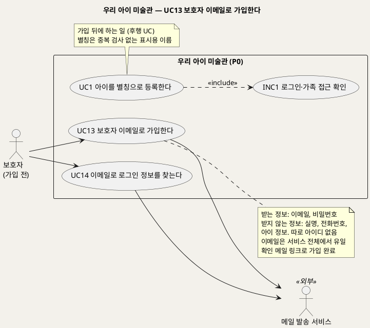
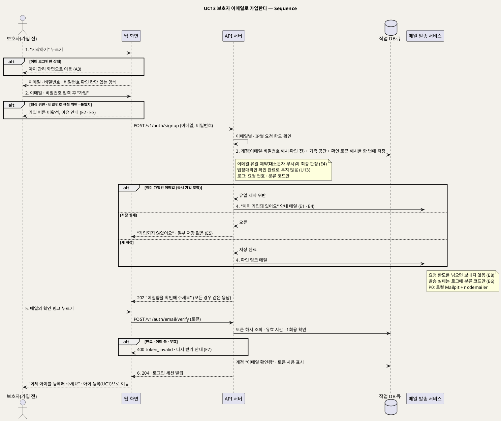

# UseCase 명세 — #13 보호자가 가입한다 — 카카오 로그인이 기본(2026-09-30), 이메일 가입은 기존 계정용 (우리 아이 미술관 P0)
**우리 아이 미술관 · UC13 · UML 2.5.1 표준 (UseCase Diagram + UseCase 기술 + Sequence Diagram)**

---

> **문서 식별**: `design/UC_13_보호자이메일가입.md`
> **작성일**: 2026-09-28 (신규 문서, 통합 결정 D18) · **표준**: UML 2.5.1 (OMG)
> **원천(SoT)**: 신지현 결정(2026-09-28, D18) "이용자 중복은 별칭이 아니라 로그인 계정으로 막는다. 따로 아이디를 만들지 않고 이메일로 로그인하며, 로그인 정보를 잊으면 이메일로 메일을 보내 찾는다" — 그리고 `.specify/features/우리-아이-미술관/spec.md` v2.2 FR-31 · FR-32 · FR-9 · FR-14 · Intent [부정적 영향] 과잉 수집·동의 오판
> **개정 (2026-09-28, 이제민 조건부 승인)**: 가입 화면에서 "이미 가입된 이메일"을 알리지 않는다. 가입 응답은 항상 같고(202), 이미 가입된 주소면 그 주소로 안내 메일만 보낸다(E1). 엔드포인트 응답 코드, P0 메일 발송(Mailpit + nodemailer), 이메일별·IP별 요청 한도를 확정했다.
> **다이어그램**: 모든 PlantUML 소스는 렌더 검증 완료(HTTP 200). 아래 링크로 브라우저에서 열 수 있다. 뷰어(plantuml.sumzip.com)는 사내 SSO 로그인 뒤에 열린다.
> **표기**: `[추론]` = 원천에 직접 없는 설계 판단 · `자료 없음 — 확인 필요` = 원천에 근거가 없는 항목

---

> **개정 (2026-09-30, 이제민 결정 — 카카오 로그인이 기본)**: 메일을 실제로 보내지 않기로 했다(U19 닫음 — 발송 계정 노출·하루 한도·스팸함·도메인 인증 불가·보호자 편의). 보호자 가입·로그인의 기본은 **카카오 로그인**이고 카카오에서 받는 것은 **회원번호뿐**이다(동의 항목 없음). 비밀번호가 없으니 확인 메일도 필요 없다. 아래 **§0 카카오 흐름**이 이 UC의 기본흐름이고, §5.1 이메일 가입 흐름은 **기존 계정·팀원·자동 점검용**으로 남긴다(새 이메일 가입을 계속 받을지는 팀 결정). 설계 근거 research R-26, 데이터 SD_03 `guardian_account.kakao_id`, 계약 `/v1/auth/kakao/*`.

## 0. 카카오 흐름 (2026-09-30 기본)

| 항목 | 내용 |
|---|---|
| 주 액터 | 보호자(카카오 계정이 있는 부모) · 보조 액터 카카오 로그인(외부 시스템) |
| 사전조건 | 서버에 카카오 앱 키가 설정돼 있다(없으면 [카카오로 시작하기]는 "준비 중이에요"로 비활성, 이메일 로그인은 그대로) |
| 사후조건 | 처음이면 카카오 회원번호로 보호자 계정과 가족 공간이 만들어지고 로그인된다. 이미 있으면 로그인만 된다 |

**기본흐름**
1. 보호자가 로그인 화면(S0a)에서 [카카오로 시작하기]를 누른다.
2. 시스템은 위조 방지 값(state)을 만들어 짧은 쿠키에 두고 카카오 인증 화면으로 보낸다(`GET /v1/auth/kakao/start`).
3. 보호자가 카카오에서 로그인·동의한다(동의 항목 없음 — 회원번호만).
4. 카카오가 시스템으로 돌려보낸다(`GET /v1/auth/kakao/callback?code&state`). 시스템은 state를 확인하고 코드를 토큰으로 바꿔 회원번호를 읽는다(토큰은 저장하지 않는다).
5. 회원번호로 계정을 찾는다. 없으면 한 트랜잭션에서 가족 공간 + 보호자 계정(만든 보호자)을 만든다(BR-ACC-09).
6. 세션을 발급하고, 처음이면 "아이를 등록해 볼까요?"(S1 아이 등록)로, 다시 온 보호자면 마지막으로 본 전시실로 보낸다.

**대체흐름**
- A1 초대 링크로 들어옴(UC15 §0): 2에서 초대 토큰을 state와 함께 기억하고, 5에서 새 가족 대신 그 가족의 공동 보호자로 넣는다(G28·G29 그대로).
- A2 이미 로그인된 상태: 1을 누르지 않고 바로 전시실로 간다.

**예외흐름**
- E1 카카오 화면에서 취소: "로그인을 취소했어요. 다시 해 볼까요?" + [카카오로 시작하기]. 계정을 만들지 않는다.
- E2 state 불일치·만료(10분)·코드 교환 실패·카카오 응답 없음: "카카오 로그인이 되지 않았어요. 잠시 뒤 다시 해 볼까요?" 계정을 만들지 않는다. 원인 코드만 로그에(토큰·코드·회원번호 원문 없음).
- E3 카카오 키 미설정: 시작 경로가 503 `kakao_not_configured`, 화면은 버튼 비활성.
- E4 DB 오류: 계정·가족을 반쯤 만들지 않는다(한 트랜잭션), "잠시 뒤 다시 해 주세요".

## 목차

1. [범위·개요](#1-범위개요)
2. [UseCase Diagram](#2-usecase-diagram)
3. [Actor 카탈로그](#3-actor-카탈로그)
4. [UseCase 목록 (원천 매핑)](#4-usecase-목록-원천-매핑)
5. [UseCase 기술 + Sequence Diagram](#5-usecase-기술--sequence-diagram)
6. [업무규칙 종합](#6-업무규칙business-rules-종합)
7. [UML 표준 준수 노트](#7-uml-표준-준수-노트)

---

## 1. 범위·개요

보호자는 서비스를 처음 쓸 때 **이메일과 비밀번호로 가입한다.** 가입 화면은 그 이메일이 이미 가입돼 있는지 알려 주지 않는다. 응답은 항상 "메일함을 확인해 주세요"이고, 이미 가입된 주소면 그 주소로 "이미 가입돼 있어요" 안내 메일만 간다(UC14와 같은 가입 여부 비노출). 따로 아이디를 만들지 않는다. **이메일이 곧 로그인 아이디**이며, 이용자끼리 겹치지 않게 하는 기준도 아이 별칭이 아니라 이 이메일이다. 이메일은 서비스 전체에서 하나뿐이어야 하며 대소문자를 구분하지 않고 비교한다.

가입하면 시스템이 그 주소로 **확인 메일**을 보낸다. 보호자가 메일의 링크를 눌러 주소가 본인 것임을 확인하면 가입이 끝나고, 가족 공간이 열리며, 아이 별칭 등록(UC1)으로 넘어간다 [추론]. 이 확인을 거쳐야 나중에 로그인 정보를 잊었을 때 같은 주소로 찾을 수 있다(UC14).

가입 때 받는 정보는 **이메일과 비밀번호뿐**이다. 실명, 전화번호, 아이 정보는 받지 않는다. 이메일은 로그인과 로그인 정보 찾기에만 쓰고 홍보 메일이나 외부 전달에는 쓰지 않는다. 또 가입했다고 해서 법정대리인 확인까지 끝났다고 보지 않는다(U13). 이 UC는 모델을 부르지 않는다. API 서버, 작업 DB, 메일 발송 서비스가 관여한다.

| 항목 | 값 |
|---|---|
| 대상 시스템 | 우리 아이 미술관 (P0) |
| 상위 프로세스 | **보호자 이메일 가입(UC13)** → 아이 등록(UC1) → 작품 접수(UC2) · (잊었을 때) 로그인 정보 찾기(UC14) |
| 원천 근거 | D18(신지현 결정) · spec FR-31 · FR-9 · FR-14 · Intent [부정적 영향] 과잉 수집·동의 오판 |
| 핵심 UseCase | 1개 (UC13) |
| 주요 액터 | 보호자(가입 전) · 메일 발송 서비스(보조) |

---

## 2. UseCase Diagram

**[「UC13 보호자 이메일 가입 UseCase Diagram」 PlantUML 뷰어로 열기](https://plantuml.sumzip.com/plantuml/svg/eNqNlF9r02AUxu_fT3GYNxt0xbJejVGGw4EXijd6JZQsTduwLJEkRUSETLIxu12s2rp1S8eKdWMyMWur7aB44Ufxsu_Jd_C8SfpnBcGLQPLyO885z_MesmrZkmmXtjQoyVmjZGbloqrlsgVJ0xTzdTa1xKxNVX8pmdIWbEjyZsE0SnpuzdAME-6tL62nHj6YIqyilDNeqXoB8pJmKUxT8jbYBphqoWhDTjUV2VYNndmqrSmAJz6_uAasudjoAv_ex73zYdeBP04Vnq2lloB3usFxH88OgQB-VcXGgDc9GPoOnu0ENY_vtxiTZJtmmRuzL_T5CAA8dxfmQLLguWqpBI3RUAm47-FuE9D1-K2L5VaIPpZUDVZWsN7nP51MhjExsqQXaNy5f807__Q-9XnDAEqWIksWof87fthTwDPF6bsl9Ax7fWz0yVONZPmXAaD_i5erUxrpGY14UMHyjou339CLxD7e8Gbjbv_p0kdPqHbc8XdPzNu8oc6VYW8AQb1Gp2GdANlbxuJ4YXExE3mZOUizMA7xJeJlob_pL0gmM6EaLFP2qi5rpZwiwtcNW4mXx8iPcuL-KRmPk1ieBJUAukfuO7y9R7FHIF46FEP5Dr_f4l93EmI7gno1ghNEx9caYUngVV-EFWdYpfqjXWwcCHDUEBvOZHuEHra7eHRIR4DeOQEER3HBaOUut4Pt68kSANZd_vmAKXoOhNfI8IZh28ZW7Jg0YpZ_aJE6BLXj0A7JzQenbvDpPWELwm50yWKoVoV3fsCw7eC7azG4KAgqHu57eHIVGrhwJ01X6Y3-AH8BVkr8eQ==)** — 클릭 시 브라우저로 연결됩니다.

#### 다이어그램 쉽게 읽기 (유저 관점)

- **누가 쓰나** — 아직 계정이 없는 보호자가 쓴다. 메일 발송 서비스는 사람이 아니라 확인 메일을 실제로 보내는 외부 구성요소다.
- **무슨 순서로** — 이메일과 비밀번호를 적어 가입하고, 받은 메일의 링크를 누르면 가입이 끝난다. 그다음 아이 등록(UC1)으로 넘어간다. 로그인 정보를 잊으면 UC14로 찾는다.
- **«include» = 항상 함께** — UC13은 로그인 전에 하는 일이라 INC1(로그인·가족 접근 확인)을 포함하지 않는다.
- **«extend» = 특정 상황에서만** — 이 UC에는 확장 관계가 없다. UC14는 별도 목표(잊은 로그인 정보 찾기)라 따로 두었다.
- **Generalization(◁)** — 이 UC에는 없다.

| 기호 | 의미 |
|---|---|
| 사람 모양(actor) | 시스템을 쓰는 사람 또는 외부 구성요소(`<<외부>>`) |
| 타원(usecase) | 액터가 이루려는 목표 |
| 사각형(rectangle) | 시스템 경계 |
| 점선 `<<include>>` | 항상 함께 수행되는 하위 행위 |
| 노트 | 규칙이나 선후 관계 보충 설명 |

---

## 3. Actor 카탈로그

| 구분 | 액터 | 이 UC에서의 역할 | 원천 근거 |
|:--:|---|---|---|
| Primary | 보호자(가입 전) | 이메일과 비밀번호를 정해 가입하고, 확인 메일의 링크로 주소를 확인한다 | D18 · spec FR-31 |
| Secondary | 메일 발송 서비스 | 확인 메일과 "이미 가입돼 있어요" 안내 메일을 보낸다. P0는 로컬 Mailpit + nodemailer, 실제 발송 제품은 미정 | D18 · 이제민 결정 ⑤ · U19 |
| 이해관계자 | 아이 | 가입과 관계없다. 아이 정보는 가입 때 받지 않는다 | BR-CHD-01 |

---

## 4. UseCase 목록 (원천 매핑)

| UC ID | 유스케이스명 | 관계 | 원천 근거 |
|:--:|---|---|---|
| UC13 | 보호자 이메일로 가입한다 | 본 문서 | D18 · spec FR-31 |
| UC14 | 이메일로 로그인 정보를 찾는다 | 짝(확인된 이메일이 있어야 UC14가 동작) | D18 · spec FR-32 |
| UC1 | 아이를 별칭으로 등록한다 | 후행(가입으로 열린 가족 공간에 아이를 등록) | D18 · spec FR-1 |
| INC1 | 로그인·가족 접근 확인 | UC13이 포함하지 않음(로그인 전). 가입 완료 세션을 UC1부터 확인 | spec FR-9 |

---

## 5. UseCase 기술 + Sequence Diagram

### 5.1 UC13 보호자 이메일로 가입한다

> **쉽게 말하면** — 처음 오신 보호자가 이메일 주소와 비밀번호만 적어 가입합니다. 따로 아이디를 만들 필요는 없습니다. 가입 버튼을 누르면 늘 "메일함을 확인해 주세요"가 나옵니다. 이미 가입한 주소라면 그 메일함에 "이미 가입돼 있어요" 안내가 갑니다. 메일함에 온 확인 링크를 누르면 가입이 끝나고, 바로 아이 별명을 등록하는 화면으로 넘어갑니다.

#### 유스케이스 기술

| 속성 | 내용 |
|---|---|
| **ID** | UC13 (D18 · spec FR-31) |
| **유스케이스명** | 보호자 이메일로 가입한다 |
| **액터** | 주: 보호자(가입 전) · 보조: 메일 발송 서비스 |
| **사전조건** | (1) 로그인하지 않은 상태다. (2) 보호자가 메일을 받을 수 있는 이메일 주소를 갖고 있다. (3) 가입을 누구에게나 열지, 초대 등으로 제한할지는 `자료 없음 — 확인 필요` (U19) |
| **사후조건** | (1) 보호자 계정이 이메일과 비밀번호 해시로 저장된다. 이메일은 서비스 전체에서 유일하다(대소문자 무시). (2) 그 계정의 가족 공간 1개가 함께 저장되고 그 계정이 만든 보호자가 된다. 계정과 가족 공간은 둘 다 있거나 둘 다 없다. 초대 링크로 가입하면 새 가족 공간을 만들지 않고 초대한 가족의 공동 보호자가 된다(A4, UC15). (3) 확인 링크를 누르면 계정이 "이메일 확인됨"이 되고 로그인 세션이 발급된다. (4) 실명·전화번호·아이 정보는 어디에도 저장되지 않는다. (5) 법정대리인 확인은 완료로 기록하지 않는다(BR-PRV-03, U13). (6) 운영 로그에는 이메일·비밀번호·토큰 원문이 남지 않고 요청 번호와 분류 코드만 남는다. (7) 이미 가입된 이메일로 가입을 시도하면 계정을 새로 만들지 않고, 화면 응답은 새 가입과 같으며, 그 주소로 안내 메일만 간다 |
| **기본흐름** | ↓ 별도 기본흐름표 |
| **대체흐름** | A1. 확인 메일을 다시 받기 · A2. 이미 계정이 있음 · A3. 로그인한 상태에서 가입 화면 진입 · A4. 공동 보호자 초대 링크로 가입 — ↓ 별도 대체흐름표 |
| **예외흐름** | E1. 이미 가입된 이메일(화면 비노출, 안내 메일) · E2. 이메일 형식 위반 · E3. 비밀번호 규칙 위반·확인 불일치 · E4. 동시 가입 경쟁 · E5. 작업 DB 저장 실패 · E6. 확인 메일 발송 실패 · E7. 확인 링크 만료·재사용 · E8. 가입 요청 과다 — ↓ 별도 예외흐름표 |
| **포함/확장** | 없음. 로그인 전 행위라 INC1을 포함하지 않는다 |
| **우선순위** | High — 모든 보호자 흐름(UC1~UC7, UC10)의 선행 조건이고, 이용자 중복을 막는 유일한 지점이다(D18) |
| **사용빈도** | 보호자당 1회(확인 메일 재요청 포함). 정량값은 `자료 없음 — 확인 필요` |
| **업무규칙** | BR-ACC-06, BR-ACC-07, BR-ACC-08, BR-ACC-02, BR-CHD-01, BR-PRV-01, BR-PRV-03 |
| **특별 요구사항** | 최소 수집: 가입 양식에는 이메일·비밀번호·비밀번호 확인 칸만 둔다. 이메일은 로그인과 로그인 정보 찾기에만 쓰고 홍보·외부 전달에 쓰지 않는다(BR-ACC-07). 보안: 비밀번호는 해시로만 저장한다 [추론]. 확인 링크의 토큰은 1회용이고 유효 시간이 있으며, DB에는 토큰 원문이 아니라 해시만 둔다 [추론 — 예시 24시간, U19]. 이메일 중복의 최종 판정은 DB 유일 제약(대소문자 무시)이다. 가입·확인 메일 재발송에는 이메일별·IP별 요청 한도를 둔다(예시: 같은 이메일 10분에 3회, 같은 IP 1시간에 20회 [추론 — 확정 아님, U19]). 비밀번호 규칙 예시: 8자 이상 [추론 — 확정 아님, U19]. 메일 발송: P0는 로컬 Mailpit(Homebrew, Docker 없음)과 nodemailer로 보내고, 실제 발송 제품은 U19로 남긴다(이제민 결정 ⑤). 엔드포인트와 응답 코드(이제민 결정 ③): `POST /v1/auth/signup` 항상 202 · `POST /v1/auth/email/verify` 성공 204, 토큰이 이미 쓰였거나 만료·무효면 구분 없이 400 `token_invalid` · `POST /v1/auth/email/verify/resend` 항상 202. 형식 검사는 화면에서 먼저 하고, 서버의 형식 위반 응답 코드는 U8에서 정한다 [추론] |
| **비고** | 원천 추적: D18(2026-09-28 신지현 결정, 이메일 로그인·이메일로 찾기로 개정) · spec FR-31(신설) · FR-32(UC14) · FR-9(가족 단위 접근. 계정 모델 U1은 공동 보호자·감상 전용 여부만 남음) · FR-14(로그 제한) · Intent [부정적 영향] 과잉 수집·동의 오판 · 공통 기준 §8(BR-ACC-06~08 신설) · §10(U8, U13, U19). 이메일은 연락처라서 D18 이전의 "연락처 받지 않음" 원칙을 "로그인·찾기 용도의 이메일만 받음"으로 좁혀 바꿨다. 탈퇴한 이메일로 다시 가입할 수 있는지는 U19 |

#### 기본흐름 (Basic Flow)

| 단계 | 액터 행위 | 시스템 행위 |
|:--:|---|---|
| 1 | 보호자가 "시작하기"를 누른다 | 이메일·비밀번호·비밀번호 확인 칸만 있는 가입 양식을 보여 준다(실명·전화번호·아이 정보 입력란 없음) |
| 2 | 보호자가 이메일과 비밀번호를 입력하고 "가입"을 누른다 | 웹 화면이 형식과 비밀번호 확인 일치를 먼저 검사한 뒤 `POST /v1/auth/signup`을 보낸다 |
| 3 | 보호자가 결과를 기다린다 | API 서버가 요청 한도와 형식을 확인하고, 대소문자를 무시해 같은 이메일이 있는지 본다. 없으면 보호자 계정(이메일·비밀번호 해시·"확인 전")과 가족 공간 1개를 한 번에 저장하고, 1회용 확인 토큰(해시)을 만든다. 있으면 아무것도 만들지 않는다(E1). 어느 쪽이든 202를 돌려준다 |
| 4 | 보호자가 "메일함을 확인해 주세요" 안내를 본다 | 새 계정이면 확인 링크 메일을, 이미 가입된 주소면 "이미 가입돼 있어요. 로그인하거나 로그인 정보 찾기를 이용해 주세요" 안내 메일을 보낸다. 화면 문구는 같다 |
| 5 | 보호자가 메일의 확인 링크를 누른다 | `POST /v1/auth/email/verify`로 토큰을 검사해(유효 시간·1회용) 계정을 "이메일 확인됨"으로 바꾸고, 토큰을 쓴 것으로 표시하고, 로그인 세션을 발급한다(204) |
| 6 | 보호자가 가입 완료를 확인한다 | "이제 아이를 등록해 주세요"와 함께 아이 등록(UC1) 화면으로 보낸다 |

#### 대체흐름 (Alternative Flow)

| ID | 분기 조건 | 흐름 |
|:--:|---|---|
| A1 | 확인 메일을 받지 못했다 | 보호자가 "확인 메일 다시 받기"를 누른다. `POST /v1/auth/email/verify/resend`로 새 토큰을 만들고 이전 토큰은 무효로 한다. 재요청 간격 제한을 둔다 [추론] |
| A2 | 이미 계정이 있는 보호자가 가입 화면에 왔다 | 화면에 늘 있는 "이미 가입하셨나요? 로그인" 링크로 로그인 화면으로 간다. 비밀번호를 잊었으면 UC14로 간다. 이 링크는 가입 여부와 관계없이 항상 보인다 |
| A3 | 로그인한 상태에서 가입 화면을 연다 | 가입 양식을 보이지 않고 아이 관리 화면(UC1)으로 보낸다 [추론] |
| A4 | 공동 보호자 초대 링크(UC15)로 가입한다 | 초대받은 이메일이 미리 채워진 양식으로 가입한다. **새 가족 공간을 만들지 않고** 초대한 가족의 공동 보호자가 된다. 초대 메일 수신으로 이메일 소유가 확인된 것으로 보고 확인 메일을 보내지 않는다 [추론] |

#### 예외흐름 (Exception Flow)

| ID | 발생 조건 | 처리 | 근거 |
|:--:|---|---|---|
| E1 | 같은 이메일이 이미 있다(대소문자 무시) | 계정을 새로 만들지 않는다. 화면 응답은 새 가입과 같게 202와 "메일함을 확인해 주세요"를 보인다. 그 주소로 "이미 가입돼 있어요. 로그인하거나 로그인 정보 찾기를 이용해 주세요" 안내 메일을 보낸다. 안내 메일도 요청 한도를 따른다 | BR-ACC-06 · BR-ACC-08 · 이제민 결정 ④ |
| E2 | 이메일이 비어 있거나 형식에 맞지 않는다 | 웹 화면은 가입 버튼을 막고, API 서버도 같은 검사를 거쳐 거절한다 | BR-ACC-06 · [추론] |
| E3 | 비밀번호가 규칙에 맞지 않거나 확인 값과 다르다 | 가입 버튼을 막고 어떤 규칙이 맞지 않는지 문장으로 안내한다 | BR-ACC-07 · [추론] |
| E4 | 거의 동시에 같은 이메일로 두 번 가입한다 | DB 유일 제약이 두 번째 가입을 막는다. 두 번째 요청은 E1과 같이 처리한다(화면은 같은 응답, 안내 메일) | BR-ACC-06 · [추론] |
| E5 | 작업 DB 장애로 저장하지 못한다 | "가입되지 않았어요, 다시 시도해 주세요"라고 안내한다. 계정만 있고 가족 공간이 없는 상태를 남기지 않는다. 로그에는 요청 번호와 분류 코드(DB)만 남긴다 | BR-ACC-07 · BR-PRV-01 |
| E6 | 메일 발송 서비스가 실패한다 | 계정은 "확인 전"으로 남기고 "메일을 보내지 못했어요. 잠시 뒤 다시 받기를 눌러 주세요"라고 안내한다(A1). 로그에는 분류 코드(메일)만 남긴다 [추론] | [추론] · U19 |
| E7 | 확인 링크가 만료됐거나, 이미 썼거나, 재발급으로 무효가 됐다 | 세 경우를 구분하지 않고 400 `token_invalid`로 답한다. 계정을 바꾸지 않고 "링크를 쓸 수 없어요. 확인 메일을 다시 받아 주세요"라고 안내한다(A1) | BR-ACC-08 · 이제민 결정 ③ |
| E8 | 짧은 시간에 가입·재발송을 너무 많이 요청한다 | 이메일별·IP별 한도(예시: 같은 이메일 10분에 3회, 같은 IP 1시간에 20회 [추론])를 넘으면 메일을 보내지 않는다. 가입 응답은 가입 여부를 드러내지 않게 202를 유지하고, 재발송 화면에는 "잠시 뒤 다시 시도해 주세요"를 보인다 [추론] | BR-ACC-08 · U19 |

#### Sequence Diagram

**[「UC13 보호자 이메일 가입 Sequence」 PlantUML 뷰어로 열기](https://plantuml.sumzip.com/plantuml/svg/eNp9Vt9PIlcUfp-_4oS-QLr-QNxt48Nm15VNfGhqsrWvZlZGnYiDC4PNvuE6GiokQmTWQQeDXa3a0BQVFVN98U_pI_fM_9Bz78wAI9s-weWen9_3nXN5ldHltJ5dSUJG-TCXyqbn5pfUZGJuUU4mlfTHuWhMyiyr2qqcllfgvTy_vJhOZbXEm1QylYZv3sbeRuOTfRaZJTmR-kXVFmFBTmYUSVf1pAKzb6IxYFctx2rjYQmw1mLnFazdsyMbOs0cHm46ps0Kx_BPrgLvlA9ZRZtXJEme1ylJqOsYdm0B60YkBHIGflYzKplIlFtX59VVWdMhhAd34FQr7LwlbGang9evZ6YBDZtdGuKajlJC1uX3ckYh38My7m3C1OTjrbNeEgZTk0F_t3JgTRu3jkSkOwO3j4XtD7KalCSvKhh6SclhAqLDFLhgU2zHtDrtZghY3mAnLfoqyUldwPFXGwiMzm0ba23CAnBj3dmwJeARhiiQH3MC0DTIATqtHPu94TWKtoCSB9qpQvh1LCIpWkIa9PWBh8dboLpZM8cu8wTuwNmpmlQJ4F2bnRYBD_NsuwL4uYyF2mCDY8P_E5kIY_UTcA4MCLn8hUTXjmVSMECbbK0Br86tjXfV_tubPEXHO-trmHi6IE6d7XseyKnaaFw842WhXSfM8uxTC8LxMR4q3gfPSy4AijDz47ufYGQtOiJn9aWRjLqoZVch3O3qWaC6iMSdur49OV8ZPP70DP-C-xW8_BO4sHcMD0_fb2qS3GLD0LkysG720jzeBkkwW6QbkqJHBskevhXNHl2Q73WnadDZu3W26s560_NhJ_c8MyGSxz0auDrhcyJpKV2BtLq4pENqQSgf-ogjoMRH3UbzIcyKOdwqsoYYWNbgQSNcd3ht42-b4BRLVDkhOh6hIOzSpBO5kCRFLV7BVYN9KXJlsnIJT3PEwzbWihCejcaEm1D8hA9VnxRvaD4swIcK27VJgJwu4NX3z4tLOivZfT2ESf9UqS8IZ6fhmGc8FSE-1COsv1NPY2TjkcOHmIzG-dQGMu3c80HAzy2qN-Rryk8cjwppERwK7T0PccDCsVM8G8hvHVN7fkZ_ikJ-Q5YPlWn5ySg019dNrht4b0sgGX_uJ9zIe3IayOZ5CDK-1qbHFjtdd9YbXkNiQIJ6EcsNgrrmOmOGxffPeYtveIKkn-j494Jnb1cKMPgi8VYdKfMp0-TygrvMjE5wK_y7IfKuqjopXUsllBU6KemeIAIQjo2O-QuaeMeaP3c0FIBf7tFoCzTD7I8ztluHzuUD7jeJ3irWqOZamRWuI4Pr7fmwBwrWrKdgdRf5fy8TUfLImpJWFz5C2B3TSGATBEYX8Kjp7BcF5Xbd2T8j3Gw-6fRDlC5w_9zfJnwYCDOi1RWIECtWcmKEGi3yfaqx8dFR0FPLijanamtyUk0I08Ixz8uaB9RIb1d-527J_kJdgblz4ererYSVzoRGvUbwU0NUWbYpbpChF8NE0rjI6j93wGnZtLhKOu1fBx8tno1G1Xv4hOJ2L9hR7QmpHAH3aXSvw_SnIxJ4GKVX1A_90_kX4PR7SA==)** — 클릭 시 브라우저로 연결됩니다.

기본흐름 1~6단계는 시퀀스의 번호 붙은 주요 메시지 `1.`~`6.`과 1:1로 대응한다.

---

## 6. 업무규칙(Business Rules) 종합

| BR ID | 규칙 | 적용 UC | 근거 |
|---|---|---|---|
| BR-ACC-06 | 보호자 로그인 아이디는 이메일이며 서비스 전체에서 유일하다. 대소문자를 구분하지 않고 비교한다. 이용자 중복은 이메일로 막고 별칭으로 막지 않는다. 따로 아이디를 만들지 않는다 | UC13, UC14 | D18 |
| BR-ACC-07 | 가입 때는 이메일과 비밀번호만 받는다. 실명·전화번호·아이 정보는 받지 않는다. 이메일은 로그인과 로그인 정보 찾기에만 쓴다. 가입과 함께 가족 공간 1개를 만들고, 계정과 가족 공간은 함께 저장한다. 비밀번호는 해시로만 저장한다 | UC13 | D18 · Intent [부정적 영향] 과잉 수집 · [추론] |
| BR-ACC-08 | 확인·재설정 메일의 링크 토큰은 1회용이고 유효 시간이 있으며, 재발급하면 이전 토큰은 무효다. DB에는 토큰 해시만 둔다. 가입과 로그인 정보 찾기의 응답은 그 이메일이 가입돼 있는지 드러내지 않는다(가입된 주소에는 안내 메일만). 가입·확인 메일 재발송·찾기 메일에는 이메일별·IP별 요청 한도를 둔다(예시: 같은 이메일 10분에 3회, 같은 IP 1시간에 20회 [추론 — 확정 아님, U19]) | UC13, UC14 | D18 · 이제민 결정 ③④ · 보완 3 |
| BR-ACC-02 | 로그인하지 않은 사용자는 차단한다. 가입(UC13)과 로그인 정보 찾기(UC14)만 예외다 | UC1~UC7, UC10, UC13, UC14 | spec FR-9 수용기준 2 |
| BR-CHD-01 | 아이는 별칭만 받는다. 실명·생년월일·출생연도는 받지 않고 저장하지 않는다. 가입 때도 아이 정보를 받지 않는다 | UC1, UC13 | spec FR-1 · Intent [핵심 데이터] 아이 |
| BR-PRV-01 | 운영 로그에 이미지·객체 키·자유 입력·이메일·비밀번호·토큰·오류 원문을 남기지 않는다. 분류 코드와 요청 번호만 남긴다 | 전 UC | spec FR-14 |
| BR-PRV-03 | 보호자 계정만으로 법정대리인 확인이 끝났다고 보지 않는다. 동의 절차는 U13에서 정한다 | UC1, UC13 (가족 흐름 전체) | Intent [부정적 영향] 동의 오판 |

---

## 7. UML 표준 준수 노트

| 항목 | 적용 |
|---|---|
| 액터 | 보호자(가입 전)는 Primary이며 시스템 경계 밖에 둔다. 가입 뒤에는 같은 사람이 UC1~UC7의 "보호자" 액터가 된다. 메일 발송 서비스는 Secondary actor(`<<외부>>`)다 |
| System Boundary | `rectangle`로 우리 아이 미술관(P0)의 책임 범위를 표시했다 |
| «include» | UC13은 INC1을 포함하지 않는다. INC1은 로그인한 보호자의 공통 행위라 가입 전 행위에는 해당하지 않는다 |
| 선후 관계 | UC13 → UC1은 include나 extend가 아닌 업무 선후 관계라서 노트로만 표시했다. UC14는 잊었을 때만 쓰는 별도 목표라 독립 UC로 두었다 |
| Sequence | 공통 기준 §3의 lifeline 이름(`웹 화면` · `API 서버` · `작업 DB·큐`)에 `메일 발송 서비스`를 더했다. 모델이 관여하지 않으므로 서빙군과 원본·결과 저장소는 넣지 않았다. 예외는 `alt`에 E1~E8을 붙였다 |

---

*우리 아이 미술관 P0 · UC13 · 2026-09-28 작성(D18) · 원천: 신지현 결정 D18 · spec.md v2.2 FR-31*
