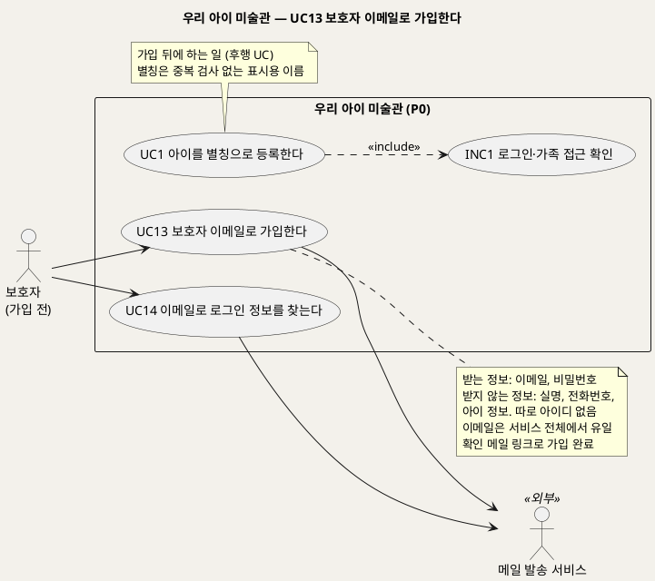
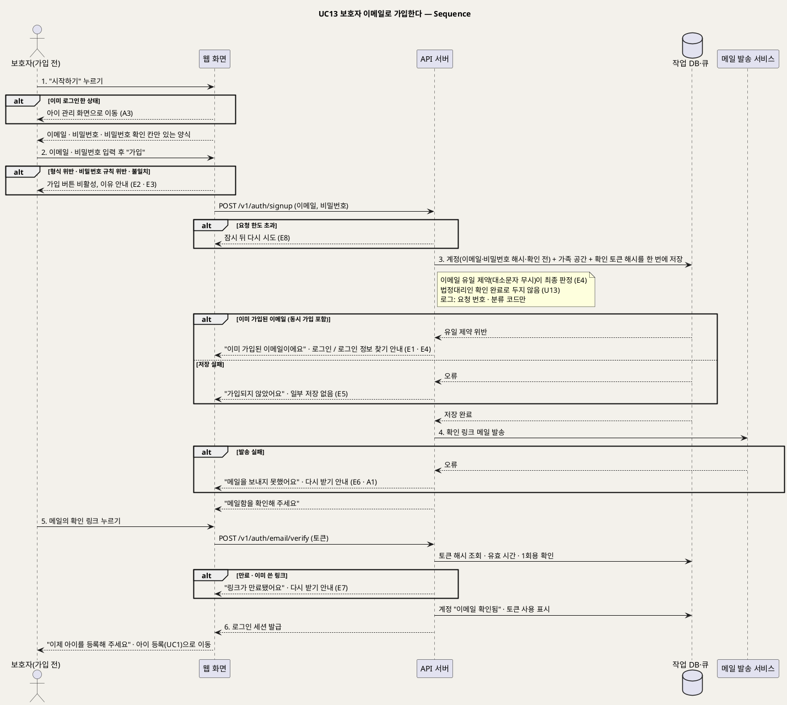

# UseCase 명세 — #13 보호자 이메일로 가입한다 (우리 아이 미술관 P0)
**우리 아이 미술관 · UC13 · UML 2.5.1 표준 (UseCase Diagram + UseCase 기술 + Sequence Diagram)**

---

> **문서 식별**: `design/UC_13_보호자이메일가입.md`
> **작성일**: 2026-09-28 (신규 문서, 통합 결정 D18) · **표준**: UML 2.5.1 (OMG)
> **원천(SoT)**: 신지현 결정(2026-09-28, D18) "이용자 중복은 별칭이 아니라 로그인 계정으로 막는다. 따로 아이디를 만들지 않고 이메일로 로그인하며, 로그인 정보를 잊으면 이메일로 메일을 보내 찾는다" — 그리고 `.specify/features/우리-아이-미술관/spec.md` v2.2 FR-31 · FR-32 · FR-9 · FR-14 · Intent [부정적 영향] 과잉 수집·동의 오판
> **다이어그램**: 모든 PlantUML 소스는 렌더 검증 완료(HTTP 200). 아래 링크로 브라우저에서 열 수 있다. 뷰어(plantuml.sumzip.com)는 사내 SSO 로그인 뒤에 열린다.
> **표기**: `[추론]` = 원천에 직접 없는 설계 판단 · `자료 없음 — 확인 필요` = 원천에 근거가 없는 항목

---

## 목차

1. [범위·개요](#1-범위개요)
2. [UseCase Diagram](#2-usecase-diagram)
3. [Actor 카탈로그](#3-actor-카탈로그)
4. [UseCase 목록 (원천 매핑)](#4-usecase-목록-원천-매핑)
5. [UseCase 기술 + Sequence Diagram](#5-usecase-기술--sequence-diagram)
6. [업무규칙 종합](#6-업무규칙business-rules-종합)
7. [UML 표준 준수 노트](#7-uml-표준-준수-노트)

---

## 1. 범위·개요

보호자는 서비스를 처음 쓸 때 **이메일과 비밀번호로 가입한다.** 따로 아이디를 만들지 않는다. **이메일이 곧 로그인 아이디**이며, 이용자끼리 겹치지 않게 하는 기준도 아이 별칭이 아니라 이 이메일이다. 이메일은 서비스 전체에서 하나뿐이어야 하며 대소문자를 구분하지 않고 비교한다.

가입하면 시스템이 그 주소로 **확인 메일**을 보낸다. 보호자가 메일의 링크를 눌러 주소가 본인 것임을 확인하면 가입이 끝나고, 가족 공간이 열리며, 아이 별칭 등록(UC1)으로 넘어간다 [추론]. 이 확인을 거쳐야 나중에 로그인 정보를 잊었을 때 같은 주소로 찾을 수 있다(UC14).

가입 때 받는 정보는 **이메일과 비밀번호뿐**이다. 실명, 전화번호, 아이 정보는 받지 않는다. 이메일은 로그인과 로그인 정보 찾기에만 쓰고 홍보 메일이나 외부 전달에는 쓰지 않는다. 또 가입했다고 해서 법정대리인 확인까지 끝났다고 보지 않는다(U13). 이 UC는 모델을 부르지 않는다. API 서버, 작업 DB, 메일 발송 서비스가 관여한다.

| 항목 | 값 |
|---|---|
| 대상 시스템 | 우리 아이 미술관 (P0) |
| 상위 프로세스 | **보호자 이메일 가입(UC13)** → 아이 등록(UC1) → 작품 접수(UC2) · (잊었을 때) 로그인 정보 찾기(UC14) |
| 원천 근거 | D18(신지현 결정) · spec FR-31 · FR-9 · FR-14 · Intent [부정적 영향] 과잉 수집·동의 오판 |
| 핵심 UseCase | 1개 (UC13) |
| 주요 액터 | 보호자(가입 전) · 메일 발송 서비스(보조) |

---

## 2. UseCase Diagram

**[「UC13 보호자 이메일 가입 UseCase Diagram」 PlantUML 뷰어로 열기](https://plantuml.sumzip.com/plantuml/svg/eNqNlF9r02AUxu_fT3GYNxt0xbJejVGGw4EXijd6JZQsTduwLJEkRUSETLIxu12s2rp1S8eKdWMyMWur7aB44Ufxsu_Jd_C8SfpnBcGLQPLyO885z_MesmrZkmmXtjQoyVmjZGbloqrlsgVJ0xTzdTa1xKxNVX8pmdIWbEjyZsE0SnpuzdAME-6tL62nHj6YIqyilDNeqXoB8pJmKUxT8jbYBphqoWhDTjUV2VYNndmqrSmAJz6_uAasudjoAv_ex73zYdeBP04Vnq2lloB3usFxH88OgQB-VcXGgDc9GPoOnu0ENY_vtxiTZJtmmRuzL_T5CAA8dxfmQLLguWqpBI3RUAm47-FuE9D1-K2L5VaIPpZUDVZWsN7nP51MhjExsqQXaNy5f807__Q-9XnDAEqWIksWof87fthTwDPF6bsl9Ax7fWz0yVONZPmXAaD_i5erUxrpGY14UMHyjou339CLxD7e8Gbjbv_p0kdPqHbc8XdPzNu8oc6VYW8AQb1Gp2GdANlbxuJ4YXExE3mZOUizMA7xJeJlob_pL0gmM6EaLFP2qi5rpZwiwtcNW4mXx8iPcuL-KRmPk1ieBJUAukfuO7y9R7FHIF46FEP5Dr_f4l93EmI7gno1ghNEx9caYUngVV-EFWdYpfqjXWwcCHDUEBvOZHuEHra7eHRIR4DeOQEER3HBaOUut4Pt68kSANZd_vmAKXoOhNfI8IZh28ZW7Jg0YpZ_aJE6BLXj0A7JzQenbvDpPWELwm50yWKoVoV3fsCw7eC7azG4KAgqHu57eHIVGrhwJ01X6Y3-AH8BVkr8eQ==)** — 클릭 시 브라우저로 연결됩니다.

#### 다이어그램 쉽게 읽기 (유저 관점)

- **누가 쓰나** — 아직 계정이 없는 보호자가 쓴다. 메일 발송 서비스는 사람이 아니라 확인 메일을 실제로 보내는 외부 구성요소다.
- **무슨 순서로** — 이메일과 비밀번호를 적어 가입하고, 받은 메일의 링크를 누르면 가입이 끝난다. 그다음 아이 등록(UC1)으로 넘어간다. 로그인 정보를 잊으면 UC14로 찾는다.
- **«include» = 항상 함께** — UC13은 로그인 전에 하는 일이라 INC1(로그인·가족 접근 확인)을 포함하지 않는다.
- **«extend» = 특정 상황에서만** — 이 UC에는 확장 관계가 없다. UC14는 별도 목표(잊은 로그인 정보 찾기)라 따로 두었다.
- **Generalization(◁)** — 이 UC에는 없다.

| 기호 | 의미 |
|---|---|
| 사람 모양(actor) | 시스템을 쓰는 사람 또는 외부 구성요소(`<<외부>>`) |
| 타원(usecase) | 액터가 이루려는 목표 |
| 사각형(rectangle) | 시스템 경계 |
| 점선 `<<include>>` | 항상 함께 수행되는 하위 행위 |
| 노트 | 규칙이나 선후 관계 보충 설명 |

---

## 3. Actor 카탈로그

| 구분 | 액터 | 이 UC에서의 역할 | 원천 근거 |
|:--:|---|---|---|
| Primary | 보호자(가입 전) | 이메일과 비밀번호를 정해 가입하고, 확인 메일의 링크로 주소를 확인한다 | D18 · spec FR-31 |
| Secondary | 메일 발송 서비스 | 확인 메일을 보낸다. 실제 제품(SMTP 서비스)은 미정 | D18 · [추론] · U19 |
| 이해관계자 | 아이 | 가입과 관계없다. 아이 정보는 가입 때 받지 않는다 | BR-CHD-01 |

---

## 4. UseCase 목록 (원천 매핑)

| UC ID | 유스케이스명 | 관계 | 원천 근거 |
|:--:|---|---|---|
| UC13 | 보호자 이메일로 가입한다 | 본 문서 | D18 · spec FR-31 |
| UC14 | 이메일로 로그인 정보를 찾는다 | 짝(확인된 이메일이 있어야 UC14가 동작) | D18 · spec FR-32 |
| UC1 | 아이를 별칭으로 등록한다 | 후행(가입으로 열린 가족 공간에 아이를 등록) | D18 · spec FR-1 |
| INC1 | 로그인·가족 접근 확인 | UC13이 포함하지 않음(로그인 전). 가입 완료 세션을 UC1부터 확인 | spec FR-9 |

---

## 5. UseCase 기술 + Sequence Diagram

### 5.1 UC13 보호자 이메일로 가입한다

> **쉽게 말하면** — 처음 오신 보호자가 이메일 주소와 비밀번호만 적어 가입합니다. 따로 아이디를 만들 필요는 없습니다. 이미 가입된 이메일이면 로그인하라고 알려 줍니다. 메일함에 온 확인 링크를 누르면 가입이 끝나고, 바로 아이 별명을 등록하는 화면으로 넘어갑니다.

#### 유스케이스 기술

| 속성 | 내용 |
|---|---|
| **ID** | UC13 (D18 · spec FR-31) |
| **유스케이스명** | 보호자 이메일로 가입한다 |
| **액터** | 주: 보호자(가입 전) · 보조: 메일 발송 서비스 |
| **사전조건** | (1) 로그인하지 않은 상태다. (2) 보호자가 메일을 받을 수 있는 이메일 주소를 갖고 있다. (3) 가입을 누구에게나 열지, 초대 등으로 제한할지는 `자료 없음 — 확인 필요` (U19) |
| **사후조건** | (1) 보호자 계정이 이메일과 비밀번호 해시로 저장된다. 이메일은 서비스 전체에서 유일하다(대소문자 무시). (2) 그 계정의 가족 공간 1개가 함께 저장된다. 계정과 가족 공간은 둘 다 있거나 둘 다 없다. (3) 확인 링크를 누르면 계정이 "이메일 확인됨"이 되고 로그인 세션이 발급된다. (4) 실명·전화번호·아이 정보는 어디에도 저장되지 않는다. (5) 법정대리인 확인은 완료로 기록하지 않는다(BR-PRV-03, U13). (6) 운영 로그에는 이메일·비밀번호·토큰 원문이 남지 않고 요청 번호와 분류 코드만 남는다 |
| **기본흐름** | ↓ 별도 기본흐름표 |
| **대체흐름** | A1. 확인 메일을 다시 받기 · A2. 이미 계정이 있음 · A3. 로그인한 상태에서 가입 화면 진입 — ↓ 별도 대체흐름표 |
| **예외흐름** | E1. 이미 가입된 이메일 · E2. 이메일 형식 위반 · E3. 비밀번호 규칙 위반·확인 불일치 · E4. 동시 가입 경쟁 · E5. 작업 DB 저장 실패 · E6. 확인 메일 발송 실패 · E7. 확인 링크 만료·재사용 · E8. 가입 요청 과다 — ↓ 별도 예외흐름표 |
| **포함/확장** | 없음. 로그인 전 행위라 INC1을 포함하지 않는다 |
| **우선순위** | High — 모든 보호자 흐름(UC1~UC7, UC10)의 선행 조건이고, 이용자 중복을 막는 유일한 지점이다(D18) |
| **사용빈도** | 보호자당 1회(확인 메일 재요청 포함). 정량값은 `자료 없음 — 확인 필요` |
| **업무규칙** | BR-ACC-06, BR-ACC-07, BR-ACC-08, BR-ACC-02, BR-CHD-01, BR-PRV-01, BR-PRV-03 |
| **특별 요구사항** | 최소 수집: 가입 양식에는 이메일·비밀번호·비밀번호 확인 칸만 둔다. 이메일은 로그인과 로그인 정보 찾기에만 쓰고 홍보·외부 전달에 쓰지 않는다(BR-ACC-07). 보안: 비밀번호는 해시로만 저장한다 [추론]. 확인 링크의 토큰은 1회용이고 유효 시간이 있으며, DB에는 토큰 원문이 아니라 해시만 둔다 [추론 — 예시 24시간, U19]. 이메일 중복의 최종 판정은 DB 유일 제약(대소문자 무시)이다. 가입 요청에는 요청 한도를 둔다 [추론]. 비밀번호 규칙 예시: 8자 이상 [추론 — 확정 아님, U19]. 메일 발송 서비스(SMTP)는 미정이다 — 개발 환경에서는 메일을 실제로 보내지 않는 테스트용 수신함을 쓴다 [추론, U19]. 엔드포인트 `POST /v1/auth/signup` · `POST /v1/auth/email/verify` · `POST /v1/auth/email/verify/resend`의 이름·형식·응답 코드는 [추론]이며 `/speckit.plan`에서 확정한다(U8) |
| **비고** | 원천 추적: D18(2026-09-28 신지현 결정, 이메일 로그인·이메일로 찾기로 개정) · spec FR-31(신설) · FR-32(UC14) · FR-9(가족 단위 접근. 계정 모델 U1은 공동 보호자·감상 전용 여부만 남음) · FR-14(로그 제한) · Intent [부정적 영향] 과잉 수집·동의 오판 · 공통 기준 §8(BR-ACC-06~08 신설) · §10(U8, U13, U19). 이메일은 연락처라서 D18 이전의 "연락처 받지 않음" 원칙을 "로그인·찾기 용도의 이메일만 받음"으로 좁혀 바꿨다. 탈퇴한 이메일로 다시 가입할 수 있는지는 U19 |

#### 기본흐름 (Basic Flow)

| 단계 | 액터 행위 | 시스템 행위 |
|:--:|---|---|
| 1 | 보호자가 "시작하기"를 누른다 | 이메일·비밀번호·비밀번호 확인 칸만 있는 가입 양식을 보여 준다(실명·전화번호·아이 정보 입력란 없음) |
| 2 | 보호자가 이메일과 비밀번호를 입력하고 "가입"을 누른다 | 웹 화면이 형식과 비밀번호 확인 일치를 먼저 검사한 뒤 `POST /v1/auth/signup`을 보낸다 |
| 3 | 보호자가 결과를 기다린다 | API 서버가 형식을 다시 검사하고, 대소문자를 무시해 같은 이메일이 있는지 확인한다. 없으면 보호자 계정(이메일·비밀번호 해시·"확인 전")과 가족 공간 1개를 한 번에 저장하고, 1회용 확인 토큰(해시)을 만든다 |
| 4 | 보호자가 "메일함을 확인해 주세요" 안내를 본다 | 메일 발송 서비스로 확인 링크가 담긴 메일을 보낸다 |
| 5 | 보호자가 메일의 확인 링크를 누른다 | `POST /v1/auth/email/verify`로 토큰을 검사해(유효 시간·1회용) 계정을 "이메일 확인됨"으로 바꾸고, 토큰을 쓴 것으로 표시하고, 로그인 세션을 발급한다 |
| 6 | 보호자가 가입 완료를 확인한다 | "이제 아이를 등록해 주세요"와 함께 아이 등록(UC1) 화면으로 보낸다 |

#### 대체흐름 (Alternative Flow)

| ID | 분기 조건 | 흐름 |
|:--:|---|---|
| A1 | 확인 메일을 받지 못했다 | 보호자가 "확인 메일 다시 받기"를 누른다. `POST /v1/auth/email/verify/resend`로 새 토큰을 만들고 이전 토큰은 무효로 한다. 재요청 간격 제한을 둔다 [추론] |
| A2 | 이미 계정이 있는 보호자가 가입 화면에 왔다 | "이미 가입하셨나요? 로그인" 링크로 로그인 화면으로 보낸다. 비밀번호를 잊었으면 UC14로 간다 |
| A3 | 로그인한 상태에서 가입 화면을 연다 | 가입 양식을 보이지 않고 아이 관리 화면(UC1)으로 보낸다 [추론] |

#### 예외흐름 (Exception Flow)

| ID | 발생 조건 | 처리 | 근거 |
|:--:|---|---|---|
| E1 | 같은 이메일이 이미 있다(대소문자 무시) | 가입을 거절하고 "이미 가입된 이메일이에요. 로그인하거나 로그인 정보 찾기를 이용해 주세요"라고 안내한다. 비밀번호 칸은 비운다 | BR-ACC-06 · D18 |
| E2 | 이메일이 비어 있거나 형식에 맞지 않는다 | 웹 화면은 가입 버튼을 막고, API 서버도 같은 검사를 거쳐 거절한다 | BR-ACC-06 · [추론] |
| E3 | 비밀번호가 규칙에 맞지 않거나 확인 값과 다르다 | 가입 버튼을 막고 어떤 규칙이 맞지 않는지 문장으로 안내한다 | BR-ACC-07 · [추론] |
| E4 | 거의 동시에 같은 이메일로 두 번 가입한다 | DB 유일 제약이 두 번째 가입을 막는다. E1과 같이 안내한다 | BR-ACC-06 · [추론] |
| E5 | 작업 DB 장애로 저장하지 못한다 | "가입되지 않았어요, 다시 시도해 주세요"라고 안내한다. 계정만 있고 가족 공간이 없는 상태를 남기지 않는다. 로그에는 요청 번호와 분류 코드(DB)만 남긴다 | BR-ACC-07 · BR-PRV-01 |
| E6 | 메일 발송 서비스가 실패한다 | 계정은 "확인 전"으로 남기고 "메일을 보내지 못했어요. 잠시 뒤 다시 받기를 눌러 주세요"라고 안내한다(A1). 로그에는 분류 코드(메일)만 남긴다 [추론] | [추론] · U19 |
| E7 | 확인 링크가 만료됐거나 이미 쓴 링크다 | 계정을 바꾸지 않고 "링크가 만료됐어요. 확인 메일을 다시 받아 주세요"라고 안내한다(A1) | BR-ACC-08 · [추론] |
| E8 | 짧은 시간에 가입·재발송을 너무 많이 요청한다 | 요청 한도 초과로 잠시 뒤 다시 시도하라고 안내한다. 한도 수치는 `자료 없음 — 확인 필요` (U19) | [추론] |

#### Sequence Diagram

**[「UC13 보호자 이메일 가입 Sequence」 PlantUML 뷰어로 열기](https://plantuml.sumzip.com/plantuml/svg/eNqFVkFPG1cQvu-vGLkXWw1GjpO04oACCZFyqBoppVe0gQVWMTax16lys5MFuWAJU7ywhrVlGihQuaoBB9sq6YGf0qPfvP_QeW93nV3cNAeE12_me998882sH-YMNWvkV1KQ017NZfLZufllPbUwt6SmUlr2zVwiqeRe6ulVNauuwAt1_uVSNpNPLzzKpDJZ-OpJ8kliZjoQkVtWFzI_6eklWFRTOU0xdCOlweyjRBLYZYfbPWxUAOsddlbF-jU7dGDQLmBjjVsO2zyCfwpVeK69ymvpeU1R1HmDLokME6NuLGDTjEVAzcGPek6nEIXuNvR5fVVNGxDBgz7wWpWddWTM7NPw8dSzp4Cmwy5MeUyPyoJqqC_UnEa5jW3cW4PH0zddXqzIgMfT4XyXObC2g-uHEqlv4saRjP1O1VOK4rGCsUm6HCYgESfgTYewuWUPeu0IsJLJjjv0UVFThpTjzx6QGINuD-s90gLwXZG_cxQQCGME5GNOAFomJcCgU2C_tbxC0ZFSCqCtGkSnkjFFSy8oo7m-8HDTBeLN2gV2USJxR555zSImgP0eOykDNkpsowq4u42b9dEC78b_B5kaxprHwA9MiLj9i8iquW0RGKBDsfZI1qDrYL8WPL0qETr27f_SxPMF9ZRvXAsgXnPQPL8jaKHTJM1K7G0HojN3BdRMQJ5JYQBCePb98x9g_HViXM0by-M5fSmdX4XosKo7IXYxt237Vbz4A4Rzt0zATmlweU3kBN6Yrww2mtR5YL8cAdlbfKQ_ER6d-dYlIcMnyWUUnYzD4NLEpvXp4ptuuC1WhwDInF57aBDga1n-4Tnlfhi0TXr2Tvl6kxfbXg47vhZUSaMS7tEINkmxYyWdMTTI6kvLBmQW5SxAoJUknfzXdND6GGXlAq6XWUuOMGsJ0JhwIn5w8Nc14OUKMafC7sUIhF1Y9EQpZFLJxSNcM9n7svAq267gSYE6s4H1MkRnE0mZJmdgwtc2YM4rmhgb8GOV7ThkSaEdCPbBCXJtwCpOoIYoTYTQ3bMI32px61RcRYqPDdsfqtRz3e1eRj5_i7DZXoVIRyRXf5BhPPBZyHFJarX_prn_5MiEdCRpptG69NpCJjni5dMRkvYRaTBCy-dj-3paNu52fDJiy14VhsB761Lumfuu-8L4XozskW9MsdLo7F7cbyE7KfJiC0JrUDbB34g-d5n5Rfa-gKZ4P5Akogj2-198txQowpsd1j4IafdAnE0lAoN0C5ZaLZBd5jQHgO-v0ewJ2NEtdj8OPhn7drHDff35naGtUL3jr7WsvvgGou7sxULjHZpHwMM23y_LFjlNvn8qNoMYX_oiQQe4f-aRcMU9KVNT3IZKF-JOx2M3Kqn8mmzhZbFK5ctafjO6jtxd5Pre7bZLiFVOJZJXD75tSbLbDuGG2_AgHhwAEn7NFjYZ9H4efTeJa2j-vPebWFds55wd1sNtkwq4b0D3OEq_LWKh95_ykAqhHzT_Amhfd0c=)** — 클릭 시 브라우저로 연결됩니다.

기본흐름 1~6단계는 시퀀스의 번호 붙은 주요 메시지 `1.`~`6.`과 1:1로 대응한다.

---

## 6. 업무규칙(Business Rules) 종합

| BR ID | 규칙 | 적용 UC | 근거 |
|---|---|---|---|
| BR-ACC-06 | 보호자 로그인 아이디는 이메일이며 서비스 전체에서 유일하다. 대소문자를 구분하지 않고 비교한다. 이용자 중복은 이메일로 막고 별칭으로 막지 않는다. 따로 아이디를 만들지 않는다 | UC13, UC14 | D18 |
| BR-ACC-07 | 가입 때는 이메일과 비밀번호만 받는다. 실명·전화번호·아이 정보는 받지 않는다. 이메일은 로그인과 로그인 정보 찾기에만 쓴다. 가입과 함께 가족 공간 1개를 만들고, 계정과 가족 공간은 함께 저장한다. 비밀번호는 해시로만 저장한다 | UC13 | D18 · Intent [부정적 영향] 과잉 수집 · [추론] |
| BR-ACC-08 | 확인·재설정 메일의 링크 토큰은 1회용이고 유효 시간이 있다. DB에는 토큰 해시만 둔다. 로그인 정보 찾기의 응답은 그 이메일이 가입돼 있는지 드러내지 않는다 | UC13, UC14 | D18 · [추론] |
| BR-ACC-02 | 로그인하지 않은 사용자는 차단한다. 가입(UC13)과 로그인 정보 찾기(UC14)만 예외다 | UC1~UC7, UC10, UC13, UC14 | spec FR-9 수용기준 2 |
| BR-CHD-01 | 아이는 별칭만 받는다. 실명·생년월일·출생연도는 받지 않고 저장하지 않는다. 가입 때도 아이 정보를 받지 않는다 | UC1, UC13 | spec FR-1 · Intent [핵심 데이터] 아이 |
| BR-PRV-01 | 운영 로그에 이미지·객체 키·자유 입력·이메일·비밀번호·토큰·오류 원문을 남기지 않는다. 분류 코드와 요청 번호만 남긴다 | 전 UC | spec FR-14 |
| BR-PRV-03 | 보호자 계정만으로 법정대리인 확인이 끝났다고 보지 않는다. 동의 절차는 U13에서 정한다 | UC1, UC13 (가족 흐름 전체) | Intent [부정적 영향] 동의 오판 |

---

## 7. UML 표준 준수 노트

| 항목 | 적용 |
|---|---|
| 액터 | 보호자(가입 전)는 Primary이며 시스템 경계 밖에 둔다. 가입 뒤에는 같은 사람이 UC1~UC7의 "보호자" 액터가 된다. 메일 발송 서비스는 Secondary actor(`<<외부>>`)다 |
| System Boundary | `rectangle`로 우리 아이 미술관(P0)의 책임 범위를 표시했다 |
| «include» | UC13은 INC1을 포함하지 않는다. INC1은 로그인한 보호자의 공통 행위라 가입 전 행위에는 해당하지 않는다 |
| 선후 관계 | UC13 → UC1은 include나 extend가 아닌 업무 선후 관계라서 노트로만 표시했다. UC14는 잊었을 때만 쓰는 별도 목표라 독립 UC로 두었다 |
| Sequence | 공통 기준 §3의 lifeline 이름(`웹 화면` · `API 서버` · `작업 DB·큐`)에 `메일 발송 서비스`를 더했다. 모델이 관여하지 않으므로 서빙군과 원본·결과 저장소는 넣지 않았다. 예외는 `alt`에 E1~E8을 붙였다 |

---

*우리 아이 미술관 P0 · UC13 · 2026-09-28 작성(D18) · 원천: 신지현 결정 D18 · spec.md v2.2 FR-31*
