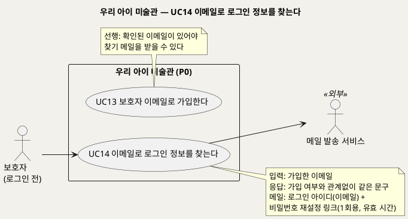
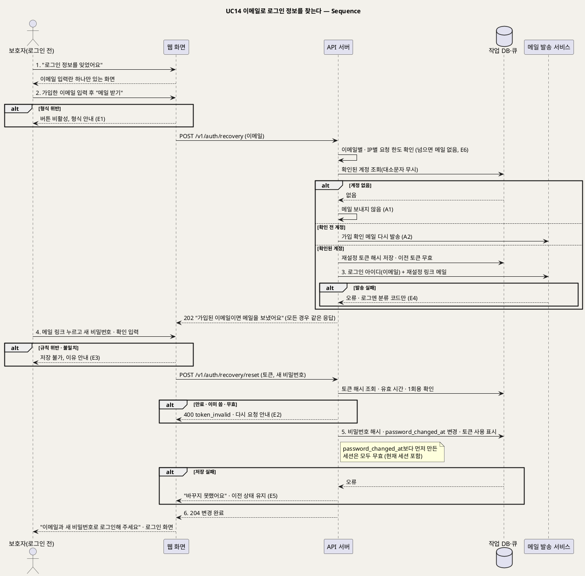

# UseCase 명세 — #14 이메일로 로그인 정보를 찾는다 (우리 아이 미술관 P0)
**우리 아이 미술관 · UC14 · UML 2.5.1 표준 (UseCase Diagram + UseCase 기술 + Sequence Diagram)**

---

> **문서 식별**: `design/UC_14_로그인정보찾기.md`
> **작성일**: 2026-09-28 (신규 문서, 통합 결정 D18) · **표준**: UML 2.5.1 (OMG)
> **원천(SoT)**: 신지현 결정(2026-09-28, D18) "로그인 정보를 잊었을 때 이메일로 메일을 보내 찾는다" — 그리고 `.specify/features/우리-아이-미술관/spec.md` v2.2 FR-32 · FR-31 · FR-14
> **개정 (2026-09-28, 이제민 조건부 승인)**: 비밀번호를 재설정하면 현재 세션을 포함해 그 계정의 모든 세션을 끊는다(`password_changed_at`보다 먼저 만든 세션 무효). 응답 코드와 이메일별·IP별 요청 한도를 확정했다.
> **다이어그램**: 모든 PlantUML 소스는 렌더 검증 완료(HTTP 200). 아래 링크로 브라우저에서 열 수 있다. 뷰어(plantuml.sumzip.com)는 사내 SSO 로그인 뒤에 열린다.
> **표기**: `[추론]` = 원천에 직접 없는 설계 판단 · `자료 없음 — 확인 필요` = 원천에 근거가 없는 항목

---

## 목차

1. [범위·개요](#1-범위개요)
2. [UseCase Diagram](#2-usecase-diagram)
3. [Actor 카탈로그](#3-actor-카탈로그)
4. [UseCase 목록 (원천 매핑)](#4-usecase-목록-원천-매핑)
5. [UseCase 기술 + Sequence Diagram](#5-usecase-기술--sequence-diagram)
6. [업무규칙 종합](#6-업무규칙business-rules-종합)
7. [UML 표준 준수 노트](#7-uml-표준-준수-노트)

---

## 1. 범위·개요

로그인 아이디는 가입한 이메일이다(UC13). 보호자가 로그인 정보를 잊으면 **가입한 이메일 주소를 입력하고, 그 주소로 온 메일의 링크를 눌러 비밀번호를 새로 정한다.** 메일에는 로그인 아이디(가입한 이메일)가 함께 적혀 있어, 어떤 주소로 가입했는지 헷갈린 보호자도 메일을 받은 주소가 로그인 아이디임을 알 수 있다 [추론].

이 화면은 **그 이메일이 가입돼 있는지 알려 주지 않는다.** 가입된 주소든 아니든 똑같이 "가입된 이메일이면 메일을 보냈어요"라고만 답한다. 남의 이메일이 이 서비스에 가입했는지 알아내는 데 쓰이지 않게 하기 위해서다(BR-ACC-08). 링크는 한 번만 쓸 수 있고 유효 시간이 지나면 쓸 수 없다. 이 UC는 모델을 부르지 않는다.

| 항목 | 값 |
|---|---|
| 대상 시스템 | 우리 아이 미술관 (P0) |
| 상위 프로세스 | 보호자 이메일 가입(UC13) → … → (잊었을 때) **로그인 정보 찾기(UC14)** → 로그인 → 이전 흐름 |
| 원천 근거 | D18(신지현 결정) · spec FR-32 · FR-31 · FR-14 |
| 핵심 UseCase | 1개 (UC14) |
| 주요 액터 | 보호자(로그인 전) · 메일 발송 서비스(보조) |

---

## 2. UseCase Diagram

**[「UC14 로그인 정보 찾기 UseCase Diagram」 PlantUML 뷰어로 열기](https://plantuml.sumzip.com/plantuml/svg/eNqVk99r01AUx9_vX3GoLy06sHRPZZThcD4JvvgmlLskbcPSXEluEBEhgzjq6sOEdltrWjro1EHA4DrNYOyP8TH35H_w3nTtquCDDyE_zvd8z_dzkmy6nDrca1vgaXXmOXWtZVp6vUkty3Be18vrxN017ZfUoW3Yodpu02GerW8xizlwb7uyXX78aEXhtqjOXpl2ExrUcg1iGQ0OnIFjNlscdNMxNG4ym3CTWwbgMBafI8B-gKMZiG8JdibpzIdffg-eb5XXQT4W5z0cXYvTEOSR_kxwlABO-uJiJs6uAeMbcdAT3SkhVOMyUkEWspMEx4cv7OJqR1AqAHXhiUcd3aT2Up7bg4hD3D8FDEJxFeDBNNc-paYFGxs4SMQPv1YjRKWndlMmL_wrevHZQznoDQHwXEOjrpT-J0k-WvX85VGBJdqfbmns4_hd1g9XmivkLSELVlhbq80d8yjqTqERYjNu3L4a1ljMlF5icla9s72bpqqjj6J7uagCHkdyNzjwQcKnFwEe76t9pPEARz6IKEkvI9k1b6-ugueLE71ecelegvtKehWI2BffOxJVZokwmMolgfiyl-1FxXI2_IDD8weA4SQbfgXshmkclIhh66Bo5kg7jHPWvmWqqNTBJDt6X4Vs0JfDxeEKk4qL4w4ezbCfA8Y3aRLDohjIT-OTOmHnROnUp7Yctimv5J_zG-NYpT4=)** — 클릭 시 브라우저로 연결됩니다.

#### 다이어그램 쉽게 읽기 (유저 관점)

- **누가 쓰나** — 로그인 정보를 잊은 보호자가 쓴다. 메일 발송 서비스가 찾기 메일을 실제로 보낸다.
- **무슨 순서로** — 이메일을 적는다 → 메일함에서 링크를 누른다 → 새 비밀번호를 정한다 → 로그인한다.
- **«include» = 항상 함께** — 로그인 전 행위라 INC1을 포함하지 않는다.
- **«extend» = 특정 상황에서만** — 이 UC에는 확장 관계가 없다.
- **Generalization(◁)** — 이 UC에는 없다.

| 기호 | 의미 |
|---|---|
| 사람 모양(actor) | 시스템을 쓰는 사람 또는 외부 구성요소(`<<외부>>`) |
| 타원(usecase) | 액터가 이루려는 목표 |
| 사각형(rectangle) | 시스템 경계 |
| 노트 | 규칙이나 선후 관계 보충 설명 |

---

## 3. Actor 카탈로그

| 구분 | 액터 | 이 UC에서의 역할 | 원천 근거 |
|:--:|---|---|---|
| Primary | 보호자(로그인 전) | 가입한 이메일을 입력하고, 메일의 링크로 비밀번호를 새로 정한다 | D18 · spec FR-32 |
| Secondary | 메일 발송 서비스 | 로그인 아이디와 재설정 링크가 담긴 메일을 보낸다. P0는 로컬 Mailpit + nodemailer | D18 · 이제민 결정 ⑤ · U19 |

---

## 4. UseCase 목록 (원천 매핑)

| UC ID | 유스케이스명 | 관계 | 원천 근거 |
|:--:|---|---|---|
| UC14 | 이메일로 로그인 정보를 찾는다 | 본 문서 | D18 · spec FR-32 |
| UC13 | 보호자 이메일로 가입한다 | 선행(확인된 이메일을 만든다) | D18 · spec FR-31 |

---

## 5. UseCase 기술 + Sequence Diagram

### 5.1 UC14 이메일로 로그인 정보를 찾는다

> **쉽게 말하면** — 비밀번호가 생각나지 않으면 가입할 때 쓴 이메일을 적습니다. 그 메일함으로 "로그인 아이디는 이 이메일이에요. 아래 링크로 비밀번호를 새로 정하세요" 메일이 옵니다. 링크는 한 번만, 정해진 시간 안에만 쓸 수 있습니다.

#### 유스케이스 기술

| 속성 | 내용 |
|---|---|
| **ID** | UC14 (D18 · spec FR-32) |
| **유스케이스명** | 이메일로 로그인 정보를 찾는다 |
| **액터** | 주: 보호자(로그인 전) · 보조: 메일 발송 서비스 |
| **사전조건** | (1) 로그인하지 않은 상태다. (2) 보호자가 UC13에서 가입해 이메일을 확인했다(확인 전 계정의 처리는 A2) |
| **사후조건** | (1) 가입된 이메일이면 그 주소로 로그인 아이디(이메일)와 1회용 재설정 링크가 담긴 메일이 간다. (2) 화면 응답은 가입 여부와 관계없이 같다. (3) 링크로 새 비밀번호를 정하면 비밀번호 해시가 바뀌고, 그 링크와 이전에 발급된 재설정 링크는 모두 쓸 수 없게 된다. (4) 비밀번호가 바뀌면 현재 세션을 포함해 그 계정의 모든 로그인 세션이 끊긴다. `password_changed_at`보다 먼저 만든 세션은 무효다(이제민 결정 ⑥). (5) 가족 데이터(아이·작품·이야기)는 바뀌지 않는다. (6) 운영 로그에는 이메일·토큰·비밀번호 원문이 남지 않는다 |
| **기본흐름** | ↓ 별도 기본흐름표 |
| **대체흐름** | A1. 가입되지 않은 이메일 · A2. 이메일 확인 전 계정 · A3. 어느 이메일로 가입했는지 모름 · A4. 메일을 다시 받기 — ↓ 별도 대체흐름표 |
| **예외흐름** | E1. 이메일 형식 위반 · E2. 링크 만료·재사용 · E3. 새 비밀번호 규칙 위반·불일치 · E4. 메일 발송 실패 · E5. 작업 DB 저장 실패 · E6. 찾기 요청 과다 — ↓ 별도 예외흐름표 |
| **포함/확장** | 없음. 로그인 전 행위라 INC1을 포함하지 않는다 |
| **우선순위** | High — 연락처를 받지 않던 D18 이전 설계의 "계정을 되찾을 수 없음"(옛 U19)을 해결하는 유일한 수단이다 |
| **사용빈도** | `자료 없음 — 확인 필요` |
| **업무규칙** | BR-ACC-06, BR-ACC-08, BR-ACC-02, BR-PRV-01 |
| **특별 요구사항** | 존재 비노출: 가입된 이메일이든 아니든 같은 문구·같은 응답 코드로 답한다. 응답 시간도 비슷하게 맞춘다 [추론]. 토큰: 1회용, 유효 시간 예시 30분 [추론 — 확정 아님, U19], DB에는 해시만 저장. 새 재설정 링크를 발급하면 이전 링크는 무효다 [추론]. 요청 한도: 이메일별·IP별 요청 한도를 둔다(예시: 같은 이메일 10분에 3회, 같은 IP 1시간에 20회 [추론 — 확정 아님, U19]). 메일 내용에는 로그인 아이디(이메일)와 링크만 담고, 아이 별칭·작품 등 가족 정보는 넣지 않는다 [추론]. 엔드포인트와 응답 코드(이제민 결정 ③): `POST /v1/auth/recovery` 항상 202 · `POST /v1/auth/recovery/reset` 성공 204, 토큰이 이미 쓰였거나 만료·무효면 구분 없이 400 `token_invalid` · 로그인 `POST /v1/auth/login` 성공 204·실패 401, 비밀번호가 맞았는데 이메일 확인 전이면 403 `email_unverified` · `POST /v1/auth/logout` |
| **비고** | 원천 추적: D18(2026-09-28 신지현 결정 "아이디를 잊었을 때 이메일로 메일을 발송해서 찾는다") · spec FR-32(신설) · FR-31 · FR-14 · 공통 기준 §8(BR-ACC-08) · §10(U8, U19). 로그인 아이디가 이메일이므로 "아이디 찾기"와 "비밀번호 재설정"을 한 흐름으로 합쳤다 [추론]. 어느 이메일로 가입했는지 전혀 모를 때는 시스템이 찾아 줄 수 없다(A3) — 다른 식별 정보를 받지 않기 때문이다 |

#### 기본흐름 (Basic Flow)

| 단계 | 액터 행위 | 시스템 행위 |
|:--:|---|---|
| 1 | 보호자가 로그인 화면에서 "로그인 정보를 잊었어요"를 누른다 | 이메일 입력란 하나만 있는 찾기 화면을 보여 준다 |
| 2 | 보호자가 가입한 이메일을 입력하고 "메일 받기"를 누른다 | 웹 화면이 형식을 검사한 뒤 `POST /v1/auth/recovery`를 보낸다. API 서버는 대소문자를 무시해 확인된 계정을 찾고, 있으면 1회용 재설정 토큰(해시)을 만들고 이전 토큰은 무효로 한다 |
| 3 | 보호자가 "가입된 이메일이면 메일을 보냈어요" 안내를 본다 | 계정이 있을 때만 메일 발송 서비스로 로그인 아이디(이메일)와 재설정 링크가 담긴 메일을 보낸다. 화면 응답은 계정이 있든 없든 같다 |
| 4 | 보호자가 메일의 링크를 누르고 새 비밀번호와 확인을 입력한다 | `POST /v1/auth/recovery/reset`로 토큰(유효 시간·1회용)과 새 비밀번호 규칙을 검사한다 |
| 5 | — | 비밀번호 해시와 `password_changed_at`을 바꾸고, 토큰을 쓴 것으로 표시한다. `password_changed_at`보다 먼저 만든 세션은 모두 무효가 된다(현재 세션 포함) |
| 6 | 보호자가 새 비밀번호로 로그인한다 | "비밀번호를 바꿨어요. 이메일과 새 비밀번호로 로그인해 주세요"를 보이고 로그인 화면으로 보낸다 |

#### 대체흐름 (Alternative Flow)

| ID | 분기 조건 | 흐름 |
|:--:|---|---|
| A1 | 입력한 이메일로 가입한 계정이 없다 | 메일을 보내지 않는다. 화면에는 기본흐름 3단계와 같은 문구를 보인다(BR-ACC-08) |
| A2 | 계정은 있으나 이메일 확인 전이다 | 재설정 메일 대신 가입 확인 메일(UC13 A1)을 다시 보낸다. 화면 문구는 같다 [추론] |
| A3 | 보호자가 어느 이메일로 가입했는지 모른다 | 쓰는 이메일 주소마다 찾기를 시도하라고 안내한다. 찾기 메일을 받은 주소가 로그인 아이디다. 시스템이 다른 정보로 찾아 주지는 않는다 [추론] |
| A4 | 메일을 받지 못했다 | 잠시 뒤 "메일 다시 받기"를 누른다. 새 토큰을 만들고 이전 토큰은 무효로 한다. 요청 한도를 따른다 |

#### 예외흐름 (Exception Flow)

| ID | 발생 조건 | 처리 | 근거 |
|:--:|---|---|---|
| E1 | 이메일이 비어 있거나 형식에 맞지 않는다 | 웹 화면이 "메일 받기" 버튼을 막고 형식을 안내한다 | [추론] |
| E2 | 링크가 만료됐거나, 이미 썼거나, 재발급으로 무효가 됐다 | 세 경우를 구분하지 않고 400 `token_invalid`로 답한다. 비밀번호를 바꾸지 않고 "링크를 쓸 수 없어요. 다시 요청해 주세요"라고 안내한다 | BR-ACC-08 · 이제민 결정 ③ |
| E3 | 새 비밀번호가 규칙에 맞지 않거나 확인 값과 다르다 | 저장 버튼을 막고 이유를 문장으로 안내한다. 토큰은 아직 쓴 것으로 보지 않는다 [추론] | BR-ACC-07 · [추론] |
| E4 | 메일 발송 서비스가 실패한다 | 화면 문구는 기본흐름 3단계와 같게 두고(존재 비노출), 운영 로그에 분류 코드(메일)만 남긴다. 보호자는 A4로 다시 요청한다 [추론] | BR-ACC-08 · BR-PRV-01 |
| E5 | 작업 DB 장애로 새 비밀번호를 저장하지 못한다 | "바꾸지 못했어요, 다시 시도해 주세요"라고 안내한다. 이전 비밀번호와 토큰 상태를 그대로 둔다 | BR-PRV-01 · [추론] |
| E6 | 짧은 시간에 찾기를 너무 많이 요청한다 | 이메일별·IP별 한도(예시: 같은 이메일 10분에 3회, 같은 IP 1시간에 20회 [추론])를 넘으면 메일을 보내지 않는다. 응답은 202 그대로다(가입 여부 비노출) | BR-ACC-08 · U19 |

#### Sequence Diagram

**[「UC14 로그인 정보 찾기 Sequence」 PlantUML 뷰어로 열기](https://plantuml.sumzip.com/plantuml/svg/eNqNVk9v2kgUv_tTPLEX0CYkJLSHHqomDV3lsNpI3Z7RFFxihZoUTKq9kcSJECA1UUwDxCCiEiWpqOoNbANa2kM_yh6Z8XfYN4NtoHDoAcmx33vz-_fsPMloJK1lXychI7-JprLpaGxbScajCZJMyum_oqGwlNlR1F2SJq_hJYntJNKprBp_mkqm0vDLs9Vnocj6REVmm8RTbxU1Aa9IMiNLmqIlZXjxNBQGVu_SW4PVB_TSBPwN73us3gPWLNNOl14NgFnfaMGgxRb8lzPgufwmK6sxWZJITMOzfFhlV3qsceKfbNYDPiAZ-C1L0nGFqBLC0JSYsktUDXzsog921aC3XVH0YnP68drWJjDdpHe6eIx_SnGikZckI2Nv45SdH8HG-vd7e_9EFGysT_eP6AC1THZ8KSb1dVZoidrfiZKUJBcWLD7G0-ERhILYNo97o8DO8-x9l9UMn4Sli9jhdT8ai4eVR7R5RRs5sMsVelCh1yW8l0flHKpzTl0JwtDKYaddNmdGgX2hT3C5GPYsn0SSGtiVMivWgZk6tSoSwCwqVM4uYFNft6sm0_9e8HrKeXrQBX8kFJBkNS4IPeYCY9PWH8__hKW90BLJattLaTmW2sOggd_DFZB4oVc_zk1Hh-_3sLnFL1AndvcJNTDpOx2Zl7mefqpXmDlAEcCleH7M6qUFiDz0pm6s49BRAz0xYdjR0QZgl5ZdK_lpKceOS7TNcwa03WVFMyDEcMvEPBQDpyyOIbp3p4C7kqLDB112nUNVClgG_jWuCm6HCxtT7Mwfj-D5wRkj29xCd2Kxhbjc3PnXVqbGjUmNpwnOrNFmeouzsI-b9r6F4nF-eDyeccWlRak5Fucx0rdrNzOQVoOT21vWuT-GMWEf_DpxFL3et_fbDnKcxbV0F6bYskt8PoxGT-hZadGrCkfknHRuAP2i83vsq0HPTB56fyQcwGYeL_4TIL3AL6-Ab6Qdl8PDJi7ccLC6Lsw5dPcO8_Pxhp41YXj3ldUsFL_K6mhb_ZQW_wnM2atw0LPEoZlHkN1hpwnsMM_3glo5epfH9xYn49ot1m6UqnuT9avOigm-X_IcWX_-vjlOYRFyWxB2mc3xsq3-7LLhRUbWwD8yemEG7A-7Mp0WsSgiLWYT84E2mkNLbGYIH7DarcNTEESj6IeSky36GckbOcFzKluensvLoKV2ZDWqqHskqcRF6SjtzsJ7ZFcCY9sdoA-C05I7iHHGLslk3qbScfy4ETUhx6MEoXVy6LPwZUSQHbQF-lMTuyQ1pcmQVhLbGqReiW8DzBvDA4RfLHozQHME3bMmVjK9x44qPD08UqcnDmGUvKLjcjjPwX7Xtss3ggnwA4Vmjsveeky_asRq_Cicj1rG8FuPv2Tox3_t916ix0vNDvftQ5Obxqv8kQeB2bV5GMTNCbvKsKqO3s35GPm8fRp2BjPhmfq8owXAPgw4XQfO-N3hfK6eIAz8_-N_rB8yDg==)** — 클릭 시 브라우저로 연결됩니다.

기본흐름 1~6단계는 시퀀스의 번호 붙은 주요 메시지 `1.`~`6.`과 1:1로 대응한다.

---

## 6. 업무규칙(Business Rules) 종합

| BR ID | 규칙 | 적용 UC | 근거 |
|---|---|---|---|
| BR-ACC-06 | 보호자 로그인 아이디는 이메일이며 서비스 전체에서 유일하다(대소문자 무시). 따로 아이디를 만들지 않는다 | UC13, UC14 | D18 |
| BR-ACC-08 | 확인·재설정 메일의 링크 토큰은 1회용이고 유효 시간이 있으며, 재발급하면 이전 토큰은 무효다. DB에는 토큰 해시만 둔다. 가입과 로그인 정보 찾기의 응답은 그 이메일이 가입돼 있는지 드러내지 않는다. 가입·확인 메일 재발송·찾기 메일에는 이메일별·IP별 요청 한도를 둔다(예시: 같은 이메일 10분에 3회, 같은 IP 1시간에 20회 [추론 — 확정 아님, U19]) | UC13, UC14 | D18 · 이제민 결정 ③④ · 보완 3 |
| BR-ACC-02 | 로그인하지 않은 사용자는 차단한다. 가입(UC13)과 로그인 정보 찾기(UC14)만 예외다 | UC1~UC7, UC10, UC13, UC14 | spec FR-9 수용기준 2 |
| BR-PRV-01 | 운영 로그에 이미지·객체 키·자유 입력·이메일·비밀번호·토큰·오류 원문을 남기지 않는다. 분류 코드와 요청 번호만 남긴다 | 전 UC | spec FR-14 |

---

## 7. UML 표준 준수 노트

| 항목 | 적용 |
|---|---|
| 액터 | 보호자(로그인 전)는 Primary, 메일 발송 서비스는 Secondary actor(`<<외부>>`)다 |
| System Boundary | `rectangle`로 우리 아이 미술관(P0)의 책임 범위를 표시했다 |
| UC 분리 | 가입(UC13)과 찾기(UC14)는 목표와 시점이 달라 따로 두었다. 로그인 아이디가 이메일이라 아이디 찾기와 비밀번호 재설정은 한 UC로 합쳤다 |
| Sequence | 존재 비노출을 드러내려고 계정 유무 분기(`alt`)가 모두 같은 응답 메시지로 모이게 그렸다. 예외는 E1~E6, 대체는 A1·A2를 붙였다 |

---

*우리 아이 미술관 P0 · UC14 · 2026-09-28 작성(D18) · 원천: 신지현 결정 D18 · spec.md v2.2 FR-32*
