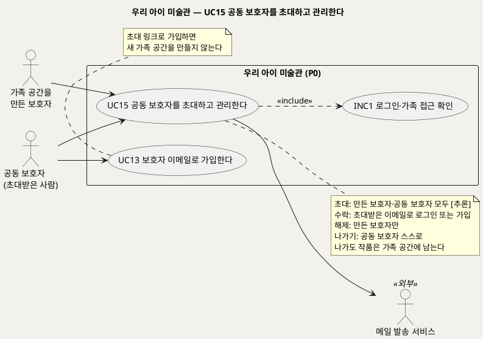
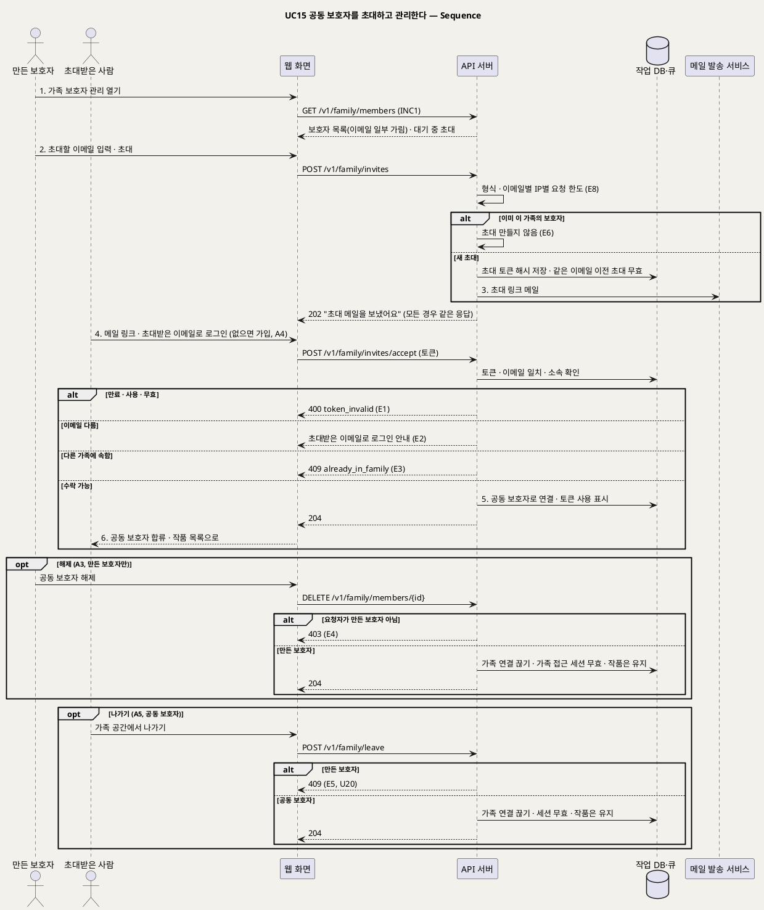

# UseCase 명세 — #15 공동 보호자를 초대하고 관리한다 (우리 아이 미술관 P0)
**우리 아이 미술관 · UC15 · UML 2.5.1 표준 (UseCase Diagram + UseCase 기술 + Sequence Diagram)**

---

> **문서 식별**: `design/UC_15_공동보호자관리.md`
> **작성일**: 2026-09-28 (신규 문서, U1 확정 · 통합 결정 D18) · **표준**: UML 2.5.1 (OMG)
> **원천(SoT)**: `.specify/features/우리-아이-미술관/spec.md` FR-9(U1 확정 2026-09-28 clarify: 공동 보호자 초대·같은 권한·해제는 만든 보호자만·스스로 나가기·나가도 작품은 남음) · FR-31(이메일 로그인, D18) · BR-APR-06(첫 결정만 반영)
> **다이어그램**: 모든 PlantUML 소스는 렌더 검증 완료(HTTP 200). 아래 링크로 브라우저에서 열 수 있다. 뷰어(plantuml.sumzip.com)는 사내 SSO 로그인 뒤에 열린다.
> **표기**: `[추론]` = 원천에 직접 없는 설계 판단 · `자료 없음 — 확인 필요` = 원천에 근거가 없는 항목

---

## 목차

1. [범위·개요](#1-범위개요)
2. [UseCase Diagram](#2-usecase-diagram)
3. [Actor 카탈로그](#3-actor-카탈로그)
4. [UseCase 목록 (원천 매핑)](#4-usecase-목록-원천-매핑)
5. [UseCase 기술 + Sequence Diagram](#5-usecase-기술--sequence-diagram)
6. [업무규칙 종합](#6-업무규칙business-rules-종합)
7. [UML 표준 준수 노트](#7-uml-표준-준수-노트)

---

## 1. 범위·개요

한 가족 공간은 여러 보호자가 함께 쓴다(U1 확정). **가족 공간을 만든 보호자**는 다른 보호자를 **이메일로 초대**한다. 초대 메일의 링크를 누른 사람은 이메일로 가입하거나(UC13) 로그인해 초대를 수락하고, 그 가족 공간의 **공동 보호자**가 된다. 초대로 가입하면 새 가족 공간은 만들지 않는다.

공동 보호자는 아이 등록·작품 접수·판정 확정·결과 결정·이야기·설명·삭제를 만든 보호자와 **똑같이** 할 수 있다. 권한 차이는 **해제** 하나다. 다른 보호자를 가족 공간에서 해제하는 것은 만든 보호자만 할 수 있고, 공동 보호자는 스스로 나갈 수만 있다. 나가거나 해제되면 그 계정은 즉시 가족 자료에 접근할 수 없지만, 그 사람이 올린 작품·이야기·설명은 가족 공간에 남는다. 두 보호자가 같은 작품에 결과 결정을 보내면 첫 결정만 반영된다(BR-APR-06).

이 UC는 모델을 부르지 않는다. API 서버, 작업 DB, 메일 발송 서비스가 관여한다.

| 항목 | 값 |
|---|---|
| 대상 시스템 | 우리 아이 미술관 (P0) |
| 상위 프로세스 | 보호자 이메일 가입(UC13) → **공동 보호자 초대·수락(UC15)** → 아이 등록(UC1) 이후 흐름을 함께 쓴다 |
| 원천 근거 | spec FR-9(U1 확정) · FR-31 · BR-APR-06 · D18 |
| 핵심 UseCase | 1개 (UC15) + 공통 1개 (INC1) |
| 주요 액터 | 가족 공간을 만든 보호자 · 공동 보호자(초대받은 사람) · 메일 발송 서비스(보조) |

---

## 2. UseCase Diagram

**[「UC15 공동 보호자 UseCase Diagram」 PlantUML 뷰어로 열기](https://plantuml.sumzip.com/plantuml/svg/eNqVVF1r2mAUvn9_xcHddBctE-mNFCmTFXaxj5tdrUPSGDU05h1JpIwxsM4N6YRqpyxuKhHc2g5hDl114G72U3aZ8-Y_7CRav8ouBrlI8j7Pec7znJPsmpZkWLmsBjk5wXNGQs6oWjKRljRNMV4kwtvMPFT155IhZeFAkg_TBs_pyTjXuAG39iJ74Xt3lxBmRkryI1VPQ0rSTIVpSsoCi4OhpjMWJFVDkS2V68xSLU0B8bGPX3og6kXRGgJ-G4uS4w7z8Cdfgyfx8Da4gx942gAcDD17LNoV_DwBMSxhOe_VbXfgAKGpgldv4rsuY5JsUVcht58Xne8-2e1T5eK-judlfO8s6oRAMuHRka4Yc86a0r6-MRXC_ifRyoMo9LBdvh0Q4_yahZc10ZoA9pvibQdEsYk_i-KkG6AeSKoGOzuiMcarfCzGmO9d0tPkO_Qv4xuP75DESwaQMxVZMgn6_zkE6j5tucz9h_EwYKfpjsaiNf49mmUknKo7moDXqNPbgOgD1_QjC2GgfqemqRb4RdpvVlUj7BVjQbSwuRmb9hHni_vAz9ZWLBCCKCWk6rKWSyoUUXDmI_3sllgRxnRuKbMt4qlrd9MIorA-XrK3Fhjg1wusVuCpuKphx3nmk0s2tn5FYXXMy_bmcQHaFTypzfwS16sPhdO8KUzPdIoFm5DuuB-9MTig7aCLKs9xeFoE0a56ZyW_gdXd_UCNFy5I2l9vRU-CH8M0iwNuWTw7CyMyD4NaOvaOe8vTsfFy6J-_LsH6lzE10BXn5Lx-sq6zS3f0Y_gLc2YVUA==)** — 클릭 시 브라우저로 연결됩니다.

#### 다이어그램 쉽게 읽기 (유저 관점)

- **누가 쓰나** — 가족 공간을 만든 보호자가 배우자 등 다른 보호자를 초대한다. 초대받은 사람은 링크를 눌러 합류한다. 메일 발송 서비스는 초대 메일을 보내는 외부 구성요소다.
- **무슨 순서로** — 초대(이메일 입력) → 초대 메일 → 링크를 눌러 로그인 또는 가입 → 공동 보호자로 합류. 필요하면 만든 보호자가 해제하거나 공동 보호자가 스스로 나간다.
- **«include» = 항상 함께** — 초대·해제·나가기는 로그인한 보호자의 일이라 INC1을 거친다. 수락은 초대 링크의 토큰으로 확인한다.
- **«extend» = 특정 상황에서만** — 이 UC에는 확장 관계가 없다.
- **Generalization(◁)** — 두 보호자 액터는 권한이 해제 하나만 다르다. 상속 대신 해제 흐름에만 조건을 걸었다.

| 기호 | 의미 |
|---|---|
| 사람 모양(actor) | 시스템을 쓰는 사람 또는 외부 구성요소(`<<외부>>`) |
| 타원(usecase) | 액터가 이루려는 목표 |
| 사각형(rectangle) | 시스템 경계 |
| 점선 `<<include>>` | 항상 함께 수행되는 하위 행위 |
| 노트 | 규칙 보충 설명 |

---

## 3. Actor 카탈로그

| 구분 | 액터 | 이 UC에서의 역할 | 원천 근거 |
|:--:|---|---|---|
| Primary | 가족 공간을 만든 보호자 | 공동 보호자를 초대하고, 필요하면 해제한다 | spec FR-9 (U1 확정) |
| Primary | 공동 보호자(초대받은 사람) | 초대를 수락해 합류하고, 원하면 스스로 나간다. 초대도 할 수 있다 [추론] | spec FR-9 (U1 확정) |
| Secondary | 메일 발송 서비스 | 초대 메일을 보낸다. P0는 로컬 Mailpit + nodemailer | D18 · 이제민 결정 ⑤ |

---

## 4. UseCase 목록 (원천 매핑)

| UC ID | 유스케이스명 | 관계 | 원천 근거 |
|:--:|---|---|---|
| UC15 | 공동 보호자를 초대하고 관리한다 | 본 문서 | spec FR-9 (U1 확정) |
| INC1 | 로그인·가족 접근 확인 | UC15가 «include»(초대·해제·나가기) | spec FR-9 |
| UC13 | 보호자 이메일로 가입한다 | 초대받은 사람이 계정이 없으면 초대 링크로 가입(UC13 A4) | spec FR-31 |

---

## 5. UseCase 기술 + Sequence Diagram

### 5.1 UC15 공동 보호자를 초대하고 관리한다

> **쉽게 말하면** — 엄마가 가족 공간을 만들었다면, 아빠의 이메일을 적어 초대합니다. 아빠는 메일의 링크를 눌러 가입(또는 로그인)하면 같은 아이들과 작품을 똑같이 관리할 수 있습니다. 다른 사람을 내보내는 것만은 가족 공간을 만든 엄마가 할 수 있고, 아빠는 스스로 나갈 수만 있습니다. 나가도 올린 작품은 그대로 남습니다.

#### 유스케이스 기술

| 속성 | 내용 |
|---|---|
| **ID** | UC15 (spec FR-9 U1 확정 · D18) |
| **유스케이스명** | 공동 보호자를 초대하고 관리한다 |
| **액터** | 주: 가족 공간을 만든 보호자, 공동 보호자 · 보조: 메일 발송 서비스 |
| **사전조건** | (1) 초대하는 보호자가 로그인되어 있고 이메일 확인을 마쳤다(INC1, UC13). (2) 초대받는 사람이 메일을 받을 수 있는 이메일 주소를 갖고 있다 |
| **사후조건** | (1) 초대를 수락한 계정은 그 가족 공간의 공동 보호자가 된다. (2) 한 계정은 한 가족 공간에만 속한다 [추론, U20]. (3) 가족 공간을 만든 보호자는 가족마다 한 명이다. (4) 해제되거나 나간 계정은 즉시 그 가족 자료에 접근할 수 없고, 그 계정의 세션에서 가족 접근이 끊긴다. (5) 나가거나 해제된 보호자가 올린 작품·이야기·설명은 가족 공간에 남는다. (6) 운영 로그에는 이메일·토큰 원문이 남지 않는다 |
| **기본흐름** | ↓ 별도 기본흐름표 (초대 → 수락 기준) |
| **대체흐름** | A1. 공동 보호자가 초대 · A2. 초대 취소 · A3. 만든 보호자가 해제 · A4. 초대받은 사람이 계정이 없음(초대 링크로 가입) · A5. 공동 보호자가 스스로 나가기 · A6. 나간 계정이 다시 로그인 — ↓ 별도 대체흐름표 |
| **예외흐름** | E1. 초대 링크 만료·사용·무효 · E2. 초대받은 이메일과 로그인한 계정 이메일이 다름 · E3. 이미 다른 가족 공간에 속한 계정 · E4. 공동 보호자가 다른 보호자를 해제하려 함 · E5. 만든 보호자가 나가려 함 · E6. 이미 이 가족의 보호자 · E7. 메일 발송 실패 · E8. 초대 요청 과다 — ↓ 별도 예외흐름표 |
| **포함/확장** | «include» INC1 로그인·가족 접근 확인(초대·해제·나가기) |
| **우선순위** | High — U1 확정으로 P0 계정 모델이 되었다. 공동 감상·공동 관리가 서비스 가치(가족이 함께 본다)의 전제다 |
| **사용빈도** | 가족당 초대 몇 회. 정량값은 `자료 없음 — 확인 필요` |
| **업무규칙** | BR-ACC-09, BR-ACC-01, BR-ACC-04, BR-ACC-06, BR-ACC-08, BR-APR-06, BR-PRV-01 |
| **특별 요구사항** | 초대 링크 토큰: 1회용·유효 시간(예시 7일 [추론, U19])·해시 저장. 같은 가족·같은 이메일로 다시 초대하면 이전 초대는 무효 [추론]. 초대 응답은 초대받은 이메일이 가입돼 있는지 드러내지 않는다(항상 202) [추론 — BR-ACC-08과 같은 원칙]. 초대 메일에는 초대한 보호자의 이메일 일부(가림)와 링크만 담고 아이 별칭·작품은 넣지 않는다 [추론]. 초대 요청에도 이메일별·IP별 요청 한도를 둔다. 초대 링크로 가입하면 초대 메일 수신으로 이메일 소유가 확인된 것으로 보고 따로 확인 메일을 보내지 않는다 [추론]. 엔드포인트 [추론, U8 — B 확인 필요]: `POST /v1/family/invites`(항상 202) · `DELETE /v1/family/invites/{id}`(204) · `POST /v1/family/invites/accept`(204 / 400 `token_invalid` / 409 `already_in_family`) · `GET /v1/family/members` · `DELETE /v1/family/members/{id}`(204 / 403 만든 보호자 아님) · `POST /v1/family/leave`(204 / 409 만든 보호자) |
| **비고** | 원천 추적: spec FR-9 수용기준(초대·같은 권한·해제는 만든 보호자만·스스로 나가기·해제 즉시 접근 불가·나가도 작품 남음·첫 결정만 반영) · U1 확정(2026-09-28 clarify, "넷플릭스 계정 공유 방식") · FR-31 이메일 로그인(D18). 원천에 없는 판단: 공동 보호자도 초대 가능, 한 계정 한 가족, 초대 유효 7일, 초대로 가입 시 확인 메일 생략, 만든 보호자의 탈퇴·권한 이전 — U20 |

#### 기본흐름 (Basic Flow)

| 단계 | 액터 행위 | 시스템 행위 |
|:--:|---|---|
| 1 | 만든 보호자가 "가족 보호자 관리"를 연다 | INC1로 로그인과 가족 공간을 확인하고, 이 가족의 보호자 목록(만든 보호자·공동 보호자, 이메일 일부 가림)과 대기 중 초대를 보여 준다 |
| 2 | 만든 보호자가 초대할 이메일을 입력하고 "초대"를 누른다 | `POST /v1/family/invites`. 형식·요청 한도를 확인하고, 1회용 초대 토큰(해시)을 만들고 같은 이메일의 이전 초대를 무효로 한다. 항상 202로 답한다 |
| 3 | — | 메일 발송 서비스로 초대 링크 메일을 보낸다 |
| 4 | 초대받은 사람이 메일의 링크를 누르고, 초대받은 이메일로 로그인한다 | `POST /v1/family/invites/accept`로 토큰(유효 시간·1회용)과 로그인 계정의 이메일이 초대받은 이메일과 같은지, 다른 가족에 속하지 않았는지 확인한다 |
| 5 | — | 계정을 그 가족 공간의 공동 보호자로 연결하고, 초대 토큰을 쓴 것으로 표시한다 |
| 6 | 공동 보호자가 가족 공간으로 들어간다 | "하*네 가족의 공동 보호자가 되었어요"를 보이고 작품 목록(S4)으로 보낸다. 만든 보호자의 보호자 목록에도 나타난다 |

#### 대체흐름 (Alternative Flow)

| ID | 분기 조건 | 흐름 |
|:--:|---|---|
| A1 | 공동 보호자가 다른 사람을 초대한다 | 기본흐름 1~6과 같다. 초대는 같은 권한에 속한다고 본다 [추론, U20] |
| A2 | 초대를 보낸 보호자가 초대를 취소한다 | `DELETE /v1/family/invites/{id}`. 초대 토큰을 무효로 하고 목록에서 뺀다 |
| A3 | 만든 보호자가 공동 보호자를 해제한다 | 확인 창("해제하면 이 가족 자료를 볼 수 없게 돼요. 올린 작품은 남아요") 뒤 `DELETE /v1/family/members/{id}`. 그 계정의 가족 연결을 끊고 가족 접근 세션을 무효로 한다. 작품·이야기·설명은 남는다 |
| A4 | 초대받은 사람이 계정이 없다 | 링크에서 "이메일로 가입"을 누른다. 초대받은 이메일이 미리 채워진 가입 양식(UC13)을 쓰고, 가입하면 **새 가족 공간을 만들지 않고** 초대한 가족의 공동 보호자가 된다. 초대 메일 수신으로 이메일 소유가 확인된 것으로 본다 [추론] |
| A5 | 공동 보호자가 스스로 나간다 | 확인 창 뒤 `POST /v1/family/leave`. 가족 연결을 끊고 가족 접근 세션을 무효로 한다. 올린 작품은 남는다 |
| A6 | 나가거나 해제된 계정이 다시 로그인한다 | 속한 가족이 없으므로 "새 가족 공간 만들기" 또는 "받은 초대 수락"만 할 수 있다 [추론, U20] |

#### 예외흐름 (Exception Flow)

| ID | 발생 조건 | 처리 | 근거 |
|:--:|---|---|---|
| E1 | 초대 링크가 만료됐거나, 이미 썼거나, 취소·재초대로 무효다 | 구분하지 않고 400 `token_invalid`. "초대 링크를 쓸 수 없어요. 초대한 분께 다시 요청해 주세요" | BR-ACC-08 · 이제민 결정 ③과 같은 규칙 |
| E2 | 로그인한 계정의 이메일이 초대받은 이메일과 다르다 | 수락하지 않고 "초대받은 이메일로 로그인해 주세요"라고 안내한다 [추론] | BR-ACC-09 |
| E3 | 로그인한 계정이 이미 다른 가족 공간에 속해 있다 | 409 `already_in_family`. "이미 다른 가족 공간에 있어요. 나간 뒤 수락할 수 있어요"(만든 보호자면 나갈 수 없음, U20) [추론] | BR-ACC-09 · U20 |
| E4 | 공동 보호자가 다른 보호자를 해제하려 한다 | 403으로 거부한다. 공동 보호자 화면에는 해제 버튼을 두지 않는다 | spec FR-9 · BR-ACC-09 |
| E5 | 만든 보호자가 나가려 한다 | 409로 거부한다. 만든 보호자의 탈퇴·권한 이전은 `자료 없음 — 확인 필요` (U20) | BR-ACC-09 · U20 |
| E6 | 이미 이 가족의 보호자인 이메일을 초대한다 | 초대를 만들지 않는다. 응답은 202 그대로(가입 여부 비노출) [추론] | BR-ACC-08 |
| E7 | 메일 발송 서비스가 실패한다 | 초대는 남기고 "다시 보내기"를 안내한다. 로그에는 분류 코드(메일)만 남긴다 | [추론] |
| E8 | 짧은 시간에 초대를 너무 많이 보낸다 | 이메일별·IP별 요청 한도를 넘으면 메일을 보내지 않는다 | BR-ACC-08 · U19 |

#### Sequence Diagram

**[「UC15 공동 보호자 Sequence」 PlantUML 뷰어로 열기](https://plantuml.sumzip.com/plantuml/svg/eNqlVl1vGlcQfd9fMXJeQHL4tKPGD1X8QSpLbWMp8TO6ho2z8hocWDuyqkrYWVvIECW0pmAHEKjGCRFVqb2pseS85Kf0ce_d_9C5d3dZPlzJUh8WtLszZ849c2bgUVYjGW17U4Ws_DKe3s7EEy8UNRlfJ6oqZ3bj4Vkpu6GktkiGbMIaSWysZ9LbqeRiWk1n4N7j6ONwbGEoIvuCJNOvlNQ6PCdqVpY0RVNlWF0Mz4J5-Zm-PQF6aVjVPmu8o-0bYEaeFnNWuWpeNsE0cvS8a5VrtHAG_-SO4an8cltOJWRJIgkNy03RD0X6a9ODmAKShSevUnLGjbABae89q-eA7XdpoyiCFtMSEtSUhLJFUhrGvb8G6-SYdgzxenV59PX8yjIwvUYvdPEab6Uk0cgaycqY2yixygEsLXy9svZsDksLo_m0c8zqN0B7NXbYEkjXOjs6E7E_EEWVJMEa7n-LpWEOwgEweznW-ss7myMHsIph9nsShmEw5zUH38WeQXAnHHxONhV1N7gpb67JmSz4ln9cDPslHnPfBfbg6KcObdV9rG445PCif-d4XXp-44evV4DKYSlgZyWnMeM0I4FBx5owhNQ4oM02R3DShsmuPHk6wlZJ7SianLVpukFWtcwKdYHgotJLHZZX-Cc7PWYXfwA3xlsdfLFv_BJRNRH5Z59_OdqxetU7rwQwUsFmBsJBZ-wDmqN8xOpFhHvgl2S0KrDXeZf_IHdpwUu1DpvWXg9pGKxQA9bMsYY4s9k7EWYbEtZgTX1QsWtYpx89SN5-BI0GPEp71l4X7GRJTiVHOxgJRVxbOzGsrvNz0td59puB4kyBj376yAfDvPjCTnseoxItfPZL0mJ60MGZALjetMsOmubOzED_Vg3wMq_6rN4HH6scstoNzosQu3EwDfMz_rs0OkgSCXlLA5-tn18altbRdLjv3JfsuiqeHRbZ4Ruc0zJSED3n7fu9KN7td9lpR7h2RODBQUMh0NIbciqOPIiqJLHTYbfTg1q4aei5Pp57F0FYOU_3DQSNOKAcqt13rVh5h-zfWOVbeD0EomZkktxFZnFbK4SJutzyVVr_IqbyqD1mxNnA5BJFUqzSMy-EiI6cjjZWqYZOHScQCc3go1X7CTpjDh5MwqLLO7RtN6FRsn7JO-uDW6BVEyaV0thUPgzNGvjmo9Mwvpzx3o-VRjfILYU4gsPItdJS7PvYs9gtOy74k5L8GYPF_Iu1gBio1URx7I9OC1UMndA_imrPcGZ228YSvQxHdGcvOyLTvSO-IsXY28-bJfMKTav32UHV8aInmzBQrYn7ZpKJ3QguJb-4mnS_iqgc3zc_Oz2hFec8NMoOAYwyezoaDn9lPIQxQcdnU5XJjuzo-N8KDHvWF0NGq5HQQLhxdncW7n9L9Qg_8A_Lv7GQEoA=)** — 클릭 시 브라우저로 연결됩니다.

기본흐름 1~6단계는 시퀀스의 번호 붙은 주요 메시지 `1.`~`6.`과 1:1로 대응한다.

---

## 6. 업무규칙(Business Rules) 종합

| BR ID | 규칙 | 적용 UC | 근거 |
|---|---|---|---|
| BR-ACC-09 | 한 가족 공간은 만든 보호자 1명과 초대받은 공동 보호자 여러 명이 같은 권한으로 쓴다. 다른 보호자 해제는 만든 보호자만, 공동 보호자는 스스로 나가기만 한다. 해제·나가기 즉시 가족 접근이 끊기고 올린 자료는 남는다. 초대는 초대받은 이메일로만 수락할 수 있고, 한 계정은 한 가족 공간에만 속한다 [추론] | UC15 (UC1~UC7, UC10 권한 전제) | spec FR-9 (U1 확정) · D18 |
| BR-ACC-01 | 가족 단위로 격리한다 | UC1~UC7, UC10, UC15 | spec FR-9 |
| BR-ACC-04 | 작품·아이 삭제는 보호자(만든 보호자와 공동 보호자)만 한다 | UC7 | spec FR-9 |
| BR-ACC-08 | 메일 링크 토큰 1회용·유효 시간·해시 저장·재발급 시 이전 무효. 가입 여부를 드러내지 않는다. 이메일별·IP별 요청 한도 | UC13, UC14, UC15 | D18 · 이제민 결정 |
| BR-APR-06 | 두 보호자가 같은 작품에 결과 결정을 보내면 첫 결정만 반영한다 | UC4 (UC15 전제) | spec FR-9 |

---

## 7. UML 표준 준수 노트

| 항목 | 적용 |
|---|---|
| 액터 | 만든 보호자와 공동 보호자는 모두 Primary다. 권한 차이가 해제 하나라 Generalization을 쓰지 않고 해제·나가기 흐름에 조건을 걸었다 |
| «include» | 초대·해제·나가기는 INC1을 포함한다. 수락은 로그인 뒤 토큰으로 확인한다 |
| UC 경계 | 초대·수락·해제·나가기는 모두 "가족 보호자 구성을 관리한다"는 한 목표라 한 UC로 두고 대체흐름으로 나눴다 |
| Sequence | 초대 응답은 모든 경우 같은 202로 모이게 그렸다(가입 여부 비노출). 해제·나가기는 `opt`로 붙였다 |

---

*우리 아이 미술관 P0 · UC15 · 2026-09-28 작성(U1 확정 · D18) · 원천: spec.md FR-9 · FR-31*
