# UseCase 통합 명세 — 가족 그림 미술관 (P0)
**가족 그림 미술관 · 개요 + UC1~UC11 통합본 · UML 2.5.1 표준 (UseCase Diagram + UseCase 기술 + Sequence Diagram)**

---

> **문서 식별**: `design/UC_ALL_가족그림미술관_통합명세.md`
> **작성일**: 2026-09-23 · **표준**: UML 2.5.1 (OMG)
> **원천(SoT)**: `.specify/features/가족-그림-미술관/spec.md` (v1.0 Draft) — P0 기능 명세. 보조 원천 `Intent-Specify.md` (2026-09-23 기획 기준안)
> **통합 기준**: 같은 폴더의 두 산출물(UC별 문서 `UC_00`~`UC_09`와 이전 통합본)을 검토해 하나로 합쳤다. 본문(범위·다이어그램·14속성·흐름·업무규칙 ID)은 원천 추적과 예외흐름이 더 촘촘한 UC별 문서를 기준으로 삼았다. 시퀀스 다이어그램은 분기 논리를 고쳤고, 빠져 있던 업무규칙 3개를 보탰다. 자세한 내용은 §9.1에 있다.
> **다이어그램**: 전체 UseCase Diagram 1개와 UC별 UseCase·Sequence Diagram 각 1개가 있다. 모든 PlantUML 소스는 사내 Kroki(`plantuml.sumzip.com`)에서 렌더를 검증했다(HTTP 200, image/svg+xml, Syntax Error 없음). 링크를 누르면 브라우저에서 열린다.
> **개정 (2026-09-28)**: 추가 요구 R1~R4(모델 정의 · 모델을 쓰는 기능 · 가상환경 uvicorn API 서버 · 'API활용' 메뉴)를 반영했다. §2.1~§2.5, §7.10 UC10, §7.11 UC11, 업무규칙 BR-API-01~09를 새로 넣고, L1 다이어그램과 §3·§4·§8·§9를 고쳤다. 새 다이어그램 4개와 L1도 같은 방식으로 렌더를 검증했다.
> **표기**: `[추론]` = 원천에 직접 없는 설계 판단 · `자료 없음 — 확인 필요` = 원천에 근거가 없는 항목

---

## 목차

1. [시스템 목적·개요](#1-시스템-목적개요)
2. [주요 기능](#2-주요-기능) — 2.1 추가 요구사항 · 2.2 핵심 모델 정의 · 2.3 모델을 쓰는 기능 · 2.4 모델 API 서버 구성 · 2.5 'API활용' 메뉴 구성
3. [유스케이스 목록](#3-유스케이스-목록)
4. [Actor 카탈로그](#4-actor-카탈로그)
5. [L1 UseCase Diagram](#5-l1-usecase-diagram)
6. [시스템 경계 (하지 않는 것)](#6-시스템-경계-하지-않는-것)
7. [유스케이스 상세](#7-유스케이스-상세) — 7.1 UC1 ~ 7.11 UC11
8. [업무규칙(Business Rules) 종합](#8-업무규칙business-rules-종합)
9. [통합 기록·결론](#9-통합-기록결론)

---

## 1. 시스템 목적·개요

**목적** — 아이의 그림과 그날의 말을 가족이 함께 간직하고, 시간이 흐른 뒤에도 다시 만나는 기록으로 잇는다. 기술은 기억을 꾸며내지 않는다. 다시 꺼내 보는 수단일 뿐이다. (원천: spec §Overview Problem Statement · Intent [미션])

**개요** — 보호자가 휴대폰으로 찍은 그림을 올리면, 시스템은 두 가지 중 하나로 결과를 만든다. 사람 형태 그림은 **움직이는 작품**으로, 그 밖의 그림이나 품질이 미달한 결과는 **원본 액자**로 만든다. 보호자는 결과를 확인해 승인하고, 제목·제작일·제작 당시 연령·아이의 한마디를 직접 입력한다. 승인된 작품만 아이별·연령별 **가족용 2D 전시**에 걸린다. 이번 범위(P0)는 다음 흐름까지다(spec §비전과 이번 범위(P0)의 위치 · Intent [개요]).

내구 접수 → 움직임/액자 → 부모 확인 → 이야기 직접 입력 → 2D 전시 · 삭제 · 운영 지표

**핵심 원칙** (원천: spec §Constraints)

| 원칙 | 내용 |
|---|---|
| 승인 전 비전시 | 보호자 승인 없이 어떤 결과도 전시하지 않는다 |
| 원본 불변 | 원본을 덮어쓰지 않고, 결과물은 처음 만든 것을 보관한다 |
| 원인 분리 | 정상 액자, 품질 미달 액자, 인프라 실패를 섞지 않는다 |
| 최소 수집 | 아이는 별칭만 받는다. 실명, 생년월일, 출생연도는 받지 않는다 |
| 기억 왜곡 금지 | 입력에 없는 사건·감정을 만들지 않고, 자동 해석·발달 평가·비교를 하지 않는다 |

**증거 수준** — 엔진을 개인 PC에서 단독 실행한 것만 확인했다. 통합 서비스, 팀 서버, 사용자 반응은 검증 전이다(spec 머리말).

---

## 2. 주요 기능

| # | 기능 | 설명 | 원천 근거 | 관련 UC |
|:--:|---|---|---|:--:|
| F1 | 아이 등록 | 별칭 하나로 등록, 여러 아이 가능 | spec FR-1 | UC1 |
| F2 | 내구 접수 | 형식·용량·판독 검사. 원본·작품·작업 기록이 모두 저장돼야 접수 | spec FR-2, FR-15 | UC2 |
| F3 | 경로 결정 | "사람·캐릭터 그림인가요?"에 대한 보호자 답으로 움직임/원본 액자 경로를 정함 | spec FR-3 | UC2 |
| F4 | 백그라운드 처리·상태 조회 | 올리기와 처리를 분리하고, 작품별 상태를 조회 | spec FR-4, FR-11, FR-15 | UC3 |
| F5 | 결과 분류 | 움직임 / 정상 액자 / 품질 대체 액자 / 인프라 실패(제한 재시도) | spec FR-5 | UC3 |
| F6 | 부모 확인 | 좋아요 · 액자로 걸기 · 다시 찍기, 승인 전 비전시 | spec FR-6 | UC4 |
| F7 | 이야기 직접 입력 | 제목·제작일·제작 당시 연령(필수), 아이의 한마디(선택, 원문 그대로) | spec FR-7 | UC5 |
| F8 | 가족용 2D 전시 | 아이별 → 연령 묶음 → 제작일 순, 골라서 재생, 무한 피드 없음 | spec FR-8 | UC6 |
| F9 | 가족 단위 접근 권한 | 다른 가족·비로그인·운영자의 이미지 접근 차단 | spec FR-9 | 공통(«include») |
| F10 | 삭제·실행 중 취소 | 새 작업 차단 → 취소 확인 → 원본·결과·임시 파일 삭제, 집계 필드만 남김 | spec FR-10, FR-11 | UC7 |
| F11 | 생존·준비 상태 | 생존과 준비를 분리 확인, 엔진 불가는 따로 표시 | spec FR-12 | UC8 |
| F12 | 운영 지표 | 지표 6종, 원인별 분리 집계, 이미지·식별 정보 없음 | spec FR-13, FR-14 | UC8 |
| F13 | 엔진 재현·평가 세트 | 버전·시간·메모리·오인 사례 기록, 버전을 바꿀 때 재평가 | spec FR-16, FR-17 | UC9 |
| F14 | 사용 관찰 기록 | 부모 역할 사용자의 막힌 지점 관찰 | spec FR-18 | 미전환(§9) |
| F15 | 추적성 | REQ → UC → T → 증거 연결 | spec FR-19 | 미전환(§9) |

### 2.1 추가 요구사항 (2026-09-28)

이 절부터 §7.10·§7.11까지는 2026-09-28에 받은 추가 요구 4건을 반영했다. 원천 추적을 위해 네 요구에 R1~R4 번호를 붙인다.

| ID | 추가 요구 | 반영 위치 |
|:--:|---|---|
| R1 | 모델 정의 — 이 모델의 용도, 입력, 출력, 모델 경로를 밝힌다 | §2.2 |
| R2 | 모델을 유스케이스의 기능으로 쓴다 — 사용자가 무엇을 입력하면 무엇을 처리해 무엇을 출력하는지 밝힌다 | §2.3 · UC2 · UC3 · UC10 |
| R3 | 모델을 쓰는 기능은 가상환경(uvicorn)의 API 서버로 구성하고 웹서비스에 연동한다 | §2.4 · UC10 |
| R4 | API 서버는 엔드포인트·가이드라인·매뉴얼을 담은 'API활용' 메뉴를 갖춘다 | §2.5 · UC11 |

추가 기능

| # | 기능 | 설명 | 원천 근거 | 관련 UC |
|:--:|---|---|---|:--:|
| F16 | 모델 API 서버 | 애니메이션 모델을 웹서비스와 분리된 API 서버(Python 가상환경 + uvicorn)로 제공한다. 웹서비스는 HTTP API로만 모델을 부른다 | R2 · R3 · Intent [핵심 이네이블러] FastAPI · 엔진 어댑터 | UC10 |
| F17 | API활용 메뉴 | 엔드포인트, 가이드라인, 매뉴얼을 한 메뉴에서 본다. 운영자와 개발 팀원만 쓴다 | R4 | UC11 |

### 2.2 핵심 모델 정의 (R1)

> **쉽게 말하면** — 이 모델은 아이가 그린 사람·캐릭터 그림 사진을 받아서, 그 그림 속 인물이 실제로 움직이는 짧은 영상으로 바꿔 줍니다. 사람이 아닌 그림(집, 자동차 등)에는 쓰지 않습니다.

| 항목 | 내용 | 근거 |
|---|---|---|
| 모델명 | Meta Animated Drawings (코드·가중치 MIT). 2025-09-03 저장소 보관 처리 | spec Dependencies · Intent [핵심 이네이블러] |
| 용도 | 아이가 그린 **사람·팔다리가 있는 캐릭터 그림**을 **움직이는 작품**으로 만드는 애니메이션 엔진. 움직임 경로 전용이며 원본 액자 경로에는 쓰지 않는다 | spec FR-3 · Intent [핵심 활동] 4 |
| 입력 | 그림 사진 1장. UC2 접수 검사를 통과한 원본(JPEG·PNG·HEIC, 20MB 이하 기본값). 원본은 읽기만 하고 바꾸지 않는다 | spec Assumptions 허용 형식·용량 · BR-INT-04 |
| 내부 처리 | 사람 형태 검출 → 관절 추정 → OpenCV 기반 분할 → 리깅 → 렌더 | Intent [핵심 이네이블러] 애니메이션 |
| 출력 | (1) 움직이는 작품 파일 1개 (2) 결과 분류(움직임 / 품질 미달) (3) 검출 점수(기록용) (4) 엔진 버전 (5) 단계별 소요 시간. [추론] 원본 엔진의 기본 출력은 GIF 애니메이션이다. 서비스에서 쓸 파일 형식(GIF/MP4 등)은 `자료 없음 — 확인 필요` | spec FR-5 · FR-16 수용기준 2 |
| 모델 실행 구성요소 | TorchServe(2025-08-07 보관 처리). 검출 모델과 관절 추정 모델을 서빙한다. API 서버 뒤의 내부망에만 둔다 | spec Dependencies · FR-16 |
| **모델 경로** | `자료 없음 — 확인 필요`. 원천(spec·Intent)에 팀 서버 설치 경로가 없다. [추론] 공개 저장소 구성에서는 두 모델 파일(`drawn_humanoid_detector.mar`, `drawn_humanoid_pose_estimator.mar`)을 TorchServe 모델 저장소(model-store) 폴더에 두고 적재한다. 팀 서버 경로는 UC9 재현 기록(A3)에서 확정해 이 칸과 API 서버 설정(`MODEL_STORE_PATH` [추론])에 같은 값으로 적는다 | spec FR-16 수용기준 1 |
| 자원 실측(1차) | 개인 PC(CPU 4코어·메모리 3.8GB·그래픽 카드 없음)에서 한 장 53~62초(렌더 약 40초), 모델 서버 약 3.1GB. 빌드 약 36분, 설치 크기 32.9GB. 팀 서버 수치는 미측정 | Intent [핵심 장벽] 인프라·엔진 재현 |
| 알려진 한계 | 집 그림을 사람 점수 0.946으로 잘못 잡아 벽에 관절이 붙은 사례가 있다. 그래서 검출 점수는 기록만 하고 승인 근거로 쓰지 않는다 | Intent [핵심 장벽] 적용 범위·품질 · BR-PRC-04 |
| 예비 모델 | 그림 전용 YOLOv8 자세 모델(가중치 AGPL-3.0), rtmlib(Apache-2.0). 교체해도 API 규격은 그대로 둔다(BR-API-01) | spec Dependencies · FR-16 수용기준 3 |

### 2.3 모델을 쓰는 기능 (R2)

모델은 **움직임 경로의 작품 변환 기능**(F3·F4·F5)으로 쓴다. 보호자가 UC2에서 그림 사진을 올리고 "사람이나 캐릭터 그림인가요?"에 **"예"**라고 답하면, UC3의 백그라운드 처리가 모델 API(UC10)를 불러 **움직이는 작품**을 만든다. 보호자는 그 결과를 UC4에서 확인한다.

| 단계 | 사용자 입력 | 시스템 처리 (모델 사용) | 출력 | UC |
|:--:|---|---|---|:--:|
| 1 | 보호자가 아이를 고르고 그림 사진 1장을 올린다 | 형식·용량·판독을 검사하고 원본·작품 기록·작업 기록을 저장한다. 모델은 아직 부르지 않는다 | "접수 완료" | UC2 |
| 2 | "사람이나 캐릭터 그림인가요?"에 "예"라고 답한다 | 작업 경로를 "움직임"으로 정한다. "아니요"면 모델을 부르지 않고 원본 액자를 만든다(BR-PRC-01) | 처리 상태 "처리 중" | UC2 |
| 3 | (입력 없음 — 보호자는 화면을 떠나도 된다) | 처리 담당이 모델 API 서버에 원본을 보내고, 모델이 검출·관절 추정·분할·리깅·렌더를 한다 | 결과 분류, 검출 점수(기록용), 엔진 버전, 단계별 시간 | UC3 → UC10 |
| 4 | 보호자가 작품 목록에서 진행 상태를 확인한다 | 성공이면 움직이는 작품을 저장한다. 품질 미달이면 재시도 없이 원본 액자로 바꾼다. 인프라 장애면 최대 3회 재시도 뒤 실패로 알린다 | "확인 대기" 또는 "처리하지 못했어요" | UC3 |
| 5 | 보호자가 결과를 보고 좋아요 / 액자로 걸기 / 다시 찍기 중 하나를 고른다 | 선택을 기록한다. 승인된 작품만 전시 후보가 된다 | 움직이는 작품(또는 원본 액자) | UC4 |

모델은 같은 API로 두 곳에서 더 쓰인다. UC9의 평가 도구가 평가 그림을 보내 엔진 버전을 검증하고, UC8의 준비 확인이 API 서버의 `/ready`로 "엔진 불가"를 가린다.

### 2.4 모델 API 서버 구성 (R3)

모델 기능은 웹서비스 안에 넣지 않는다. **별도 API 서버**로 띄우고 웹서비스가 HTTP로 부른다. 이렇게 하면 원천이 요구한 "교체 가능한 엔진 어댑터"(Intent [핵심 장벽] 서빙 의존성)가 API 경계와 같아진다. 엔진을 바꿔도 웹서비스는 바뀌지 않는다(BR-ENG-05).

호출 경로는 다음 한 방향이다.

1. 보호자 브라우저 → (HTTPS) → 가족 그림 미술관 웹서비스
2. 웹서비스의 처리 담당(워커) → (내부망 HTTP · 토큰) → 모델 API 서버(Python 가상환경 + uvicorn)
3. 모델 API 서버 → (localhost 전용) → TorchServe + Animated Drawings 모델
4. 처리 담당 → 원본·결과 저장소(결과 저장은 웹서비스가 맡는다)

| 항목 | 내용 | 근거 |
|---|---|---|
| 실행 방식 | Python 가상환경(`venv`)에 의존성을 고정 설치하고, ASGI 서버 **uvicorn**으로 API 앱을 띄운다 | R3 |
| 프레임워크 | FastAPI. [추론] 원천 Intent-Specify [핵심 이네이블러]가 FastAPI를 적었고, uvicorn의 기본 짝이다. 웹서비스 스택(Intent-Plan은 Node/Express)과 무관하게 API 서버는 Python으로 둔다 | Intent-Specify · Intent-Plan |
| 연동 방식 | 웹서비스의 처리 담당이 작업을 요청하고(비동기, `202`), 상태를 조회한 뒤 결과를 받는다. [추론] 한 장에 53~62초가 걸리므로 요청-응답 한 번으로 기다리는 동기 호출은 쓰지 않는다 | Intent [핵심 장벽] 인프라 · spec FR-4 |
| 네트워크 | API 서버는 내부망 주소에만 바인딩한다. TorchServe는 API 서버와 같은 호스트의 localhost에만 열고, 관리 API는 닫는다. 외부 포트는 열지 않는다 | spec FR-14 · FR-16 수용기준 4 · BR-ENG-01 |
| 인증 | 호출자(웹서비스 처리 담당, 평가 도구)마다 발급한 토큰을 요청 헤더로 받는다. [추론] 인증 방식의 세부는 `자료 없음 — 확인 필요` | [추론] |
| 파일 처리 | API 서버는 결과를 가족 저장소에 직접 쓰지 않는다. 결과 파일을 돌려주고, 웹서비스가 원본·결과 저장소에 저장한다. 작업 정리(`DELETE`) 때 입력·결과·임시 파일을 지운다 | spec FR-11 · FR-14 학습 재사용 금지 |
| 고정 환경 | 가상환경의 패키지 버전은 잠금 파일로 고정하고, 엔진(TorchServe·모델 파일)은 고정 이미지와 체크섬으로 관리한다 | Intent [핵심 이네이블러] "Docker 고정 이미지·체크섬·엔진 어댑터" |
| 포트 | `자료 없음 — 확인 필요`. [추론] 예시 값은 8000 | — |

**엔드포인트** (API 규격 v1, [추론] — 이름과 형식은 plan 단계에서 확정)

| 메서드 · 경로 | 용도 | 주요 응답 | 쓰는 UC |
|---|---|---|---|
| `GET /health` | 생존 확인. 프로세스가 응답하는지 본다 | `200 {"status":"alive"}` | UC8 |
| `GET /ready` | 준비 확인. 모델이 적재되고 엔진이 응답하는지 본다 | `200 ready` / `503 engine_unavailable` | UC8 · UC10 |
| `GET /v1/model` | 모델명, 엔진 버전, 모델 파일 체크섬 | `200` | UC9 · UC11 |
| `POST /v1/jobs` | 변환 작업 요청. 원본 이미지(multipart)와 요청 번호를 받는다 | `202 {job_id}` / `401` `403` / `422 invalid_input` | UC10 |
| `GET /v1/jobs/{job_id}` | 작업 상태 조회 | `queued` `running` `done` `failed` + 결과 분류(`animated` / `quality_below`) 또는 오류 분류(`engine_down` / `timeout`) + 검출 점수 + 엔진 버전 + 단계별 시간 | UC10 |
| `GET /v1/jobs/{job_id}/result` | 움직이는 작품 파일 받기 | `200` 파일 / `404` | UC10 |
| `DELETE /v1/jobs/{job_id}` | 작업 정리. 진행 중이면 취소하고, 끝났으면 입력·결과·임시 파일을 지운다 | `204` | UC10 · UC7(EXT1) |
| `GET /openapi.json` · `GET /docs` | 기계가 읽는 API 명세와 자동 문서. API활용 메뉴의 엔드포인트 탭이 이것을 읽는다 | `200` | UC11 |

**결과·오류 대응** — API 응답의 분류는 웹서비스의 작업 기록 분류와 1:1로 맞춘다. 그래야 "품질 미달"과 "인프라 실패"가 섞이지 않는다(BR-OPS-03).

| API 응답 | 웹서비스 작업 기록 | 웹서비스 처리 |
|---|---|---|
| `done` + `animated` | 결과 종류 = 움직임 | 결과 저장 → 확인 대기 |
| `done` + `quality_below` | 대체 분류 = 품질 미달 | 재시도 없이 원본 액자(BR-PRC-02) |
| `failed` + `timeout` | 오류 분류 = 시간 초과 | 재시도 규칙(BR-PRC-03) |
| `503 engine_unavailable` · 연결 실패 | 오류 분류 = 엔진 다운 | 재시도 규칙(BR-PRC-03) |
| `401` `403` `422` | [추론] 오류 분류 = 연동 오류(설정 문제) | 재시도하지 않고 운영자에게 알린다. 보호자에게는 "처리하지 못했어요" |

### 2.5 'API활용' 메뉴 구성 (R4)

API 서버를 쓰고 관리하는 데 필요한 정보를 웹서비스의 **'API활용' 메뉴** 한 곳에 모은다. 서비스 운영자와 연동 개발 팀원만 볼 수 있고, 보호자 화면에는 나타나지 않는다(BR-API-07).

| 탭 | 담는 내용 | 원천 |
|---|---|---|
| 엔드포인트 | §2.4의 엔드포인트 목록, 요청·응답 형식, 오류 코드와 작업 기록 분류 대응표, 요청 예시(curl), 현재 모델명·엔진 버전. API 서버의 `/openapi.json`에서 생성해 실제 API와 어긋나지 않게 한다 | R4 · BR-API-08 |
| 가이드라인 | 호출 규칙: 내부망에서만 호출, 토큰 필수, "예" 경로 작품만 보낸다, 재시도는 웹서비스 규칙(최대 3회)을 따른다, 작업당 시간 상한 10분, 작업이 끝나면 반드시 정리(`DELETE`), 로그에 이미지·자유 입력 금지, 시험 호출에는 팀원이 직접 그린 그림만 쓴다 | R4 · BR-PRC-01~06 · BR-PRV-01 · BR-ENG-04 |
| 매뉴얼 | 설치(가상환경 만들기·의존성 설치), 기동·중지(uvicorn), 상태 확인(`/health`·`/ready`), 모델 파일 경로 설정과 모델 교체, 엔진 버전 변경 시 UC9 재평가 절차, 장애 대응(엔진 불가·시간 초과·디스크 부족) | R4 · spec FR-12 · FR-16 · FR-17 |
| 시험 호출 (선택, EXT3) | 평가 세트의 그림을 골라 API를 직접 불러 보고 응답을 확인한다 | R4 · BR-API-09 [추론] |

**매뉴얼 기동 예시** ([추론] 파일·모듈 이름은 plan 단계에서 확정)

```bash
python3 -m venv .venv
source .venv/bin/activate
pip install -r requirements.lock
export MODEL_STORE_PATH=<모델 경로 — 자료 없음, 확인 필요>
uvicorn app.main:app --host <내부망 IP> --port 8000 --workers 1
```

---

## 3. 유스케이스 목록

> 원천 Intent [수익] 절은 "UC-01~09의 작품 정리·감상·통제"를 P0 범위로 적고, 후속 범위로 UC-13(영화), UC-15(설명·큐레이션), UC-17(주문)을 언급한다. 아래 UC1~UC9는 그 P0 번호대에 대응한다. UC10·UC11은 2026-09-28 추가 요구 R1~R4로 더한 것으로, 원천 번호대와 무관하다. [추론] 원천에는 UC-01~09의 개별 명칭이 없다. 그래서 아래 명칭은 spec FR에서 도출했으며, 원천의 번호 체계와 이름이 같다는 보장은 없다.

| UC ID | 유스케이스명 | 주액터 | 우선순위 | 원천 근거 | 본문 | 상태 |
|:--:|---|---|:--:|---|---|:--:|
| UC1 | 아이를 별칭으로 등록한다 | 보호자 | Medium | spec FR-1 · Intent [핵심 데이터] 아이 | §7.1 | 완료 |
| UC2 | 작품 사진을 접수한다 | 보호자 | High | spec FR-2, FR-3, FR-15 · Intent [핵심 활동] 3·4 | §7.2 | 완료 |
| UC3 | 작품 처리 진행을 확인한다 | 보호자 | High | spec FR-4, FR-5, FR-11, FR-15 · Intent [핵심 장벽] 품질·인프라 | §7.3 | 완료 |
| UC4 | 처리 결과를 확인하고 전시 방식을 고른다 | 보호자 | High | spec FR-6 · Intent [핵심 활동] 5 | §7.4 | 완료 |
| UC5 | 작품 이야기를 기록한다 | 보호자 | High | spec FR-7 · Intent [핵심 활동] 5 · [부정적 영향] 기억의 재작성 | §7.5 | 완료 |
| UC6 | 가족 전시를 감상한다 | 보호자 | High | spec FR-8, FR-9 · Intent [가치제안] 경험 원칙 | §7.6 | 완료 |
| UC7 | 작품 또는 아이를 삭제한다 | 보호자 | High | spec FR-10, FR-11 · Intent [부정적 영향] 삭제 누락 | §7.7 | 완료 |
| UC8 | 서비스 상태와 운영 지표를 확인한다 | 서비스 운영자 | Medium | spec FR-12, FR-13, FR-14 · Intent [미션] 서빙 지표 | §7.8 | 완료 |
| UC9 | 엔진 버전을 평가 그림으로 검증한다 | 평가 담당 팀원 | Medium | spec FR-16, FR-17 · Intent [핵심 장벽] 엔진 재현 | §7.9 | 완료 |
| UC10 | 모델 API로 그림을 움직이는 작품으로 변환한다 | 웹서비스 처리 담당(시스템) · 평가 도구(시스템) | High | 추가 요구 R1·R2·R3 · spec FR-4, FR-5, FR-16 · Intent [핵심 이네이블러] | §7.10 | 완료 (2026-09-28 추가) |
| UC11 | API활용 메뉴에서 엔드포인트·가이드라인·매뉴얼을 확인한다 | 연동 개발 팀원 · 서비스 운영자 | Medium | 추가 요구 R4 · spec FR-9, FR-12, FR-16 | §7.11 | 완료 (2026-09-28 추가) |

**공통·조건부 유스케이스** (독립 절 없이 기반 UC 절에서 다룬다)

| ID | 명칭 | 관계 | 원천 근거 |
|:--:|---|---|---|
| INC1 | 로그인·가족 접근 확인 | UC1~UC7이 «include» | spec FR-9 |
| EXT1 | 실행 중 처리 취소 | UC7을 «extend» (확장점: 삭제 대상에 처리 중인 작품이 있음) | spec FR-10 |
| EXT2 | 다시 찍어 재접수 | UC2가 UC4를 «extend» (확장점: 보호자가 "다시 찍기" 선택) | spec FR-6 |
| INC2 | 팀원 로그인·역할 확인 | UC11이 «include» | spec FR-9 수용기준 3 · Assumptions 운영자 권한 |
| EXT3 | 평가 그림으로 시험 호출 | UC11을 «extend» (확장점: 팀원이 "시험 호출" 선택). 실행 시 UC10을 «include» | 추가 요구 R4 [추론] |

**우선순위 근거**
- High: 가족 경험의 핵심 흐름(접수 → 처리 → 확인 → 이야기 → 전시)과 아동 정보 삭제 통제. spec §Overview의 P0 범위와 §Constraints에서 필수로 적은 항목이다.
- Medium: UC1은 선행 조건이지만 기능이 작다. UC8·UC9는 가족이 직접 쓰지 않는 운영·검증 기능이다(spec FR-16~17은 "Secondary Requirements"에 있다). UC8의 지표는 원천 [미션] "서빙 지표"에 근거한다.
- UC10(High): 움직임 경로의 유일한 모델 호출 통로다. 원천이 서빙 의존성을 "치명" 등급으로 분류했다. UC11(Medium): 추가 요구 R4의 필수 구성이지만 가족이 쓰는 기능은 아니다.

**추상수준 판정** — [추론] 다음 항목은 UC로 두지 않았다.
- "임시 파일 정리(FR-11)"는 시스템이 스스로 하는 일이라 액터의 목표가 아니다. UC3·UC7의 시스템 행위로 흡수했다.
- "자원 상한(FR-15)"은 규칙이므로 UC2·UC3의 업무규칙으로 흡수했다.
- "아동 정보 보호(FR-14)"는 전 UC에 걸친 제약이라 업무규칙과 특별 요구사항으로 흡수했다.

---

## 4. Actor 카탈로그

| 구분 | 액터 | 설명 | 관련 UC | 원천 근거 |
|:--:|---|---|---|---|
| Primary | 보호자(부모) | 아이를 등록하고, 작품을 올리고, 결과를 확인·승인하고, 이야기를 입력하고, 감상·삭제한다. 잠재 구매자(가설) | UC1~UC7 | spec Target Users |
| Primary | 서비스 운영자 | 생존·준비 상태와 운영 지표를 확인한다. 가족의 이미지와 이야기에는 접근하지 않는다 | UC8 | spec Target Users · FR-9 · Assumptions 운영자 권한 |
| Primary | 평가 담당 팀원 | 직접 그린 평가 그림으로 엔진 버전을 검증하고 오인 사례를 기록한다 | UC9 | spec Target Users · FR-17 |
| Primary | 연동 개발 팀원 | 'API활용' 메뉴에서 엔드포인트·가이드라인·매뉴얼을 보고 웹서비스·평가 도구와 모델 API의 연동을 구현한다. [추론] 원천에 없는 새 액터 | UC11 | 추가 요구 R4 |
| Primary(시스템) | 웹서비스 처리 담당 · 평가 도구 | 모델 API 서버를 부르는 호출자. UC10의 경계가 모델 API 서버이므로 이 UC에서만 액터로 둔다 | UC10 | 추가 요구 R3 · spec FR-4 · FR-17 |
| Secondary | 애니메이션 엔진 | 사람 형태 그림의 검출·관절 추정·리깅·렌더를 수행하는 외부 공개 엔진(Meta Animated Drawings, MIT, 2025-09-03 보관 처리). 내부 네트워크로 격리. 2026-09-28부터 모델 API 서버(Python 가상환경 · uvicorn) 뒤에서만 호출된다(§2.2·§2.4) | UC10(UC3·UC9가 포함), UC8(준비 확인) | spec Dependencies · FR-16 · 추가 요구 R1·R3 |
| Secondary | 모델 API 서버 | 애니메이션 모델을 감싼 API 서버. UC11에서 자기 명세(`/openapi.json`)와 모델 정보를 제공한다 | UC11 | 추가 요구 R3·R4 |
| Secondary | 원본·결과 저장소 | 원본, 결과, 임시 파일을 보관하는 저장소. 실제 제품은 미확정 | UC2, UC3, UC4, UC6, UC7, UC8(준비 확인) | spec Dependencies · Intent [핵심 이네이블러] 파일 |
| 이해관계자 | 아이 | 계정이 없고 보호자와 함께 화면을 본다. 주 수혜자이며 결제 대상이 아니다. [추론] 시스템을 직접 조작하지 않으므로 다이어그램 액터로 두지 않는다 | (UC6 감상 맥락) | spec Target Users |
| 이해관계자 | 성장한 아이 | 장기 수혜자. 내보내기·권한 이전은 P0 밖이다 | 없음 | spec Target Users · Out of Scope |

주의: spec FR-9의 가족 접근 계정 모델(보호자 1계정 / 공동 보호자 초대 / 감상 전용 초대)은 미확정([NEEDS CLARIFICATION])이다. 이 문서는 "보호자 계정"을 단일 역할로 표기한다. 공동 보호자나 감상 전용 액터를 추가할지는 `자료 없음 — 확인 필요`로 두었다.

---

## 5. L1 UseCase Diagram

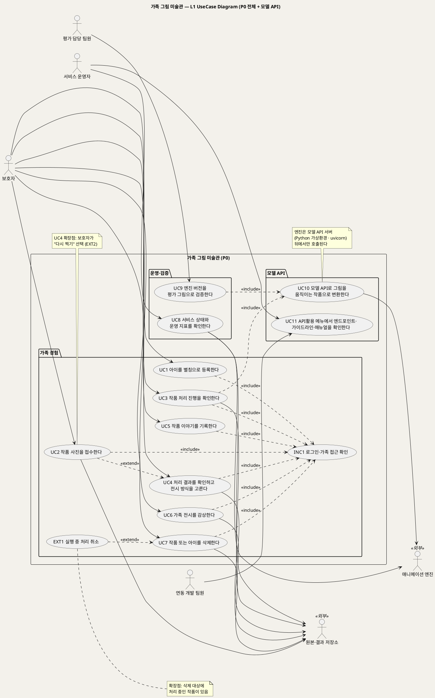

**[「L1 전체 UseCase Diagram」 PlantUML 뷰어로 열기](https://plantuml.sumzip.com/plantuml/svg/eNp9Vt9P21YUfvdfcZS9gKZWhEACVYW6USpVqjakrdIekJCbmGDV2Chx2FBVyZRsAkJFUkhJio2CFKBMVEuTqAlS9tI_ZY-5x__DzrXjYHtkT_HhnO-7554f3-VRVhczem5NgVxyeUVck5XN5bSoKFJmc_lZVMi-lNV1MSOuwQsx-TKd0XJqal5TtAx88yT2JLrwvS8iuyqmtF9lNQ0ropKVBEVa0UHXICOnV3VIyRkpqcuaKuiyrkjQbxh49hn6nS676AH7q4s7tX7bgH-MI3gWhedZaV7MSvBYFtOcfGxxArCWx2YbvgX250f2tgvfLT4dFwQxqVM6EdZq25UunhYjIGZhUcxIqu75MG-ymzzu1QE_tLGy5UX9uJ71QuyDXcoIWKHNCjdg7xt44sYsbIjKkOe4wQ6qlLrJGqY_6LG0MYwp11hhh10dodXG3yuAx0d4mXep1LSsSvDwIVa77IsxNzfEnBRZq_u10282-q0e3dPA03P8Y99B_UQhAZDACymqaSpiZFQVqVzjEXglAKxT38S0L7T5t31ccX0AuayU5GWOPJ-PApbzlDQ7J6JWHm8-odljZyaww8_szLLLJivUnYwoNgyeBDwt2e92AN9c03XRytMtSrhTCcAmw7DYENassItrIKj9fpej7WoZrW4AHQujpzyYWzeeuAer9Fu1JZUPTIEu0LjCgsVZ6a_svHtLORWmnB4mRN0r9_rdBmflP6EKTIeRcW-i3UMdWKOI21sBWDwMS3gHskqR7R35eoBvPmHNDKATQfTTH6hp1CHqPl2axsdLoNTveKVwkDwwCF345Wfqd6FO1Qasl4b173z0xo5HEOa1f4Tc7eFzauCFdccMzYBv1ejq2yZWDeqDg6PuGnbJ9LfJd7eZMNfsYHWANfO8plZ-SR1sqTvug_F0kwlwzYYTvxWMuwZ_wicoDqNLzw_EEwMvt3hHeG-cTnlb0TLsanC8oxP_oY5yTrtq4ocrIE1gu208LlKN-N3YoWkfXPM67FHzllTePjro0GRWz-knu6xzwPveiIWIug16LQiu3MG9e3POcgbMyaAZC5pTQXM6aMaDZkIgxRx8zwhcGQfGrM9BWZEc3hoCl5b79-ecKYQHpGSymlRyKYmkjAvHSFdstGtqtGt6tCs-2pUY5XIWhft4DHdJv-mSmvLlzrMJOWIDB01W-KDZUS6HjxfN0XuHxG9NBax4wEoErJk7LPflEZxjfbagaro0eJ-1FW_l-aTR81MrPhhoEDB66ba3aHLJ6ylFvUTj6K2E1aYv-tkXqATAWV3qF5qua2uc2xV_fg8f_fDNptEnb4RGm-s1Nt6S4kZIS2r2tgVjlNfk-P8wO3vnigVahm-ZHTVq5sk7tripr2qqo9GkS9UKPYPwtQO5DTmpZdRxCmHv6u5usst94Gl9MVmRb9vtyY_oi_5V-hf7f_uM)** — 클릭 시 브라우저로 연결됩니다.

#### 다이어그램 쉽게 읽기 (유저 관점)

- **누가 쓰나** — 보호자는 가족 경험 일곱 가지(UC1~UC7)를 쓴다. 서비스 운영자는 상태·지표 확인(UC8)과 API활용 메뉴(UC11)를, 평가 담당 팀원은 엔진 검증(UC9)을, 연동 개발 팀원은 API활용 메뉴(UC11)를 쓴다. 오른쪽의 애니메이션 엔진과 원본·결과 저장소는 사람이 아니라 시스템이 기대는 외부 구성요소다.
- **무슨 순서로** — 아이 등록(UC1) → 사진 올리기(UC2) → 처리 진행 보기(UC3) → 결과 고르기(UC4) → 이야기 쓰기(UC5) → 전시 감상(UC6). 삭제(UC7)는 언제든 할 수 있다.
- **«include» = 항상 함께** — 보호자가 쓰는 모든 기능은 매번 "로그인·가족 접근 확인"을 거친다. 다른 가족의 작품은 보이지 않는다.
- **모델 API(2026-09-28 추가)** — 그림을 움직이게 만드는 모델은 웹서비스가 직접 부르지 않는다. 처리(UC3)와 평가(UC9)는 늘 모델 API(UC10)를 거친다(«include»). 그래서 애니메이션 엔진은 UC10에만 연결된다.
- **«extend» = 특정 상황에서만** — 삭제하려는 작품이 아직 처리 중일 때만 "실행 중 처리 취소"가 끼어든다. 결과 확인에서 "다시 찍기"를 고를 때만 사진 접수가 다시 시작된다.
- **Generalization(◁)** — 이 다이어그램에는 없다. 결과 종류(움직임/액자)는 UC를 나누지 않고 UC3·UC4의 흐름 안에서 갈라진다.

| 기호 | 의미 |
|---|---|
| 사람 모양(actor) | 시스템을 쓰는 사람 또는 외부 시스템(`<<외부>>`) |
| 타원(usecase) | 액터가 이루려는 목표 |
| 사각형(rectangle) | 시스템 경계. 안쪽이 이 시스템의 책임 |
| 실선 화살표 | 액터와 유스케이스의 연결 |
| 점선 `<<include>>` | 기반 UC가 항상 포함하는 하위 행위 |
| 점선 `<<extend>>` | 확장점 조건일 때만 기반 UC에 끼어드는 행위 |

---

## 6. 시스템 경계 (하지 않는 것)

원천 spec §Out of Scope를 그대로 옮긴다.

| 제외 항목 | 원천 근거 | 비고 |
|---|---|---|
| 키워드 입력, 설명 초안 생성, 큐레이션 | spec Out of Scope · Intent [핵심 활동] 후속 | Intent가 언급한 후속 UC-15 |
| 하이라이트 영화(장면 선택·순서·자막·음악) | spec Out of Scope | Intent가 언급한 후속 UC-13 |
| 3D 복원, 3D 전시, 실물 필름 제작·주문 | spec Out of Scope | 주문은 Intent가 언급한 후속 UC-17 |
| 결제, 구독, 가격 실험 | spec Out of Scope · Intent [수익] | |
| 촬영 보정(원근 보정·작품 영역 자동 자르기) | spec Out of Scope | |
| 내보내기, 성장 후 접근권 이전, 장기 보관 정책, 서비스 종료 이관 | spec Out of Scope | |
| 상용화용 법정대리인 동의 절차 | spec Out of Scope · Constraints 동의 오판 금지 | |
| 백업 사본의 보존·삭제 정책 | spec FR-10 · Out of Scope | 운영 전 결정 |
| 기관(유치원·미술학원)용 다아동 권한 | spec Out of Scope | |
| 외부 업체(알림장 앱, 인화·필름 업체) 연동 | spec Out of Scope · FR-14 | 외부 자동 전달 금지 |
| 얼굴 인식, 학습 재사용, 자동 감정 해석, 발달 평가, 아이 간 비교 | spec FR-14 · FR-8 · Constraints | 기능으로 만들지 않음 |

---

## 7. 유스케이스 상세

각 UC는 범위·개요 → UseCase Diagram → Actor → 관련 UseCase → 쉽게 말하면 → 유스케이스 기술(14속성) → 기본흐름 → Sequence Diagram → UML 노트 순서다. 시퀀스의 번호 붙은 메시지(`1.` ~ `n.`)는 기본흐름 단계와 1:1로 대응한다.

### 7.1 UC1 아이를 별칭으로 등록한다

#### 범위·개요

보호자는 작품을 올리기 전에 아이를 **별칭 하나**로 등록한다. 이 서비스는 아동 정보를 최소로 수집한다. 그래서 실명, 생년월일, 출생연도는 받지 않는다. 나이는 아이 정보가 아니라 작품마다 "제작 당시 연령"으로 받는다(UC5). 보호자 한 명이 여러 아이를 등록할 수 있고, 등록한 별칭은 작품 접수(UC2)와 전시(UC6)에서 아이를 구분하는 기준이 된다.

| 항목 | 값 |
|---|---|
| 대상 시스템 | 가족 그림 미술관 (P0) |
| 상위 프로세스 | 가족 공간 준비 → 작품 접수(UC2) |
| 원천 근거 | spec FR-1 · FR-9 · Intent [핵심 데이터] 아이 · [부정적 영향] 과잉 수집 |
| 핵심 UseCase | 1개 (UC1) + 공통 1개 (INC1) |
| 주요 액터 | 보호자 |

#### UseCase Diagram

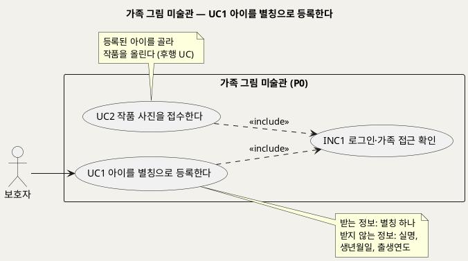

**[「UC1 아이 등록 UseCase Diagram」 PlantUML 뷰어로 열기](https://plantuml.sumzip.com/plantuml/svg/eNqNkkFL3EAYhu_zKz7Wi4KKu72JLFKp0Evx0vMyJrMxmJ0pyYQipbDYCFs9VNuNTdlEXLAqxdKVXbpbyKk_pcfMl__QSXah60HoLcz3vu8z3zvZ9CR1pd9ywDcaTdqynYOGRR2HuQeNtSrx9m3-irq0BbvU2Ldc4XNzSzjChYXtJ9vVZ0_nFN4eNcVrm1vQpI7HiMOaEqQA17b2JJi2ywxpC06kLR0G2aCN_XvIxhN1nYL6McHOZTZqw592F15uVQHDAJOR-qpnwwB_fcc4Vf0Y1Kd71U_yMFYnV4RQQ-qrVNRwlEcTvDitAPVgh7qMS0IKHuWWZlUegy3urC1V4A0B8D1mUE9L_5NdkrR23vr8hfZqocZgMvk9nlHx8iwbp5B_CfVp6SuED5k1wIuz_GMH8PAObzQ9KGzYiR7QauQtIdP1YGWlXvKL-66u1stMWIeNDZsbjm-yep0UsY-MCBeSzV5GNGeLqEFPHXc1ONSFrs92hzyM1GE0HeNNW5dzPK_Ckyv17WhZz_Fdoo4C7HUxSZcBf8b6AD8P1IeAMG5CQZxid4WUojXl1orgsld1Gs8Vnw1vVZIWqWUvZSHRnboe6DZgMe8F-fl7bV_6F72pv_R__BcZpFBs)** — 클릭 시 브라우저로 연결됩니다.

##### 다이어그램 쉽게 읽기 (유저 관점)

- **누가 쓰나** — 보호자 한 사람이 쓴다. 아이는 계정이 없어 직접 등록하지 않는다.
- **무슨 순서로** — 로그인한 보호자가 아이의 별칭을 적어 등록한다. 그다음 작품을 올릴 때(UC2) 그 아이를 고른다.
- **«include» = 항상 함께** — 아이 등록은 매번 "로그인·가족 접근 확인"을 거친다. 내 가족 공간에만 아이가 추가된다.
- **«extend» = 특정 상황에서만** — 이 UC에는 확장 관계가 없다.
- **Generalization(◁)** — 이 UC에는 없다.

| 기호 | 의미 |
|---|---|
| 사람 모양(actor) | 시스템을 쓰는 사람 |
| 타원(usecase) | 액터가 이루려는 목표 |
| 사각형(rectangle) | 시스템 경계 |
| 점선 `<<include>>` | 항상 함께 수행되는 하위 행위 |
| 노트 | 규칙이나 선후 관계 보충 설명 |

#### Actor

| 구분 | 액터 | 이 UC에서의 역할 | 원천 근거 |
|:--:|---|---|---|
| Primary | 보호자 | 아이 별칭을 등록하고 수정한다 | spec Target Users · FR-1 |
| 이해관계자 | 아이 | 등록 대상. 시스템을 직접 조작하지 않는다 | spec Target Users |

#### 관련 UseCase

| UC ID | 유스케이스명 | 관계 | 원천 근거 |
|:--:|---|---|---|
| UC1 | 아이를 별칭으로 등록한다 | 본 문서 | spec FR-1 |
| INC1 | 로그인·가족 접근 확인 | UC1이 «include» | spec FR-9 |
| UC2 | 작품 사진을 접수한다 | 후행(등록된 아이를 선택) | spec FR-1 "작품을 올릴 때 어느 아이의 작품인지 고를 수 있다" |

> **쉽게 말하면** — 보호자가 아이의 별명(예: "하늘")만 적어 등록합니다. 진짜 이름이나 생일은 묻지 않습니다. 형제가 있으면 여러 명을 등록하고, 작품을 올릴 때 누구 그림인지 고릅니다.

#### 유스케이스 기술

| 속성 | 내용 |
|---|---|
| **ID** | UC1 (spec FR-1) |
| **유스케이스명** | 아이를 별칭으로 등록한다 |
| **액터** | 주: 보호자 · 보조: 없음 |
| **사전조건** | (1) 보호자가 로그인되어 있다(INC1). (2) 보호자의 가족 공간이 존재한다. [추론] 가족 공간은 보호자 계정 생성 시 함께 생긴다고 본다. 계정 생성 절차는 원천에 없다 — `자료 없음 — 확인 필요` |
| **사후조건** | (1) 가족 공간에 새 아이가 별칭으로 저장된다. (2) 별칭은 같은 가족 안에서 유일하다. (3) 실명·생년월일·출생연도는 어디에도 저장되지 않는다. (4) 새 아이가 작품 올리기(UC2)의 아이 선택 목록에 나타난다 |
| **기본흐름** | ↓ 별도 기본흐름표 |
| **대체흐름** | A1. 별칭 수정 — 보호자가 등록된 아이의 별칭을 고친다. 중복 검사(BR-CHD-02)를 다시 거쳐 저장한다(spec FR-1). A2. 추가 등록 — 형제 등 두 번째 이후 아이를 같은 절차로 등록한다(spec FR-1 "2명 이상"). A3. 최초 진입 — 등록된 아이가 없는 상태에서 작품 올리기(UC2)를 시도하면, 아이 등록 화면으로 먼저 안내한다. [추론] 원천은 "등록 시 1회"만 명시한다 |
| **예외흐름** | E1. 별칭 중복 — 같은 가족 안에 같은 별칭이 있으면 저장을 거절하고 "이미 쓰는 별칭이에요"라고 안내한다(spec FR-1). E2. 빈 별칭 — 아무것도 입력하지 않으면 저장 버튼을 막고 입력을 요청한다. [추론] 별칭 길이·허용 문자 규칙은 `자료 없음 — 확인 필요`. E3. 기록 저장 실패 — 기록 저장소 장애로 저장하지 못하면 "저장되지 않았어요, 다시 시도해 주세요"라고 안내한다. 일부만 저장된 아이는 남기지 않는다. 운영 로그에는 분류 코드만 남긴다(spec FR-14 · Intent [핵심 장벽] 인프라 "저장소·DB 장애 분리"). E4. 로그인 만료 — 세션이 만료됐으면 INC1에 따라 다시 로그인하게 하고, 입력하던 별칭은 저장하지 않는다(spec FR-9) |
| **포함/확장** | «include» INC1 로그인·가족 접근 확인 |
| **우선순위** | Medium — 모든 작품 흐름의 선행 조건이지만 기능 범위가 작다(spec FR-1) |
| **사용빈도** | 아이당 1회 등록(Intent [핵심 데이터] "아이 등록 시 1회"). 별칭 수정 빈도는 `자료 없음 — 확인 필요` |
| **업무규칙** | BR-CHD-01, BR-CHD-02, BR-ACC-01, BR-PRV-01, BR-CHD-03 |
| **특별 요구사항** | 개인정보: 등록 화면에 실명·생년월일·출생연도 입력란을 두지 않는다(spec FR-1 수용기준). 운영 로그에 별칭(자유 입력)을 남기지 않는다(spec FR-14). 접근: 다른 가족의 아이 목록은 조회할 수 없다(spec FR-9) |
| **비고** | 원천 추적: spec FR-1(수용기준 4개 전부 반영: 입력란 제한 / 가족 내 중복 거절 / 2명 이상·작품 올릴 때 선택 / 수정 가능) · FR-9 · FR-14 · Key Entities "아이" · Intent [핵심 데이터] "아이: 보호자가 정한 별칭. 아이 등록 시 1회. 출생연도·생년월일은 저장하지 않는다" · Intent [부정적 영향] "과잉 수집". 미결: spec FR-9 계정 모델([NEEDS CLARIFICATION])에 따라 공동 보호자의 등록 권한이 달라질 수 있다 |

#### 기본흐름 (Basic Flow)

| 단계 | 액터 행위 | 시스템 행위 |
|:--:|---|---|
| 1 | 보호자가 아이 관리 화면을 연다 | INC1로 로그인과 가족 공간을 확인하고, 이 가족에 등록된 아이 목록을 보여 준다 |
| 2 | 보호자가 "아이 추가"를 누른다 | 별칭 입력란 하나만 있는 등록 양식을 보여 준다(실명·생년월일·출생연도 입력란 없음) |
| 3 | 보호자가 별칭을 입력하고 저장을 누른다 | 같은 가족 안에 같은 별칭이 있는지 검사한다 |
| 4 | — | 중복이 없으면 아이를 가족 공간에 저장한다 |
| 5 | 보호자가 갱신된 목록에서 새 아이를 확인한다 | 새 아이가 포함된 목록을 보여 주고, 작품 올리기(UC2)의 아이 선택에 반영한다 |

#### Sequence Diagram

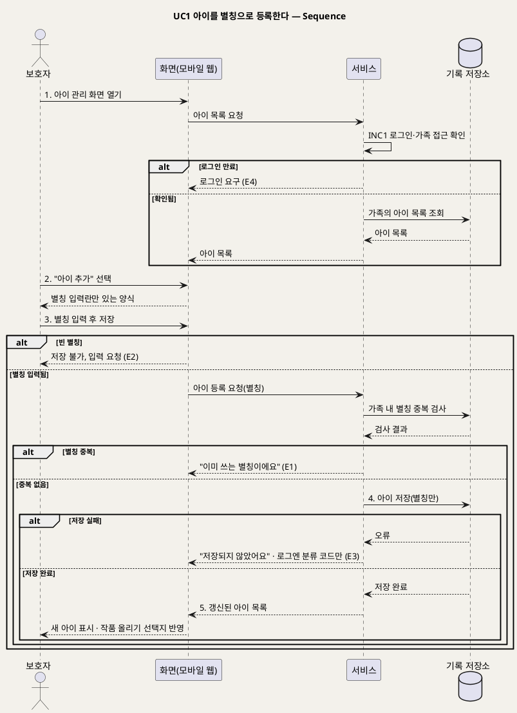

**[「UC1 아이 등록 Sequence」 PlantUML 뷰어로 열기](https://plantuml.sumzip.com/plantuml/svg/eNptVM9PGlEQvu9fMaEXSCopai8ejNFq4qVpYuzVPGG1xBUU1jTeqNKGCAeoIKvuEkih_gimKKtAQi_-KT3um_0fOrv7UAFJWMKbb-b75pt5O5dUWULd21YgKe-ubbDtqLK_tskURU7sr70LScmtaGyHJdg2rLPw1mYivheLLMSVeALeLE0thRbnXyCSX1gk_jUa24QNpiRlSY2qigyrCyHAUhoNkzf6wNtp7N2g3uc1HfjxLa8Zdknn2Tr8SxVhRd7dk2NhWZJYWCUOH2-bttbFSt4HLAmfWEKOqRKxqdFwdIfFVPDZp0V-Zfr59SVvFdHoA573Ai56dXkYiWmd99J4VHejK58XpAhT2TpLyuCzui1SAlhNYaWBP3Iu5MO8JHmUMDFL5WAGQkHRC1hmiv9ugkcPWDaphEQYQlJpggocv75yK58V8e5GckJPiOWPZA35YHW6aHQfO1YrhbVbElGwOn2qXKJTiSnqMwb4RY7_ykngVpgYqHqOE4113wT_4nRAkmkGogrPXw5yZqktSvG40NBGddZa9plDQKiJ13sZZR8OyrHImGuTQXLfQ-FDkah9gOmqfWi4hhFK4GfEegBWvvNqg1dS1C_9yfCjIuBJAbPGWO2p4HAS2OdpMUfPu15GAEj3KJ2HA_6QIVFvBxW8WZGJk8LEYVWul69N2t1mke33cgKv2g78wHwqWi_w9j1Ydyk8aI767p3ST8tq9ynoNvQyj85GpuFzLtof2oTjluOauG-GieU8KfNRVyFHlNuX4MbyDzRyz6WE1umnXfdsEi3RSAIu1hEjDMRs3c5duqejm6PVeUMTkRGhbi7Pa3iRIqYjLGl4YroiHzuDnS5TCw9pKgH4t8iPdWch_ItTngKvCSHhNO3djHEJrwCGlLwP0lxuMVvleX1s1Z3P2NocZgY4u6BjVncEY6Vg_6RzrUnvBXoZiBV3muMtDbVvnmS6Ht7T-c7Rg969_wF0jo9l)** — 클릭 시 브라우저로 연결됩니다.

기본흐름 1~5단계는 시퀀스의 번호 붙은 주요 메시지 `1.`~`5.`와 1:1로 대응한다.

#### UML 노트

| 항목 | 적용 |
|---|---|
| 액터 | 보호자는 Primary이며 시스템 경계 밖에 둔다. 아이는 조작 주체가 아니므로 이해관계자로만 기록했다 |
| System Boundary | `rectangle`로 가족 그림 미술관(P0)의 책임 범위를 표시했다 |
| «include» | INC1은 모든 보호자 UC가 항상 거치는 공통 행위라 include로 분리했다(UML 2.5.1 UseCases 장의 Include 정의) |
| 선후 관계 | UC1 → UC2는 include나 extend가 아닌 업무 선후 관계라서 노트로만 표시했다 |
| Sequence | 기록 저장소는 `database` lifeline으로 분리했다. 예외는 `alt` 프래그먼트에 E1~E4를 붙였다 |

---

### 7.2 UC2 작품 사진을 접수한다

#### 범위·개요

보호자가 휴대폰으로 찍은 그림 사진을 올리고, "사람이나 팔다리가 있는 캐릭터 그림인가요?"에 답한다. 이 답이 처리 경로를 정한다. "예"면 움직임 경로, "아니요"면 원본 액자 경로다. 시스템은 형식·용량·판독 가능 여부를 먼저 검사한다. 그다음 **원본, 작품 기록, 처리 작업 기록이 모두 저장된 경우에만** "접수 완료"로 응답한다. 이것이 **내구 접수**다. 하나라도 실패하면 접수하지 않은 것으로 보고, 일부만 저장된 흔적도 남기지 않는다.

접수 완료 뒤의 처리는 백그라운드에서 진행되며 UC3에서 다룬다. 결과 확인(UC4)에서 "다시 찍기"를 고르면 이 UC가 확장으로 다시 시작되고, 새 사진은 새 작품으로 접수된다.

| 항목 | 값 |
|---|---|
| 대상 시스템 | 가족 그림 미술관 (P0) |
| 상위 프로세스 | 아이 등록(UC1) → **작품 접수(UC2)** → 처리(UC3) → 확인(UC4) |
| 원천 근거 | spec FR-2 · FR-3 · FR-6 · FR-15 · Scenario 2, 6, 7 · Intent [핵심 활동] 3·4 |
| 핵심 UseCase | 1개 (UC2) + 공통 1개 (INC1) + 확장 관계 1개 (EXT2: UC2 ··> UC4 «extend») |
| 주요 액터 | 보호자 · 원본·결과 저장소(보조) |

#### UseCase Diagram

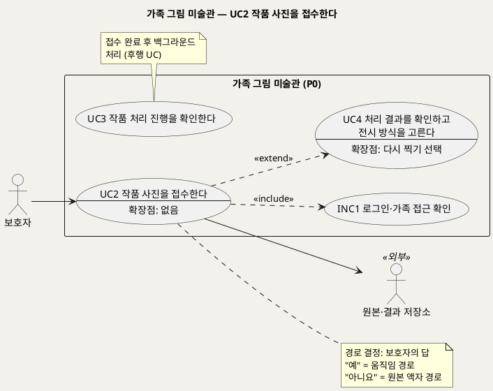

**[「UC2 작품 접수 UseCase Diagram」 PlantUML 뷰어로 열기](https://plantuml.sumzip.com/plantuml/svg/eNqFU19r01AUf7-f4lBftoeObd3TmGU4HPgiA_GtUO7atAtLE0lu0SFC1DAq3aDTVdttKRm6DWFgt06Xh_riR_Ex9-Q7eG6S6gaKb-Ge3zm_P-dk2RHcFs2GAc1KucYburFVrnPD0Oyt8uw8czZ18wm3eQPWeWWzbltNs7piGZYNd1YLq3P3791AOBu8aj3VzTrUuOFozNBqAoQFtl7fEFDVba0idMtkQheGBtHQxeMLiK5DeToG-SXEVhBdufDT3YfHK_OAg734bQvw1Tmeeeh7gMEetnpx90i2PzHGK4JE5OToKu6FOOjkgDuwxm3NFJMaHnbkKPxxHV0Oo9GY-l0cnOD2TgJ9RBANlpawH8pvbrHImJLHzTpJy_1L29Ta7HQOnjOApqNVuEPQ_0otmfl8yYz7XUUedBYBP2yjn4qg5puzHjxcmQN5fES86CvhqQyaFl2PQY3ww6RPAW-LWAC87MnTc0jNypMJPu72olFQMjHwsH0EcvgZ277SSK_yJPybQHpTUBzuRuEQ0Avi134md-E2a-G39ZSc7Mfv36jpE3KVQNZbYC8YSzcE-XwxMa_Sm5kpJoZgkdahmxWjWdVoH5OS8qYq2jOhmdWsoPqTDTJmWkLLTsyqZYlGl98pRpUFBl0yNDkS9Hvk7ishcthr5eAu4KGLZy9x4GU9SanryXYLD_ZTgDoiwO4x9U9AJAQUb0q-bglhNVL2Ag1Itw_Y9-THHYgPPUr9Qt2SP8aDK_lOkWSBTVGVEqPG6T9Dl-mLfshfpte2jQ==)** — 클릭 시 브라우저로 연결됩니다.

##### 다이어그램 쉽게 읽기 (유저 관점)

- **누가 쓰나** — 보호자가 사진을 올린다. 원본·결과 저장소는 원본을 보관하는 외부 구성요소다.
- **무슨 순서로** — 아이를 고르고, 사진을 올리고, "사람 그림인가요?"에 답한다. 접수가 완료되면 처리는 뒤에서(UC3) 진행되므로 화면을 떠나도 된다.
- **«include» = 항상 함께** — 사진을 올릴 때마다 "로그인·가족 접근 확인"을 거친다.
- **«extend» = 특정 상황에서만** — 결과 확인(UC4)에서 "다시 찍기"를 고를 때만 사진 접수가 다시 시작된다. 이때 이전 원본은 그대로 두고 새 작품으로 받는다.
- **Generalization(◁)** — 이 UC에는 없다. 움직임 경로와 원본 액자 경로는 UC를 나누지 않고, 같은 접수 흐름에서 경로 값만 다르게 기록한다.

| 기호 | 의미 |
|---|---|
| 사람 모양(actor) | 시스템을 쓰는 사람 또는 외부 구성요소(`<<외부>>`) |
| 타원(usecase) | 액터가 이루려는 목표. `--` 아래는 확장점 |
| 사각형(rectangle) | 시스템 경계 |
| 점선 `<<include>>` | 항상 함께 수행되는 하위 행위 |
| 점선 `<<extend>>` | 확장점 조건일 때만 기반 UC(UC4)에 끼어드는 행위 |

#### Actor

| 구분 | 액터 | 이 UC에서의 역할 | 원천 근거 |
|:--:|---|---|---|
| Primary | 보호자 | 아이를 고르고, 사진을 올리고, 사람·캐릭터 여부에 답한다 | spec Target Users · FR-2 · FR-3 |
| Secondary | 원본·결과 저장소 | 올린 원본을 변형 없이 보관한다. 실제 제품은 미확정 | spec Dependencies · Intent [핵심 이네이블러] 파일 |

#### 관련 UseCase

| UC ID | 유스케이스명 | 관계 | 원천 근거 |
|:--:|---|---|---|
| UC2 | 작품 사진을 접수한다 | 본 문서 | spec FR-2 · FR-3 · FR-15 |
| INC1 | 로그인·가족 접근 확인 | UC2가 «include» | spec FR-9 |
| UC4 | 처리 결과를 확인하고 전시 방식을 고른다 | UC2가 UC4를 «extend»(EXT2, 확장점: 다시 찍기 선택) | spec FR-6 "다시 찍기를 고르면 … 새 올리기가 시작된다" |
| UC3 | 작품 처리 진행을 확인한다 | 후행 | spec FR-4 |

> **쉽게 말하면** — 아이 그림을 휴대폰으로 찍어 올리고 "사람이나 캐릭터 그림인가요?"에 답합니다. 사진과 기록이 모두 안전하게 저장돼야 "접수 완료"가 뜹니다. 그 뒤로는 화면을 닫아도 처리가 계속됩니다.

#### 유스케이스 기술

| 속성 | 내용 |
|---|---|
| **ID** | UC2 (spec FR-2, FR-3, FR-15) |
| **유스케이스명** | 작품 사진을 접수한다 |
| **액터** | 주: 보호자 · 보조: 원본·결과 저장소 |
| **사전조건** | (1) 보호자가 로그인되어 있다(INC1). (2) 가족 공간에 아이가 1명 이상 등록되어 있다(UC1). (3) 보호자 기기에 올릴 그림 사진이 있거나 촬영할 수 있다 |
| **사후조건** | (1) 성공 시 원본이 변형 없이 저장되고, 작품 기록과 처리 작업 기록(요청 번호·경로·상태 "접수됨")이 함께 저장된다. (2) 작품이 처리 대기열에 오르고, 보호자에게 "접수 완료"가 표시된다. (3) 실패 시 원본·작품 기록·작업 기록 어느 것도 남지 않는다. (4) 어떤 경우에도 기존 작품의 원본은 덮어쓰이지 않는다 |
| **기본흐름** | ↓ 별도 기본흐름표 |
| **대체흐름** | A1. 원본 액자 경로 — 3단계에서 "아니요"를 고르면 경로를 "원본 액자"로 기록한다. 이후 흐름은 같고, UC3에서 엔진을 시도하지 않는다(spec FR-3). A2. 다시 찍기로 진입(EXT2) — UC4에서 "다시 찍기"를 고르면 이 UC가 1단계부터 시작된다. 아이는 이전 작품의 아이로 미리 선택된다. 새 사진은 새 작품·새 작업으로 접수되고, 이전 원본은 덮어쓰지 않는다(spec FR-6). [추론] 아이 미리 선택은 설계 판단이다. A3. 동시 처리 상한 도달 — 접수는 정상 완료된다. 작품은 거절되지 않고 대기열에서 순서를 기다리며, 상태는 "접수됨"으로 유지된다(spec FR-15). A4. 같은 요청의 중복 전송 — 네트워크 문제로 같은 올리기 요청이 다시 오면, 새 작품을 만들지 않고 이미 접수된 작품의 결과를 돌려준다(spec FR-2) |
| **예외흐름** | E1. 허용되지 않는 형식 — 접수 전에 거절하고 "지원하지 않는 사진 형식이에요"라고 안내한다(spec FR-2). E2. 용량 초과 — 접수 전에 거절하고 상한을 안내한다(spec FR-2, FR-15). E3. 판독 불가 — 허용 형식이지만 이미지로 열리지 않는 깨진 파일이면 "사진을 열 수 없어요"라고 안내한다(spec Edge Cases). E4. 사람·캐릭터 질문 미응답 — 답하기 전에는 올리기를 마칠 수 없다(spec FR-3). E5. 원본 저장 실패 — "접수되지 않았어요, 다시 올려 주세요"라고 안내한다. 작품 기록과 작업 기록을 만들지 않는다(spec FR-2). E6. 작품·작업 기록 저장 실패 — 이미 저장된 원본을 제거하고 E5와 같이 안내한다. 목록에 작품이 나타나지 않는다(spec Scenario 6). E7. 로그인 만료 — INC1에 따라 다시 로그인하게 하고, 접수는 이뤄지지 않는다(spec FR-9) |
| **포함/확장** | «include» INC1 로그인·가족 접근 확인 · «extend» UC4(EXT2, 확장점: 보호자가 "다시 찍기" 선택) |
| **우선순위** | High — 모든 가족 경험의 입구다. 원천 [핵심 활동] 3이 "원본·작품·작업 기록 성공 뒤에만 접수"를 핵심 활동으로 명시한다 |
| **사용빈도** | `자료 없음 — 확인 필요`. 원천은 P0 동시 사용자를 10명 이하로 가정하지만(spec Assumptions) 작품 업로드 빈도는 제시하지 않는다 |
| **업무규칙** | BR-INT-01, BR-INT-02, BR-INT-03, BR-INT-04, BR-INT-05, BR-PRC-07, BR-APR-03, BR-ACC-01, BR-PRV-01, BR-CHD-03 |
| **특별 요구사항** | 허용 형식·용량 기본값: JPEG·PNG·HEIC, 한 장 20MB 이하. 계획 단계에서 조정할 수 있다(spec Assumptions). 신뢰성: 접수 완료된 작품은 서버 재시작이나 처리 담당 실패에도 사라지지 않고 최종 상태에 도달한다(spec FR-2). 응답성: 접수 완료 응답은 엔진 처리를 기다리지 않는다(spec FR-4). 사용성: 질문 옆에 사람·캐릭터 예시와 동물·사물·풍경 예시를 보여 준다(spec FR-3). 개인정보: 운영 로그에 이미지·저장 위치 키를 남기지 않는다(spec FR-14) |
| **비고** | 원천 추적: spec FR-2(수용기준 5개: 사전 거절 / 부분 저장 금지 / 접수 후 소실 금지 / 중복 전송 1건 / 원본 불변) · FR-3(질문 필수 / "아니요" 엔진 미시도 / 예시 안내) · FR-6 다시 찍기 · FR-15 대기열 · Scenario 2, 6, 7 · Edge Cases "허용 형식이지만 깨진 파일", "같은 요청의 중복 전송", "동시 처리 상한 도달" · Intent [핵심 활동] 3 "입력 형식·용량·디코딩을 검사하고 원본·작품·작업 기록 성공 뒤에만 접수한다", 4 "부모의 사람/캐릭터 답으로 경로를 정한다". 원본 액자 경로가 엔진 없이 동작하는 것은 UC3에서 검증한다 |

#### 기본흐름 (Basic Flow)

| 단계 | 액터 행위 | 시스템 행위 |
|:--:|---|---|
| 1 | 보호자가 "작품 올리기"를 연다 | INC1로 로그인과 가족 공간을 확인하고, 등록된 아이 목록을 보여 준다 |
| 2 | 보호자가 아이를 고르고 사진을 찍거나 기기에서 고른다 | 사진의 형식·용량·판독 가능 여부를 검사하고, 통과하면 미리보기를 보여 준다 |
| 3 | 보호자가 "사람이나 캐릭터 그림인가요?"에 예/아니요로 답한다 | 예시 안내를 함께 보여 주고, 답을 처리 경로(움직임/원본 액자)로 정한다 |
| 4 | 보호자가 "올리기"를 누른다 | 요청 번호로 같은 요청이 이미 접수됐는지 확인한다 |
| 5 | — | 원본을 원본·결과 저장소에 변형 없이 저장한다 |
| 6 | — | 작품 기록과 처리 작업 기록(요청 번호·경로·상태 "접수됨")을 함께 저장하고 처리 대기열에 올린다 |
| 7 | 보호자가 "접수 완료" 안내를 확인하고, 화면을 떠나거나 계속 머문다 | "접수 완료, 준비되면 확인할 수 있어요"를 표시하고 작품 목록에 "접수됨" 상태로 보여 준다 |

#### Sequence Diagram

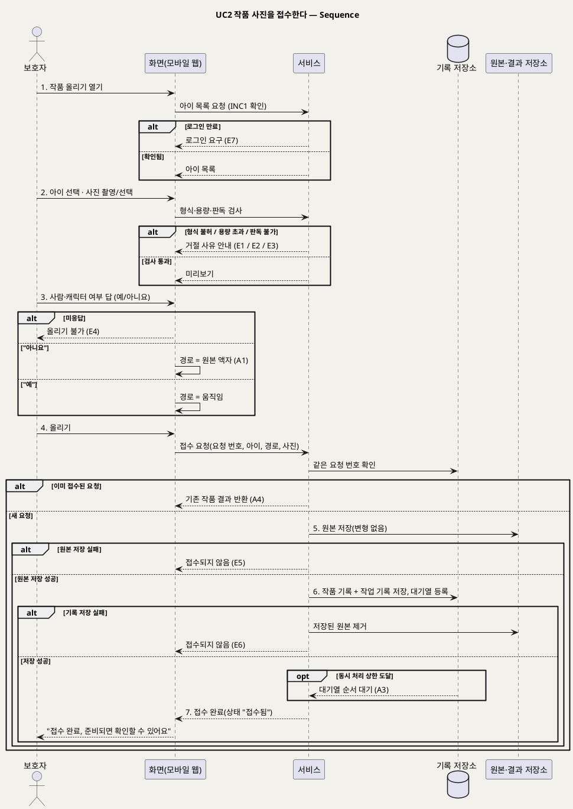

**[「UC2 작품 접수 Sequence」 PlantUML 뷰어로 열기](https://plantuml.sumzip.com/plantuml/svg/eNp9VU1PG1cU3c-vuHI3tgqmhnxIkYrSUCJlU1VC6RZNYEKtGJvYg6rshjBBk9hSTIvLOLFdUEiAyFGMbWKnSjf8lC7n3fkPPW_m2XhsmgWDPO_ce8-599w3twumnjc31zNUMB4vP9TX05kny2t6JmPknyx_N6sVHqWzG3peX6cH-sqjtXxuM7u6kMvk8vTN3bm7qcU7I4jCr_pq7rd0do0e6pmCoZlpM2PQ_YVZ4sau_7tD_LTJxzbXbeKDXXZcv1ITxSP619qjJePxppFdMTRNXzGRPSY6Xd_tc6McI71AP-t5I2tqqGOmV9IbetakmF_dE6fduHh_Ilp7XP9C_PpzIkDfvxdFsl0Tn21-cRScLv2yoK3qpv5ALxgU8_otcVgHIYsbb3mnFEB-vDOW4HVZdPoXPa_d8jpfxsBL4AveIUWankd5ukWp5FC12xTvmqhDvN_FPw3nQIEGYFxBP7ok3p8GLF7tcfsDxe_9tJAiv1rhej-h6RmTxGHN6_Xxk8RxSbwpaRTETw-qXZ4jhXfepPjizYRmYAoqjSifjMdESmtGdnVCw2xyAGL7wN-u00VPzZC422R3ayZ8H1HkuxUu1i96_OpU_PX8oueXyuLlM_LaFkIDMSGCxCfH33dohkIkUjqyuTOkInDutaxx1t5Ziw9CK9UOQM8RT7tQm0Lc4qx8zCndYUHyd86RdaJfH_uYCTwm53GV9LmkLCEaJQj5uyzeffBtOb-m-GSRKJ5TnF1nBs0RRQcdV0P6iAns4hTVZEeQS2W9NWKCUBYoX1NEY8M0MRU4kNr-B3Ol7ym0H8QeYh8o_kNqGOk6_x9j8fEWN-wr5V1LXjKK-jFYTGXEuPKjaDvYxSllhilVZEp5IaEFrZ3H1kgCrSrXLYpEKg8GTUIC9EnVEeWaQk6Mud_iw-5ghdTeiZbrV100YNA63nbG4ufDdUSG68lh34J1jYuOBedhiDtcLyUQENAZhRAXj_ySXJTxVVFsXT6GtMoLJMAAr8skIY9oFvvM65xfZlGduTG8EdSd8638zfvPKHIHTZEoWVL-PnbzjzO5mzKTJBvBjZKdEB9CgvYOqNWwOaPgr2u7kQiwoboJWUS5Dfj9ZZWLqNB2YSTMYgv3OV7CzE2FIql8emiuS2Hs1HApqxcY6FxCRUizXkHyZnLozKqN-y8uq23XsAGK_UlskGF882KRQJj2yMLHAHrx8VDG9Cu4SSSk4fCfXbWIAy7yKf9u44Hv5H-zoFrm)** — 클릭 시 브라우저로 연결됩니다.

기본흐름 1~7단계는 시퀀스의 번호 붙은 주요 메시지 `1.`~`7.`과 1:1로 대응한다.

#### UML 노트

| 항목 | 적용 |
|---|---|
| 액터 | 원본·결과 저장소는 시스템이 기대는 외부 구성요소라서 Secondary actor(`<<외부>>`)로 경계 밖에 뒀다 |
| «extend» | UC2 → UC4. 확장 UC(UC2)가 기반 UC(UC4)의 확장점 "다시 찍기 선택"에서 끼어든다. 화살표는 확장 UC에서 기반 UC로 향한다 |
| 확장점 표기 | 기반 UC 타원 안 `--` 아래에 확장점 이름을 적었다 |
| 경로 분기 | 움직임/원본 액자는 같은 목표(접수)의 변형이라 UC를 나누지 않았다. 대체흐름 A1로 표현했다 |
| Sequence | 원본·결과 저장소를 별도 participant로 분리했다. 예외는 `alt`, 선택적 경로는 `opt`에 E·A 번호를 붙였다 |

---

### 7.3 UC3 작품 처리 진행을 확인한다

#### 범위·개요

접수된 작품은 올리기 요청과 분리되어 백그라운드의 **처리 담당**이 처리한다. 보호자는 기다리지 않고 화면을 떠나도 되며, 나중에 작품 목록에서 진행 상태를 확인한다. 이 UC의 목표는 "내 작품이 어떻게 되고 있는지 알고, 준비되면 확인하러 가는 것"이다.

처리 결과는 네 가지로 나뉘며 **서로 섞이지 않게** 기록한다. 이 분리가 이 UC의 핵심 규칙이다(spec FR-5).

| 결과 | 조건 | 기록 |
|---|---|---|
| 움직이는 작품 | 엔진이 정상 결과를 만듦 | 결과 종류 = 움직임 |
| 원본 액자(정상) | 보호자가 "아니요"로 답함, 엔진 미시도 | 대체 분류 = 사람 그림 아님 |
| 원본 액자(품질 대체) | 엔진 결과가 품질 기준 미달, 재시도 없음 | 대체 분류 = 품질 미달 |
| 실패 | 인프라 장애가 제한 재시도 후에도 계속됨 | 오류 분류 = 엔진 다운 / 시간 초과 / 저장소 / 기록(DB) |

| 항목 | 값 |
|---|---|
| 대상 시스템 | 가족 그림 미술관 (P0) |
| 상위 프로세스 | 작품 접수(UC2) → **처리·상태 확인(UC3)** → 결과 확인(UC4) |
| 원천 근거 | spec FR-4 · FR-5 · FR-11 · FR-15 · Scenario 2, 4, 5 · Intent [핵심 활동] 3·4 · [핵심 장벽] |
| 핵심 UseCase | 1개 (UC3) + 공통 1개 (INC1) |
| 주요 액터 | 보호자 · 애니메이션 엔진(보조) · 원본·결과 저장소(보조) |

#### UseCase Diagram

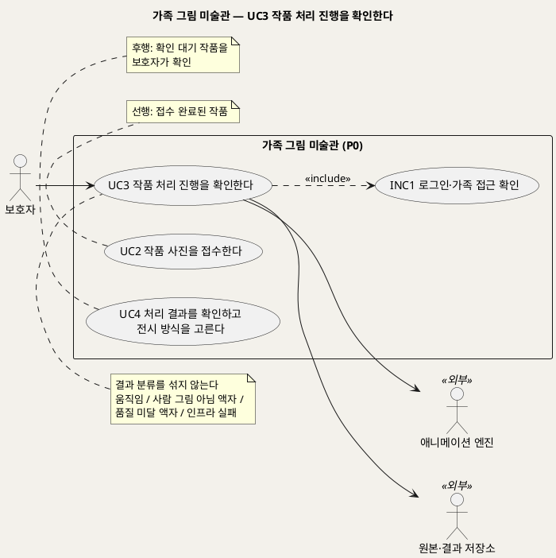

**[「UC3 처리 진행 UseCase Diagram」 PlantUML 뷰어로 열기](https://plantuml.sumzip.com/plantuml/svg/eNqNU01r20AUvO-veLiX9pDvnEIwoSaBXkqg9FYIG1t2RGQpSGtKKAW1qMWNfHCK3TrENjKN4wYCdeOQ6OBTf0qP2uf_0LeS4sSHlt4k7czOvJmnDUdwW1TKBlTyO0Ve1o3DnRI3DM0-3FlcYc6-bh5wm5dhl-f3S7ZVMQs5y7BseLS1srW0-fQBwtnjBeu1bpagyA1HY4ZWFCAssPXSnoCCbmt5oVsmE7owNIiGLvZ-QnQbyvMxyB8hVoPo2oXfbgNe5lYAu8eTz1XAq5Y8vwQceJMvn7DjweSkiZ1w0mxL_4wxnhfkJSNH15NWiN16BrgD29zWTHF3hs1A-lV50cDONX5oAX5t0G0xcNMs6aYG6-t4EsobN5udck7rchT-uo2uhtFoDBi42O3jx1rMekGQGRJTk3GzRFNl_jbW4-3FJxl4wwAqjpbnDkH_d8pYlMAPuc-e55ZA9tqkQzgymshicBzdjlN2zFPAWdHlqej7SxJUakTDamtGbXmWtHpnMUlE9sdTi61oFLwyMfDQb4McXqDfUXfSV9kP7y9cZW8ZS5qBublsPJBKYH4-G5uENYpUN_NGpaBRpupIwZKKpq9x9oyZltBotQ7AKqbJpE3JG0_2W8oeel0cuIDNI3nUULsCgKcuDt5h14MFNbzs1u56wqYnfVqNZo92CBYISwHhoKoKlP7l9ADUxA1Pdojin01q35lmFkC5SSztWkJY5cSVShC9gApdSwMGPPHkt5qst9MK_sFeVR5OvZidJA2y5kbhMKVSxISY7j31n8Lu79ygJ_qx_wDeSN5C)** — 클릭 시 브라우저로 연결됩니다.

##### 다이어그램 쉽게 읽기 (유저 관점)

- **누가 쓰나** — 보호자가 작품 목록에서 진행 상태를 본다. 애니메이션 엔진은 그림을 움직이게 만드는 외부 구성요소이고, 원본·결과 저장소는 파일을 보관한다.
- **무슨 순서로** — 사진을 올린 뒤(UC2) 뒤에서 처리가 진행된다. 상태가 "확인 대기"로 바뀌면 보호자가 결과를 확인하러 간다(UC4).
- **«include» = 항상 함께** — 상태를 볼 때마다 "로그인·가족 접근 확인"을 거친다. 내 가족의 작품만 보인다.
- **«extend» = 특정 상황에서만** — 이 UC에는 확장 관계가 없다. 처리 중에 삭제하는 경우는 UC7의 "실행 중 처리 취소"가 맡는다.
- **Generalization(◁)** — 없다. 네 가지 결과는 UC를 나누지 않고 흐름 안에서 갈라진다.

| 기호 | 의미 |
|---|---|
| 사람 모양(actor) | 시스템을 쓰는 사람 또는 외부 구성요소(`<<외부>>`) |
| 타원(usecase) | 액터가 이루려는 목표 |
| 사각형(rectangle) | 시스템 경계 |
| 점선 `<<include>>` | 항상 함께 수행되는 하위 행위 |
| 노트 | 규칙·선후 관계 보충 |

#### Actor

| 구분 | 액터 | 이 UC에서의 역할 | 원천 근거 |
|:--:|---|---|---|
| Primary | 보호자 | 작품별 진행 상태를 확인하고, 확인 대기 작품을 골라 결과 확인(UC4)으로 간다 | spec FR-4 |
| Secondary | 애니메이션 엔진 | 움직임 경로 작품의 검출·관절 추정·리깅·렌더를 수행한다. Meta Animated Drawings(MIT, 2025-09-03 보관 처리), 모델 실행 구성요소는 TorchServe(2025-08-07 보관 처리). 내부 네트워크로 격리 | spec Dependencies · FR-14 · FR-16 |
| Secondary | 원본·결과 저장소 | 원본을 제공하고, 처음 만든 결과와 임시 파일을 보관한다 | spec Dependencies |

[추론] "처리 담당"(백그라운드 작업자)은 시스템 내부 구성요소라서 액터가 아니다. 시퀀스에서만 lifeline으로 나타낸다.

#### 관련 UseCase

| UC ID | 유스케이스명 | 관계 | 원천 근거 |
|:--:|---|---|---|
| UC3 | 작품 처리 진행을 확인한다 | 본 문서 | spec FR-4 · FR-5 · FR-11 · FR-15 |
| INC1 | 로그인·가족 접근 확인 | UC3가 «include» | spec FR-9 |
| UC2 | 작품 사진을 접수한다 | 선행 | spec FR-2 |
| UC4 | 처리 결과를 확인하고 전시 방식을 고른다 | 후행 | spec FR-6 |
| UC10 | 모델 API로 그림을 움직이는 작품으로 변환한다 | UC3이 «include» (움직임 경로일 때, 2026-09-28 추가) | 추가 요구 R2·R3 |

주: UC10 포함 관계는 2026-09-28 추가분이다. 이 절의 UseCase Diagram에는 그리지 않았고, §5 L1과 §7.10 다이어그램에 있다. 기본흐름의 엔진 호출 단계는 UC10의 API 호출로 수행된다.

> **쉽게 말하면** — 사진을 올린 뒤 기다릴 필요 없이 다른 일을 해도 됩니다. 나중에 목록을 열면 "처리 중", "확인 대기", "처리하지 못했어요" 같은 상태가 보입니다. 움직이게 만들 수 없는 그림은 원본 액자로 준비되고, 서버 문제는 몇 번 다시 시도한 뒤에도 안 되면 솔직하게 알려 줍니다.

#### 유스케이스 기술

| 속성 | 내용 |
|---|---|
| **ID** | UC3 (spec FR-4, FR-5, FR-11, FR-15) |
| **유스케이스명** | 작품 처리 진행을 확인한다 |
| **액터** | 주: 보호자 · 보조: 애니메이션 엔진, 원본·결과 저장소 |
| **사전조건** | (1) 보호자가 로그인되어 있다(INC1). (2) UC2에서 접수 완료된 작품이 1건 이상 있고, 작업 기록에 경로(움직임/원본 액자)가 정해져 있다. (3) 원본이 원본·결과 저장소에 저장되어 있다 |
| **사후조건** | (1) 작품이 "확인 대기" 또는 "실패" 중 하나의 최종 처리 상태에 도달한다. (2) 작업 기록에 결과 종류, 대체 분류 또는 오류 분류, 진단 이유(정해진 코드), 엔진 검출 점수(기록용), 단계별 소요 시간, 시도 횟수, 엔진 버전이 남는다. (3) 결과물은 처음 만든 것 하나만 저장된다. (4) 처리 중 생긴 임시 파일이 남아 있지 않다. (5) 원본은 변형되지 않았다. (6) 작품은 아직 전시되지 않았다 |
| **기본흐름** | ↓ 별도 기본흐름표 (움직임 경로의 정상 결과 기준) |
| **대체흐름** | A1. 원본 액자 경로 — 경로가 "원본 액자"면 3~4단계에서 엔진을 부르지 않는다. 원본으로 액자 결과를 만들고 대체 분류를 "사람 그림 아님"으로 기록한다. 엔진이 멈춘 상태에서도 이 경로는 확인 대기까지 진행된다(spec FR-3, Scenario 2). A2. 모델 품질 미달 — 엔진이 인물을 찾지 못하거나 관절 추정·렌더 결과가 없으면, 재시도하지 않고 원본 액자로 대체한다. 대체 분류는 "품질 미달"이고 오류 분류는 비운다. 보호자에게 "움직임을 만들 수 없어 액자로 준비했어요"라고 안내한다(spec FR-5, Scenario 4). A3. 처리 담당 중도 정지 — 담당이 멈추면 정해진 점유 시간이 지난 뒤 다른 담당이 이어받는다. 이어받기도 시도 횟수에 포함하고, 상한을 넘으면 실패로 처리한다(spec FR-4, Edge Cases). A4. 대기열 대기 — 동시 처리 상한에 도달하면 작품은 "접수됨" 상태로 순서를 기다린다. 대기 시간도 미리보기 시간 p95에 포함한다(spec FR-15, Edge Cases). A5. 보호자 부재 — 보호자가 화면을 떠나 있어도 처리는 계속된다. 다음에 목록을 열 때 바뀐 상태가 보인다(spec FR-4) |
| **예외흐름** | 공통 규칙: 인프라 장애는 "품질 미달"로 바꾸지 않는다. 작품당 최대 3회까지 시도하며 시도 사이 간격을 점점 늘린다. 재시도를 다 쓰면 상태를 "실패"로 바꾸고 보호자에게 "처리하지 못했어요"와 UC4의 선택지(액자로 걸기 / 다시 찍기)를 보여 준다. 해당 건은 결과 미도달로 집계한다(spec FR-5, Assumptions, Scenario 5). E1. 엔진 다운 — 엔진이 응답하지 않는다. 오류 분류 = 엔진 다운. E2. 시간 초과 — 작업당 처리 시간 상한(기본 10분)을 넘긴다. 오류 분류 = 시간 초과(spec FR-15, Assumptions). E3. 저장소 장애 — 원본을 읽거나 결과를 쓸 수 없다. 오류 분류 = 저장소. 원본까지 읽을 수 없으면 UC4에서 "액자로 걸기"를 비활성화한다(spec Edge Cases). E4. 기록 장애 — 작업 기록을 갱신할 수 없다. 오류 분류 = 기록(DB). E5. 처리 중 삭제 요청 — 보호자가 UC7로 작품을 삭제하면 이 처리는 EXT1(실행 중 처리 취소)에 따라 멈추고, 이후 결과 파일을 만들지 않는다(spec FR-10). E6. 임시 파일 잔존 — 처리 담당이 비정상 종료해 남은 임시 파일은 다음 정리 주기에 지운다(spec FR-11) |
| **포함/확장** | «include» INC1 로그인·가족 접근 확인 · «include» UC10 모델 API 변환(움직임 경로일 때, 2026-09-28 추가) |
| **우선순위** | High — 품질 미달과 인프라 실패의 분리가 서비스 팀의 개선 우선순위와 결과 미도달 추적의 기반이다(spec Business Value · Intent [가치제안] "정상 액자와 품질 미달, 인프라 실패를 섞지 않는다") |
| **사용빈도** | 접수 1건당 처리 1회. 상태 확인 빈도는 `자료 없음 — 확인 필요` |
| **업무규칙** | BR-INT-04, BR-INT-05, BR-PRC-01, BR-PRC-02, BR-PRC-03, BR-PRC-04, BR-PRC-05, BR-PRC-06, BR-PRC-07, BR-PRC-08, BR-APR-01, BR-APR-03, BR-ENG-01, BR-ENG-02, BR-PRV-01 |
| **특별 요구사항** | 성능(잠정 검증 목표): 팀 서버 단일 처리 조건에서 접수부터 확인 대기까지 p95 3분 이내. 원본 액자 경로는 p95 30초 이내(spec Success Criteria). 1차 개인 PC 실측은 CPU 4코어·메모리 3.8GB·그래픽 카드 없이 한 장 53~62초(렌더 약 40초), 모델 서버 약 3.1GB였다(Intent [핵심 장벽] 인프라). 신뢰성: 결과 미도달 0건이 목표다. 보안: 엔진은 외부 네트워크에서 직접 접근할 수 없고, 관리 기능과 외부 포트를 닫은 고정 실행 환경에서 돈다(spec FR-14, FR-16). 품질: 엔진 검출 점수는 기록만 하고 승인 근거로 쓰지 않는다. 1차 시험에서 집 그림이 사람 점수 0.946(사람 그림 0.997)으로 잡혀 벽에 관절이 붙은 사례가 있다(Intent [핵심 장벽] 적용 범위·품질) |
| **비고** | 원천 추적: spec FR-4(수용기준 4개: 즉시 응답 / 상태 전이 / 중복 처리 금지·이어받기 / 상태 반영) · FR-5(표 4행과 수용기준 5개 전부) · FR-11(임시 파일 정리 2개) · FR-15(시간 상한·대기열) · Scenario 2, 4, 5 · Edge Cases "처리 담당의 중도 정지", "엔진만 멈춘 상태", "엔진이 사람 점수는 높지만 사람이 아닌 그림" · Intent [핵심 활동] 3 "워커가 별도로 처리하고 상태를 조회할 수 있게 한다", 4 "비인물·모델 품질 미달은 원본 액자, 인프라 장애는 제한 재시도·실패로 분리". 오인 움직임(사물을 사람으로 처리)은 시스템이 판정할 수 없어 예외로 두지 않았다. 이는 UC4의 부모 확인이 거른다. 품질 미달 판정 기준(임계값)은 `자료 없음 — 확인 필요`이며, 계획 단계에서 평가 그림 세트(UC9)로 정한다(spec Assumptions) |

#### 기본흐름 (Basic Flow)

| 단계 | 액터 행위 | 시스템 행위 |
|:--:|---|---|
| 1 | 보호자가 작품 목록을 연다 | INC1로 로그인과 가족 공간을 확인하고, 작품별 상태("접수됨")를 보여 준다 |
| 2 | — | 처리 담당이 대기열에서 작품 하나를 점유하고(다른 담당과 중복 처리 금지) 상태를 "처리 중"으로 바꾼다 |
| 3 | — | 경로가 "움직임"이므로 원본을 애니메이션 엔진에 보내 검출·관절 추정·리깅·렌더를 요청한다(시간 상한 적용) |
| 4 | — | 엔진 결과가 정상이면 처음 만든 움직이는 결과를 원본·결과 저장소에 저장한다. 검출 점수는 기록만 한다 |
| 5 | — | 작업 기록에 결과 종류·단계별 시간·시도 횟수·엔진 버전을 남기고, 임시 파일을 지우고, 상태를 "확인 대기"로 바꾼다 |
| 6 | 보호자가 목록을 다시 연다 | 바뀐 상태 "확인 대기"를 보여 준다 |
| 7 | 보호자가 확인 대기 작품을 고른다 | 결과 미리보기와 함께 결과 확인 화면(UC4)으로 연결한다 |

#### Sequence Diagram

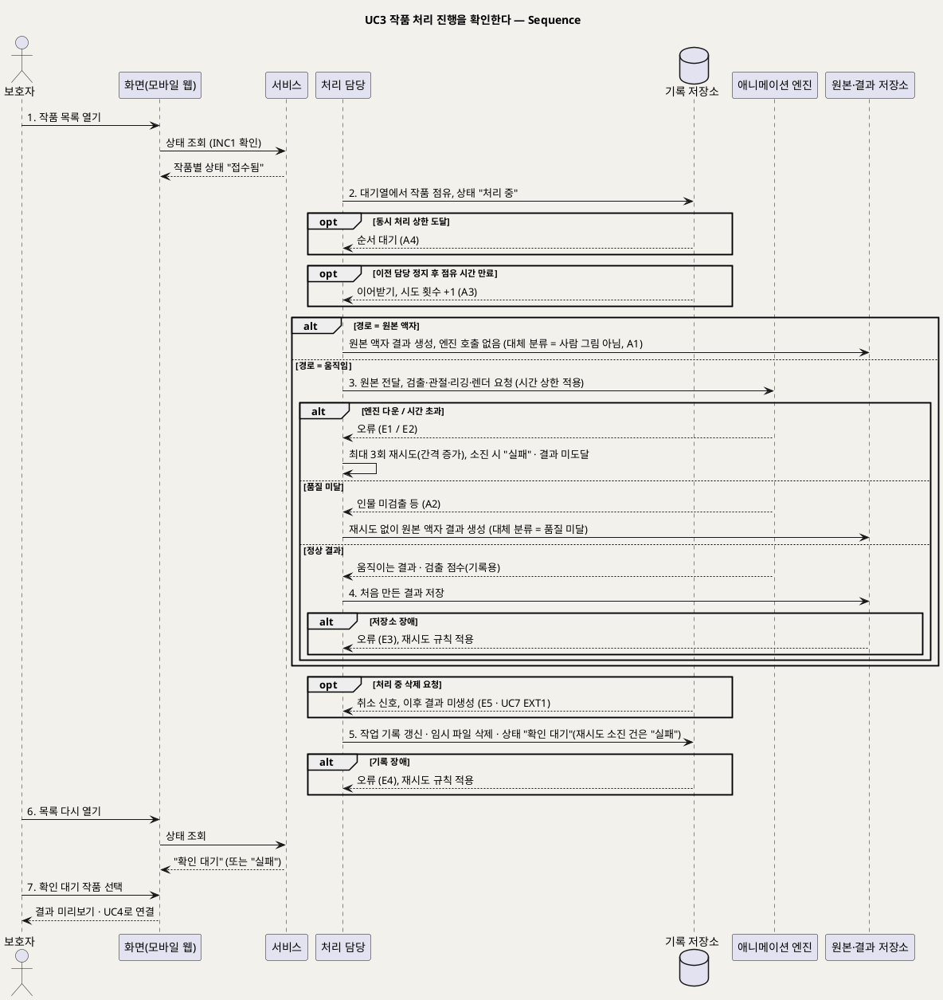

**[「UC3 처리 진행 Sequence」 PlantUML 뷰어로 열기](https://plantuml.sumzip.com/plantuml/svg/eNqFVl1v2mYUvvevOGI3oFE2SrpKlTa1oVTqzTQpy7a7yE3cDIVACo6m3pHhRKx4GlmhEGIzR6MhVFQjxCtE6m7yU3bp9_g_7Lyvbb6SdjdBss_Hc57nOce5X1DlvLq7nYGC8mztqbydzjxf25QzGSX_fO3zhFTYSmd35Ly8DU_k9a3NfG43u5HMZXJ5-ORR4lE8tTwTUfhR3sj9lM5uwlM5U1AkNa1mFFhNJgDbh-7vZcBhk532Abua--oXNDVwj-pojt26wSod-LdYgxXl2a6SXVckSV5XqUmIXdhuc4ztagjkAnwj55WsKlE7Nb2e3pGzKoTcoxrr2WH25owNami-Bzy-jIjo1cfzkagZ7FLDFx3xduW75MJrDx2r2KxyKUK-z-W3lLy0IavyE7mgQMgZD9iJCWgVsf0aD3QR9XB5oU7dYpUy6xEYG_ebgI0aTSxCU9nNdFZZCD-usovx1cgZDpyL9wu1V4gEIsObG259RTPBPYjHAkbZm54A1LAJmkQvKYQGoxgs7bklA_Bk4LZ0CD_-Ohn36Y5IPOJWUMyrxC60ICWE1iGWm6x6FpIkjwJe9uEyBd-OAdOL1Is6YqNKjE60tapoWNFpEV_rzmFIyu2owH47wooxsQBF1Q16qLFKXwJenAPyuxGossFre70g_GApIinZDVGIs2ppvkzUto7dIrjHmo8AqIszoPddnf2p31Sa8l_ZbHBMlaM8mkCA2_qDRoZP49Qr4fWS5IwKzvAfdmLAl-CpBFg_IS9S1SkvQiJedzYCAjVLJmrnUd8DwK38jkhoHKBJotB4OLSBvdPY6yZv8nOftXVwRmN2Srl1IqcZhQdxAkT7NAumiN09bGtzQDxzEZJEbALG4vxGKbNIfcljdhGt8tWIJHAu9-nX0tmvNcBWDYdvIexT54uD1h62ehHqwZnwJ6BFxZYNnwU0o12mOSkGgv7zZDc7fLRwKk4pqdsRETiFPI372yAyIMG9iu2-p0qYGjjDHuCp6QyKEWLxQOcYuI9CWOm4-lkIrkYB1-yv8cRPgi-yJXbL4rl4-AGI5pj1RbbHErCX5-SCa1gnOgfwPBntjwl_XeI5TJEAKXdxac_P_TBST3bTZi9qQR8xvoDN7V9uhr0T5Qt3E_6lGF9C7j--Ii8tmDs8IknoHdwh4D91S7wAv8rNGie4RBN2nJGBl0e-i0Q23yrvr9gvscyTK0Hmf4uW4Xvxpr0dnQk0FYu2KMrXmC_9VPuA8dQdTspq8i6kfvg27u3ywhW7I-4nNvbBP-jO4Jzq8jxaKm4vV9fFp8TDxJ_7Z807of5hCoVnzOB50zm30SxO7Bnxroj_2QiIvDZawODSRxgUnC18CL6IBV8Avpf8vP7Ph2D-9C9MQ25tVrm3pugXG96NwVzO5PprllsyRV8K9ZPuzW7maZ8-5TxDiLPEDxk2BhQg3afJ6B-Q_wAywSke)** — 클릭 시 브라우저로 연결됩니다.

기본흐름 1~7단계는 시퀀스의 번호 붙은 주요 메시지 `1.`~`7.`과 1:1로 대응한다. 대체흐름 A1·A2와 예외흐름 E1~E5는 `alt`/`opt` 프래그먼트로 표시했다. E6(임시 파일 주기 정리)은 이 요청 흐름 밖의 주기 작업이라 시퀀스에 넣지 않았다.

#### UML 노트

| 항목 | 적용 |
|---|---|
| 주액터 선정 | 처리 자체는 시스템이 수행한다. 하지만 이 UC가 달성하는 액터 목표는 보호자의 "진행 확인"이라서 보호자를 주액터로 뒀다. 기본흐름 1·6·7단계에 액터 행위가 있다 |
| 외부 구성요소 | 애니메이션 엔진과 원본·결과 저장소는 Secondary actor(`<<외부>>`)로 경계 밖에 뒀다. 시퀀스에서도 별도 participant로 분리했다 |
| 내부 구성요소 | 처리 담당은 액터가 아니라 시스템 내부 lifeline으로만 표현했다 |
| 분기 | 경로(움직임/원본 액자)는 `alt`, 품질 미달과 인프라 장애는 중첩 `alt`, 조건부 상황은 `opt`로 표현하고 A·E 번호를 붙였다 |
| 최종 상태 | 사후조건에 "확인 대기 또는 실패"라는 두 최종 처리 상태를 명시했다(spec FR-2 "최종 상태에 도달") |

---

### 7.4 UC4 처리 결과를 확인하고 전시 방식을 고른다

#### 범위·개요

모든 결과는 **보호자가 확인해야만 전시된다.** 엔진이 사물을 사람으로 잘못 잡아 어색하게 움직이는 경우가 있다(1차 시험: 집 그림 사람 점수 0.946). 그런 결과가 걸러지는 마지막 관문이 이 UC다. 보호자에게 보이는 선택지는 결과 종류에 따라 다르다.

| 결과 | 선택지 |
|---|---|
| 움직이는 작품 | **좋아요**(움직이는 작품으로 전시) / **액자로 걸기**(원본 액자로 전시) / **다시 찍기** |
| 원본 액자(정상·품질 대체) | **액자로 걸기** / **다시 찍기** |
| 실패 | **액자로 걸기**(원본이 있으므로 원본 액자로 전시) / **다시 찍기** |

승인된 작품은 제목·제작일·제작 당시 연령이 채워지면 가족 전시(UC6)에 걸린다. 이야기 입력은 UC5에서 다룬다.

| 항목 | 값 |
|---|---|
| 대상 시스템 | 가족 그림 미술관 (P0) |
| 상위 프로세스 | 처리(UC3) → **부모 확인(UC4)** → 이야기(UC5) → 전시(UC6) |
| 원천 근거 | spec FR-6 · FR-5 · FR-13 · Scenario 1, 3, 5, 7, 10 · Intent [핵심 활동] 5 |
| 핵심 UseCase | 1개 (UC4) + 공통 1개 (INC1) + 확장 1개 (EXT2: UC2 ··> UC4) |
| 주요 액터 | 보호자 · 원본·결과 저장소(보조) |

#### UseCase Diagram

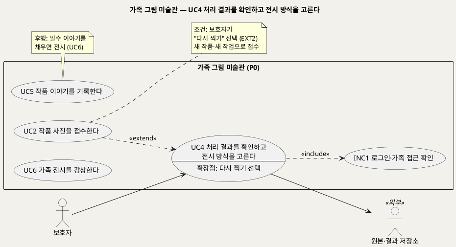

**[「UC4 부모 확인 UseCase Diagram」 PlantUML 뷰어로 열기](https://plantuml.sumzip.com/plantuml/svg/eNqFU1Fr01AUfr-_4hBftoeOrW57GKMMywa-yEAFHwblrk27sDSR5BYdIlQXpTKFTqx2riktuMlgYLoWm4c-7af4mJz8B89N07k8DJ9yuef7zved79xs2IJbolbVoVYslHlV0w8KFa7rqnVQWFxm9r5mPOcWr8IuL-5XLLNmlPKmblpwb-v-1tLmg1sIe4-XzBeaUYEy122V6WpZgDDB0ip7AkqapRaFZhpMaEJXIfDq2B9AMPbD8wmEv3xs9IJRHf7Uv8DT_DLgVTs8v4TgyguGk_BsAtFJC10_arWDYQ-w5-BRB0LvAo9cdB2gy_DMD49-MMaLgvwp4XAUtX3sNhXgNmxzSzXErIanzXDoX4-n3albHbtn-P5jDH1MEBXW1_HED3_XcznGpHNuVMi1cpftue3FeQVeMYCarRa5TdD_TrFj3D3GjpHJ7BgSTcZ6zTWgOwlF71Pge4BOLzp0Y7skc1v14aP8EoT9DjkkIRpxahh7x8F4Jh_zJDBtNwvYPY4-NwDfXuJPR_ohGjbaUatD8olaNk1auSG5I2xNyJwcU376boq3kuatwo0zmUFM8pp4-CZFWmWvGZvuDjKZXDyszHVhIRcPAGu0KM0o6rWSSpuSM8iShMiK-lKoRikuLMf8eLeMGaZQk3dplpOZsO8FgxEFPXs35I-ulVTwSpI8zG0-e5Kdl7TDRpLA9Tg547d32JnQDpL4GHkAKTnV3TWFMKtTYRlKdOpEXz-sQdRyCJzKUfYfOPjdCy9Gszc_R6nM_2u5QSf6ff8CJsnP4Q==)** — 클릭 시 브라우저로 연결됩니다.

##### 다이어그램 쉽게 읽기 (유저 관점)

- **누가 쓰나** — 보호자가 결과를 보고 고른다. 원본·결과 저장소는 미리보기와 원본을 꺼내 오는 외부 구성요소다.
- **무슨 순서로** — 결과를 보고 → 좋아요 / 액자로 걸기 / 다시 찍기 중 하나를 고르고 → 이야기를 채우면(UC5) → 가족 전시에 걸린다(UC6).
- **«include» = 항상 함께** — 결과를 볼 때마다 "로그인·가족 접근 확인"을 거친다.
- **«extend» = 특정 상황에서만** — "다시 찍기"를 고를 때만 사진 접수(UC2)가 끼어들어 새 사진을 받는다.
- **Generalization(◁)** — 없다. 결과 종류별 선택지는 같은 UC 안의 대체흐름으로 다룬다.

| 기호 | 의미 |
|---|---|
| 사람 모양(actor) | 시스템을 쓰는 사람 또는 외부 구성요소(`<<외부>>`) |
| 타원(usecase) | 액터가 이루려는 목표. `--` 아래는 확장점 |
| 사각형(rectangle) | 시스템 경계 |
| 점선 `<<include>>` | 항상 함께 수행되는 하위 행위 |
| 점선 `<<extend>>` | 확장점 조건일 때만 끼어드는 행위(UC2 → UC4) |

#### Actor

| 구분 | 액터 | 이 UC에서의 역할 | 원천 근거 |
|:--:|---|---|---|
| Primary | 보호자 | 결과를 보고 좋아요 / 액자로 걸기 / 다시 찍기를 고른다 | spec FR-6 |
| Secondary | 원본·결과 저장소 | 결과 미리보기와 원본을 제공한다 | spec Dependencies |

#### 관련 UseCase

| UC ID | 유스케이스명 | 관계 | 원천 근거 |
|:--:|---|---|---|
| UC4 | 처리 결과를 확인하고 전시 방식을 고른다 | 본 문서 | spec FR-6 |
| INC1 | 로그인·가족 접근 확인 | UC4가 «include» | spec FR-9 |
| UC2 | 작품 사진을 접수한다 | UC4를 «extend»(EXT2) | spec FR-6 다시 찍기 |
| UC5 | 작품 이야기를 기록한다 | 후행(전시 조건) | spec FR-7 · Edge Cases "이야기를 입력하지 않고 승인만 누름" |
| UC6 | 가족 전시를 감상한다 | 후행 | spec FR-8 |

> **쉽게 말하면** — 결과가 준비되면 보호자가 먼저 봅니다. 마음에 들면 "좋아요", 움직임이 어색하면 "액자로 걸기", 사진이 흐리면 "다시 찍기"를 누릅니다. 보호자가 고르기 전에는 가족 전시에 아무것도 걸리지 않습니다.

#### 유스케이스 기술

| 속성 | 내용 |
|---|---|
| **ID** | UC4 (spec FR-6) |
| **유스케이스명** | 처리 결과를 확인하고 전시 방식을 고른다 |
| **액터** | 주: 보호자 · 보조: 원본·결과 저장소 |
| **사전조건** | (1) 보호자가 로그인되어 있다(INC1). (2) 작품이 UC3를 거쳐 "확인 대기" 또는 "실패" 상태다. (3) 작품이 삭제 중이 아니다 |
| **사후조건** | (1) 보호자의 선택(좋아요/액자로 걸기/다시 찍기)이 해당 작업의 결과 종류·처리 원인과 연결되어 기록된다. (2) 좋아요 또는 액자로 걸기를 골랐고 필수 이야기가 채워져 있으면 상태가 "전시됨"이 된다. 이야기가 비어 있으면 승인만 기록되고 전시는 보류된다. (3) 다시 찍기를 고르면 건이 "다시 찍기로 닫힘"이 되고 전시되지 않는다. (4) 원본은 변형되지 않고, 결과를 다시 만들지 않는다 |
| **기본흐름** | ↓ 별도 기본흐름표 (움직이는 작품 + 좋아요 기준) |
| **대체흐름** | A1. 액자로 걸기(움직이는 결과) — 3단계에서 "액자로 걸기"를 고르면 원본을 액자로 전시한다. 이미 만든 움직이는 결과는 전시하지 않고, 대체 분류를 "부모 선택"으로 기록한다(spec FR-6, Scenario 3). A2. 원본 액자 결과 — 결과가 원본 액자(사람 그림 아님·품질 미달)면 "액자로 걸기 / 다시 찍기"만 보여 준다. 액자로 걸면 기존 대체 분류를 유지한다(spec FR-6 표). [추론] 이때 "부모 선택"으로 덮어쓰지 않는 것은 원인 분리 원칙(FR-13)을 따른 판단이다. A3. 실패 건 — "처리하지 못했어요"와 함께 "액자로 걸기 / 다시 찍기"를 보여 준다. 액자로 걸면 원본을 액자로 전시하고, 오류 분류는 그대로 둔다(spec FR-6, Scenario 5). A4. 다시 찍기 — 건을 "다시 찍기로 닫힘"으로 바꾸고, 원본과 결과는 삭제 규칙(UC7)과 같은 방식으로 지워 집계 필드만 남긴다. 이어서 EXT2로 UC2 사진 접수를 시작한다. 새 사진은 새 작품·새 작업이다(spec FR-6, Scenario 7, Assumptions). A5. 이야기 입력 완료 상태 — 필수 이야기가 이미 채워져 있으면 선택 즉시 "전시됨"이 된다(spec FR-7 "부모 확인 전후 언제든 입력") |
| **예외흐름** | E1. 원본 읽기 불가 — 저장소 장애가 계속돼 원본을 읽을 수 없으면 "액자로 걸기"를 비활성화하고 "다시 찍기"만 제공한다(spec Edge Cases). E2. 미리보기 불러오기 실패 — 결과 파일을 일시적으로 읽을 수 없으면 "잠시 후 다시 확인해 주세요"라고 안내하고, 선택지를 누를 수 없게 한다. 상태는 확인 대기로 유지한다. [추론] 원천은 미리보기 실패 처리를 따로 적지 않았다. 승인 전 비전시 원칙(FR-6)에 따라 보류로 설계했다. E3. 선택 기록 저장 실패 — 선택이 저장되지 않으면 "반영되지 않았어요"라고 안내한다. 전시 상태를 바꾸지 않고, 로그에는 분류 코드만 남긴다(spec FR-6 · FR-14). E4. 삭제 중인 작품 — 다른 화면에서 삭제를 요청한 작품이면 선택을 받지 않고 목록에서 사라졌다고 안내한다(spec FR-10). E5. 로그인 만료 — INC1에 따라 다시 로그인하게 하고, 선택은 기록하지 않는다(spec FR-9) |
| **포함/확장** | «include» INC1 로그인·가족 접근 확인 · «extend» UC2가 이 UC를 확장(EXT2, 확장점: 보호자가 "다시 찍기" 선택) |
| **우선순위** | High — "승인 전 전시하지 않는다"는 원천 [개요]와 [핵심 활동] 5의 핵심 통제다. 오인 움직임을 거르는 유일한 관문이다(Intent [핵심 장벽] 적용 범위·품질) |
| **사용빈도** | 처리가 끝난 작품 1건당 1회. 월간 건수는 `자료 없음 — 확인 필요` |
| **업무규칙** | BR-APR-01, BR-APR-02, BR-APR-03, BR-APR-04, BR-APR-05, BR-EXH-01, BR-PRC-04, BR-INT-04, BR-OPS-02, BR-ACC-01, BR-PRV-01 |
| **특별 요구사항** | 품질 통제: 엔진 검출 점수를 선택지 노출이나 자동 승인에 쓰지 않는다(spec FR-5). 사용성: 부모 조작 시간은 처리 대기를 빼고 작품 한 점 올리기·확인·이야기 입력까지 3분 이내(spec Success Criteria, 잠정). 액자 전환은 한 번의 선택으로 끝난다. 표현: 원본 액자에 "실패"나 "대체" 표시를 붙이지 않는다(spec FR-8). 측정: 첫 결과 승인율 = 좋아요 ÷ (좋아요 + 액자 전환 + 다시 찍기)이며, 첫 결과가 움직이는 작품인 건만 대상이다(spec FR-13, Assumptions) |
| **비고** | 원천 추적: spec FR-6(선택지 표 3행, 수용기준 5개: 승인 전 비전시 / 액자로 걸기 = 부모 선택 / 다시 찍기 = 새 작품 / 결과 재생성 금지 / 선택 기록) · FR-13 첫 결과 승인율 · Scenario 1, 3, 5, 7, 10 · Edge Cases "이야기를 입력하지 않고 승인만 누름", "다시 찍기 후 새 사진을 올리지 않음", "실패 건에서 원본까지 읽을 수 없는 경우" · Assumptions "다시 찍기로 닫힌 건의 파일", "실패 건의 액자 선택" · Intent [핵심 활동] 5 "부모 확인(좋아요·액자로 걸기·다시 찍기) … 원본을 덮어쓰거나 승인 전 전시하지 않는다" · Intent [부정적 영향] "어색하거나 왜곡된 움직임: 부모 승인 전 전시하지 않고 액자 전환·재촬영을 제공한다". 미결: 실패 건에서 액자로 걸 때 대체 분류를 "부모 선택"으로 기록할지, 오류 분류만 둘지 원천에 명시가 없다 — `자료 없음 — 확인 필요` |

#### 기본흐름 (Basic Flow)

| 단계 | 액터 행위 | 시스템 행위 |
|:--:|---|---|
| 1 | 보호자가 확인 대기 작품을 연다 | INC1로 접근을 확인하고, 원본·결과 저장소에서 결과 미리보기와 원본을 불러와 결과 종류에 맞는 선택지를 보여 준다 |
| 2 | 보호자가 움직이는 결과를 재생하고 원본과 비교한다 | 선택할 때만 재생하고 정지할 수 있게 하며, 원본을 나란히 보여 준다 |
| 3 | 보호자가 "좋아요"를 누른다 | 부모 선택을 작업의 결과 종류·처리 원인과 연결해 기록한다 |
| 4 | — | 이 작품의 필수 이야기(제목·제작일·제작 당시 연령)가 채워졌는지 확인한다 |
| 5 | 보호자가 안내에 따라 이야기 입력(UC5)으로 가거나 전시를 확인한다 | 이야기가 비어 있으면 "이야기를 채우면 전시돼요"라고 안내하고 UC5로 연결한다. 채워져 있으면 상태를 "전시됨"으로 바꾼다 |

#### Sequence Diagram

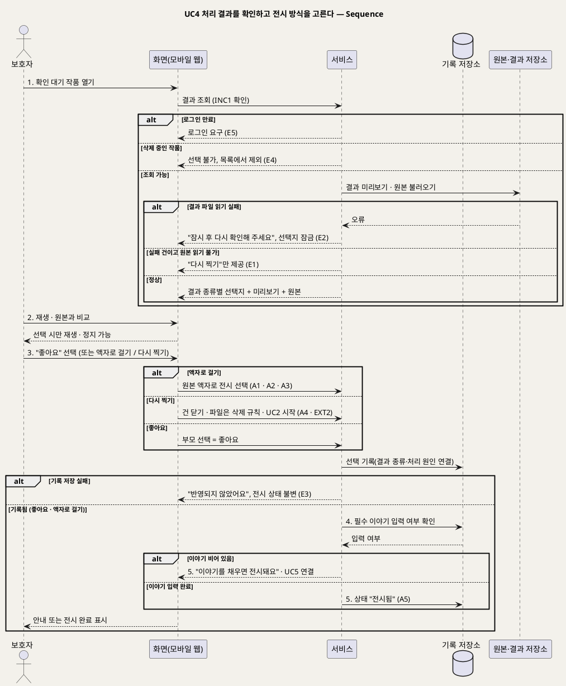

**[「UC4 부모 확인 Sequence」 PlantUML 뷰어로 열기](https://plantuml.sumzip.com/plantuml/svg/eNptVc9vGlcQvu9fMdpeQIndgvGlUqPExJFyqSo5rnqzNvbGQcE4gbWq3HC8iZChKq7YeIlZghNo7JSqm4DDWqIX_yk97pv9Hzrv7Vt-rHMAsbzvzXzzzTezt0uGVjT2dvJQ0p9tPNJ2cvnnG9taPq8Xn298l1FKT3KFp1pR24GH2uaT7eLuXmEru5vfLcI395bupVZXZhClx9rW7q-5wjY80vIlXTFyRl6H9WwG8LPN_uyD_9n1B2PWG0PQtNDxAsv2Bx3AjonVFjD3HKsOOibQn6znsWoX_is3YE1_tqcXNnVF0TYNSqyywTCwPWzXVdBK8JNW1AuGQhSM3GbuqVYwQA2aDXY-TLCPZ8xtoDMGPLlMCvT6_Xkkmi12aeJhV5yu_ZxVtjRDe6iVdFB9z2WnDtErY7uHr2oCcnclFuCkzgbe1SisLQZeI77EO6QIC7coPXwPqUVZP7BamZIAto-CPyqAx0N6UghDSKJC0CjqqRu8qUHi_o_ZlLybVLS8Aey05Y88EepDjb2vKSAuLkSppuf4puFf9CGxupxUdOoO4Iu_sdMC7B6JY0Ehfh3NTnDgAPtS8d3yTWAfz0kQPK6TalRpC5seBcxEAUOShGSHvSjSrVCDaSnsH4-sQC3khV-NINSPp2Bv-2h3uQIAvDZ5IajVRAedf4VU1W5QOyMEyMALE63oMuvZ4dFsESq2O9xfwYkJ5CnxU9pvCPh-jKZH4qg3ZbX4oUxqdHyvQrWlkxQvrE4kBv_TEJ2hcG1IXPIKJfpKcpkR3d8IplKXuHD-4IKCp6bBOxYe7F-_HbX_3UuqjA3MGYo35pW8IfnwiIUthX_itksvUl19pH5OZBcNuTT9i7pwHSHlnUnribvgPL1IVCm97HI8x9Iiyf2uipbJJY2CJJhdZ4cNQOuUppY8STJ6nPW3MCdP6Ok4ikqaHYlI9wlKro8o150Up3knLb6XpDfn0sQCUkvp_C_px9Bu6JSjAfFHLbxs8qP1bJrrQaNCWTL8n9VfHqQj90dVx6KzL2VaQxG7H2ZwvEdyRu6uTBUPt05irvVXI7lBqXgxrccunYdyzW2p6XzEXOjaaO-zui3cbR2iZeProbS91O9gPzhoiUEclMmdkXRhfFY_g8SEuzBCrE3J6ciLcjK05QhcsWlEhmiNw0X3knWI5HGfZJFTSNcIPzPGsxi5CqYR-LJ-TWPbrqBTuz4wy9x_EZi_aPAT8XXpZSDLZL-PhTNFO5elkJMxvEa0aYZLdb40yiLVUmXU-plKnlhOyvELLTA3TlaFvSCfyUGQkovwEBy16En44TZ90cv4f6Bhu3s=)** — 클릭 시 브라우저로 연결됩니다.

기본흐름 1~5단계는 시퀀스의 번호 붙은 주요 메시지 `1.`~`5.`와 1:1로 대응한다. 5단계는 이야기 입력 여부에 따라 `alt`의 두 갈래 중 하나로만 실행된다.

#### UML 노트

| 항목 | 적용 |
|---|---|
| «extend» 방향 | 확장 UC(UC2)에서 기반 UC(UC4)로 점선 화살표를 그렸다. 확장점 "다시 찍기 선택"은 기반 UC 타원 안에 적었다 |
| 결과 종류 분기 | 움직임·원본 액자·실패는 같은 목표(전시 방식 결정)의 변형이라 UC를 나누지 않았다. 대체흐름 A1~A3으로 표현했다 |
| 전시 조건 | 승인과 이야기 입력은 서로 다른 목표라서 UC4와 UC5로 나눴다. 전시 조건은 BR-EXH-01로 두 UC에 걸었다 |
| Sequence | 3단계의 선택 분기(액자로 걸기·다시 찍기)와 5단계의 이야기 입력 여부를 `alt`로 표현했다. 예외 E1~E5는 해당 지점에 번호를 붙였다 |

---

### 7.5 UC5 작품 이야기를 기록한다

#### 범위·개요

보호자는 작품마다 **제목, 제작일, 제작 당시 연령**을 입력하고, 원하면 **아이의 한마디**를 덧붙인다. 입력한 말은 **그대로** 저장하고 그대로 보여 준다. 시스템은 문장을 만들거나, 고치거나, 감정을 해석하지 않는다. 이 원칙은 후속 범위인 키워드 기반 설명 생성과 P0를 가르는 경계이기도 하다. P0는 **직접 입력**만 다룬다.

아이의 생년월일을 받지 않으므로, 나이는 작품마다 "제작 당시 연령"으로 받는다. 이 값이 가족 전시(UC6)의 연령별 묶음 기준이 된다. 필수 세 항목이 채워지고 보호자가 승인(UC4)해야 작품이 전시된다.

| 항목 | 값 |
|---|---|
| 대상 시스템 | 가족 그림 미술관 (P0) |
| 상위 프로세스 | 부모 확인(UC4) ↔ **이야기 기록(UC5)** → 전시(UC6). UC4와 순서가 바뀌어도 된다 |
| 원천 근거 | spec FR-7 · FR-6 · Edge Cases · Intent [핵심 활동] 5 · [핵심 데이터] 작품 |
| 핵심 UseCase | 1개 (UC5) + 공통 1개 (INC1) |
| 주요 액터 | 보호자 |

#### UseCase Diagram

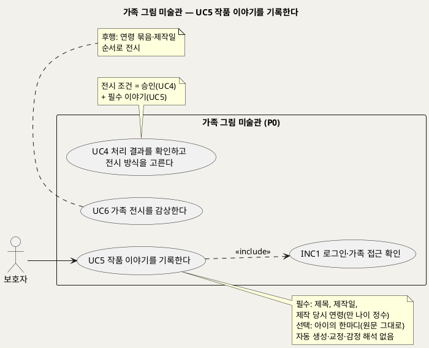

**[「UC5 이야기 기록 UseCase Diagram」 PlantUML 뷰어로 열기](https://plantuml.sumzip.com/plantuml/svg/eNqNU19L21AUf7-f4tC9tExFWeuDuCIrE_YyfNnbQK5tWoNpMpJbhoxBt4bRrYJ12K1iIy1MxSEsarem0Cc_yh5zT77Dzk2LtQ8bezrJPb9zfn9usuYIbotK2YBKfrPIy7qxu1nihqHZu5uLGebs6OYrbvMybPH8Tsm2KmYhZxmWDQ_WH60vPX1yD-Fs84L1WjdLUOSGozFDKwoQFth6aVtAQbe1vNAtkwldGBqEfhV7VxAOAnk2AvkjwHo37Ffhd_UQXuQygCcH0ec6oNfH1igMfHk6AlV6XtTqyMY3xnhekI6EvOlH7QBPmgngDmxwWzMFY4qMmyUiSvyNKbmxmErAGwZQcbQ8dwj6P8QxDQHvzz17nlsC2esQB3rB7WBCid2DcDCC6KhFp_GcAs4SpgGv2_LsEsJrP7wZKbYxPmq1w5vuSxO7LjY6IP0LbHjouUCn8jSYKknPLlyGO3Y1GMv3m1h7NyN_mb1lbBwWzM9nY0PK_cJCNhYJK7C6qpt5o1LQslnGTEtok5u0ihP7UcvFenuFiDry-8WcqhQeeqM5ao5fQDaGSj1-9WV3mJTneyDftylb6rdoOKWQbjeqebSG1lHoXhuU0vO6PDxM4nFTXgbx3e1VKeAYf9KU-0eANQ_dK8r6Z5N2qcxVpdk-uh4RfkBvj2lmAZT0sf4tSwirPDaQjjXG0WLPD6_68Bjw05CCT1JT8TycGJx-CtTJpP6xc1mFcuxGXz6uTByDvPxFOm4Hd9ko2noH3Q65mQiYblyjJ_oX_wChUcDe)** — 클릭 시 브라우저로 연결됩니다.

##### 다이어그램 쉽게 읽기 (유저 관점)

- **누가 쓰나** — 보호자가 작품의 제목, 그린 날, 그때 나이, 아이가 한 말을 적는다.
- **무슨 순서로** — 결과 확인(UC4) 전이든 후든 언제든 적을 수 있다. 승인과 필수 이야기가 둘 다 갖춰지면 가족 전시(UC6)에 걸린다.
- **«include» = 항상 함께** — 이야기를 쓸 때마다 "로그인·가족 접근 확인"을 거친다.
- **«extend» = 특정 상황에서만** — 이 UC에는 확장 관계가 없다.
- **Generalization(◁)** — 없다. 움직이는 작품과 원본 액자는 같은 이야기 항목을 가진다.

| 기호 | 의미 |
|---|---|
| 사람 모양(actor) | 시스템을 쓰는 사람 |
| 타원(usecase) | 액터가 이루려는 목표 |
| 사각형(rectangle) | 시스템 경계 |
| 점선 `<<include>>` | 항상 함께 수행되는 하위 행위 |
| 노트 | 입력 규칙·전시 조건 보충 |

#### Actor

| 구분 | 액터 | 이 UC에서의 역할 | 원천 근거 |
|:--:|---|---|---|
| Primary | 보호자 | 작품의 이야기(제목·제작일·제작 당시 연령·아이의 한마디)를 입력하고 수정한다 | spec FR-7 |
| 이해관계자 | 아이 | 한마디의 화자. 시스템을 직접 조작하지 않는다 | spec Target Users |

#### 관련 UseCase

| UC ID | 유스케이스명 | 관계 | 원천 근거 |
|:--:|---|---|---|
| UC5 | 작품 이야기를 기록한다 | 본 문서 | spec FR-7 |
| INC1 | 로그인·가족 접근 확인 | UC5가 «include» | spec FR-9 |
| UC4 | 처리 결과를 확인하고 전시 방식을 고른다 | 전시 조건을 함께 구성(순서 무관) | spec FR-6 · FR-7 수용기준 4 |
| UC6 | 가족 전시를 감상한다 | 후행 | spec FR-8 |

> **쉽게 말하면** — 그림 제목과 그린 날, 그때 아이 나이를 적습니다. 아이가 그림을 보며 한 말이 있으면 한마디로 남깁니다. 적은 말은 한 글자도 바뀌지 않고 그대로 전시에 나옵니다.

#### 유스케이스 기술

| 속성 | 내용 |
|---|---|
| **ID** | UC5 (spec FR-7) |
| **유스케이스명** | 작품 이야기를 기록한다 |
| **액터** | 주: 보호자 · 보조: 없음 |
| **사전조건** | (1) 보호자가 로그인되어 있다(INC1). (2) 대상 작품이 접수 완료되어 있고(UC2), 삭제 중이거나 다시 찍기로 닫힌 상태가 아니다 |
| **사후조건** | (1) 제목·제작일·제작 당시 연령과(입력한 경우) 아이의 한마디가 입력한 그대로 저장된다. (2) 보호자가 이미 승인했고 필수 세 항목이 모두 채워졌으면 상태가 "전시됨"이 되고, 수정 내용은 전시 화면에 곧바로 반영된다. (3) 시스템이 만들거나 바꾼 문장은 없다 |
| **기본흐름** | ↓ 별도 기본흐름표 (승인이 끝난 작품에 처음 입력하는 경우 기준) |
| **대체흐름** | A1. 승인 전 입력 — 확인 대기 상태에서 먼저 입력하면 저장만 하고, 전시는 UC4에서 승인할 때 이뤄진다(spec FR-7 수용기준 4). A2. 전시 후 수정 — 이미 전시된 작품의 이야기를 고치면 전시 화면에 곧바로 반영한다(spec FR-7 수용기준 4). A3. 한마디 생략 — 한마디를 비워도 필수 세 항목만으로 전시 조건을 만족한다(spec FR-7 수용기준 1). A4. 한마디 지우기 — 수정에서 한마디를 비우면 저장된 한마디를 지운다. [추론] 원천은 선택 입력만 명시한다. 삭제 가능은 선택 입력의 당연한 귀결로 판단했다. A5. 필수 항목 일부만 입력 — 일부만 채워 저장하면 입력한 값은 저장하되 전시하지 않는다. 비어 있는 항목을 표시하고 "이야기를 채우면 전시돼요"라고 안내한다. [추론] 원천은 "모두 채워야 전시"만 적었다. 부분 저장 허용은 "언제든 입력·수정"(FR-7)에 맞춘 설계 판단이다 |
| **예외흐름** | E1. 미래 제작일 — 오늘보다 뒤의 날짜면 거절하고 "그린 날은 오늘 이후일 수 없어요"라고 안내한다(spec FR-7 수용기준 2, Edge Cases). E2. 연령 범위 밖 — 만 나이 정수 0~18세가 아니면 거절하고 허용 범위를 안내한다(spec FR-7 수용기준 2, Assumptions). E3. 저장 실패 — 기록 저장소 장애로 저장하지 못하면 "저장되지 않았어요"라고 안내하고 이전 값을 유지한다. 로그에는 입력 문장 없이 분류 코드만 남긴다(spec FR-14 · Intent [핵심 장벽] 인프라). E4. 삭제 중이거나 닫힌 작품 — 삭제 중이거나 다시 찍기로 닫힌 작품이면 입력을 받지 않고 안내한다(spec FR-10 · FR-6). E5. 로그인 만료 — INC1에 따라 다시 로그인하게 한다. [추론] 입력 중이던 내용의 임시 보존 여부는 `자료 없음 — 확인 필요` |
| **포함/확장** | «include» INC1 로그인·가족 접근 확인 |
| **우선순위** | High — 원천 [미션]의 "아이의 그림과 그날의 말을 함께 간직"을 실현하는 기능이고, 전시의 필수 조건이다(spec FR-7) |
| **사용빈도** | 작품 1건당 최초 입력 1회 + 수정 수시. 수정 빈도는 `자료 없음 — 확인 필요` |
| **업무규칙** | BR-STY-01, BR-STY-02, BR-STY-03, BR-EXH-01, BR-CHD-01, BR-ACC-01, BR-PRV-01, BR-STY-04 |
| **특별 요구사항** | 기억 왜곡 금지: 한마디에 자동 요약·교정·감정 태그를 붙이지 않는다. 입력에 없는 사건·감정·발달 상태를 만들지 않는다(spec FR-7, Constraints · Intent [부정적 영향] 기억의 재작성). 최소 수집: 생년월일·출생연도 대신 작품별 제작 당시 연령만 받는다(Intent [부정적 영향] 과잉 수집). [추론] 출생연도가 없으므로 작품 간 연령·제작일의 앞뒤가 맞는지는 검사하지 않는다. 개인정보: 한마디와 제목은 자유 입력이므로 운영 로그와 지표에 남기지 않는다(spec FR-13, FR-14) |
| **비고** | 원천 추적: spec FR-7(수용기준 5개 전부: 필수 3·선택 1 / 제작일·연령 검증 / 원문 그대로 / 전후 언제든 입력·즉시 반영 / 결과 종류 무관 동일 항목) · FR-6(전시 조건) · Edge Cases "이야기를 입력하지 않고 승인만 누름", "미래 제작일 또는 범위 밖 연령" · Assumptions "제작 당시 연령", "이야기 필수 항목" · Key Entities "작품" · Intent [핵심 활동] 5 "제목·제작일·제작 당시 연령·선택형 한마디" · Intent [핵심 데이터] 작품 · Intent [가치제안] "작품과 실제 말이 먼저 보인다". 후속 범위(키워드·설명 초안·부모 승인본 구분)는 spec Out of Scope이므로 다루지 않는다 |

#### 기본흐름 (Basic Flow)

| 단계 | 액터 행위 | 시스템 행위 |
|:--:|---|---|
| 1 | 보호자가 작품의 "이야기 쓰기"를 연다(UC4 안내 또는 작품 상세에서) | INC1로 접근을 확인하고, 필수 항목(제목·제작일·제작 당시 연령)과 선택 항목(아이의 한마디)을 구분한 입력 화면을 보여 준다 |
| 2 | 보호자가 제목, 제작일, 제작 당시 연령을 입력한다 | 제작일이 오늘 이후가 아닌지, 연령이 만 나이 정수 0~18인지 바로 검사한다 |
| 3 | 보호자가 원하면 아이의 한마디를 입력한다 | 입력한 글자를 그대로 받는다. 자동 요약·교정·감정 태그는 제안하지 않는다 |
| 4 | 보호자가 "저장"을 누른다 | 입력값을 원문 그대로 작품 기록에 저장한다 |
| 5 | — | 보호자 승인과 필수 세 항목이 모두 갖춰졌는지 확인하고, 갖춰졌으면 상태를 "전시됨"으로 바꾼다 |
| 6 | 보호자가 저장 결과를 확인한다 | "전시에 걸렸어요"(또는 승인 전이면 "확인하면 전시돼요")를 보여 준다 |

#### Sequence Diagram

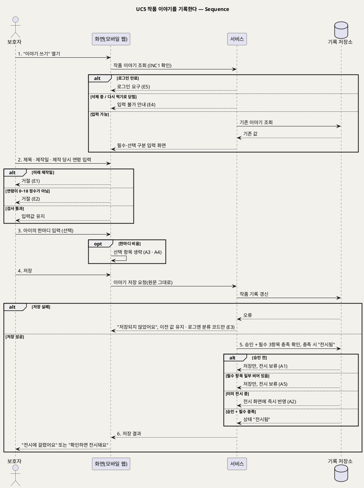

**[「UC5 이야기 기록 Sequence」 PlantUML 뷰어로 열기](https://plantuml.sumzip.com/plantuml/svg/eNqVVU1PE1EU3c-vuKmbNgJaSo1xYQTExI0xMbglAwzYWFpshxg3psBoaltjlY6M0GmmsZUPIU6hlDapG3-Ky3l3_oP3zQfFoTFx09c3775z7zn33Jl7WVnMyGsrSchKL-aWxJVE8tXcsphMSplXczfjQvZ5IrUqZsQVmBcXni9n0mupxel0Mp2Baw9iD6IzU5ciss_ExfTLRGoZlsRkVhLkhJyUYHY6Dlj7aH_KA-ptVPtW12TNPvClrttqlRUb8DtXgSfSizUptSAJgrggU4IQO23bWhdr5RCIWXgsZqSULFAqObGQWBVTMoTsLxV20A6zw31mVlDvA-72Ik707MO_I1Gpsp6ChYZz-uTptLAoyuK8mJUg5FYCaOSw1sS3JSfk_pQguClh9C7BwR2IjhGOTwFwy6QlBLjdplWgCIojYAoM0gWsm_ZOCcIPH01Hwf6iot6NCGJSBlavWudd2gLbK7GvJQEciFE_5eAcdyrW2RGEZ-IRQSJ1ATeO0agCNj7CDSANsUgb871DpkoPvts1LQiHtTfMaALr5C0zB6jm2UabICd8SPeYzlih6d-9S1LQVcLFevsKJ4qi49EL6l6YZX4K5rZVBfPar3NUDHtTByLDOoqf0m2kIKUWr6g-PkadqbLDA_h1zv-RuLzTFxui2nO4b5vM6HmArrg_uqymDe5QRbxLBOyloHJbJhp5kiDqS-CgEEu4-Tp6m-6qVLQrlsKK2r8gxj0I6ySHG0dgvz2zTofldCskhQCrBu7lhrKOjfGMXG1dAz4ke3lWqfhyhV0RI0J6Vb50yh2-m_NS-i135bbVYy4hbuqsdgbhyRgXcJI3fkjyiTFvGP529aD1ziG3JJ4ch3G3zI66QD5lpRx5LyJc9o03C96MWWYLi4bTHR-k2LBL-0EbodZgzSv2Dbl3WFkj2UifAqoafm5THaERpzxDgYGunKE3P9ukTUchRMCfFbZFetEwzsT8nnuVKC3r9Cxg-zhJUejxAbzuORhivpadA6y3vHEe8bfcilSnQisr74cIziHrYtBzehDk6pLaK42Aew_oxcdrDU-SKwGcGr3cfmq9zzo5p9-faSZredRL_wUcvwAm2WhO_AB6mwzDcc7cGcXtMuC3dw6aqaG2TmjjA7SAVq4oQyA31-3NoFDcioGO3_KdSFNlDh8nD4PXZbW6zOh6jgCmlVmhwj8SvEG2qlH1Hhf2oc9DHPPfox_6_v0BiyRYIA==)** — 클릭 시 브라우저로 연결됩니다.

기본흐름 1~6단계는 시퀀스의 번호 붙은 주요 메시지 `1.`~`6.`과 1:1로 대응한다.

#### UML 노트

| 항목 | 적용 |
|---|---|
| UC 분리 | 승인(UC4)과 이야기 기록(UC5)은 둘 다 전시 조건이지만 목표와 수행 시점이 달라서 별도 UC로 뒀다. 순서 의존이 없으므로 include나 extend로 묶지 않았다 |
| 추상수준 | 제목·제작일·연령·한마디 필드는 UC가 아니라 기본흐름 단계로 내렸다 |
| 선택 항목 | 한마디 생략은 정상 경로의 변형이라 대체흐름(A3)으로 처리했다 |
| Sequence | 입력 검증은 화면 단에서 `alt`로 표현했고, 전시 전환 조건(승인 전·부분 입력·전시 중)도 `alt`로 나눴다 |

---

### 7.6 UC6 가족 전시를 감상한다

#### 범위·개요

가족은 **승인된 작품만** 모인 2D 전시 화면에서 작품을 **한 점씩 골라** 감상한다. 전시는 아이별로 나뉘고, 한 아이 안에서는 제작 당시 연령별로 묶이며, 묶음 안에서는 제작일 순서로 놓인다. 작품을 고르면 결과(움직이는 작품 또는 원본 액자)와 함께 제목, 제작일, 제작 당시 연령, 아이의 한마디가 보인다. 움직이는 작품에서도 원본 사진을 볼 수 있다.

원천의 경험 원칙이 화면 규칙을 정한다. 작품과 실제 말이 먼저 보이고, 과도한 필터·자동 감정 해석·발달 평가·비교가 없다. 자동 반복이나 무한 피드 대신 가족이 골라서 본다. 움직이지 않는 원본 액자도 완성된 작품으로 대한다.

| 항목 | 값 |
|---|---|
| 대상 시스템 | 가족 그림 미술관 (P0) |
| 상위 프로세스 | 승인(UC4) + 이야기(UC5) → **감상(UC6)** |
| 원천 근거 | spec FR-8 · FR-9 · FR-6 · Scenario 1, 9, 10 · Intent [가치제안] 경험 원칙 |
| 핵심 UseCase | 1개 (UC6) + 공통 1개 (INC1) |
| 주요 액터 | 보호자 · 원본·결과 저장소(보조) · 아이(이해관계자, 함께 감상) |

#### UseCase Diagram

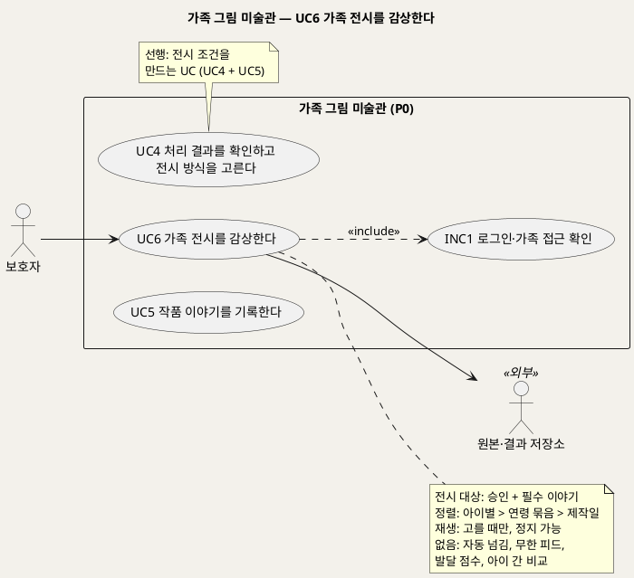

**[「UC6 가족 전시 UseCase Diagram」 PlantUML 뷰어로 열기](https://plantuml.sumzip.com/plantuml/svg/eNqFU1FL21AUfr-_4tC9KFZRpj4UKbIyYS9DGHsbyLVNazBNRnLLkDHIMIjTgnUzs7KmpLAqg8Ki7WwKedpP2WPuzX_YuYlFfRh7SnLPd77zfd-5WbcYNVmjrkGjvFWldVXb26pRTVPMva3FVWLtqvpbatI6bNPybs00GnqlZGiGCU82nm4sPX_2AGHt0IrxTtVrUKWapRBNqTJgBphqbYdBRTWVMlMNnTCVaQrEgS161xCPQ34ZAf8ZikM_Htnwxz6D16XVaV34jjju8H6EBy2x_zFxO_z4OyG0zFBEjg9HSTsU3VYOqAWb1FR0Nq2Jby0-DH-P45sgHkbIZItuXxw0U-grhCiwtiYuQn5rF4uESHlUr6G03L-0zWwuzubgPQFoWEqZWgj9r9R0GqIeNr14WVoC3uvgAOFJhVOC03gcQXLh4mnaJ4GPpy2DuGnzywFkruS0DJ-47Xjov9EzFcCDH-LYE54DeMr74b2S5ceEKyC6p8nnQxDeSLhRHAapA3z0vEcOVsgHQrKEYX6-mHqS7hcWiqlOKGCcql7WGhUF85QlCUuDJkQ3mHJ3E4zqXR5TqU0b0yqAOJqgD5iDxHXEYfteUAp1uT9ADJa8ER86UARxHnB_AnxwK7ym_PY7aEV4kcR3B2LfK2TmcYVuk18185JGXNlyYfyoL2HnB9iLtN0WP7kA7rTjiZ1HyhFah-Qs4l86ecTxAIMYYHsLheXvVCCNA3zixL9aRNErIC1mPrcNxox6ZlTGLRw_-fqpMDUsekF8PcLdSOarJs7gR_LSw4zc75zMevaecR3f8P_8C_MfxJQ=)** — 클릭 시 브라우저로 연결됩니다.

##### 다이어그램 쉽게 읽기 (유저 관점)

- **누가 쓰나** — 보호자가 화면을 연다. 아이는 곁에서 함께 보지만 계정이 없어 액터로 그리지 않았다. 원본·결과 저장소는 작품 파일을 꺼내 오는 외부 구성요소다.
- **무슨 순서로** — 보호자가 승인하고(UC4) 이야기를 채운(UC5) 작품만 여기에 걸린다. 아이를 고르고, 나이별로 묶인 작품 중 한 점을 골라 본다.
- **«include» = 항상 함께** — 전시를 열 때마다 "로그인·가족 접근 확인"을 거친다. 다른 가족의 전시는 볼 수 없다.
- **«extend» = 특정 상황에서만** — 이 UC에는 확장 관계가 없다.
- **Generalization(◁)** — 없다. 움직이는 작품과 원본 액자는 같은 대우로 전시된다.

| 기호 | 의미 |
|---|---|
| 사람 모양(actor) | 시스템을 쓰는 사람 또는 외부 구성요소(`<<외부>>`) |
| 타원(usecase) | 액터가 이루려는 목표 |
| 사각형(rectangle) | 시스템 경계 |
| 점선 `<<include>>` | 항상 함께 수행되는 하위 행위 |
| 노트 | 전시 규칙·선후 관계 보충 |

#### Actor

| 구분 | 액터 | 이 UC에서의 역할 | 원천 근거 |
|:--:|---|---|---|
| Primary | 보호자 | 전시를 열고, 아이와 작품을 골라 재생·정지하고, 원본과 이야기를 함께 본다 | spec FR-8 · Target Users |
| Secondary | 원본·결과 저장소 | 전시할 결과와 원본을 제공한다 | spec Dependencies |
| 이해관계자 | 아이 | 보호자와 함께 자기 그림을 본다. 조작 주체가 아니다 | spec Target Users |

주의: 가족 구성원(공동 보호자, 감상 전용 가족)이 별도 계정으로 전시를 볼 수 있는지는 spec FR-9 [NEEDS CLARIFICATION]으로 미확정이다 — `자료 없음 — 확인 필요`.

#### 관련 UseCase

| UC ID | 유스케이스명 | 관계 | 원천 근거 |
|:--:|---|---|---|
| UC6 | 가족 전시를 감상한다 | 본 문서 | spec FR-8 · FR-9 |
| INC1 | 로그인·가족 접근 확인 | UC6가 «include» | spec FR-9 |
| UC4 | 처리 결과를 확인하고 전시 방식을 고른다 | 선행(승인) | spec FR-6 |
| UC5 | 작품 이야기를 기록한다 | 선행(필수 이야기) | spec FR-7 |

> **쉽게 말하면** — 가족이 모여 앉아 아이의 작품을 나이별로 넘겨 봅니다. 마음에 드는 그림을 누르면 그림이 움직이고, 그날 아이가 한 말이 함께 보입니다. 저절로 다음 작품으로 넘어가지 않으니 천천히 골라 볼 수 있습니다.

#### 유스케이스 기술

| 속성 | 내용 |
|---|---|
| **ID** | UC6 (spec FR-8, FR-9) |
| **유스케이스명** | 가족 전시를 감상한다 |
| **액터** | 주: 보호자 · 보조: 원본·결과 저장소 |
| **사전조건** | (1) 보호자가 로그인되어 있다(INC1). (2) 가족 공간에 아이가 1명 이상 등록되어 있다(UC1) |
| **사후조건** | (1) 보호자는 이 가족의 "전시됨" 작품만 보았다. (2) 승인 전·실패·다시 찍기로 닫힘·삭제 중인 작품은 어디에도 노출되지 않았다. (3) 작품·이야기·원본은 바뀌지 않았다. [추론] 감상 행위 자체(조회 기록)를 저장할지는 `자료 없음 — 확인 필요`. 재열람 관찰은 spec FR-18의 관찰 기록으로 수행한다 |
| **기본흐름** | ↓ 별도 기본흐름표 (움직이는 작품 감상 기준) |
| **대체흐름** | A1. 원본 액자 작품 — 고른 작품이 원본 액자면 재생 없이 액자로 보여 준다. 움직이는 작품과 같은 크기·대우이며 "실패"·"대체" 표시가 없다(spec FR-8). A2. 작품 다시 찾기 — 보호자가 제목이나 제작일로 검색해 특정 작품을 연다(spec FR-8 수용기준 7). A3. 전시할 작품이 없음 — 선택한 아이에게 전시된 작품이 없으면 빈 전시를 보여 주고 작품 올리기(UC2)로 안내한다. [추론] 빈 상태 화면은 원천에 없다. A4. 이야기 수정 반영 — UC5에서 이야기를 고친 작품은 다음 조회부터 수정 내용으로 보인다(spec FR-7 수용기준 4). A5. 다른 아이로 전환 — 보호자가 다른 아이를 고르면 그 아이의 연령 묶음으로 바뀐다(spec FR-8 수용기준 1) |
| **예외흐름** | E1. 다른 가족 작품 직접 접근 — 다른 가족의 작품 주소를 직접 입력하면 접근을 거부하고, 원본·결과·이야기를 어느 것도 노출하지 않는다(spec FR-9, Scenario 9). E2. 비로그인 접근 — 로그인하지 않았으면 어떤 작품도 보여 주지 않고 로그인을 요구한다(spec FR-9). E3. 승인 전 작품 직접 접근 — 확인 대기·실패·닫힘 작품은 전시 목록과 상세 어디에도 나오지 않는다. 주소로 접근해도 전시 화면으로는 보여 주지 않는다(spec FR-6 수용기준 1, Scenario 10). E4. 파일 불러오기 실패 — 원본·결과 저장소 장애로 파일을 못 불러오면 "지금은 작품을 불러올 수 없어요"라고 안내한다. 목록의 이야기는 그대로 보여 준다. [추론] 원천은 전시 중 저장소 장애 처리를 따로 적지 않았다. Intent [핵심 장벽] 인프라 "저장소·DB 장애 분리"를 근거로 설계했다. E5. 삭제된 작품 — 삭제 요청된 작품은 곧바로 전시에서 사라지고, 열려 있던 상세는 "더 이상 없는 작품이에요"로 바뀐다(spec FR-10 수용기준 1) |
| **포함/확장** | «include» INC1 로그인·가족 접근 확인 |
| **우선순위** | High — 원천 [미션]의 "가족이 함께 간직하고 다시 만나는 기록"과 [가치제안] 공동 감상을 직접 실현한다(spec FR-8) |
| **사용빈도** | `자료 없음 — 확인 필요`. 재열람 행동은 P0 검증 관찰 대상이다(Intent [미션] P0 경험 검증 "재열람 행동·이유를 관찰") |
| **업무규칙** | BR-APR-01, BR-EXH-01, BR-EXH-02, BR-EXH-03, BR-EXH-04, BR-STY-03, BR-ACC-01, BR-ACC-02, BR-ACC-03, BR-EXH-05 |
| **특별 요구사항** | 경험: 자동 넘김·무한 피드·자동 반복 없이 고를 때만 재생하고 정지할 수 있다. 과도한 필터·꾸밈 효과·발달 점수·아이 간 비교 표시가 없다(spec FR-8 · Intent [부정적 영향] 과도한 화면 소비·비교·평가 오용). 사용성: 전시 작품 20점 이상 중 지정 작품을 30초 안에 찾는다(spec Success Criteria, 잠정). 접근: 가족 간 교차 접근 시험에서 노출 0건(spec Success Criteria). 기기: 모바일 웹(spec Assumptions). 보호: 운영자는 전시 이미지를 볼 수 없다(spec FR-9) |
| **비고** | 원천 추적: spec FR-8(수용기준 7개 전부: 아이별·연령 묶음·제작일 / 결과+이야기 표시 / 원본 보기 / 선택 재생·정지·무한 피드 없음 / 원본 액자 동등 대우 / 필터·점수·비교 없음 / 제목·제작일로 다시 찾기) · FR-9(수용기준 1·2·3) · FR-6 수용기준 1 · Scenario 1, 9, 10 · Success Criteria "다시 찾기", "접근 차단" · Intent [가치제안] 경험 원칙 "작품과 실제 말이 먼저 보인다 … 가족이 한 점씩 꺼내 보고" · Intent [부정적 영향] "과도한 화면 소비", "비교·평가 오용". 공동 감상의 계정 모델은 spec FR-9 미결 |

#### 기본흐름 (Basic Flow)

| 단계 | 액터 행위 | 시스템 행위 |
|:--:|---|---|
| 1 | 보호자가 가족 전시를 연다 | INC1로 로그인과 가족 공간을 확인하고, 이 가족의 아이 목록을 보여 준다 |
| 2 | 보호자가 아이를 고른다 | 그 아이의 "전시됨" 작품만 제작 당시 연령별로 묶고, 묶음 안은 제작일 순서로 정지 상태 목록을 보여 준다 |
| 3 | 보호자가 아이와 함께 볼 작품 하나를 고른다 | 원본·결과 저장소에서 결과를 불러와 제목·제작일·제작 당시 연령·아이의 한마디와 함께 보여 준다 |
| 4 | 보호자가 재생을 누른다 | 움직이는 작품을 재생하고 정지 조작을 제공한다(자동 반복·자동 넘김 없음) |
| 5 | 보호자가 "원본 보기"를 누른다 | 원본 사진을 보여 준다 |
| 6 | 보호자가 정지하고 목록으로 돌아간다 | 재생을 멈추고, 다음 작품으로 저절로 넘어가지 않고 연령 묶음 목록으로 돌아간다 |

#### Sequence Diagram

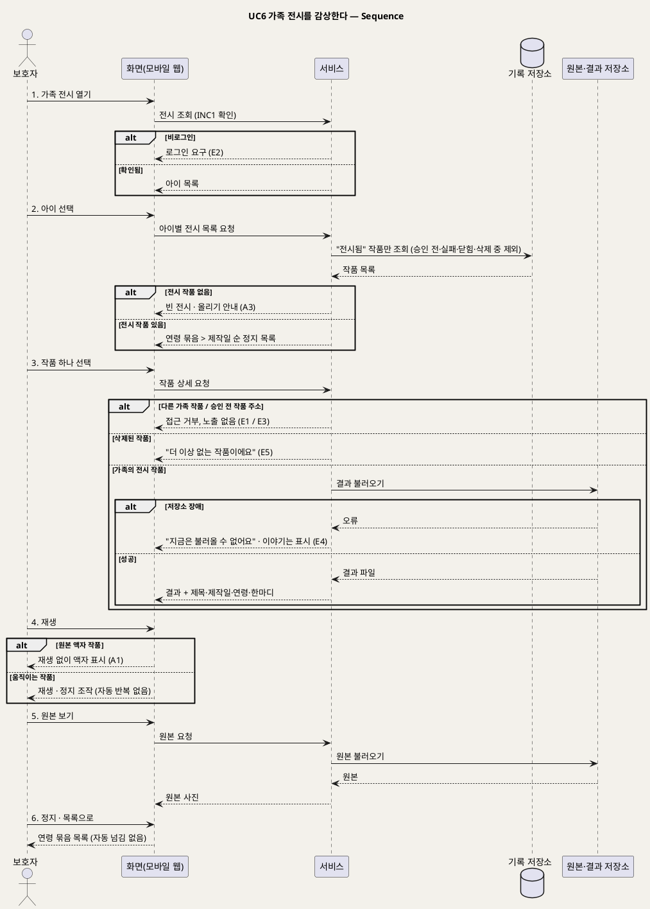

**[「UC6 가족 전시 Sequence」 PlantUML 뷰어로 열기](https://plantuml.sumzip.com/plantuml/svg/eNp9Vc9PE1EQvu9fMamXNkq1ohw4EBEx8WJMiF7JCis2lKLtEuOtwGoaWmNrWlmgrW0sFrAmxRa6TXrqn-Jx3-z_4Ozb9xb6Q0_Azsz3vvnmm-FBUlcT-tZGDJLa2-VX6kY09n55TY3FtMT75TszSnI9Gn-jJtQNeKmurK8lNrfiqwubsc0E3Hg8_Tiy-PBaRvK1urr5Lhpfg1dqLKkpelSPafB8YQbsVgpr54BVAzMldtynDznc3XaKJZapw59UAZa0t1tafEVTFHVFJ_QAa3cc08JKLgBqEp6pCS2uK_SOHl2JvlHjOgScgwI77QTZ2QlrFbDcBzzqhXj28yfDmWiUWM_AvTqPLr1YUFZVXX2pJjUI2FaL1cpELYWVY_yY5SmPHo4AHOVY2xp07d8tu90fSV4ivsTbowhTc_Q8zEIkPNw14H6H3lIoSCnEgXJkpNZyDrMQfPJ0IQLOQRHLVkhRYzoQaVYr2V2LvijAi6Ykvh8APCzYF00ILt4NKRrpLiBY7mS0BosGljvAzk6pZUWLr46xvhuWSWhUnd3yMF0eYW1DEveAXAL4-5fCn5oj7Sg1IEadOwkAVvLOlzRrZP1Gca_HiVeNQRczdSd7MuiyzE-nYtLfO7-wSprU8xQv4QFJQYhTVyQ4muzBVUmq6AVw_yOWs2Nq9dIyb9AFNJvsR5OmQS2l2U4HgvPTQrsRsEp6Ahjut1i1B6x5SUGY4zwree7ANJVWi9hI_U_k6bDEd4om2zEnai0I7G6jYUmFuScydXZs-d7y0m7DlaR-6fc-OXSMezVvd2n_zlvsMnUL2AcLL0tCNLJQhKAWfS34KFhOyjGKFWCfCkCOIJIuAtsriET3236OSAcI8r5A8xhj2RzWWILOeXtEsGLJ2GWafWuiWXe3BsCbtNg7cH8Uq_QZRNk1g5gkkOmFhtjSVGyLuKV86CYNzOTNf-1wtq43iHux714FasfJl1ymwcV7IQL0RDHO7fbFxJcFcSebJS-MExDhm65fyB1kdekb-pVbatB1L2IjzQoF9zmyziT73HPt08Rd4X5-msjINbqVV5q6XqICUTorKrxBd2S2bG8-Iid-lMLGtrvk_iz_jeWK5Xmd9pqSaa8rOfb5AFjLZO0LYarQxB7uhyVxuvNjZ1G0NHRWpDtk2XV3jFmA5yjDxhegO01sGGN8ZsKyF-rKW10s9enGKmPNDy2_uIB-54Zp91J-5w-odfrX-hf6bIh5)** — 클릭 시 브라우저로 연결됩니다.

기본흐름 1~6단계는 시퀀스의 번호 붙은 주요 메시지 `1.`~`6.`과 1:1로 대응한다. A2(제목·제작일 검색)는 2단계를 대신하는 진입 경로라서 시퀀스에서 생략했다.

#### UML 노트

| 항목 | 적용 |
|---|---|
| 액터 | 아이는 함께 보는 이해관계자이지만 시스템과 직접 상호작용하지 않아 actor로 그리지 않았다. 대신 노트와 카탈로그에 기록했다 |
| 선후 관계 | UC4·UC5는 전시 조건을 만드는 선행 UC이며 include/extend 관계가 아니라서 노트로 표시했다 |
| 대체 진입 | 검색으로 찾는 경로(A2)는 같은 목표의 다른 진입이라 대체흐름으로 처리했다 |
| Sequence | 접근 차단(E1·E3·E5)과 저장소 장애(E4)를 `alt`로 표현하고, 결과 종류(원본 액자/움직임)도 `alt`로 나눴다 |

---

### 7.7 UC7 작품 또는 아이를 삭제한다

#### 범위·개요

보호자는 작품 하나, 또는 아이 한 명(그 아이의 모든 작품 포함)을 삭제한다. 아동의 그림과 사진에는 이름·유치원·얼굴이 담길 수 있으므로, 삭제는 **빠짐없이, 정해진 순서로** 이뤄져야 한다.

1. 새 처리를 막는다.
2. 진행 중인 처리가 끝났거나 취소됐음을 확인한다.
3. 원본, 결과, 임시 파일을 지운다.
4. 작업 기록에서 작품과의 연결, 저장 위치, 자유 입력을 제거하고 **집계 필드만** 남긴다.

처리 중인 작품이면 **EXT1 실행 중 처리 취소**가 끼어든다. 백업에 남는 사본은 P0 범위 밖이며 운영 전에 정한다.

| 항목 | 값 |
|---|---|
| 대상 시스템 | 가족 그림 미술관 (P0) |
| 상위 프로세스 | 모든 작품 상태에서 언제든(접수됨·처리 중·확인 대기·실패·전시됨) |
| 원천 근거 | spec FR-10 · FR-11 · FR-9 수용기준 4 · Scenario 8 · Intent [부정적 영향] 삭제 누락 · [핵심 데이터] |
| 핵심 UseCase | 1개 (UC7) + 공통 1개 (INC1) + 확장 1개 (EXT1) |
| 주요 액터 | 보호자 · 원본·결과 저장소(보조) |

#### UseCase Diagram

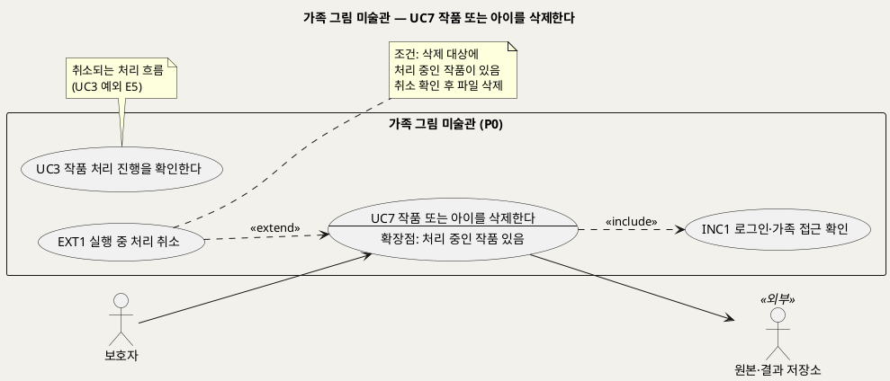

**[「UC7 삭제 UseCase Diagram」 PlantUML 뷰어로 열기](https://plantuml.sumzip.com/plantuml/svg/eNqNk89qE1EUxvf3KQ5x0y5SGoIUQgnFkIIbKajgolBuJ5N06GRGZm7QIsKoQaLNYlIaTWkmJJBGF4ppE8wssvJRXM498w7eO39qBAV3w5zvnO93vjOzYzNqsUZdh4ZyUKV1TT85qFFdV62Tg80tYh9rxlNq0TocUuW4ZpkNo1IyddOCO7v53Vz53orCPqIV85lm1KBKdVslulplwEywtNoRg4pmqQrTTIMwjekqBFMHR9cQLHw-WQL_5mNrGMwd-Omcw-PSFuCgE561gPdc_v4csNtEb86vloCvv-KwH3b7_HRMCFWYYMnw2Tzs-ThwM0Bt2KOWarC0hpcun_k_FsHNNJiJ_qGDgyt8246kD4VEhe1tvPD5d6dYJERSUqMmCDP_Qlzb21zPwAsC0LBVhdpC-r_E-0Y2u2-EF13JMHQLgDc9PvkCOO6g56cjcNBCLwYUg1d97j8o5YCP-oJJ6MVSMSIOO8FiCXKu50d9UrjaWH7yKAd4Og4_vJNmt76Lz2kUUvHnSvlbnkT8qSna0WsmRvFKCWaevCQkTh6y2WIELlPZ2ChGMFAQMWuGojcqqsg54pE1qZEl9TlTjYqoyBdyQHQaQgyTqcknZFZTSBxNg-t5IYkWeNvBN6_woytLfwlUHCLJVAqilZMVILwU27Tb6KV3IoICpGnsfGgyZtaltVwx7eZuL7px7BV6Lp80RXEtyqzXEl8TlO-u_x61I57EP_YLjsqaAQ==)** — 클릭 시 브라우저로 연결됩니다.

##### 다이어그램 쉽게 읽기 (유저 관점)

- **누가 쓰나** — 보호자만 삭제할 수 있다. 원본·결과 저장소에서 파일이 실제로 지워진다.
- **무슨 순서로** — 삭제를 누르면 작품이 곧바로 화면에서 사라진다. 그 뒤 시스템이 처리 중단을 확인하고 파일과 기록을 정리한다.
- **«include» = 항상 함께** — 삭제할 때마다 "로그인·가족 접근 확인"을 거친다. 내 가족의 작품만 지울 수 있다.
- **«extend» = 특정 상황에서만** — 지우려는 작품이 아직 처리 중일 때만 "실행 중 처리 취소"가 끼어든다. 이때 처리가 멈춘 것을 확인한 뒤에 파일을 지운다.
- **Generalization(◁)** — 없다. 작품 삭제와 아이 삭제는 같은 규칙을 쓰고, 아이 삭제는 그 아이의 모든 작품에 같은 절차를 반복한다(대체흐름 A1).

| 기호 | 의미 |
|---|---|
| 사람 모양(actor) | 시스템을 쓰는 사람 또는 외부 구성요소(`<<외부>>`) |
| 타원(usecase) | 액터가 이루려는 목표. `--` 아래는 확장점 |
| 사각형(rectangle) | 시스템 경계 |
| 점선 `<<include>>` | 항상 함께 수행되는 하위 행위 |
| 점선 `<<extend>>` | 확장점 조건일 때만 기반 UC에 끼어드는 행위(EXT1 → UC7) |

#### Actor

| 구분 | 액터 | 이 UC에서의 역할 | 원천 근거 |
|:--:|---|---|---|
| Primary | 보호자 | 작품이나 아이의 삭제를 요청하고 확인한다. 삭제 권한은 보호자에게만 있다 | spec FR-9 수용기준 4 · FR-10 |
| Secondary | 원본·결과 저장소 | 원본, 결과, 임시 파일을 실제로 지운다 | spec Dependencies · FR-10 |

[추론] 처리 담당(백그라운드 작업자)은 취소 신호를 받는 시스템 내부 구성요소라서 시퀀스 lifeline으로만 표현한다.

#### 관련 UseCase

| UC ID | 유스케이스명 | 관계 | 원천 근거 |
|:--:|---|---|---|
| UC7 | 작품 또는 아이를 삭제한다 | 본 문서 | spec FR-10 · FR-11 |
| INC1 | 로그인·가족 접근 확인 | UC7이 «include» | spec FR-9 |
| EXT1 | 실행 중 처리 취소 | UC7을 «extend»(확장점: 처리 중인 작품 있음) | spec FR-10 수용기준 2 · Scenario 8 |
| UC3 | 작품 처리 진행을 확인한다 | 취소되는 처리 흐름(UC3 E5) | spec FR-4 · FR-10 |

> **쉽게 말하면** — 보호자가 "삭제"를 누르면 작품이 바로 화면에서 사라집니다. 뒤에서 처리 중이던 작업은 멈추고, 원본 사진과 결과물, 임시 파일이 모두 지워집니다. 운영 통계용 숫자만 남고, 누구의 어떤 그림이었는지는 남지 않습니다.

#### 유스케이스 기술

| 속성 | 내용 |
|---|---|
| **ID** | UC7 (spec FR-10, FR-11) |
| **유스케이스명** | 작품 또는 아이를 삭제한다 |
| **액터** | 주: 보호자 · 보조: 원본·결과 저장소 |
| **사전조건** | (1) 보호자가 로그인되어 있다(INC1). (2) 삭제 대상 작품이나 아이가 이 가족 공간에 있다. (3) 요청자가 보호자 역할이다(spec FR-9 수용기준 4) |
| **사후조건** | (1) 대상 작품은 전시·목록 어디에도 없다. (2) 그 작품의 새 처리는 시작되지 않으며, 진행 중이던 처리는 멈췄다. (3) 원본, 결과, 임시 파일이 남아 있지 않다. (4) 남은 작업 기록에는 작품·아이 연결, 저장 위치, 자유 입력이 없고 집계 필드(경로, 결과 종류, 분류, 단계별 시간, 시도 횟수, 엔진 버전)만 있다. (5) 아이 삭제였다면 그 아이의 모든 작품에 (1)~(4)가 적용되고 아이 기록도 없다. (6) 끝내 완료하지 못한 삭제는 운영자에게 "삭제 미완료"로 집계된다 |
| **기본흐름** | ↓ 별도 기본흐름표 (처리 중이 아닌 작품 하나를 삭제하는 경우 기준) |
| **대체흐름** | A1. 아이 삭제 — 보호자가 아이 관리 화면에서 아이를 삭제하면, 그 아이의 모든 작품에 2~5단계를 반복한 뒤 아이 기록(별칭)을 지운다(spec FR-10 수용기준 6). A2. 처리 중인 작품(EXT1) — 3단계에서 진행 중인 처리가 있으면 처리 담당에 취소 신호를 보내고, 처리가 멈춘 것을 확인한 뒤 4단계로 간다. 취소 이후 결과 파일은 새로 생기지 않는다(spec FR-10 수용기준 2, Scenario 8). 아이 삭제에 처리 중인 작품이 섞여 있으면 작품마다 취소를 확인한다(spec Edge Cases). A3. 삭제 확인 취소 — 확인 창에서 "취소"를 누르면 아무것도 바뀌지 않는다. [추론] 되돌릴 수 없는 작업이라 확인 단계를 두는 것은 설계 판단이다 |
| **예외흐름** | E1. 파일 일부 삭제 실패 — 원본·결과·임시 파일 중 일부를 지우지 못하면 자동으로 다시 시도한다. 끝내 완료되지 않은 건은 운영자에게 "삭제 미완료"로 집계된다(이미지와 식별 정보 제외). 보호자 화면에서는 이미 사라진 상태를 유지한다(spec FR-10 수용기준 5, Edge Cases). E2. 취소 확인 지연 — 처리 담당이 취소 신호에 응답하지 않으면 점유 시간이 만료될 때까지 파일 삭제를 미룬다. 그 뒤 처리 재개를 막은 상태에서 삭제를 진행한다. [추론] 원천은 "취소 확인 뒤 삭제"만 명시하고 무응답 처리는 적지 않았다. UC3 A3(점유 시간 만료)를 근거로 설계했다. E3. 권한 없는 요청 — 보호자가 아닌 계정(예: 서비스 운영자)이나 다른 가족이 삭제를 요청하면 거부한다(spec FR-9 수용기준 1·4). E4. 로그인 만료 — INC1에 따라 다시 로그인하게 하고, 삭제는 시작하지 않는다(spec FR-9). E5. 삭제 상태 전환 실패 — 기록 저장소 장애로 "삭제 중" 전환 자체가 실패하면 "삭제되지 않았어요"라고 안내하고 아무것도 바꾸지 않는다. [추론] 원천에 명시가 없다. 부분 삭제를 막기 위한 판단이다. E6. 백업 사본 — 백업에 남는 사본의 보존·삭제는 P0 범위 밖이다. 운영 전에 정할 항목으로 남긴다(spec FR-10 수용기준 7) |
| **포함/확장** | «include» INC1 로그인·가족 접근 확인 · «extend» EXT1 실행 중 처리 취소(확장점: 삭제 대상에 처리 중인 작품이 있음) |
| **우선순위** | High — 아동 정보 통제의 마지막 수단이다. 원천 [부정적 영향] "삭제 누락"과 [핵심 활동] 6 "권한·삭제·실행 중 취소·임시 파일 정리"가 필수 항목으로 명시한다 |
| **사용빈도** | `자료 없음 — 확인 필요` |
| **업무규칙** | BR-DEL-01, BR-DEL-02, BR-DEL-03, BR-DEL-04, BR-ACC-01, BR-ACC-04, BR-APR-05, BR-PRC-08, BR-PRV-01 |
| **특별 요구사항** | 완전성: 삭제 시험(처리 중 삭제 포함)에서 삭제 완료 후 남은 원본·결과·임시 파일 0건, 남은 작업 기록의 작품 연결·저장 위치·자유 입력 0건(spec Success Criteria). 즉시성: 요청 즉시 전시·목록에서 사라진다(spec FR-10 수용기준 1). 개인정보: "삭제 미완료" 집계와 로그에 이미지·저장 위치·별칭·제목·한마디가 없다(spec FR-13, FR-14). 권한: 삭제는 보호자만 할 수 있다(spec FR-9) |
| **비고** | 원천 추적: spec FR-10(수용기준 7개 전부: 즉시 제외·새 처리 금지 / 실행 중 취소 후 삭제 / 파일 0 / 집계 필드만 / 자동 재시도·미완료 집계 / 아이 삭제 전파 / 백업 범위 밖) · FR-11(임시 파일) · FR-9 수용기준 4 · Scenario 8 · Edge Cases "삭제 중 일부 파일 삭제 실패", "아이 삭제 시 처리 중인 작품 포함" · Intent [부정적 영향] "삭제 누락: 새 작업을 막고 실행 작업의 종료·취소를 확인한 뒤 원본·결과·임시 파일을 지운다. 백업 보존 정책은 운영 전 결정한다" · Intent [핵심 데이터] "삭제 시 원본·결과·임시 파일을 지우고 작업의 작품 연결과 저장 위치·자유 입력을 제거한 뒤 집계 필드만 남긴다". 미결: 공동 보호자 모델(spec FR-9 [NEEDS CLARIFICATION])이면 누가 삭제할 수 있는지 달라질 수 있다 |

#### 기본흐름 (Basic Flow)

| 단계 | 액터 행위 | 시스템 행위 |
|:--:|---|---|
| 1 | 보호자가 작품 상세에서 "삭제"를 누른다 | INC1로 접근과 보호자 권한을 확인하고, 되돌릴 수 없다는 확인 창을 보여 준다 |
| 2 | 보호자가 삭제를 확인한다 | 작품 상태를 "삭제 중"으로 바꾸고, 전시·목록에서 즉시 빼고, 새 처리 시작을 막는다 |
| 3 | — | 이 작품에 진행 중인 처리가 없는지 확인한다(있으면 EXT1) |
| 4 | — | 원본·결과 저장소에서 원본, 결과, 임시 파일을 지운다 |
| 5 | — | 작업 기록에서 작품·아이 연결, 저장 위치, 자유 입력을 제거해 집계 필드만 남기고, 작품 기록을 지운다 |
| 6 | 보호자가 목록에서 작품이 사라진 것을 확인한다 | "삭제했어요"를 보여 준다 |

#### Sequence Diagram

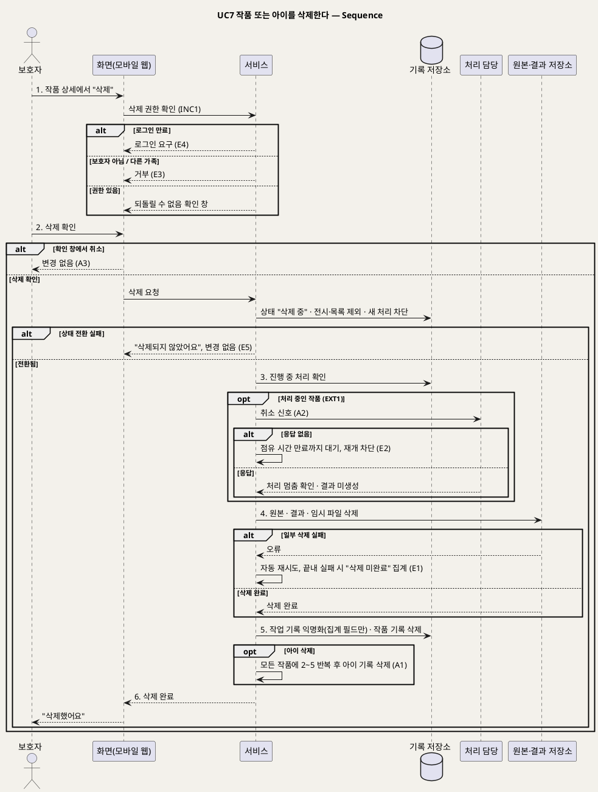

**[「UC7 삭제 Sequence」 PlantUML 뷰어로 열기](https://plantuml.sumzip.com/plantuml/svg/eNp1VU1P21gU3ftXXGU2iVSYAqWVZlG1pVTqZjQS0-nskAsuExESmhiNuhmFxq0yxBLJNIAz2FHQhPIhqhoSiJHohp8yS7_r_zDXz-85wXQWSST7vnPPOffcl0clXS3qays5KGlv5l-rK9nc2_klNZfTim_n7z5QSsvZ_KpaVFfglbqwvFQsrOUXZwq5QhG-ezb1bGL2yUhF6Td1sfB7Nr8Er9VcSVP0rJ7T4MXMA8B2I_irCsyqs40m4JaBTp_tXwG--4wdO9iyWa0L_5abMKe9WdPyC5qiqAs6NUmxXj-wPGzXU6CW4Ce1qOV1hdrp2YXsqprXIRW0muyon2bHh8xtokOgu5cZXv3i-c1KNGx2aeBGl7-d-2VGWVR19ZVa0iDley7bcwA7ZWzv4weTlzx9kgA4s9inE2C1Pqtd8oqXheKyVkxU7dZZz7se-Geu37tKQM6RKlIXCYGxh0QSfoCJcWkRVtbR8HCnTmQJivuTUqiISokx1UbPwL8wyTcIWlvoeJB-_uPMREZRczqwPdsfeOFDdmCyf0wF-MEx2Wv4Hv9u-ucnkJ69l1E0GhjEZocjYjULvietXbbvge-Wce80CeWfuuyiTABTAkCQwnYVnduN6xbbNNmnPmDVAtz5QDWSP7pfFS2_eMuYyXGpNyrkCodnhE84OCR_qV_oEx0VINSyV_bPvspe6ceS503M6FzCXzIHzz5LDQ8pC-G7ynpQiecC2G2k4HpAIzawZl8P2PFRFCIbWx5_UaGJRqFB95DVDgkvVCBw6FzQIitq3cAMXyUME23INzwo00g2cMvC7T4xS91JSpudzhBAJI6jsvoIoqA_RW4eGMH2nyFzSSw2AaCwqsd0uw3ucZTK9OyvP09keE2MGEU_NIW7Tyo6FB4yeVIWcqVOg9XOBU3xPIYQhnfqaHfovO27hgitf2mGmplZpsW8QzROfNcWHhKbuEUkmPeIwQWxsWEDsbZHVbzoyvTQdMSCsi8eVhw0TiUm5XD0V5INN5fQ7pGJfMNHIMJRt8MMQGCa_A7ik1OGLlyFiyJjM5w3CNgRshYtnKV8y6d2nW22Qi-oEds0KAPrDnvXF3ihgXEyQ00tg4xM0cQbfs8g08QARxcgqvk_JrdqEo7wTE3zqwt33oO8Qp1zdvyebuW06BzQXfLRprlmIp94omTx0CcePv7PMPo04UF4y3_sCBDafpj8YxqYa7HeOQS7hgS4gU6RlNJH-cstuz_-DaXJi0T4GmxXxQIqEVr4eURf9Af6H0t3WTg=)** — 클릭 시 브라우저로 연결됩니다.

기본흐름 1~6단계는 시퀀스의 번호 붙은 주요 메시지 `1.`~`6.`과 1:1로 대응한다. EXT1(실행 중 처리 취소)은 3단계 뒤 `opt` 프래그먼트로 표현했다.

#### UML 노트

| 항목 | 적용 |
|---|---|
| «extend» | EXT1은 기반 UC(UC7)의 확장점 "처리 중인 작품 있음"에서만 끼어든다. 화살표는 EXT1 → UC7 방향이다 |
| 작품/아이 삭제 | 두 삭제는 같은 목표(내 가족의 기록 지우기)의 변형이라 Generalization 대신 대체흐름 A1(반복)으로 표현했다 |
| 시스템 단계 | 3~5단계는 시스템 행위만 있지만, 1·2·6단계에 액터 행위가 있어 시스템 독백이 아니다 |
| Sequence | 처리 담당을 별도 lifeline으로 두고, 취소 신호와 멈춤 확인을 EXT1 `opt` 안에 넣었다 |

---

### 7.8 UC8 서비스 상태와 운영 지표를 확인한다

#### 범위·개요

서비스 운영자는 두 가지를 확인한다. 첫째는 서비스가 살아 있는지(**생존**)와 작품을 받아 처리할 준비가 됐는지(**준비**)다. 둘째는 서빙 지표다. 이 UC의 목표는 **이미지를 보지 않고도** 모델 품질 문제와 인프라 장애를 구분하고, 결과가 보호자에게 닿지 못한 건을 찾는 것이다(spec Target Users 서비스 운영자).

| 지표 | 정의 (spec FR-13 · Intent [미션]) |
|---|---|
| 첫 결과 승인율 | 좋아요 ÷ (좋아요 + 액자 전환 + 다시 찍기). 첫 결과가 움직이는 작품인 건만 대상 |
| 비인물 액자율 | 엔진을 시도하지 않은 액자 ÷ 접수 완료 |
| 모델 품질 대체율 | 품질 미달 액자 ÷ 엔진 시도 |
| 재시도율 | 인프라 재시도가 1회 이상 발생한 작업 ÷ 엔진 시도 |
| 미리보기 시간 p95 | 접수 완료부터 확인 대기까지 걸린 시간의 95백분위 |
| 결과 미도달 수 | 재시도를 다 쓴 건. 목표 0 |

원천은 이 지표들이 **정의와 검증 계획이며 달성 실적이 아니다**라고 명시한다(Intent [미션]).

| 항목 | 값 |
|---|---|
| 대상 시스템 | 가족 그림 미술관 (P0) |
| 상위 프로세스 | 운영 감시(가족 흐름 UC2~UC7과 병행) |
| 원천 근거 | spec FR-12 · FR-13 · FR-14 · FR-9 수용기준 3 · Scenario 11 · Intent [미션] 서빙 지표 · [핵심 데이터] 운영 지표 |
| 핵심 UseCase | 1개 (UC8) |
| 주요 액터 | 서비스 운영자 · 원본·결과 저장소(보조) · 애니메이션 엔진(보조) |

#### UseCase Diagram

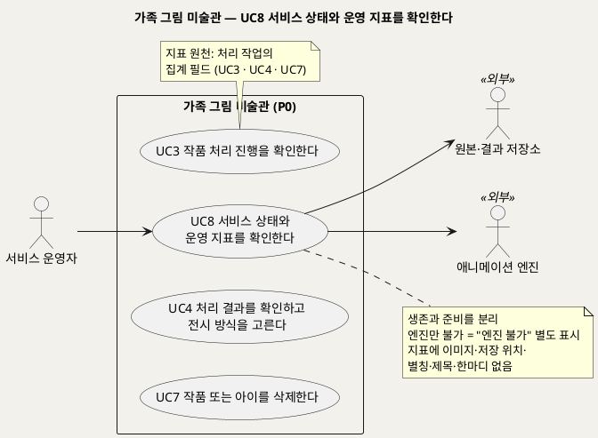

**[「UC8 운영 상태·지표 UseCase Diagram」 PlantUML 뷰어로 열기](https://plantuml.sumzip.com/plantuml/svg/eNp9U19L21AUf7-f4tC96IPgqFAZrshEXzcYexuU2KYxmCaSpAwZg7hG6WzBdmvXuCWlglockzlbbAt96kfZY-7pd9i5qVYLc09Jzj2_c35_blYtWzLtfE6DfDqVlXKqtptSJE2Tzd3U4jKztlV9RzKlHGxK6W3FNPJ6Zs3QDBOebMQ3nq6_eNBhbUkZ452qK5CVNEtmmpy1wTbAVJUtGzKqKadt1dCZrdqaDOGVgye_Iez1-fkQ-K8-Flth14E_Tg3erC0Duj4fuHh4CljYGxd8PHYAv3XR2wNsO-Oqz8-GMD6uY9Af131eOmVMSttELPYAGfVjsxIDyYKXO9a05XuFd_qjXnh9FXaGgC0Hm2d4UI76XlOLDCsreNznN04yOQXVW7xU5Bc1DLq47wE2ath2I8i6rqj6DIYJtZKukNLYY1LnXi3Ox-A9A8hbclqyqPUR5W_1_0qPOBB0dlIcsFkdfy4CXnv8_Cdh3fHXTxi4_8LGZ7FLd6CJQw8XemGnRXxaLpZ84FcXWArETKrys_79wKXZgYk7Mtyr8MMaYN0lG8Vc_HiJLX-GTIJ9YIzigoWFZKRL2CLeo2imXxPXGdMNW769ZUb21gcsBHjSjcI9dchOsYnfuCRJHEbJ8XaZSkVKB55TulHtthAD3nH5ETlV9UmmgETGY6MCgjZF2HZGvcm9AfRdHHijHrURDAeX4sTnPy5GPSGrXeQ1Etw4wKDMZD0Dgu-E9KZh20Zuwjo-3QJ0PfHafzYNrlnFxj4GXtRRDTvEq-7yLz7MiZRHPWH35JGYv9-wSm_0Y_8FvbLvPg==)** — 클릭 시 브라우저로 연결됩니다.

##### 다이어그램 쉽게 읽기 (유저 관점)

- **누가 쓰나** — 서비스 운영자(팀원)가 쓴다. 저장소와 애니메이션 엔진은 "준비됐는지" 확인하는 대상이다.
- **무슨 순서로** — 먼저 서비스가 살아 있고 준비됐는지 보고, 다음에 기간별 지표를 본다. 결과가 닿지 못한 건이 있으면 요청 번호로 하나씩 추적한다.
- **«include» = 항상 함께** — 이 UC에는 포함 관계가 없다. 보호자용 가족 접근 확인(INC1)은 운영자에게 적용되지 않는다. 운영자 인증 방식은 원천에 없다.
- **«extend» = 특정 상황에서만** — 없다.
- **Generalization(◁)** — 없다. 지표 숫자는 UC3(처리)·UC4(부모 선택)·UC7(삭제)이 남긴 집계 기록에서 나온다.

| 기호 | 의미 |
|---|---|
| 사람 모양(actor) | 시스템을 쓰는 사람 또는 외부 구성요소(`<<외부>>`) |
| 타원(usecase) | 액터가 이루려는 목표 |
| 사각형(rectangle) | 시스템 경계 |
| 실선 | 액터·외부 구성요소와 UC의 연결 |
| 노트 | 규칙·데이터 출처 보충 |

#### Actor

| 구분 | 액터 | 이 UC에서의 역할 | 원천 근거 |
|:--:|---|---|---|
| Primary | 서비스 운영자 | 생존·준비 상태와 지표를 확인하고 결과 미도달 건을 추적한다. 가족의 이미지·이야기에는 접근하지 않는다 | spec Target Users · FR-9 수용기준 3 · Assumptions 운영자 권한 |
| Secondary | 원본·결과 저장소 | 준비 상태 확인 대상 | spec FR-12 수용기준 2 |
| Secondary | 애니메이션 엔진 | 준비 상태에서 "엔진 불가"를 따로 표시하기 위한 확인 대상 | spec FR-12 수용기준 3 |

#### 관련 UseCase

| UC ID | 유스케이스명 | 관계 | 원천 근거 |
|:--:|---|---|---|
| UC8 | 서비스 상태와 운영 지표를 확인한다 | 본 문서 | spec FR-12 · FR-13 · FR-14 |
| UC3 | 작품 처리 진행을 확인한다 | 데이터 원천(결과·분류·시간·시도 횟수) | spec FR-5 · FR-13 |
| UC4 | 처리 결과를 확인하고 전시 방식을 고른다 | 데이터 원천(부모 선택 → 첫 결과 승인율) | spec FR-6 · FR-13 |
| UC7 | 작품 또는 아이를 삭제한다 | 데이터 원천(삭제 미완료) | spec FR-10 수용기준 5 |

> **쉽게 말하면** — 운영 담당 팀원이 서비스가 제대로 돌고 있는지 확인합니다. "그림이 이상하게 나와서 액자가 된 것"과 "서버가 고장 나서 실패한 것"이 따로 집계되어 무엇부터 고칠지 알 수 있습니다. 가족의 그림이나 아이 이름은 운영 화면에 나오지 않습니다.

#### 유스케이스 기술

| 속성 | 내용 |
|---|---|
| **ID** | UC8 (spec FR-12, FR-13, FR-14) |
| **유스케이스명** | 서비스 상태와 운영 지표를 확인한다 |
| **액터** | 주: 서비스 운영자 · 보조: 원본·결과 저장소, 애니메이션 엔진 |
| **사전조건** | (1) 운영자가 운영자 역할로 운영 화면에 접근했다. 운영자 인증 방식은 `자료 없음 — 확인 필요`. (2) 처리 작업 기록에 집계 필드가 쌓여 있다(없으면 A4) |
| **사후조건** | (1) 운영자는 생존과 준비 상태를 따로 확인했다. (2) 운영자는 지정 기간의 여섯 지표와 원인별 분해, 결과 미도달·삭제 미완료 건수를 확인했다. (3) 이 과정에서 이미지, 저장 위치, 별칭, 제목, 한마디는 노출되지 않았다. (4) 이 UC는 가족 데이터를 바꾸지 않는다 |
| **기본흐름** | ↓ 별도 기본흐름표 |
| **대체흐름** | A1. 준비 안 됨 — 원본 저장소, 작품·작업 기록 저장소, 처리 대기열 중 하나라도 쓸 수 없으면 "준비 안 됨"과 해당 구성요소를 표시한다(spec FR-12 수용기준 2). A2. 엔진만 불가 — 애니메이션 엔진만 멈췄으면 "엔진 불가"를 따로 표시한다. 이때 접수와 원본 액자 경로는 계속 동작한다고 알린다(spec FR-12 수용기준 3, Edge Cases). A3. 삭제 미완료 확인 — 끝내 완료되지 않은 삭제 건수를 요청 번호로 확인한다(이미지·식별 정보 없음)(spec FR-10 수용기준 5). A4. 데이터 없음 — 선택 기간에 해당 건이 없어 분모가 0이면 비율을 "해당 없음"으로 표시한다. [추론] 원천에 명시가 없다 |
| **예외흐름** | E1. 기록 저장소 장애 — 지표 계산용 기록을 읽을 수 없으면 "지표를 계산할 수 없어요"라고 표시한다. 생존·준비 결과는 별개로 보여 준다(준비 = 준비 안 됨)(spec FR-12 · Intent [핵심 장벽] 인프라 "저장소·DB 장애 분리"). E2. 가족 데이터 접근 시도 — 운영 화면에서 결과 미도달 건의 이미지·원본·이야기를 열려고 하면 제공하지 않는다. 운영 화면에는 그런 경로가 없다(spec FR-9 수용기준 3, FR-13 수용기준 4). E3. 권한 없는 접근 — 운영자 역할이 아닌 계정(보호자 등)은 운영 화면에 접근할 수 없다. [추론] 원천은 운영자 역할의 존재만 전제한다. 역할 분리 방식은 `자료 없음 — 확인 필요`. E4. 생존 확인 무응답 — 서비스 프로세스가 응답하지 않으면 생존 확인이 실패로 표시된다. 이 경우 운영 화면 자체도 열리지 않을 수 있다. [추론] 외부 감시 수단은 `자료 없음 — 확인 필요` |
| **포함/확장** | 없음. [추론] 보호자용 INC1은 운영자에게 적용하지 않는다 |
| **우선순위** | Medium — 가족이 직접 쓰지 않는 기능이다. 하지만 원천 [미션]의 서빙 지표와 [가치제안] "정상 액자와 품질 미달, 인프라 실패를 섞지 않는다"를 검증하는 수단이다 |
| **사용빈도** | `자료 없음 — 확인 필요` |
| **업무규칙** | BR-OPS-01, BR-OPS-02, BR-OPS-03, BR-OPS-04, BR-PRC-03, BR-DEL-02, BR-DEL-03, BR-ACC-03, BR-PRV-01 |
| **특별 요구사항** | 개인정보: 지표 화면과 지표 데이터에 이미지, 저장 위치, 별칭, 제목, 한마디가 없다. 운영 로그 표본 점검에서 이미지·저장 위치 키·자유 입력·오류 원문 0건이 목표다(spec FR-13 수용기준 4, Success Criteria). 정확성: 장애 주입 시험(엔진 정지·시간 초과·저장소 장애·기록 장애)에서 인프라 장애가 "품질 미달"로 집계되는 건수 0건이 목표다(spec Success Criteria). 목표값: 결과 미도달 0건 외 비율 지표에는 목표값을 두지 않는다. 기준선으로만 쓴다(spec Success Criteria) |
| **비고** | 원천 추적: spec FR-12(수용기준 3개: 생존 / 준비(저장소·기록·대기열) / 엔진 불가 분리) · FR-13(지표 표 6행, 수용기준 4개: 기간별 / 원인별 분리 / 요청 번호 추적 / 식별 정보 없음) · FR-14 · FR-9 수용기준 3 · Scenario 11 · Success Criteria "원인 분리 정확도", "로그 정보 보호" · Intent [미션] 서빙 지표 5종과 "지표는 정의와 검증 계획이며 달성 실적이 아니다" · Intent [핵심 데이터] 운영 지표 "이미지는 포함하지 않는다" · Intent [핵심 활동] 6 "생존/준비 상태·운영 지표를 검증한다". 참고: Intent [미션]은 서빙 지표 5종을 정의하고, 재시도율은 Intent [핵심 데이터] 운영 지표에 있다. spec FR-13은 둘을 합쳐 6종으로 정리했다 |

#### 기본흐름 (Basic Flow)

| 단계 | 액터 행위 | 시스템 행위 |
|:--:|---|---|
| 1 | 운영자가 서비스 상태 화면을 연다 | 운영자 역할을 확인하고, 서비스 프로세스의 응답 여부(생존)를 보여 준다 |
| 2 | 운영자가 준비 상태를 확인한다 | 원본 저장소, 작품·작업 기록 저장소, 처리 대기열을 쓸 수 있는지 확인하고, 애니메이션 엔진 가능 여부를 따로 확인해 "준비됨 / 준비 안 됨 / 엔진 불가"를 표시한다 |
| 3 | 운영자가 지표 화면에서 기간을 고른다 | 처리 작업의 집계 필드만으로 여섯 지표와 삭제 미완료 건수를 계산해 보여 준다 |
| 4 | 운영자가 원인별 분해를 연다 | 정상 액자(사람 그림 아님), 품질 미달 액자, 부모 선택 액자, 인프라 실패(오류 분류별)를 서로 다른 항목으로 보여 준다 |
| 5 | 운영자가 결과 미도달 건을 연다 | 요청 번호, 오류 분류, 시도 횟수, 단계별 시간, 엔진 버전만 보여 준다(이미지·저장 위치·자유 입력 없음) |

#### Sequence Diagram

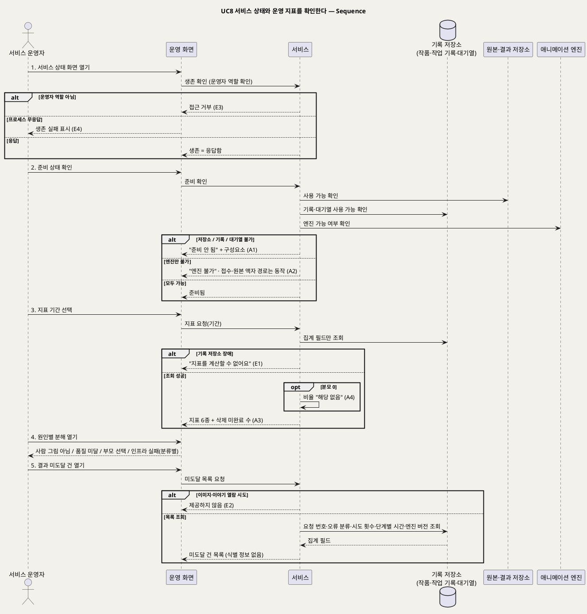

**[「UC8 운영 상태·지표 Sequence」 PlantUML 뷰어로 열기](https://plantuml.sumzip.com/plantuml/svg/eNp9VUFvGlcQvu-vGNELqLIbx2kUVWoU23GknnqI0lMla2NvXBS8OLBWldvGXkfIixRI2RrIrgstLjjCKoaNIRK9-Kf0uG_2P3TeewvYi9uLAb2Z-eb75pvxo7yh5oy9nQzktVcbL9SddOb1xraayWi51xt3Hij5l2l9V82pO_Bc3Xy5ncvu6Vtr2Uw2B188WX6ytL56LSL_k7qV_Tmtb8MLNZPXFCNtZDR4tvYA0HLZZwuPWoAHb8IDF2smYN3H6hvAthmWXXY6hrDmoDcKHZfZLfjHrMBT7dWepm9qiqJuGoSYuFZGJONJKQFqHr7fzSvUgpHeTO-qukGBsnZYq7AzX4Y8-y4WMqklnp_-sKZsqYb6XM1rkAhGPdb0ABsmnpzi2-KPehJPyuH7wtWQPvH4EGTE1ZAVTfqKx35KlHm8GgP5UGKD0dUw6PeCwXhWUGISJy0W7zSYXWBnFfR8PKwCHlewbYnodX07rZMUxBUWHnI-8A0sLc5JG5GmVJ86U3gchRM_CscDD5t-JDQkpyJS8HnoNKKHlKJmDJh7RMdidlUBUWth2gI2ysFwDMFFj12akFxfTikaDR_CisWaLloj3hrr-uiVmf2J0kVHPJ2ITFtCuxUWO0BOQNulKveiKtOsGKjM-jZ6D52OoulbMXHukjgtk8SZKcPpxSSREdGTQHkoJ8Mf97tYP4OgZ7Kj01jM41UKmLPB_6bIEfK6YqyTIDzucumiWKH9xCfwVQRBX2YY7LJAqXOiJCZsnQKwUicBX0LwqYvWBdYrvFZyZWmiqsBn7eJ_l5IdyucEXA35nLFQpQUQliaQJvdG0P-bpsyOKsDe1Wg3CORuBMI-dli5FJGcn6Doldq8ZXDLi9FV4OSDHjGyGuGBFxucjODc-udJGZi6MRxsl4MBjZZ8-4vLyWKzF9aLQuH4hgP_cBq3CDE9T1QL93tiEwp8M9_irz6hJ8itU10FALV7EQy4abO7BklokRJwh35GxScM-Nq6HUiEjs_sz6KiR5chuULmB-CyzIkmOd_H3w9puLh_jg0X2F8jrFnsj6LoK7nCF3BO0nsk6YcS-YsN-FQtwrxxIWb7uN9lJ0UIhiP25zjaeTIf3T5sFzgWs7vcjJcmZyUHQ7_54aaF98bRJic57dMqoaVinXy9CNE15MXeWbxecHH7vZpFsI9nYl5i2nJHPJ8zb5tkSTqWzpiyeRHePd0QyrvlVLk0l9CpUhZROyK5aXgzv0oIaZLprKSVBC6wfiGs0jnHaovIgeRIPwUchPXfxIYwu0Ne4ULTA7mSAqJt6lvYsGYIVHrhmp-vuXWu9ZtaRa0m0fYETMNhAz8ykJz-I_pD_9T_BeRE3Tk=)** — 클릭 시 브라우저로 연결됩니다.

기본흐름 1~5단계는 시퀀스의 번호 붙은 주요 메시지 `1.`~`5.`와 1:1로 대응한다.

#### UML 노트

| 항목 | 적용 |
|---|---|
| 액터 | 운영자는 보호자와 다른 Primary actor다. 보호자용 INC1을 포함하지 않는다 |
| 외부 구성요소 | 저장소와 엔진은 준비 확인의 대상이라 Secondary actor로 경계 밖에 뒀다 |
| 데이터 의존 | UC3·UC4·UC7은 지표 데이터의 출처일 뿐 include/extend 관계가 아니다. 노트로 표시했다 |
| Sequence | 준비 확인에서 저장소·기록·엔진을 각각 별도 lifeline으로 확인하고, 결과를 `alt`로 나눴다 |

---

### 7.9 UC9 엔진 버전을 평가 그림으로 검증한다

#### 범위·개요

핵심 애니메이션 엔진(Meta Animated Drawings)은 2025-09-03에 보관 처리됐다. 모델 실행 구성요소(TorchServe)도 2025-08-07에 보관 처리되어 보안 수정이 없다. 따라서 엔진은 **조건부로 채택**하고, 팀 서버에서 반복 재현해 검증하며, 언제든 **교체할 수 있어야** 한다(spec FR-16 · Intent [핵심 장벽]).

평가 담당 팀원은 **팀원이 직접 그린** 사람·동물·사물 그림과 각 그림의 기대 경로(움직임/원본 액자)를 평가 세트로 관리한다. 엔진 버전이 바뀔 때마다 전체를 다시 평가한다. 기대와 달라진 건과 오인 사례(예: 사물을 사람으로 잡아 관절을 붙인 경우)를 기록해 버전 채택 여부를 판단한다(spec FR-17).

| 항목 | 값 |
|---|---|
| 대상 시스템 | 가족 그림 미술관 (P0) — 엔진 검증 영역 |
| 상위 프로세스 | 엔진 재현 → **평가 세트 재평가(UC9)** → 버전 채택 → 운영 처리(UC3) |
| 원천 근거 | spec FR-16 · FR-17 · FR-14 · Intent [핵심 활동] 2·7 · [핵심 장벽] · [핵심 데이터] 평가 그림 |
| 핵심 UseCase | 1개 (UC9) |
| 주요 액터 | 평가 담당 팀원 · 애니메이션 엔진(보조) |

#### UseCase Diagram

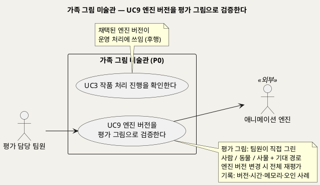

**[「UC9 엔진 평가 UseCase Diagram」 PlantUML 뷰어로 열기](https://plantuml.sumzip.com/plantuml/svg/eNqFU19r01AUf7-f4lBfNmQ46dPGKMOxPfvim1Du2jQLSxNJbpUhQqYROlpYp61rXVJaGPUPBbtYXIX64kfxMffkO3huE3EVxacc7vmd8_tzyLYruCNqVRNqpWKFVw3zqKhz09Sco-L6BnMPDesRd3gV9nnpUHfsmlXesU3bgVt7-b27u_duINwDXrafGJYOFW66GjO1igBhg2PoBwLKhqOVhGFbTBjC1CCeeDi8gvh6JkdzkJ9mWB_EUw9-eG14sLMBeN7Gdz7IyMeBj6EPyekJzWQDGMzlMIA48nAUJp1ANi4Z4yVBwnIZUDamsvEVkqaHF60ccBd2H3PzFwg7A9moyw9tDKf4spvRpTBLNywNtrawN5NfvEKBMSWdWzrJzv1L98r99dUcPGUANVcrcZegf7Px0Pqfj4UGGl3elAfsnyWv6oBRV47GQEuTNyeLXHodDGdLs3n2jDHlFtbWCotdSoqqU2-MWbbQssPYlYxtSdhmFhzFQ1zHODhLGxMC4vOx7DfhDsjTnhzPqVAvVNyGeDaRTdoRfSNbCnrTPsjPHnUAGwGoNCJa3R-ntIRVs8NwMwN_vyZYPKEvHUl-fE-m6al7SV4XdEOPaVYZlJHUzb4thF1N7eQV9ZWfvAhlK_jzBlPVfDvF7nEWJp63AF9PsO_DSnKhcl39vXubKvo9fgJNg5ZL)** — 클릭 시 브라우저로 연결됩니다.

##### 다이어그램 쉽게 읽기 (유저 관점)

- **누가 쓰나** — 평가 담당 팀원이 쓴다. 애니메이션 엔진은 시험을 받는 외부 구성요소다.
- **무슨 순서로** — 팀원이 직접 그린 평가 그림과 "이 그림은 움직여야 한다/액자여야 한다"는 기대를 등록한다. 엔진 버전이 바뀌면 전체를 다시 돌려 기대와 달라진 그림을 찾는다. 통과한 버전만 실제 가족 작품 처리(UC3)에 쓴다.
- **«include» = 항상 함께** — 없다. 보호자용 가족 접근 확인은 적용되지 않는다.
- **«extend» = 특정 상황에서만** — 없다.
- **Generalization(◁)** — 없다. 현재 엔진과 예비 엔진 후보는 같은 평가 절차를 거친다(대체흐름 A1).

| 기호 | 의미 |
|---|---|
| 사람 모양(actor) | 시스템을 쓰는 사람 또는 외부 구성요소(`<<외부>>`) |
| 타원(usecase) | 액터가 이루려는 목표 |
| 사각형(rectangle) | 시스템 경계 |
| 실선 | 액터·외부 구성요소와 UC의 연결 |
| 노트 | 평가 규칙·선후 관계 보충 |

#### Actor

| 구분 | 액터 | 이 UC에서의 역할 | 원천 근거 |
|:--:|---|---|---|
| Primary | 평가 담당 팀원 | 평가 그림과 기대 경로를 등록하고, 엔진 버전별 평가를 실행·검토하고, 채택 여부를 판단한다 | spec Target Users · FR-17 |
| Secondary | 애니메이션 엔진 | 평가 대상. 현재 엔진은 Meta Animated Drawings(코드·가중치 MIT). 예비안은 그림 전용 자세 모델(가중치 AGPL-3.0)과 rtmlib(Apache-2.0) | spec Dependencies · FR-16 · Intent [핵심 장벽] |

#### 관련 UseCase

| UC ID | 유스케이스명 | 관계 | 원천 근거 |
|:--:|---|---|---|
| UC9 | 엔진 버전을 평가 그림으로 검증한다 | 본 문서 | spec FR-16 · FR-17 |
| UC3 | 작품 처리 진행을 확인한다 | 후행(채택 버전이 운영 처리에 쓰임) | spec FR-16 수용기준 2·3 |
| UC10 | 모델 API로 그림을 움직이는 작품으로 변환한다 | UC9가 «include» (평가 그림을 API로 보냄, 2026-09-28 추가) | 추가 요구 R3 |

주: UC10 포함 관계는 2026-09-28 추가분이다. 이 절의 다이어그램에는 그리지 않았고, §5 L1과 §7.10 다이어그램에 있다.

> **쉽게 말하면** — 팀원들이 직접 그린 시험용 그림으로 엔진을 시험합니다. 사람 그림은 움직이고 집이나 동물 그림은 걸러지는지 버전이 바뀔 때마다 똑같이 확인합니다. 결과가 달라진 그림과 잘못 움직인 그림을 기록해서, 그 버전을 써도 되는지 판단합니다.

#### 유스케이스 기술

| 속성 | 내용 |
|---|---|
| **ID** | UC9 (spec FR-16, FR-17) |
| **유스케이스명** | 엔진 버전을 평가 그림으로 검증한다 |
| **액터** | 주: 평가 담당 팀원 · 보조: 애니메이션 엔진 |
| **사전조건** | (1) 평가 대상 엔진 버전이 팀 서버의 고정 실행 환경에 설치되어 있고, 외부 포트와 관리 기능이 닫혀 있다(spec FR-16 수용기준 4). (2) 평가 세트에 팀원이 직접 그린 그림이 종류별로 있다. (3) 평가 담당 팀원이 평가 도구에 접근할 수 있다. [추론] 평가를 제품 안의 화면으로 할지, 별도 도구로 할지는 `자료 없음 — 확인 필요` |
| **사후조건** | (1) 이 엔진 버전으로 평가 세트 전체를 실행한 결과가 버전에 연결되어 남는다. 결과에는 그림별 결과 경로, 검출 점수(기록용), 단계별 시간, 메모리가 들어간다. (2) 기대 경로와 달라진 건의 목록과 분류된 오인 사례가 남는다. (3) 채택/보류 판단과 근거가 버전에 연결되어 기록된다. (4) 운영 중인 가족 작품과 그 처리에는 영향이 없다 |
| **기본흐름** | ↓ 별도 기본흐름표 (새 엔진 버전 재평가 기준) |
| **대체흐름** | A1. 예비 엔진 후보 평가 — 그림 전용 자세 모델이나 rtmlib 기반 후보도 같은 평가 세트·같은 절차로 평가한다. 교체하더라도 가족 흐름(접수·부모 확인·이야기·전시·삭제)과 화면은 바뀌지 않아야 한다(spec FR-16 수용기준 3 · Intent [핵심 장벽]). [추론] 예비안 가중치의 AGPL-3.0 라이선스 영향은 채택할 때 검토한다(spec Dependencies). A2. 평가 그림 추가 — 2단계 이후를 실행하지 않고 1단계(그림·기대 경로 등록)만 한다(spec FR-17). A3. 재현 기록 — 새 환경에 엔진을 설치할 때 버전, 빌드 시간, 설치 크기, 우회 사항을 함께 기록한다. 참고로 1차 재현은 원본 그대로 설치되지 않았다. 기반 시스템 저장소가 내려가 보관 저장소로 우회했고, 빌드 약 36분, 설치 크기 32.9GB였다(spec FR-16 수용기준 1 · Intent [핵심 장벽] 엔진 재현) |
| **예외흐름** | E1. 허용되지 않는 평가 그림 — 팀원이 직접 그리지 않은 그림(공개 이미지, 실제 아동 그림 등)은 평가 세트에 넣지 않는다. 등록 시 제작자(팀원) 확인을 받는다(spec FR-17 · Intent [핵심 파트너] "시연 데이터는 팀원이 직접 그린 그림만 사용"). [추론] 제작자 확인 방식은 `자료 없음 — 확인 필요`. E2. 기대 경로 미입력 — 종류나 기대 경로가 없는 그림은 등록을 거부한다(spec FR-17 수용기준 1). E3. 엔진 실행·설치 실패 — 엔진이 뜨지 않거나 평가 도중 멈추면 평가를 중단하고, 실패 단계를 기록하고, 해당 버전을 "채택 불가(재현 실패)"로 표시한다(spec FR-16 · Intent [핵심 장벽] 엔진 재현). E4. 그림 단위 시간 초과 — 특정 그림이 처리 시간 상한을 넘기면 그 그림을 "시간 초과"로 기록하고 나머지 그림은 계속 평가한다. [추론] 운영의 시간 상한(BR-PRC-06)을 평가에도 적용하는 판단이다. E5. 격리 조건 미충족 — 평가 전에 엔진의 외부 포트나 관리 기능이 열려 있으면 평가를 시작하지 않고 격리 조치를 요구한다(spec FR-16 수용기준 4 · FR-14) |
| **포함/확장** | «include» UC10 모델 API 변환(2026-09-28 추가) |
| **우선순위** | Medium — 가족 기능은 아니다. 하지만 원천이 엔진 재현을 "상" 등급 장벽으로, 서빙 의존성을 "치명" 등급으로 분류하므로 운영 전 필수 검증이다(Intent [핵심 장벽]) |
| **사용빈도** | 엔진 버전을 바꿀 때마다 1회 전체 재평가(Intent [핵심 데이터] 평가 그림 "엔진 버전 변경 때 재평가"). 평가 그림 추가 빈도는 `자료 없음 — 확인 필요` |
| **업무규칙** | BR-ENG-01, BR-ENG-02, BR-ENG-03, BR-ENG-04, BR-ENG-05, BR-PRC-04, BR-PRC-06 |
| **특별 요구사항** | 보안: 엔진은 외부 네트워크에서 직접 접근할 수 없고, 검증된 고정 실행 환경으로 격리한다(spec FR-14, FR-16). 기록: 버전, 소요 시간, 메모리, 오인 사례를 남긴다(spec FR-16 수용기준 1). 기준 정보: 1차 개인 PC 실측은 CPU 4코어·메모리 3.8GB·그래픽 카드 없이 한 장 53~62초(렌더 약 40초), 모델 서버 약 3.1GB였다. 팀 서버 수치와 동시 처리량은 미측정이다(Intent [핵심 장벽] 인프라). 품질 판정: 검출 점수만으로 통과를 판정하지 않는다. 1차 시험에서 집 그림이 사람 점수 0.946(사람 그림 0.997)으로 잡혀 벽에 관절이 붙은 사례가 있다(Intent [핵심 장벽] 적용 범위·품질). 품질 미달 판정 기준(임계값)은 이 평가 결과로 계획 단계에서 정한다(spec Assumptions) |
| **비고** | 원천 추적: spec FR-16(수용기준 4개: 팀 서버 재현·기록 / 작업별 엔진 버전 / 교체 시 가족 흐름 불변 / 관리 기능·외부 포트 차단·고정 환경) · FR-17(수용기준 3개: 종류·기대 경로 / 버전 변경 시 전체 재평가·달라진 건 목록 / 오인 사례 분류) · FR-14 · Key Entities "평가 그림" · Success Criteria Qualitative "평가 세트 결과" · Intent [핵심 활동] 2 "Animated Drawings를 재현하고 버전·시간·메모리·오인 사례를 기록한다 … 팀 서버에서 반복 검증한다", 7 "팀원 그림으로 품질을 평가" · Intent [핵심 장벽] 엔진 재현·서빙 의존성·적용 범위·인프라 · Intent [핵심 데이터] 평가 그림. 참고: 평가 결과로 채택 기준(몇 건까지 허용할지)을 정하는 수치는 원천에 없다 — `자료 없음 — 확인 필요` |

#### 기본흐름 (Basic Flow)

| 단계 | 액터 행위 | 시스템 행위 |
|:--:|---|---|
| 1 | 평가 담당 팀원이 직접 그린 평가 그림을 종류(사람/동물/사물)·기대 경로와 함께 등록한다 | 종류·기대 경로·제작자(팀원) 확인이 있는지 검사하고 평가 세트에 저장한다 |
| 2 | 팀원이 새 엔진 버전으로 평가 실행을 요청한다 | 엔진의 격리 조건을 확인하고, 엔진 버전을 기록한 뒤, 평가 세트 전체를 차례로 엔진에 보낸다 |
| 3 | — | 그림마다 결과 경로(움직임/품질 미달), 검출 점수(기록용), 단계별 시간, 메모리를 기록한다 |
| 4 | — | 기대 경로와 비교해 달라진 건의 목록을 만들고, 오인 사례를 유형별로 분류해 제안한다 |
| 5 | 팀원이 결과를 검토하고 오인 사례의 분류를 확정한다 | 버전별 결과를 보관하고, 이전 버전 결과와 나란히 보여 준다 |
| 6 | 팀원이 이 버전의 채택/보류를 판단하고 근거를 적는다 | 판단과 근거를 엔진 버전에 연결해 기록한다 |

#### Sequence Diagram

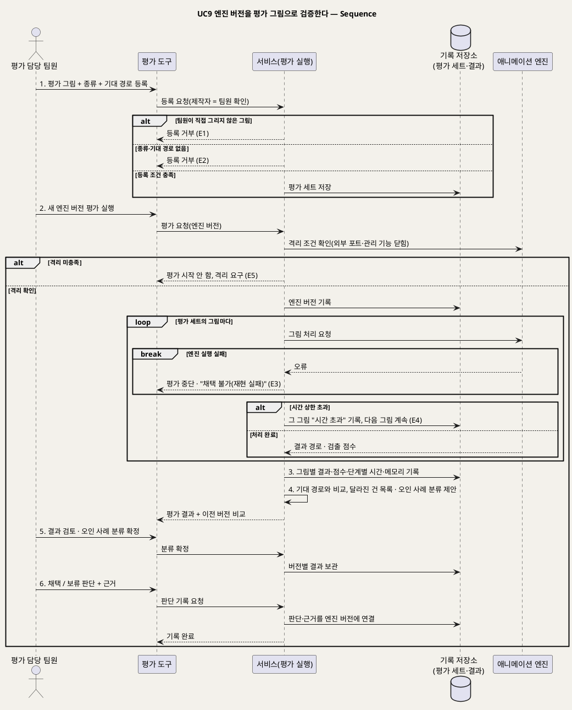

**[「UC9 엔진 평가 Sequence」 PlantUML 뷰어로 열기](https://plantuml.sumzip.com/plantuml/svg/eNqFVV9v2lYUf_enOGIvoDZsadpJndSqapp-gbZ7mhTdJG6K4pgUnE59o40b0cAUosFCOozMRprQMQ0IAyKxl3yUPfoef4ed63sNmCjai23de_78zu_8zvGjrMUy1u62AVn99epLtp0y3q5uMsPQM29Xv7mvZbdS5g7LsG1YY-tbm5n0rrmxnDbSGfjq6dLTxZXHMxbZV2wj_WPK3ISXzMjqmpWyDB1eLN8HPC7jmQ28Z6Nro2ODf_jR6-TAG4745zHWxrxRA6-Xw8-OX6nxQhP-zZXhmf56VzfXdU1j6xZljCkvXujzwiX4xRz-WooBy8LKG2ZoBMJKrad2mGlNTQ9t7-92YPM8nZ6zQbvGL208aMaVNRaa_i8fE4H5s--XtQ1msTWW1SHmjTq84QC6Oayf4n7xB3PiY4_8g9HV0Ot1vIux9H3yeC5RxeWFPG-V0enjh6qiQyI3N1MmVSgqgIWHAUr4DhaTUYrgFuBvH_hplT4EliJd9P4RrPGfu4RMC_zIn2CTuzwE_FTG3p9xdGtYP8J6CR4o0sA_qaAzSmjMsNQRQQM8e4fukUzZxjMqrnKATohBgyD6whSlSuN1O3yQg_jKYkLTqfEKKnESQYrH--gU_z_KHRUlLKLR8bqEbdDCRjf0fkgck2ukB6o7mm5uXOPzThJwLx_VIUS6PsdgeKcYnPVLaAqC7B0Ze70WERYildzG8WQk6vEP21If_ZywEZQcnJKE__DrVcm_8uZ_jaI1TtFPgIo-UlPy4FfOb0_SfiqTxom4e4o4dS5xzDEWZUDKmkyMdHonyiY6VdV3fpaniSSjSaRp4VKc2KsqIERWYLiW0dlWmEwSHLyK58E1hCEWJoRjtUmaUbc31N884oVzuBrSRHVtf88BPsjTRRzrbb9qqwQ0gvGVpUQQSUhBvAXNxJ7XIaO9d7RiAPt5GtfZdIogKiksKxa6BLYxxdZtal6ThBxaeRc27v9EOe-qnMEEKEZObP578aaS5coIx4PKEhtwQNjcEuarMwXI5yzKpWTYnAtbxbkaSr-rIZFEoMSNLIBOWmX-5TzUX9BxFU0iuZuMbhU8odV5SauzJKptc2cs-ijEzb-0xFASWGoYyQvwfZs3yHpgi-0kVk0lf6OCVcW0zGgRuhMZylTkNTe195JTjnL-vntjWiF1t0IB5tbg3O0sgzL1lD7gF32a0esgvqXVIdX2tbAJAhZLQoi0iodjWlvX8qr78KcRjkVkcwUmtBaCCPx0PPePPC7RQYegXecyDCu1JbTxiB70C_8PzhzVPg==)** — 클릭 시 브라우저로 연결됩니다.

기본흐름 1~6단계는 시퀀스의 번호 붙은 주요 메시지 `1.`~`6.`과 1:1로 대응한다. 2단계의 그림별 처리는 `loop` 프래그먼트로 표현했다.

#### UML 노트

| 항목 | 적용 |
|---|---|
| 시스템 경계 | [추론] 평가 도구는 가족용 화면과 분리될 수 있다. 하지만 엔진 버전·평가 기록을 같은 시스템이 관리하므로 경계 안에 뒀다. 별도 도구 여부는 미확정이다 |
| 액터 | 평가 담당 팀원은 Primary, 엔진은 평가 대상인 Secondary actor다 |
| 후행 관계 | UC3과는 데이터(채택 버전) 선후 관계일 뿐 include/extend가 아니다 |
| Sequence | 그림별 반복은 `loop`, 실행 실패·시간 초과는 그 안의 `alt`, 등록 거부와 격리 미충족은 각 단계의 `alt`로 표현했다 |

---

### 7.10 UC10 모델 API로 그림을 움직이는 작품으로 변환한다

#### 범위·개요

애니메이션 모델(Meta Animated Drawings)은 웹서비스 안에서 직접 돌리지 않는다. **Python 가상환경에서 uvicorn으로 띄운 모델 API 서버**가 모델을 감싸고, 웹서비스는 이 API만 부른다(R3). 이 UC는 웹서비스의 처리 담당이 움직임 경로 작품 1건을 API 서버에 맡기고, 결과를 받아 오고, 작업을 정리하기까지를 다룬다.

보호자가 직접 이 UC를 쓰지는 않는다. 보호자가 UC2에서 "예"라고 답한 작품을 UC3이 처리할 때 이 UC가 **항상 포함**된다(«include»). UC9의 평가 도구도 같은 API를 같은 방식으로 부른다.

| 항목 | 값 |
|---|---|
| 대상 시스템 | 모델 API 서버 (Python 가상환경 · uvicorn · FastAPI [추론]) |
| 상위 프로세스 | 작품 접수(UC2) → 처리(UC3) → **모델 변환(UC10)** → 결과 확인(UC4) |
| 원천 근거 | R1 · R2 · R3 · spec FR-3 · FR-4 · FR-5 · FR-11 · FR-14 · FR-16 · Intent [핵심 이네이블러] · [핵심 장벽] 서빙 의존성 |
| 핵심 UseCase | 1개 (UC10) |
| 주요 액터 | 웹서비스 처리 담당(시스템) · 평가 도구(시스템) · 애니메이션 모델(보조) |

#### UseCase Diagram

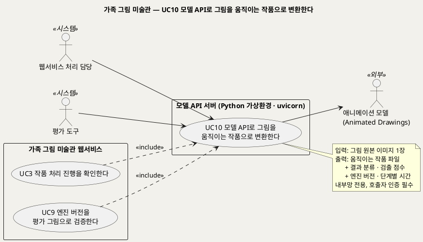

**[「UC10 모델 API 변환 UseCase Diagram」 PlantUML 뷰어로 열기](https://plantuml.sumzip.com/plantuml/svg/eNqNlFFL21AUx9_vpzh0L8qmWHxyiOicwt58mOxFkLs0rcH03pGkGzKEuEWoxqEb7VZnKhXU6hDm2q5GcC_7KHvMvfkOO7eJW2UKy1Puzf-c_M__d5NJ26GWUyqaUNIW87RomCuLBWqaurWymB0h9rLBXlCLFuE51ZYLFi-x3DQ3uQX3ZkdnszOP-hT2Es3xVwYrQJ6atk5MPe-Aw8EyCksO5AxL1xyDM-IYjqlDdO7Kg28QXYTi-ArE11CWG1HHhV9uBeansyMgvpyIdyFMzT0RB0Gqk3UP5J4rm2uy3hGbFZD77-MPZRlcKY1ou_FuLa4Gwj8khGoO2szIvUvpBeLSk5uHIFs1cXwGwu8I_zID1IZn3FrWLRgfl36Aing9mJi4Lo23N9AliG0v-n7WUz_l3LxdK6sN4ZfFaQWNyfVa6n6BDUwxo0gdPQePLarCsQd7nWZYwWC66rUbiq6LjYjKh7ICZpO5K5z-YTLwmgCUbF2jNpbMT4-maVxPKZte_HFDRRbvVmU9TILpvR3FN2vHQH6qYAGIlicbHhYtsHT8NPkk4qjlyuP6jU5jZLXf-l9soKy2PBiYW3GWOOsRf7uGhKLWD_h5AaWXhsYtNvjPIHfDX2D_Rz-1hgd4lZAU8dDQRLLVg_hnpXIbHk4W8BCBGEwzSzkdiahY7nyEW6pHwpEQxh09Pek8n3QG9LcuGkcPrznKvR3RDkGZR6JNF7Jy_0jJukFPdstsEG9tyfoVipLrPhI4j9p4JrqeOKqpGBWSbgCysSPLtT7hDaBKKPyTqO2JNn5CfhCde6gVbzp4-ESzDgr659MHENdC7Cb3d9BmiKghrnqqr85yoGYkk3iHv4vfXugJkg==)** — 클릭 시 브라우저로 연결됩니다.

##### 다이어그램 쉽게 읽기 (유저 관점)

- **누가 쓰나** — 사람이 아니라 웹서비스의 처리 담당과 평가 도구가 쓴다. 애니메이션 모델은 API 서버 뒤에 숨어 있는 외부 구성요소다.
- **무슨 순서로** — 처리 담당이 그림을 보낸다 → API 서버가 모델로 움직임을 만든다 → 처리 담당이 결과를 받아 저장한다 → API 서버의 임시 파일을 지운다.
- **«include» = 항상 함께** — UC3(움직임 경로 처리)와 UC9(엔진 평가)는 모델이 필요할 때 반드시 이 UC를 거친다. 웹서비스가 모델을 직접 부르는 길은 없다.
- **«extend» = 특정 상황에서만** — 없다. 처리 중 취소는 UC7의 EXT1이 이 UC의 `DELETE` 호출로 수행한다.
- **Generalization(◁)** — 없다. 현재 모델과 예비 모델은 같은 API 규격을 따른다.

| 기호 | 의미 |
|---|---|
| 사람 모양(actor) | 시스템을 쓰는 외부 시스템(`<<시스템>>`) 또는 외부 구성요소(`<<외부>>`) |
| 타원(usecase) | 액터가 이루려는 목표 |
| 사각형(rectangle) | 시스템 경계. 웹서비스와 모델 API 서버를 따로 그렸다 |
| 점선 `<<include>>` | 기반 UC가 항상 포함하는 하위 행위 |
| 노트 | 입력·출력과 접근 제약 |

#### Actor

| 구분 | 액터 | 이 UC에서의 역할 | 원천 근거 |
|:--:|---|---|---|
| Primary | 웹서비스 처리 담당 | 움직임 경로 작품의 원본을 API에 보내고, 상태를 조회하고, 결과를 받아 원본·결과 저장소에 저장하고, 작업을 정리한다 | R3 · spec FR-4 · Intent [핵심 활동] 3 |
| Primary | 평가 도구 | UC9에서 평가 그림을 같은 API로 보낸다 | spec FR-16 · FR-17 |
| Secondary | 애니메이션 모델 | Meta Animated Drawings. TorchServe로 서빙되며, API 서버에서만 호출된다 | R1 · spec Dependencies |

[추론] 이 UC의 시스템 경계는 모델 API 서버다. 그래서 웹서비스의 처리 담당은 경계 밖의 시스템 액터가 된다. UC3에서 처리 담당을 액터로 두지 않은 것(내부 구성요소)과 관점이 다르다.

#### 관련 UseCase

| UC ID | 유스케이스명 | 관계 | 원천 근거 |
|:--:|---|---|---|
| UC10 | 모델 API로 그림을 움직이는 작품으로 변환한다 | 본 문서 | R2 · R3 |
| UC3 | 작품 처리 진행을 확인한다 | UC3이 «include» (움직임 경로일 때) | spec FR-4 · FR-5 |
| UC9 | 엔진 버전을 평가 그림으로 검증한다 | UC9가 «include» | spec FR-16 · FR-17 |
| UC7 | 작품 또는 아이를 삭제한다 | EXT1(실행 중 처리 취소)이 이 UC의 작업 정리를 부른다 | spec FR-10 |
| UC8 | 서비스 상태와 운영 지표를 확인한다 | 준비 확인이 API 서버의 `/ready`를 읽는다 | spec FR-12 |
| UC11 | API활용 메뉴에서 엔드포인트·가이드라인·매뉴얼을 확인한다 | 이 UC의 API 규격을 문서로 보여 준다 | R4 |

> **쉽게 말하면** — 그림을 움직이게 만드는 모델은 별도의 작은 서버 안에 들어 있습니다. 서비스는 그 서버에 "이 그림 움직여 줘"라고 부탁하고, 다 되면 결과를 받아 옵니다. 움직일 수 없는 그림이면 서버가 그렇다고 알려 주고, 서비스는 원본 액자로 바꿉니다.

#### 유스케이스 기술

| 속성 | 내용 |
|---|---|
| **ID** | UC10 (R1, R2, R3 · spec FR-4, FR-5, FR-16) |
| **유스케이스명** | 모델 API로 그림을 움직이는 작품으로 변환한다 |
| **액터** | 주: 웹서비스 처리 담당, 평가 도구 · 보조: 애니메이션 모델 |
| **사전조건** | (1) 모델 API 서버가 가상환경에서 uvicorn으로 떠 있고, 내부망 주소에만 바인딩되어 있다(BR-API-02). (2) 모델 파일이 설정된 모델 경로에 있고 체크섬이 맞다. 모델 경로는 `자료 없음 — 확인 필요`(§2.2). (3) 호출자가 유효한 토큰을 갖고 있다. (4) 보낼 작품은 UC2에서 접수 완료되었고 경로가 "움직임"이다(BR-PRC-01) |
| **사후조건** | (1) 작업이 결과 분류(움직임 / 품질 미달) 또는 오류 분류(엔진 다운 / 시간 초과 / 연동 오류) 중 하나로 끝난다. (2) 응답에 엔진 버전, 검출 점수(기록용), 단계별 소요 시간이 담긴다. (3) 성공이면 움직이는 작품 파일 1개가 웹서비스의 원본·결과 저장소에 저장된다. (4) API 서버에 입력 이미지·결과·임시 파일이 남아 있지 않다. (5) 원본은 변형되지 않았다 |
| **기본흐름** | ↓ 별도 기본흐름표 (움직임 결과 성공 기준) |
| **대체흐름** | A1. 평가 호출 — UC9의 평가 도구가 평가 그림으로 같은 흐름을 밟는다. 결과는 가족 저장소가 아니라 평가 결과 기록에 남는다(spec FR-17). A2. 처리 대기 — API 서버의 동시 처리 상한에 도달하면 작업은 `queued` 상태로 기다린다. 처리 담당은 같은 간격으로 상태를 계속 조회한다(spec FR-15). 동시 처리 상한은 `자료 없음 — 확인 필요`. A3. 시험 호출 — UC11의 EXT3에서 팀원이 평가 그림으로 API를 불러 본다. 결과는 화면에만 보이고 가족 저장소에 쓰지 않는다(BR-API-09) |
| **예외흐름** | E1. API 서버 무응답·엔진 불가 — 연결이 안 되거나 `/ready`가 `503 engine_unavailable`이면 작업을 보내지 않는다. 오류 분류 = 엔진 다운. 웹서비스는 UC3의 재시도 규칙(최대 3회)을 따른다(BR-PRC-03). E2. 인증 실패 — 토큰이 없거나 허용되지 않은 호출자면 `401`/`403`. [추론] 설정 문제이므로 재시도하지 않고 운영자에게 알린다. E3. 입력 오류 — 형식·용량이 맞지 않으면 `422 invalid_input`. UC2 검사를 통과한 원본이면 일어나지 않아야 하므로 연동 오류로 기록한다. E4. 시간 초과 — 작업당 시간 상한(기본 10분)을 넘기면 `failed` + `timeout`. 오류 분류 = 시간 초과(BR-PRC-06). E5. 품질 미달 — 모델이 인물을 찾지 못하거나 관절 추정·렌더 결과가 없으면 `done` + `quality_below`. 오류가 아니다. 웹서비스는 재시도 없이 원본 액자로 대체한다(BR-PRC-02). E6. 처리 중 취소 — UC7의 EXT1이 `DELETE`를 보내면 처리를 멈추고 결과 파일을 만들지 않는다(BR-API-06) |
| **포함/확장** | UC3·UC9가 이 UC를 «include». 이 UC에는 포함·확장 대상이 없다 |
| **우선순위** | High — 움직임 경로의 유일한 모델 호출 통로다. 원천이 서빙 의존성을 "치명" 등급으로 분류했고, 격리와 교체 가능성이 이 경계에서 보장된다(Intent [핵심 장벽]) |
| **사용빈도** | 움직임 경로 작품 1건당 1회(재시도 포함 최대 3회). 평가 때는 평가 세트 그림 수만큼. 정량값은 `자료 없음 — 확인 필요` |
| **업무규칙** | BR-API-01, BR-API-02, BR-API-03, BR-API-04, BR-API-05, BR-API-06, BR-PRC-01, BR-PRC-02, BR-PRC-03, BR-PRC-04, BR-PRC-06, BR-ENG-01, BR-ENG-02, BR-ENG-05, BR-PRV-01 |
| **특별 요구사항** | 성능: 1차 실측은 한 장 53~62초(렌더 약 40초), 모델 서버 약 3.1GB다(Intent [핵심 장벽] 인프라). 그래서 비동기 작업형으로 둔다. 움직임 경로 p95 3분 이내 목표(spec Success Criteria)에는 API 대기 시간도 포함된다. 보안: API 서버는 내부망 전용이고 토큰으로 호출자를 확인한다. TorchServe는 localhost에만 열고 관리 API를 닫는다(spec FR-14, FR-16). 개인정보: 입력 이미지와 결과는 작업 정리 때 지우고, 학습에 다시 쓰지 않는다. 로그에는 요청 번호와 분류 코드만 남긴다(spec FR-14). 고정 환경: 가상환경 패키지는 잠금 파일로, 엔진은 고정 이미지와 체크섬으로 관리한다(Intent [핵심 이네이블러]) |
| **비고** | 원천 추적: 추가 요구 R1(모델 정의: 용도·입력·출력·경로) · R2(모델을 움직임 경로 기능으로 활용) · R3(가상환경 uvicorn API 서버로 구성해 웹서비스와 연동) · spec FR-3 수용기준 2·3 · FR-4 · FR-5 표·수용기준 · FR-11 · FR-14 · FR-15 · FR-16 수용기준 2·3·4 · Dependencies · Intent-Specify [핵심 이네이블러] "FastAPI", "내부 TorchServe + Docker 고정 이미지·체크섬·엔진 어댑터" · [핵심 장벽] 서빙 의존성·인프라. 엔드포인트 이름·응답 형식·포트·인증 방식은 원천에 없어 모두 [추론]이며 plan 단계에서 확정한다. 모델 경로는 `자료 없음 — 확인 필요` |

#### 기본흐름 (Basic Flow)

| 단계 | 액터 행위 | 시스템 행위 |
|:--:|---|---|
| 1 | 처리 담당이 API 서버의 준비 상태를 묻는다(`GET /ready`) | 모델 적재와 엔진 응답을 확인하고, 모델명·엔진 버전과 함께 "준비됨"을 돌려준다 |
| 2 | 처리 담당이 원본 이미지와 요청 번호를 토큰과 함께 보낸다(`POST /v1/jobs`) | 호출자·형식·용량을 검사하고 작업 번호를 발급해 `202`로 접수한다 |
| 3 | — | 모델로 사람 형태 검출 → 관절 추정 → 분할 → 리깅 → 렌더를 하고, 단계별 시간을 기록한다 |
| 4 | 처리 담당이 작업 상태를 조회한다(`GET /v1/jobs/{job_id}`) | `done` + `animated`와 검출 점수(기록용)·엔진 버전·단계별 시간을 돌려준다 |
| 5 | 처리 담당이 결과 파일을 받아(`GET …/result`) 원본·결과 저장소에 저장한다 | 움직이는 작품 파일을 돌려준다 |
| 6 | 처리 담당이 작업 정리를 요청한다(`DELETE /v1/jobs/{job_id}`) | 입력 이미지·결과·임시 파일을 지우고 집계 기록만 남긴 뒤 `204`를 돌려준다 |

#### Sequence Diagram

```plantuml
@startuml seq_family_gallery_10
skinparam backgroundColor #F3F1EB
skinparam shadowing false
title UC10 모델 API로 그림을 움직이는 작품으로 변환한다 — Sequence

participant "웹서비스 처리 담당" as Worker
participant "모델 API 서버\n(uvicorn)" as API
participant "애니메이션 모델\n(TorchServe)" as Engine
database "원본·결과 저장소" as Store

Worker -> API : 1. GET /ready
alt API 서버 무응답 또는 엔진 불가
  API --> Worker : 연결 실패 / 503 engine_unavailable (E1)
else 준비됨
  API --> Worker : 200 ready · 모델명 · 엔진 버전
  Worker -> API : 2. POST /v1/jobs (원본 이미지, 요청 번호, 토큰)
  alt 토큰 없음 또는 허용되지 않은 호출자
    API --> Worker : 401 / 403 (E2)
  else 형식·용량 위반
    API --> Worker : 422 invalid_input (E3)
  else 요청 정상
    API --> Worker : 202 작업 번호
    API -> Engine : 3. 검출 → 관절 추정 → 분할 → 리깅 → 렌더
    Worker -> API : 4. GET /v1/jobs/{job_id}
    alt 시간 상한 초과
      API --> Worker : status = failed, error = timeout (E4)
    else 인물 미검출 또는 결과 없음
      Engine --> API : 결과 없음
      API --> Worker : status = done, result = quality_below (E5)
    else 변환 성공
      Engine --> API : 움직임 결과 · 검출 점수
      API --> Worker : status = done, result = animated · 점수 · 단계별 시간
      Worker -> API : 5. GET /v1/jobs/{job_id}/result
      API --> Worker : 움직이는 작품 파일
      Worker -> Store : 결과 저장(처음 만든 것 1개)
    end
    Worker -> API : 6. DELETE /v1/jobs/{job_id}
    API -> API : 입력·결과·임시 파일 삭제, 집계 기록만 유지
    API --> Worker : 204 정리 완료
  end
end
@enduml
```

**[「UC10 모델 API 변환 Sequence」 PlantUML 뷰어로 열기](https://plantuml.sumzip.com/plantuml/svg/eNqVVV1v2mYUvudXHHU3RErCR8guKqXq1tFp0qRVSqbdTEIv8Db1YuzGNlTRNIksJmKBSqQDhbbAXC0NaZVqDGhCJK7yU3rp9_g_7PjFtFkGF7vAwvY5z_s8z_nwXdNihpXPqWDy7dRDllPUndQmU1Vu7KRi0ZC5pWiPmcFykGaZrU1Dz2vZe7qqG_DZ_ZX7seSX1yLMRyyrP1G0TXjIVJOHLMVSOXx_LxYF8fZUPB3BFw--Ea9a4F6MxMkY2zbgyyJ2d7E9FAd1wM6h96yMrbEfIwZF73nTa7RE5Rg-FOuwzrfzXMvwUIhOs5SM8phpFtzCl5dot8SljQfHgP2mODkDURmKyuUtYCb8oBtb3Ph3yicy4Kf27R-1cL6gZHRDW5BJ9ObGIQ1HVMriTZ2YYqkZyKG0Dd3IPFrnRoFPMpPapqLxUJZZLM1M7tOricHo6sLt99zBGNApYuc17ldl9LqlG6RnwhGW7khKtyG2DF8nNyBicJbdCTHVukYVxNkQ24ei8h5EsyZdO6pjl56fl91eMQQydomwAtTbFNCj0wErx171FCKwGl0BLnmm8horMEVlaapTOBlbCHGqG-BxkfwUtdNZaPFoFCQxuLoIfBBvS_7NlEjfRsem1Juy4svw4Lt10lWIRX7S0yaEJ-aAX_6_RtgtLgK-qGP_HWGUveZoEbx9x9vtLRCY78Lkjs7Zx3Z1Kt87KuOLN6LWpHzAxgG2i0C5eN7CTo0SZ0hIRGNkQ4JsCCfjPrhU7TUbWGlfXfhof_wG2LJFrzkHIB4HRSswVcmmqPnzFgGtfAQKNKDTwL3d2QDxaNzvdjwqBVI_hd0JeoiiVpbB7RdJCXzYfwbusIhOGfC8TsjyiTi3vYYz-Xty5l6WJn-dqnhal4A3K5AIGisoQORnuqaU7C8y2HcYKy23R1O5t0uDBzgsU8_KlzM00OKw8ias0bArKs8uAjcMWgtrYCk5rktPEgsyeeJKeyTOxkCFDjQF9ZsOhixqcFbgwNJH4rOC5hPK6hpfpCY18yRpDbbzVChrJ5Xmqv6EWK1eYzXZMjRbf7uD9_NOD5ZUx57yoGYPRKBTw3Lz_zJimpJjFs_KqZEIcpgqp-7AFgM7KEOAerOIq3OKGJnAz-MyY9OCV61ie_yfc-Rauua63Flh2q1y7LpV8btD7_Yg5vZagZdadmbDfb4MXyW_TW4k5_Rc0PGBzZ2ScF5PVyUNYscmIwKSgL--Q6dFG6J7SC6BO-qJV20iQ4Pq0OjPm7OEP4f-NwGf2-JPv3d8rv7vLl3ou_cPpuACyQ==)** — 클릭 시 브라우저로 연결됩니다.

기본흐름 1~6단계는 시퀀스의 번호 붙은 주요 메시지 `1.`~`6.`과 1:1로 대응한다. 품질 미달(E5)과 시간 초과(E4)도 6단계의 작업 정리를 거친다.

#### UML 노트

| 항목 | 적용 |
|---|---|
| 시스템 경계 | 이 UC만 경계를 "모델 API 서버"로 잡았다. 웹서비스와 API 서버를 다른 경계로 그려 R3의 분리 요구를 드러냈다 |
| 액터 | 처리 담당과 평가 도구는 사람 아닌 Primary actor(`<<시스템>>`), 모델은 Secondary actor다 |
| 포함 관계 | UC3·UC9 → UC10 «include». 경계를 넘는 포함이지만, 두 UC가 모델을 쓸 때 반드시 거친다는 뜻을 우선했다 [추론] |
| Sequence | 준비 실패·인증·입력 오류는 바깥 `alt`, 처리 결과(시간 초과·품질 미달·성공)는 안쪽 `alt`로 나눴다. 예외흐름 ID를 메시지에 병기했다 |

---

### 7.11 UC11 API활용 메뉴에서 엔드포인트·가이드라인·매뉴얼을 확인한다

#### 범위·개요

모델 API 서버(UC10)를 연동하고 운영하려면 어떤 엔드포인트가 있는지, 어떤 규칙으로 불러야 하는지, 어떻게 설치·기동·교체하는지 알아야 한다. 이 정보를 웹서비스의 **'API활용' 메뉴**에 모은다(R4). 메뉴는 **엔드포인트 · 가이드라인 · 매뉴얼** 세 탭으로 이루어진다. 팀원이 평가 그림으로 API를 직접 불러 보는 **시험 호출**은 선택 기능(EXT3)이다.

이 메뉴는 서비스 운영자와 연동 개발 팀원만 쓴다. 가족의 이미지나 이야기는 이 메뉴에 나타나지 않는다(BR-ACC-03).

| 항목 | 값 |
|---|---|
| 대상 시스템 | 가족 그림 미술관 웹서비스 — API활용 메뉴 |
| 상위 프로세스 | API 서버 구축(UC10) → **API 규격·규칙·운영 절차 확인(UC11)** → 연동 구현 · 운영(UC8) · 평가(UC9) |
| 원천 근거 | R4 · R3 · spec FR-9 수용기준 3 · FR-12 · FR-14 · FR-16 · FR-17 |
| 핵심 UseCase | 1개 (UC11) + 공통 1개 (INC2) + 확장 1개 (EXT3) |
| 주요 액터 | 연동 개발 팀원 · 서비스 운영자 · 모델 API 서버(보조) |

#### UseCase Diagram

```plantuml
@startuml uc_family_gallery_11
skinparam backgroundColor #F3F1EB
skinparam shadowing false
left to right direction
title 가족 그림 미술관 — UC11 API활용 메뉴에서 엔드포인트·가이드라인·매뉴얼을 확인한다

actor "연동 개발 팀원" as Dev
actor "서비스 운영자" as Ops
actor "모델 API 서버" as API <<시스템>>

rectangle "가족 그림 미술관 웹서비스 — API활용 메뉴" {
  usecase "UC11 API활용 메뉴에서 엔드포인트·\n가이드라인·매뉴얼을 확인한다" as UC11
  usecase "INC2 팀원 로그인·역할 확인" as INC2
  usecase "EXT3 평가 그림으로 시험 호출" as EXT3
  usecase "UC10 모델 API로 그림을\n움직이는 작품으로 변환한다" as UC10
}

Dev --> UC11
Ops --> UC11
UC11 ..> INC2 : <<include>>
EXT3 ..> UC11 : <<extend>>
EXT3 ..> UC10 : <<include>>
UC11 --> API

note right of UC11
  탭 3개: 엔드포인트 / 가이드라인 / 매뉴얼
  엔드포인트는 API 서버의
  OpenAPI 명세에서 생성
  보호자에게는 메뉴 비노출
end note
note bottom of EXT3
  확장점: 팀원이 "시험 호출" 선택
  팀원이 직접 그린 평가 그림만
end note
@enduml
```

**[「UC11 API활용 메뉴 UseCase Diagram」 PlantUML 뷰어로 열기](https://plantuml.sumzip.com/plantuml/svg/eNqVVE9LG0EUv8-neKRnrak3kdDWKnipPbTQgyBrsomLm13ZnbSVUoi4gv-KsY1Norshgq1VKo0a6gqe_Cg9Zt58h77ZrEYXCu0tM_N77_3-vM1jl2sOLxVNKGVn8lrRMBdnCppp6s7iTDrN3HnDWtAcrQizWna-4NglKzdmm7YDDyaGJ9LjT-8g3DktZ781rALkNdPVmannOXAbHKMwxyFnOHqWG7bFuMFNHbrtMu6fQvciFN-uQPwMcbXV7ZThd7kKr8bSaXjyYlI2fNw9AnFUFWsdrFXQ8wFrVfHZl1s_MAjlenh9oRoFHboTwRXdXV-IwwMF_0InD2RjRwF3fLFxwJiW5UQ9hbW22GoQBV-0fZCbZdyrpEBz4Zn-5hbj-eLSw_UDwN0O1pew2YNMLbg3EHH8XXwMFVFQ6DMvAqjj6Chu-FQrV_xMhjGlXLMKpDr1N9m4d9mfqDxIyk_BewZQcvWs5lKf_7Jo2vp3kyINqvvdaZPPxx7FPoHY94l91ARrJ3KnFZdHhQp4t3D89cthkFtrND_WjP4VdQDyR9bqIOsh_vKjUgVNKByCvsWqKO4QeNMW7pXxcElpWq8CNrflp9W4szgvy0b9vpgh9oExChcGBjI9cRRj_xCZOTiYiejDCMVnWFmzlNMpvEiBeotA6k1_x3Url3gaSpRFaDWAqDNm2VyPvwM7f-OuXD6BYdrBkWRg8BASedHNbWBUmcArC_pLiEGdIFMLuqXuxPEKeuHNYiwH6J3SqzjvKOebFXronm2qBr0NAtpAsaIyYaQRFO8e-Vmbc7uo2Mc5qdCbX7FVGYkXg_jSV3M_VvRacjlQ6FuISq213YuyfX81xOFmf-pj-kV_S38A6a1KzA==)** — 클릭 시 브라우저로 연결됩니다.

##### 다이어그램 쉽게 읽기 (유저 관점)

- **누가 쓰나** — API를 연동하는 개발 팀원과 서비스를 운영하는 운영자가 쓴다. 보호자는 이 메뉴를 볼 수 없다.
- **무슨 순서로** — 로그인하고 'API활용' 메뉴를 연다 → 엔드포인트 탭에서 API 목록과 예시를 본다 → 가이드라인 탭에서 호출 규칙을 본다 → 매뉴얼 탭에서 설치·기동·장애 대응 방법을 본다.
- **«include» = 항상 함께** — 메뉴를 열 때마다 "팀원 로그인·역할 확인"(INC2)을 거친다.
- **«extend» = 특정 상황에서만** — 팀원이 "시험 호출"을 고를 때만 EXT3이 끼어들고, 이때 UC10(모델 API 변환)을 실제로 부른다.
- **Generalization(◁)** — 없다. 개발 팀원과 운영자는 같은 메뉴를 같은 권한으로 본다 [추론].

| 기호 | 의미 |
|---|---|
| 사람 모양(actor) | 시스템을 쓰는 사람 또는 외부 시스템(`<<시스템>>`) |
| 타원(usecase) | 액터가 이루려는 목표 |
| 사각형(rectangle) | 시스템 경계 |
| 점선 `<<include>>` | 항상 함께 수행되는 하위 행위 |
| 점선 `<<extend>>` | 확장점 조건일 때만 끼어드는 행위 |

#### Actor

| 구분 | 액터 | 이 UC에서의 역할 | 원천 근거 |
|:--:|---|---|---|
| Primary | 연동 개발 팀원 | 엔드포인트 규격과 예시로 웹서비스·평가 도구의 연동을 구현한다 | R4 · [추론] 원천에 없는 새 액터 |
| Primary | 서비스 운영자 | 매뉴얼로 API 서버를 설치·기동·교체하고 장애에 대응한다 | spec Target Users · FR-12 |
| Secondary | 모델 API 서버 | 자기 명세(`/openapi.json`)와 모델 정보(`/v1/model`)를 제공한다 | R3 |

#### 관련 UseCase

| UC ID | 유스케이스명 | 관계 | 원천 근거 |
|:--:|---|---|---|
| UC11 | API활용 메뉴에서 엔드포인트·가이드라인·매뉴얼을 확인한다 | 본 문서 | R4 |
| INC2 | 팀원 로그인·역할 확인 | UC11이 «include» | spec FR-9 수용기준 3 · Assumptions 운영자 권한 |
| EXT3 | 평가 그림으로 시험 호출 | UC11을 «extend» (확장점: 팀원이 "시험 호출" 선택) | R4 [추론] |
| UC10 | 모델 API로 그림을 움직이는 작품으로 변환한다 | 문서 대상 · EXT3이 «include» | R3 |
| UC8 | 서비스 상태와 운영 지표를 확인한다 | 매뉴얼의 상태 확인 절차와 연결 | spec FR-12 |

> **쉽게 말하면** — 팀원이 모델 서버를 쓰고 관리할 때 보는 안내 메뉴입니다. 어떤 주소로 무엇을 보내면 무엇이 돌아오는지, 지켜야 할 규칙은 무엇인지, 서버를 어떻게 켜고 고치는지를 한곳에서 봅니다. 가족에게는 보이지 않습니다.

#### 유스케이스 기술

| 속성 | 내용 |
|---|---|
| **ID** | UC11 (R4) |
| **유스케이스명** | API활용 메뉴에서 엔드포인트·가이드라인·매뉴얼을 확인한다 |
| **액터** | 주: 연동 개발 팀원, 서비스 운영자 · 보조: 모델 API 서버 |
| **사전조건** | (1) 팀원이 운영자 또는 개발 팀원 역할로 로그인되어 있다(INC2). (2) 가이드라인과 매뉴얼 문서가 문서 저장소에 등록되어 있다. (3) 모델 API 서버의 명세 주소(`/openapi.json`)가 웹서비스 설정에 있다 |
| **사후조건** | (1) 팀원이 현재 API 서버 버전의 엔드포인트, 호출 규칙, 운영 절차를 확인했다. (2) 명세 버전과 문서 버전이 다르면 그 사실이 경고로 남는다. (3) 가족 데이터는 조회되지도 기록되지도 않았다. (4) 시험 호출(EXT3)을 했다면 그 결과는 가족 저장소에 남지 않았다 |
| **기본흐름** | ↓ 별도 기본흐름표 |
| **대체흐름** | A1. 시험 호출(EXT3) — 팀원이 평가 세트에서 그림을 골라 "시험 호출"을 누르면, 웹서비스가 UC10 흐름으로 API를 부르고 응답(상태·결과 분류·검출 점수·엔진 버전·단계별 시간)과 결과 파일을 화면에 보여 준다. 결과는 작업 정리로 지운다(BR-API-09). A2. 매뉴얼 절차 중 상태 확인 — 운영자가 매뉴얼의 "상태 확인" 절에서 바로 `/health`·`/ready` 결과를 본다. 자세한 지표는 UC8로 간다(spec FR-12). A3. 문서 갱신 — 운영자가 모델·API 버전을 바꾼 뒤 가이드라인·매뉴얼을 고쳐 올린다. 문서에 API 버전을 적어 명세와 대조할 수 있게 한다(BR-API-08) |
| **예외흐름** | E1. 권한 없음 — 보호자나 비로그인 사용자가 메뉴 주소로 들어오면 `403`으로 막고, 보호자 화면에는 메뉴를 보여 주지 않는다(BR-API-07 · spec FR-9). E2. API 서버 응답 없음 — 명세를 읽지 못하면 "API 서버 연결 불가"와 마지막으로 확인한 명세(버전·시각)를 보여 주고, 매뉴얼의 장애 대응 절로 안내한다. E3. 허용되지 않는 시험 이미지 — 시험 호출에 평가 세트 밖의 이미지(실제 아동 그림, 공개 이미지)를 쓰려 하면 거부한다(BR-API-09 · BR-ENG-04). E4. 명세·문서 불일치 — API 서버의 명세 버전과 가이드라인·매뉴얼의 버전이 다르면 경고를 띄운다(BR-API-08) |
| **포함/확장** | «include» INC2 팀원 로그인·역할 확인 · «extend» EXT3 평가 그림으로 시험 호출(EXT3은 UC10을 «include») |
| **우선순위** | Medium — 가족 기능은 아니지만, R4가 API 서버의 필수 구성으로 요구했다. 연동 구현과 엔진 교체 절차의 기준 문서가 된다 |
| **사용빈도** | 연동 구현·API 버전 변경·장애 대응 때. 정량값은 `자료 없음 — 확인 필요` |
| **업무규칙** | BR-API-07, BR-API-08, BR-API-09, BR-ACC-03, BR-ENG-04, BR-PRV-01 |
| **특별 요구사항** | 정확성: 엔드포인트 탭은 API 서버의 OpenAPI 명세에서 생성해 손으로 쓴 문서와 실제 API가 어긋나지 않게 한다. 보안: 메뉴는 팀원 역할에만 보이고, 토큰 값은 화면에 평문으로 보여 주지 않는다 [추론]. 개인정보: 메뉴 어디에도 가족의 이미지·별칭·이야기가 나오지 않는다(spec FR-9 수용기준 3). 사용성: 가이드라인과 매뉴얼은 명령 예시를 복사해 바로 쓸 수 있게 코드 블록으로 보여 준다 [추론] |
| **비고** | 원천 추적: 추가 요구 R4("API server는 endpoint와 가이드라인 및 매뉴얼을 포괄하는 'API활용' 메뉴로 구성") · R3 · spec FR-9 수용기준 3(운영자의 이미지 접근 차단) · FR-12(생존·준비) · FR-14 · FR-16(엔진 교체·재현 기록) · FR-17(평가 그림) · Intent [핵심 파트너] "시연 데이터는 팀원이 직접 그린 그림만 사용". "연동 개발 팀원" 액터와 시험 호출(EXT3)은 원천에 없는 설계 판단([추론])이다. 메뉴를 웹서비스 운영 화면 안에 둘지, API 서버의 `/docs`와 연결할지는 `자료 없음 — 확인 필요` |

#### 기본흐름 (Basic Flow)

| 단계 | 액터 행위 | 시스템 행위 |
|:--:|---|---|
| 1 | 팀원이 로그인한 뒤 'API활용' 메뉴를 연다 | 역할(운영자·개발 팀원)을 확인하고 엔드포인트·가이드라인·매뉴얼 세 탭을 보여 준다 |
| 2 | 팀원이 엔드포인트 탭을 고른다 | API 서버에서 명세와 모델 정보를 읽어, 명세 버전을 문서 버전과 대조한 뒤 엔드포인트 목록·모델명·엔진 버전을 보여 준다 |
| 3 | 팀원이 엔드포인트 하나를 고른다 | 요청·응답 예시(curl)와 오류 코드–작업 기록 분류 대응표를 보여 준다 |
| 4 | 팀원이 가이드라인 탭을 고른다 | 호출 규칙(내부망·토큰·재시도·시간 상한·작업 정리·개인정보·시험 그림 제한)을 보여 준다 |
| 5 | 팀원이 매뉴얼 탭을 고른다 | 설치(가상환경)·기동(uvicorn)·상태 확인·모델 경로 설정과 교체·장애 대응 절차를 보여 준다 |

#### Sequence Diagram

```plantuml
@startuml seq_family_gallery_11
skinparam backgroundColor #F3F1EB
skinparam shadowing false
title UC11 API활용 메뉴에서 엔드포인트·가이드라인·매뉴얼을 확인한다 — Sequence

actor "연동 개발 팀원\n/ 서비스 운영자" as Dev
participant "API활용 메뉴 화면" as UI
participant "웹서비스" as SVC
database "문서 저장소\n(가이드라인·매뉴얼)" as Doc
participant "모델 API 서버\n(uvicorn)" as API

Dev -> UI : 1. 로그인 후 API활용 메뉴 열기
UI -> SVC : 메뉴 요청
alt 보호자 또는 비로그인
  SVC --> UI : 403, 메뉴 비노출 (E1)
else 운영자 또는 개발 팀원
  SVC --> UI : 탭 3개(엔드포인트 / 가이드라인 / 매뉴얼)
  Dev -> UI : 2. 엔드포인트 탭 선택
  UI -> SVC : 엔드포인트 목록 요청
  SVC -> API : GET /openapi.json · GET /v1/model
  alt API 서버 응답 없음
    SVC --> UI : 연결 불가 + 마지막 확인 명세 · 장애 대응 매뉴얼 링크 (E2)
  else 명세 수신
    SVC -> SVC : 명세 버전과 문서 버전 대조
    opt 버전 불일치
      SVC --> UI : 문서 갱신 필요 경고 (E4)
    end
    SVC --> UI : 엔드포인트 목록 · 모델명 · 엔진 버전
  end
  Dev -> UI : 3. 엔드포인트 하나 선택
  SVC --> UI : 요청·응답 예시(curl) · 오류 코드 대응표
  Dev -> UI : 4. 가이드라인 탭 선택
  UI -> SVC : 가이드라인 요청
  SVC -> Doc : 호출 규칙 조회
  SVC --> UI : 내부망·인증·재시도·시간 상한·개인정보 규칙
  Dev -> UI : 5. 매뉴얼 탭 선택
  UI -> SVC : 매뉴얼 요청
  SVC -> Doc : 매뉴얼 조회
  SVC --> UI : 설치(가상환경) · 기동(uvicorn) · 상태 확인 · 모델 교체 · 장애 대응
end
@enduml
```

**[「UC11 API활용 메뉴 Sequence」 PlantUML 뷰어로 열기](https://plantuml.sumzip.com/plantuml/svg/eNp1VU1PGlEU3c-vuLEbTCsWsRsXxtZq466JtSsTM8JoqeMMwmDjDmU0KDRiCnXQGYMJ1mI0mSLCmNSNP6XLeW_-Q-88vkfcAL537r3nnnvedSqu8DElsS5CXNhYWuHXI-LW0iovikJsaykQ4OJrESnKx_h1WOZDa6sxOSGFp2VRjsGL2eBsYOZdDyL-hQ_L3yLSKqzwYlzglIgiCrAwHQjA249zTlGnJxUglTzZr9HjHFV1oMd58kN3Dq-pYTkH1mPDNpPUqOEZMf7i2WODXJZd-E_8SwWnWHCBBZ1kyvAvmYd5YSMhSCGB4_iQgpyG6LFJDotgmzoxdXCySXqaW5RGAYuRe5UelIGe1Ki2Tc9yQ8DH4b2wySF5JRKKRHlJgSEvUayZJ5UaAy_M9WPp6X0nLwPMf57mwrzCL_NxAYbItcV6LCXp2QXdyy5KvufbG27SkUP9JcjVb_LdcuVjLVRVTJLYjITkmNSMwBuOwy5gZBL5wQQE_EDOdbthYX5wTtUn0qPoNdsyOURjDFLGoPbNSZ5WbzheVIDc1hzNQpmAaDlykAdss5OXAxY30q45_jr4qp3Dxe1atK6DbyYwzAlohK7m7WR98_Fmc1I3EESEz-MOGAWPfnjSFRDT9Oow5ve6iyWmaslJGYjtbd8LJFcVcm605WjRm2RTmIAPM59gVI4KEh-N-L_GZQkeG83DzcDouhwWRIxwJewODahxRDJ3WGePGlm89nSMrrWrJpB6GhuEl9hUml4myeV-y_FIaJeqllvItVKhBASVM4663eOvbWf7GjUfc4VgqreCaFqjmVK3aGfmzWukR0uqfYspmn5tHrAK5yYLk6NK57Sepij9vcYuPG20EtjmHywITkFFAcGuPti3JSQ2PsxiBCk8SICBA8B-mw8AubLmj_P0Um1x4dq5eqceHDD1gkZ2tO7g-wuzET822gPS0jSj-0KJmDjMCmplcoGxD27KlujOke4pOu5_YsxnreYFej2GG8B9Ahp7QXZDp_dFwDk4J1kvdbJTI3U0ieGyt-gv9_vsGumTQxV_ZnTbROOltnFduntVd0GlAr7rVlpPE2_8PW56ln4XMph4z_1A0lQto3nYHkRmRQ3dwYTGhYR7u7PamPYISOntF9CxAth3OVqtPXkLnGuGKfzA_2X_ATM0YtE=)** — 클릭 시 브라우저로 연결됩니다.

기본흐름 1~5단계는 시퀀스의 번호 붙은 주요 메시지 `1.`~`5.`와 1:1로 대응한다. 시험 호출(EXT3)은 UC10 시퀀스를 그대로 따르므로 여기서는 그리지 않았다.

#### UML 노트

| 항목 | 적용 |
|---|---|
| 시스템 경계 | 메뉴는 웹서비스 안에 있고, 모델 API 서버는 경계 밖의 보조 액터(`<<시스템>>`)로 그렸다 |
| 액터 | 연동 개발 팀원과 서비스 운영자는 Primary actor다. 연동 개발 팀원은 이번 추가 요구로 새로 둔 액터다 |
| 확장 관계 | EXT3은 UC11을 확장하고, 실행할 때 UC10을 포함한다 |
| Sequence | 권한 분기는 바깥 `alt`, API 서버 연결 여부는 안쪽 `alt`, 버전 불일치 경고는 `opt`로 표현했다 |

---

## 8. 업무규칙(Business Rules) 종합

도메인: CHD 아이 · INT 접수 · PRC 처리 · APR 승인 · STY 이야기 · EXH 전시 · DEL 삭제 · ACC 접근 · OPS 운영 · ENG 엔진 · API 모델 API · PRV 개인정보. 같은 ID가 여러 UC에 나올 때는 가장 완전한 문장과 근거를 남겼다. 근거 열에 "(통합 시 추가)"가 붙은 3개는 이번 통합에서 새로 넣은 규칙이다. BR-API-01~09는 2026-09-28 추가 요구 R1~R4로 새로 넣었다.

| BR ID | 규칙 | 적용 UC | 근거 |
|---|---|---|---|
| BR-CHD-01 | 아이는 보호자가 정한 별칭으로만 등록한다. 실명·생년월일·출생연도는 받지 않고 저장하지 않는다 | UC1, UC5 | spec FR-1 · Intent [핵심 데이터] 아이 · [부정적 영향] 과잉 수집 |
| BR-CHD-02 | 같은 가족 안에서 별칭은 서로 달라야 한다. 등록과 수정 모두에 적용한다 | UC1 | spec FR-1 수용기준 2 |
| BR-CHD-03 | 보호자 한 명이 아이를 여러 명 등록할 수 있고, 작품을 올릴 때 어느 아이의 작품인지 고른다 | UC1, UC2 | spec FR-1 수용기준 3 (통합 시 추가) |
| BR-INT-01 | 형식·용량·판독 검사를 통과한 사진만 접수한다. 실패하면 사유(형식/용량/판독 불가)를 안내한다 | UC2 | spec FR-2 수용기준 1 · Intent [핵심 활동] 3 |
| BR-INT-02 | 원본·작품 기록·작업 기록이 모두 저장에 성공해야 "접수 완료"다. 하나라도 실패하면 일부 저장분까지 제거하고 미접수로 처리한다 | UC2 | spec FR-2 수용기준 2 · Scenario 6 · Intent [핵심 활동] 3 |
| BR-INT-03 | 같은 올리기 요청이 중복 전송되어도 작품은 하나만 생긴다 | UC2 | spec FR-2 수용기준 4 |
| BR-INT-04 | 원본은 올린 그대로 보존한다. 어떤 후속 처리도 원본을 덮어쓰거나 변형하지 않는다 | UC2, UC3, UC4 | spec FR-2 수용기준 5 · Constraints 원본 불변 |
| BR-INT-05 | 사람·캐릭터 질문에 답해야 올리기를 마칠 수 있다. "예"는 움직임 경로, "아니요"는 원본 액자 경로다 | UC2, UC3 | spec FR-3 · Intent [핵심 활동] 4 |
| BR-PRC-01 | "아니요"로 답한 작품은 엔진을 한 번도 거치지 않는다. 원본 액자 경로는 엔진 없이 동작한다 | UC3 | spec FR-3 수용기준 2·3 |
| BR-PRC-02 | 모델 품질 미달은 재시도하지 않고 곧바로 원본 액자로 대체한다 | UC3 | spec FR-5 수용기준 2 |
| BR-PRC-03 | 인프라 장애는 품질 미달로 바꾸지 않는다. 작품당 최대 3회 시도(간격 증가) 뒤 실패로 알리고 결과 미도달로 집계한다 | UC3, UC8 | spec FR-5 수용기준 1·3 · Assumptions 재시도 기본값 |
| BR-PRC-04 | 엔진 검출 점수는 기록만 하고 자동 전시나 승인의 근거로 쓰지 않는다 | UC3, UC4, UC9 | spec FR-5 수용기준 5 · Intent [핵심 장벽] 0.946 사례 |
| BR-PRC-05 | 한 작품을 두 처리 담당이 동시에 처리하지 않는다. 담당이 멈추면 점유 시간 만료 뒤 다른 담당이 이어받고, 이어받기도 시도 횟수에 포함한다 | UC3 | spec FR-4 수용기준 3 · Edge Cases |
| BR-PRC-06 | 작업당 처리 시간 상한(기본 10분)을 넘기면 "시간 초과"로 분류하고 재시도 규칙을 따른다 | UC3, UC9 | spec FR-15 · Assumptions |
| BR-PRC-07 | 동시 처리 상한에 도달해도 새 작품은 거절하지 않고 대기열에서 순서를 기다린다 | UC2, UC3 | spec FR-15 |
| BR-PRC-08 | 처리가 끝나면(성공·품질 대체·실패·취소) 임시 파일을 지우고, 비정상 종료로 남은 임시 파일은 주기적으로 정리한다 | UC3, UC7 | spec FR-11 |
| BR-APR-01 | 보호자 승인 전에는 어떤 결과도 전시하지 않는다(확인 대기·실패·다시 찍기로 닫힘은 전시 화면에 나타나지 않음) | UC3, UC4, UC6 | spec FR-6 수용기준 1 · Scenario 10 · Constraints |
| BR-APR-02 | 선택지는 결과 종류로 정한다. 움직임 = 좋아요/액자로 걸기/다시 찍기, 원본 액자·실패 = 액자로 걸기/다시 찍기 | UC4 | spec FR-6 표 |
| BR-APR-03 | 결과물은 처음 만든 것을 보관하고 다시 만들지 않는다. 다시 찍기는 새 작품·새 작업이며 이전 원본을 덮어쓰지 않는다 | UC2, UC3, UC4 | spec FR-6 · Intent [핵심 데이터] "결과물은 처음 만든 것을 보관하고 다시 만들지 않는다" |
| BR-APR-04 | 움직이는 결과에서 "액자로 걸기"를 고르면 원본 액자로 전시하고 대체 분류를 "부모 선택"으로 기록한다 | UC4 | spec FR-6 수용기준 2 |
| BR-APR-05 | 다시 찍기로 닫힌 건의 원본·결과는 삭제 규칙과 같은 방식으로 지우고 집계 필드만 남긴다 | UC4, UC7 | spec Assumptions "다시 찍기로 닫힌 건의 파일" |
| BR-STY-01 | 제목·제작일·제작 당시 연령은 전시에 필요한 필수 항목이고, 아이의 한마디는 선택 항목이다 | UC5 | spec FR-7 수용기준 1 · Assumptions "이야기 필수 항목" · Intent [부정적 영향] "아이의 한마디는 선택 입력" |
| BR-STY-02 | 제작일은 오늘보다 뒤일 수 없다. 제작 당시 연령은 만 나이 정수 0~18세만 받는다 | UC5 | spec FR-7 수용기준 2 · Assumptions "제작 당시 연령" |
| BR-STY-03 | 아이의 한마디는 입력한 글자 그대로 저장·표시한다. 자동 요약·교정·감정 해석을 하지 않고, 입력에 없는 사건·감정·발달 상태를 만들지 않는다 | UC5, UC6 | spec FR-7 수용기준 3 · Constraints 기억 왜곡 금지 · Intent [부정적 영향] 기억의 재작성 |
| BR-STY-04 | 이야기는 부모 확인 전후 언제든 입력·수정할 수 있고, 수정은 전시 화면에 곧바로 반영된다. 결과 종류와 무관하게 같은 항목을 가진다 | UC5, UC6 | spec FR-7 수용기준 4·5 (통합 시 추가) |
| BR-EXH-01 | 전시 조건은 보호자 승인(좋아요 또는 액자로 걸기)과 필수 이야기(제목·제작일·제작 당시 연령) 입력 완료를 모두 갖추는 것이다 | UC4, UC5, UC6 | spec FR-6 · FR-7 수용기준 1 · Edge Cases |
| BR-EXH-02 | 전시는 아이별로 나누고, 한 아이 안에서 제작 당시 연령별로 묶고, 묶음 안에서 제작일 순서로 놓는다 | UC6 | spec FR-8 수용기준 1 |
| BR-EXH-03 | 움직이는 작품은 고를 때만 재생하고 정지할 수 있다. 자동 넘김·자동 반복·무한 피드를 두지 않는다 | UC6 | spec FR-8 수용기준 4 · Constraints · Intent [부정적 영향] 과도한 화면 소비 |
| BR-EXH-04 | 원본 액자는 움직이는 작품과 같은 크기·대우로 전시하고 "실패"·"대체" 표시를 붙이지 않는다. 필터·꾸밈 효과·발달 점수·아이 간 비교를 두지 않는다 | UC4, UC6 | spec FR-8 수용기준 5·6 · Intent [부정적 영향] 비교·평가 오용 · [가치제안] |
| BR-EXH-05 | 보호자는 제목이나 제작일로 특정 작품을 다시 찾을 수 있다 | UC6 | spec FR-8 수용기준 7 · Success Criteria 다시 찾기 (통합 시 추가) |
| BR-DEL-01 | 삭제 순서는 새 작업 차단 → 진행 중 처리의 종료·취소 확인 → 원본·결과·임시 파일 삭제다. 취소 이후 결과 파일은 새로 생기지 않는다 | UC7 | spec FR-10 수용기준 1·2 · Intent [부정적 영향] 삭제 누락 |
| BR-DEL-02 | 삭제 후 작업 기록에는 작품·아이 연결, 저장 위치, 자유 입력을 남기지 않고 집계 필드만 남긴다 | UC7, UC8 | spec FR-10 수용기준 4 · Intent [핵심 데이터] |
| BR-DEL-03 | 삭제 도중 일부가 실패하면 자동 재시도하고, 끝내 완료되지 않은 건은 이미지·식별 정보 없이 "삭제 미완료"로 집계한다 | UC7, UC8 | spec FR-10 수용기준 5 |
| BR-DEL-04 | 백업 사본의 보존·삭제는 P0 범위 밖이며 운영 전에 결정한다 | UC7 | spec FR-10 수용기준 7 · Intent [부정적 영향] |
| BR-ACC-01 | 가족 공간의 작품·원본·결과·이야기는 해당 가족만 조회할 수 있다(목록·상세·직접 주소 모두) | UC1~UC7 | spec FR-9 수용기준 1 |
| BR-ACC-02 | 로그인하지 않은 사용자는 어떤 작품도 볼 수 없다 | UC6 외 보호자 UC 전체 | spec FR-9 수용기준 2 |
| BR-ACC-03 | 서비스 운영자는 운영 화면·지표에서 가족의 원본·결과 이미지를 볼 수 없다 | UC6, UC8 | spec FR-9 수용기준 3 · Assumptions 운영자 권한 |
| BR-ACC-04 | 작품 삭제와 아이 삭제는 보호자만 할 수 있다 | UC7 | spec FR-9 수용기준 4 |
| BR-OPS-01 | 생존(프로세스 응답)과 준비(원본 저장소·기록 저장소·처리 대기열 사용 가능)를 분리해 확인한다. 엔진만 멈추면 "엔진 불가"를 따로 표시한다 | UC8 | spec FR-12 |
| BR-OPS-02 | 지표 정의는 첫 결과 승인율, 비인물 액자율, 모델 품질 대체율, 재시도율, 미리보기 시간 p95, 결과 미도달 수의 여섯 가지다(정의는 §1 표) | UC4, UC8 | spec FR-13 · Intent [미션] 서빙 지표 · [핵심 데이터] 운영 지표 |
| BR-OPS-03 | 정상 액자(사람 그림 아님), 품질 미달 액자, 부모 선택 액자, 인프라 실패를 서로 다른 항목으로 집계한다 | UC8 | spec FR-13 수용기준 2 · Intent [가치제안] |
| BR-OPS-04 | 지표 화면과 지표 데이터에는 이미지, 저장 위치, 별칭, 제목, 한마디가 없다. 결과 미도달 건은 요청 번호로만 추적한다 | UC8 | spec FR-13 수용기준 3·4 · Intent [핵심 데이터] |
| BR-ENG-01 | 엔진은 외부 네트워크에서 직접 접근할 수 없다. 관리 기능과 외부 포트를 닫은 검증된 고정 실행 환경으로 격리한다 | UC3, UC9, UC10 | spec FR-14 · FR-16 수용기준 4 · Intent [핵심 장벽] 서빙 의존성 |
| BR-ENG-02 | 처리 작업과 평가 결과마다 엔진 버전을 기록한다 | UC3, UC9 | spec FR-16 수용기준 2 |
| BR-ENG-03 | 엔진 버전을 바꾸면 평가 세트 전체를 다시 실행하고, 기대 경로와 달라진 건을 목록으로 남긴다 | UC9 | spec FR-17 수용기준 2 · Intent [핵심 데이터] 평가 그림 |
| BR-ENG-04 | 평가와 시연에는 팀원이 직접 그린 그림만 쓴다 | UC9 | spec FR-17 · Intent [핵심 파트너] |
| BR-ENG-05 | 엔진을 예비안으로 바꿔도 접수·부모 확인·이야기·전시·삭제 흐름과 화면은 바뀌지 않는다 | UC9 (UC2~UC7에 영향 없음) | spec FR-16 수용기준 3 |
| BR-API-01 | 모델 기능은 웹서비스와 분리된 모델 API 서버로만 제공한다. API 서버는 Python 가상환경에서 uvicorn으로 구동한다. 웹서비스와 평가 도구는 모델을 직접 부르지 않고 HTTP API로만 부른다. 모델을 바꿔도 API 규격은 유지한다 | UC3, UC9, UC10 | 추가 요구 R3 · spec FR-16 수용기준 3 · Intent [핵심 장벽] 교체 가능한 엔진 어댑터 |
| BR-API-02 | API 서버는 내부망 주소에만 바인딩하고, 토큰으로 호출자(웹서비스 처리 담당·평가 도구)를 확인한다. 엔진(TorchServe)은 API 서버 호스트의 localhost에만 열고 관리 API를 닫는다 | UC10, UC11 | spec FR-14 · FR-16 수용기준 4 · BR-ENG-01 |
| BR-API-03 | API 응답의 결과 분류(움직임 / 품질 미달)와 오류 분류(엔진 다운 / 시간 초과 / 연동 오류)는 웹서비스 작업 기록의 분류와 1:1로 맞춘다. 품질 미달은 오류 코드로 돌려주지 않는다 | UC3, UC8, UC10 | spec FR-5 · FR-13 수용기준 2 |
| BR-API-04 | 모든 작업 응답에 엔진 버전, 검출 점수(기록용), 단계별 소요 시간을 담는다 | UC3, UC9, UC10 | spec FR-5 · FR-16 수용기준 2 |
| BR-API-05 | API 서버는 작업 정리 때 입력 이미지·결과·임시 파일을 지우고, 이미지를 학습이나 다른 목적에 쓰지 않는다. 로그에는 요청 번호·작업 번호·분류 코드만 남긴다 | UC10 | spec FR-11 · FR-14 · BR-PRV-01 |
| BR-API-06 | 처리 중인 작업에 정리(취소) 요청이 오면 처리를 멈추고, 이후 결과 파일을 만들지 않는다 | UC7, UC10 | spec FR-10 수용기준 2 |
| BR-API-07 | 'API활용' 메뉴는 엔드포인트·가이드라인·매뉴얼 세 영역으로 구성한다. 서비스 운영자와 개발 팀원에게만 보이고, 보호자 화면에는 나타나지 않으며, 가족의 이미지·이야기를 보여 주지 않는다 | UC11 | 추가 요구 R4 · spec FR-9 수용기준 3 |
| BR-API-08 | 엔드포인트 탭은 API 서버의 OpenAPI 명세에서 생성한다. 가이드라인·매뉴얼에는 대상 API 버전을 적고, 명세와 버전이 다르면 경고한다 | UC11 | 추가 요구 R4 [추론] |
| BR-API-09 | 시험 호출에는 평가 세트의 팀원이 직접 그린 그림만 쓴다. 결과는 가족 저장소에 쓰지 않고 작업 정리로 지운다 | UC10, UC11 | spec FR-17 · Intent [핵심 파트너] · BR-ENG-04 |
| BR-PRV-01 | 운영 로그에는 이미지, 저장 위치 키, 자유 입력 텍스트, 오류 원문을 남기지 않는다. 분류 코드와 요청 번호만 남긴다 | 전 UC | spec FR-14 · Intent [부정적 영향] 아동 그림·사진 유출 |

---

## 9. 통합 기록·결론

### 9.1 통합 기록

| 항목 | 기준으로 삼은 쪽 | 내용 |
|---|---|---|
| 개요(§1~§6) | UC_00 | 목적·기능·목록·액터·L1 다이어그램·시스템 경계를 그대로 옮겼다. 목록의 문서 열만 이 문서의 절 번호로 바꿨다 |
| UC 본문(범위·UseCase Diagram·14속성·기본흐름) | UC_01~UC_09 | 예외흐름이 더 많고(UC당 4~7개), Intent까지 원천을 추적한다. 업무규칙 ID가 개요와 맞는다 |
| Sequence Diagram | UC_01~UC_09 + 수정 | 9개 모두 분기 논리를 고쳤다. 원래 소스는 예외 `alt`에 `else`가 없어서, 오류가 나도 뒤의 정상 메시지가 이어지는 것으로 읽혔다. 예: UC1은 별칭이 중복돼도 "4. 아이 저장"이 실행되고, UC3은 품질 미달 뒤에도 "움직이는 결과"가 반환됐다. 이제 정상 경로를 `else` 안에 넣었다. UC9의 엔진 실행 실패는 `break`로 바꿨다. 메시지 문구와 번호(`1.` ~ `n.`)는 그대로 두었다 |
| 업무규칙 | UC_01~UC_09 + 이전 통합본 | 45개에서 문서마다 조금씩 달랐던 문장을 하나로 합쳤다. 원천에 있는데 규칙이 없던 3개를 보탰다: BR-CHD-03(여러 아이 등록), BR-STY-04(이야기 언제든 수정·즉시 반영), BR-EXH-05(제목·제작일로 다시 찾기). 합계 48개 |
| 미해결 사항 | UC_00 §8.3 + 이전 통합본 | 13건에 5건을 더했다(14~18번) |
| 추가 요구 R1~R4 (2026-09-28) | 신규 작성 | §2.1~§2.5(모델 정의·기능·API 서버·API활용 메뉴), §7.10 UC10, §7.11 UC11, BR-API-01~09를 새로 썼다. L1 다이어그램에 UC10·UC11과 새 액터를 넣었다. UC3·UC9 절에는 UC10 포함 관계를 표와 포함/확장 속성에만 보탰고, 두 절의 다이어그램은 그대로 두었다 |
| 이전 통합본의 나머지 | 폐기 | 이전 통합본의 UC 본문과 다이어그램은 쓰지 않았다. 흐름 번호(A·E)와 업무규칙 ID(BR-RCV·APV·SEC·EVL)가 UC_00과 맞지 않기 때문이다 |

### 9.2 도출 결과

| UC ID | 유스케이스명 | 본문 | 분량(자) | 14속성 | 대체흐름 | 예외흐름 | 기본흐름 단계 / 시퀀스 번호 메시지 | 다이어그램 |
|:--:|---|:--:|--:|:--:|:--:|:--:|:--:|:--:|
| UC1 | 아이를 별칭으로 등록한다 | §7.1 | 7,474 | 14/14 | 3개 | 4개 | 5 / 5 | UseCase + Sequence |
| UC2 | 작품 사진을 접수한다 | §7.2 | 9,752 | 14/14 | 4개 | 7개 | 7 / 7 | UseCase + Sequence |
| UC3 | 작품 처리 진행을 확인한다 | §7.3 | 11,315 | 14/14 | 5개 | 6개 | 7 / 7 | UseCase + Sequence |
| UC4 | 처리 결과를 확인하고 전시 방식을 고른다 | §7.4 | 10,157 | 14/14 | 5개 | 5개 | 5 / 5 | UseCase + Sequence |
| UC5 | 작품 이야기를 기록한다 | §7.5 | 9,092 | 14/14 | 5개 | 5개 | 6 / 6 | UseCase + Sequence |
| UC6 | 가족 전시를 감상한다 | §7.6 | 9,629 | 14/14 | 5개 | 5개 | 6 / 6 | UseCase + Sequence |
| UC7 | 작품 또는 아이를 삭제한다 | §7.7 | 9,882 | 14/14 | 3개 | 6개 | 6 / 6 | UseCase + Sequence |
| UC8 | 서비스 상태와 운영 지표를 확인한다 | §7.8 | 9,995 | 14/14 | 4개 | 4개 | 5 / 5 | UseCase + Sequence |
| UC9 | 엔진 버전을 평가 그림으로 검증한다 | §7.9 | 9,937 | 14/14 | 3개 | 5개 | 6 / 6 | UseCase + Sequence |
| UC10 | 모델 API로 그림을 움직이는 작품으로 변환한다 | §7.10 | 11,054 | 14/14 | 3개 | 6개 | 6 / 6 | UseCase + Sequence |
| UC11 | API활용 메뉴에서 엔드포인트·가이드라인·매뉴얼을 확인한다 | §7.11 | 9,498 | 14/14 | 3개 | 4개 | 5 / 5 | UseCase + Sequence |

- **유스케이스**: 11개(UC1~UC11) + 공통 2개(INC1, INC2) + 확장 3개(EXT1~EXT3). UC10·UC11과 INC2·EXT3은 2026-09-28 추가분
- **액터**: Primary 4개(보호자, 서비스 운영자, 평가 담당 팀원, 연동 개발 팀원) + 시스템 호출자 1개(웹서비스 처리 담당·평가 도구, UC10) + Secondary 3개(애니메이션 엔진, 모델 API 서버, 원본·결과 저장소). 이해관계자(아이, 성장한 아이)는 액터로 두지 않았다
- **흐름**: 기본흐름 64단계, 대체흐름 43개, 예외흐름 57개(UC10·UC11 추가분 포함). 기본흐름 단계와 시퀀스 번호 메시지가 모든 UC에서 1:1로 대응한다
- **업무규칙**: 57개(도메인 12개). BR-API-01~09 9개를 더했다. 모든 규칙의 근거 열이 원천 절을 지목한다
- **다이어그램**: 23개(L1 1개 + UseCase 11개 + Sequence 11개). 2026-09-28에 새로 쓴 UC10·UC11 4개와 고친 L1도 같은 검증을 통과했다. 모두 렌더 검증(HTTP 200, image/svg+xml, Syntax Error 없음, URL 4096자 이하)과 링크 복호 대조를 통과했다
- 분량은 각 `### 7.n` 절의 글자 수 실측값이다

### 9.3 원천 커버리지

**spec 기능 요구사항 기준: 19개 중 17개 전환(89%).**

| spec FR | 전환 UC | 비고 |
|---|---|---|
| FR-1 | UC1 | |
| FR-2, FR-3 | UC2 | FR-3의 원본 액자 경로 동작은 UC3에서도 다룸 |
| FR-4, FR-5, FR-11 | UC3 | FR-11은 UC7에서도 다룸 |
| FR-6 | UC4 | |
| FR-7 | UC5 | |
| FR-8 | UC6 | |
| FR-9 | INC1(UC1~UC7) · UC6 · UC7 · UC8 | 계정 모델은 미결(8.3) |
| FR-10 | UC7 | |
| FR-12, FR-13 | UC8 | |
| FR-14 | 전 UC 업무규칙(BR-PRV-01) · UC3 · UC9(BR-ENG-01) | 아래 미전환 일부 참고 |
| FR-15 | UC2 · UC3 업무규칙 | |
| FR-16, FR-17 | UC9 | |
| **FR-18 사용 관찰 기록** | **미전환** | 사람이 수행하는 검증 활동이라 시스템과 상호작용하는 액터 목표가 아니다. P0 검증 계획(관찰 기록 양식)으로 관리할 것을 권고한다 |
| **FR-19 추적성** | **미전환** | 프로젝트 관리 활동(REQ → UC → T → 증거)이다. 이 문서 묶음의 "원천 근거"·"비고" 열이 REQ → UC 구간을 채운다. UC → T → 증거는 `/speckit.tasks` 이후 이어 간다 |

**추가 요구 기준 (2026-09-28): 4개 중 4개 전환.**

| 추가 요구 | 전환 위치 | 비고 |
|---|---|---|
| R1 모델 정의 | §2.2 · UC10 | 모델 경로는 원천에 없어 `자료 없음 — 확인 필요`(미해결 19) |
| R2 모델을 쓰는 기능 | §2.3 · UC2 → UC3 → UC10 → UC4 | 움직임("예") 경로의 작품 변환 기능 |
| R3 가상환경(uvicorn) API 서버·웹서비스 연동 | §2.4 · UC10 · BR-API-01~06 | 엔드포인트·포트·인증 세부는 [추론] |
| R4 'API활용' 메뉴(엔드포인트·가이드라인·매뉴얼) | §2.5 · UC11 · BR-API-07~09 | |

**부분 전환** — spec FR-14의 "얼굴 인식 없음·학습 재사용 금지·외부 업체 자동 전달 금지"는 **하지 않는 기능**이다. 그래서 흐름이 아니라 §6 시스템 경계에 옮겼다. 별도 BR로는 두지 않았다.

**Intent [핵심 활동] 기준** — 8개 중 3~6(접수·경로·확인·이야기·전시·삭제·운영)은 UC2~UC8로 전환했다. 2와 7(엔진 재현·팀원 그림 평가)은 UC9로, 7의 사용 관찰 부분은 미전환(FR-18과 동일)이다. 1(유스케이스 문서화)과 8(Spec-kit 진행 관리)은 이 산출물 자체이거나 프로세스 활동이라 UC 대상이 아니다.

### 9.4 미해결 사항

두 산출물에서 모은 `자료 없음 — 확인 필요` 항목 전체다. 14~18번은 이전 통합본에서 가져왔다. 19~23번은 2026-09-28 추가 요구 반영 때 생겼다. 영향이 큰 순서로 정리했다.

| # | 항목 | 관련 UC | 영향 |
|:--:|---|---|---|
| 1 | **가족 접근 계정 모델** — 보호자 1계정 / 공동 보호자 초대 / 감상 전용 초대 중 무엇인가 (spec FR-9 [NEEDS CLARIFICATION]) | UC1, UC6, UC7, INC1 | 높음. 액터 추가, 초대·해제 UC 신설, 삭제 권한 규칙이 달라진다 |
| 2 | 품질 미달 판정 기준(임계값)과 엔진 버전 채택 기준 수치 | UC3, UC9 | 높음. 원본 액자 대체와 버전 채택을 가르는 기준이다. 평가 그림 세트로 계획 단계에서 정한다 |
| 3 | 실패 건에서 "액자로 걸기"를 고를 때 대체 분류를 "부모 선택"으로 기록할지, 오류 분류만 둘지 | UC4, UC8 | 중간. 지표 집계 방식이 바뀐다 |
| 4 | 운영자 인증 방식과 운영자·보호자 역할 분리 방식 | UC8 | 중간. 보안 설계 전제다 |
| 5 | 보호자 계정·가족 공간 생성 절차 | UC1 | 중간. 원천에 가입 흐름이 없다 |
| 6 | 평가를 제품 안 화면으로 할지 별도 도구로 할지, 평가 그림의 제작자 확인 방식 | UC9 | 중간 |
| 7 | 생존 확인의 외부 감시 수단 | UC8 | 낮음 |
| 8 | 별칭 길이·허용 문자 규칙 | UC1 | 낮음 |
| 9 | 로그인 만료 시 입력 중이던 이야기의 임시 보존 여부 | UC5 | 낮음 |
| 10 | 감상 행위(조회 기록) 저장 여부. 저장한다면 재열람 관찰(FR-18)과의 관계 | UC6 | 낮음. 개인정보 최소 수집 원칙과 함께 판단해야 한다 |
| 11 | 사용빈도 정량값 전반(업로드·상태 확인·수정·감상·삭제·지표 확인·평가 그림 추가) | UC1~UC9 | 낮음. 부하 시험 설계 입력이다 |
| 12 | 원천 Intent가 언급한 UC-01~09의 원래 명칭과 이 문서 UC1~UC9의 대응 | 전체 | 낮음. 번호 체계만 확인하면 된다 |
| 13 | 백업 사본의 보존·삭제 정책(원천이 "운영 전 결정"으로 명시) | UC7 | P0 범위 밖 |
| 14 | 동시 처리 수 상한 값(원천: "팀 서버 재현 시험 뒤 정한다") | UC2, UC3 | 중간. 부하 시험 뒤 확정 |
| 15 | 처리 담당 이어받기의 점유 시간, 임시 파일 정리의 "정해진 시간"과 주기 | UC3, UC7 | 중간. plan 단계 설정값 |
| 16 | 삭제 자동 재시도 횟수·간격 | UC7 | 중간. plan 단계 설정값 |
| 17 | 제목·한마디의 최대 길이 | UC5 | 낮음 |
| 18 | 기술 스택 정본 — Intent-Specify(FastAPI·PostgreSQL)와 Intent-Plan(Vue·Node·MariaDB)이 다르다 | 전체 | 높음. `/speckit.plan` 전에 하나로 정한다. 모델 API 서버는 R3에 따라 스택과 관계없이 Python(uvicorn)으로 둔다 |
| 19 | **모델 경로** — 팀 서버에서 모델 파일(`.mar`)을 둘 모델 저장소 경로 | UC10, UC11 | 높음. R1이 명시를 요구했다. UC9 팀 서버 재현(A3) 때 확정해 §2.2와 API 서버 설정에 같은 값으로 적는다 |
| 20 | 움직이는 작품의 서비스 파일 형식(GIF / MP4 등) | UC4, UC6, UC10 | 중간. 전시 화면과 저장 용량 설계에 들어간다 |
| 21 | 모델 API 서버의 포트, 인증 방식(토큰 발급·교체), 엔드포인트 이름·응답 형식 확정 | UC10, UC11 | 중간. 현재 값은 모두 [추론]. plan 단계에서 확정한다 |
| 22 | 'API활용' 메뉴 위치 — 웹서비스 운영 화면 안에 둘지, API 서버의 `/docs`와 연결할지 | UC11 | 낮음 |
| 23 | 연동 개발 팀원 역할의 인증·권한(운영자 역할과 같은지) | UC11 | 낮음. 미해결 4번과 함께 정한다 |

### 9.5 다음 단계 권고

1. **미해결 1번(계정 모델)을 먼저 확정한다.** `/speckit.clarify`로 spec FR-9를 닫는다. 공동 보호자나 감상 전용 모델이 선택되면 "가족 구성원을 초대한다/해제한다" UC를 추가하고 UC1·UC6·UC7의 권한 규칙을 고친다.
2. **미해결 2번은 계획 단계의 선행 작업으로 둔다.** 팀 서버 재현과 평가 그림 세트 1차 평가(UC9)를 먼저 수행하고, 그 결과로 품질 미달 임계값과 채택 기준을 정한다.
3. **미해결 3~6번은 `/speckit.plan` 전에 한 번에 정리한다.** 지표 집계(3), 운영자 인증(4), 가입 절차(5), 평가 도구 형태(6)는 데이터 모델과 화면 설계에 바로 들어간다.
4. **FR-18(사용 관찰)은 UC가 아니라 검증 계획 문서로 만든다.** 막힌 단계·이유·재열람 이유를 기록하는 양식이 필요하다. 동의 조건 확정 전에는 실제 아동을 관찰하지 않는다는 제약을 함께 적는다.
5. **모델 경로(미해결 19)는 UC9 팀 서버 재현과 함께 닫는다.** 재현 기록에 모델 저장소 경로와 체크섬을 남기고, 같은 값을 §2.2, API 서버 설정, 'API활용' 매뉴얼에 적는다. 엔드포인트 규격(미해결 21)은 `/speckit.plan`에서 OpenAPI 명세로 확정한다.
6. **추적성(FR-19)은 이 문서의 BR·UC ID를 그대로 이어 쓴다.** `/speckit.tasks`에서 작업(T)마다 UC ID와 BR ID를 붙이면 REQ → UC → T → 증거 사슬이 닫힌다.

---

*가족 그림 미술관 P0 · UseCase 통합 명세 · 2026-09-23 (2026-09-28 추가 요구 R1~R4 반영) · 원천: spec.md v1.0 · 보조 원천: Intent-Specify.md · 추가 요구 R1~R4*
