# UseCase 통합 명세 — 우리 아이 미술관 (P0 · P0.5 · P1)
**우리 아이 미술관 · 개요 + UC1~UC12 통합본 · UML 2.5.1 표준 (UseCase Diagram + UseCase 기술 + Sequence Diagram)**

---

> **문서 식별**: `design/UC_ALL_우리아이미술관_통합명세.md`
> **작성일**: 2026-09-23 · **개정**: 2026-09-28 (모델 조합 서빙 재검토·이름 변경, DDBM Intent-Specify 기준) · **표준**: UML 2.5.1 (OMG)
> **개정 (2026-09-28)**: 모델 조합 서빙을 기준으로 전면 다시 합쳤다. 서비스 이름을 "우리 아이 미술관"으로 바꿨다(옛 이름 "가족 그림 미술관"). UC2는 판정 제안과 보호자 확정으로, UC9는 모델 7종의 평가·승격·롤백으로 넓혔고, 옛 UC10(모델 API 변환)은 UC3·UC12로 흡수했다. UC10(작품 설명, P0.5)과 UC12(모델 기능 엔드포인트, P0.5)를 새로 넣었다. 자세한 내용은 §9.1에 있다.
> **원천(SoT)**: `Intent-Specify.md` (2026-09-28 기획 기준안, DDBM에서 수정) + `.specify/features/우리-아이-미술관/spec.md` v2.0 (개정 중). 보조 원천 `Intent-Plan.md` (웹스택 후보 4종, 미확정)
> **통합 기준**: 같은 폴더의 `UC_00_개요_우리아이미술관.md`와 UC별 문서 `UC_01`~`UC_12`를 합쳤다. §1~§6은 UC_00, §7은 UC 문서 본문을 옮겼다. UC 문서끼리 어긋나거나 비어 있던 곳은 재작성 공통 기준 §11 통합 결정 D1~D15를 반영했고, 바꾼 문장마다 `[통합 D#]`를 붙였다. 개별 UC 문서는 고치지 않았다.
> **다이어그램**: 전체 UseCase Diagram 1개와 UC별 UseCase·Sequence Diagram 각 1개, 합계 25개다. PlantUML 소스와 렌더 링크는 UC 문서의 것을 그대로 옮겼고, 사내 Kroki(`plantuml.sumzip.com`)에서 렌더를 검증했다(HTTP 200, SVG 안 `Syntax Error` 없음). `plantuml.sumzip.com`은 사내 SSO 로그인 뒤 열린다.
> **표기**: `[추론]` = 원천에 직접 없는 설계 판단 · `자료 없음 — 확인 필요` = 원천에 근거가 없는 항목 · `[통합 D#]` = 통합 결정 D#로 UC 문서 문장을 바꾼 곳 · U1~U18 = 공통 미해결 번호(§9.4)

---

## 목차

1. [시스템 목적·개요](#1-시스템-목적개요)
2. [주요 기능](#2-주요-기능) — 2.1 모델 조합 · 2.2 모델을 쓰는 흐름 · 2.3 낮춤 체인과 원인 분리 · 2.4 서빙 구조와 API 서버 · 2.5 'API활용' 메뉴
3. [유스케이스 목록](#3-유스케이스-목록)
4. [Actor 카탈로그](#4-actor-카탈로그)
5. [L1 UseCase Diagram](#5-l1-usecase-diagram)
6. [시스템 경계 (하지 않는 것)](#6-시스템-경계-하지-않는-것)
7. [유스케이스 상세](#7-유스케이스-상세) — 7.1 UC1 ~ 7.12 UC12
8. [업무규칙(Business Rules) 종합](#8-업무규칙business-rules-종합)
9. [통합 기록·결론](#9-통합-기록결론)

---

## 1. 시스템 목적·개요

**목적** — 아이의 작품과 그날의 말을 가족이 함께 간직하고, 시간이 흐른 뒤에도 다시 만나는 기록으로 잇는다. 기술은 기억을 꾸며내지 않는다. 다시 꺼내 보는 수단일 뿐이다. 서비스 팀의 목표는 성격이 다른 공개 모델들을 하나의 작업 계약 뒤에서 안정적으로 서빙해, 어떤 사진을 올려도 결과가 돌아오게 하는 것이다. (원천: Intent [미션])

**개요** — 우리 아이 미술관은 휴대폰 사진 속 아이 작품을 찾아내 미술관의 작품으로 바꿔 거는 가족용 미술관이다. 모델을 새로 학습하지 않는다. 공개 사전학습 모델을 이어 붙여 API 서버 뒤에서 서빙한다. 한 장의 사진이 여러 모델을 거치며 중간 결과를 재사용하고, 어느 모델이 실패해도 **한 단계 낮춘 결과**가 돌아온다. (원천: Intent [개요])

접수 → 배경 분리 → 판정 제안(제로샷 분류 + 관절 기하 규칙) → **보호자 확정** → 움직임 / 2.5D 입체 부조 / 원본 액자 생성(낮춤 체인) → 보호자 결과 확인·승인 → 이야기 입력(P0.5: 키워드 설명 초안) → 전시

| 구간 | 포함 |
|:--:|---|
| P0 | 판정 제안 · 움직임 · 2.5D · 액자 · 전시 · 삭제 · 모델별 지표 · 모델 평가·승격 · API활용 메뉴 |
| P0.5 | 키워드 기반 작품 설명(UC10) · 외부 모델 기능 엔드포인트(UC12) |
| P1 | 만들기 작품(점토·종이 공작)의 3D 조각. 팀 서버 GPU 확인 후 결정한다. 그 전에는 화면에 노출하지 않는다 |
| 후속 | 하이라이트 영화 · 실물 필름 · 결제 · 촬영 보정 · 내보내기·권한 이전 · 큐레이션 · 기관용 다아동 권한 |

**핵심 원칙** (원천: Intent [가치제안] 경험 원칙 · [부정적 영향])

| 원칙 | 내용 |
|---|---|
| 승인 전 비전시 | 보호자가 승인하지 않은 결과·설명은 어디에도 전시하지 않는다 |
| 원본 불변 | 원본을 덮어쓰지 않는다. 결과물은 처음 만든 것을 보관한다. 설명은 승인 전까지만 다시 만들 수 있다 |
| 결과는 늘 돌아온다 | 품질이 모자라면 한 단계 낮춘 결과(움직임→2.5D→액자, 설명→템플릿→직접)를 돌려주고, 낮춘 사실을 숨기지 않는다 |
| 원인 분리 | 보호자 선택·모델 낮춤·보호자 전환·인프라 실패·결과 미도달을 섞지 않는다 |
| 제안은 제안까지 | 판정은 문구로 제안만 하고 보호자가 확정한다. 점수를 보이지 않는다 |
| 최소 수집 | 아이는 별칭만 받는다. 설명 생성에 이미지·이름을 넣지 않는다. 외부 입력은 보관하지 않는다 |
| 기억 왜곡 금지 | 입력에 없는 사건·감정·발달 상태를 만들지 않는다. AI 설명은 "AI 작성"으로 표시하고 아이의 실제 말과 섞지 않는다. 자동 감정 해석·발달 평가·아이 간 비교·무한 피드는 없다 |

**증거 수준** — 개인 PC에서 애니메이션 엔진(M3)을 단독 실행한 것만 확인했다. 한 장 53~62초(렌더 약 40초), 빌드 36분, 설치 크기 32.9GB였다. 집 그림의 사람 점수가 0.946, 사람 그림이 0.997로 나와 엔진 점수만으로는 집 그림을 걸러내지 못했다. 다른 모델, 통합 서비스, 사용자 반응, 수요, 수익은 검증 전이다. (원천: Intent [개요] · [핵심 장벽])

---

## 2. 주요 기능

| # | 기능 | 설명 | 원천 근거 | 관련 UC |
|:--:|---|---|---|:--:|
| F1 | 아이 등록 | 별칭 하나로 등록, 여러 아이 가능. 실명·생년월일·출생연도는 받지 않음 | spec FR-1 · Intent [핵심 데이터] 아이 | UC1 |
| F2 | 내구 접수 | 형식·용량·판독 검사. 원본·작품 기록·작업 기록이 모두 저장돼야 접수 완료(202) | spec FR-2, FR-15 | UC2 |
| F3 | 배경·작품 분리 | M1로 작품 마스크·컷아웃을 만든다. 2.5D 마스크의 기본 출처 | spec FR-20 · Intent [핵심 이네이블러] | UC2 · UC3 |
| F4 | 판정 제안과 보호자 확정 | M1·M2·M3·M4를 합쳐 문구로 제안하고, 보호자 확정값으로 처리 경로를 정함. 점수 비노출, 수정 여부 기록 | spec FR-3, FR-21 · Intent [핵심 활동] 4 | UC2 |
| F5 | 백그라운드 처리·상태 조회 | 올리기와 처리를 분리하고, 작품별 상태·단계별 진행을 조회 | spec FR-4, FR-11, FR-15 | UC3 |
| F6 | 결과 생성 | 결과 종류 4종(움직임 / 2.5D 부조 / 원본 액자 / P1 3D 조각). 2.5D는 M1 마스크 + M5 깊이 | spec FR-5, FR-22 | UC3 |
| F7 | 낮춤 체인·원인 기록 | 품질 미달은 한 단계 낮춤, 인프라 장애는 제한 재시도. 원인 5분류를 섞지 않고 표시 | spec FR-23 · Intent [핵심 활동] 5 | UC3 · UC4 |
| F8 | 서빙 3종 분리 | CPU 비전 비동기 큐 · GPU 전용 큐 · LLM 동기 요청. 모델별 시간 상한·동시 처리 제한 | spec FR-25 · Intent [핵심 활동] 6 | UC3 · UC8 |
| F9 | 결과 확인·승인 | 좋아요 / 낮춘 결과로 걸기 / 액자로 걸기 / 다시 찍기. 승인 전 비전시 | spec FR-6, FR-23 | UC4 |
| F10 | 이야기 직접 입력 | 제목·제작일·제작 당시 연령(필수), 아이의 한마디(선택, 입력 그대로) | spec FR-7 | UC5 |
| F11 | 작품 설명 초안 (P0.5) | 보호자 키워드·선택 태그로 M6 초안 생성, 규칙 검사, 템플릿 기준선, "AI 작성" 표시, 승인 후 고정 | spec FR-27 · Intent [핵심 이네이블러] 작품 설명 | UC10 |
| F12 | 가족 전시 | 아이별 → 연령 묶음 → 제작일 순. 재생·시차 효과는 고를 때만. 무한 피드 없음 | spec FR-8 | UC6 |
| F13 | 3D 조각 (P1) | 만들기 작품을 M7로 GLB로 만들고 회전 보기. "뒷면은 AI가 추정했어요" 표시. GPU 확인 전 비노출 | spec FR-29 · Intent [부정적 영향] 3D의 추정 면 | UC6 (P1 대체흐름) |
| F14 | 가족 단위 접근 권한 | 다른 가족·비로그인·운영자의 이미지 접근 차단 | spec FR-9 | INC1 · INC2 |
| F15 | 삭제·실행 중 취소 | 새 작업 차단 → 모든 단계 작업 종료 확인 → 원본·마스크·깊이·중간·최종·설명·GLB·임시 파일 삭제 | spec FR-10, FR-11 | UC7 |
| F16 | 생존·준비·모델별 지표 | `/live`·`/ready`(모델별)·`/metrics`. 서빙 지표 전체, 원인별 분리 집계, 식별 정보 없음 | spec FR-12, FR-13, FR-14, FR-26 · Intent [미션] 서빙 지표 | UC8 |
| F17 | 모델 재현·평가·승격 | 모델 7종 버전 고정·매니페스트·어댑터, 평가 묶음 재평가 후 승격, 롤백 | spec FR-16, FR-17, FR-24 · Intent [핵심 활동] 2·7 | UC9 |
| F18 | 모델 API 서버 · API활용 메뉴 | Python 가상환경 + uvicorn API 서버, 엔드포인트·가이드라인·매뉴얼 메뉴(팀원 전용) | spec FR-30 · 추가 요구 R3·R4 | UC11 |
| F19 | 외부 모델 기능 엔드포인트 (P0.5) | `segment`·`classify`·`pose`·`relief`·`caption`. API 키 인증·요청 한도·크기 제한·입력 비보존 | spec FR-28 · Intent [핵심 이네이블러] 외부 사용 | UC12 |
| F20 | 사용 관찰 기록 | 보호자 역할 사용자의 막힌 지점 관찰 | spec FR-18 · Intent [미션] P0 경험 검증 | 미전환(§9.3) |
| F21 | 추적성 | FR → UC → T → 검증 증거 연결 | spec FR-19 · Intent [핵심 활동] 8 | 미전환(§9.3) |

**추가 요구 R1~R4 반영 위치** — 2026-09-28에 받은 추가 요구 4건을 원천 추적을 위해 R1~R4로 부른다. 이번 개정은 그 반영 범위를 모델 1종에서 모델 7종으로 넓혔다.

| ID | 추가 요구 | 반영 위치 |
|:--:|---|---|
| R1 | 모델 정의 — 모델의 용도, 입력, 출력, 모델 경로를 밝힌다 | §2.1 · UC9(매니페스트) |
| R2 | 모델을 유스케이스의 기능으로 쓴다 — 사용자가 무엇을 입력하면 무엇을 처리해 무엇을 출력하는지 밝힌다 | §2.2 · UC2 · UC3 · UC4 · UC10 |
| R3 | 모델을 쓰는 기능은 가상환경(uvicorn)의 API 서버로 구성하고 웹서비스에 연동한다 | §2.4 · UC3 · UC11 · UC12 · spec FR-30 |
| R4 | API 서버는 엔드포인트·가이드라인·매뉴얼을 담은 'API활용' 메뉴를 갖춘다 | §2.5 · UC11 · spec FR-30 |

### 2.1 모델 조합 (R1)

> **쉽게 말하면** — 사진 한 장이 들어오면 먼저 작품만 오려 내고(M1), 무엇을 그렸는지 짐작하고(M2·M4), 사람이나 캐릭터면 움직이게 하고(M3), 그게 어려우면 도톰한 입체로 띄운다(M5). 가족이 원하면 키워드로 설명 초안을 받고(M6, P0.5), 점토·종이 공작은 나중에 3D로 돌려 본다(M7, P1). 모델은 새로 학습하지 않는다.

| ID | 모델 · 역할 | 용도 | 입력 | 출력 | 라이선스 | 서빙군 | 구간 |
|:--:|---|---|---|---|---|:--:|:--:|
| M1 | 배경·작품 분리 — BiRefNet | 사진에서 작품만 떼어 낸다. 2.5D 마스크의 기본 출처 | 접수된 원본 사진(읽기 전용) | 작품 마스크 · 컷아웃 | MIT 계열 | CPU 비전 | P0 |
| M2 | 종류 판정·태그 — OpenCLIP 제로샷 | "사람 그림 / 동물 / 집 / 사물" 판정으로 움직임 제안, 설명 키워드 후보 | M1 컷아웃 + 판정 문구 후보 | 종류 후보 · 태그(점수는 내부 기록만) | 가중치 라이선스 확인 필요 | CPU 비전 | P0 |
| M3 | 관절·리깅·렌더 — Meta Animated Drawings (내부 TorchServe, Docker 고정 이미지). 예비: 그림 전용 YOLOv8 자세 모델(ONNX) | 사람·캐릭터 그림을 원본 선 그대로 리깅해 움직이는 그림을 만든다 | 원본 또는 M1 컷아웃 | 관절 좌표 · 움직이는 작품 파일(형식은 U9) · 검출 점수(기록용) | MIT (2025-09-03 보관 처리, TorchServe 2025-08-07 보관 처리). 예비 모델 가중치 AGPL-3.0 → 서비스 소스 공개 전제 | CPU 비전 | P0 |
| M4 | 판정 보조 규칙 — 관절 기하(팔다리 길이·좌우 대칭·몸통 비율). **모델 아님** | 엔진 점수만으로 집 그림을 거르지 못하는 문제를 보완한다 | M3 관절 좌표 | 움직임 적합 여부(보조 판정) | — | CPU 비전 | P0 |
| M5 | 2.5D 부조 — Depth Anything V2 **Small** | 움직이기 어려운 작품을 도톰한 입체로 띄워 시차 효과를 준다 | 원본 + M1 마스크 | 깊이 맵 · 2.5D 부조 결과(형식은 U9) | Apache-2.0 (Base·Large는 비상업이라 제외) | GPU(없으면 CPU) | P0 |
| M6 | 작품 설명 — Qwen3-4B 자체 호스팅(Ollama/vLLM) + 규칙 검사 + 템플릿 기준선. 과정 제공 LLM 엔드포인트가 있으면 대체 | 보호자 키워드로 작품 설명 초안을 만든다 | 보호자 키워드 · 선택 태그 · 아이의 실제 발언 · 제작 당시 나이 · 제작일 (이미지·이름 제외) | 설명 초안 · 출처(LLM/템플릿) · 규칙 검사 결과 · 생성 횟수 | 조건 확인 필요 | LLM | P0.5 |
| M7 | 3D 조각 — TripoSR(채택 5종 밖, P1 후보) / 대안 TRELLIS | 만들기 작품을 화면에서 돌려 보는 3D로 만든다 | 만들기 작품 사진(+ M1 마스크) | GLB · 뒷면 추정 표시 | MIT (TRELLIS는 의존성 라이선스 확인 필요) | GPU | P1 |

**모델 경로** — `자료 없음 — 확인 필요`(U14). 원천에 팀 서버의 모델 파일 경로가 없다. [추론] 경로는 모델별 매니페스트(BR-MDL-01)의 한 항목으로 두고, UC9 재현 때 확정해 API활용 매뉴얼(UC11)과 같은 값으로 적는다.

**중간 결과 재사용** — M1 마스크 → M5 2.5D · M3 관절 → M4 판정 보조와 애니메이션이 공용 · M2 태그 → M6 키워드 후보(보호자가 골라야 입력이 됨, BR-CAP-06). 한 장의 사진을 모델마다 따로 처음부터 처리하지 않는다.

**제외·후순위 모델**

| 모델 | 판단 | 사유 |
|---|---|---|
| Hunyuan3D | 제외 | 한국이 라이선스 적용 대상 밖이다 |
| Depth Anything V2 Base·Large | 제외 | 비상업 라이선스다 |
| Stable Fast 3D | 후순위 | 자체 라이선스다 |
| 평면 그림용 image-to-3D | 쓰지 않음 | 보이지 않는 뒷면을 지어내므로 재창작 금지 원칙에 어긋난다 |

### 2.2 모델을 쓰는 흐름 (R2)

보호자는 사진을 올리고 제안을 확정하고 결과를 고르는 일만 한다. 모델 호출은 모두 API 서버 뒤의 단계 작업이 맡는다.

| 단계 | 사용자 입력 | 시스템 처리 (모델) | 출력 | UC |
|:--:|---|---|---|:--:|
| 1 | 보호자가 아이를 고르고 작품 사진 1장을 올린다 | 형식·용량·판독을 검사하고 원본·작품 기록·작업 기록을 저장한다. 판정 단계 작업을 등록한다. 모델은 아직 부르지 않는다 | "접수 완료"(202), 상태 `접수됨` | UC2 |
| 2 | (입력 없음 — 기다리거나 화면을 떠나도 된다) | 분리(M1) → 제로샷 판정(M2) → 관절 추정(M3) → 기하 규칙(M4)을 합쳐 제안 문구를 만든다 | 판정 제안 문구(점수 없음), 상태 `확정 대기` | UC2 |
| 3 | 제안을 보고 `움직임` / `2.5D 부조` / `원본 액자` 중 하나로 확정한다 | 제안값·확정값·수정 여부를 기록하고, 확정값으로 처리 경로를 정한다. 제안이 늦거나 실패해도 직접 확정할 수 있다 [추론] | 상태 `처리 중` | UC2 |
| 4 | (입력 없음) | 움직임: M3 렌더 · 2.5D: M1 마스크 + M5 깊이 · 액자: 모델 호출 없음. 품질 미달이면 재시도 없이 한 단계 낮춘다 | 결과 파일 · 결과 종류 · 낮춤 원인 · 모델 ID·버전·처리 시간 | UC3 |
| 5 | 작품 목록에서 진행 상태를 확인한다 | 단계별 진행과 낮춤 사실을 보여 준다. 인프라 장애는 같은 단계를 최대 3회 재시도한다 | `확인 대기` 또는 `처리하지 못함` | UC3 |
| 6 | 결과를 보고 좋아요 / 낮춘 결과로 걸기 / 액자로 걸기 / 다시 찍기 중 하나를 고른다 | 선택을 기록한다. 바꾼 경우 "보호자 전환"으로 남긴다. 다시 찍기는 새 작품으로 접수한다 | 상태 `승인됨` | UC4 |
| 7 | 제목·제작일·제작 당시 연령·아이의 한마디를 입력한다 | 필수 항목을 검사하고 한마디는 입력 그대로 저장한다 | 상태 `전시 중` | UC5 |
| 8 | (P0.5, 선택) 키워드를 적고 M2 태그 후보 중 일부를 고른다 | M6가 초안을 만들고 규칙 검사를 한다. 실패가 상한을 넘으면 템플릿 설명으로 낮춘다 | "AI 작성" 표시 초안 → 보호자 수정·승인 후 고정 | UC10 |
| 9 | 아이를 골라 전시를 감상한다 | 아이별 → 연령 묶음 → 제작일 순으로 보여 준다. 재생·시차 효과는 고를 때만 | 전시 화면 (P1: 3D 회전 보기) | UC6 |

모델은 가족 흐름 밖에서도 같은 어댑터로 쓰인다. UC9의 평가 담당 팀원이 평가 묶음으로 모델 버전을 검증하고, UC8의 `/ready`가 모델별 준비 상태를 보여 주고, UC12의 외부 클라이언트가 모델 기능 엔드포인트로 각 기능을 따로 부른다(P0.5).

### 2.3 낮춤 체인과 원인 분리

**낮춤 체인** (BR-FBK-01) — 품질 미달이면 재시도하지 않고 한 단계 낮춘다.

| 체인 | 1단계 | 2단계 | 3단계 |
|---|---|---|---|
| 평면 그림 | 움직임(M3) | 2.5D 부조(M5) | 원본 액자 |
| 만들기 작품 (P1) | 3D 조각(M7) | 2.5D 부조(M5) | 원본 액자 |
| 작품 설명 (P0.5) | LLM 초안(M6) | 템플릿 설명 | 보호자 직접 입력 |

**마스크 출처** (BR-FBK-02) — 2.5D 마스크는 M1 분리 결과가 기본이다. M1이 품질 미달이면 2.5D를 건너뛰고 원본 사진 전체를 액자로 건다. 사람을 찾지 못한 그림도 M1 마스크로 2.5D를 만들 수 있다.

**인프라 장애는 낮춤이 아니다** (BR-PRC-03) — 엔진 다운·시간 초과·저장소·DB·모델 미준비는 같은 단계 작업을 첫 시도 포함 최대 3회 시도한다 [통합 D1]. 결과를 만드는 단계(움직임 렌더·깊이·부조·3D)가 소진되면 `처리하지 못함`으로 알리고 "결과 미도달"로 집계한다(목표 0). 이때 보호자는 모델이 필요 없는 원본 액자로 걸기를 고를 수 있다. 그 결정은 `frame`으로 남기되 원인은 인프라 실패·결과 미도달 그대로 두고, 보호자 전환으로 세지 않으며 첫 결과 승인율 분모에서 뺀다 [통합 D2]. 판정 단계가 소진되면 작품을 `확정 대기`로 두고 보호자가 직접 확정한다(BR-SUG-05). 설명 단계(M6)가 소진되면 보호자가 "템플릿으로 받기 / 나중에 다시 / 직접 쓰기"를 고른다. 두 경우 모두 인프라 실패로만 세고 결과 미도달로 세지 않는다 [통합 D1].

**결과 원인 5분류** (BR-FBK-04) — 서로 섞지 않는다. 지표도 원인별로 따로 센다(BR-OPS-03).

| # | 원인 | 발생 시점 | 기록 위치 | 관련 UC |
|:--:|---|---|---|:--:|
| ① | 보호자 선택 | 확정 시 액자·2.5D를 고름 | 작품 확정값 · 수정 여부 | UC2 |
| ② | 모델 낮춤 | 품질 미달로 한 단계 낮춤(어느 단계에서 어디로) | 단계 작업 낮춤 원인 | UC3 |
| ③ | 보호자 전환 | 결과 확인 시 낮춘 결과·액자로 바꿈 | 작품 보호자 결정 | UC4 |
| ④ | 인프라 실패 | 재시도 중 또는 소진 | 단계 작업 오류 분류 · 시도 횟수 | UC3 · UC8 |
| ⑤ | 결과 미도달 | 재시도 소진으로 결과 없음 | 작품 상태 `처리하지 못함` | UC3 · UC8 |

**상태 모델** — 작품 상태는 `접수됨` → `판정 중` → `확정 대기` → `처리 중` → `확인 대기` → `승인됨` → `전시 중`(필수 이야기 입력 뒤)으로 간다. 종료 상태는 `처리하지 못함`이다. `삭제 중`은 삭제 절차가 도는 동안의 과도 상태이며, 이 상태의 작품에는 확정·결정·이야기·설명 요청을 받지 않는다(BR-DEL-05) [통합 D4]. 단계 작업은 작품당 여러 개이며(`분리` · `판정` · `움직임 렌더` · `깊이·부조` · `설명` · `3D`), 각각 모델 ID·버전·상태·시도 횟수·처리 시간·낮춤 원인 또는 오류 분류를 가진다.

### 2.4 서빙 구조와 API 서버 (R3)

API 서버는 접수·상태·권한만 맡고 모델을 직접 import하지 않는다(BR-MDL-02). 작업 계약 하나 뒤에 서빙 3종을 두고, 모델마다 어댑터와 버전 매니페스트를 둔다. 모델을 바꿔도 가족 흐름과 API 계약은 바뀌지 않는다(BR-MDL-05).

| 서빙군 | 모델 | 실행 방식 | GPU가 없을 때 |
|---|---|---|---|
| CPU 비전 워커 | M1 · M2 · M3 · M4 | 비동기 작업 큐 | 영향 없음 |
| GPU 워커 | M5 · M7 | 전용 큐, 모델 상주 | M5는 CPU에서 실행(속도 미측정), M7은 비노출(BR-SRV-02) |
| LLM 서버 | M6 | 짧은 동기 요청 또는 스트리밍 | [추론] CPU 실행 가능 여부는 U2·U3 확인 뒤 판단 |

기반은 DB 작업 테이블 + 전용 워커, S3 호환 저장소, Prometheus·구조화 로그다. TorchServe·Ollama 등 모델 런타임 포트는 내부망에만 둔다(BR-SRV-04). 모델 기능은 Python 가상환경 + uvicorn으로 띄운 API로 제공한다(R3, BR-API-01).

**스택** — 미확정이다. Intent-Plan에 웹스택 후보 4종(Vue+Node+MariaDB, React+FastAPI+PostgreSQL, Django, Next.js)이 있고, Intent-Specify는 FastAPI+PostgreSQL안과 Vue+Node+MariaDB안을 언급한다. [추론] 모델 서빙 계층(워커·어댑터·모델 기능 엔드포인트)은 R3와 모델 생태계 때문에 Python(uvicorn)으로 고정하고, 보호자 앱 API의 스택만 `/speckit.plan`에서 정한다(U7).

**엔드포인트** ([추론] 이름·형식은 `/speckit.plan`에서 OpenAPI로 확정, U8)

| 메서드 · 경로 | 용도 | UC |
|---|---|:--:|
| `POST /v1/children` · `GET /v1/children` | 아이 별칭 등록·조회 | UC1 |
| `PATCH /v1/children/{id}` | 아이 별칭 수정 [통합 D13] | UC1 |
| `POST /v1/artworks` | 사진 접수(202). 원본·작품 기록·작업 기록 저장 후 판정 단계 작업 등록 | UC2 |
| `GET /v1/artworks` | 가족 작품 목록·상태 [통합 D13] | UC3 |
| `GET /v1/artworks/{id}` | 상태·판정 제안 문구·단계별 진행·낮춤 표시 | UC2 · UC3 · UC4 |
| `POST /v1/artworks/{id}/confirm` | 보호자 확정 `animated` / `relief` / `frame` (P1 `sculpture`) | UC2 |
| `POST /v1/artworks/{id}/decision` | 결과 확인 선택 `like` / `use_lower` / `frame` / `retake` | UC4 |
| `PUT /v1/artworks/{id}/story` | 제목·제작일·제작 당시 연령·아이의 한마디 | UC5 |
| `POST /v1/artworks/{id}/captions` · `PUT /v1/artworks/{id}/captions/{cid}` | 설명 초안 생성(P0.5) · 수정·승인·폐기 | UC10 |
| `GET /v1/gallery?child={id}` | 아이별 → 연령 묶음 → 제작일 순 전시 | UC6 |
| `DELETE /v1/artworks/{id}` · `DELETE /v1/children/{id}` | 삭제 | UC7 |
| `GET /live` · `GET /ready` (모델별 상태 포함) · `GET /metrics` | 운영 | UC8 |
| `GET /v1/admin/models` · `POST /v1/admin/models/{mid}/evaluate` · `POST .../promote` · `POST .../rollback` | 매니페스트 조회·평가·승격·롤백 | UC9 |
| `POST /v1/models/{segment\|classify\|pose\|relief\|caption}` | 외부 클라이언트용 모델 기능(P0.5, API 키 인증·요청 한도·크기 제한·입력 비보존) | UC12 |
| `GET /v1/models/jobs/{job_id}` · `GET /v1/models/jobs/{job_id}/result` | 외부 비동기 작업 상태·결과 조회(P0.5). 옛 `/v1/jobs…`는 쓰지 않는다 [통합 D13] | UC12 |
| `GET /openapi.json` · `GET /docs` | API활용 메뉴의 엔드포인트 탭 원천 | UC11 |

**응답 분류 대응** — 단계 작업 응답 분류와 작업 기록 분류를 1:1로 맞춘다(BR-API-02). 그래야 "모델 낮춤"과 "인프라 실패"가 섞이지 않는다.

| 단계 작업 응답 | 작업 기록 | 처리 |
|---|---|---|
| 성공 | 결과 종류 기록 | 다음 단계 또는 `확인 대기` |
| 품질 미달 | 낮춤 원인(어느 단계에서 어디로) | 재시도 없이 한 단계 낮춤(BR-PRC-02) |
| 엔진 다운 · 시간 초과 · 저장소 · DB · 모델 미준비 | 오류 분류 · 시도 횟수 | 첫 시도 포함 최대 3회 시도. 결과를 만드는 단계가 소진되면 `처리하지 못함`(BR-PRC-03), 판정·설명 단계 소진은 인프라 실패로만 기록 [통합 D1] |

외부 클라이언트는 `/v1/models/…`만 부를 수 있고 가족 데이터(`/v1/artworks…`, `/v1/gallery`)에는 접근하지 못한다(BR-API-06). 외부 호출 입력은 처리 뒤 보관하지 않고 로그에도 남기지 않는다(BR-API-05). 입력·결과는 워커 임시 영역에만 두고 원본·결과 저장소에 쓰지 않는다 [통합 D8]. M7(3D)은 외부 엔드포인트에 열지 않는다 [통합 D9].

### 2.5 'API활용' 메뉴 (R4)

API 서버를 쓰고 관리하는 데 필요한 정보를 **'API활용' 메뉴** 한 곳에 모은다. 서비스 운영자와 연동 개발 팀원만 볼 수 있고, 보호자 화면에는 나타나지 않는다(BR-API-07).

| 탭 | 담는 내용 | 원천 |
|---|---|---|
| 엔드포인트 | §2.4 엔드포인트 목록, 요청·응답 형식, 응답 분류와 작업 기록 분류 대응표, 요청 예시, 모델별 활성 버전. `/openapi.json`에서 생성해 실제 API·모델 버전과 어긋나지 않게 한다 | R4 · BR-API-08 |
| 가이드라인 | 호출 규칙: 모델 런타임은 내부망 전용, 외부 엔드포인트는 API 키 필수·요청 한도·크기 제한, 품질 미달은 낮춤·인프라 장애는 최대 3회 재시도, 모델별 시간 상한, 로그에 이미지·자유 입력 금지, 외부 입력 비보존, 시험 호출은 평가 묶음 작품만 | R4 · BR-PRC-02·03·06 · BR-API-03~05·09 · BR-PRV-01 |
| 매뉴얼 | 가상환경 만들기·의존성 설치, uvicorn 기동·중지, `/live`·`/ready`·`/metrics` 확인, 모델 경로 설정(U14)과 매니페스트, 모델 버전 변경 시 UC9 재평가·승격·롤백 절차, 장애 대응(모델 미준비·시간 초과·큐 적체·디스크 부족) | R3 · R4 · spec FR-12 · FR-24 |
| 시험 호출 (선택, EXT3, P0.5) | 평가 묶음 작품을 골라 모델 기능 엔드포인트(UC12)를 직접 불러 응답을 확인한다. UC12를 포함하므로 P0.5부터 쓴다 [통합 D12] | R4 · BR-API-09 |

---

## 3. 유스케이스 목록

> UC1~UC9는 2026-09-23 목록을 승계해 모델 조합 기준으로 고쳤다. UC10은 옛 "모델 API 변환"을 버리고 P0.5 작품 설명으로 다시 정의했다. 옛 UC10의 단계 작업 호출은 UC3으로, 모델 기능 제공은 UC12로 옮겼다. 원천 Intent [수익]은 UC1~7·UC10을 보호자 상품 가설의 근거로, UC12를 기관·외부 앱 후보로 적었다.

| UC ID | 유스케이스명 | 주액터 | 구간 | 우선순위 | 원천 근거 | 본문 | 상태 |
|:--:|---|---|:--:|:--:|---|---|:--:|
| UC1 | 아이를 별칭으로 등록한다 | 보호자 | P0 | Medium | spec FR-1 · Intent [핵심 데이터] 아이 | §7.1 | 개정 2026-09-28 |
| UC2 | 작품 사진을 접수하고 판정 제안을 확정한다 | 보호자 | P0 | High | spec FR-2, FR-3, FR-15, FR-20, FR-21 · Intent [핵심 활동] 3·4 | §7.2 | 개정 2026-09-28 |
| UC3 | 작품 처리 진행을 확인한다 | 보호자 | P0 | High | spec FR-4, FR-5, FR-11, FR-15, FR-22, FR-23, FR-25 · Intent [핵심 활동] 5·6 | §7.3 | 개정 2026-09-28 |
| UC4 | 처리 결과를 확인하고 전시 방식을 고른다 | 보호자 | P0 | High | spec FR-6, FR-23 · Intent [부정적 영향] 어색하거나 왜곡된 결과 | §7.4 | 개정 2026-09-28 |
| UC5 | 작품 이야기를 기록한다 | 보호자 | P0 | High | spec FR-7 · Intent [부정적 영향] 기억의 재작성 | §7.5 | 개정 2026-09-28 |
| UC6 | 가족 전시를 감상한다 | 보호자 | P0 (P1 3D 대체흐름) | High | spec FR-8, FR-9, FR-29 · Intent [가치제안] 경험 원칙 | §7.6 | 개정 2026-09-28 |
| UC7 | 작품 또는 아이를 삭제한다 | 보호자 | P0 | High | spec FR-10, FR-11 · Intent [부정적 영향] 동의 오판·삭제 누락 | §7.7 | 개정 2026-09-28 |
| UC8 | 서비스 상태와 모델별 운영 지표를 확인한다 | 서비스 운영자 | P0 | Medium | spec FR-12, FR-13, FR-14, FR-26 · Intent [미션] 서빙 지표 | §7.8 | 개정 2026-09-28 |
| UC9 | 모델 버전을 평가 묶음으로 검증하고 승격·롤백한다 | 평가 담당 팀원 | P0 | Medium | spec FR-16, FR-17, FR-24 · Intent [핵심 활동] 2·7 · [핵심 데이터] 모델 매니페스트·평가 묶음 | §7.9 | 개정 2026-09-28 |
| UC10 | 키워드로 작품 설명 초안을 만들고 승인한다 | 보호자 | P0.5 | Medium | spec FR-27 · Intent [핵심 이네이블러] 작품 설명 · [부정적 영향] 기억의 재작성 | §7.10 | 신규 2026-09-28 |
| UC11 | API활용 메뉴에서 엔드포인트·가이드라인·매뉴얼을 확인한다 | 연동 개발 팀원 · 서비스 운영자 | P0 | Medium | spec FR-30 · 추가 요구 R3·R4 | §7.11 | 개정 2026-09-28 |
| UC12 | 모델 기능 엔드포인트를 호출한다 | 외부 클라이언트(연동 앱) | P0.5 | Low | spec FR-28 · Intent [핵심 이네이블러] 외부 사용 · [핵심 장벽] 외부 엔드포인트 | §7.12 | 신규 2026-09-28 |

**공통·조건부 유스케이스** (독립 문서 없이 기반 UC 문서에서 다룬다)

| ID | 명칭 | 관계 | 원천 근거 |
|:--:|---|---|---|
| INC1 | 로그인·가족 접근 확인 | UC1~UC7, UC10이 «include» | spec FR-9 |
| INC2 | 팀원 로그인·역할 확인 | UC8, UC9, UC11이 «include» | spec FR-9 · BR-ACC-05 |
| INC3 | API 키 인증·요청 한도 확인 | UC12가 «include» | spec FR-28 · Intent [부정적 영향] 외부 엔드포인트 남용 |
| EXT1 | 실행 중 처리 취소 | UC7을 «extend» (확장점: 삭제 대상에 처리 중인 단계 작업이 있음) | spec FR-10 |
| EXT2 | 다시 찍어 재접수 | UC2가 UC4를 «extend» (확장점: 보호자가 "다시 찍기" 선택) | spec FR-6 |
| EXT3 | 평가 작품으로 시험 호출 | UC11을 «extend» (확장점: 팀원이 "시험 호출" 선택). 실행 시 UC12를 «include». UC12가 P0.5이므로 EXT3도 P0.5 | 추가 요구 R4 · BR-API-09 |
| — | 설명 초안 받기 | UC10이 UC5를 «extend» (확장점: 보호자가 "키워드로 설명 초안 받기" 선택, P0.5) | spec FR-27 |

**우선순위 근거**
- High: 가족 경험의 핵심 흐름(접수·확정 → 처리 → 확인 → 이야기 → 전시)과 아동 정보 삭제 통제. Intent [개요]가 P0로 적은 판정 제안·움직임·2.5D·액자·전시·삭제다.
- Medium: UC1은 선행 조건이지만 기능이 작다. UC8·UC9·UC11은 가족이 직접 쓰지 않는 운영·검증·연동 기능이다. UC8은 Intent [미션] 서빙 지표, UC9는 [핵심 장벽] 서빙 기반(치명), UC11은 추가 요구 R4에 근거한다. UC10은 P0.5이지만 보호자 상품 가설의 근거다(Intent [수익]).
- Low: UC12는 P0.5이며 외부 연동 수요가 가설이다. Intent [수익]은 권한·동의·계약 검증 전에는 판매 가능 제품으로 표시하지 않는다고 적었다.

**추상수준 판정** — [추론] 다음 항목은 UC로 두지 않았다.
- 모델별 처리(분리·판정·관절·깊이·설명·3D)는 액터의 목표가 아니라 시스템의 단계 작업이다. UC2(판정)·UC3(생성)·UC10(설명)의 시스템 행위와 시퀀스 lifeline으로 내렸다.
- 3D 조각(FR-29)은 P1이고 GPU 확인 전 비노출이다. 별도 UC 대신 UC2 확정값 `sculpture`와 UC6의 P1 대체흐름으로 둔다.
- "임시 파일 정리(FR-11)"·"자원 상한(FR-15)"·"서빙 3종 분리(FR-25)"는 규칙이다. UC3·UC7의 시스템 행위와 업무규칙으로 흡수했다.
- "아동 정보 보호(FR-14)"는 전 UC에 걸친 제약이라 BR-PRV와 특별 요구사항, §6 시스템 경계로 흡수했다.
- 옛 UC10(모델 API 변환)은 주액터가 시스템이었다. 액터의 목표 단위가 아니므로 해체해 UC3(가족 흐름의 모델 호출)과 UC12(외부 액터의 모델 기능 호출)로 옮겼다.

---

## 4. Actor 카탈로그

| 구분 | 액터 | 설명 | 관련 UC | 원천 근거 |
|:--:|---|---|---|---|
| Primary | 보호자 | 아이를 등록하고, 작품을 올려 판정 제안을 확정하고, 결과를 확인·승인하고, 이야기와 설명을 입력하고, 감상·삭제한다. 1차 잠재 구매자(가설) | UC1~UC7, UC10 | Intent [가치제안] · [수익] |
| Primary | 서비스 운영자 | 생존·준비 상태와 모델별 운영 지표를 확인하고 API활용 메뉴를 본다. 가족의 이미지와 이야기에는 접근하지 않는다(BR-ACC-03) | UC8, UC11 | Intent [미션] 서빙 지표 · spec FR-9 |
| Primary | 평가 담당 팀원 | 직접 만든 평가 묶음으로 모델 버전을 재평가하고 승격·롤백한다 | UC9 | Intent [핵심 활동] 7 · [핵심 데이터] 평가 묶음 |
| Primary | 연동 개발 팀원 | API활용 메뉴에서 엔드포인트·가이드라인·매뉴얼을 보고 연동을 구현하며, 시험 호출을 할 수 있다 | UC11 | 추가 요구 R4 |
| Primary | 외부 클라이언트(연동 앱, P0.5, 가설) | API 키로 인증해 모델 기능 엔드포인트를 부른다. 가족 데이터에는 접근하지 못한다. 유치원·알림장 앱은 확장 가설이다 | UC12 | Intent [핵심 이네이블러] 외부 사용 · [혜택] 외부 개발자 · [수익] 연동 수익 가설 |
| Secondary | 원본·결과 저장소(S3 호환) | 원본·마스크·깊이·중간·최종 결과·설명·GLB·임시 파일을 보관한다. 실제 제품은 미확정 | UC2~UC4, UC6, UC7, UC8 | Intent [핵심 이네이블러] 기반 |
| Secondary(조건부) | 과정 제공 LLM | 과정에서 제공하는 LLM 엔드포인트. 쓰게 되면 M6를 대체하는 외부 시스템 보조 액터로 올린다. 기본은 자체 호스팅이라 액터가 아니다. 조건 확인 전에는 아이 데이터를 보내지 않는다(BR-CAP-05) | UC10 | Intent [핵심 파트너] |
| 이해관계자 | 아이 | 계정이 없고 보호자와 함께 화면을 본다. 주 수혜자이며 결제 대상이 아니다. 시스템을 직접 조작하지 않으므로 액터로 두지 않는다 | (UC6 감상 맥락) | Intent [가치제안] · [수익] |
| 이해관계자 | 성장한 아이 | 장기 수혜자. 내보내기·권한 이전은 후속이다 | 없음 | Intent [가치제안] · [혜택] |

**모델은 액터가 아니다** — 자체 호스팅 모델(M1~M7)은 시스템 내부 구성요소다. UseCase Diagram의 액터로 두지 않는다. 시퀀스에서만 서빙군 lifeline(`CPU 비전 워커` / `GPU 워커` / `LLM 서버`)으로 나눈다. 옛 개요가 Secondary로 둔 "애니메이션 엔진"과 "모델 API 서버"는 이 원칙에 따라 내부 구성요소로 옮겼다.

주의: 가족 접근 계정 모델(보호자 1계정 / 공동 보호자 / 감상 전용)은 미확정이다(U1). 이 문서 묶음은 "보호자"를 단일 역할로 표기한다. 공동 보호자나 감상 전용 액터를 추가할지는 `자료 없음 — 확인 필요`로 두었다.

---

## 5. L1 UseCase Diagram

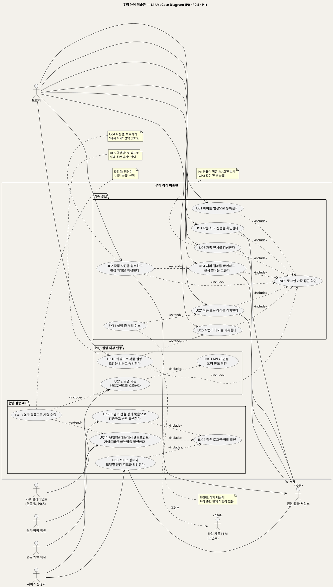

**[「L1 전체 UseCase Diagram」 PlantUML 뷰어로 열기](https://plantuml.sumzip.com/plantuml/svg/eNp9V91PIlcUf5-_4oS-aNI1DvidjdlW3WYT25K0Jn0wMbMwIlkcDIzbNs0mqNgosBG6oqhgMMFVN5qOQmVM6It_Sh_n3vkfeu6dGXZmWHySM-f7d76uL9KqlFLXVxOwHllKrqeWIivxRHQpJiUScur3pXlRSL-JK2tSSlqF11LkTSyVXFeiM8lEMgVfvQy9FOe-dUmkV6Ro8te4EoNlKZGWhYS8rIKahFQ8tqJCNJ6SI2o8qQhqXE3IQI818vEaaDlLay0gf-t0p260MvBfZh_mRVhIyzNSWobZuBRjxgfCw_DYhvDw0Cj_Kw4KghRRMZAAabbMik5PiwGQ0hCWUrKiOjyarZKHLM010F-LVjYcqR_X0o6IubdraBkg-RbJP4BZyNATS2burZTo2jnUyN4RGFqVaFW30Kz8titzpJP7DJgbLVLrYFL0QDdz-qIyYCvT8u3XPIFBrjmTiLsDPSmSpv7YNu40o9kBWs_Q03P6Z4GL_oQiMjx_bnmYnnaUUJLWyyhcNZr_wPz898zZmWbctlDM9oJf3ZoCq4KkxLACgT4lCMAfAsAa1luKoRSCQ89uwbj71zysWDyA9bQcYeUJLMyItgFy3gHSzNKHG1rtkLMqkA-35Kxmlqsk3-CxoKxfOQj0tGT-tQN085peoJksZlOiOxWzXDGa9UXFLBTtFGl5h7HNozJ-8FgN-q2GulbvKjzDi6x5sOto13SPdsivPeKoWbVgeTlqVky0nqV5zE-7ovkas4pfybn-2eSI3-RoNyBsi3LH0DVmlf3xATTq1xwDG3_LKVfTinRrw6M25lcbdxySSpHk9l0lops3CKZHe9yr_eoHrCkW0GjrmDS2pBNAyWg7UHBNJuhVnfvlZ2yHfAPRBtoodfFvXzqtzCRQ5527w_hQ02yDfNp-bNtTZM3Ml9ptGMzNBj0pkA9V1mUOsFwda9PasRuFXKBIA0sDNPfgL7o43GM3COTTJXmv87LkztHU4T76MPeumXJO532Ae-beC54Y7EEvBN-EX7Eosdw6_Vh7bKOx4316dwNMdS_rAzHkB8TaVWwZZLg6mvsCEhPg2m7YEFtVepRZVKwscBLtlYfdnzFLVXcbu8Kf8FuddGAgd1nWc2xo7A15fU9rBWu4FxUrNmskGMLG3dVjm5w1iHbrcTDZA7TI4DGPqvT4CsjVPtlt0cMipgI-wBlsrPewb7HUbKXiJ3LRYAoHnT7TLIo95Qja-9rd0_TwxizXfXUI9jRzyMnd6jJ7seEc4iq0m8HpaquI7wTBOkDw7Nk0X3geMuglQ15yxEuOeskxLznuczQs4E2ziQnXbwSEHTKbmhTwYH3mWDfIoYOCwNb50NA0H22YwsMRVyKJ9aiMl4Mt676sUH_WSH_WaH_WWH_WeH8WLoe-vAmHFexhTfZnieITvC4gIR-P70HGY9EylvybKitRF4oMFx_DDp7B4uHwPrQ4otif5Y-Pu2KV5a8HXiM3NeKhxjzUuIea8FB2lPxdMQXd14YgKElVtt96yWVnz7MBw3dMvThlHx4gOItbGzjxyHXOQ6OEU4gvsEuDba3TEj3cZi8SeoqLvCBgqsCMWx5eJ1U1ucpcWIefZeLy0n0M4tQiN4Cbgd1qqr3HtR7AjVk3t2owgOEFB5-wzO8Dq4TLdMB9d1j0_OSAdXHwNXDi8vCEaXarw-KUc590zTlhoVkwjwu4c1kS-B3lBr4LL9hLCjjjIUu22dbxx-7GPeTF3Vp-iCeDw7e6_MG-wF_478D_skVEnQ==)** — 클릭 시 브라우저로 연결됩니다.

#### 다이어그램 쉽게 읽기 (유저 관점)

- **누가 쓰나** — 보호자는 가족 경험 일곱 가지(UC1~UC7)와 P0.5 설명 초안(UC10)을 쓴다. 서비스 운영자는 상태·지표 확인(UC8)과 API활용 메뉴(UC11)를, 평가 담당 팀원은 모델 검증·승격(UC9)을, 연동 개발 팀원은 API활용 메뉴(UC11)를 쓴다. 외부 클라이언트(연동 앱)는 P0.5에서 모델 기능 엔드포인트(UC12)만 부른다. 원본·결과 저장소와 과정 제공 LLM(쓰게 될 때만)은 사람이 아니라 시스템이 기대는 외부 구성요소다.
- **무슨 순서로** — 아이 등록(UC1) → 사진 올리고 제안 확정(UC2) → 처리 진행 보기(UC3) → 결과 고르기(UC4) → 이야기 쓰기(UC5, 원하면 설명 초안 UC10) → 전시 감상(UC6). 삭제(UC7)는 언제든 할 수 있다.
- **모델은 어디에** — 다이어그램에 모델 이름이 없다. 모델 7종은 시스템 안쪽의 부품이라 액터로 그리지 않는다. 분리·판정은 UC2, 움직임·2.5D 생성은 UC3, 설명은 UC10 안에서 일어난다.
- **«include» = 항상 함께** — 보호자 기능은 매번 "로그인·가족 접근 확인"을, 팀원 기능은 "팀원 로그인·역할 확인"을, 외부 호출은 "API 키 인증·요청 한도 확인"을 거친다.
- **«extend» = 특정 상황에서만** — 삭제하려는 작품이 아직 처리 중일 때만 "실행 중 처리 취소"가 끼어든다. 결과 확인에서 "다시 찍기"를 고를 때만 사진 접수가 다시 시작된다. 이야기를 쓰다가 "키워드로 설명 초안 받기"를 고를 때만 설명 생성이 끼어든다. API활용 메뉴에서 "시험 호출"을 고를 때만 평가 작품으로 모델 기능을 불러 본다.
- **Generalization(◁)** — 이 다이어그램에는 없다. 결과 종류(움직임/2.5D/액자/P1 3D)는 UC를 나누지 않고 UC2 확정값과 UC3·UC4의 흐름 안에서 갈라진다.

| 기호 | 의미 |
|---|---|
| 사람 모양(actor) | 시스템을 쓰는 사람 또는 외부 시스템(`<<외부>>`) |
| 타원(usecase) | 액터가 이루려는 목표 |
| 사각형(rectangle) | 시스템 경계. 안쪽이 이 시스템의 책임 |
| 폴더(package) | 성격이 같은 UC 묶음(가족 경험 / P0.5 설명·외부 연동 / 운영·검증·API) |
| 실선 화살표 | 액터와 유스케이스의 연결 |
| 점선 `<<include>>` | 기반 UC가 항상 포함하는 하위 행위 |
| 점선 `<<extend>>` | 확장점 조건일 때만 기반 UC에 끼어드는 행위 |
| 점선 `조건부` | 조건이 확인될 때만 생기는 외부 시스템 연결 |

---

## 6. 시스템 경계 (하지 않는 것)

**후속 범위** (Intent [개요] P0/P0.5/P1 구분 · [수익])

| 제외 항목 | 원천 근거 | 비고 |
|---|---|---|
| 하이라이트 영화(장면 선택·순서·자막·음악) | Intent [수익] 부가 수익 가설 | 후속 |
| 실물 필름·인화물·3D 조각 출력 주문 | Intent [수익] 부가 수익 가설 | 후속 |
| 결제, 구독, 가격 실험 | Intent [수익] "결제는 범위 밖" | 결제가 없는 관심 실험으로 먼저 확인 |
| 촬영 보정(원근 보정·작품 영역 자동 자르기) | spec Out of Scope | M1 분리는 배경 제거이며 원근 보정이 아니다 [추론] |
| 내보내기, 성장 후 접근권 이전, 장기 보관 정책 | Intent [가치제안] 성장한 아이 · [수익] | 후속 가치이며 보장된 성과가 아님 |
| 큐레이션 | spec Out of Scope | P0.5 설명 초안(UC10)과 별개 |
| 기관(유치원·미술학원)용 다아동 권한 | spec Out of Scope · Intent [수익] | UC12 외부 클라이언트와 별개 |
| 상용화용 법정대리인 동의 절차 | Intent [부정적 영향] 동의 오판 | U13 |
| 백업 사본의 보존·삭제 정책 | spec FR-10 | 운영 전 결정, U15 |
| 3D 조각의 화면 노출 | Intent [개요] P1 | 노출 설정(기본 꺼짐)으로 켜며, 팀 서버 GPU 확인(U2) 뒤 켠다. 꺼져 있으면 3D 결과는 원본 액자로 보인다 [통합 D10] |

**하지 않는 기능** (Intent [부정적 영향] · [핵심 파트너] · spec FR-14)

| 제외 기능 | 원천 근거 | 비고 |
|---|---|---|
| 얼굴 인식 | Intent [부정적 영향] 아동 이미지 유출 | BR-PRV-02 |
| 학습 재사용(가족 작품으로 모델 학습·미세조정) | Intent [부정적 영향] 아동 이미지 유출 · [개요] "새로 학습하지 않고" | BR-PRV-02 |
| 자동 감정 해석 | Intent [가치제안] 경험 원칙 | 아이의 한마디는 입력 그대로(BR-STY-03) |
| 발달 평가·그림 발달 점수 | Intent [부정적 영향] 비교·평가 오용 | BR-EXH-04 |
| 아이 간 비교 | Intent [부정적 영향] 비교·평가 오용 | BR-EXH-04 |
| 판정 점수 노출 | Intent [부정적 영향] 판정의 강요 | BR-SUG-02 |
| 외부 업체·외부 모델 API로 가족 기록 자동 전달 | Intent [핵심 파트너] · [부정적 영향] 아동 이미지 유출 | BR-PRV-02 · BR-CAP-05. 과정 제공 LLM은 조건 확인 뒤에만 |
| 평면 그림의 image-to-3D | Intent [부정적 영향] 3D의 추정 면 | 보이지 않는 뒷면을 지어내는 재창작이라 금지(BR-EXH-06) |
| Hunyuan3D 사용 | Intent [핵심 장벽] 라이선스 | 한국이 적용 대상 밖 |
| 무한 피드·자동 재생 | Intent [가치제안] 경험 원칙 | BR-EXH-03 |

---

## 7. 유스케이스 상세

각 UC는 범위·개요 → UseCase Diagram → Actor → 관련 UseCase → 쉽게 말하면 → 유스케이스 기술(14속성) → 기본흐름 → (대체흐름·예외흐름) → Sequence Diagram → UML 노트 순서다. UC2·UC5~UC10·UC12는 대체흐름과 예외흐름을 14속성 표 안에 두었고, UC1·UC3·UC4·UC11은 별도 표로 두었다. 시퀀스의 번호 붙은 메시지(`1.` ~ `n.`)는 기본흐름 단계와 1:1로 대응한다. UC별 업무규칙 표는 §8 한 표로 합쳤다. 본문 안의 `공통 기준 §n`은 재작성 공통 기준(2026-09-28)의 절을 가리킨다.

### 7.1 UC1 아이를 별칭으로 등록한다

#### 범위·개요

보호자는 작품을 올리기 전에 아이를 **별칭 하나**로 등록한다. 이 서비스는 아동 정보를 최소로 수집한다. 그래서 실명, 생년월일, 출생연도는 받지 않는다. 나이는 아이 정보가 아니라 작품마다 "제작 당시 연령"으로 받는다(UC5). 보호자 한 명이 여러 아이를 등록할 수 있고, 등록한 별칭은 작품 접수(UC2)와 전시(UC6)에서 아이를 구분하는 기준이 된다.

별칭은 가족 화면 안에서 아이를 가리키는 데만 쓴다. P0.5의 작품 설명 생성(UC10)에도 별칭을 포함한 아이 이름을 넣지 않는다. 또 보호자 계정으로 로그인해 아이를 등록했다고 해서 법정대리인 확인까지 끝났다고 보지 않는다. 동의 절차는 상용화 전에 정할 미해결 사항(U13)이다. 이 UC는 모델을 부르지 않는다. API 서버와 작업 DB만 관여한다.

| 항목 | 값 |
|---|---|
| 대상 시스템 | 우리 아이 미술관 (P0) |
| 상위 프로세스 | 가족 공간 준비 → **아이 등록(UC1)** → 작품 접수(UC2) |
| 원천 근거 | spec FR-1 · FR-9 · FR-14 · Intent [핵심 데이터] 아이 · [부정적 영향] 과잉 수집·동의 오판 · [핵심 장벽] 아동 개인정보 |
| 핵심 UseCase | 1개 (UC1) + 공통 1개 (INC1) |
| 주요 액터 | 보호자 |

#### UseCase Diagram

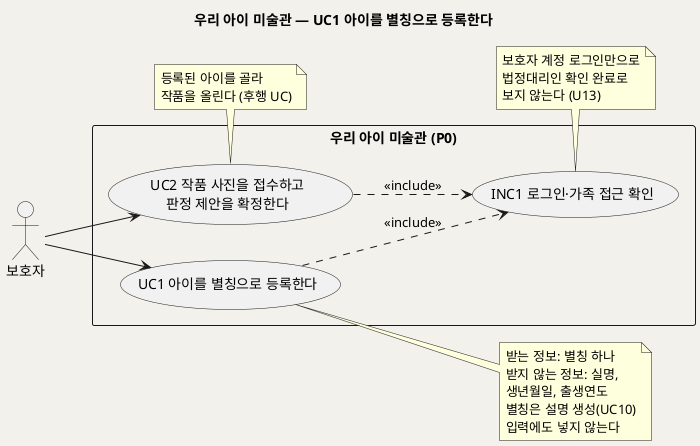

**[「UC1 아이 등록 UseCase Diagram」 PlantUML 뷰어로 열기](https://plantuml.sumzip.com/plantuml/svg/eNqNU01r20AQve-vGNyLDUmInVsIJjQ00EvJJbeCUSTFEVGkIq0ppRRMKoObGOq0UeM0krHJVykptWtTu-BTf0qP2tF_6KwsUvsQ6E27896-N29G6y5XHF45MKGiluyKU1L3DFMrlRXT1J1XpeU8c_cN64XiKAewo6j7ZceuWNqGbdoOPNpc2cw_eTyDcPcUzX5pWGXYVUxXZ6a-y4Hb4BjlPQ6a4egqN2yLcYObOuDnnri5A_Q9DIcgvo-x3omGVfhTPYXtjXxaENcTEAMPf33DYCK6AYiPfdENYz8Qx1eMKSonKxkxGMatMbabGVBc2FIc3eKMST3FKpNW5iGx7NZyLgOvGUDF1VXFJeh_aidKhJ2lPn1GXAJGozGG49-jqFfFbh-wcxKNJhCf-3Sb8CRwXrMA2D6JP9QBD-_wltQ9ScN6K_Zb0aDz3IobTez4dBmgX5dl-VzHnzNTYG8Ym3YPi4vFxN7cscBkd0tLxcQBrMLammGpZkXTi0UmTTxQYpbN9XSO9m7atuhdiKNTcuRT_KtpUkB-xWFrWsbbKkV5NIvC4yvxtbZAdXwbipqHF6cYThYAfwZ0gWc98d6T5GnsIfE9SZBo9PpZUl7OSXK7JjrXeNYkOAjv8p-SXAvd0kA6ntresTm3D6TvNPb7bYGIZCjU-5GJ28Z01BL1Q-YrGlVaHCql4wM898RlI4UMhnPCkN3Or-QelJf5Q7pEohnMbFk0-CLCSdKXXIJk-q07cdNLHo0vvPjTO6LPPL1OX_Tf_gUGQtGS)** — 클릭 시 브라우저로 연결됩니다.

##### 다이어그램 쉽게 읽기 (유저 관점)

- **누가 쓰나** — 보호자 한 사람이 쓴다. 아이는 계정이 없어 직접 등록하지 않는다. 공동 보호자나 감상 전용 가족이 등록할 수 있는지는 계정 모델이 정해진 뒤 결정한다(U1).
- **무슨 순서로** — 로그인한 보호자가 아이의 별칭을 적어 등록한다. 그다음 작품을 올릴 때(UC2) 그 아이를 고른다.
- **«include» = 항상 함께** — 아이 등록은 매번 "로그인·가족 접근 확인"을 거친다. 아이는 내 가족 공간에만 추가되고, 다른 가족은 볼 수 없다.
- **«extend» = 특정 상황에서만** — 이 UC에는 확장 관계가 없다.
- **Generalization(◁)** — 이 UC에는 없다.

| 기호 | 의미 |
|---|---|
| 사람 모양(actor) | 시스템을 쓰는 사람 |
| 타원(usecase) | 액터가 이루려는 목표 |
| 사각형(rectangle) | 시스템 경계 |
| 점선 `<<include>>` | 항상 함께 수행되는 하위 행위 |
| 노트 | 규칙이나 선후 관계 보충 설명 |

#### Actor

| 구분 | 액터 | 이 UC에서의 역할 | 원천 근거 |
|:--:|---|---|---|
| Primary | 보호자 | 아이 별칭을 등록하고 수정한다 | spec FR-1 · 공통 기준 §6 액터 |
| 이해관계자 | 아이, 성장한 아이 | 등록 대상. 시스템을 직접 조작하지 않아 액터로 두지 않는다 | 공통 기준 §6 액터 · Intent [가치제안] |

이 UC에는 보조 액터가 없다. 원본·결과 저장소와 모델(M1~M7)은 관여하지 않는다.

#### 관련 UseCase

| UC ID | 유스케이스명 | 관계 | 원천 근거 |
|:--:|---|---|---|
| UC1 | 아이를 별칭으로 등록한다 | 본 문서 | spec FR-1 · Intent [핵심 데이터] 아이 |
| INC1 | 로그인·가족 접근 확인 | UC1이 «include» | spec FR-9 · 공통 기준 §6 |
| UC2 | 작품 사진을 접수하고 판정 제안을 확정한다 | 후행(등록된 아이를 선택) | spec FR-1 수용기준 "작품을 올릴 때 어느 아이의 작품인지 고를 수 있다" |

> **쉽게 말하면** — 보호자가 아이의 별명(예: "하늘")만 적어 등록합니다. 진짜 이름이나 생일은 묻지 않습니다. 형제가 있으면 여러 명을 등록하고, 작품을 올릴 때 누구 그림인지 고릅니다.

#### 유스케이스 기술

| 속성 | 내용 |
|---|---|
| **ID** | UC1 (spec FR-1) |
| **유스케이스명** | 아이를 별칭으로 등록한다 |
| **액터** | 주: 보호자 · 보조: 없음 |
| **사전조건** | (1) 보호자가 로그인되어 있다(INC1, BR-ACC-02). (2) 보호자의 가족 공간이 존재한다. [추론] 가족 공간은 보호자 계정을 만들 때 함께 생긴다고 본다. 계정 생성 절차와 계정 모델은 원천에 없다 — `자료 없음 — 확인 필요` (U1) |
| **사후조건** | (1) 가족 공간에 새 아이가 별칭으로 저장된다. (2) 별칭은 같은 가족 안에서 유일하다. (3) 실명·생년월일·출생연도는 어디에도 저장되지 않는다. (4) 새 아이가 작품 접수(UC2)의 아이 선택 목록에 나타난다. (5) 등록을 마쳐도 법정대리인 확인이 끝난 것으로 기록하지 않는다(BR-PRV-03, U13). (6) 운영 로그에는 별칭이 남지 않고 요청 번호와 분류 코드만 남는다 |
| **기본흐름** | ↓ 별도 기본흐름표 |
| **대체흐름** | A1. 별칭 수정 · A2. 추가 등록 · A3. 아이 없이 작품 접수 진입 · A4. 공동 보호자 등록 — ↓ 별도 대체흐름표 |
| **예외흐름** | E1. 별칭 중복 · E2. 빈 별칭·형식 위반 · E3. 다른 가족의 아이 접근 · E4. 비로그인·세션 만료 · E5. 작업 DB 저장 실패 — ↓ 별도 예외흐름표 |
| **포함/확장** | «include» INC1 로그인·가족 접근 확인 |
| **우선순위** | Medium — 모든 작품 흐름의 선행 조건이지만 기능 범위가 작다(공통 기준 §6, spec FR-1) |
| **사용빈도** | [추론] 아이당 등록 1회. 2026-09-28 원천은 "아이 등록 시 1회" 문구를 빼고 "보호자가 정한 별칭"만 적는다. 별칭 수정 빈도는 `자료 없음 — 확인 필요` |
| **업무규칙** | BR-CHD-01, BR-CHD-02, BR-ACC-01, BR-ACC-02, BR-PRV-01, BR-PRV-03 |
| **특별 요구사항** | 최소 수집: 등록 화면에 실명·생년월일·출생연도 입력란을 두지 않는다(spec FR-1 수용기준). 별칭은 가족 화면 표시에만 쓴다. P0.5 설명 생성(UC10) 입력에는 별칭을 포함한 아이 이름을 넣지 않는다(Intent [부정적 영향] 과잉 수집, UC10의 BR-CAP-01). 개인정보: 운영 로그와 지표 라벨에 별칭(자유 입력)을 남기지 않는다(BR-PRV-01, spec FR-14). 접근: 가족 ID는 요청 본문이 아니라 로그인 세션에서 정한다 [추론]. 다른 가족의 아이 목록은 어떤 경로로도 조회할 수 없다(spec FR-9). 동의: 보호자 계정만으로 법정대리인 확인이 끝났다고 보지 않는다. 동의 절차는 상용화 전에 정한다(U13). 엔드포인트 `POST /v1/children` · `GET /v1/children`의 이름·형식·응답 코드는 [추론]이며 `/speckit.plan`에서 확정한다(U8) |
| **비고** | 원천 추적: spec FR-1(수용기준 4개 전부 반영: 입력란 제한 / 가족 내 중복 거절 / 2명 이상 등록·작품 올릴 때 선택 / 수정 가능) · FR-9(가족 단위 접근, 계정 모델 [NEEDS CLARIFICATION]) · FR-14(로그 제한) · Intent [핵심 데이터] "아이: 보호자가 정한 별칭. 생년월일·출생연도는 저장하지 않는다" · Intent [부정적 영향] 과잉 수집("실명·생년월일 대신 별칭", "설명 생성 입력에 이미지와 아이 이름을 넣지 않는다")·동의 오판 · Intent [핵심 장벽] 상 — 아동 개인정보 · 공통 기준 §4(엔드포인트) · §6(UC 목록·INC1) · §8(BR) · §9(최소 수집 원칙) · §10(U1, U8, U13). 아이 삭제는 UC7이 다룬다. 모델이 관여하지 않으므로 시퀀스에 서빙군 lifeline을 두지 않았다. 미결: U1 계정 모델에 따라 공동 보호자의 등록·수정 권한이 달라진다. U13 동의 절차가 정해지면 등록 앞에 동의 단계가 붙을 수 있다 |

#### 기본흐름 (Basic Flow)

| 단계 | 액터 행위 | 시스템 행위 |
|:--:|---|---|
| 1 | 보호자가 아이 관리 화면을 연다 | 웹 화면이 `GET /v1/children`을 보낸다. API 서버는 INC1로 로그인과 가족 공간을 확인하고, 이 가족에 등록된 아이 목록(별칭만)을 보여 준다 |
| 2 | 보호자가 "아이 추가"를 누른다 | 별칭 입력란 하나만 있는 등록 양식을 보여 준다(실명·생년월일·출생연도 입력란 없음). [추론] "실명 대신 가족이 부르는 별칭을 적어 주세요" 같은 안내를 함께 둔다 |
| 3 | 보호자가 별칭을 입력하고 저장을 누른다 | 웹 화면이 빈 값을 먼저 걸러 낸 뒤 `POST /v1/children`(별칭)을 보낸다. API 서버는 INC1을 다시 확인하고 세션에서 가족 ID를 정한다 |
| 4 | 보호자가 저장 결과를 기다린다 | API 서버가 작업 DB에서 같은 가족 안의 별칭 중복을 검사하고, 중복이 없으면 별칭과 가족 연결만 저장한다. 법정대리인 확인 상태는 완료로 두지 않는다 |
| 5 | 보호자가 갱신된 목록에서 새 아이를 확인한다 | 등록 완료와 새 아이가 포함된 목록을 보여 주고, 작품 접수(UC2)의 아이 선택에 반영한다 |

#### 대체흐름 (Alternative Flow)

| ID | 분기 조건 | 흐름 |
|:--:|---|---|
| A1 | 등록된 아이의 별칭을 고친다 | 보호자가 목록에서 아이를 골라 별칭을 수정한다. 가족 내 중복 검사(BR-CHD-02)와 형식 검사를 다시 거쳐 저장한다(spec FR-1 "등록 후 수정할 수 있다"). 수정 엔드포인트는 `PATCH /v1/children/{id}`로 둔다 [통합 D13]. 이름·형식은 U8에서 확정 |
| A2 | 두 번째 이후 아이를 등록한다 | 형제 등 추가 아이를 기본흐름 2~5단계로 등록한다. 등록 수 상한은 `자료 없음 — 확인 필요` (spec FR-1 "2명 이상") |
| A3 | 등록된 아이가 없는 상태에서 작품 접수(UC2)를 시작한다 | [추론] 아이 등록 화면으로 먼저 안내하고, 등록을 마치면 UC2로 돌아간다 |
| A4 | 공동 보호자가 아이를 등록하려 한다 | 계정 모델(U1)이 정해지기 전에는 가족 공간을 만든 보호자 계정만 등록·수정한다 [추론]. (a) 보호자 1계정 / (b) 공동 보호자 / (c) 관리 보호자 + 감상 전용 중 무엇으로 정하느냐에 따라 이 흐름을 고친다 |

#### 예외흐름 (Exception Flow)

| ID | 발생 조건 | 처리 | 근거 |
|:--:|---|---|---|
| E1 | 같은 가족 안에 같은 별칭이 있다 | 저장을 거절하고 "이미 쓰는 별칭이에요"라고 안내한다. 입력값은 화면에 남겨 고칠 수 있게 한다 | BR-CHD-02 · spec FR-1 |
| E2 | 별칭이 비어 있거나 형식에 맞지 않는다 | 웹 화면은 저장 버튼을 막고, API 서버도 같은 검사를 거쳐 거절한다. 별칭 길이·허용 문자 규칙은 `자료 없음 — 확인 필요` | BR-CHD-01 · [추론] |
| E3 | 다른 가족의 아이 ID로 조회·수정을 요청한다 | 찾을 수 없음으로 응답하고 존재 여부도 알리지 않는다 [추론]. 로그에는 분류 코드만 남긴다 | BR-ACC-01 · spec FR-9 "직접 주소 입력 어떤 경로로도" |
| E4 | 로그인하지 않았거나 세션이 만료됐다 | INC1에 따라 다시 로그인하게 한다. 입력하던 별칭은 저장하지 않는다 | BR-ACC-02 · spec FR-9 |
| E5 | 작업 DB 장애로 저장하지 못한다 | "저장되지 않았어요, 다시 시도해 주세요"라고 안내한다. 일부만 저장된 아이 기록은 남기지 않는다. 운영 로그에는 요청 번호와 분류 코드(DB)만 남긴다. 모델 단계가 아니므로 3회 재시도·결과 미도달 집계(BR-PRC-03)는 적용하지 않고 보호자가 다시 시도한다 [추론] | BR-PRV-01 · spec FR-14 · Intent [핵심 데이터] 오류 분류 "DB" |

#### Sequence Diagram

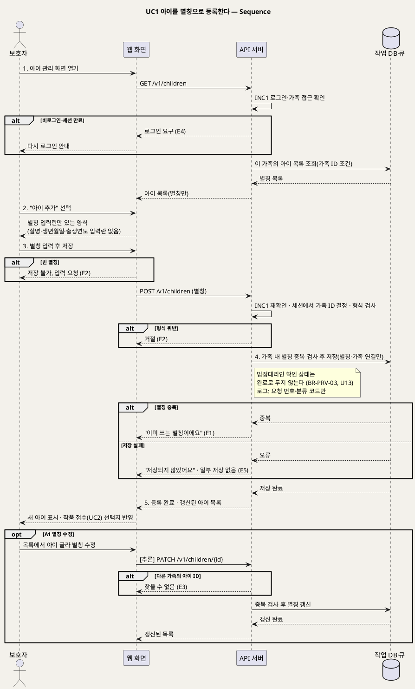

**[「UC1 아이 등록 Sequence」 PlantUML 뷰어로 열기](https://plantuml.sumzip.com/plantuml/svg/eNptVU1vGlcU3c-vuKIbkAIOdrLxoooxTutNayUhm7SyJjCxUQg4MG5VRZVwGFcoIBVqCBN7BoEKzYccFdvEYIl24Z_S5bw7_6H3zbzBjPEGad47736cc-7lXkGV8-ruiwwUlJebud38ZnI7nUltbsmZjJL_ZfN2VCo8T2d35Lz8Ap7Kyedb-dxuNrWay-Ty8NX9pfvRtdgMorAtp3I_p7Nb8EzOFBRJTasZBRKrUcCmhuaQ9SfAzjS8-IzGhHUNYAcnrGvaTYNVevBfsQEPlZe7SjapSJKcVClHgJ0NbX2M7VoA5AJsyHklq0qUTU0n0ztyVoUAHl2A_a7BPg4dSGLdf72ysQ6oGexUc67pU0rJqvxULij0tl3H1j7EY5cje89NEY9JkpsGwl9TNFiGaETUD9awyP46FukAW0NrPJAIQ0ieZxm-WXsECz9FFxwaKYjEj6e3698RFdS3NRqjOb4cWYMidk8AO3VrNKGoTTqV5IwK7EKbgaE2xn0d2Psq-7MqgRMs7BU3xQEeNqwvxxBcuxMiUMLFiFYIV-lhxZiFN8vs9VBSsimvyHiMcE6bTl1o6l7f7NNH0gmwO7APq0FR9nqcH1gnw5BEL8PTLl2FxRvJV6wvXNAFUluhOcoXIySOC8bzBiUMkIgdu2RKc3252bC9zzp91i5SOPooszcNwLd1rJg_ZINY6bFP-0RkyWT7Gh410JzQ17lBB9gasN-1q_ek6m9o3lDSUsSfC-wjetYpYrsvNCsLwA3suzhg52Xq5ZYXgRTD08-k2GLI0WHWSRvfP_RbCQRfoRs8he1j1z1wOQLXLtiqke3hSivrdICdJgfYepN4oYMivj52ahcnaGhsoF93mHVCD8tXVfrscifipSAzTQnq1dnZF5FghifRwZXxWwOqyjFANqcqkE9vbauQe-ZMKQA7bVLFrMpnjvcmWsTSnl0ySGCC4DuNZsJZJfUavif1mm_ohq-TYOxBeOPB4_DtpVuQiC7xmXDNv-zxzk7LtFsuR-xcY33y-j8NdmBQNbxL4AW5us72REF8Xp-e-hgL8F33N1V6MOA-FCvPHHJNDhsBojJKVNKG9HxBBrWrH-aC6z2qaz6484bVdNEvNnV8O3QCc_XNCTsvTgM7ZqaEd13t_PEFxuFQ8k_q3YhYzuKah7YGJ1jpsJrhn-O5kcRS2UPYdYNvHV5Xu27_Uea7Dst6MLG6GBITzbsg16G-J0m5HRVWolPKyzrpT_1fm0Q3rTC4t5nPPjBzMvdydqKe0CZh3c6PsLHyaPVb32wtvEqnfiW4ozcti_54fgeuxwlwTQsc_IumxtNdMe04jXMtsN5enZsJUavL6nXt3VNPm-sTORVCKMDT3aMf-if_HyqDs5s=)** — 클릭 시 브라우저로 연결됩니다.

기본흐름 1~5단계는 시퀀스의 번호 붙은 주요 메시지 `1.`~`5.`와 1:1로 대응한다.

#### UML 노트

| 항목 | 적용 |
|---|---|
| 액터 | 보호자는 Primary이며 시스템 경계 밖에 둔다. 아이·성장한 아이는 조작 주체가 아니므로 이해관계자로만 기록했다 |
| System Boundary | `rectangle`로 우리 아이 미술관(P0)의 책임 범위를 표시했다 |
| «include» | INC1은 모든 보호자 UC가 항상 거치는 공통 행위라 include로 분리했다(UML 2.5.1 UseCases 장의 Include 정의) |
| 선후 관계 | UC1 → UC2는 include나 extend가 아닌 업무 선후 관계라서 노트로만 표시했다 |
| Sequence | 공통 기준 §3의 lifeline 이름(`보호자` · `웹 화면` · `API 서버` · `작업 DB·큐`)을 썼다. 모델이 관여하지 않으므로 CPU 비전 워커·GPU 워커·LLM 서버와 원본·결과 저장소는 넣지 않았다. 예외는 `alt`에 E1~E5를, 대체흐름 A1은 `opt`로 붙였다 |

---

### 7.2 UC2 작품 사진을 접수하고 판정 제안을 확정한다

#### 범위·개요

보호자가 아이를 고르고 휴대폰으로 찍은 작품 사진을 올린다. 시스템은 형식·용량·판독 가능 여부를 먼저 검사하고, **원본·작품 기록·작업 기록이 모두 저장된 경우에만** "접수 완료"로 응답한다(내구 접수). 접수가 끝나면 판정 단계 작업이 CPU 비전 워커 큐에 오른다. 워커는 원본을 읽기만 하면서 배경을 분리해 작품 마스크·컷아웃을 만들고(M1), 무엇을 그렸는지 제로샷으로 판정하고 태그를 뽑고(M2), 관절을 추정하고(M3), 관절 기하 규칙(M4)으로 움직일 수 있는 그림인지 따진 뒤 **제안 문구**를 만든다. 점수는 보여 주지 않는다.

보호자는 잘라 낸 작품(컷아웃)과 제안 문구를 보고 **움직임 / 2.5D 입체 부조 / 원본 액자** 중 하나를 확정한다. 처리 경로는 제안이 아니라 이 확정값으로 정해지고, 제안값·확정값·수정 여부가 함께 기록된다(판정 수정률의 원천). 확정되면 그 경로의 처리 단계 작업이 등록되고 이후 진행은 UC3에서 다룬다. 판정이 늦거나 실패해도 보호자는 직접 확정할 수 있다 [추론]. 결과 확인(UC4)에서 "다시 찍기"를 고르면 이 UC가 확장(EXT2)으로 다시 시작되고, 새 사진은 새 작품으로 접수된다. 만들기 작품(점토·종이 공작)의 3D 조각은 P1이며 팀 서버 GPU가 확인되기 전에는 선택지에 나타나지 않는다.

| 항목 | 값 |
|---|---|
| 대상 시스템 | 우리 아이 미술관 (P0) |
| 상위 프로세스 | 아이 등록(UC1) → **작품 접수·판정 제안 확정(UC2)** → 처리 진행 확인(UC3) → 결과 확인·전시 방식 선택(UC4) |
| 원천 근거 | spec v2.0 FR-2 · FR-3 · FR-15 · FR-20 · FR-21 · Intent [핵심 활동] 4 "판정은 제안까지만 한다" · [핵심 장벽] 상 — 판정 정확도 · [부정적 영향] 판정의 강요 · [핵심 이네이블러] 배경·작품 분리 / 종류 판정·태그 / 관절·리깅 / 판정 보조 |
| 핵심 UseCase | 1개 (UC2) + 공통 1개 (INC1) + 확장 관계 1개 (EXT2: UC2 ··> UC4 «extend») |
| 주요 액터 | 보호자 · 원본·결과 저장소(보조) |
| 쓰는 모델 | M1 배경·작품 분리 · M2 OpenCLIP 제로샷 종류 판정·태그 · M3 관절 추정 · M4 관절 기하 규칙(모델 아님) — 모두 CPU 비전 워커. 액자 확정 시 M3 렌더·M5는 부르지 않는다 |

#### UseCase Diagram

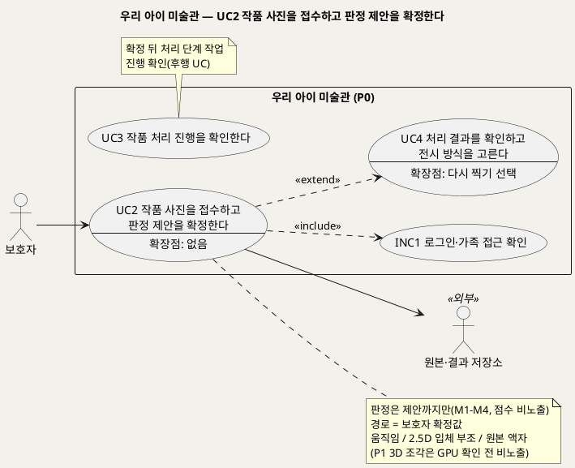

**[「UC2 작품 접수·판정 확정 UseCase Diagram」 PlantUML 뷰어로 열기](https://plantuml.sumzip.com/plantuml/svg/eNqFVF1r02AUvs-vONSbDuxc13kzZhlWJ15MCrK7QcnSrAvLEklSVETINBuVVuiGdZ1rSgubVRgY27FlMG_8KV7mPfkPnjdJRwd-3DXnPOc9z8ehi6YlGlZ1S4WqVNKrRknaUNRyqSKqqmy8LM3MCuamoj0TDXEL1kRps2LoVa1c0FXdgFtLuaXsw_sTCHNDLOvPFa0C66JqyoIqr1tg6WAolQ0LyoohS5aia4KlWKoM-Mljn08BWw66Z8C--VjrBWc2_LI_wEphFrC7F-7XAN-c4oAgDmBvD2vtsNUORj0IG03stajWwVaNd8PDFhXCVofVjwVBlCyimGKjs7DtY7eZAtGEomjImjXu4VGTjfyfF8HQC0ZX9JKN3RPcbUTQpwSRYWEBD312bufzgsDJi1qFiKf-xjxdnJlKwSsBoGrKkmgS9L9CVrV_KlnVMhmCUIW49ZrzgAe76MYc6e3JVY-fFLLA-p3gwkeX6_Js7H_ny4KLq-hR14_mOPAmxznAYZtLir1gJ2P8mCP2HKx3gHlfse5yjlRlJ_6fCFKNQ9F7H_geoNML37oJ3bmbW3PXzsTLyZ3w47uxA3w5dyCZzQmvBSEOEDKZfCSemzs9nY8EwTylpWiSWi3LFNe4xbXxjvzCkrVy0uDzUcCCoOmWnNynvp44GgeCrp1kElw2cGCzQSO9nM0sz92mcpPyA3bpsB0fzztTNBQMf5D3cA-uTy7JMfD2qY1HNg62sevAHZidvvuApO_gkI7nnELyqBhfI91Un0ZpIF3MQo5gfS_wtjmXR8WVxBfa70wuJ2HAdcRi1nTL0rdiNTmuJmIBbP947DOrfwlGDjcfD3Y4t8j35PF0eBR9rRQmHl6kX_Qn8RuDEAoC)** — 클릭 시 브라우저로 연결됩니다.

##### 다이어그램 쉽게 읽기 (유저 관점)

- **누가 쓰나** — 보호자가 사진을 올리고 전시 방식을 확정한다. 원본·결과 저장소는 원본과 잘라 낸 작품(마스크·컷아웃)을 보관하는 외부 구성요소다. 판정에 쓰는 모델은 서비스 안의 부품이라 그림에 사람 모양으로 나오지 않는다.
- **무슨 순서로** — 아이를 고르고 사진을 올리면 "접수 완료"가 뜬다. 잠시 뒤 잘라 낸 작품과 "움직일 수 있을 것 같아요" 같은 제안이 나오고, 보호자가 셋 중 하나를 고른다. 그 뒤 만드는 과정은 UC3에서 본다.
- **«include» = 항상 함께** — 사진을 올리거나 확정할 때마다 "로그인·가족 접근 확인"을 거친다.
- **«extend» = 특정 상황에서만** — 결과 확인(UC4)에서 "다시 찍기"를 고를 때만 사진 접수가 다시 시작된다. 이전 원본은 그대로 두고 새 작품으로 받는다.
- **Generalization(◁)** — 이 UC에는 없다. 움직임·2.5D·액자는 UC를 나누지 않고, 같은 확정 흐름에서 확정값만 다르게 기록한다.

| 기호 | 의미 |
|---|---|
| 사람 모양(actor) | 시스템을 쓰는 사람 또는 외부 구성요소(`<<외부>>`) |
| 타원(usecase) | 액터가 이루려는 목표. `--` 아래는 확장점 |
| 사각형(rectangle) | 시스템 경계 |
| 실선 화살표 | 액터와 UC의 연관 |
| 점선 `<<include>>` | 항상 함께 수행되는 하위 행위 |
| 점선 `<<extend>>` | 확장점 조건일 때만 기반 UC(UC4)에 끼어드는 행위 |
| 메모(note) | 경로 결정 규칙과 후행 UC 안내 |

#### Actor

| 구분 | 액터 | 이 UC에서의 역할 | 원천 근거 |
|:--:|---|---|---|
| Primary | 보호자 | 아이를 고르고 사진을 올린다. 컷아웃과 제안 문구를 보고 움직임 / 2.5D 입체 부조 / 원본 액자 중 하나를 확정한다 | spec FR-2 · FR-3 · FR-21 · Intent [핵심 활동] 4 · [가치제안] "지금의 보호자" |
| Secondary | 원본·결과 저장소(S3 호환) | 원본을 변형 없이 보관하고, M1이 만든 작품 마스크·컷아웃을 보관한다. 실제 제품은 미확정 | Intent [핵심 이네이블러] 기반 "S3 호환 저장소" · 공통 기준 §6 액터 |

모델 M1~M4는 자체 호스팅 구성요소라 액터로 두지 않는다. 시퀀스에서만 서빙군 lifeline "CPU 비전 워커"로 나타낸다(공통 기준 §6). 아이는 이해관계자이며 액터가 아니다.

#### 관련 UseCase

| UC ID | 유스케이스명 | 관계 | 원천 근거 |
|:--:|---|---|---|
| UC2 | 작품 사진을 접수하고 판정 제안을 확정한다 | 본 문서 | spec FR-2 · FR-3 · FR-15 · FR-20 · FR-21 |
| INC1 | 로그인·가족 접근 확인 | UC2가 «include» | spec FR-9 · 공통 기준 §6 |
| UC4 | 처리 결과를 확인하고 전시 방식을 고른다 | UC2가 UC4를 «extend»(EXT2, 확장점: 보호자가 "다시 찍기" 선택) | spec FR-6 · BR-APR-02 · BR-APR-03 |
| UC3 | 작품 처리 진행을 확인한다 | 후행(확정된 경로의 처리 단계 작업) | spec FR-4 · FR-5 · FR-22 · FR-23 · FR-25 |

> **쉽게 말하면** — 아이 작품을 찍어 올리면 사진과 기록이 안전하게 저장된 뒤 "접수 완료"가 뜹니다. 잠시 뒤 서비스가 작품만 잘라 보여 주고 "움직일 수 있을 것 같아요"처럼 어울리는 전시 방식을 제안합니다. 제안은 참고일 뿐이고, 움직임·입체 부조·액자 중 무엇으로 만들지는 보호자가 정합니다.

#### 유스케이스 기술

| 속성 | 내용 |
|---|---|
| **ID** | UC2 (spec v2.0 FR-2, FR-3, FR-15, FR-20, FR-21) |
| **유스케이스명** | 작품 사진을 접수하고 판정 제안을 확정한다 |
| **액터** | 주: 보호자 · 보조: 원본·결과 저장소. 시스템 내부 구성요소: API 서버, 작업 DB·큐, CPU 비전 워커(M1·M2·M3·M4) |
| **사전조건** | (1) 보호자가 로그인되어 있다(INC1). (2) 가족 공간에 아이가 1명 이상 등록되어 있다(UC1). (3) 보호자 기기에 올릴 작품 사진이 있거나 촬영할 수 있다. (4) 판정 모델(M1·M2·M3)이 매니페스트상 활성이다. 활성이 아니면 판정 제안 없이 직접 확정으로 진행한다(E6, BR-MDL-07) |
| **사후조건** | (1) 접수 성공 시 원본이 변형 없이 저장되고, 작품 기록과 작업 기록(요청 번호·상태 "접수됨")이 함께 저장된다. (2) 판정 단계 작업(분리 M1, 판정 M2+M3+M4)의 모델 ID·버전·상태·시도 횟수·처리 시간·낮춤 원인 또는 오류 분류가 기록되고, 작품 마스크·컷아웃이 저장소에 남는다(M1 성공 시). (3) 보호자가 확정하면 작품에 제안값·확정값(`animated` / `relief` / `frame`)·수정 여부가 기록되고, 확정 경로의 처리 단계 작업이 등록되어 상태가 "처리 중"이 된다. (4) 확정하지 않고 떠나면 상태는 "확정 대기"로 남고 목록에서 나중에 확정할 수 있다. (5) 접수 실패 시 원본·작품 기록·작업 기록 어느 것도 남지 않는다. (6) 어떤 경우에도 원본은 덮어쓰이지 않는다 |
| **기본흐름** | ↓ 별도 기본흐름표 |
| **대체흐름** | A1. 제안과 다르게 확정 — 7단계에서 제안과 다른 선택지를 골라도 막지 않는다. 수정 여부를 "예"로 기록하고 판정 수정률(보호자가 제안과 다르게 고른 건 / 제안 제시 건)에 집계한다(BR-SUG-03, BR-OPS-02). A2. 제안이 늦어 화면을 떠남 — 4~5단계 중 보호자가 화면을 닫아도 판정 단계 작업은 계속된다(BR-PRC-05). 작품은 목록에 "판정 중" → "확정 대기"로 보이고, 보호자가 나중에 목록에서 작품을 열면 6단계부터 이어서 확정한다. A3. 제안 전 직접 확정 [추론] — 제안이 나오기 전에 보호자가 "직접 고르기"로 확정할 수 있다(BR-SUG-05). 제안값은 "제안 전"으로 기록하고 판정 수정률의 분모(제안 제시 건)에서 뺀다 [통합 D14]. 판정 단계 작업은 취소하지 않고 끝까지 수행해 M1 마스크·M3 관절을 처리 단계가 재사용하게 한다 [추론]. A4. 원본 액자로 확정 — 확정값이 `frame`이면 처리 단계에서 M3 렌더와 M5를 부르지 않는다(BR-PRC-01). 결과 원인은 "보호자 선택"으로 기록하고 모델 낮춤과 섞지 않는다(BR-FBK-04). A5. 사람을 찾지 못한 그림 — M2가 동물·집·사물로 판정하거나 M4 기하 규칙을 통과하지 못하면 "입체 부조가 어울려요"를 제안한다. 엔진 사람 점수가 높아도 그것만으로 움직임을 제안하지 않는다(BR-SUG-04, 집 그림 사람 점수 0.946 사례). A6. 중복 전송 — 같은 요청 번호로 올리기가 다시 오면 새 작품을 만들지 않고 기존 작품을 돌려준다(BR-INT-03). 확정 요청이 중복되면 첫 확정값을 유지하고 같은 응답을 돌려준다 [추론]. A7. 다시 찍기로 진입(EXT2) — UC4에서 "다시 찍기"를 고르면 이 UC가 1단계부터 시작되고 아이는 이전 작품의 아이로 미리 선택된다 [추론]. 새 사진은 새 작품·새 작업으로 접수되며 이전 작품의 원본·결과는 덮어쓰지 않는다(BR-APR-03, 이전 작품 처리는 BR-APR-05). A8. 동시 처리 상한 도달 — 접수는 정상 완료되고, 판정 단계 작업은 거절되지 않고 CPU 비전 큐에서 순서를 기다린다. 화면에는 "판정 중(대기)"로 보인다(BR-PRC-07). A9. (P1) 만들기 작품 — 3D 노출 설정(기본 꺼짐)이 켜지고 M7이 활성화된 뒤에만 선택지에 "3D 조각(`sculpture`)"이 나타난다. 노출 설정은 팀 서버 GPU 확인(U2) 뒤 켠다 [통합 D10]. 그 전에는 보이지 않는다(BR-SRV-02) |
| **예외흐름** | E1. 허용되지 않는 형식 — JPEG·PNG·HEIC가 아니면 접수 전에 거절하고 "지원하지 않는 사진 형식이에요"라고 안내한다(BR-INT-01). E2. 용량 초과 — 20MB(기본값) 초과면 접수 전에 거절하고 상한을 안내한다(BR-INT-01). E3. 판독 불가 — 허용 형식이지만 이미지로 열리지 않는 깨진 파일이면 "사진을 열 수 없어요"라고 안내한다(BR-INT-01). E4. 원본 저장 실패 — "접수되지 않았어요, 다시 올려 주세요"라고 안내하고 작품 기록·작업 기록을 만들지 않는다(BR-INT-02). E5. 작품·작업 기록 저장 실패 — 이미 저장된 원본을 제거하고 E4와 같이 안내한다. 목록에 작품이 나타나지 않고 판정 단계 작업도 등록되지 않는다(BR-INT-02). E6. 판정 단계 인프라 장애 — 워커 다운·시간 초과·저장소·DB·모델 미준비(라이선스 미확인으로 비활성인 경우 포함, BR-MDL-07)는 낮춤이 아니다. 같은 단계를 첫 시도 포함 최대 3회 시도하고 오류 분류를 기록한다(BR-PRC-03) [통합 D1]. 소진되면 제안 없이 "제안을 준비하지 못했어요. 직접 골라 주세요"를 보여 주고, 보호자는 직접 확정할 수 있다(BR-SUG-05). [추론] 판정 단계 소진은 작품을 "처리하지 못함"으로 끝내지 않고 "확정 대기"로 두며, 인프라 실패로만 집계하고 결과 미도달로 세지 않는다 [통합 D1]. E7. M1 분리 품질 미달 — 작품을 배경에서 분리하지 못하면(임계값은 U5) 컷아웃 대신 원본 사진을 보여 주고 "액자로 거는 것을 추천해요"를 제안한다. 분리 실패와 원인을 단계 작업에 기록한다(BR-FBK-02, BR-FBK-03). 보호자가 그래도 2.5D를 고르면 막지 않되 "배경을 분리하지 못해 액자로 걸릴 수 있어요"를 안내한다 [추론]. E8. 비로그인·세션 만료 — INC1에 따라 로그인을 요구하고 접수·확정은 이뤄지지 않는다(BR-ACC-02). E9. 다른 가족의 아이·작품 — 다른 가족의 아이로 올리거나 다른 가족 작품을 조회·확정하려 하면 거절하고, 작품의 존재 여부도 알리지 않는다 [추론](BR-ACC-01). E10. 확정할 수 없는 상태 — 이미 확정되어 "처리 중" 이후인 작품에 다른 확정값이 오면 거절하고 현재 상태를 보여 준다. `삭제 중`인 작품에는 확정 요청 자체를 받지 않는다(BR-DEL-05) [통합 D4]. 처리 뒤 전시 방식을 바꾸려면 UC4를 쓴다 [추론] |
| **포함/확장** | «include» INC1 로그인·가족 접근 확인 · «extend» UC4(EXT2, 확장점: 보호자가 "다시 찍기" 선택) |
| **우선순위** | High — 모든 가족 경험의 입구이자 판정 제안·확정이 처리 경로를 정한다. Intent [핵심 활동] 4 "판정은 제안까지만 한다. 문구로 보여 주고 보호자가 확정하며, 수정 여부를 기록한다" |
| **사용빈도** | `자료 없음 — 확인 필요`. 원천은 작품 업로드 빈도와 판정 제안 제시 건수를 제시하지 않는다 |
| **업무규칙** | BR-INT-01, BR-INT-02, BR-INT-03, BR-INT-04, BR-INT-05, BR-SUG-01, BR-SUG-02, BR-SUG-03, BR-SUG-04, BR-SUG-05, BR-PRC-01, BR-PRC-03, BR-PRC-05, BR-PRC-07, BR-FBK-02, BR-FBK-03, BR-FBK-04, BR-SRV-01, BR-SRV-02, BR-MDL-07, BR-APR-03, BR-ACC-01, BR-ACC-02, BR-OPS-02, BR-PRV-01, BR-PRV-02 |
| **특별 요구사항** | 입력: JPEG·PNG·HEIC, 한 장 20MB 이하(기본값, 계획 단계에서 조정 가능). 응답성: `POST /v1/artworks`는 모델 처리를 기다리지 않고 202로 "접수 완료"를 돌려준다. 판정 단계 처리 시간 상한과 목표 시간은 `자료 없음 — 확인 필요`(U6). 신뢰성: 접수된 작품은 서버 재시작이나 워커 중단에도 사라지지 않고, 같은 단계 작업을 중복 처리하지 않으며 중단된 작업은 이어받는다(BR-PRC-05). 서빙: M1·M2·M3·M4는 CPU 비전 비동기 큐에서 돌고 API 서버는 모델을 import하지 않는다(BR-SRV-01). 화면 갱신 방식(폴링/푸시)은 [추론] 폴링이며 `/speckit.plan`에서 정한다(U8). 사용성: 제안은 문구로만 보여 주고 점수는 보이지 않는다(BR-SUG-02). 문구 확정과 제안 지연 시 화면은 U10. 선택지 셋을 같은 무게로 보여 준다 [추론]. 개인정보: 운영 로그에 이미지·객체 키·자유 입력·오류 원문을 남기지 않는다(BR-PRV-01). M1·M2는 작품 분리·종류 판정에만 쓰고 얼굴 인식·학습 재사용에 쓰지 않으며, 원본을 외부 모델 API로 보내지 않는다(BR-PRV-02) |
| **비고** | 원천 추적: Intent [개요] "사진에서 작품을 분리하고(배경 분리), 무엇을 그렸는지 판정을 제안하고(제로샷 분류+관절 규칙), 보호자가 확정하면" · [핵심 활동] 4 · [핵심 장벽] 상 — 판정 정확도 "엔진 점수만으로는 집 그림을 걸러내지 못했다(사람 점수 0.946, 사람 그림 0.997)" · [부정적 영향] 판정의 강요 "제안 문구만 보여 주고 점수를 노출하지 않는다. 제안과 다른 선택을 막지 않는다" · [핵심 이네이블러] 분리·판정·관절·판정 보조 · [핵심 데이터] 작품 "작품 마스크·판정 제안과 보호자 확정값", 처리 작업 · [미션] 서빙 지표 "판정 수정률". spec v2.0 FR-2(내구 접수) · FR-3(판정 제안을 보여 주고 보호자 확정값으로 경로 결정) · FR-15(대기열) · FR-20(M1 분리) · FR-21(판정 제안과 보호자 확정·수정 기록). 공통 기준 §2 모델 카탈로그 · §3 서빙 구조 · §4 엔드포인트 `POST /v1/artworks`, `GET /v1/artworks/{id}`, `POST /v1/artworks/{id}/confirm` · §5 상태 모델·판정 제안 · §8 BR. 추가 요구 R2(모델을 유스케이스의 기능으로 쓴다: 사진 입력 → M1~M4 → 컷아웃·제안 문구 출력). 공통 기준 §5는 분리(M1)와 판정(M2+M3+M4)을 별도 단계 작업으로 두므로, 이 문서는 두 단계 작업을 차례로 CPU 비전 큐에 등록한다. 제안 결정 규칙(M2 판정 + M4 통과 → 움직임, 그 밖에 M1 성공 → 2.5D, M1 실패 → 액자)은 [추론]이며 임계값은 U5. 제안 문구 3종은 [추론 문구](U10). 옛 문서의 "사람·캐릭터 질문 필수"(옛 BR-INT-05·E4)는 폐기했다 |

#### 기본흐름 (Basic Flow)

| 단계 | 액터 행위 | 시스템 행위 |
|:--:|---|---|
| 1 | 보호자가 "작품 올리기"를 연다 | INC1로 로그인과 가족 공간을 확인하고 등록된 아이 목록을 보여 준다(`GET /v1/children`) |
| 2 | 보호자가 아이를 고르고 사진을 찍거나 기기에서 고른다 | 형식(JPEG·PNG·HEIC)·용량(20MB 이하)·판독 가능 여부를 검사하고, 통과하면 미리보기를 보여 준다(BR-INT-01) |
| 3 | 보호자가 "올리기"를 누른다 | `POST /v1/artworks`로 요청 번호의 중복을 확인하고, 원본을 저장소에 변형 없이 저장한 뒤 작품 기록과 작업 기록을 함께 저장한다. 모두 성공하면 202 "접수 완료"(상태 "접수됨")를 돌려준다(BR-INT-02·03·04) |
| 4 | 보호자가 "접수 완료, 작품을 살펴보고 있어요" 안내를 보며 화면에 머문다 | 분리·판정 단계 작업을 CPU 비전 워커 큐에 등록하고 상태를 "판정 중"으로 바꾼다. 워커가 원본을 읽기만 하며 M1로 배경을 분리해 작품 마스크·컷아웃을 저장소에 저장한다(BR-SRV-01, FR-20) |
| 5 | 보호자가 진행 표시를 계속 본다 | 워커가 M2(OpenCLIP 제로샷: 사람 그림 / 동물 / 집 / 사물)로 종류와 태그를 뽑고, M3로 관절을 추정하고, M4 관절 기하 규칙(팔다리 길이·좌우 대칭·몸통 비율)을 적용한다(BR-SUG-01) |
| 6 | 보호자가 판정 결과 화면을 본다 | 결과를 합쳐 제안 문구를 만들고 점수는 내부 기록에만 남긴다. 상태를 "확정 대기"로 바꾸고 `GET /v1/artworks/{id}`로 컷아웃·제안 문구·선택지(움직임 / 2.5D 입체 부조 / 원본 액자)를 보여 준다(BR-SUG-02·04) |
| 7 | 보호자가 선택지 하나를 골라 확정한다 | `POST /v1/artworks/{id}/confirm`으로 확정값을 받고, 제안값·확정값·수정 여부를 작품에 기록한다(BR-INT-05, BR-SUG-03) |
| 8 | 보호자가 "만들기 시작했어요" 안내를 확인하고 화면을 떠나거나 진행 화면(UC3)으로 간다 | 확정 경로의 처리 단계 작업을 등록하고 상태를 "처리 중"으로 바꾼다. 움직임은 움직임 렌더(M3)를 CPU 비전 큐에, 2.5D는 깊이·부조(M5)를 GPU 전용 큐(GPU가 없으면 CPU)에, 액자는 모델 호출 없이 등록한다(BR-PRC-01, BR-SRV-02) |

#### Sequence Diagram

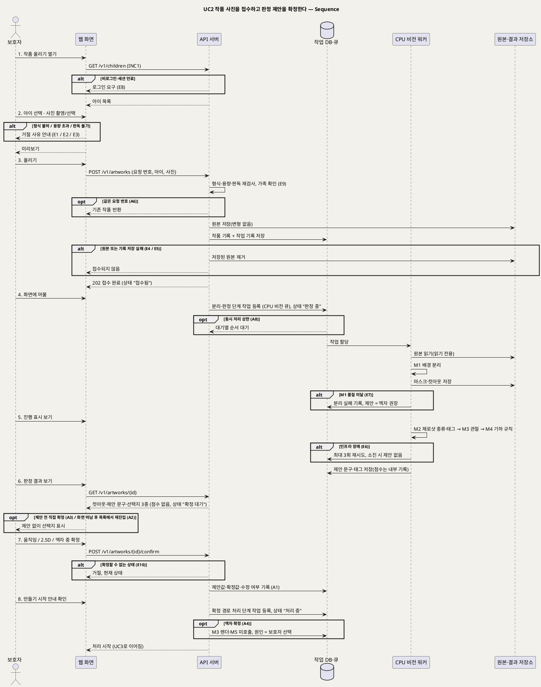

**[「UC2 작품 접수·판정 확정 Sequence」 PlantUML 뷰어로 열기](https://plantuml.sumzip.com/plantuml/svg/eNp9Vk1vE1cU3c-vuEo3thpsbCdAkUCQDyoWtJFo1tGQGLAwNthOEaoqOWQSGewKB2IyIWPXaUMdKlc1jokdUbrIT2E5781_6Hkf49hO1A3BM_e9e-49554717I5M5NbfpikbPzxQno5s7B4P5FcWrhnJpPxzNOF81Ej-yCRemRmzId0x1x8cC-TXk4tTaeT6Qx9dSN2IzI7NRCRvW8upZ8kUvforpnMxo1cIpeM0_x0lHhtw3tVIP6syRsWr1rE6xu8YHsV2z2ok1cq83oFzxxeKYi33nYFD7yKw4p79CW_Sbfjj5fjqcW4YZiLOeQeYwcdz-7xWnmMzCzNmZl4KmcARS6xmHhkpnI0xneOcM8me9-RIfM3h19fn7tJ3HJY25Kv8dNYMnPmHTMbx9naBt9ao5mp4663olLMTA2fn56bJ3Zk8Tpq2SnxT3syCk9HUZTZQe-467Zb7sE_KDHPa-_4eklG30YpKEmhp3NXAZIuUyTUb5fdZH803V6L-FYHfwy8R5SAfpm-nf2Bwj9GwpIxXECBm99NR4KGmcwJYGzXcbs9XkVubvX4mk2sUWK_lwyS58_52fpxxN9uuh-bFJi9FDTiqSVjKIxXQFuH2J_v2W71FORoyA_gVt1brdJxV3NNvNPk9kpYPZfgPLvCi1VihwVvq0Bh5H3Pfn2OwILoUFiogb1cE-_dVh5w5xUMnfIyuR9avK605NSRt8CedYA6gqOzUfFPTOEfPcf-7qGbEI7o5GgFsdBJt4faPPf9bdVnsPoknXmQpQAaxdt_EWsXIMFxXfm4Ljio-uYfV8WCA1kk5KSK47Wm287jxDihSL77QUoeJARmvwka6Uc5PN7m1TwN5aLA9QvBUQIBmO92fMmwlu1t2yf8XVUiEwxKJWoFBthBHtCgq3VeLfUxz0yJQHUT7gXV9DXpYdC_1XlJpL6R2WX2YnP4PfHinlfaRzkTgpHJPuoBPDKQlZ0TZA6oHS1PGQUr27yBblReAO5pdUbPR3Ug8W0LKgdJqyveqoMB1Of3x4KnSJ8IaYfgW2Vi-z3W_HeoE-zQgiIkacKfWHHfPbD8frDXH0S9gQEjgFcEoQOd2Xe1vY0xySh7uc2LqLZt41IZVXHA6CXRG6Q719cMK-UFqVsgteDAo_QDWbYIvCpsRhElgHiVOiseGeLZGXRXP-NoQP1BjywIMejHqmtuRaCaltv-rOsdvYk1CvzFnreCRvBPXaH2ndVBGeA89MIbBTlhReEgF0VN-pqBTvqqUFIZ14ZPV8DrLqyc3MOSuFTUOUrVJOazYXlvnpO34Yg26jkerkSowIGj8VX4z29r7J0N8laFwdGX9Vd0K0ZuJy_MQ_6aEECwgsjtOvxoW2m62vM2LVaFVcOnK3UUc2G0GP7RASMU896WxCADDXtpoZr1kjQ8wbEqTE2XrGfovHrLmj34bR-gHkxeLwu9YqBga-wwr5t1WrwXQv7e1LtFd-SsHeF7V_inxNLPI8buUwp2h3EpyxZjF0MvSSPTRQ3IXO5qrdExZV5-_WI5NlYwgnqjQ-6xoLB4OXXE3tTZs33ydiy9WDCHQu-iqfhMqCHp9WjwjBUw2F9_5wigShtnCugiBLSTF2hqFhBEQ5MzYvco4WFGNcL_937Zv_BiOnU3kXmolpn-UsEiUr0RzOnWYCedP23XcnuNYzGgwKYOHfTrAYm4rVeQh8wg_4sU0lG2mifCQIsip8VxKSTX_es9OfVFB1bhb0q1aIayaXJgAZgd36DOcrsT1n0X881NN7JP88SA48scmD1WL7FfNo-7tyaFU4jPt0NnXBiVWHxXqP9Jpwk94yNEJ1X1BOanYxJvtcPfdHijHDSu4Qi-Zv8DRPopiA==)** — 클릭 시 브라우저로 연결됩니다.

기본흐름 1~8단계는 시퀀스의 번호 붙은 주요 메시지 `1.`~`8.`과 1:1로 대응한다. 4·5단계의 모델 호출(M1, M2→M3→M4)은 모두 CPU 비전 워커 lifeline에서 일어나며, 2.5D 확정 시 GPU 워커로 가는 처리는 UC3 시퀀스에서 다룬다.

#### UML 노트

| 항목 | 적용 |
|---|---|
| 액터 | 원본·결과 저장소는 시스템이 기대는 외부 구성요소라 Secondary actor(`<<외부>>`)로 경계 밖에 뒀다. 모델 M1~M4는 자체 호스팅 내부 구성요소라 UseCase Diagram에 두지 않았다 |
| «include» | UC2 → INC1. 접수와 확정 요청마다 로그인·가족 접근을 확인한다 |
| «extend» | UC2 → UC4. 확장 UC(UC2)가 기반 UC(UC4)의 확장점 "다시 찍기 선택"에서 끼어든다. 화살표는 확장 UC에서 기반 UC로 향한다 |
| 확장점 표기 | 기반 UC 타원 안 `--` 아래에 확장점 이름을 적었다. UC2 자체는 확장점이 없다 |
| 경로 분기 | 움직임·2.5D·액자(P1 3D)는 같은 목표(접수·확정)의 확정값 차이라 UC를 나누지 않고 Generalization도 쓰지 않았다. 대체흐름 A1·A4·A9로 표현했다 |
| 단일 UC 유지 | 접수와 확정 사이에 비동기 판정이 끼지만, 보호자 목표(작품을 맡기고 전시 방식을 정한다)가 하나라 UC를 나누지 않았다. 나중 확정은 대체흐름 A2로 다뤘다 |
| Sequence | 공통 기준 §3의 lifeline 이름을 썼다. 모델은 서빙군 lifeline "CPU 비전 워커"로 나타내고 메시지에 M1~M4를 적었다. 예외는 `alt`, 선택적 경로는 `opt`에 E·A 번호를 붙였다 |

---

### 7.3 UC3 작품 처리 진행을 확인한다

#### 범위·개요

보호자가 UC2에서 판정 제안을 확정하면, API 서버는 확정값에 따라 단계 작업을 서빙 3종에 나눠 보낸다. 움직임은 CPU 비전 워커가 M3(Animated Drawings)로 렌더하고, 2.5D 부조는 GPU 워커가 M1 마스크와 M5(Depth Anything V2 Small) 깊이로 만든다(GPU가 없으면 CPU 비전 워커가 M5를 돌린다). P1의 3D 조각은 GPU 워커의 M7이 맡는다. 보호자는 기다리지 않고 화면을 떠나도 되며, 작품 목록과 상세에서 단계별 진행과 낮춤 여부를 확인한다. 결과가 나오면 상태가 "확인 대기"로 바뀌고 UC4로 넘어간다.

이 UC의 핵심은 두 종류의 실패를 섞지 않는 것이다. **품질 미달**은 재시도하지 않고 낮춤 체인으로 한 단계 낮춘 결과를 돌려주며, 어느 단계에서 어디로 낮췄는지 기록하고 보호자에게 보여 준다. **인프라 장애**(엔진 다운·시간 초과·저장소·DB·모델 미준비)는 낮춤이 아니다. 같은 단계를 최대 3회까지 시도하고, 소진되면 "처리하지 못함"으로 알리고 결과 미도달로 집계한다. 이때 보호자는 모델이 필요 없는 원본 액자로 걸기를 고를 수 있다.

| 확정값 | 단계 작업 (서빙군 · 모델) | 품질 미달 시 낮춤 | 마스크 출처 |
|---|---|---|---|
| 움직임(`animated`) | 움직임 렌더 (CPU 비전 워커 · M3, 판정 단계의 관절 결과 재사용) | 움직임 → 2.5D 부조 → 원본 액자 | 2.5D로 낮출 때 M1 마스크 |
| 2.5D 부조(`relief`) | 깊이·부조 (GPU 워커 · M5, GPU 없으면 CPU 비전 워커) | 2.5D 부조 → 원본 액자 | M1 마스크 |
| 원본 액자(`frame`) | 모델 호출 없음(M3·M5 미호출) | 낮춤 없음 | 해당 없음 |
| (P1) 3D 조각(`sculpture`) | 3D (GPU 워커 · M7 → GLB). GPU 확인 전에는 비노출 | 3D 조각 → 2.5D 부조 → 원본 액자 | 2.5D로 낮출 때 M1 마스크 |

M1 마스크가 없으면(분리 단계 품질 미달) 2.5D를 건너뛰고 원본 사진 전체를 액자로 건다(BR-FBK-02).

보호자가 보는 단계별 진행 [추론 — 표시 문구는 화면 설계에서 확정]

| 단계 작업 | 보이는 상태 | 낮춤 표시 예 |
|---|---|---|
| 분리(M1) | 완료 / 결과 없음 | "작품을 잘라 내지 못해 원본 사진으로 준비해요" |
| 판정(M2+M3 관절+M4) | 완료 (UC2에서 끝남) | 제안 문구만. 점수 비노출 |
| 움직임 렌더(M3) | 대기 / 진행 중 / 완료 / 다시 시도 중 / 처리하지 못함 | "움직임을 만들 수 없어 입체 부조로 준비했어요" |
| 깊이·부조(M5) | 대기 / 진행 중 / 완료 / 다시 시도 중 / 처리하지 못함 | "입체 부조를 만들 수 없어 액자로 준비했어요" |
| (P1) 3D(M7) | 대기 / 진행 중 / 완료 / 다시 시도 중 / 처리하지 못함 | "3D 조각을 만들 수 없어 입체 부조로 준비했어요" |

| 항목 | 값 |
|---|---|
| 대상 시스템 | 우리 아이 미술관 (P0, 3D 조각은 P1) |
| 상위 프로세스 | 접수·판정 제안·확정(UC2) → **처리 진행 확인(UC3)** → 결과 확인·승인(UC4) |
| 원천 근거 | Intent [핵심 활동] 5·6 · [핵심 장벽] 서빙 기반·자원·모델 품질 미측정 · [부정적 영향] 어색하거나 왜곡된 결과·자원 과소비 · [핵심 데이터] 처리 작업 · spec FR-4 · FR-5 · FR-11 · FR-15 · FR-22 · FR-23 · FR-25 |
| 핵심 UseCase | 1개 (UC3) + 공통 1개 (INC1) |
| 주요 액터 | 보호자 · 원본·결과 저장소(보조) |
| 결과 파일 형식 | 움직임·2.5D 결과의 서비스 파일 형식은 미정(U9) |

#### UseCase Diagram

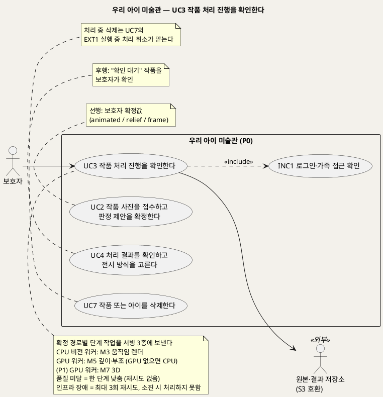

**[「UC3 처리 진행 확인 UseCase Diagram」 PlantUML 뷰어로 열기](https://plantuml.sumzip.com/plantuml/svg/eNqNVN9P02AUfe9fcTNfRiIIDENCkBARjA8aEiTxgYSUrRsNpSVdF2OMySSFTDbjIFQ29iPFDAcGdTJkI-ALf4qP_W7_B-_XdpM9SHxq0-_cc88993ydTBqibqRWFUhFF7WUvhhdlpXYYkJUFEl_tTgYEZIrsrom6uIqLInRlYSupdTYlKZoOtyZicwMTT-8gUguizHtpawmIC4qSUlQpLgBhga6nFg2ICbrUtSQNVUwZEORAPcb7PMJoGVi5QzY9zZmbOcsDb_TuzA_FQGsbrs7GcDTggerm-7Hd1gxwS1aWGm7Vplla4IgRg3SEmLNM7fQxmo-BGISZkVdUo3OGZbyrNm-bjmnDad5BWinsXqIm7kFNTwXASpzi4U-r26O8BKMj2Oxzc7TExOCwCWLaoLkhv6lNzw7SNWvBYBUUoqKSYL-r3yvKYFv1j55NjUE7KDstNqEI9WNNB78INXbTusqqPbqOLC36XC36foJNeTdqAwzBdcqOE17QXVzebQt-lhGK9MRY1s9YoZ7OUc6E_juscOr7gQ-J9omZsvAGseYrXBO-soO238JR3oJRzsiWSHPtnYDPzkvrn8lZT1iRoU3guBvE_r7JzyvuLkDAxPe_DBG25LVqJKKSbQufsRh3h4FQdUMifK3Blo8cNmfl2b5RQ6zpgkse-TQgyTh3oZnmFlmF0WI4KcN3MsD5Yqt82GoeGp2HtiFSQMDlnJ4WRuDp7TnUhrrb7FKXHaOvd8l4GMCdhH3wbnYogmvWxQpPGhA2Dve28TyFTs-46x9VBOeHerrLRyFyCMueSeD9QzPG8uewAMgfzqq2fo3PK9BGKsntAL2wfRoKznOxze0a7IK2Upht2yqxJ9llktDxN3PQbfkLtBNoLAAX6K_atos1tPAvly61pEgqTHgRvpuLmmGoa36hvKkoGlTrsege_8Ci53GDh9KVOVV0ZBicA90SZGlOL3E6Vch9d3CywPjlkyPN-SHDUi4026EguzQogjT7UlXJAjlLayjXG1wGWvbQdh4AOkIKwU6nX7xfIhsqFFjHxKgW0dkEe_B6gdUwMPQbTNJb_T7_AOwhpXh)** — 클릭 시 브라우저로 연결됩니다.

##### 다이어그램 쉽게 읽기 (유저 관점)

- **누가 쓰나** — 보호자가 작품 목록과 상세에서 처리 진행을 본다. 원본·결과 저장소는 원본을 내주고 결과를 보관하는 바깥 저장소다. 그림을 움직이거나 입체로 만드는 모델(M3·M5·M7)은 서비스 안의 부품이라 그림에 사람 모양으로 나오지 않는다.
- **무슨 순서로** — 사진을 올리고 전시 방식을 확정하면(UC2) 뒤에서 처리가 진행된다. 상태가 "확인 대기"로 바뀌면 보호자가 결과를 보러 간다(UC4).
- **«include» = 항상 함께** — 진행을 볼 때마다 "로그인·가족 접근 확인"을 거친다. 내 가족의 작품만 보인다.
- **«extend» = 특정 상황에서만** — 이 UC에는 확장 관계가 없다. 처리 중에 작품을 지우는 경우는 UC7의 "실행 중 처리 취소"가 맡는다.
- **Generalization(◁)** — 없다. 움직임·2.5D·액자·(P1) 3D는 UC를 나누지 않고 흐름 안에서 갈라진다.

| 기호 | 의미 |
|---|---|
| 사람 모양(actor) | 시스템을 쓰는 사람 또는 바깥 시스템(`<<외부>>`) |
| 타원(usecase) | 액터가 이루려는 목표 |
| 사각형(rectangle) | 시스템 경계 |
| 점선 `<<include>>` | 항상 함께 수행되는 하위 행위 |
| 노트 | 규칙·선후 관계 보충 |

#### Actor

| 구분 | 액터 | 이 UC에서의 역할 | 원천 근거 |
|:--:|---|---|---|
| Primary | 보호자 | 작품별 상태와 단계별 진행·낮춤 원인을 확인하고, "확인 대기" 작품을 골라 UC4로 간다. "처리하지 못함"이면 원본 액자로 걸기를 고를 수 있다 | spec FR-4 · FR-23 · Intent [가치제안] "어떤 사진이든 결과가 돌아온다" |
| Secondary | 원본·결과 저장소(S3 호환) | 원본을 읽기 전용으로 내주고, 마스크·깊이·처음 만든 결과·임시 파일을 보관한다 | Intent [핵심 이네이블러] 기반 · 공통 기준 §6 |

[추론] CPU 비전 워커·GPU 워커·모델 M1~M7·작업 DB·큐는 시스템 내부 구성요소라 액터가 아니다(공통 기준 §6). 시퀀스에서만 lifeline으로 나타낸다. LLM 서버(M6)는 이 UC에서 쓰지 않는다.

#### 관련 UseCase

| UC ID | 유스케이스명 | 관계 | 원천 근거 |
|:--:|---|---|---|
| UC3 | 작품 처리 진행을 확인한다 | 본 문서 | spec FR-4 · FR-5 · FR-11 · FR-15 · FR-22 · FR-23 · FR-25 |
| INC1 | 로그인·가족 접근 확인 | UC3이 «include» | 공통 기준 §6 · BR-ACC-01·02 |
| UC2 | 작품 사진을 접수하고 판정 제안을 확정한다 | 선행 (확정값이 처리 경로를 정한다) | spec FR-2 · FR-3 · FR-20 · FR-21 |
| UC4 | 처리 결과를 확인하고 전시 방식을 고른다 | 후행 ("확인 대기" 작품) | spec FR-6 · FR-23 |
| UC7 | 작품 또는 아이를 삭제한다 | EXT1(실행 중 처리 취소)이 이 UC의 단계 작업을 멈춘다 | spec FR-10 · FR-11 |

> **쉽게 말하면** — 사진을 올리고 전시 방식을 고른 뒤에는 기다리지 않아도 됩니다. 나중에 목록을 열면 "작품 잘라 내기 완료, 움직임 만드는 중"처럼 단계별 진행이 보입니다. 움직임이 어려우면 입체 부조로, 그것도 어려우면 원본 액자로 한 단계 낮춰 준비하고 그 사실을 숨기지 않으며, 서버 문제로 끝내 못 만들면 솔직하게 알리고 원본 액자로 걸 수 있게 합니다.

#### 유스케이스 기술

| 속성 | 내용 |
|---|---|
| **ID** | UC3 (spec FR-4, FR-5, FR-11, FR-15, FR-22, FR-23, FR-25) |
| **유스케이스명** | 작품 처리 진행을 확인한다 |
| **액터** | 주: 보호자 · 보조: 원본·결과 저장소 |
| **사전조건** | (1) 보호자가 로그인되어 있고 가족 공간에 접근할 수 있다(INC1). (2) UC2에서 접수된 작품이 1건 이상 있다. (3) 기본흐름 기준 작품은 보호자 확정을 마쳐 상태가 "처리 중"이고, API 서버가 확정값에 따른 단계 작업을 작업 DB·큐에 등록했다(움직임 → CPU 비전 큐, 2.5D·(P1) 3D → GPU 전용 큐, 액자 → 모델 없음). (4) 분리(M1)·판정 단계 작업이 끝나 있어 M1 마스크와 M3 관절 결과(있으면)를 재사용할 수 있다. (5) 원본이 원본·결과 저장소에 있다. (6) 호출할 모델의 활성 버전이 매니페스트에 있다(BR-MDL-01·07) |
| **사후조건** | (1) 작품이 "확인 대기" 또는 "처리하지 못함" 중 하나에 도달한다(처리 중 삭제되면 "삭제 중"). (2) 단계 작업마다 모델 ID·버전·상태·시도 횟수·처리 시간과 낮춤 원인 또는 오류 분류가 기록된다. (3) 결과 종류(움직임/2.5D/액자/(P1) 3D)와 결과 원인 분류(보호자 선택·모델 낮춤·인프라 실패·결과 미도달)가 섞이지 않게 기록된다. (4) 결과물은 처음 만든 것만 저장된다. (5) 임시 파일이 남아 있지 않다. (6) 원본은 변형되지 않았다. (7) 모델 점수는 기록만 되고 화면에 보이지 않는다. (8) 작품은 아직 전시되지 않았다 |
| **기본흐름** | ↓ 별도 기본흐름표 (움직임 확정 · 정상 결과 기준) |
| **대체흐름** | A1 2.5D 부조 확정 경로 · A2 GPU 없음(M5를 CPU로) · A3 움직임 품질 미달 → 2.5D · A4 2.5D 품질 미달 → 액자 · A5 M1 마스크 없음 → 2.5D 건너뛰고 액자 · A6 대기열 대기 · A7 워커 중단 뒤 이어받기 · A8 원본 액자 확정 경로 · A9 확정 전 작품 · A10 (P1) 3D 조각 확정 경로 · A11 보호자 부재 (↓ 별도 대체흐름표) |
| **예외흐름** | 공통: 인프라 장애는 낮춤으로 바꾸지 않고 같은 단계를 최대 3회 시도한다. 소진되면 "처리하지 못함"·결과 미도달로 집계하고 보호자에게 원본 액자로 걸기를 보인다. E1 엔진 다운 · E2 시간 초과 · E3 저장소 장애 · E4 기록(DB) 장애 · E5 모델 미준비 · E6 처리 중 삭제 요청 · E7 임시 파일 잔존 (↓ 별도 예외흐름표) |
| **포함/확장** | «include» INC1 로그인·가족 접근 확인. UC7의 EXT1(실행 중 처리 취소)이 이 UC의 단계 작업을 멈춘다 |
| **우선순위** | High — "어떤 사진이든 결과가 돌아온다"는 서비스 약속과 모델별 낮춤률·결과 미도달 지표가 이 UC의 분류 기록에서 나온다(Intent [미션] 서비스 팀 미션 · [가치제안]) |
| **사용빈도** | 확정 1건당 단계 작업 1~3개(낮춤 체인 길이만큼). 인프라 장애 시 단계당 최대 3회 시도. 보호자의 진행 확인 횟수는 `자료 없음 — 확인 필요` |
| **업무규칙** | BR-INT-04, BR-INT-05, BR-PRC-01, BR-PRC-02, BR-PRC-03, BR-PRC-04, BR-PRC-05, BR-PRC-06, BR-PRC-07, BR-PRC-08, BR-FBK-01, BR-FBK-02, BR-FBK-03, BR-FBK-04, BR-SRV-01, BR-SRV-02, BR-SRV-03, BR-SRV-04, BR-MDL-01, BR-MDL-02, BR-MDL-05, BR-MDL-06, BR-MDL-07, BR-API-01, BR-API-02, BR-APR-01, BR-APR-03, BR-ACC-01, BR-ACC-02, BR-OPS-03, BR-PRV-01 |
| **특별 요구사항** | 성능(잠정): 팀 서버 단일 처리 조건에서 접수부터 확인 대기까지 p95 3분 이내, 원본 액자 경로 p95 30초 이내(spec Success Criteria 기존값, v2.0에서 낮춤 체인 포함 여부 재확인 필요). 1차 개인 PC 실측은 애니메이션 한 장 53~62초(렌더 약 40초)이고, M5·M7의 처리 시간은 미측정이다(U2·U6). 시간 상한: 움직임 렌더 10분(기존값), 다른 단계는 `자료 없음 — 확인 필요`(U6). 서빙: CPU 비전 비동기 큐, GPU 전용 큐(모델 상주), 모델별 동시 처리 상한은 `자료 없음 — 확인 필요`(U6). 보안: 모델 런타임(TorchServe 등) 포트는 내부망에만 두고, 보관 처리된 엔진은 고정 이미지·체크섬으로 격리한다. 개인정보: 운영 로그에 이미지·객체 키·자유 입력·오류 원문을 남기지 않는다. 신뢰성: 결과 미도달 목표 0건. 결과 파일 형식은 U9 |
| **비고** | 원천 추적: Intent [개요] "어느 모델이 실패해도 한 단계 낮춘 결과가 돌아온다" · [핵심 활동] 5 낮춤 체인·인프라 장애는 제한 재시도, 6 서빙 3종 분리 · [핵심 장벽] 서빙 기반(치명)·자원(GPU 미확인)·모델 품질 미측정 · [부정적 영향] 자원 과소비 · [핵심 데이터] 처리 작업(단계 작업별 모델 ID·버전·상태·시도 횟수·처리 시간·낮춤 원인 또는 오류 분류) · spec FR-4(백그라운드 처리·상태 조회) · FR-5(결과 종류 4종 + 낮춤·인프라 실패 분리) · FR-11(임시 파일 정리) · FR-15(시간 상한·대기열) · FR-22(2.5D·마스크 출처) · FR-23(낮춤 체인·원인 기록·표시) · FR-25(서빙 3종) · 공통 기준 §2·§3·§5·§8. 옛 UC10 "모델 API로 그림을 움직이는 작품으로 변환한다"는 없어졌다. 그 워커↔모델 호출과 결과·오류 분류 대응표는 이 UC의 시스템 행위(기본흐름 3~5단계)와 아래 대응표(BR-API-02)로 흡수했고, 외부 클라이언트용 모델 기능 호출은 UC12로 옮겼다. UC10 번호는 이제 "키워드로 작품 설명 초안을 만들고 승인한다"(P0.5)가 쓴다. 옛 BR 대응: BR-ENG-01 → BR-MDL-06, BR-ENG-02 → BR-MDL-01, 옛 UC10의 BR-API-03(결과·오류 분류 1:1) → BR-API-02. 워커와 모델 어댑터 사이 호출 이름·응답 코드는 원천에 없어 [추론]이며 `/speckit.plan`에서 확정한다(U8). 품질 미달 판정 임계값은 `자료 없음 — 확인 필요`(U5). 오인 결과(사물을 움직임으로 만든 경우)는 시스템이 판정하지 못하므로 예외로 두지 않고 UC4의 보호자 확인이 거른다 |

#### 기본흐름 (Basic Flow)

| 단계 | 액터 행위 | 시스템 행위 |
|:--:|---|---|
| 1 | 보호자가 작품 목록을 연다 | `GET /v1/artworks` [통합 D13] 요청에서 INC1로 로그인과 가족 공간을 확인하고, 가족의 작품만 골라 상태("처리 중")와 현재 단계를 보여 준다 |
| 2 | 보호자가 처리 중인 작품의 상세를 연다 | `GET /v1/artworks/{id}`로 단계별 진행(분리 완료 · 판정 완료 · 움직임 렌더 대기)을 보여 준다. 모델 점수는 보이지 않는다 |
| 3 | — (보호자는 화면을 떠나 있어도 된다) | CPU 비전 워커가 CPU 비전 큐에서 움직임 렌더(M3) 단계 작업을 점유한다. 같은 단계는 한 워커만 처리하고, 시도 횟수와 시작 시각을 기록하고, 원본을 읽기만 한다 |
| 4 | — | M3 어댑터가 판정 단계의 관절 결과를 재사용해 리깅·렌더를 한다(시간 상한 10분). 품질 검사를 통과하면 처음 만든 움직임 결과를 원본·결과 저장소에 저장하고, 모델 점수는 기록만 한다 |
| 5 | — | 단계 작업 기록(모델 ID·버전·상태·시도 횟수·처리 시간·응답 분류)을 갱신하고, 결과 종류 "움직임"·원인 "보호자 선택"을 남기고, 임시 파일을 지우고, 작품 상태를 "확인 대기"로 바꾼다 |
| 6 | 보호자가 목록을 다시 연다 | 바뀐 상태 "확인 대기"와 결과 종류, 낮춤이 있었다면 낮춘 단계와 원인을 보여 준다 |
| 7 | 보호자가 확인 대기 작품을 고른다 | 결과 미리보기와 함께 결과 확인 화면(UC4)으로 연결한다 |

#### 대체흐름 (Alternative Flow)

| ID | 조건 | 흐름 |
|:--:|---|---|
| A1 | 2.5D 부조로 확정 | 3~4단계에서 GPU 워커가 GPU 전용 큐의 깊이·부조(M5) 단계 작업을 점유한다. M1 마스크와 M5 깊이로 2.5D 결과를 만들어 저장한다. 원인 = 보호자 선택(spec FR-22) |
| A2 | GPU가 없음 | M5 단계 작업은 CPU 비전 워커가 실행한다. 처리 시간이 늘 수 있고 수치는 미측정이다(U2·U6). M7(3D)은 확정 선택지에 나오지 않는다(BR-SRV-02) |
| A3 | 움직임 렌더 품질 미달(관절·렌더 결과 없음 등) | 재시도하지 않는다. 단계 작업에 낮춤 원인 "움직임→2.5D"와 원인 코드를 기록하고, M1 마스크가 있으면 깊이·부조(M5) 단계 작업을 새로 등록해 A1처럼 진행한다. 결과 원인 = 모델 낮춤. 화면에 "움직임을 만들 수 없어 입체 부조로 준비했어요" [추론 문구]를 보인다(BR-FBK-01·03) |
| A4 | 2.5D 품질 미달 | 재시도하지 않는다. 낮춤 원인 "2.5D→액자"를 기록하고 모델 없이 원본 액자 결과를 만든다 [추론: 액자 합성은 CPU 비전 워커가 맡는다]. 결과 원인 = 모델 낮춤 |
| A5 | M1 마스크 없음(분리 단계 품질 미달) | 2.5D를 건너뛴다. 움직임 확정이면 "움직임→액자", 2.5D 확정이면 "2.5D→액자"로 기록하고 원본 사진 전체로 액자 결과를 만든다(BR-FBK-02) |
| A6 | 모델별 동시 처리 상한 도달 | 단계 작업은 대기열에서 순서를 기다린다. 화면에 "순서를 기다리는 중"을 보인다. 대기 시간도 처리 시간 p95와 큐 적체 지표에 포함한다(BR-PRC-07) |
| A7 | 워커 중도 정지 | 점유 시간이 지나면 다른 워커가 같은 단계 작업을 이어받는다. 이어받기도 시도 횟수에 넣고, 상한을 넘으면 인프라 실패 소진으로 처리한다(BR-PRC-05) |
| A8 | 원본 액자로 확정 | M3·M5를 부르지 않는다(BR-PRC-01). 원본으로 액자 결과를 만들어 저장하고 원인 = 보호자 선택으로 기록한다. 모델 런타임이 멈춰 있어도 이 경로는 "확인 대기"까지 간다 |
| A9 | 확정 전 작품 | 상태가 "접수됨"·"판정 중"·"확정 대기"면 단계 작업을 시작하지 않고, "확정 대기"면 UC2의 확정 화면으로 안내한다. 제안이 늦거나 판정 단계가 실패해도 보호자는 직접 확정할 수 있다(BR-SUG-05 [추론], UC2 소관) |
| A10 | (P1) 3D 조각으로 확정 | GPU 워커가 M7로 GLB를 만든다. 품질 미달이면 "3D→2.5D"로 낮춰 A1로, 그것도 미달이면 액자로 간다(BR-FBK-01). 3D 노출 설정이 꺼져 있으면(기본값, 팀 서버 GPU 확인 전) 이 경로가 화면에 없다(U2) [통합 D10] |
| A11 | 보호자 부재 | 보호자가 화면을 떠나 있어도 처리는 계속된다. 다음에 목록이나 상세를 열 때 바뀐 상태가 보인다 |

#### 예외흐름 (Exception Flow)

공통 규칙(BR-PRC-03): 인프라 장애는 품질 미달로 바꾸지 않는다. 같은 단계 작업을 시도 간격을 늘려 가며 최대 3회까지 시도하고, 그동안 화면에는 "다시 시도하는 중"을 보인다. 소진되면 작품 상태를 "처리하지 못함"으로 바꾸고 결과 미도달로 집계한다. 이 규칙은 결과를 만드는 단계(움직임 렌더·깊이·부조·3D)에 쓰며, 판정 단계 소진은 UC2 E6, 설명 단계 소진은 UC10 E1을 따른다 [통합 D1]. 화면에는 "처리하지 못했어요"와 "원본 액자로 걸기" 선택지를 보인다. 보호자가 이를 고르면 모델 없이 액자 결과를 만들어 UC4로 넘긴다 결정은 `frame`으로 남기되 원인은 인프라 실패·결과 미도달 그대로 두고, 보호자 전환으로 세지 않으며 첫 결과 승인율 분모에서 뺀다(BR-FBK-04, UC4 A5와 같은 기준) [통합 D2].

| ID | 조건 | 처리 | 오류 분류 |
|:--:|---|---|---|
| E1 | 엔진 다운 — 모델 런타임(TorchServe 등)이나 워커가 응답하지 않음 | 공통 규칙대로 재시도 | 엔진 다운 |
| E2 | 시간 초과 — 단계 시간 상한을 넘김(움직임 렌더 10분, 다른 단계 U6) | 해당 시도를 끊고 공통 규칙대로 재시도(BR-PRC-06) | 시간 초과 |
| E3 | 저장소 장애 — 원본을 읽거나 결과·마스크를 쓸 수 없음 | 공통 규칙대로 재시도. 원본까지 읽을 수 없으면 "원본 액자로 걸기"도 비활성화한다 | 저장소 |
| E4 | 기록(DB) 장애 — 단계 작업 기록이나 작품 상태를 갱신할 수 없음 | 공통 규칙대로 재시도. 기록이 안 된 결과는 "확인 대기"로 내보내지 않는다 [추론] | 기록(DB) |
| E5 | 모델 미준비 — `/ready`에서 해당 모델이 준비되지 않았거나 활성 버전이 없음(라이선스 미확인 모델 비활성 포함, BR-MDL-07) | 공통 규칙대로 재시도. 낮춤으로 바꾸지 않는다 | 모델 미준비 |
| E6 | 처리 중 삭제 요청 | UC7의 EXT1(실행 중 처리 취소)이 새 단계 작업 등록을 막고 실행 중인 단계를 멈춘다. 이후 결과 파일을 만들지 않는다(BR-DEL-01). 취소된 단계 작업은 이어받기에서 빼고 "취소"로 분류해 지표에서 뺀다(BR-DEL-05) [통합 D4] | 취소 |
| E7 | 임시 파일 잔존 — 워커 비정상 종료 | 다음 정리 주기에 지운다(BR-PRC-08, spec FR-11) | 해당 없음 |

#### Sequence Diagram

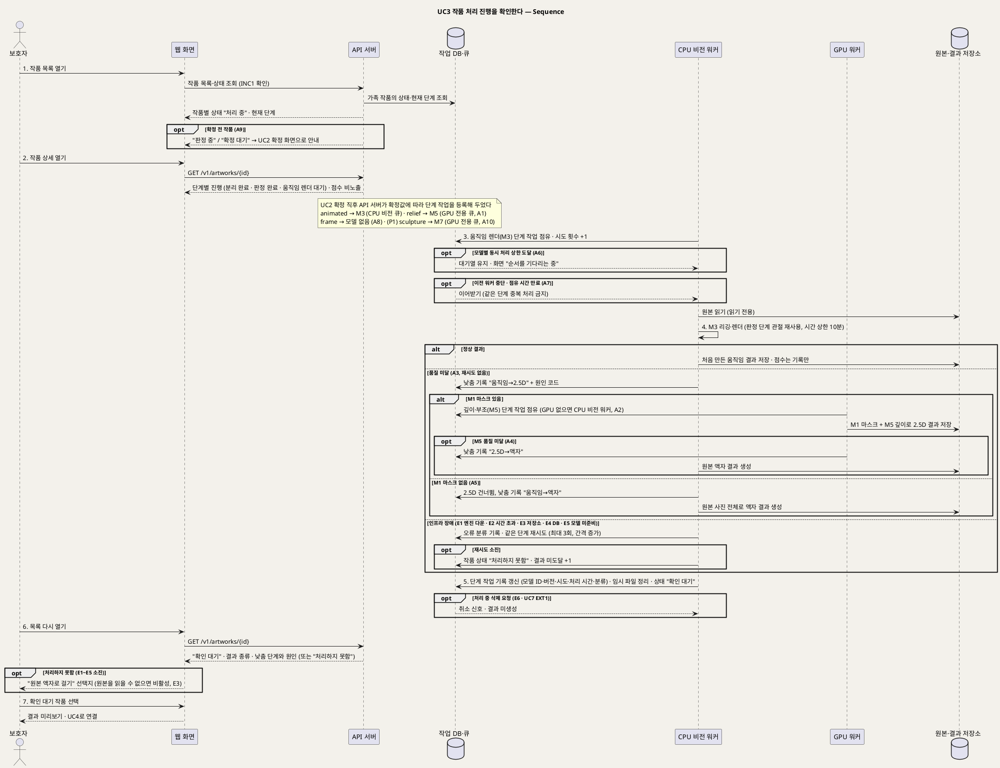

**[「UC3 처리 진행 확인 Sequence」 PlantUML 뷰어로 열기](https://plantuml.sumzip.com/plantuml/svg/eNqdV89PG0cUvu9fMXIvtuKaGENoOVThVyIOVEgJUm9ogzeJFccmtklUVa1MsiA3OIpJ7GDAdk3rBIhIa4wDRiEX_pQcPbP_Q783s2t7DemhF5bdefPme9_73nvj68mUnkgtPYyypPFoPr6UmF-4H4mG5-_p0aiR-Hn-akhLPojEFvWE_pDd0Rce3EvEl2LhiXg0nmDf3AjdCE6N91gk7-vh-JNI7B67q0eThpaKpKIGm5sIMVFZt15lmGgU-bsDJnZN683vomwya7Mgyi2rUOJrNfYlnWe3jEdLRmzB0DR9IYVDPPyoaRVbopLzMD3JZvWEEUtpOC4VWYgs6rEU84jtU_jJ8_2mNJmbdi-PzU4zYZZ4w5TLeNXCekq_oycN7K2si40VNjl-fmItqyMmx937J2bnGD81RdVkYjsrPtWkFb66zW7CrGcdr73HbOf4Uev8pN2ot4_OmKimReWtWM1K01uIE_Gq0Ni3PyACNsqCAYc0_n6f75SZ2Gi2W3UNizChoEbdBucn4tmy9azExE7d2soy7_SPE0GbYJ9GG7Bvchzb2vW02Dm0d4tykamNoKBoisoB42t77SPT9qN2OqjUHk6r6jCPk9LauoednzCXCy2-mJIIqgUm-VN4vWPf-zTGXI49VjYnzcjPAF7VLp5NI2gP-7L6CjoadJypdIvSGd9BvIUMf9rUjFj4AomDHRIBV5ity0i8OXWbDTwODiCZT-KJB8mBXyLhX91Rq2hk1FK5zMuPTRn1psn_ysq4bfidD2I7LXaXRcVkvJrlL_J2KD65Vs2JTJFUxVda4rikabF4ymDxx0aCQPlJg6w3Xniytk3WlTJSaK-166_ERo7xfJ2Xzzqpk7KmAuOvD6ENq9BkfD0nNjKoM7jWY5GHesoIS15nQszbI3LUgQSZMKIR466yGGZeqe-qKbb2ycLPxoKUw7soe0Pa8Pd7_AURvCrKEN_Yd9KJdzboY8mFpehiaimhDGdGLnN21UcJZMSDphEaR6yhwAUqvTMhnztSyWipKrldK_GXiGLrD6L4SlBqUIGjBPKXm7DoNCKIuFDCR5OvHQD0NYoJx1LmCcSonTXIhsG_2E3LXEv1QfqZEmXj7RmDCYiFR_48LyUs1Ugni3Kz2zloCbgdCQAwsLTrQLWbJdl4x0YuACAHb5q8vo0zmLdd3xTldCd4uDv66ATTbmUAUPLoMChbCzmR_Qe-Pksv9lNlwNfhWx04FCBFwGH7dOX8xBav19a3fXC7mRZVFFXlQDw9gA-_E4hNaPAqCsSn6VEQUC3gI1OdD8H1I2sUSS9EwOtqT6ZdnbJbM8Qvkb1Txg7NwJBh1MN20QT_aakchvwSl5KBkqOve67UFH_6tziu2Y6oO9unQp6DgeFJD7tCjKFvMvE5z1-XqGIQykwQODPiec1ahnQqaJ1ZrDDq9d3eevocGQNvx-ixde_M8FeUqkoA6NDDoKULQwY1Mejr9e4Q5gJxhUpTHUmdkMC7mZMeSIew6ydqSPl34--jhjyCFVHYoQls239FXNKmc_yzsjAP5QbSI_5SrtwMOq1iWAHpzZCK5LDJzQwvpf3_lbFebF9BBo3umlLujaaaGJdCJaASJl1J8ib1UxrTBWRrKgi4efKCOhdbTVLk1GBH9c0MOaJvoe5wl-9DFA_9M-x0SPAvamkku1-VoljjbzEVMFrwsEPF1r6a72jbKz6W0J5YCFPaDyuz3dhn4l0Zs4Fcy-7TLYTVLNBf4Lk7HXuGuVUoUqfj7z9ZhT051W2mSDqqVaKv2nzR1O31OBzoE7wdSLt-KNbApM3C9CRqpEGCx71FQsTTbsqSVCohIkINzIpJXdvKZgUlpVogO_pu41a3HOe2oBpv516C_H8QVWR9Ky8aH5DLa7R1bmKETf10O3ix4Z7sUfIAFvdOd_C2Ui67aVwLOPc0EghNmP910-iLpOd48ecKyQIf7FpQLIvNtNOrvLyYo_54aRZ9PaS4Vkjbv0GdSiDExpzCYwc46txe7aqh-mkftiQ6YVYtUAJfXmVDNw4MF_nA9O32N8jd2sS0PPSjRHyXMjgSYK7gO9qUh2j9qHokibF7RGSrtA7JCt-ow0C7joPw6-ZfrqxY0w==)** — 클릭 시 브라우저로 연결됩니다.

기본흐름 1~7단계는 시퀀스의 번호 붙은 주요 메시지 `1.`~`7.`과 1:1로 대응한다. 등록 노트는 UC2 확정 직후의 상태를 보여 준다. 대체흐름 A2~A7·A9와 예외흐름 E1~E6은 `alt`/`opt` 프래그먼트로 표시했다. A1·A8·A10은 등록 노트에서 경로만 가리켰고, E7(임시 파일 주기 정리)은 이 요청 흐름 밖의 주기 작업이라 시퀀스에 넣지 않았다.

#### 단계 작업 응답 분류 ↔ 작업 기록 분류 대응표 (BR-API-02)

워커가 모델 어댑터에서 받은 응답을 단계 작업 기록과 작품 상태로 옮기는 규칙이다. 응답 코드 이름은 [추론]이며 `/speckit.plan`에서 OpenAPI로 확정한다(U8). 품질 미달은 오류 코드로 돌려주지 않는다.

| 어댑터 응답 [추론] | 단계 작업 기록 | 낮춤 원인 / 오류 분류 | 다음 행동 | 결과 원인 분류 (BR-FBK-04) | 작품 상태 |
|---|---|---|---|---|---|
| `done` · `ok` | 완료 | — | 결과 저장 → 확인 대기 | 보호자 선택 (낮춤이 앞서 있었으면 모델 낮춤 유지) | 확인 대기 |
| `done` · `quality_below` (M3) | 완료(낮춤) | 낮춤 "움직임→2.5D" + 원인 코드 | M1 마스크 있으면 M5 등록, 없으면 액자 | 모델 낮춤 | 처리 중 |
| `done` · `quality_below` (M5) | 완료(낮춤) | 낮춤 "2.5D→액자" + 원인 코드 | 액자 결과 생성 | 모델 낮춤 | 처리 중 → 확인 대기 |
| `done` · `quality_below` (P1 M7) | 완료(낮춤) | 낮춤 "3D→2.5D" + 원인 코드 | M5 등록(마스크 없으면 액자) | 모델 낮춤 | 처리 중 |
| `done` · `quality_below` (M1, 판정 단계에서 기록) | 완료(낮춤) | 마스크 없음 | 2.5D 건너뜀 | 모델 낮춤 | 처리 중 |
| `failed` · `engine_down` | 재시도 대기 | 엔진 다운 | 같은 단계 재시도(최대 3회) | 인프라 실패(재시도 중) | 처리 중 |
| `failed` · `timeout` | 재시도 대기 | 시간 초과 | 같은 단계 재시도 | 인프라 실패(재시도 중) | 처리 중 |
| `failed` · `storage` | 재시도 대기 | 저장소 | 같은 단계 재시도 | 인프라 실패(재시도 중) | 처리 중 |
| (워커 감지) DB 갱신 실패 | 재시도 대기 | 기록(DB) | 같은 단계 재시도 | 인프라 실패(재시도 중) | 처리 중 |
| `failed` · `model_not_ready` | 재시도 대기 | 모델 미준비 | 같은 단계 재시도 | 인프라 실패(재시도 중) | 처리 중 |
| 인프라 실패 3회 소진 | 실패 | 마지막 오류 분류 유지 | 원본 액자로 걸기 선택지 표시 | 결과 미도달 | 처리하지 못함 |
| `cancelled` (UC7 EXT1) | 취소 | 취소 | 결과 미생성, 임시 파일 정리 | 집계 제외(BR-DEL-05) [통합 D4] | 삭제 중 |

`failed` · `invalid_input`(입력 형식 오류)은 원천의 오류 분류 5종(엔진 다운·시간 초과·저장소·DB·모델 미준비)에 없다. UC2 검사를 통과한 원본이면 일어나지 않아야 하므로 분류와 처리는 `자료 없음 — 확인 필요`로 두고 미해결 U18로 올린다 [통합 D15].

#### UML 노트

| 항목 | 적용 |
|---|---|
| 주액터 선정 | 처리 자체는 시스템이 하지만 이 UC가 이루는 액터 목표는 보호자의 "진행 확인"이다. 기본흐름 1·2·6·7단계에 액터 행위가 있다 |
| 외부 구성요소 | 원본·결과 저장소만 Secondary actor(`<<외부>>`)로 경계 밖에 뒀다 |
| 내부 구성요소 | 모델 M1~M7은 시스템 내부 구성요소라 UseCase Diagram에 액터로 두지 않고, 시퀀스에서 서빙군 lifeline(CPU 비전 워커 / GPU 워커)으로만 나타냈다. 메시지에 모델 ID를 적었다 |
| 옛 UC10 흡수 | 옛 UC10은 모델 API 서버를 경계로 따로 잡았다. 새 기준에서는 모델이 내부 구성요소이므로 별도 UC를 두지 않고 이 UC의 시스템 행위로 옮겼다 |
| 분기 | 결과(정상·품질 미달·인프라 장애)는 `alt`, 낮춤 안의 마스크 유무는 중첩 `alt`, 조건부 상황은 `opt`로 표현하고 A·E 번호를 붙였다 |
| 최종 상태 | 사후조건에 "확인 대기 / 처리하지 못함" 두 처리 종료 상태를 적었다 |

---

### 7.4 UC4 처리 결과를 확인하고 전시 방식을 고른다

#### 범위·개요

모든 결과는 **보호자가 확인해야만 전시된다.** 모델 조합은 판정을 제안까지만 하고, 움직임·2.5D 부조가 어색하게 나올 수 있다(1차 시험: 엔진이 집 그림에 사람 점수 0.946을 줬다). 이 UC는 그런 결과가 걸러지는 마지막 관문이다. 보호자는 "확인 대기" 작품의 **원본과 결과를 나란히** 보고, 모델이 품질 미달로 결과를 낮췄다면 **어느 단계에서 어디로 낮췄는지** 문구로 본다. 실패를 성공처럼 꾸미지 않는다(BR-FBK-03). 점수는 보이지 않는다.

보호자에게 보이는 선택지(BR-APR-02)는 결과 종류에 따라 다르다. 결정은 `POST /v1/artworks/{id}/decision` 한 번으로 보낸다(`like` / `use_lower` / `frame` / `retake`).

| 지금 결과 | 보이는 선택지 | 비고 |
|---|---|---|
| 움직임 | **좋아요** / **낮춘 결과로 걸기**(2.5D) / **액자로 걸기** / **다시 찍기** | "낮춘 결과로 걸기"는 M1 작품 마스크가 있을 때만 보인다 [추론] |
| 2.5D 부조 (보호자 선택 또는 모델 낮춤) | **좋아요** / **액자로 걸기** / **다시 찍기** | 2.5D 아래 단계는 액자뿐이라 "낮춘 결과로 걸기"를 따로 두지 않는다 [추론] |
| 원본 액자 (보호자 선택 또는 모델 낮춤) | **좋아요(이대로 걸기)** / **다시 찍기** | |
| (P1) 3D 조각 | **좋아요** / **낮춘 결과로 걸기**(2.5D) / **액자로 걸기** / **다시 찍기** | 3D 노출 설정(기본 꺼짐)이 켜졌을 때만 보인다(U2) [통합 D10]. "뒷면은 AI가 추정했어요" 표시 |
| 처리하지 못함 (인프라 재시도 소진) | **액자로 걸기** / **다시 찍기** | 원본이 있으므로 모델 없이 원본 액자로 걸 수 있다 |

결정은 원인 5분류(보호자 선택 · 모델 낮춤 · 보호자 전환 · 인프라 실패 · 결과 미도달)와 섞이지 않게 기록한다. 결과 확인에서 다른 결과로 바꾸면 **보호자 전환**이다(BR-APR-04). 첫 결정은 서빙 지표 **첫 결과 승인율 = 좋아요 / 결과가 도달한 작품의 첫 결정**(Intent [미션], BR-OPS-02)의 원천이 된다 [통합 D14]. 승인된 작품은 필수 이야기가 채워지면 가족 전시(UC6)에 걸린다. 이야기 입력은 UC5에서 다룬다.

| 항목 | 값 |
|---|---|
| 대상 시스템 | 우리 아이 미술관 (P0, 3D 조각 결과 확인만 P1) |
| 상위 프로세스 | 접수·확정(UC2) → 처리 진행(UC3) → **결과 확인·승인(UC4)** → 이야기(UC5) → 전시(UC6) |
| 원천 근거 | spec v2.0 FR-6 · FR-23 · Intent [핵심 활동] 5 · [미션] 서빙 지표 · [가치제안] "실패를 성공처럼 꾸미지 않고" · [부정적 영향] "어색하거나 왜곡된 결과" |
| 핵심 UseCase | 1개 (UC4) + 공통 1개 (INC1) + 확장 1개 (EXT2: UC2 ··> UC4) |
| 주요 액터 | 보호자 · 원본·결과 저장소(보조) |
| 엔드포인트 [추론] | `GET /v1/artworks/{id}` (결과·낮춤 표시 조회) · `POST /v1/artworks/{id}/decision` (결정) — 이름·형식은 `/speckit.plan`에서 확정(U8) |

#### UseCase Diagram

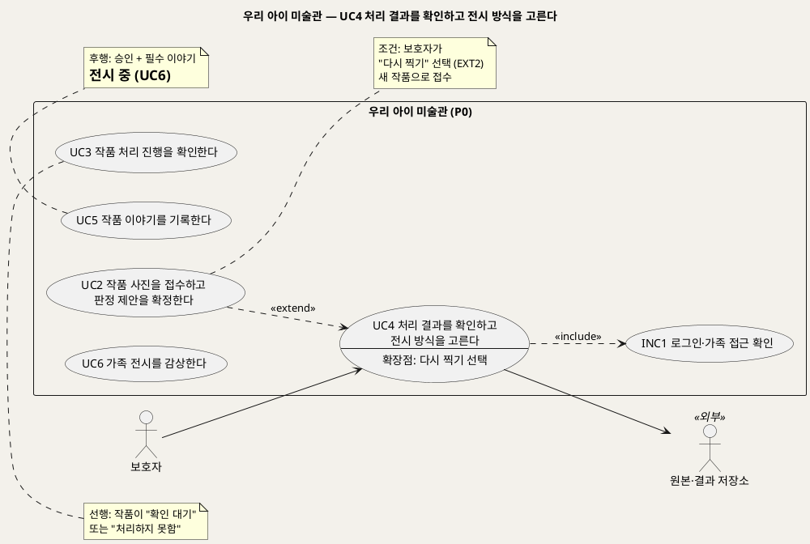

**[「UC4 결과 확인·승인 UseCase Diagram」 PlantUML 뷰어로 열기](https://plantuml.sumzip.com/plantuml/svg/eNqFVF1L22AUvs-vOGQ3yqj4fSGuyERhN0PYBrsolJjGGoyJJG_Zxhhks4z6MajDSJ2NpKBzG8KiLTNjvdpP2WVy8h923qRRM5BdtbzneZ7znOecds5ikslq6xrU5LJRM8vyqqpVylVJ0xTzVXl0UrDWVH1DMqV1WJbktapp1PTKvKEZJtxbnFgcW3h4C2GtShXjhapXYUXSLEXQlBUGzABTra4yqKimIjPV0AWmMk0B_ORHn88BnTq6PYi-B9jwwp4Nf-x9eDY_CXjZ4vXw0g-7_ei0D_Ghg24QO62w6wF6ddxpQ-R_xR0X3TrQY3QaRDsngiDJjPyJUbcXtwI8boogWbAkmYrOshoeNaNu8PsqVSc1G49P8f1uAn1CEAVmZ_EwiH7YxaIgcOeSXiXX4l22h5ZGh0V4LQDULEWWLIL-d4qSfvcYJb1QKOkcTca85gzQG4ei_yEMfMC6F2-6iV1qc7vro8fzYxB12uFVQI1oRN_GzgWNuBdeZe0THgfm7Y4DHu_FHxuA787xrM79EA0brcxuvNtEz6HHNjoNXuZynhM7bXI3MDOe15y41kyTIN34YCvj8iRucSfy3KlrrttDp09z8wT5R8fN8abyvGm4HprHm5D8Jm6-zZGmhTeCkJ4FFArFJEe-spGRYpINzNANqLqs1SoKHQGPh5c4hFeUl0zRK0lhMuEnZyMIusGUwckbK4M8sOOHFz3aYXaS5I-exdxOxcFSYWjh-dPxYU7bbAwSwHafVjrYhkB9gbdJezFjI-3E0-MSB1szGY1OVExzhmjX5k0IE7Wa0fY-nXKyEdotntkQffsVO1_Ef7SXDcaM9VSehxwf1VP57Z9c8z7E9DtotG4WRJgH2Y8TT_ZgiHIevhGdo2_0d_MXv00n5Q==)** — 클릭 시 브라우저로 연결됩니다.

##### 다이어그램 쉽게 읽기 (유저 관점)

- **누가 쓰나** — 보호자가 결과를 보고 고른다. 원본·결과 저장소는 원본 사진과 결과 미리보기를 꺼내 주는 외부 구성요소다. 모델(M1~M7)은 시스템 안쪽 부품이라 여기엔 그리지 않는다.
- **무슨 순서로** — 처리 진행(UC3)이 끝나 "확인 대기"가 되면 → 원본과 결과를 나란히 보고 → 좋아요 / 낮춘 결과로 걸기 / 액자로 걸기 / 다시 찍기 중 하나를 고르고 → 이야기를 채우면(UC5) → 가족 전시에 걸린다(UC6).
- **«include» = 항상 함께** — 결과를 볼 때마다 "로그인·가족 접근 확인"을 거친다. 다른 가족의 작품은 열리지 않는다.
- **«extend» = 특정 상황에서만** — "다시 찍기"를 고를 때만 사진 접수(UC2)가 끼어들어 새 사진을 새 작품으로 받는다.
- **Generalization(◁)** — 없다. 결과 종류(움직임·2.5D·액자·P1 3D·처리하지 못함)별 선택지는 같은 목표의 변형이라 대체흐름으로 다룬다.

| 기호 | 의미 |
|---|---|
| 사람 모양(actor) | 시스템을 쓰는 사람 또는 외부 구성요소(`<<외부>>`) |
| 타원(usecase) | 액터가 이루려는 목표. `--` 아래는 확장점 |
| 사각형(rectangle) | 시스템 경계 |
| 실선 | 액터와 UC의 연결 |
| 점선 `<<include>>` | 항상 함께 수행되는 하위 행위 (UC4 → INC1) |
| 점선 `<<extend>>` | 확장점 조건일 때만 끼어드는 행위 (UC2 → UC4) |
| note | 선행·후행 조건과 확장 조건 |

#### Actor

| 구분 | 액터 | 이 UC에서의 역할 | 원천 근거 |
|:--:|---|---|---|
| Primary | 보호자 | 원본과 결과를 비교하고 좋아요 / 낮춘 결과로 걸기 / 액자로 걸기 / 다시 찍기를 고른다 | spec FR-6 · Intent [핵심 활동] 5 |
| Secondary | 원본·결과 저장소(S3 호환) | 원본, 결과 미리보기(움직임·2.5D·P1 GLB), 작품 마스크를 제공한다 | Intent [핵심 이네이블러] 기반 · 공통 기준 §6 |

GPU 워커(M5 · P1 M7)는 "낮춘 결과로 걸기"로 2.5D를 새로 만들 때만 시퀀스에 나온다. 시스템 내부 구성요소라 액터로 두지 않는다(공통 기준 §6).

#### 관련 UseCase

| UC ID | 유스케이스명 | 관계 | 원천 근거 |
|:--:|---|---|---|
| UC4 | 처리 결과를 확인하고 전시 방식을 고른다 | 본 문서 | spec FR-6 · FR-23 |
| INC1 | 로그인·가족 접근 확인 | UC4가 «include» | 공통 기준 §6 · BR-ACC-01·02 |
| UC2 | 작품 사진을 접수하고 판정 제안을 확정한다 | UC4를 «extend» (EXT2, 확장점: "다시 찍기" 선택) | spec FR-6 · BR-APR-03 |
| UC3 | 작품 처리 진행을 확인한다 | 선행 (확인 대기 · 처리하지 못함을 만든다) | spec FR-5 · FR-23 |
| UC5 | 작품 이야기를 기록한다 | 후행 (전시 조건) | spec FR-7 · BR-EXH-01 |
| UC6 | 가족 전시를 감상한다 | 후행 | spec FR-8 |
| UC8 | 서비스 상태와 모델별 운영 지표를 확인한다 | 지표 소비 (첫 결과 승인율 · 원인별 집계) | spec FR-13 · FR-26 · BR-OPS-02·03 |

> **쉽게 말하면** — 결과가 준비되면 보호자가 먼저 봅니다. 원본 옆에 결과가 나란히 놓이고, 모델이 한 단계 낮춘 결과라면 "움직임이 어려워 입체 부조로 만들었어요"처럼 솔직하게 알려 줍니다. 마음에 들면 "좋아요", 움직임이 어색하면 "낮춘 결과로 걸기"나 "액자로 걸기", 사진이 흐리면 "다시 찍기"를 누릅니다. 보호자가 고르기 전에는 가족 전시에 아무것도 걸리지 않습니다.

#### 유스케이스 기술

| 속성 | 내용 |
|---|---|
| **ID** | UC4 (spec v2.0 FR-6 · FR-23) |
| **유스케이스명** | 처리 결과를 확인하고 전시 방식을 고른다 |
| **액터** | 주: 보호자 · 보조: 원본·결과 저장소 |
| **사전조건** | (1) 보호자가 로그인되어 있고 작품이 보호자 가족 공간에 속한다(INC1). (2) 작품 상태가 "확인 대기"(결과 도달) 또는 "처리하지 못함"(인프라 재시도 소진)이다(UC3). (3) 작품에 아직 결정이 기록되지 않았다. (4) 작품이 "삭제 중"이 아니다. (5) 원본은 원본·결과 저장소에 올린 그대로 있다(BR-INT-04) |
| **사후조건** | (1) 결정(`like` / `use_lower` / `frame` / `retake`)이 작품과 해당 단계 작업의 결과 종류·낮춤 원인에 연결되어 한 번만 기록된다. 결과 확인에서 다른 결과로 바꾼 결정은 "보호자 전환"으로 기록되고, 모델 낮춤·인프라 실패 원인은 덮어쓰지 않는다(BR-APR-04 · BR-FBK-04). (2) `like` / `frame`(또는 이미 있는 낮춘 결과로 `use_lower`)이면 상태가 "승인됨"이 되고, 필수 이야기가 채워져 있으면 "전시 중"이 된다. 비어 있으면 승인만 기록되고 전시는 보류된다(BR-EXH-01). (3) `use_lower`로 낮춘 결과를 새로 만들어야 하면 깊이·부조 단계 작업이 등록되고 상태가 "처리 중"으로 돌아간다 [추론]. (4) `retake`이면 이 작품은 전시되지 않고 삭제 규칙에 따라 정리되며(BR-APR-05), UC2가 새 작품 접수를 시작한다. (5) 원본은 바뀌지 않고, 처음 만든 결과는 보관된다(BR-APR-03). (6) 첫 결정이 첫 결과 승인율 집계 이벤트로 남는다(BR-OPS-02). 승인 전에는 어디에도 전시되지 않는다(BR-APR-01) |
| **기본흐름** | ↓ 별도 기본흐름표 (결과 = 움직임, 낮춤 없음, "좋아요" 기준) |
| **대체흐름** | ↓ 별도 대체흐름표 A1~A8 — A1 낮춘 결과로 걸기 · A2 액자로 걸기(전환) · A3 이미 낮춰진 결과 · A4 원본 액자 결과 · A5 처리하지 못함 · A6 다시 찍기(EXT2) · A7 이야기가 이미 채워짐 · A8 (P1) 3D 조각 결과 |
| **예외흐름** | ↓ 별도 예외흐름표 E1~E7 — E1 원본 읽기 불가 · E2 결과 미리보기 불러오기 실패 · E3 결정 기록 저장 실패 · E4 삭제 중인 작품 · E5 로그인 만료·가족 불일치 · E6 낮춘 결과 생성 실패 · E7 중복 결정 |
| **포함/확장** | «include» INC1 로그인·가족 접근 확인 · «extend» UC2가 이 UC를 확장(EXT2, 확장점: 보호자가 "다시 찍기" 선택) |
| **우선순위** | High — "승인 전 전시하지 않는다"는 Intent [부정적 영향] "어색하거나 왜곡된 결과"의 핵심 통제이며, 판정 정확도 미측정(Intent [핵심 장벽] 상 — 판정 정확도)으로 생긴 어색한 결과를 거르는 유일한 관문이다 |
| **사용빈도** | 결과가 도달했거나 처리하지 못한 작품 1건당 첫 결정 1회. "낮춘 결과로 걸기"로 2.5D를 새로 만든 작품은 1회 더 확인한다. 가족당·월간 건수는 `자료 없음 — 확인 필요` |
| **업무규칙** | BR-APR-01, BR-APR-02, BR-APR-03, BR-APR-04, BR-APR-05, BR-APR-06 [통합 D11], BR-EXH-07 [통합 D3], BR-DEL-05 [통합 D4], BR-FBK-01, BR-FBK-02, BR-FBK-03, BR-FBK-04, BR-PRC-02, BR-PRC-03, BR-PRC-04, BR-SRV-02, BR-EXH-01, BR-EXH-03, BR-EXH-04, BR-EXH-06, BR-INT-04, BR-OPS-02, BR-OPS-03, BR-ACC-01, BR-ACC-02, BR-PRV-01 |
| **특별 요구사항** | 표현: 결과 옆에 원본을 늘 함께 보인다. 모델 점수·판정 점수를 보이지 않는다(BR-PRC-04). 낮춤 문구는 "어느 단계에서 어디로"를 담는다 — 예: "움직임을 만들기 어려워 입체 부조로 바꿨어요", "입체 부조가 어려워 원본 액자로 걸었어요" [추론 문구, U10과 함께 확정]. 원본 액자·2.5D에 "실패" 딱지를 붙이지 않고 완성된 작품으로 대한다(BR-EXH-04). 재생: 움직임 재생·2.5D 시차 효과·(P1) 회전은 보호자가 누를 때만 하고 정지할 수 있다. 자동 재생 없음(BR-EXH-03). 사용성: 처리 대기를 빼고 작품 한 점 올리기·확인·이야기 입력까지 3분 이내(spec v1.0 Success Criteria "부모 조작 시간", 잠정 — v2.0 확인 필요). 전환은 한 번 누르면 끝난다. 무결성: 결정은 작품당 한 번만 반영한다(E7). 개인정보: 로그에는 결정 코드·원인 분류만 남기고 이미지·객체 키·자유 입력은 남기지 않는다(BR-PRV-01). 결과 파일 형식(GIF/MP4/깊이맵+셰이더)은 U9 |
| **비고** | 원천 추적: Intent-Specify [핵심 활동] 5 "인프라 장애는 낮춤이 아니라 제한 재시도" · [미션] 서빙 지표 "첫 결과 승인율 = 좋아요 / 결과 확인 건" · [가치제안] "실패를 성공처럼 꾸미지 않고, 어떤 단계로 낮췄는지 기록한다", "재생·시차 효과는 보호자가 고를 때만" · [부정적 영향] "어색하거나 왜곡된 결과: 승인 전 전시하지 않고, 낮춘 결과·원본 액자·재촬영을 고를 수 있다", "3D의 추정 면(P1)" · [핵심 데이터] 작품 "낮춤 원인·보호자 결정·승인 시각" · spec v2.0 FR-6(결과 확인·승인) · FR-23(낮춤 체인·원인 기록·표시) · 관련 FR-13·FR-26(지표) · FR-22(2.5D) · FR-29(P1 3D) · 공통 기준 §4(엔드포인트) · §5(상태 모델·낮춤 체인·원인 5분류) · §8(BR). 추가 요구 R1~R4는 이 UC에 직접 걸리지 않는다(모델 호출은 UC3 계약을 따른다). [추론] 판단: (a) "낮춘 결과로 걸기"는 지금 결과가 움직임(또는 P1 3D)이고 M1 작품 마스크가 있을 때만 보인다. 기본 처리 흐름은 움직임이 성공하면 2.5D를 미리 만들지 않으므로(낮춤 체인은 품질 미달일 때만 내려간다, BR-FBK-01) 대부분 새로 만들어야 한다. 이때 원본과 M1 마스크를 재사용해 깊이·부조 단계 작업(M5)을 새로 등록하고, 처음 만든 움직임 결과는 지우지 않고 보관한다. 새 사진을 요구하지 않는다. 2.5D를 미리 만들어 두는 안은 GPU 유무(U2)·처리 시간(U6)이 정해진 뒤 다시 검토한다. (b) 지금 결과가 2.5D면 아래 단계는 액자뿐이라 "낮춘 결과로 걸기"를 "액자로 걸기"로 합친다. (c) 지금 결과가 원본 액자면 "좋아요(이대로 걸기)"를 `like`로 기록한다 — 전환이 아니므로 원인은 보호자 선택 또는 모델 낮춤 그대로다. (d) "처리하지 못함"에서 "액자로 걸기"는 결정 `frame`으로 남기되 원인은 인프라 실패·결과 미도달 그대로 두고 보호자 전환으로 세지 않는다(BR-FBK-04). 옛 판의 미결("실패 건 액자 = 부모 선택?")은 이 판단으로 대신한다. (e) 첫 결과 승인율의 "결과 확인 건"은 결과가 도달한 작품의 첫 결정(`like`·`use_lower`·`frame`·`retake`)이며 "처리하지 못함"은 제외한다. `use_lower` 뒤의 두 번째 확인은 첫 결과로 세지 않는다. (f) 다시 찍기로 닫힌 작품은 별도 상태를 두지 않고 "삭제 중"으로 넘긴다(공통 기준 §5 상태 모델에 "다시 찍기로 닫힘"이 없음). 옛 BR 대응: 옛 BR-APR-04 "액자 전환 = 부모 선택"은 새 BR-APR-04 "보호자 전환"으로 바뀌었다. 관련 미해결: U8(엔드포인트·응답 형식), U9(결과 파일 형식), U10(문구), U2·U6(2.5D 생성 시간) |

#### 기본흐름 (Basic Flow)

| 단계 | 액터 행위 | 시스템 행위 |
|:--:|---|---|
| 1 | 보호자가 처리 진행(UC3) 목록이나 알림에서 "확인 대기" 작품을 연다 | `GET /v1/artworks/{id}`로 INC1 가족 접근을 확인하고, 작업 DB에서 상태·결과 종류·단계 작업의 낮춤 원인을 읽는다. 원본·결과 저장소에서 원본과 결과 미리보기를 불러와 나란히, 정지 상태로 보여 준다 |
| 2 | 보호자가 결과 안내 문구와 선택지를 읽는다 | 결과 종류와 낮춤 여부를 문구로만 보여 준다(여기서는 "움직이는 그림으로 만들었어요"). 점수는 보이지 않는다. 결과 종류에 맞는 선택지 — 좋아요 / 낮춘 결과로 걸기 / 액자로 걸기 / 다시 찍기 — 를 보여 준다(BR-APR-02) |
| 3 | 보호자가 "재생"을 눌러 움직임을 보고 원본과 비교한다 | 누를 때만 재생하고 언제든 정지할 수 있게 한다. 원본은 옆에 그대로 둔다(BR-EXH-03) |
| 4 | 보호자가 "좋아요"를 누른다 | 웹 화면이 `POST /v1/artworks/{id}/decision` (`like`)을 보낸다. API 서버가 상태·가족·중복 결정을 확인하고, 결정·원인 분류(원래 원인 유지)·첫 결정 여부·승인 시각을 한 트랜잭션으로 기록한 뒤 상태를 "승인됨"으로 바꾼다. 첫 결과 승인율 집계 이벤트를 남긴다(BR-OPS-02) |
| 5 | 보호자가 안내를 보고 이야기 입력(UC5)으로 가거나 전시를 확인한다 | 필수 이야기(제목·제작일·제작 당시 연령)가 채워졌는지 확인한다. 비어 있으면 "이야기를 채우면 전시돼요"라고 안내하고 UC5로 연결한다. 채워져 있으면 상태를 "전시 중"으로 바꾼다(BR-EXH-01) |

#### 대체흐름 (Alternative Flow)

| ID | 분기 지점 | 흐름 |
|:--:|:--:|---|
| A1 | 4단계 | **낮춘 결과로 걸기** — 지금 결과가 움직임이고 M1 마스크가 있을 때 보호자가 "낮춘 결과로 걸기"를 누른다(`use_lower`). 결정을 "보호자 전환(움직임 → 2.5D)"으로 기록한다(BR-APR-04). 2.5D 결과가 이미 있으면 바로 "승인됨"이 되고 5단계로 간다. 없으면 [추론] 원본과 M1 마스크로 깊이·부조 단계 작업(M5)을 GPU 워커 전용 큐에 등록하고 상태를 "처리 중"으로 바꾼다(GPU가 없으면 M5를 CPU에서 실행, BR-SRV-02). 처음 만든 움직임 결과는 보관한다(BR-APR-03). 2.5D를 새로 만드는 것은 다른 결과 종류를 만드는 것이라 재생성 금지에 걸리지 않는다(BR-APR-06) [통합 D11]. 2.5D가 도달하면 다시 "확인 대기"가 되고, 보호자는 1단계부터 2.5D 결과를 확인한다. 이 두 번째 확인은 첫 결과 승인율에 세지 않는다 |
| A2 | 4단계 | **액자로 걸기(전환)** — 지금 결과가 움직임·2.5D·(P1) 3D일 때 보호자가 "액자로 걸기"를 누른다(`frame`). 모델을 부르지 않고 원본을 액자로 승인한다. 결정을 "보호자 전환(… → 액자)"으로 기록하고, 만든 결과는 전시하지 않되 보관한다. 5단계로 간다 |
| A3 | 2단계 | **이미 낮춰진 결과** — 처리 중 품질 미달로 낮춤 체인이 동작했으면(BR-PRC-02 · BR-FBK-01) 단계 작업의 낮춤 원인을 읽어 "움직임을 만들기 어려워 입체 부조로 바꿨어요"처럼 **어느 단계에서 어디로** 낮췄는지 보여 준다(BR-FBK-03). M1 분리가 품질 미달이라 2.5D를 건너뛰고 원본 액자가 된 경우도 그대로 알린다(BR-FBK-02). 선택지는 지금 결과 종류를 따른다. "좋아요"를 누르면 원인은 "모델 낮춤" 그대로 두고 보호자 전환으로 세지 않는다 |
| A4 | 2단계 | **원본 액자 결과** — 확정 때 보호자가 액자를 골랐거나(보호자 선택) 모델 낮춤으로 액자가 된 경우 선택지는 "좋아요(이대로 걸기) / 다시 찍기"다. "좋아요"는 `like`로 기록하고 원인은 바꾸지 않는다 [추론] |
| A5 | 1단계 | **처리하지 못함** — 인프라 장애로 같은 단계를 3회 재시도하고도 소진된 작품(BR-PRC-03)이면 "처리하지 못했어요"와 함께 "액자로 걸기 / 다시 찍기"만 보여 준다. 결과를 꾸며 보이지 않는다. "액자로 걸기"는 모델 없이 원본으로 승인하고 `frame`으로 기록하되, 원인은 인프라 실패·결과 미도달 그대로 둔다(BR-FBK-04). 첫 결과 승인율 분모에서 빼고 보호자 전환으로 세지 않는다 [통합 D2] |
| A6 | 4단계 | **다시 찍기 (EXT2)** — 보호자가 "다시 찍기"를 누르면(`retake`) 결정을 기록하고, 이 작품은 전시하지 않은 채 "삭제 중"으로 넘겨 삭제 규칙(BR-DEL-01 순서)대로 원본·마스크·결과를 지우고 집계 필드만 남긴다(BR-APR-05). 이어서 UC2 사진 접수를 시작한다. 새 사진은 새 작품·새 작업이며 이전 원본을 덮어쓰지 않는다(BR-APR-03). 새 사진을 올리지 않고 나가도 이전 작품은 되살리지 않는다 |
| A7 | 5단계 | **이야기가 이미 채워짐** — UC5에서 필수 이야기를 먼저 입력해 둔 작품이면 승인과 동시에 "전시 중"이 된다 |
| A8 | 2단계 | **(P1) 3D 조각 결과** — 3D 노출 설정이 켜진 경우에만(기본 꺼짐, 팀 서버 GPU 확인 뒤 켬, U2 · BR-SRV-02) [통합 D10] 만들기 작품의 GLB 미리보기를 원본 사진과 함께 보이고 "뒷면은 AI가 추정했어요"를 표시한다(BR-EXH-06). 회전은 보호자가 조작할 때만 한다. "낮춘 결과로 걸기"는 2.5D로(3D → 2.5D → 액자, BR-FBK-01) A1과 같이 처리한다 |

#### 예외흐름 (Exception Flow)

| ID | 발생 지점 | 흐름 |
|:--:|:--:|---|
| E1 | 1단계 | **원본 읽기 불가** — 저장소 장애가 계속돼 원본을 읽을 수 없으면 원본 비교와 "액자로 걸기"를 비활성화하고 "다시 찍기"만 제공한다. 결정 전이면 상태는 그대로 둔다(옛 spec Edge Cases "실패 건에서 원본까지 읽을 수 없는 경우") |
| E2 | 1단계 | **결과 미리보기 불러오기 실패** — 결과 파일을 일시적으로 읽지 못하면 "잠시 후 다시 확인해 주세요"라고 안내하고 선택지를 누를 수 없게 한다. 상태는 "확인 대기"로 유지한다. 승인 전 비전시(BR-APR-01)에 따라 보지 못한 결과는 승인받지 않는다 [추론] |
| E3 | 4단계 | **결정 기록 저장 실패** — 작업 DB 저장이 실패하면 "반영되지 않았어요"라고 안내하고 상태·전시를 바꾸지 않는다. 로그에는 오류 분류 코드만 남긴다(BR-PRV-01). 보호자는 다시 누를 수 있다 |
| E4 | 1·4단계 | **삭제 중인 작품** — 다른 화면에서 삭제(UC7)를 요청해 `삭제 중` 과도 상태인 작품이면(BR-DEL-05) [통합 D4] 결정을 받지 않고 "삭제 중인 작품이에요"라고 안내한 뒤 목록으로 돌아간다 |
| E5 | 1·4단계 | **로그인 만료·가족 불일치** — INC1이 실패하면 결정을 기록하지 않고 다시 로그인하게 한다. 다른 가족의 작품이면 존재 여부도 알리지 않는다(BR-ACC-01·02) |
| E6 | A1 | **낮춘 결과 생성 실패** — 새로 등록한 깊이·부조 단계가 품질 미달이면 낮춤 체인대로 원본 액자로 한 단계 낮추고 "입체 부조가 어려워 원본 액자로 걸었어요"를 보인다(BR-PRC-02 · BR-FBK-03). 인프라 장애면 최대 3회 재시도하고, 소진되면 [추론] 처음 결과(움직임)를 둔 채 "확인 대기"로 되돌리고 "입체 부조를 만들지 못했어요"라고 알린다. 단계 작업에는 인프라 실패로 기록한다(BR-PRC-03). 결과가 이미 한 번 도달했으므로 결과 미도달로 세지 않는다 |
| E7 | 4단계 | **중복 결정** — 두 번 누르거나 다른 기기에서 이미 결정한 작품이면 첫 결정만 반영하고, 나중 요청에는 이미 반영된 결정을 알려 준다(BR-APR-06) [통합 D11]. 지표에 두 번 세지 않는다 |

#### Sequence Diagram

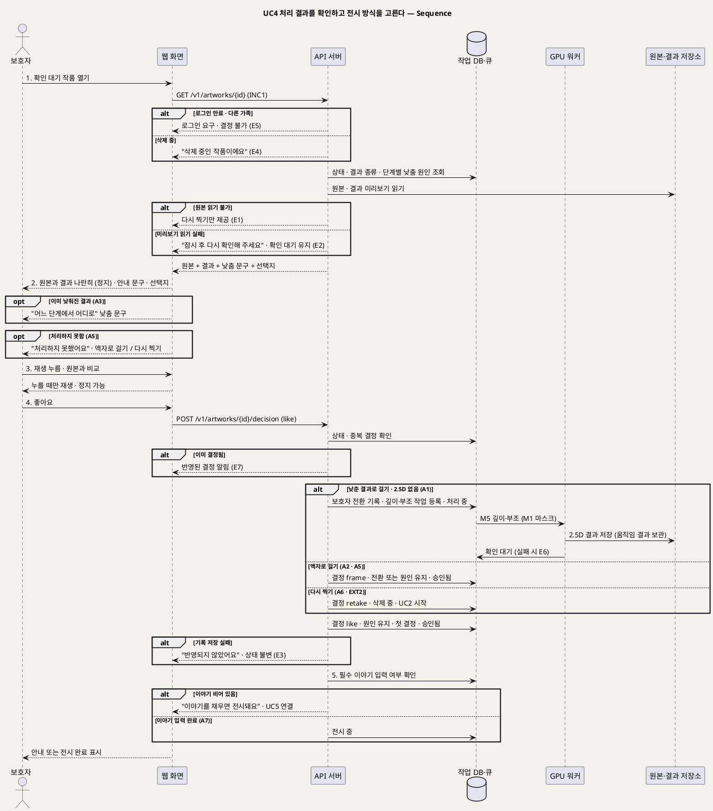

**[「UC4 결과 확인·승인 Sequence」 PlantUML 뷰어로 열기](https://plantuml.sumzip.com/plantuml/svg/eNp1VktvGlcU3s-vOKIbUBS7YJNIXkTxg0RepLHkWOrOmsDEQSbgAG5UVZWwPY4QUBW3EOMYEE7wI63bYoNtrLgb_5Qu5575Dz33MRgGezn3nud3vvPdeZxK68n06psYpIy3i4nV5GL4dTQWWVzSYzEj-ePit-NaajkaX9GT-ht4qYeXl5KJ1XhkOhFLJOGbJ2NP_KGpPovUaz2SeBeNL8ErPZYytHQ0HTNgYXoc8LTCDo7BOm1Z7Su2fwX2ThlrXbtcsdoNwIaJ-Sqw1hfM17BmAh2y_S7LN-G_TAnmjberRjxsaJoeTlNiD2t37EoX60UP6CmY05NGPK1RCeloOLqix9Pgwd1LSlFiXzrCZGF28HpybhbQrLJTU1zTpxbR0_pLPWWQb30LtzdhZur6wl6TKWamBv2fzi0A7hbwa1Nc06c7fZG1u9cXsl_qL4P1fXxfENbz1AP1IsuG-4-oOpgA_4jCBFghY3VbQGXYv2UBtzv0pZENWfK6J-Bp6AWM_uAfpYzvEsnl1OhP0cjP4J39btrv0_RYGthe1broiliHBfa5ANcXQGASpGC1Mrh3ooEIdd9JfuOAH0vW2TF3oNqxUQZ2niUf8IaCPs2goQKu_4WNKmBzyx3Fc3MlQokGsNbB7SKF9VCMcYoRj2jC6xGhSk64sWZvVFVCAdanTbZfkSUfWW2TtU1g63_jeZMgL4rAey37Y8GJIuDkgQTmfYHYP13iHHFFoFn7l8PI0VGG8kT1NwRIvskZia1fyIZApBFWrfYZteBXMNwSHTDftAtHw7DUGzyYvWs6cR32dwA_X6HZFfBQ5S4GVBt4yKEP9MHmRFVd3HO6veeAxI67fIL3iOANe6NGETTBHnJUlJuAwIjy554OXOsVVs_Y9Sx4ae7k5uMVYTnL1jtOUH7Qi5pYISxrHQJCpm7hoekE806O-QgHd14PfuiwXFFNlvPCJJDprFQiCnoGWxA9iyRCPEgrOBrsj692-YgSBG9P4Lb9kKX4Dr5Y3iPVoFRgnXQ5xKODkxYp3Zs5RmDVj3GjBixrsgNTBOqhxy5N66w4hDA3JZlj5YJgj_TnjgJavoYstz-UapxSfcpj2aSCB1Z-7vn8LTs_GjHC0VQ0EQdvLLps-O5YLNpHRtxVCy05JjdBTk9esOIQc1mrgpU1Vqw6vkjtHNB0Qw8lI4XY8JlVHGm_gZYSB0aCMyRg77FWoIH5fU58VWFPxvkDYO9QDNq1PQGTdZmj4q4v2DnJldBCLsns9xN1r94TKUIUjEJyTZ6AZ0G3r_eZn2Qwi7mmvXbMS-CGfbohihwQalqA3QwermG9x2e-551Mn7doYHBdvXL9gdMp9MBRSzfjvJMB3oCkbz8aCuJX9JAakikCE1YpslypJ31SEvh17pIO-NCkHPXTmJI84Dah718E7kiTNNL6sszTE23-tTAd4A0Q4ENKrTw509QKuCo6_dOxGaiPk0RNVuF7h046dBO7i-Uc0hb37a7kM-k1a3NRHJMUHCgxSI8oLU-2wqmN5Sv5jm6yBuXcPiZCuNivTGiHKRFZ0mtVGJZvx44vNJ7Qbrbov0L9tLBfr5wCF6aDlKVFEKjRD5WwY_LH2Dv50D0U9QPE6cx7couJI8KKCspYRrO3qvSlPSY_-o_7H6_l0nY=)** — 클릭 시 브라우저로 연결됩니다.

기본흐름 1~5단계는 시퀀스의 번호 붙은 주요 메시지 `1.`~`5.`와 1:1로 대응한다. 4단계의 `alt`는 대체흐름 A1·A2·A5·A6의 결정 분기이고, 기본흐름("좋아요")은 그 뒤의 `결정 like` 기록이다. 5단계는 이야기 입력 여부에 따라 두 갈래 중 하나로만 실행된다. GPU 워커(M5)는 A1에서 2.5D를 새로 만들 때만 등장한다.

#### UML 노트

| 항목 | 적용 |
|---|---|
| «extend» 방향 | 확장 UC(UC2)에서 기반 UC(UC4)로 점선 화살표를 그렸다. 확장점 "다시 찍기 선택"은 기반 UC 타원 안에 적고, 조건은 note로 붙였다 |
| «include» | 로그인·가족 접근 확인(INC1)은 결과를 열 때마다 항상 수행되므로 include로 두었다 |
| 결과 종류 분기 | 움직임·2.5D·액자·P1 3D·처리하지 못함은 같은 목표(전시 방식 결정)의 변형이라 UC나 Generalization으로 나누지 않고 대체흐름 A3~A5·A8로 표현했다 |
| 낮춘 결과 새로 만들기 | A1의 2.5D 생성은 UC3과 같은 단계 작업 계약을 쓰지만, 보호자의 결정에서 시작되는 흐름이라 UC4의 대체흐름에 두었다. 별도 UC로 나누지 않았다 [추론] |
| 전시 조건 | 승인과 이야기 입력은 서로 다른 목표라 UC4와 UC5로 나눴다. 전시 조건은 BR-EXH-01로 두 UC에 걸었다 |
| 액터 | 모델(M1~M7)은 시스템 내부 구성요소라 UseCase Diagram에 두지 않고, 시퀀스에서만 서빙군 lifeline(GPU 워커)으로 그렸다 |
| Sequence | 기본흐름 1~5단계를 번호 붙은 메시지로 옮겼다. 4단계의 결정 분기(A1·A2·A5·A6)와 5단계의 이야기 여부를 `alt`로, 낮춤 표시(A3)·처리하지 못함(A5)을 `opt`로 표현했다. 예외 E1~E7은 해당 지점에 번호를 붙였다 |

---

### 7.5 UC5 작품 이야기를 기록한다

#### 범위·개요

보호자는 작품마다 **제목, 제작일, 제작 당시 연령**을 입력하고, 원하면 **아이의 한마디**를 덧붙인다. 한마디는 **입력한 글자 그대로** 저장하고 그대로 보여 준다. 시스템은 이 UC에서 문장을 만들거나 고치거나 감정을 해석하지 않으며, 모델(M1~M7)도 부르지 않는다. 아이의 생년월일을 받지 않으므로 나이는 작품마다 "제작 당시 연령"으로 받고, 이 값이 가족 전시(UC6)의 연령 묶음 기준이 된다. 보호자 승인(UC4)과 필수 세 항목이 모두 갖춰져야 작품이 `전시 중`이 된다.

P0.5부터는 이 UC에 **확장점 "설명 초안 요청"**이 생긴다. 보호자가 "키워드로 설명 초안 받기"를 고르면 UC10(키워드로 작품 설명 초안을 만들고 승인한다)이 이 UC를 «extend»한다. 이때 여기서 입력한 한마디·제작 당시 연령·제작일은 설명 생성의 입력이 될 수 있지만, 아이 이름(별칭)과 작품 이미지는 넘기지 않는다(BR-CAP-01). 아이의 한마디(실제 말)와 AI 설명은 **저장 필드도, 화면 영역도 따로** 둔다(BR-STY-03, BR-EXH-05). AI 설명이 한마디 칸을 채우거나 덮어쓰는 일은 없다.

| 항목 | 값 |
|---|---|
| 대상 시스템 | 우리 아이 미술관 (P0, 확장점은 P0.5) |
| 상위 프로세스 | 접수(UC2) → 결과 확인·승인(UC4) ↔ **이야기 기록(UC5)** → 전시(UC6). UC4와 순서가 바뀌어도 된다. P0.5: UC5 → (선택) UC10 설명 초안 |
| 원천 근거 | spec v2.0 FR-7 · FR-6 · FR-27 · Intent [핵심 데이터] 작품 · [가치제안] 경험 원칙 "작품과 실제 말이 먼저 보인다" · [부정적 영향] 과잉 수집·기억의 재작성 |
| 핵심 UseCase | 1개 (UC5) + 공통 1개 (INC1) + 확장 1개 (UC10, P0.5) |
| 주요 액터 | 보호자 |

#### UseCase Diagram

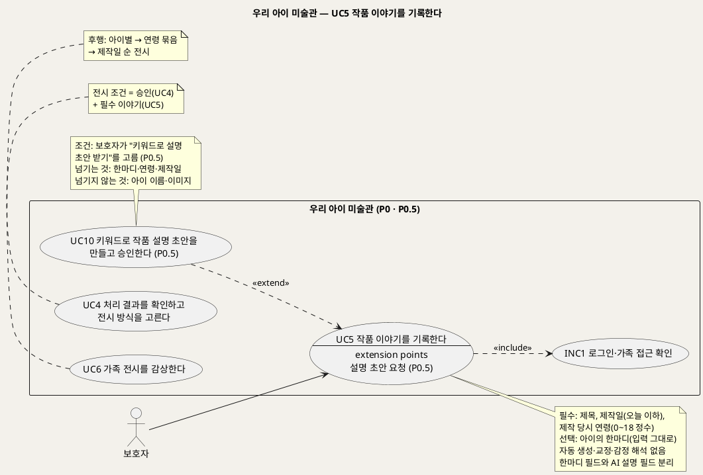

**[「UC5 이야기 기록 UseCase Diagram」 PlantUML 뷰어로 열기](https://plantuml.sumzip.com/plantuml/svg/eNqNVEFLG1EQvr9fMaSXSFUiVSnBiq1U8FK8eBPCmqxxcd2V3Q1tKS1pXSVVodEmbdSsRIiKYumqqYmQkz_F477Z_9B5u5sYD5YewgtvZr75vvnm7YRpSYaVW1Yhl07pOSOVXlTUTCorqapsvE8lRpi5pGgrkiEtw7yUXsoaek7LTOqqbsCTqWdTQ69f9WSYi1JGf6toWViQVFNmqrxggaWDoWQXLcgohpy2FF1jlmKpMuCey4_PAcs2Og3gv1tYqHmNPNzlSzA7OQJ4sO3vFICCWG57LZcftUEch45frvLNOmNS2iIeMX7V8CstPCjGQDJhRjJkzWJMNJO0LDWKPdYpPpOA2ybMJAZH-mLwgQHkTDktmXLQn7Bi_8VjYIDJ7yxZM0kbrOiKZpkM7To_WwNsFLBMtXslvPwl-olOPX1i028mh4AfVr1mC53WbdNz83h4AVjb9ppt8HfLdBvIEom9hbOTQwnwv9Rxf4t_rxJCl2dvZ3TsOY2fUErdu6oBbtwQXki7w0aAC7CH4MOAlxUxNO_S9a7aQnNIxi9XCGlOw5qNm1Xg7iluOtQG6JYftQg4Qhx-CDgKXWmiMBiiW8TVzyGbqGiUfWQsdBAGBsaFD0x4MDg4HkwAkjA2pmhpNZeRx8dZMAQREzkiFPiQoQjTdEuOFk9fCHAAfFqAQiVJFKr87LRfnDQ0dNpxrNT5RkV4TPr6-ik3jAHfvBEy8afLazfxxKeh5xQpE0qfyLFr_qqTjBYLnQoIMScFXirF8WCN146AfOVbebInyD8o8m-7gKsO2hfk9Z8iYQnPxUm1DbQdarWOzlbANsISvMlj3M3Dy-mOv-Ed8GubXGIkGoTiUPa8bln6cqg7MBYPXe-ikYTuSyEvIPZwewJYkRuuLHf3acljgU_k7LEd7QtlcLsi9n-jRMuxmrznedsMx0RnZ7DdbDzJ05g2ukXRW6QfQVMBnfQsT_L_UDIcuBJsXagHXkQLHaegIPY0cvj-rVKEKD-OOSrmvG_7P752KPErG-7WdyLHgZ9fh24Edx1ZgIVqxOUefIL-0Zf0L3V0pIk=)** — 클릭 시 브라우저로 연결됩니다.

##### 다이어그램 쉽게 읽기 (유저 관점)

- **누가 쓰나** — 보호자가 작품의 제목, 그린 날, 그때 나이, 아이가 한 말을 적는다.
- **무슨 순서로** — 결과 확인(UC4) 전이든 후든 언제든 적을 수 있다. 승인과 필수 이야기가 둘 다 갖춰지면 가족 전시(UC6)에 걸린다.
- **«include» = 항상 함께** — 이야기를 쓸 때마다 "로그인·가족 접근 확인"을 거친다.
- **«extend» = 특정 상황에서만** — P0.5부터, 보호자가 "키워드로 설명 초안 받기"를 고를 때만 UC10이 끼어든다. 고르지 않으면 이 UC는 직접 입력만으로 끝난다. 화살표가 UC10에서 UC5로 향하는 것은 "UC10이 UC5에 덧붙는다"는 뜻이다.
- **Generalization(◁)** — 없다. 움직임·2.5D 부조·원본 액자 어느 결과든 같은 이야기 항목을 가진다.

| 기호 | 의미 |
|---|---|
| 사람 모양(actor) | 시스템을 쓰는 사람 |
| 타원(usecase) | 액터가 이루려는 목표 |
| 타원 안 `extension points` | 다른 UC가 덧붙을 수 있는 지점 |
| 사각형(rectangle) | 시스템 경계 |
| 점선 `<<include>>` | 항상 함께 수행되는 하위 행위 |
| 점선 `<<extend>>` | 조건이 맞을 때만 덧붙는 행위 (확장 UC → 기본 UC) |
| 노트 | 입력 규칙·확장 조건·전시 조건 보충 |

#### Actor

| 구분 | 액터 | 이 UC에서의 역할 | 원천 근거 |
|:--:|---|---|---|
| Primary | 보호자 | 작품의 이야기(제목·제작일·제작 당시 연령·아이의 한마디)를 입력하고 수정한다. P0.5에서 설명 초안 받기를 고를 수 있다 | spec FR-7 · FR-27 · Intent [가치제안] 지금의 보호자 |
| 이해관계자 | 아이 | 한마디의 화자. 시스템을 직접 조작하지 않으므로 액터로 두지 않는다 | 공통 기준 §6 액터 |

자체 호스팅 모델(M1~M7)은 시스템 내부 구성요소라 액터가 아니다. 이 UC의 기본흐름은 어떤 모델도 부르지 않는다. 확장점에서 쓰는 M6(LLM 서버)과 조건부 보조 액터 "과정 제공 LLM"은 UC10 문서에서 다룬다.

#### 관련 UseCase

| UC ID | 유스케이스명 | 관계 | 원천 근거 |
|:--:|---|---|---|
| UC5 | 작품 이야기를 기록한다 | 본 문서 | spec FR-7 · Intent [핵심 데이터] 작품 |
| INC1 | 로그인·가족 접근 확인 | UC5가 «include» | 공통 기준 §6 · BR-ACC-01·02 |
| UC10 | 키워드로 작품 설명 초안을 만들고 승인한다 (P0.5) | UC5를 «extend» (확장점: 설명 초안 요청) | spec FR-27 · Intent [가치제안] "P0.5부터는 키워드로 설명 초안도 받는다" |
| UC4 | 처리 결과를 확인하고 전시 방식을 고른다 | 전시 조건을 함께 구성(순서 무관) | spec FR-6 · BR-EXH-01 |
| UC6 | 가족 전시를 감상한다 | 후행 | spec FR-8 · BR-EXH-02 |

> **쉽게 말하면** — 그림 제목과 그린 날, 그때 아이 나이를 적습니다. 아이가 그림을 보며 한 말이 있으면 한마디로 남기고, 그 말은 한 글자도 바뀌지 않고 그대로 전시에 나옵니다. P0.5부터는 원하면 키워드로 설명 초안을 따로 받을 수 있지만, 그 설명은 "AI 작성" 칸에 따로 놓이고 아이의 말과 섞이지 않습니다.

#### 유스케이스 기술

| 속성 | 내용 |
|---|---|
| **ID** | UC5 (spec v2.0 FR-7) |
| **유스케이스명** | 작품 이야기를 기록한다 |
| **액터** | 주: 보호자 · 보조: 없음 (모델·외부 시스템을 부르지 않는다) |
| **사전조건** | (1) 보호자가 로그인되어 있고 대상 작품이 자기 가족의 작품이다(INC1, BR-ACC-01·02). (2) 대상 작품이 접수 완료되어 있다(UC2, BR-INT-02). 상태는 `접수됨`~`전시 중` 또는 `처리하지 못함` 중 하나이고 `삭제 중`이 아니다. (3) 다시 찍기로 대체된 이전 작품이 아니다 [추론] |
| **사후조건** | (1) 제목·제작일·제작 당시 연령과(입력한 경우) 아이의 한마디가 입력한 그대로 작품 기록의 이야기 필드에 저장된다. (2) 한마디 필드는 AI 설명 필드와 분리되어 있고, 이 UC는 설명 필드를 만들거나 바꾸지 않는다. (3) 작품이 `승인됨`이고 필수 세 항목이 모두 채워졌으면 상태가 `전시 중`이 되고, 이미 `전시 중`이면 수정 내용이 전시 화면에 곧바로 반영된다. (4) 시스템이 만들거나 바꾼 문장은 없다. (5) 운영 로그에는 자유 입력(제목·한마디)이 남지 않는다 |
| **기본흐름** | ↓ 별도 기본흐름표 (승인이 끝난 작품에 처음 입력하는 경우 기준) |
| **대체흐름** | A1. 승인 전 입력 — `확인 대기` 이전 상태에서 먼저 입력하면 저장만 하고, 전시는 UC4에서 승인할 때 이뤄진다(BR-APR-01, BR-EXH-01). A2. 전시 후 수정 — `전시 중`인 작품의 이야기를 고치면 전시 화면에 곧바로 반영한다(spec FR-7). A3. 한마디 생략 — 한마디를 비워도 필수 세 항목만으로 전시 조건을 만족한다(BR-STY-01). A4. 한마디 지우기 — 수정에서 한마디를 비우면 저장된 한마디를 지운다. [추론] 원천은 선택 입력만 명시하며, 삭제 가능은 선택 입력의 귀결로 판단했다. A5. 필수 항목 일부만 입력 — 전시 전 작품에서 일부만 채워 저장하면 입력한 값은 저장하되 전시하지 않는다. 비어 있는 항목을 표시하고 "이야기를 채우면 전시돼요"라고 안내한다 [추론 — "언제든 입력·수정"에 맞춘 부분 저장 허용]. A6. 설명 초안 요청 (P0.5, 확장점) — 보호자가 설명 영역의 "키워드로 설명 초안 받기"를 고르면 UC10이 «extend»로 이어진다. UC10에 넘길 수 있는 이 UC의 값은 아이의 한마디·제작 당시 연령·제작일뿐이고, 아이 이름(별칭)·작품 이미지는 넘기지 않는다(BR-CAP-01). 제목은 BR-CAP-01 허용 입력 목록에 없으므로 넘기지 않는다 [추론]. 초안은 설명 필드에만 저장되고 한마디 필드는 바뀌지 않는다(BR-STY-03). P0에서는 이 선택지를 화면에 보이지 않는다. A7. 승인된 AI 설명이 있는 작품의 이야기 수정 (P0.5) — 한마디·연령·제작일을 고쳐도 승인된 설명은 고정이라 자동으로 다시 만들지 않는다(BR-CAP-04). "승인한 설명은 그대로 남아요"라고 안내한다 [추론 문구]. 승인 뒤 설명을 바꾸는 경로는 `자료 없음 — 확인 필요`(U16) [통합 D15]. A8. `처리하지 못함` 작품 — 인프라 실패로 결과가 없는 작품에도 이야기를 먼저 적어 둘 수 있다. 보호자가 원본 액자로 걸기를 골라 승인하면 전시 조건을 채운다 [추론] |
| **예외흐름** | E1. 미래 제작일 — 오늘보다 뒤의 날짜면 거절하고 "그린 날은 오늘 이후일 수 없어요"라고 안내한다(BR-STY-02). 화면과 API 서버가 모두 검사한다 [추론]. E2. 연령 범위 밖 — 만 나이 정수 0~18이 아니면 거절하고 허용 범위를 안내한다(BR-STY-02). E3. 저장 실패 — DB 장애로 저장하지 못하면 "저장되지 않았어요"라고 안내하고 이전 값을 유지한다. 입력 중인 값은 화면에 남겨 다시 저장할 수 있게 한다 [추론]. 로그에는 입력 문장 없이 오류 분류 코드만 남긴다(BR-PRV-01 · Intent [핵심 데이터] 오류 분류 "DB"). E4. 삭제 중이거나 대체된 작품 — `삭제 중`이거나 다시 찍기로 대체된 이전 작품이면 입력을 받지 않고 안내한다(BR-DEL-01 새 작업 차단, BR-DEL-05, BR-APR-05) [통합 D4]. E5. 로그인 만료 — INC1에 따라 다시 로그인하게 한다. 입력 중이던 내용의 임시 보존 여부는 `자료 없음 — 확인 필요`. E6. 다른 가족의 작품 — 가족 격리에 따라 작품이 없는 것처럼 거절한다(BR-ACC-01) [추론 — 존재 여부를 드러내지 않는 응답]. E7. 전시 중 작품의 필수 항목 비우기 — `전시 중`인 작품에서 제목·제작일·연령을 비우고 저장하면 거절하고 "전시 중인 작품은 제목·그린 날·나이를 비울 수 없어요"라고 안내한다 [추론 — 전시 조건이 저장만으로 깨지지 않게 함] |
| **포함/확장** | «include» INC1 로그인·가족 접근 확인 · «extend» UC10 키워드로 작품 설명 초안을 만들고 승인한다 → UC5 (확장점: 설명 초안 요청 — 보호자가 "키워드로 설명 초안 받기" 선택, P0.5) |
| **우선순위** | High — Intent [미션]의 "아이의 작품과 그날의 말을 가족이 함께 간직"을 실현하고, 전시의 필수 조건이다(spec FR-7, BR-EXH-01) |
| **사용빈도** | 작품 1건당 최초 입력 1회 + 수정 수시. 작품 등록 빈도·수정 빈도는 `자료 없음 — 확인 필요` |
| **업무규칙** | BR-STY-01, BR-STY-02, BR-STY-03, BR-EXH-01, BR-EXH-05, BR-CAP-01, BR-CAP-04, BR-CHD-01, BR-APR-01, BR-APR-05, BR-DEL-01, BR-ACC-01, BR-ACC-02, BR-PRV-01 |
| **특별 요구사항** | 기억 왜곡 금지: 한마디에 자동 요약·교정·감정 태그를 붙이지 않고, 입력에 없는 사건·감정·발달 상태를 만들지 않는다(Intent [부정적 영향] 기억의 재작성 · 경험 원칙). 필드 분리: 한마디(실제 말)와 AI 설명은 저장 필드와 화면 영역을 나눈다. 화면에서는 작품과 한마디를 먼저 보이고, AI 설명은 "AI 작성" 표시와 함께 별도 영역에 둔다(BR-STY-03, BR-EXH-05). 최소 수집: 생년월일·출생연도 대신 작품별 제작 당시 연령만 받는다(BR-CHD-01). [추론] 출생연도가 없으므로 작품 간 연령·제작일의 앞뒤가 맞는지는 검사하지 않는다. 결과 종류 무관: 움직임·2.5D 부조·원본 액자 모두 같은 이야기 항목을 가진다(BR-EXH-04). 개인정보: 제목·한마디는 자유 입력이므로 운영 로그·지표 라벨에 남기지 않는다(BR-PRV-01, BR-OPS-04). 외부 전달 금지: 이 UC의 입력을 외부 업체·외부 모델 API로 보내지 않는다(BR-PRV-02) |
| **비고** | 원천 추적: spec v2.0 FR-7(필수 3·선택 1 / 제작일·연령 검증 / 원문 그대로 / 승인 전후 언제든 입력·즉시 반영 / 결과 종류 무관 동일 항목) · FR-6(전시 조건) · FR-27(P0.5 확장 UC10) · Intent [핵심 데이터] 작품 "제목·제작일·제작 당시 연령·아이의 한마디(선택, 입력 그대로)", 작품 설명 "보호자 키워드·선택한 태그·초안·출처…승인 후 고정" · [가치제안] 경험 원칙 "작품과 실제 말이 먼저 보인다", "AI가 쓴 설명은 'AI 작성'으로 표시하고 아이의 실제 말과 섞지 않는다" · [부정적 영향] 과잉 수집 "설명 생성 입력에 이미지와 아이 이름을 넣지 않는다", 기억의 재작성 · [핵심 장벽] 상 — 기억 왜곡 · 공통 기준 §4(`PUT /v1/artworks/{id}/story`, `POST /v1/artworks/{id}/captions`), §5(상태 모델), §6(확장 관계), §8(BR). 추가 요구 R1~R4는 이 UC에 직접 해당하지 않는다. 미해결: U1(가족 접근 계정 모델 — 공동 보호자가 있으면 누가 이야기를 쓰고 동시 수정을 어떻게 처리할지 미정), E5 임시 보존 여부, A7 승인 뒤 설명 변경 경로, U3·U11(확장점 쪽 M6 실행 방식·규칙 검사는 UC10에서 다룸), U8(엔드포인트 이름은 [추론]) |

#### 기본흐름 (Basic Flow)

| 단계 | 액터 행위 | 시스템 행위 |
|:--:|---|---|
| 1 | 보호자가 작품의 "이야기 쓰기"를 연다(UC4 안내 또는 작품 상세에서) | INC1로 로그인·가족 접근을 확인하고, 작품 상태와 기존 이야기를 불러와 필수 항목(제목·제작일·제작 당시 연령)과 선택 항목(아이의 한마디)을 구분한 입력 화면을 보여 준다 |
| 2 | 보호자가 제목, 제작일, 제작 당시 연령을 입력한다 | 제작일이 오늘 이후가 아닌지, 연령이 만 나이 정수 0~18인지 바로 검사한다 |
| 3 | 보호자가 원하면 아이의 한마디를 입력한다 | 입력한 글자를 그대로 받는다. 자동 요약·교정·감정 태그를 제안하지 않고, 한마디 칸은 AI 설명 칸과 따로 둔다 |
| 4 | 보호자가 "저장"을 누른다 | `PUT /v1/artworks/{id}/story`로 받은 값을 다시 검사한 뒤, 원문 그대로 이야기 필드에 저장한다. 설명 필드는 건드리지 않는다 |
| 5 | 보호자가 저장 결과 안내를 확인한다 | `승인됨`과 필수 세 항목 충족을 확인해 상태를 `전시 중`으로 바꾸고 "전시에 걸렸어요"(승인 전이면 "확인하면 전시돼요")를 보여 준다 |
| 6 | 보호자가 작품 상세 화면으로 돌아간다 | 작품과 아이의 한마디를 먼저 보이고, 설명 영역은 분리해 둔다. P0.5에서는 이 영역에 확장점 "키워드로 설명 초안 받기"를 둔다 |

#### Sequence Diagram

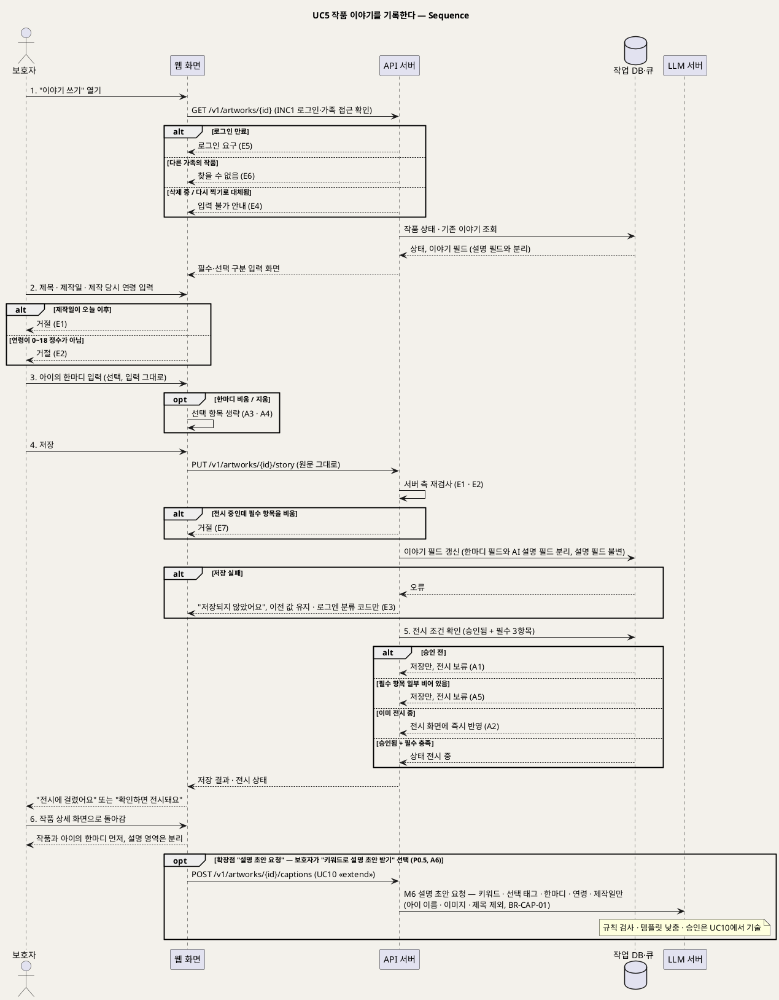

**[「UC5 이야기 기록 Sequence」 PlantUML 뷰어로 열기](https://plantuml.sumzip.com/plantuml/svg/eNqVVl1vGlcQfd9fMaIvWPUXsZ1WeYiCnaSKlLRWU79Vsjb21kEm4MA6aVS1Iva6ojZRcAIBx4BABX-kdrt2iFmrtJH8U_q4d_Y_dO7HYjBWpb4Ay50798yZM-fujaSpJ8zlR1FIGo9n48uJ2bmHkej87IIejRqJZ7OjE1pyMRJb0hP6I3igzy0uJOLLsfmpeDSegE9uj90O3Zrsikg-1OfjTyOxBfhOjyYNzYyYUQNmpiYAK5veqzRguYn5tuvYrNEG_lUre_kS26jDP6kc3DceLxuxOUPT9DmTDgiw902v6GAlGwA9CdN6woiZGh1lRuYiS3rMhABun4K3lWP7TREyc6d3OTx9B9AqsWNLLNOjNq-b-gM9adDeyiYW1uDm5FnLey6PuDnZu__u3Xvd--lR0yQMGLpOp8E1CA1TJr8swNc2fQUAC0361iiC4jiKa_DFrW9g5ElohPI_jScWkyM_ROZ_hOCdL6dCwGolt-Vg2TlruXYKa0eA1U231aba8vTvgKZHzfMgYLsZ9mtGA5F5yEdyvo5vc-6HAwjemhjQDGoEEMOs4YDMjeWi6sfFDGj_jWULME0BhZ-xnKEUV1UKXDnEagmwvgkjPB9u0IP9QjSxBCyTwuMmy-71payssWoD2EmaDgfMp9lKk7KOU9bYvCZCrxPtIlJKZPW5t1qCsxbXB9aa0EVuzfbeZjSKHuqwKsMHu6K8vMVelyCIVp29W1OPuJUiDBbbORjQevDRMpV71kKr6q2WgWijMB-1VFZfy68MU3tK7N0-R0m_uJDK7fMHoudU0FOwWfVUJRMt7AQTXMBina0XOXJv2yLeZiQsddg1cI9srKaJrJDfApGPbx39KfQ5JcsTdEmrxTaK_5XiiuT7YiVjw3wv5440wSdxN81yOb_8oCRl0H8mdVGfqd0DWnzJ7IpnpxZup0gXuJuiHwqIrwDJrJc_5IzhaplVPkAwPMb5Co9fjmucM5zCSqNngqZnLpmgkSRZxTPCup1lB043RiUupRMxxYBOjao5cI9TuMIHJMRRcHZkdyzRtjp1yGEvbCUOBZ1Phiz0osY7LH92iaov6tK1j3CjCsFz9s4VGuZu1aVaJdnBvn_T7H3Kx8xpAtyoexk-fL3DQQprFC_CDcg9LFukdlH_1zFfxDdNMo2AnKOqRShfAZaqPIAIUs5SyAlADdLsXzkCQjZERY-pFnZXPTHcIbNmu0dN5WPUpfVTzm12Dz712R2T9KpyxDrf3FeLBL2bGfRT0-3AsQTD_nz0tIsqabOTlGjZGxq2Spr87H8k9a2TCGF_OF3a6M8hVqRXYCELuPOLyGQXsficMl3xM_XXjif7ZMh9GaUFdh3ZUVVnqGTb3WPbfa-cRwaLrdpFHwjIZY7OPXJY1VH9BlbMsvUcBGR_vHyRalC52Ms2D-mbzavDXVaNluNXXmqLi-BlhhzFtbN9GOQmDvcyy2F7baqpo3RiDguHWPZdW5OOQygrDaxmqSAV10zTncIvPDw-DIi3iM5LA3fGgLdSx-0MFyuB693E7G15V0uDCk6PDk8MQpguPN-_lO18df8y35nTl8xIPJaE4MxUaBTOfjO-N6lPZ38O-AN3nb8wUIJ7V-EyuAJtB59oorLKVT5u_I9zfviqvE667xxS7rexoORTKHXHEutCs2p41VXF92w5gzD59dBUeHpoNMRhxuKmAfEnRkIhdVslPN0CZY8cwFrJy2XYzkdgK7_jSV0kFDrmveGFk6bIW8Vlna4Kod6gD3ql_BekcQ7E)** — 클릭 시 브라우저로 연결됩니다.

기본흐름 1~6단계는 시퀀스의 번호 붙은 주요 메시지 `1.`~`6.`과 1:1로 대응한다. 기본흐름에는 모델 호출이 없다. `LLM 서버` lifeline은 P0.5 확장점(`opt`)에서만 나타나며, 그 뒤의 처리는 UC10 문서가 정의한다.

#### UML 노트

| 항목 | 적용 |
|---|---|
| UC 분리 | 승인(UC4)과 이야기 기록(UC5)은 둘 다 전시 조건이지만 목표와 수행 시점이 달라 별도 UC로 뒀다. 순서 의존이 없으므로 include나 extend로 묶지 않았다 |
| «extend» 방향 | 설명 초안 생성(UC10)은 보호자가 고를 때만 일어나는 조건부 행위이고 UC5는 그것 없이 완결된다. 그래서 UC10 → UC5 «extend»로 그리고, UC5 타원에 확장점 "설명 초안 요청 (P0.5)"을 적었다. 확장 조건은 노트로 보충했다 |
| 모델 비노출 | M6은 시스템 내부 구성요소라 UseCase Diagram에 액터로 두지 않았다. 시퀀스에서만 `LLM 서버` lifeline으로, 확장점 `opt` 안에 한정해 나타낸다 |
| 추상수준 | 제목·제작일·연령·한마디 필드는 UC가 아니라 기본흐름 단계로 내렸다 |
| 선택 항목 | 한마디 생략·지우기는 정상 경로의 변형이라 대체흐름(A3·A4)으로 처리했다 |
| Sequence | 입력 검증은 화면(`alt`)과 API 서버 재검사로, 전시 전환 조건(승인 전·부분 입력·전시 중·충족)은 `alt`로 나눴다. 예외·대체 ID를 메시지에 병기했다 |

---

### 7.6 UC6 가족 전시를 감상한다

#### 범위·개요

가족은 **승인되고 필수 이야기가 채워진 작품만** 모인 전시 화면에서 작품을 **한 점씩 골라** 감상한다. 전시는 아이별로 나뉘고, 한 아이 안에서는 제작 당시 연령별로 묶이며, 묶음 안에서는 제작일 순서로 놓인다(BR-EXH-02). 작품을 고르면 결과가 정지 상태로 먼저 보이고 제목·제작일·제작 당시 연령·아이의 한마디가 함께 보인다. 결과 종류에 따라 감상 방식이 다르다. 움직이는 그림은 재생, 2.5D 부조는 시차 효과, 원본 액자는 그대로 본다. 재생과 시차 효과는 보호자가 고를 때만 켜지고, 다음 작품으로 저절로 넘어가지 않는다(BR-EXH-03). 어느 결과에서든 원본 사진으로 바꿔 볼 수 있다.

감상은 **이미 만든 결과를 저장소에서 읽기만** 한다. 이 UC는 모델(M1~M7)을 부르지 않으므로 CPU 비전 워커·GPU 워커·LLM 서버의 상태와 상관없이 열린다. P0.5에서는 보호자가 승인한 작품 설명이 "AI 작성" 표시와 함께 아이의 실제 말과 떨어진 자리에 붙는다(BR-EXH-05). P1에서 팀 서버 GPU가 확인되면 만들기 작품(점토·종이 공작)의 3D 조각을 돌려 볼 수 있고, 이때 "뒷면은 AI가 추정했어요"와 원본 사진을 함께 보여 준다(BR-EXH-06). GPU 확인 전에는 3D 조각을 화면에 드러내지 않는다(BR-SRV-02).

| 항목 | 값 |
|---|---|
| 대상 시스템 | 우리 아이 미술관 (P0, P0.5 설명 표시, P1 3D 조각 대체흐름) |
| 상위 프로세스 | 결과 확인·승인(UC4) + 이야기 기록(UC5) [+ 설명 승인(UC10, P0.5)] → **감상(UC6)** |
| 원천 근거 | spec FR-8 · FR-9 · FR-29 · Intent [가치제안] 경험 원칙 · [부정적 영향] 3D의 추정 면·비교·평가 오용 · [미션] P0 경험 검증 |
| 핵심 UseCase | 1개 (UC6) + 공통 1개 (INC1) |
| 주요 액터 | 보호자 · 원본·결과 저장소(보조) · 아이(이해관계자, 계정 없이 함께 감상) |
| 엔드포인트 | `GET /v1/gallery?child={id}` (공통 기준 §4, 이름·형식은 [추론] — U8) |
| 호출 모델 | 없음. 결과 생성(M3·M5·M7)과 설명 생성(M6)은 UC3·UC10에서 이미 끝났다 |

#### UseCase Diagram

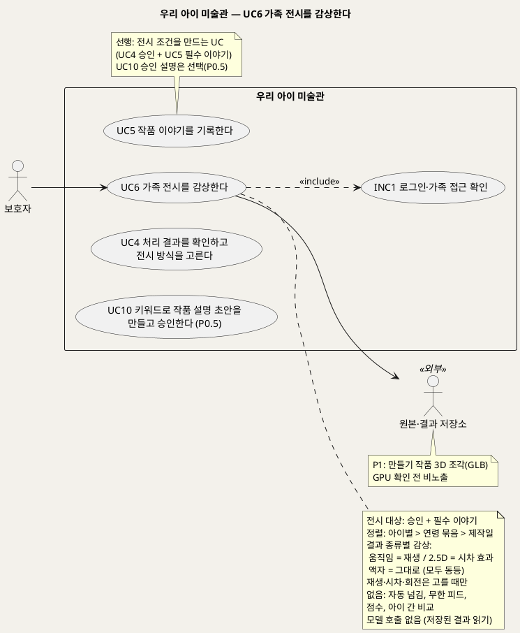

**[「UC6 가족 전시 UseCase Diagram」 PlantUML 뷰어로 열기](https://plantuml.sumzip.com/plantuml/svg/eNqFVN9r02AUfc9fcakvHc7ZqttD0SLOHwgiBdnbYGRt1gW7RNIUEREyl0l1FTu3uG5LSiubTimY2bqmUF_2p_iY7-Z_8H5J6lZBfGqT79x7zz3nfLlZ1kVNr6yUoJJfqGjygigvFMVSSdKeLaRmhPJjWXkiauIKLIr5x0VNrSiFWbWkanDh7tW76Tu3ziHKy2JBfSorRVgSS2VJKElLOugqaHJxWYeCrEl5XVYVQZf1kgS457JPHUDLRKcH7JuH1ZbfM-CXsQ1zszPguwa2jwFbJm7Y7HBIL-q4thpYNts4EAQxrxOJBOv2goaHzXoCxDLkRE1S9NEZ7tdZ1zvt-99dvzukTgY2D_FVLYQ-IogE16_jrsdOjGxWEDg9USkStcQ_uCXguQBQKUt5sUyo_7IMBxHqfNH9h7NpYG3b73vocHKjBpt-fwjBrkVvwzoOHJ92DfB7g_OKFuLTInxgNfxua16JWABzv-CGg44J9JYdemdMro03nAZsbgbvq0BbojX0PTfcgH7aztgG0-N16RQELw9wv8a2bFrlTxfzgH1dB-xV0arS-HmFfSbIAbEAfDMIifKmkMylpqYn4t7plPBCECLn4NKlbCgYl3ZqKhuKABmySVbypUpBIp_4EYeFBgqCoupSnDB1KRZ7pEPNICsy8Wy4CAH5WW2cbRtCLdbqZGKrWdeELOCOy1oDYJ0TdGr8uWXThugMCT_K0sd1dtjg8MjvDB0B7hv4eRWbJtwgSTq45sBluDI1fZs_b9joHkGwd0TlIdhqU2rphIJARLmMSfb1iG3Wgb3bZVvHE5xd2OW0H1Wf9oO9Gt_NMSJnh8CsGmnMkTuviCzt0axTOTCz4Q-MSdqhR5pDsD0kqybDfeskweQo2r5rAhuY_o86nfHxbz3g9-nEjjtCMro2rG7_2d35SdpNCJJSAK5-ZMGiquvqSuQBjwuareDD68zIC2y7_nGPZzLMhM3e8FtOuGSY65FDPJN_u8SFCDMXo6KYcRH4jDUnStM_6UQ5AcilMxDn0XNHkb16O2TmribvPbjFB93LzcWXijPn2rB1LsdZ-5v0jz6XvwGWW5eu)** — 클릭 시 브라우저로 연결됩니다.

##### 다이어그램 쉽게 읽기 (유저 관점)

- **누가 쓰나** — 보호자가 전시 화면을 연다. 아이는 곁에서 함께 보지만 계정이 없어 액터로 그리지 않았다. 원본·결과 저장소는 작품 파일(원본 사진, 움직이는 그림, 2.5D 부조, P1 3D 조각)을 꺼내 오는 외부 구성요소다.
- **무슨 순서로** — 보호자가 결과를 승인하고(UC4) 이야기를 채운(UC5) 작품만 여기에 걸린다. 아이를 고르고, 나이별로 묶인 작품 중 한 점을 골라 본다. 움직이는 그림은 재생을, 입체 부조는 시차 효과를 눌러야 움직인다.
- **«include» = 항상 함께** — 전시를 열 때마다 "로그인·가족 접근 확인"을 거친다. 다른 가족의 전시는 볼 수 없다.
- **«extend» = 특정 상황에서만** — 이 UC에는 확장 관계가 없다. 설명 보기(P0.5)와 3D 조각 돌려 보기(P1)는 같은 목표 안의 대체흐름으로 다룬다.
- **Generalization(◁)** — 없다. 움직임·2.5D·액자는 서로 우열이 없는 같은 대우의 작품이라 상속으로 나누지 않았다.

| 기호 | 의미 |
|---|---|
| 사람 모양(actor) | 시스템을 쓰는 사람 또는 외부 구성요소(`<<외부>>`) |
| 타원(usecase) | 액터가 이루려는 목표 |
| 사각형(rectangle) | 시스템 경계 |
| 점선 `<<include>>` | 항상 함께 수행되는 하위 행위 |
| 노트 | 전시 규칙·선후 관계·P1 조건 보충 |

#### Actor

| 구분 | 액터 | 이 UC에서의 역할 | 원천 근거 |
|:--:|---|---|---|
| Primary | 보호자 | 전시를 열고, 아이와 작품을 골라 재생·시차 효과·(P1) 회전을 켜고 끄며, 원본과 이야기를 함께 본다 | spec FR-8 · Intent [가치제안] 지금의 보호자 |
| Secondary | 원본·결과 저장소(S3 호환) | 원본 사진과 결과 파일(움직임·2.5D·P1 GLB)을 읽기 전용으로 내준다 | 공통 기준 §3·§6 · Intent [핵심 이네이블러] |
| 이해관계자 | 아이 | 계정 없이 보호자와 함께 자기 작품을 본다. 조작 주체가 아니다 | Intent [가치제안] 지금의 아이 · 공통 기준 §6 |
| 이해관계자 | 성장한 아이 | 훗날 작품과 그날의 말을 다시 만난다. 장기 보존·권한 이전은 후속 | Intent [가치제안] 성장한 아이 |

주의: 공동 보호자나 감상 전용 가족이 별도 계정으로 전시를 볼 수 있는지는 미해결 U1(가족 접근 계정 모델)이다 — `자료 없음 — 확인 필요`. 이 문서는 보호자 계정 하나로 가족이 같은 화면을 함께 보는 경우를 기준으로 쓴다.

자체 호스팅 모델(M1~M7)은 시스템 내부 구성요소이고, 이 UC에서는 호출되지 않는다.

#### 관련 UseCase

| UC ID | 유스케이스명 | 관계 | 원천 근거 |
|:--:|---|---|---|
| UC6 | 가족 전시를 감상한다 | 본 문서 | spec FR-8 · FR-9 · FR-29 |
| INC1 | 로그인·가족 접근 확인 | UC6가 «include» | spec FR-9 · BR-ACC-01·02 |
| UC4 | 처리 결과를 확인하고 전시 방식을 고른다 | 선행(승인) | spec FR-6 · BR-APR-01 |
| UC5 | 작품 이야기를 기록한다 | 선행(필수 이야기) | spec FR-7 · BR-EXH-01 |
| UC10 | 키워드로 작품 설명 초안을 만들고 승인한다 | 선행(선택, P0.5 승인 설명) | spec FR-27 · BR-CAP-04 |

> **쉽게 말하면** — 가족이 모여 앉아 아이의 작품을 나이별로 넘겨 봅니다. 그림을 누르면 제목과 그날 아이가 한 말이 먼저 보이고, 재생을 눌러야 그림이 움직이거나 입체 부조가 살짝 떠오릅니다. 저절로 다음 작품으로 넘어가지 않으니 천천히 골라 볼 수 있고, 언제든 원본 사진으로 바꿔 볼 수 있습니다.

#### 유스케이스 기술

| 속성 | 내용 |
|---|---|
| **ID** | UC6 (spec FR-8, FR-9, FR-29 · 엔드포인트 `GET /v1/gallery?child={id}`) |
| **유스케이스명** | 가족 전시를 감상한다 |
| **액터** | 주: 보호자 · 보조: 원본·결과 저장소 · 이해관계자: 아이(계정 없이 함께 봄) |
| **사전조건** | (1) 보호자가 로그인되어 있고 가족 공간이 확인된다(INC1). (2) 가족 공간에 아이가 1명 이상 등록되어 있다(UC1). (3) 전시 대상은 상태 `전시 중` 작품, 곧 보호자 승인(UC4)과 필수 이야기(제목·제작일·제작 당시 연령, UC5)를 모두 갖춘 작품이다(BR-EXH-01). (4) (P1) 3D 조각은 3D 노출 설정이 켜진 경우에만 대상이 된다. 설정은 기본 꺼짐이고 팀 서버 GPU 확인(U2) 뒤 켠다. 저장된 GLB 감상에는 GPU가 필요 없다(BR-SRV-02) [통합 D10] |
| **사후조건** | (1) 보호자는 이 가족의 `전시 중` 작품만 보았다. (2) `확인 대기`·`처리하지 못함`·다시 찍기로 넘어간 작품·`삭제 중` 작품과 승인 전 설명은 어디에도 노출되지 않았다. (3) 원본·결과·이야기·설명은 바뀌지 않았다(읽기만, BR-INT-04). (4) 어떤 모델도 호출되지 않았고 단계 작업도 새로 생기지 않았다. (5) 감상 행위 자체(조회 기록)를 저장할지는 `자료 없음 — 확인 필요`. 재열람 관찰은 Intent [미션] P0 경험 검증의 직접 사용 관찰로 수행한다 |
| **기본흐름** | ↓ 별도 기본흐름표 (움직이는 그림 감상 기준) |
| **대체흐름** | A1. 원본 액자 작품 — 재생·시차 선택지 없이 액자로 보여 준다. 움직임·2.5D와 같은 크기·대우이며 "실패"·"대체" 표시가 없다(BR-EXH-04). 보호자가 확정 때 고른 액자, 모델 낮춤으로 된 액자, 결과 확인에서 바꾼 액자 모두 전시 화면에서는 구분하지 않는다. 전시 화면에는 낮춤 원인·결과 원인 분류를 표시하지 않는다(BR-EXH-07) [통합 D3]. A2. 2.5D 부조 작품 — 정지 부조로 먼저 보이고, 보호자가 "시차 효과"를 켤 때만 화면 기울임·끌기에 따라 입체감이 움직인다. 끄면 정지 부조로 돌아간다(BR-EXH-03). 시차 효과의 입력 방식(기기 기울기 센서·손가락 끌기)과 파일 형식은 U9 — `자료 없음 — 확인 필요`. A3. (P1) 만들기 작품 3D 조각 — 3D 노출 설정이 켜진 경우에만 나타난다 [통합 D10]. 정지 상태로 먼저 보이고, 보호자가 "돌려 보기"를 고를 때만 GLB를 회전해 볼 수 있다. 3D 화면에는 늘 "뒷면은 AI가 추정했어요"를 표시하고 원본 사진을 나란히 보여 준다(BR-EXH-06). 평면 그림에는 이 경로가 없다. 3D 노출 설정이 꺼져 있으면 3D 조각 결과를 싣지 않고 해당 작품을 원본 액자로 보여 준다(BR-SRV-02) [통합 D10]. A4. 원본 보기 전환 — 결과 화면과 원본 사진 화면을 언제든 서로 바꿔 볼 수 있다. 원본은 읽기만 하며 손대지 않은 그대로 보인다(BR-INT-04). A5. (P0.5) 승인된 작품 설명 — 보호자가 UC10에서 승인한 설명이 있으면 작품·이야기 아래 따로 구분된 자리에 "AI 작성" 표시와 함께 보인다. 아이의 한마디 칸과 섞지 않는다(BR-EXH-05, BR-STY-03). 승인 전 초안·폐기본은 보이지 않는다(BR-CAP-04). 출처가 보호자 직접 입력이면 "AI 작성" 표시를 붙이지 않고, 템플릿 출처도 "AI 작성"으로 표시한다(BR-CAP-03) [통합 D6]. A6. 작품 다시 찾기 — 보호자가 제목이나 제작일로 검색해 특정 작품을 연다(spec FR-8). 검색 조건 전달 방식은 [추론] `GET /v1/gallery` 질의 인자 — U8. A7. 다른 아이로 전환 — 다른 아이를 고르면 그 아이의 연령 묶음으로 바뀐다. A8. 전시할 작품이 없음 — 고른 아이에게 `전시 중` 작품이 없으면 빈 전시를 보여 주고 작품 올리기(UC2)로 안내한다 [추론] |
| **예외흐름** | E1. 다른 가족 자료 직접 접근 — 다른 가족의 아이 id로 `GET /v1/gallery?child={id}`를 부르거나 작품·파일 주소를 직접 입력하면 거부하고, 원본·결과·이야기·설명 어느 것도 노출하지 않는다. 존재 여부도 드러내지 않는다 [추론](BR-ACC-01). E2. 비로그인 접근 — 어떤 작품도 보여 주지 않고 로그인을 요구한다(BR-ACC-02). E3. 전시 조건 미충족 작품 직접 접근 — `확인 대기`·`처리하지 못함`·필수 이야기 미입력 작품, 승인 전 설명은 목록과 상세 어디에도 나오지 않는다. 주소로 접근해도 전시 화면으로 보여 주지 않는다(BR-APR-01, BR-EXH-01, BR-CAP-04). E4. 저장소 장애 — 원본·결과 저장소에서 파일을 못 읽으면 "지금은 작품을 불러올 수 없어요" [추론 문구]로 안내하고, DB에서 읽은 제목·제작일·연령·아이의 한마디는 그대로 보여 준다. 이는 인프라 장애이며 낮춤이 아니다. 감상 중에는 결과를 다시 만들지 않고, 보호자가 다시 불러오기를 누를 수 있다 [추론](Intent [핵심 장벽] · 공통 기준 §5). E5. 삭제 중·삭제된 작품 — 삭제가 요청된 작품은 곧바로 목록에서 빠지고, 열려 있던 상세는 "더 이상 없는 작품이에요" [추론 문구]로 바뀐다(BR-DEL-01, BR-ACC-04). E6. 결과 파일 재생·표시 불가 — 기기가 결과 형식(움직임 파일·2.5D 깊이 결과·P1 GLB)을 표시하지 못하면 원본 사진으로 보여 주고 결과를 표시할 수 없다고 알린다 [추론]. 결과 파일 형식은 U9. E7. (P1) 3D 노출 전 3D 경로 접근 — 3D 노출 설정이 꺼져 있을 때 3D 조각 결과나 회전 보기 주소를 직접 요청하면 [통합 D10] 거부하고 노출하지 않는다(BR-SRV-02, U2) |
| **포함/확장** | «include» INC1 로그인·가족 접근 확인. «extend» 없음. P0.5 설명 표시와 P1 3D 회전 보기는 대체흐름 A5·A3 |
| **우선순위** | High — Intent [미션] "아이의 작품과 그날의 말을 가족이 함께 간직하고 다시 만나는 기록"과 [가치제안] 공동 감상을 직접 실현하는 마지막 단계다(spec FR-8). P1 3D 대체흐름은 GPU 확인 뒤에만 활성 |
| **사용빈도** | `자료 없음 — 확인 필요`. 재열람 행동은 P0 검증 관찰 대상이다(Intent [미션] P0 경험 검증 "아이가 자기 작품을 알아보는지, 가족이 원본과 결과를 함께 보는지 확인"). 수요·재방문은 검증 전이다(Intent [가치제안]) |
| **업무규칙** | BR-EXH-01, BR-EXH-02, BR-EXH-03, BR-EXH-04, BR-EXH-05, BR-EXH-06, BR-EXH-07 [통합 D3], BR-APR-01, BR-STY-03, BR-CAP-03, BR-CAP-04, BR-INT-04, BR-SRV-02, BR-ACC-01, BR-ACC-02, BR-ACC-03, BR-ACC-04, BR-DEL-01, BR-API-06, BR-PRV-01 |
| **특별 요구사항** | 경험: 작품과 아이의 실제 말이 먼저 보인다. 재생·시차 효과·(P1) 회전은 보호자가 고를 때만 켜지고 끌 수 있다. 자동 넘김·자동 반복·무한 피드가 없다. 과도한 필터·꾸밈 효과·자동 감정 해석·발달 점수·아이 간 비교 표시가 없다(Intent [가치제안] 경험 원칙 · [부정적 영향] 비교·평가 오용). 모델 비호출: 감상 요청은 작업 DB·큐와 원본·결과 저장소만 읽고 CPU 비전 워커·GPU 워커·LLM 서버를 거치지 않는다. 따라서 GPU 워커나 LLM 서버가 멈춰도 전시는 열린다 [추론]. 사용성: 전시 작품 20점 이상 중 지정 작품을 30초 안에 찾는다(spec 성공 기준, 잠정 — v2.0 유지 여부 확인 필요). 보안: 가족 간 교차 접근 시험에서 노출 0건(spec 성공 기준). 운영자·팀원은 전시 이미지·이야기를 볼 수 없다(BR-ACC-03). 외부 클라이언트 API 키로는 `/v1/gallery`에 접근할 수 없다(BR-API-06). 파일 읽기 주소는 [추론] 짧게 유효한 읽기 전용 주소로 내주고 운영 로그에 객체 키를 남기지 않는다(BR-PRV-01). 응답 시간 목표: `자료 없음 — 확인 필요`. 기기: 모바일 웹(spec Assumptions) |
| **비고** | 원천 추적: Intent [가치제안] 경험 원칙 "작품과 실제 말이 먼저 보인다. 재생·시차 효과는 보호자가 고를 때만 한다 … AI가 쓴 설명은 'AI 작성'으로 표시하고 아이의 실제 말과 섞지 않는다" · [가치제안] 지금의 아이 "원본 액자도 완성된 작품으로 대한다" · [부정적 영향] 3D의 추정 면(P1), 비교·평가 오용, 아동 이미지 유출 · [핵심 장벽] 자원(GPU 없으면 3D는 P1 비노출) · [핵심 이네이블러] 3D 조각(P1) TripoSR(채택 5종 밖, P1 후보) → GLB, 화면에서 회전 보기 · [미션] P0 경험 검증 · spec FR-8(아이별·연령 묶음·제작일, 결과+이야기, 원본 보기, 선택 재생, 액자 동등 대우, 필터·점수·비교 없음, 다시 찾기) · FR-9(가족 격리·비로그인 차단·운영자 비열람) · FR-29(P1 3D 조각, 뒷면 추정 표시, GPU 확인 후) · FR-27(P0.5 AI 작성 표시·승인 후 고정, 표시 측면만) · 공통 기준 §2 M5·M7, §4 `GET /v1/gallery?child={id}`, §5 상태 모델·결과 종류, §8 BR-EXH-01~06·BR-SRV-02, §10 U1·U2·U8·U9. 추가 요구 R1~R4와는 직접 관련 없다. 개정 전 문서의 lifeline "서비스·기록 저장소"는 공통 기준 이름 "API 서버·작업 DB·큐"로 바꿨다 |

#### 기본흐름 (Basic Flow)

| 단계 | 액터 행위 | 시스템 행위 |
|:--:|---|---|
| 1 | 보호자가 가족 전시를 연다 | INC1로 로그인과 가족 공간을 확인하고, 이 가족의 아이 별칭 목록을 보여 준다 |
| 2 | 보호자가 아이를 고른다 | `GET /v1/gallery?child={id}`로 그 아이의 `전시 중` 작품만 골라 제작 당시 연령별로 묶고, 묶음 안은 제작일 순서로 정지 상태 목록을 보여 준다. 결과 종류(움직임·2.5D·액자)를 같은 크기로 싣는다 |
| 3 | 보호자가 아이와 함께 볼 작품 하나를 고른다 | 원본·결과 저장소에서 결과 파일을 읽어 정지 상태로 보여 주고, 제목·제작일·제작 당시 연령·아이의 한마디(입력 그대로)를 먼저 보여 준다. 승인된 설명이 있으면 "AI 작성" 표시로 따로 보여 준다(A5) |
| 4 | 보호자가 재생을 누른다 | 움직이는 그림을 재생하고 정지 조작을 제공한다. 자동 반복·자동 넘김은 없다. 2.5D는 시차 효과(A2), 액자는 그대로(A1), P1 3D는 돌려 보기(A3) |
| 5 | 보호자가 "원본 보기"를 누른다 | 원본·결과 저장소에서 원본 사진을 읽어 보여 주고, 결과 화면으로 돌아갈 수 있게 한다(A4) |
| 6 | 보호자가 정지하고 목록으로 돌아간다 | 재생을 멈추고, 다음 작품으로 저절로 넘어가지 않고 연령 묶음 목록으로 돌아간다 |

#### Sequence Diagram

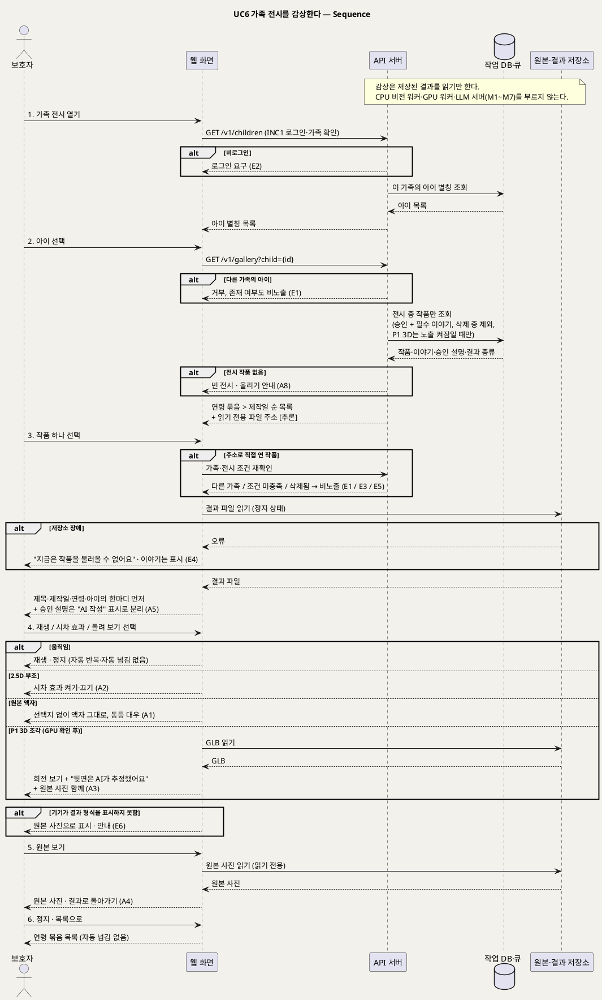

**[「UC6 가족 전시 Sequence」 PlantUML 뷰어로 열기](https://plantuml.sumzip.com/plantuml/svg/eNp9VltPG1cQft9fMXJfbAGm5tYKqTTcgpCgQkp5KhXagEusOCaxTaqqamVgQRZY4lI7GFi7dmtqQI5qgoNt4b7wU_LoM_sfMueyxjdVQnj3nDkz33zzzZx9EgrrwfDGKz-EvG-WN4K-Zd23vKb7_d7gL8tfjmihl77Aaz2ov4Ln-srLteD6RmB1ct2_HoQvng4-9UxPNFmEXuir6z_7Amvwk-4PebWwL-z3wuLkCNSLEczeAGYM3DfZRY0WDnF700qYbD8HnyJxeOZ9s-ENrHg1TV8Jk3cHuy1ZyQqmDx2gh2BBD3oDYY3ihH0rvtd6IAwOPK-CdRpnVyVhsjjbuj2-MAtomOyDIbbpVVvVw_pzPeSls-kjPNmBqYmHsrUpQ0xNtLs_ZLeVh3L9Q7F-WyPsEUxf4G5MGD8jjIQ1sB72wvpbb5C771WroLLDVESdYocmSDc8d0z9V68UWT4GMn83nZhcWARWNYggwPMY3uceyjO0ZD_Pzc2rXJzznt_nv3JxP-wuwi5KmKcoiT22FxeuvIFV4Kg0TVIGfWPEDIyCx91aBcCTEsHQaJNMOFmjMDP9PfS_9fSvvPD5V-k0OGe_m_QAy5r1cgVTnAzpwjpN0KtL0_1hDrthQJlwT3120MYG4Fm8_rEAzukBF8eoCbMxIp2sMFVS2DCVpGQMvsBuDay-B8wWrbOYRnZ9DZi2xfUVy6a0loCth5VFOxUDbtsOjYy1nerKgeqBbwUX3_zqW_1NZrufYxeVDrjtiddvilSeXoJfwnSBuC7wah0Ygq2dCt6ZRIWnCxWqNrkjIIlax1EuE8nBUsCJe1XOZQ8Jx8BokhOHiRpVkQJtvceMOpgx8bTSuxRY8MDgFAkDVESsmZg_xBRJJxEjx642WkXAh3LDKz3KgGjk2PXOYyv8tcMukoIOG684SmnuYirWIYJq1LZ7KAMmC-yfAnkn5qJsqwTO8a-beGgU8qTIMlVghTvyCGMiKepZwo5RUxV2KdCjmkn4P7sCKxYTJn_XqFHhB7yLs2zmxw4BDLptxFYiybaStg5ERuIsCRcwv4mZI45EWVNizUqRGiCSFAfZYv2GJJUuyO7ooKFZOdBv27N_qTZXakkUkR1ewqfd41ap0O70IP83LMmSQMTA4VBkYez0JSdOzCTEdKBBu226VL3UFAP-k8gQSOnjkfhkjhdXpkqLirpRGoj5SL0SFVNN0IEpkvNdlP1ZoJqC0CPV_12JWt0hKm3riEvQOjI5Sc7pIYm_LWpLAlp7aE7K9RVnWomAHoU-6Fe0H29EPkzzURYnuV_WKE-hjmb9cuSO8VmOHo0bh4LEK83uDNIkKZHIbdfKENdKAbdTvD77JhYvwTq75GD7gR3EWCZH06YkNNgkovMIV0_a6MKj8sYJkvVx0iXHDk6BFZPs9iOlpF6NZL0aUT1FpNGNSpNreIrPfdJON88t8KjbRQ-zTUOoYXxAOZEXG7VfliJ1cyPyEMrhsUvKEmiSs1iE-OqlxE_ZHzdAr3jGXXuUazFxhLKLm-DkN5jsBbDODVejfWzVzsxNKK12ypD2ukCjMcivSEV4D30lHJfp_ueVHZ-lzgLqeGLVehdVOhQiUPluFTBvkEwu6_dJwjwohcjLRc74H523dZhM4H6KC1yKhMYE54Nd39PxbpQ1h0CzxkWlFM_rrAbd9IgM2S6xYbftQCbW1tyt-BvN3Tz4XO391HJG-1-4HKH6OOGtcBCjliIqpGaGOhtixG0Llw7KQSwz7gzTMsOl6aPaW-X9hIihr9DPa7cwnA==)** — 클릭 시 브라우저로 연결됩니다.

기본흐름 1~6단계는 시퀀스의 번호 붙은 주요 메시지 `1.`~`6.`과 1:1로 대응한다. A6(제목·제작일로 다시 찾기)과 A7(다른 아이로 전환)은 2단계를 대신하는 진입 경로라서 시퀀스에서 생략했다. E7(3D 노출 전 직접 접근)은 E1·E3과 같은 "주소로 직접 연 작품" 분기에서 거부된다.

#### UML 노트

| 항목 | 적용 |
|---|---|
| 액터 | 아이는 계정 없이 함께 보는 이해관계자라 actor로 그리지 않았다. 원본·결과 저장소는 경계 밖 secondary actor다. 모델(M1~M7)은 내부 구성요소이며 이 UC에서 호출되지 않아 lifeline을 두지 않았다 |
| 선후 관계 | UC4·UC5(필수)와 UC10(선택, P0.5)은 전시 조건을 만드는 선행 UC이며 include/extend 관계가 아니라서 노트로 표시했다 |
| 대체 진입 | 결과 종류별 감상(A1 액자·A2 2.5D·A3 P1 3D)은 같은 목표 안의 다른 경로라 «extend»가 아닌 대체흐름으로 처리했다. 3D는 구간(P1)과 GPU 조건만 다르다 |
| Generalization | 결과 종류를 상속으로 나누지 않았다. 동등 대우 원칙(BR-EXH-04)상 우열·하위 유형 관계가 없다 |
| Sequence | lifeline 이름은 공통 기준 §3을 따랐다. 접근 차단(E1·E2·E3·E5)과 저장소 장애(E4), 표시 불가(E6)를 `alt`로, 결과 종류 4가지를 `alt`로 나눴다. 결과·원본 파일은 [추론] API 서버가 내준 읽기 전용 주소로 웹 화면이 저장소에서 직접 읽는다 |

---

### 7.7 UC7 작품 또는 아이를 삭제한다

#### 범위·개요

보호자는 작품 하나, 또는 아이 한 명(그 아이의 모든 작품 포함)을 삭제한다. 아이 작품 사진에는 이름·유치원·얼굴이 담길 수 있고, 한 장의 사진은 여러 모델을 거치며 마스크·깊이·움직임·부조·설명 같은 파생 결과를 여러 개 남긴다. 그래서 삭제는 **빠짐없이, 정해진 순서로** 이뤄져야 한다(BR-DEL-01).

1. 새 작업을 막는다.
2. 그 작품의 모든 단계 작업(분리·판정·움직임 렌더·깊이·부조·설명·3D)이 끝났거나 취소됐음을 확인한다. 단계 작업은 서빙 3종(CPU 비전 워커·GPU 워커·LLM 서버)에 흩어져 있다.
3. 원본·마스크·깊이·중간·최종 결과·설명 초안과 승인본·임시 파일을 지운다.
4. 작업 기록에서 작품 연결과 자유 입력을 제거하고 **집계 필드만** 남긴다(BR-DEL-02).

실행 중인 단계 작업이 있으면 **EXT1 실행 중 처리 취소**가 끼어든다. 백업에 남는 사본은 P0 범위 밖이며 운영 전에 정한다(BR-DEL-04, U15).

| 항목 | 값 |
|---|---|
| 대상 시스템 | 우리 아이 미술관 (P0) |
| 상위 프로세스 | 모든 작품 상태에서 언제든(`접수됨`·`판정 중`·`확정 대기`·`처리 중`·`확인 대기`·`승인됨`·`전시 중`·`처리하지 못함`) |
| 원천 근거 | Intent [부정적 영향] 동의 오판·삭제 누락 · [핵심 데이터] 삭제 시 처리 · spec FR-10 · FR-11 |
| 엔드포인트 | `DELETE /v1/artworks/{id}` · `DELETE /v1/children/{id}` ([추론] 이름·형식은 `/speckit.plan`에서 확정, U8) |
| 핵심 UseCase | 1개 (UC7) + 공통 1개 (INC1) + 확장 1개 (EXT1) |
| 주요 액터 | 보호자 · 원본·결과 저장소(보조) |

삭제 범위는 아래와 같다.

| 구분 | 항목 | 근거 |
|---|---|---|
| 지운다 — 저장소 | 원본 사진 · 작품 마스크·컷아웃(M1) · 깊이 결과(M5) · 중간 결과(판정용 관절 좌표 등, M3·M4) · 최종 결과(움직임 GIF/MP4(M3) · 2.5D 부조 · P1 GLB(M7)) · 임시 파일 | Intent [핵심 데이터] · [비용] 저장 항목 · BR-DEL-01 |
| 지운다 — 기록 | 작품 기록(제목·제작일·제작 당시 연령·아이의 한마디·판정 제안과 확정값·결과 종류·보호자 결정) · 작품 설명(키워드·선택 태그·초안·승인본, P0.5) · 아이 삭제면 아이 별칭 | Intent [핵심 데이터] · BR-DEL-01 |
| 남긴다 — 집계 필드 | 단계 종류 · 모델 ID·버전 · 상태 · 시도 횟수 · 처리 시간 · 낮춤 원인 또는 오류 분류 · 결과 종류 · 결과 원인 분류. [추론] 판정 수정률 계산용 "수정 여부"도 남긴다 | BR-DEL-02 · BR-OPS-02 · BR-FBK-04 |
| 대상 아님 | 모델 평가 묶음(팀원이 만든 작품) · 모델 매니페스트 · 운영 지표(라벨에 작품 번호 없음) · 외부 모델 엔드포인트 입력(처음부터 보관하지 않음) · 백업 사본(P0 밖) | BR-MDL-04 · BR-MDL-01 · BR-OPS-04 · BR-API-05 · BR-DEL-04 |

#### UseCase Diagram

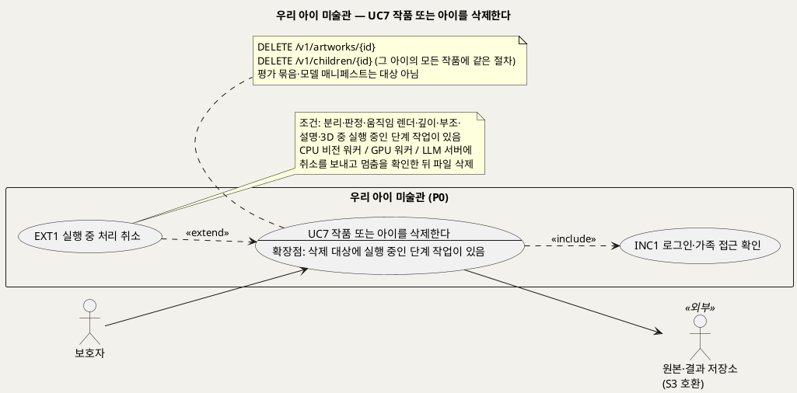

**[「UC7 삭제 UseCase Diagram」 PlantUML 뷰어로 열기](https://plantuml.sumzip.com/plantuml/svg/eNqNVFFL22AUfc-vuLgXfdAqPggiIqt1DNwQdLAHQWIbazAmI0nnhgjVxVHbulVnZzubEiFOJ45VW5rKfOpP2WO-m_-w-6V16x4GvqW599x7zrmnmTJMUTdT6wqk4ktaSl9akxPGUlJUFEl_uzQ8JhhrsvpK1MV1WBbja0ldS6mJqKZoOjyaGZ0ZiT3u6TBWxYS2IatJWBEVQxIUacUEUwNdTq6akJB1KW7KmiqYsqlIgF9q7OsVYNFCuwHsRwszjt9Iw6_0EbyIjgFWD4LDDLBSgWWPum3s7A5w5zs6laBYYTlXEMS4SVz6WL0RlFpYLfSBaMCcqEuqeV_DkwKrt9qef1Pz64R30lg9w_f5RbV_fhQIFpRLAyFunvolmJjAcos105OTgsApi2qS6Pb9j2__3DChNwWAlCHFRYNaH0p_UR0cXFSDcpETcgrj3SKwfBrfbeNxATDnBp_3AN0DtFvAchd-3eKj8XiXs8BqBu18yJ129lJ4-jw6Auy04nstQpL4WhpPr0n8ge_dAV9pt0Icb-wFxl4ujPSsBbwphbK9C7IsRPAOYUsQOi7D4OBkuJyLHhqaDAfCOLkoq3EllZDIxnAmr_EeXpLemJKaoAp_wQeEzguCqplSNy7aSmcRAJ7W_OvGOLCmRUzaXpAvoFNse3iSxvNtrFrAnDzbPyKRt1lype3R8QjU9jjYctnlbtsbne6oeYifBIvOvQB2a6FD1ZM8_nQhAk_o3Z8fs7PPaHaF3Vh0Jr4n9IcfmKLIdhp-3QH2LYNNF22r6zcdHdihC0E-j_Z9EgQyArjujvhlzTS1da6-c9Dp2GxsIQaR1yMR-qNuaPqaEdmUE1v_luKrspKga4Ql6KejdxOHdgnY5QX75HQDyUPl18popykLGaxdDNCk4OMe5QPYVZPUk30E2Cd3zl2WywQfSph1g2yLx7gTTD6b5Up_mU_RE31DhN-qfBut)** — 클릭 시 브라우저로 연결됩니다.

##### 다이어그램 쉽게 읽기 (유저 관점)

- **누가 쓰나** — 보호자만 삭제할 수 있다. 운영자나 팀원은 지울 수 없다. 원본·결과 저장소에서 사진과 결과 파일이 실제로 지워진다.
- **무슨 순서로** — 삭제를 누르면 작품이 곧바로 화면에서 사라진다. 그 뒤 시스템이 돌아가던 처리를 모두 멈추게 하고, 사진·결과·설명·기록을 정리한다.
- **«include» = 항상 함께** — 삭제할 때마다 "로그인·가족 접근 확인"을 거친다. 내 가족의 작품과 아이만 지울 수 있다.
- **«extend» = 특정 상황에서만** — 지우려는 작품이 아직 처리 중일 때만 "실행 중 처리 취소"가 끼어든다. 움직임을 만드는 중이든, 입체 부조를 만드는 중이든, 설명을 쓰는 중이든 모두 멈춘 것을 확인한 뒤에 파일을 지운다.
- **Generalization(◁)** — 없다. 작품 삭제와 아이 삭제는 같은 규칙을 쓰고, 아이 삭제는 그 아이의 모든 작품에 같은 절차를 반복한다(대체흐름 A1).

| 기호 | 의미 |
|---|---|
| 사람 모양(actor) | 시스템을 쓰는 사람 또는 외부 구성요소(`<<외부>>`) |
| 타원(usecase) | 액터가 이루려는 목표. `--` 아래는 확장점 |
| 사각형(rectangle) | 시스템 경계 |
| 점선 `<<include>>` | 항상 함께 수행되는 하위 행위(UC7 → INC1) |
| 점선 `<<extend>>` | 확장점 조건일 때만 기반 UC에 끼어드는 행위(EXT1 → UC7) |
| 메모(note) | 확장 조건과 엔드포인트·대상 범위 보충 |

#### Actor

| 구분 | 액터 | 이 UC에서의 역할 | 원천 근거 |
|:--:|---|---|---|
| Primary | 보호자 | 작품이나 아이의 삭제를 요청하고 확인한다. 삭제 권한은 보호자에게만 있다 | spec FR-10 · 공통 기준 §6 · BR-ACC-04 |
| Secondary | 원본·결과 저장소(S3 호환) | 원본·마스크·깊이·중간·최종 결과·임시 파일을 실제로 지운다 | Intent [핵심 이네이블러] 기반 · 공통 기준 §6 |

자체 호스팅 모델(M1~M7)과 서빙 3종(CPU 비전 워커·GPU 워커·LLM 서버)은 시스템 내부 구성요소다. 액터로 두지 않고, 취소 신호를 받는 시퀀스 lifeline으로만 표현한다(공통 기준 §6). 서비스 운영자는 이 UC의 액터가 아니다. "삭제 미완료" 집계는 UC8에서 본다.

#### 관련 UseCase

| UC ID | 유스케이스명 | 관계 | 원천 근거 |
|:--:|---|---|---|
| UC7 | 작품 또는 아이를 삭제한다 | 본 문서 | spec FR-10 · FR-11 · Intent [부정적 영향] 삭제 누락 |
| INC1 | 로그인·가족 접근 확인 | UC7이 «include» | 공통 기준 §6 · BR-ACC-01 · BR-ACC-02 |
| EXT1 | 실행 중 처리 취소 | UC7을 «extend»(확장점: 삭제 대상에 처리 중인 단계 작업이 있음) | spec FR-10 · Intent [부정적 영향] "실행 작업 종료 확인" |
| UC4 | 처리 결과를 확인하고 전시 방식을 고른다 | 다시 찍은 이전 작품이 이 삭제 규칙을 따른다(BR-APR-05) | 공통 기준 §8 |
| UC8 | 서비스 상태와 모델별 운영 지표를 확인한다 | 삭제 미완료 집계를 운영자가 본다(BR-DEL-03) | spec FR-10 · FR-26 |

> **쉽게 말하면** — 보호자가 "삭제"를 누르면 작품이 바로 화면에서 사라집니다. 뒤에서 움직임·입체 부조·설명을 만들던 작업은 모두 멈추고, 원본 사진과 잘라 낸 그림, 깊이 정보, 결과물, 설명, 임시 파일이 모두 지워집니다. 운영 통계용 숫자만 남고, 누구의 어떤 그림이었는지는 남지 않습니다.

#### 유스케이스 기술

| 속성 | 내용 |
|---|---|
| **ID** | UC7 (spec FR-10, FR-11) |
| **유스케이스명** | 작품 또는 아이를 삭제한다 |
| **액터** | 주: 보호자 · 보조: 원본·결과 저장소 |
| **사전조건** | (1) 보호자가 로그인되어 있다(INC1). (2) 삭제 대상 작품이나 아이가 이 가족 공간에 있다(BR-ACC-01). (3) 요청자가 보호자 역할이다(BR-ACC-04). (4) 대상 작품이 이미 `삭제 중`이 아니다(이미 `삭제 중`이면 같은 삭제를 이어 간다 [추론]) |
| **사후조건** | (1) 대상 작품은 전시·목록 어디에도 없다. (2) 그 작품의 새 단계 작업은 등록되지 않고, 실행 중이던 단계 작업(분리·판정·움직임 렌더·깊이·부조·설명·3D)은 모두 멈췄으며 멈춘 뒤 새 결과가 생기지 않았다. (3) 원본·마스크·깊이·중간·최종 결과(GIF/MP4·부조·GLB)·임시 파일이 저장소에 남아 있지 않다. (4) 작품 기록과 설명 초안·승인본이 없다. (5) 남은 작업 기록에는 작품·아이 연결, 저장 위치, 자유 입력이 없고 집계 필드만 있다(BR-DEL-02). (6) 아이 삭제였다면 그 아이의 모든 작품에 (1)~(5)가 적용되고 아이 기록(별칭)도 없다. (7) 끝내 완료하지 못한 삭제는 식별 정보 없이 "삭제 미완료"로 집계된다(BR-DEL-03). (8) 모델 평가 묶음·매니페스트·운영 지표는 바뀌지 않는다 |
| **기본흐름** | ↓ 별도 기본흐름표 (작품 하나를 삭제하는 경우 기준. 실행 중인 단계 작업이 있으면 3단계에서 EXT1) |
| **대체흐름** | A1. 아이 삭제 — 보호자가 아이 관리 화면에서 아이를 삭제하면(`DELETE /v1/children/{id}`) 확인 창에 그 아이의 작품 수를 함께 보여 준다 [추론]. 확인하면 그 아이의 모든 작품을 한꺼번에 `삭제 중`으로 바꿔 전시에서 빼고, 작품마다 3~5단계를 반복한 뒤 아이 기록(별칭)을 지운다(spec FR-10). 처리 중인 작품이 섞여 있으면 작품마다 A2를 거친다. A2. 실행 중인 단계 작업 있음(EXT1) — 3단계에서 실행 중인 단계 작업을 찾으면 그 작업이 속한 서빙군에 취소를 보낸다. CPU 비전 워커에는 분리(M1)·판정(M2·M3·M4)·움직임 렌더(M3)를, GPU 워커에는 깊이·부조(M5)와 P1 3D(M7)를, LLM 서버에는 설명(M6, P0.5) 요청 중단을 보낸다. 각 서빙군이 멈춤을 확인하면 4단계로 간다. 멈춘 작업은 결과를 저장소에 쓰지 않고, 임시 파일은 BR-PRC-08에 따라 정리 대상이 된다. [추론] 워커는 결과를 쓰기 직전에 작품이 `삭제 중`인지 다시 확인한다. A3. 삭제 확인 취소 — 확인 창에서 "취소"를 누르면 아무것도 바뀌지 않는다. [추론] 되돌릴 수 없는 작업이라 확인 단계를 두는 것은 설계 판단이다. A4. 대기열에만 있는 단계 작업 — 아직 워커가 가져가지 않은 단계 작업은 2단계에서 대기열에서 빼고 취소로 표시한다. 취소 신호를 보낼 필요가 없다 [추론]. A5. 다시 찍은 이전 작품 — 결과 확인에서 "다시 찍기"(UC4, EXT2)로 닫힌 이전 작품을 지울 때도 같은 절차를 따른다(BR-APR-05) |
| **예외흐름** | E1. 저장소 파일 일부 삭제 실패 — 원본·마스크·깊이·결과·임시 파일 중 일부를 지우지 못하면 자동으로 다시 시도한다. 끝내 완료되지 않은 건은 "삭제 미완료"로 집계하되 이미지·객체 키·작품 번호를 넣지 않는다(BR-DEL-03, BR-OPS-04, BR-PRV-01). 보호자 화면에서는 이미 사라진 상태를 유지한다. 재시도 횟수·간격은 `자료 없음 — 확인 필요`. E2. 취소 무응답 — 서빙군이 취소에 응답하지 않으면(예: 보관 처리된 TorchServe 기반 M3 엔진이 멈춤, Intent [핵심 장벽] 서빙 기반) 그 단계의 시간 상한(BR-PRC-06, BR-SRV-03)이 지날 때까지 파일 삭제를 미룬다. 그동안 그 단계의 재시도와 다른 워커의 이어받기를 막는다(BR-PRC-05 예외). 시간 상한 뒤에 늦게 도착한 결과는 저장하지 않고 버린다. 이 대기는 인프라 실패로 집계하지 않는다 [추론]. 움직임 렌더 외 시간 상한은 `자료 없음 — 확인 필요`(U6). E3. 권한 없는 요청 — 다른 가족의 보호자, 서비스 운영자·팀원, 외부 클라이언트(API 키)가 삭제를 요청하면 거부하고 아무것도 바꾸지 않는다(BR-ACC-01, BR-ACC-03, BR-ACC-04, BR-API-06). E4. 로그인 만료 — INC1에 따라 다시 로그인하게 하고 삭제는 시작하지 않는다(BR-ACC-02). E5. `삭제 중` 전환 실패 — 작업 DB 장애로 `삭제 중` 전환 자체가 실패하면 "삭제되지 않았어요"라고 안내하고 아무것도 바꾸지 않는다. [추론] 부분 삭제를 막기 위한 판단이다. E6. 삭제 중 작품에 대한 다른 요청 — `삭제 중`인 작품에 확정(`/confirm`)·결과 선택(`/decision`)·이야기(`/story`)·설명 생성(`/captions`) 요청이 오면 받지 않는다. 새 작업 차단(BR-DEL-01)의 일부다. `삭제 중`은 삭제 절차가 도는 동안의 과도 상태로, 이어받기(BR-PRC-05)에서 빠지고 취소된 단계 작업은 "취소"로 분류해 지표에서 뺀다(BR-DEL-05) [통합 D4]. E7. 백업 사본 — 백업에 남는 사본의 보존·삭제는 P0 범위 밖이다. 운영 전에 정할 항목으로 남기고, 화면에 "백업까지 지웠다"고 표시하지 않는다(BR-DEL-04, U15) |
| **포함/확장** | «include» INC1 로그인·가족 접근 확인 · «extend» EXT1 실행 중 처리 취소(확장점: 삭제 대상에 처리 중인 단계 작업이 있음) |
| **우선순위** | High — 아동 정보 통제의 마지막 수단이다. Intent [부정적 영향] "동의 오판·삭제 누락"이 순서를 못 박았고, 모델 7종이 파생 결과를 여러 개 남기므로 누락 위험이 옛 설계보다 크다 |
| **사용빈도** | `자료 없음 — 확인 필요` (사용 관찰 전. 다시 찍기로 닫힌 이전 작품 정리까지 포함하면 접수 건수에 비례할 수 있다 [추론]) |
| **업무규칙** | BR-DEL-01, BR-DEL-02, BR-DEL-03, BR-DEL-04, BR-DEL-05 [통합 D4], BR-ACC-01, BR-ACC-02, BR-ACC-03, BR-ACC-04, BR-API-06, BR-APR-05, BR-CAP-04, BR-PRC-05, BR-PRC-06, BR-PRC-08, BR-SRV-03, BR-OPS-04, BR-PRV-01 |
| **특별 요구사항** | 완전성: 삭제 시험(서빙 3종 각각에서 처리 중 삭제 포함)에서 삭제 완료 뒤 남은 원본·마스크·깊이·결과·GLB·임시 파일 0건, 남은 설명 초안·승인본 0건, 남은 작업 기록의 작품 연결·저장 위치·자유 입력 0건. 즉시성: 요청 즉시 전시·목록에서 사라진다. 비동기성: 파일 삭제는 요청 응답을 기다리게 하지 않는다(`202` 수락 [추론]). 개인정보: "삭제 미완료" 집계와 로그에 이미지·객체 키·별칭·제목·한마디·키워드가 없다(BR-PRV-01, BR-OPS-04). 권한: 삭제는 보호자만 할 수 있다(BR-ACC-04). 설명 승인본의 "승인 후 고정"(BR-CAP-04)은 재생성·수정을 막는 규칙이며 삭제를 막지 않는다 [추론] |
| **비고** | 원천 추적: Intent [부정적 영향] "동의 오판·삭제 누락: 삭제는 새 작업 차단→실행 작업 종료 확인→원본·중간·최종·임시 파일 삭제 순" · Intent [핵심 데이터] "삭제 시 원본·마스크·중간·최종 결과·임시 파일을 지우고 작업의 작품 연결과 자유 입력을 제거한 뒤 집계 필드만 남긴다" · Intent [핵심 장벽] 서빙 기반(보관 처리 엔진) · Intent [비용] 저장 항목(원본·마스크·GIF/MP4·깊이 결과·GLB) · spec FR-10(즉시 제외·새 처리 금지 / 실행 중 취소 후 삭제 / 파일 0 / 집계 필드만 / 자동 재시도·미완료 집계 / 아이 삭제 전파 / 백업 범위 밖) · FR-11(임시 파일) · 공통 기준 §3(서빙 3종·lifeline) · §4(엔드포인트) · §5(`삭제 중` 상태·단계 작업) · §8(BR) · §10(U1·U6·U8·U15). 개정: 옛 문서의 lifeline "처리 담당"은 서빙 3종으로, "엔진 버전" 집계 필드는 "모델 ID·버전"으로 바꿨다. 미결: 공동 보호자 모델이면 누가 삭제할 수 있는지 달라질 수 있다(U1) |

#### 기본흐름 (Basic Flow)

| 단계 | 액터 행위 | 시스템 행위 |
|:--:|---|---|
| 1 | 보호자가 작품 상세에서 "삭제"를 누른다 | INC1로 로그인·가족 접근과 보호자 권한을 확인하고, 되돌릴 수 없다는 확인 창에 지워지는 항목(사진·결과·이야기·설명)을 보여 준다 |
| 2 | 보호자가 삭제를 확인한다 | `DELETE /v1/artworks/{id}`를 받아 작품 상태를 `삭제 중`으로 바꾸고, 전시·목록에서 즉시 빼고, 새 단계 작업 등록을 막고, 대기열에만 있던 단계 작업을 뺀다. 삭제 접수를 응답한다 |
| 3 | 보호자는 목록으로 돌아가 작품이 빠진 것을 본다(기다리지 않는다) | 그 작품의 모든 단계 작업(분리·판정·움직임 렌더·깊이·부조·설명·3D)이 끝났는지 작업 DB에서 확인한다. 실행 중인 작업이 있으면 EXT1(A2) |
| 4 | 보호자는 다른 작품을 보거나 화면을 닫아도 된다. 삭제는 계속된다 | 원본·결과 저장소에서 원본·마스크·깊이·중간·최종 결과(GIF/MP4·부조·GLB)·임시 파일을 지운다 |
| 5 | 보호자 추가 조작 없음. 같은 아이의 다른 작품 전시는 그대로 볼 수 있다 | 작품 기록(이야기·판정 제안과 확정값)과 설명 초안·승인본을 지우고, 작업 기록에서 작품·아이 연결과 저장 위치·자유 입력을 제거해 집계 필드만 남긴다 |
| 6 | 보호자가 삭제 완료 안내를 확인한다 | "삭제했어요"를 보여 준다. [추론] 화면은 삭제 상태 조회로 완료를 안다(U8) |

#### Sequence Diagram

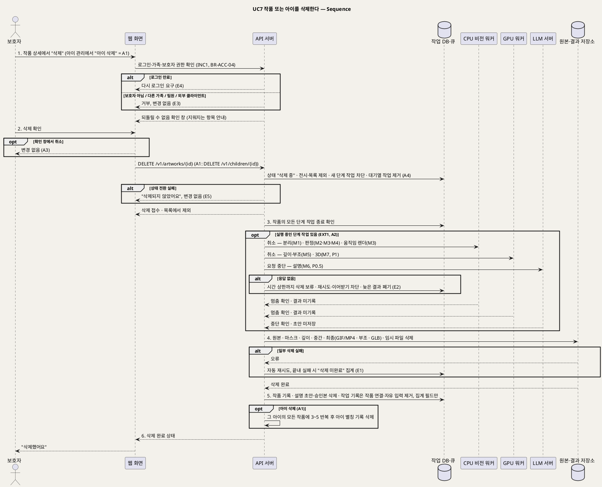

**[「UC7 삭제 Sequence」 PlantUML 뷰어로 열기](https://plantuml.sumzip.com/plantuml/svg/eNqVVt1PIlcUf5-_4oS-QOIXomtiUrOKSEykMd016ZuZFeoSWXABu2maNrCOGwrTCF0RLB_BFkWNpqygQOq--Kf0ce6d_2HPvXMHBuxLH0yYez7uOb_f75zr81hcjsb33oQgFni7GdmLbu4E_bHNbTkUCkR_3Jyak2I7wfCuHJXfwCt5a2c7GtkL-92RUCQKX624VpyeJYtH7LXsj7wLhrfhezkUC0jxYDwUgA33HNBqTv89BaSYJekjoHmFVtrk7AHo-xtaK-v5MsnU4d_EEbwIvN0LhLcCkiRvxfESG2m19WKXVrM2kGOwLkcD4biE18WDW8FdORwHGy31QD85Ipdt7rKxOmxeXF8FqpTJrcLN-Cn55bj8So4FMLaao4UDWF567OhJ44rlpeF49_oGkJ5CawrQkkr_qXMvPB1286Kbxe4dta-t-axl4Ke1jFKWtLqPHe22qbUQlVqCVs_oB5W7vkAcEA-jdRhfwA5hHpwTJqh0P0mVLi1kMT2m4ojawG6ADFo7Qc6v-1bj0HT6GhadDgnzYVaG0zyQ07LW6dIKK6aZoKefHjt9BkC7V5EqBDuPDmBf_cbtHIOlb8cX3e7xqRmHJIfigwRAGir5S5WAZx4360aiaaZscaN_HGl312D3YIIAqgYG92G1JFOESRZEzrpgVITfuppAyPAHPemS-wToyTapPGBn9Lirp7ujd2qfmug1hpkT2u1noIUPtKLijS68MeyXhuvLFsmhSs4RpFTRdBUd0-ZnxLWRYDw3EkzJev6GXF1ioSnyvu14QtL0hIBaZJAiu3FLMsEK7Vwg11j0hlGHSDI_Wu-iqNfK17JnzfPSA5M_OCdRbe8i0Z3Y5E9B_8_o7Ryybr0OhvyYl1sdRs8LKHbMgQLS9_vSAVrP2eCxgypUkCnk_-qSnFbws4xoc8M-TnLmQmspIOaHNi_wgNmImtC6TVpo9021MsKP5Qh9iMswuX6C-GbqunoxypeoBKlAmBHcNM0X6XEblWJ7SuLsf5BodlLLMRJZWbwHE2_eiTSEgcscJ1opovcF-Vgb7fHPA5SzlUhW_PGvDC8u92Hvasoo77uXOCOL0w6zxwW2OliJnHS-88i9giNq9zkdrFRdzdJa3u6bfuz4XPg3w09pKUEbSVpVgNRU8tuR3eeypPSOptR6aZwG5O4eJ6Zp983yJK5lu29uDNadllC2l-bZENLbG9YK45FloEqdXB3Yfc_Qf2pilkVw-irocSfQx7N-HkNJmbLWVDjH-bLWUzl9Bhc41eSMc0Gr1-hHDpXHDp_YNmmWUDNWEaXPaSUBYhvqh1lmtns4iIxr4BiOD5bWZYre183BwgQikvzdxUgkHiO8_zuCITOIENAMImg7hWPPIox1zVVoaorvbIyaQVnx3c7baqRouq4nr_mFnCGeqJ5joLFfd2VUmd27ujLpW5_hIZw_9su7tmQIocqmElWi0or5fhqDVXlgq9CUvjlYRiWWPoq4SovSCG_VLDk8GTCDU5as4EYTaRiv_fXAGj5RcBRsQBs5Jnm7x2nM4JO7RC3cfXjeZvvPl4E3b41LTgCL4kj3EGqGncjDu-fTZcQwjZhvYKGJDGJMNUvLNTw9ILUzsXvGzDp1fE4-lvFZMqbX-hSydWkZCqN8fKCEl2UpiC1RyILrl1kgzSJp3YFeUsx8pKXQ3o3ZleBnIA1zQz2bGEZH7EVp9AkQqOvHKbEApeeYDP9hk74AbWW5NQ==)** — 클릭 시 브라우저로 연결됩니다.

기본흐름 1~6단계는 시퀀스의 번호 붙은 주요 메시지 `1.`~`6.`과 1:1로 대응한다. EXT1(실행 중 처리 취소)은 3단계 뒤 `opt` 프래그먼트로 표현했고, 취소는 모델이 속한 서빙군 lifeline마다 따로 보낸다. 모델 평가 묶음과 매니페스트는 가족 데이터가 아니므로 시퀀스에 나오지 않는다.

#### UML 노트

| 항목 | 적용 |
|---|---|
| «include» | INC1은 모든 삭제에서 항상 수행된다. 화살표는 UC7 → INC1 방향이다 |
| «extend» | EXT1은 기반 UC(UC7)의 확장점 "삭제 대상에 실행 중인 단계 작업이 있음"에서만 끼어든다. 화살표는 EXT1 → UC7 방향이고 조건은 note로 적었다 |
| 작품/아이 삭제 | 두 삭제는 같은 목표(내 가족의 기록 지우기)의 변형이라 Generalization 대신 대체흐름 A1(반복)로 표현했다 |
| 내부 구성요소 | 모델 M1~M7과 서빙 3종은 액터가 아니라 시퀀스 lifeline이다. 메시지에 모델 ID를 적어 어느 서빙군에 취소가 가는지 보인다 |
| 시스템 단계 | 3~5단계는 시스템이 주로 일하지만 액터 열에 보호자가 기다리지 않는다는 사실을 적어 시스템 독백을 피했다 |
| Sequence | 기본흐름 1~6과 메시지 `1.`~`6.`이 1:1로 대응한다. 대체·예외는 `alt`/`opt`에 A·E 번호를 붙였다 |

---

### 7.8 UC8 서비스 상태와 모델별 운영 지표를 확인한다

#### 범위·개요

서비스 운영자는 두 가지를 확인한다. 첫째는 API 서버가 살아 있는지(**생존**, `/live`)와 작품을 받아 처리할 준비가 됐는지(**준비**, `/ready`)다. 준비는 작업 DB·큐와 원본·결과 저장소, 그리고 모델 M1~M7 각각의 상태로 나눠 보여 준다. GPU가 없어 M5(깊이)를 CPU로 돌리는 상태나 M7(3D)을 노출하지 않는 상태도 "고장"과 구분해 표시한다. 둘째는 `/metrics` 에 기반한 서빙 지표다. 이 UC의 목표는 **가족의 이미지·이야기를 보지 않고도** 모델 품질 문제(낮춤)와 인프라 장애(재시도·결과 미도달)를 구분하고, 어느 모델·어느 서빙군에서 문제가 나는지 찾는 것이다(Intent [미션] "어떤 사진을 올려도 결과가 돌아오게 하는 것").

| 지표 | 정의 | 분리 단위 | 원천 |
|---|---|---|---|
| 첫 결과 승인율 | 좋아요 ÷ 결과가 도달한 작품의 첫 결정. 재시도 소진 뒤 원본 액자로 건 건은 분모에서 뺀다 [통합 D2·D14] | 결과 종류(움직임·2.5D·액자) [추론] | Intent [미션] |
| 판정 수정률 | 보호자가 제안과 다르게 고른 건 ÷ 제안 제시 건. 제안 없이 직접 확정한 건(BR-SUG-05)은 분모에서 뺀다 [통합 D14] | 제안 문구 종류 [추론] | Intent [미션] · [핵심 활동] 4 |
| 모델별 낮춤률 | 움직임→2.5D, 2.5D→액자, 설명→템플릿 건 ÷ 해당 모델 시도. P1 3D→2.5D는 M7 노출 뒤에만 센다 | 모델 ID·버전, 낮춤 구간(어느 단계→어디로) | Intent [미션] · 공통 기준 §5 |
| 설명 규칙 검사 실패율 (P0.5) | 규칙 검사에서 걸린 생성 ÷ M6 생성 시도 [추론 분모] | 모델 버전, 출처(LLM/템플릿) | Intent [미션] |
| 모델별 처리 시간 p95 | 단계 작업 처리 시간의 95백분위 | 모델 ID·버전, 서빙군 | Intent [미션] |
| 재시도율 | 인프라 재시도가 1회 이상 난 단계 작업 ÷ 해당 모델 단계 작업 [추론 정의] | 모델 ID, 오류 분류 | Intent [핵심 데이터] 운영 지표 |
| 큐 적체 | 서빙군별 대기 중 단계 작업 수. CPU 비전 큐·GPU 전용 큐는 대기 작업 수, LLM 서버는 동시 처리 상한에 걸려 기다리는 요청 수 [추론] | 서빙 3종 | Intent [미션] · [핵심 활동] 6 |
| 결과 미도달 수 | 결과를 만드는 단계(움직임 렌더·깊이·부조·3D)를 첫 시도 포함 3회 시도하고도 실패해 `처리하지 못함` 이 된 건. 판정·설명 단계 소진은 인프라 실패로만 센다 [통합 D1]. **목표 0** | 모델 ID, 오류 분류 | Intent [미션] · 공통 기준 §5 |
| (보조) 삭제 미완료 수 | 자동 재시도 뒤에도 끝나지 않은 삭제 건 | — | 공통 기준 BR-DEL-03 |
| (보조, P0.5) 외부 엔드포인트 호출량·한도 초과 수 | `/v1/models/{…}` 엔드포인트별 호출 수와 요청 한도·크기 제한 초과 거부 수 [추론] | 엔드포인트 | Intent [핵심 장벽] 외부 엔드포인트 · [핵심 자원] 운영 시 |

원천은 이 지표들이 **정의와 검증 계획이며 달성 실적이 아니다**라고 명시한다(Intent [미션]). 결과 미도달 0건 외의 비율 지표에는 목표값을 두지 않고 기준선으로만 쓴다. 지표 라벨에는 이미지·작품 번호·식별 정보를 넣지 않는다(Intent [핵심 데이터]). `삭제 중` 작품에서 취소된 단계 작업은 "취소"로 분류해 모든 지표에서 뺀다(BR-DEL-05) [통합 D4].

| 항목 | 값 |
|---|---|
| 대상 시스템 | 우리 아이 미술관 (P0, 일부 지표 P0.5) |
| 상위 프로세스 | 운영 감시(가족 흐름 UC2~UC7·UC10, 외부 호출 UC12와 병행) |
| 원천 근거 | Intent [미션] 서빙 지표 · [핵심 활동] 3(`/live`·`/ready`·`/metrics`)·6(서빙 3종) · [핵심 자원] API 서버 연결·외부 사용·기반(Prometheus·구조화 로그) · [핵심 데이터] 처리 작업·운영 지표 · [핵심 장벽] 서빙 기반·자원·외부 엔드포인트 · [부정적 영향] 아동 이미지 유출 · spec v2.0 FR-12·13·14·26 |
| 핵심 UseCase | 1개 (UC8) + 포함 1개 (INC2) |
| 주요 액터 | 서비스 운영자 · 원본·결과 저장소(보조) |

#### UseCase Diagram

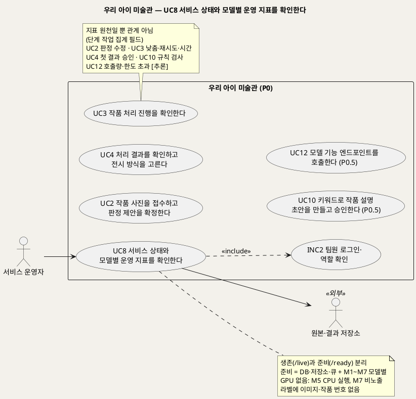

**[「UC8 운영 상태·모델별 지표 UseCase Diagram」 PlantUML 뷰어로 열기](https://plantuml.sumzip.com/plantuml/svg/eNqNVF1P02AUvu-vOMEbFgX5jMQoMaIYL1ASw5UYUrcyGktruk5jjKZAIYPNuCmVoR2WZDhU1GUsW0lITPZTvOx7-h88bzvGRyTxat37Pufp85zznN5IGaJupOcVSMdntLQ-E5-TlcRMUlQUSX8x0zcipJ7I6lNRF-fhsRh_ktS1tJoY0xRNhwvjg-P9t2-eQKTmxIT2XFaTMCsqKUlQpFkDDA10OTlnQELWpbgha6pgyIYiAX6ssi97gLaFpTqwXx5mXL9uwh9zHabGRgAthx1YuFYGXFoIlhzcNIF922VvPLZvUXUdiwuAFTMoOGznEIJNG0teYDssWxYEMW6QxK4THCEet_JdIKbg_tNUB_Ipz_a9VtOvVf39Q0DXxK0dXMmFuAcEkeDaNdz0WMMcHRUE7kFUk6S_6zwD3ZN9sS54KQCkU1JcTBH0HD_T6n8aCsUQyUnOu_fGBiDImWQA2LbjNz2Ct5rTKm78CGy3XR9WcuhpOQOAW4XgXQZwcQ8rZIAEuAXMFAO76O-702qQy6Nr06GDdoZfczrXPiXnDOdgh7NWDBtTsYIPq0e1Z6wMnq4dOiqKxnDSf6QHXQuzDrDqV8yWOCedsh3vmHDoNGF_HwSLZfyUY-8d6k5HmlVm35aJrp5p-2IVgpSJDXDtoKOSD7F3ONbm7u87Qz7QTiL4XpWt7QBurNN7grd7nGDNI_nUwaKHDeefdAPCK0GgDEJPz2g4Vp6P3t7RcFBwlQInq3ElnZAocfyKw8IoCoKqGVJ7obTZdiRwqYTb9e7LivxMioUhLpsUte7LuiQmXsSANSxqLQeG53Adbt1sNTtJbzWDhTxchIn-1xNXjleM8Hcmp8jaCpZyV2FiGMb432yZhnoJOPLAYsvcIyFZ6ZDVdnEjD7QLfBUqJr0h6jmrZagXbSJBUhPATUROHmuGoc1HVngkovgDZRprDpYOgf3OAy2VzzfEtli2SKBult0ND7YKuLFMNQX-L6Dr906M7qfCxYjymynyn1aT8wNb_ImNMhe2R2Fiby16zDp-1QqLeAa_w9F3IAxDVEhZ8psOHmzSpUkLE6IpA9GE2edV6qDN6YBixYsfYmOdbbuPjs3eoCf6zP4FheK6sw==)** — 클릭 시 브라우저로 연결됩니다.

##### 다이어그램 쉽게 읽기 (유저 관점)

- **누가 쓰나** — 서비스 운영자(팀원)가 쓴다. 원본·결과 저장소는 "쓸 수 있는 상태인지" 확인받는 대상이다. 모델 M1~M7은 시스템 안의 구성요소라 사람 모양으로 그리지 않고, 시퀀스에서 CPU 비전 워커·GPU 워커·LLM 서버로 나눠 보여 준다.
- **무슨 순서로** — 팀원 계정으로 들어와 운영자 역할을 확인받고, 서비스가 살아 있는지 → 모델별로 준비됐는지 → 기간별 지표 → 모델별 지표 → 원인별 분해 순서로 본다. 결과가 닿지 못한 건이 있으면 작업 단위로 추적한다.
- **«include» = 항상 함께** — 운영 화면을 열 때마다 "팀원 로그인·역할 확인(INC2)"이 함께 일어난다. 보호자용 로그인(INC1)과는 다르다.
- **«extend» = 특정 상황에서만** — 없다. GPU 없음·P0.5 미가동 같은 상황은 같은 화면 안의 표시 차이라 대체흐름으로 다룬다.
- **Generalization(◁)** — 없다. 아래쪽 UC2·UC3·UC4·UC10·UC12는 지표 숫자가 나오는 곳을 보여 줄 뿐, UC8과 선으로 이어진 관계가 아니다.

| 기호 | 의미 |
|---|---|
| 사람 모양(actor) | 시스템을 쓰는 사람 또는 외부 구성요소(`<<외부>>`) |
| 타원(usecase) | 액터가 이루려는 목표 |
| 사각형(rectangle) | 시스템 경계 |
| 실선 | 액터·외부 구성요소와 UC의 연결 |
| 점선 화살표 `<<include>>` | 기준 UC가 항상 함께 수행하는 하위 행위 |
| 노트 | 규칙·데이터 출처 보충 |

#### Actor

| 구분 | 액터 | 이 UC에서의 역할 | 원천 근거 |
|:--:|---|---|---|
| Primary | 서비스 운영자 | 생존·준비 상태와 모델별 지표를 확인하고 결과 미도달 건을 추적한다. 가족의 이미지·이야기에는 접근하지 못한다 | Intent [핵심 활동] 3 · [핵심 데이터] 운영 지표 · 공통 기준 §6 액터 · BR-ACC-03 |
| Secondary | 원본·결과 저장소(S3 호환) | 준비 상태 확인 대상. 사용 불가면 "준비 안 됨" | Intent [핵심 자원] 기반 · 공통 기준 §6 액터 |
| (내부 구성요소) | CPU 비전 워커(M1~M4) · GPU 워커(M5·M7) · LLM 서버(M6) | 모델별 준비 상태와 처리 기록의 출처. 액터로 두지 않고 시퀀스 lifeline으로만 둔다 | 공통 기준 §2·§3·§6 |

#### 관련 UseCase

| UC ID | 유스케이스명 | 관계 | 원천 근거 |
|:--:|---|---|---|
| UC8 | 서비스 상태와 모델별 운영 지표를 확인한다 | 본 문서 | spec v2.0 FR-12 · FR-13 · FR-14 · FR-26 · Intent [미션] · [핵심 활동] 3 |
| INC2 | 팀원 로그인·역할 확인 | UC8이 «include» | 공통 기준 §6 · BR-ACC-05 |
| UC2 | 작품 사진을 접수하고 판정 제안을 확정한다 | 데이터 원천(제안값·확정값·수정 여부 → 판정 수정률) | FR-21 · BR-SUG-03 |
| UC3 | 작품 처리 진행을 확인한다 | 데이터 원천(단계 작업의 모델·버전·시도 횟수·처리 시간·낮춤 원인·오류 분류) | FR-5 · FR-23 · FR-25 |
| UC4 | 처리 결과를 확인하고 전시 방식을 고른다 | 데이터 원천(좋아요·보호자 전환 → 첫 결과 승인율) | FR-6 · BR-APR-04 |
| UC10 | 키워드로 작품 설명 초안을 만들고 승인한다 (P0.5) | 데이터 원천(규칙 검사 결과·출처 → 설명 규칙 검사 실패율, 설명→템플릿 낮춤) | FR-27 · BR-CAP-03 |
| UC12 | 모델 기능 엔드포인트를 호출한다 (P0.5) | 데이터 원천(호출량·한도 초과 수) [추론] | FR-28 · BR-API-04 |

> **쉽게 말하면** — 운영 담당 팀원이 서비스와 모델 7종이 제대로 돌고 있는지 확인합니다. "그림이 움직이기 어려워 2.5D로 낮춘 것"과 "서버가 고장 나서 결과가 못 간 것"이 따로 집계되어, 어느 모델을 먼저 손봐야 할지 알 수 있습니다. 가족의 그림·이야기·아이 별칭은 운영 화면에 나오지 않습니다.

#### 유스케이스 기술

| 속성 | 내용 |
|---|---|
| **ID** | UC8 (spec v2.0 FR-12, FR-13, FR-14, FR-26) |
| **유스케이스명** | 서비스 상태와 모델별 운영 지표를 확인한다 |
| **액터** | 주: 서비스 운영자 · 보조: 원본·결과 저장소. 내부 구성요소(액터 아님): 작업 DB·큐, CPU 비전 워커(M1~M4), GPU 워커(M5·M7), LLM 서버(M6) |
| **사전조건** | (1) 운영자가 팀원 계정을 갖고 있고 운영자 역할이 부여돼 있다(INC2). 팀원 인증 방식은 `자료 없음 — 확인 필요`(U8). (2) API 서버가 `/live`·`/ready`·`/metrics` 를 제공한다(엔드포인트 이름·형식은 [추론], U8). (3) 단계 작업 기록에 모델 ID·버전·상태·시도 횟수·처리 시간·낮춤 원인 또는 오류 분류가 쌓여 있다(없으면 A6). (4) 모델 7종의 매니페스트에 활성 버전이 정해져 있다(BR-MDL-01) |
| **사후조건** | (1) 운영자는 생존과 준비 상태를 따로 확인했고, 준비는 DB·저장소·큐와 모델 M1~M7별로 확인했다. (2) 운영자는 지정 기간의 서비스 지표, 모델별 지표, 서빙 3종별 큐 적체, 결과 원인 5분류 집계, 결과 미도달·삭제 미완료 건수를 확인했다. (3) 이 과정에서 이미지, 객체 키, 작품 번호, 별칭, 제목, 아이의 한마디, 자유 입력, 오류 원문은 노출되지 않았다. (4) 이 UC는 가족 데이터와 모델 매니페스트를 바꾸지 않는다(읽기 전용) |
| **기본흐름** | ↓ 별도 기본흐름표 |
| **대체흐름** | A1. 준비 안 됨 — 작업 DB·큐나 원본·결과 저장소 중 하나라도 쓸 수 없으면 "준비 안 됨"과 해당 구성요소를 표시한다. 접수도 받을 수 없는 상태다. A2. 일부 모델 미준비 — 특정 모델(예: M3)만 준비되지 않았으면 전체를 "준비 안 됨"으로 뭉뚱그리지 않고 해당 모델을 "미준비"로, 영향받는 경로(예: 움직임)를 함께 표시한다. 모델이 필요 없는 원본 액자 경로와 접수는 계속 동작한다고 알린다 [추론]. 미준비 중 들어온 단계 작업은 낮춤이 아니라 인프라 재시도로 집계된다(BR-PRC-03). A3. GPU 없음 — GPU 워커가 GPU를 찾지 못하면 M5는 "CPU 실행"(속도 미측정, U2·U6), M7은 "비노출(P1)"로 표시한다. 둘 다 장애가 아니라 정해진 운영 상태로 구분한다(BR-SRV-02). A4. 활성화 금지 모델 — 라이선스 조건이 확인되지 않아 활성화하지 않은 모델(예: AGPL 예비 모델, 조건 미확인 M6)은 "비활성(라이선스 확인 전)"으로 표시하고 "미준비"와 섞지 않는다 [추론](BR-MDL-07, U4). A5. P0.5 외부 엔드포인트 지표 — P0.5가 가동 중이면 `/v1/models/{segment\|classify\|pose\|relief\|caption}` 엔드포인트별 호출 수와 요청 한도·크기 제한 초과 거부 수를 함께 보여 준다. 라벨은 엔드포인트 이름까지만 쓰고 입력은 남기지 않는다 [추론](BR-API-04, BR-API-05, U12). A6. 해당 없음 — 선택 기간에 분모가 0이거나 P0.5가 가동 전이면(설명 규칙 검사 실패율·설명→템플릿 낮춤률·외부 호출 지표) 비율을 "해당 없음"으로 표시한다 [추론]. A7. 삭제 미완료 확인 — 자동 재시도 뒤에도 끝나지 않은 삭제 건수를 이미지·식별 정보 없이 보여 준다(BR-DEL-03) |
| **예외흐름** | E1. 작업 DB 장애 — 지표 계산용 단계 작업 기록을 읽을 수 없으면 "지표를 계산할 수 없어요"라고 표시한다. 생존·준비 결과는 별개로 보여 준다(준비 = 준비 안 됨). 원천: Intent [핵심 데이터] 처리 작업 오류 분류(DB). E2. 가족 데이터 접근 시도 — 운영 화면에서 결과 미도달 건의 원본·결과 이미지·이야기·설명을 열려고 하면 제공하지 않는다. 운영 화면에는 그런 경로가 없다(BR-ACC-03). 원천: Intent [부정적 영향] 아동 이미지 유출. E3. 역할 없는 접근 — INC2에서 운영자 역할이 확인되지 않으면(보호자 계정, 다른 팀원 역할 등) 운영 화면과 지표 조회를 거부한다(BR-ACC-05). 평가 담당·연동 개발 팀원에게 지표를 읽기로 열지는 `자료 없음 — 확인 필요`. E4. 생존 확인 무응답 — API 서버 프로세스가 응답하지 않으면 생존 실패로 표시된다. 이 경우 운영 화면 자체가 열리지 않을 수 있다. 외부 감시 수단은 `자료 없음 — 확인 필요`. E5. 서빙군 응답 시간 초과 — 준비 확인 중 CPU 비전 워커·GPU 워커·LLM 서버 가운데 응답하지 않는 서빙군이 있으면 그 서빙군의 모델을 "확인 불가"로 표시하고 "준비됨"으로 보지 않는다 [추론]. 원천: Intent [핵심 장벽] 치명 — 서빙 기반(보관 처리된 Animated Drawings·TorchServe, 보안 수정 없음). E6. 라벨 규칙 위반 — 지표 수집 중 라벨에 이미지·작품 번호·객체 키·자유 입력이 들어간 항목이 발견되면 그 항목을 화면에 싣지 않고 "라벨 규칙 위반"으로 표시한다 [추론](BR-OPS-04, BR-PRV-01) |
| **포함/확장** | «include» INC2 팀원 로그인·역할 확인. 확장 없음. 보호자용 INC1은 포함하지 않는다 |
| **우선순위** | Medium — 가족이 직접 쓰지 않는 기능이다. 하지만 Intent [미션] "어떤 사진을 올려도 결과가 돌아오게" 하는 서빙 목표와 "결과 미도달 0"을 확인하는 유일한 수단이다 |
| **사용빈도** | `자료 없음 — 확인 필요`. [추론] 정기 점검과 장애 신고 때 연다 |
| **업무규칙** | BR-OPS-01, BR-OPS-02, BR-OPS-03, BR-OPS-04, BR-FBK-03, BR-FBK-04, BR-PRC-03, BR-SRV-01, BR-SRV-02, BR-SRV-03, BR-MDL-01, BR-MDL-07, BR-SUG-03, BR-CAP-03, BR-API-05, BR-DEL-02, BR-DEL-03, BR-DEL-05 [통합 D4], BR-ACC-03, BR-ACC-05, BR-PRV-01 |
| **특별 요구사항** | 개인정보: 운영 화면·지표·라벨에 이미지, 객체 키, 작품 번호, 별칭, 제목, 아이의 한마디, 자유 입력, 오류 원문이 없다. 라벨은 모델 ID·버전·서빙군·단계·낮춤 구간·원인 분류·오류 분류·(P0.5) 엔드포인트 이름으로 한정한다 [추론]. 운영 로그 표본 점검에서 위 항목 0건이 목표다. 정확성: 장애 주입 시험(워커 정지·시간 초과·저장소 장애·DB 장애·모델 미준비)에서 인프라 장애가 "모델 낮춤"으로 집계되는 건수 0건이 목표다(옛 spec Success Criteria "원인 분리 정확도" — v2.0 반영 여부 확인 필요). 상태 표시: GPU 없음(M5 CPU 실행·M7 비노출)과 라이선스 전 비활성은 장애와 다른 표시로 보여 준다. 보안: TorchServe·Ollama 등 모델 런타임 포트는 내부망에만 두고 운영 화면은 API 서버를 거쳐서만 상태를 읽는다(BR-SRV-04). `/metrics`·`/ready` 의 외부 노출 범위는 `자료 없음 — 확인 필요`(U8). 목표값: 결과 미도달 0건 외에는 목표값 없이 기준선으로만 쓴다(Intent [미션]). 시간 상한·처리 시간 기준은 M3 외 미측정이다(U6) |
| **비고** | 원천 추적: Intent-Specify.md [미션] 서빙 지표(첫 결과 승인율·판정 수정률·모델별 낮춤률·설명 규칙 검사 실패율·p95·큐 적체·결과 미도달)와 "지표는 정의와 검증 계획이며 달성 실적이 아니다" · [핵심 활동] 3(운영용 `/live`·`/ready`·`/metrics`)·6(서빙 3종) · [핵심 자원] 외부 사용(`/ready`(모델별)) · 기반(Prometheus·구조화 로그) · [핵심 데이터] 처리 작업(오류 분류: 엔진 다운·시간 초과·저장소·DB·모델 미준비) · 운영 지표(재시도율 포함, "이미지·작품 번호는 라벨에 넣지 않는다") · [핵심 장벽] 서빙 기반·자원(GPU)·외부 엔드포인트 · [부정적 영향] 아동 이미지 유출. spec v2.0 FR-12(생존·준비 분리), FR-13(지표 — Intent [미션] 서빙 지표 전체), FR-14(로그 규칙), FR-26(모델별 지표). 연관 FR-25(서빙 3종), FR-28(P0.5 외부 엔드포인트). 옛 spec FR-9 수용기준 3(운영자 이미지 차단)은 BR-ACC-03으로 옮겼다. 공통 기준 §2(모델)·§3(서빙·lifeline)·§4(엔드포인트)·§5(상태·원인 5분류)·§6(INC2)·§8(BR)·§10(U2·U4·U6·U8·U12). 추가 요구 R1~R4 중 직접 해당 없음(R4 'API활용' 메뉴는 UC11). 옛 문서의 지표 6종(비인물 액자율·모델 품질 대체율·미리보기 시간 p95 포함)은 모델별 지표로 바뀌었다. 재시도율은 Intent [미션] 목록에는 없고 [핵심 데이터] 운영 지표와 공통 기준 BR-OPS-02에 있다 |

#### 기본흐름 (Basic Flow)

| 단계 | 액터 행위 | 시스템 행위 |
|:--:|---|---|
| 1 | 운영자가 팀원 계정으로 운영 화면에 로그인한다 | 팀원 로그인·역할 확인(INC2)으로 운영자 역할을 확인하고 운영 화면을 연다 |
| 2 | 운영자가 생존 상태를 확인한다 | `/live` 로 API 서버 프로세스가 응답하는지만 확인해 "생존"을 표시한다. 의존 구성요소는 보지 않는다 |
| 3 | 운영자가 준비 상태를 확인한다 | `/ready` 로 작업 DB·큐와 원본·결과 저장소 사용 가능 여부, CPU 비전 워커(M1~M4)·GPU 워커(M5·M7)·LLM 서버(M6)의 모델별 준비 상태와 활성 버전을 확인해 "준비됨 / 준비 안 됨 / 모델별 미준비 / CPU 실행 / 비노출"로 표시한다 |
| 4 | 운영자가 기간을 고르고 서비스 지표를 연다 | `/metrics` 로 모은 단계 작업 집계 필드만으로 첫 결과 승인율, 판정 수정률, 설명 규칙 검사 실패율(P0.5), 결과 미도달 수, 삭제 미완료 수를 계산해 보여 준다 |
| 5 | 운영자가 모델별 지표를 연다 | 모델 ID·버전별 낮춤률(움직임→2.5D, 2.5D→액자, 설명→템플릿), 처리 시간 p95, 재시도율과 서빙 3종별 큐 적체를 보여 준다 |
| 6 | 운영자가 원인별 분해를 연다 | 보호자 선택, 모델 낮춤(어느 단계에서 어디로), 보호자 전환, 인프라 실패(오류 분류별: 엔진 다운·시간 초과·저장소·DB·모델 미준비), 결과 미도달을 서로 다른 항목으로 보여 준다 |
| 7 | 운영자가 결과 미도달 건을 추적한다 | 단계 작업 번호, 모델 ID·버전, 오류 분류, 시도 횟수, 처리 시간만 보여 준다. 작품 번호·이미지·객체 키·자유 입력·오류 원문은 없다 [추론: 추적 키는 작품 번호가 아닌 단계 작업 번호] |

#### Sequence Diagram

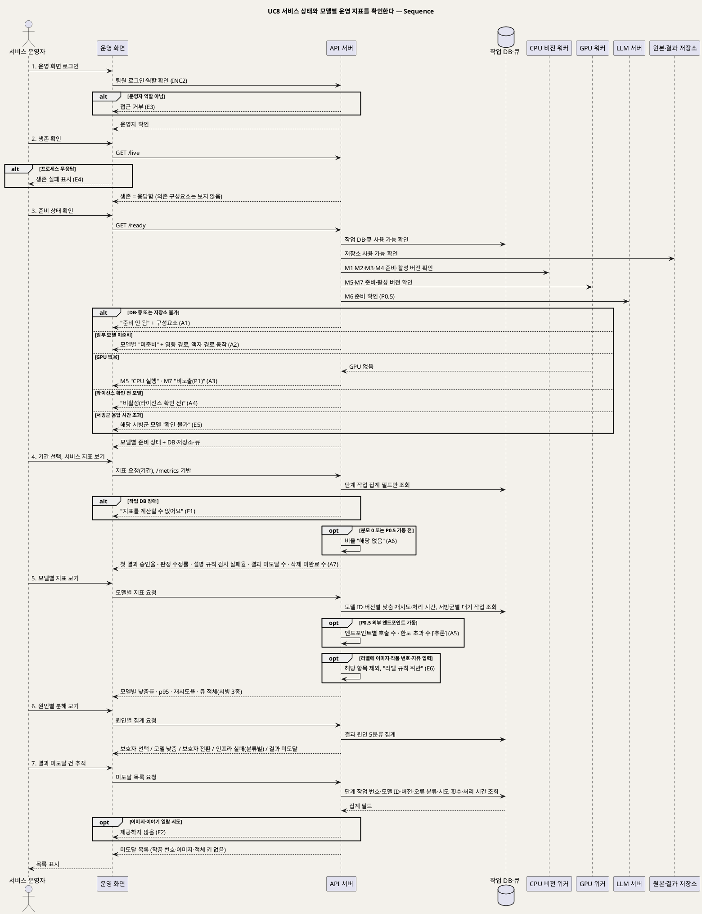

**[「UC8 운영 상태·모델별 지표 Sequence」 PlantUML 뷰어로 열기](https://plantuml.sumzip.com/plantuml/svg/eNqNV11PG0cUfd9fceW-2AqQ8GGSIjVKQghCCi1SmqeqQhtwEysOENu0ypuBJaLYFaa1g03WdGnt4qSmNcaxjeq-8FPyuDP7H3rvzK7tXZuoDwhm5879OOfcO8OdWFyNxtdfRCAWerm4uh5dXHoWjiwvPlUjkVD01eKNW0rseXhlTY2qL-CJuvT8aXR1fWV5ejWyGoXPHow_GJ2512MRe6Yur_4QXnkK36mRWEiJh-OREDyevgVc09mFxneLwLc2rC2d5xPA3pfZTy12rgE_rPPcBvCThLWvs1IbrHyWF1pWVmfJInxMZOBR6OV6aGUppCjqUhxj-3ocisP8KO0DNQZfrcUUTCYeXgqvqStxNJS-rXyGvatLk8dzbpO7C3MiwZom9nGpLKtx9YkaC-H5o31-sA337102rQ0Z4_499_nphcdAyRhYydsU_6corPCr22wWzXr2Z737Dx_O96aBS08lb9PsvHXZNGtV87wN3EjwoxJ_nRLWjxAVRAfLh-HbVCJMwegIuKoHdqybzRYiq5AB2lHlU2ClEui7u3vZ5AenVtawaQD_3JfTYwFFjcS7YINtwrMaS-YUEK6GO6G5sW8222CeVVkjAf6Z8YASWllWPEYdZzKQJ_0xTH-rwI_rzrYr6dmZr-F6JPx9SORlZTRMn2stUgSr1HlhnyU_YFriDLlEz1OOP54sWqkyoNh4UsfsJgZmJ22_AOnLypbBzws5-mZ-qHDtjB9mEH22mwF2XkftIha7vJAKeMoYxzKKCdSHLf2rq4mG1OVXMovbKDLKwSU-4JsVfvgOzGqC7ZYcP7a9EIBA3pbFJ61JslMwP3rZnB_Dn3H8mbDTxFB5RPIMUIgkaffBWXkwiAdu_q8DpGo8MOmA4Ghq4cZIUGrKqY7l0gRmtwDW2MHk-7Tlc-DM7gBLl31wzUUI-O-OIp84f5C5NslPDhpgf7fkyT6P3Unk6xiRW1Sn9aYEZu1fFNcQBjwmscolsL080oPRxuxoor8PXqMEMAAthrv09m65Y88H5QAhTb750QeXTUBkfZgB227xhu5fGA34MMq4HYUV2rxQ55pBSrfBJNRlDf1goSNJj_-Kk8L7hIMYjdW8-aFqqx7T0s0qYl3fwZnT593K1lnyoueUDbXPdi8ZxAAzwUEt1nMDuDrkmtBERwhCHp6umhgBs1UVqWmGtVUY6r1ixD1CXYkm7j6zt0gptVO_9BAYgusvQvFoeClGPlk15-pBliyblKFsRX6yTysLx94vOjvBLjuuWocpORydbgXKO2sMUG7nhkMnfLMqJuhOTmjjTR2zIqhGJVSra3HET0OM4IbTG9Q0oqH38kSdE8CpjurXy4i-TYtQHNE7OXDA1f4E5y7ZvUC66CzKz0qluZGlvPAXKxn0jWtF9n4bzKbOL_J4KoHDxR6j9inbE_YP28MroSLqopObp9zQRfPlNfZ7Snz3373pHZPBkV45XM1gn5Hk0k2ZVOHc_cumnElkzjb_4o0iyuqogqLGJPHPWo79UbE1PtSVsTBPJTB2h3bJMnEiOOD5Fk0WfpBBGVh7FXqt7LZsary0eKzIu5Wj3nYwoofOntNk4uM3vJFhx8a3iFSwRw44z2plfoA3QaFOiJ4kqJ5962echLUddErLNNdRVUfbzCh5M7GFYWVP2ft3qCB8h7WGcEYIvw67XNewB0iJk59uWomorZC1z4OCbgddR0x0bRkbvFb3S3hhnP-27SV_Eu_It2mER7htaJjn4PbtGNl9OIB8R9LCFILUQqWcbe8t5bxORNBrRgwRuN65K0RptO6aGDhIc_iJWMTnRqFtN4BfhsCsArjr7QNPpTdH-jvFPMMnSSODMHmk3rFAtthxYaDUXdPJEUFfA6AuckXCQeaKS0ESWIe_otw8neCoHQMM90zOnsEn1NirQbxXsm3RLwd1dpQC6X7As1A3z_Eples-l1BmYwNl5i3e7xV6N7xZLaDAwNos2jMvoLjffbYL-eBT7mA0_J_nP2yQbEg=)** — 클릭 시 브라우저로 연결됩니다.

기본흐름 1~7단계는 시퀀스의 번호 붙은 주요 메시지 `1.`~`7.`과 1:1로 대응한다.

#### UML 노트

| 항목 | 적용 |
|---|---|
| 액터 | 서비스 운영자는 보호자와 다른 Primary actor다. 보호자용 INC1이 아니라 팀원용 INC2를 «include»한다 |
| 외부 구성요소 | 원본·결과 저장소는 준비 확인 대상이라 Secondary actor로 경계 밖에 뒀다. 모델 M1~M7은 시스템 내부 구성요소라 액터로 두지 않았다 |
| 데이터 의존 | UC2·UC3·UC4·UC10·UC12는 지표 데이터의 출처일 뿐 include/extend 관계가 아니다. 선을 긋지 않고 노트로 표시했다 |
| Sequence | lifeline은 공통 기준 §3의 이름을 썼다. 모델은 서빙군 lifeline(CPU 비전 워커·GPU 워커·LLM 서버)에 모델 ID를 적어 표현했고, 준비 확인 결과와 예외는 `alt`/`opt`로 나눴다. 기본흐름 7단계와 번호 메시지 7개가 1:1로 대응한다 |
| 추상수준 | 지표 화면의 차트·필드 배치는 다루지 않는다. 엔드포인트 이름은 [추론]이며 `/speckit.plan`에서 확정한다(U8) |

---

### 7.9 UC9 모델 버전을 평가 묶음으로 검증하고 승격·롤백한다

#### 범위·개요

우리 아이 미술관은 공개 사전학습 모델 7종(M1~M7)을 새로 학습하지 않고 이어 붙여 서빙한다. 그중 관절·리깅 엔진(M3, Meta Animated Drawings)은 2025-09-03에, 그 실행 구성요소(TorchServe)는 2025-08-07에 보관 처리되어 보안 수정이 없다. 나머지 모델은 아이 그림·책상 배경·점토 공작에서의 품질을 아직 재지 않았다. 그래서 모든 모델은 **버전을 고정한 매니페스트**로 관리하고, 후보 버전은 **평가 묶음 전체를 다시 돌려 통과해야만 승격**하며, 문제가 생기면 **직전 활성 후보로 롤백**한다(spec FR-16·FR-17·FR-24 · Intent [핵심 활동] 2·7 · [혜택] 서비스 팀 "모델 교체를 매니페스트 승격·롤백으로 안전하게").

평가 담당 팀원은 운영 화면에서 모델별 매니페스트(모델 ID·가중치 SHA-256·런타임·이미지 다이제스트·설정 해시·활성/롤백 후보)를 보고, 후보 버전을 **팀원이 직접 만든 작품만으로 구성한 평가 묶음**(사람·비인물·촬영 조건·입체·설명 입력)으로 재평가한다. 시스템은 항목별로 기대 경로 대비 결과, 오인 사례, 처리 시간, 메모리를 기록한다. 설명 생성(M6, P0.5)은 템플릿 기준선과 비교하고 규칙 검사 실패율을 잰다. 모델을 바꿔도 보호자 흐름(UC1~UC7)과 API 계약은 그대로여야 한다. 승격 기준 수치는 아직 없다(U5) — 첫 평가 묶음 측정 뒤에 정한다.

| 항목 | 값 |
|---|---|
| 대상 시스템 | 우리 아이 미술관 (P0) — 모델 버전 관리·평가 영역 (M6은 P0.5, M7은 P1부터 대상) |
| 상위 프로세스 | 모델 재현·매니페스트 등록 → **평가 묶음 재평가·승격·롤백(UC9)** → 운영 단계 작업(UC2·UC3·UC10) → 모델별 지표 확인(UC8) |
| 원천 근거 | Intent [핵심 활동] 2·7 · [핵심 장벽] · [핵심 데이터] 모델 매니페스트·평가 묶음 · [혜택] 서비스 팀 · spec FR-16·FR-17·FR-24 · 공통 기준 §2·§3·§4·§8 |
| 핵심 UseCase | 1개 (UC9) + 공통 INC2 |
| 주요 액터 | 평가 담당 팀원 (모델 M1~M7은 시스템 내부 구성요소라 액터가 아니다) |

#### UseCase Diagram

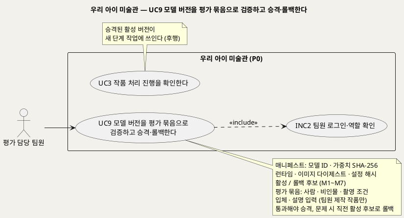

**[「UC9 모델 평가 UseCase Diagram」 PlantUML 뷰어로 열기](https://plantuml.sumzip.com/plantuml/svg/eNqNk1FP01AUx9_7KU7mCySCwKIGQhYUIfKAMTG-mSxlK6OhtKbtNMZoBhQz2FRQK0O6WZLKkMw4tuq6ZE98FB97z_0O3tt1ER6MvvW25_8_v_M_tzOGKepmfk2BfCad1-W0KKdzoqJI-rP02KRgrMrqY1EX12BJzKzmdC2vZmc1RdPhynxyfnzu9oUKY0XMak9lNQfLomJIgiItm2BqoMu5FROysi5lTFlTBVM2FQnwU5McNwBtC6s-kO8BFt3QL8Cvwgd4ODsJ5PSEvA6AtCx0WYkF9O122CwAafzEahmdHjlyIGwV8LhK7UrYdgF3umHr63mHHHmkeUZth5Q8QRAzJqNNDNQln5S6QMsFPNxNgGjA3BNREQTOJqo5xpX4G9jQ_bHhBDwXAPKGlBENVvq_nI_Uf4JGLMzvov3CvdmJGBWYS9gJsBqcd3D_G7VdoAc2O0Y6XniZKwlY26PvioCtSjRN3aIftyO8SHapaVJ4IQg8BxgZSUUQfLDR0VRkDFMwPS2rGSWflVIpQVA1U4p3qi3HyKTukVKRvqngjkd3gqlBKgt34LwDLA709rBbgQd3b41MXL_BFZ-bdLOANYsXsKB5znW-H48d0HX6RtFHy0PXBmr7WHKYkh44aJ3BNejHB_TQIm0fhhbHXy7eHOYFFxcwBbjRILUydyJdtqCANHqRrd_AyjrgUTM885kKa1vY8uOG5HSLvyDuFxiKF8CZantxrKRejjq9-hG2e5zM7sVbvcr6BqwWGCxLfZ1digFxH5Rf2z65IKlZ4Gn2I13STFNb62ea5ECRH9l1BvrBFYtoN4ssq5OwbXEi3N_CfYb4vsnnK3kM-pDve_hPixn2xP7y31h7BnI=)** — 클릭 시 브라우저로 연결됩니다.

##### 다이어그램 쉽게 읽기 (유저 관점)

- **누가 쓰나** — 평가 담당 팀원이 쓴다. 보호자는 이 기능을 보지 못한다. 배경 분리·종류 판정·관절·깊이·설명·3D 모델은 사람이 아니라 시스템 안의 부품이라 그림에 액터로 두지 않았다.
- **무슨 순서로** — 팀원이 모델별 현재 버전과 후보 버전을 확인하고, 후보 버전으로 시험용 작품 묶음을 전부 다시 돌린다. 기대와 다른 결과·잘못 잡은 사례·처리 시간·메모리를 보고 통과하면 승격한다. 승격 뒤 문제가 보이면 바로 이전 버전으로 되돌린다. 승격된 버전은 이후 가족 작품 처리(UC3)에 쓰인다.
- **«include» = 항상 함께** — INC2 팀원 로그인·역할 확인. 평가 담당 역할이 있는 팀원만 평가·승격·롤백을 할 수 있다.
- **«extend» = 특정 상황에서만** — 없다. 롤백·M6 비교·보류는 같은 목표 안의 대체흐름으로 다룬다.
- **Generalization(◁)** — 없다. 7종 모델과 예비 모델 후보는 모두 같은 매니페스트·평가 절차를 거친다.

| 기호 | 의미 |
|---|---|
| 사람 모양(actor) | 시스템을 쓰는 사람 |
| 타원(usecase) | 액터가 이루려는 목표 |
| 사각형(rectangle) | 시스템 경계 |
| 실선 화살표 | 액터와 UC의 연결 |
| 점선 `<<include>>` | 항상 함께 일어나는 하위 행위 |
| 노트 | 매니페스트·평가 규칙·선후 관계 보충 |

#### Actor

| 구분 | 액터 | 이 UC에서의 역할 | 원천 근거 |
|:--:|---|---|---|
| Primary | 평가 담당 팀원 | 평가 묶음을 관리하고, 후보 버전 평가를 실행·검토하고, 오인 사례를 분류하고, 승격·보류·롤백을 결정한다 | Intent [핵심 활동] 7 · spec FR-17·FR-24 · 공통 기준 §6 액터 |
| 내부 구성요소(액터 아님) | 모델 M1~M7 (CPU 비전 워커: M1·M2·M3·M4 / GPU 워커: M5·M7 / LLM 서버: M6) | 평가 대상. 시퀀스에서 서빙군 lifeline으로만 나타난다 | 공통 기준 §2·§3·§6 · Intent [핵심 이네이블러] |

#### 관련 UseCase

| UC ID | 유스케이스명 | 관계 | 원천 근거 |
|:--:|---|---|---|
| UC9 | 모델 버전을 평가 묶음으로 검증하고 승격·롤백한다 | 본 문서 | spec FR-16 · FR-17 · FR-24 · Intent [핵심 활동] 2·7 |
| INC2 | 팀원 로그인·역할 확인 | UC9가 «include» | 공통 기준 §6 · BR-ACC-05 |
| UC3 | 작품 처리 진행을 확인한다 | 후행(승격된 활성 버전이 단계 작업에 쓰이고, 단계 작업이 모델 ID·버전을 기록) | 공통 기준 §5 단계 작업 |
| UC8 | 서비스 상태와 모델별 운영 지표를 확인한다 | 참고(승격 뒤 모델별 낮춤률·p95를 보고 롤백을 판단하는 근거) | spec FR-26 · Intent [혜택] 서비스 팀 |
| UC11 | API활용 메뉴에서 엔드포인트·가이드라인·매뉴얼을 확인한다 | 참고(EXT3 시험 호출은 평가 묶음 작품만 쓴다, BR-API-09) | 공통 기준 §6 EXT3 |

> **쉽게 말하면** — 서비스가 쓰는 7가지 모델의 새 버전을, 팀원들이 직접 만든 시험용 작품 묶음으로 전부 다시 돌려 봅니다. 기대와 달라진 작품, 잘못 잡은 사례, 걸린 시간과 메모리를 이전 버전과 나란히 보고 괜찮을 때만 실제 서비스에 올립니다. 올린 뒤 문제가 보이면 바로 이전 버전으로 되돌리고, 그래도 보호자 화면과 API는 달라지지 않습니다.

#### 유스케이스 기술

| 속성 | 내용 |
|---|---|
| **ID** | UC9 (spec FR-16, FR-17, FR-24) |
| **유스케이스명** | 모델 버전을 평가 묶음으로 검증하고 승격·롤백한다 |
| **액터** | 주: 평가 담당 팀원 · 보조 액터 없음(모델 M1~M7은 내부 구성요소로 CPU 비전 워커·GPU 워커·LLM 서버에서 실행된다) |
| **사전조건** | (1) 평가 담당 팀원이 로그인했고 평가 담당 역할이 확인됐다(INC2). (2) 평가할 후보 버전이 팀 서버에 설치되어 있고 매니페스트(모델 ID·가중치 SHA-256·런타임·이미지 다이제스트·설정 해시)가 등록돼 있다(BR-MDL-01). 모델 파일 경로는 `자료 없음 — 확인 필요`(U14). (3) 후보 버전의 어댑터가 있어 API 서버가 모델을 직접 import하지 않고 작업 계약으로 부른다(BR-MDL-02). (4) 보관 처리된 엔진(M3의 Animated Drawings·TorchServe)은 내부망 격리·고정 이미지·체크섬 조건을 갖췄다(BR-MDL-06). (5) 평가 묶음에 대상 모델에 맞는 항목(사람·비인물·촬영 조건·입체·설명 입력)과 항목별 기대 경로가 있다(BR-MDL-04) |
| **사후조건** | (1) 후보 버전으로 평가 묶음 전체를 돌린 평가 기록이 그 버전의 매니페스트에 연결되어 남는다. 기록에는 항목별 기대 경로 대비 결과, 확정된 오인 사례 분류, 처리 시간, 메모리가 들어간다(M6은 템플릿 기준선 대비 결과와 규칙 검사 실패율 포함). (2) 승격했으면 후보가 활성 버전이 되고, 직전 활성 버전은 롤백 후보로 자동 지정된다(BR-MDL-03) [통합 D5]. 이후 새 단계 작업은 새 활성 버전으로 처리되고 단계 작업에 모델 ID·버전이 기록된다. (3) 롤백했으면 직전 활성 후보가 다시 활성 버전이 되고 롤백 사유가 남는다. (4) 보호자 흐름(UC1~UC7)·엔드포인트·응답 분류는 바뀌지 않는다(BR-MDL-05). (5) 평가 기록과 운영 로그에 가족 작품 이미지·자유 입력이 들어가지 않는다(BR-ACC-03, BR-PRV-01) |
| **기본흐름** | ↓ 별도 기본흐름표 (후보 버전 평가 → 승격 기준) |
| **대체흐름** | A1. 롤백 — 승격 뒤 모델별 지표(UC8: 낮춤률·처리 시간 p95·재시도율)나 보호자 신고로 문제가 보이면, 팀원이 `POST /v1/admin/models/{mid}/rollback`을 요청한다. 시스템은 직전 활성 후보를 활성으로 되돌리고, 문제가 된 버전을 롤백 후보에서 뺀 채 사유를 기록한다(BR-MDL-03). 롤백 대상은 이미 평가를 통과해 활성이었던 버전이므로 재평가 없이 즉시 되돌린다. 이미 실행 중인 단계 작업은 시작할 때의 버전으로 끝내고 새 단계 작업부터 되돌린 버전을 쓴다(BR-MDL-03) [통합 D5]. A2. 보류 — 평가 결과가 기준에 못 미치거나 판단이 서지 않으면 승격하지 않고 보류 사유만 기록한다. 활성 버전은 그대로다. A3. 설명 생성 모델(M6, P0.5) 평가 — 설명 입력 세트(키워드·선택 태그·아이의 실제 발언 형식의 팀원 작성 문장·나이·제작일)로 LLM 서버에서 초안을 만들고, 같은 입력의 템플릿 기준선 설명과 나란히 비교한다. 규칙 검사(입력에 없는 사건·감정·발달 상태) 실패율과 재생성 횟수를 잰다(BR-CAP-02). 과정 제공 LLM으로 대체할지는 U3이며, 쓰게 되더라도 평가 묶음의 설명 입력만 보낸다(BR-CAP-05). A4. 3D 조각 모델(M7, P1) 평가 — 입체 항목(팀원이 만든 점토·종이 공작)으로 GPU 워커에서 평가한다. GPU가 없으면(U2) 평가하지 않고 M7은 비노출로 둔다(BR-SRV-02). A5. 예비 모델 후보 평가 — 그림 전용 YOLOv8 자세 모델(M3 예비, 가중치 AGPL-3.0)도 같은 묶음·같은 절차로 평가할 수 있다. 다만 서비스 소스 공개 결정 전에는 승격하지 않는다(BR-MDL-07, U4). A6. 평가 묶음 항목 추가 — 팀원이 직접 만든 작품을 종류·기대 경로와 함께 등록만 하고 평가는 실행하지 않는다. 항목을 추가하면 이후 평가부터 반영하고, 활성 버전을 새 묶음으로 다시 평가할지는 팀원이 정한다 [추론] |
| **예외흐름** | E1. 허용되지 않는 평가 항목 — 팀원이 직접 만들지 않은 작품(실제 가족 작품·공개 이미지 등)이나 기대 경로가 없는 항목은 평가 묶음에 넣지 않고 등록을 거부한다(BR-MDL-04, BR-ACC-03). 제작자 확인 방식은 `자료 없음 — 확인 필요`. E2. 매니페스트 불일치 — 설치된 가중치의 SHA-256이나 이미지 다이제스트·설정 해시가 매니페스트와 다르면 평가를 시작하지 않고 불일치 항목을 보여 준다(BR-MDL-01, Intent [핵심 장벽] 서빙 기반). E3. 격리 조건 미충족 — 보관 엔진이나 모델 런타임(TorchServe·Ollama)의 포트가 내부망 밖에 열려 있으면 평가를 시작하지 않고 격리 조치를 요구한다(BR-MDL-06, BR-SRV-04). E4. 평가 중 인프라 장애 — 워커 중단·모델 미준비·저장소 오류는 품질 결과가 아니다. 해당 항목을 최대 3회 재시도하고, 소진되면 그 항목을 "평가 미완료"로 표시한다. 미완료 항목이 남은 평가는 "전체 재평가"가 아니므로 승격 근거가 되지 않는다(BR-PRC-03, BR-MDL-03) [통합 D5, 운영의 재시도 규칙을 평가에 적용]. 시간 상한을 넘긴 항목은 "시간 초과"로 기록하고 나머지 항목은 계속한다(BR-PRC-06). E5. 라이선스 미확인 — OpenCLIP 가중치·Qwen3·TRELLIS 의존성처럼 라이선스 조건이 확인되지 않은 버전은 평가 결과와 관계없이 승격을 거부한다(BR-MDL-07, U4). E6. 평가 근거 없는 승격 요청 — 해당 버전의 매니페스트 해시와 일치하는 전체 재평가 기록이 없거나, 팀원이 통과로 판단하지 않은 버전은 승격을 거부한다(BR-MDL-03). E7. 계약 불일치 — 후보 어댑터의 응답 분류가 작업 기록 분류와 1:1로 맞지 않거나 결과 종류가 기존 계약(움직임/2.5D/액자, P1 3D)과 다르면 승격을 거부한다(BR-MDL-05, BR-API-02). E8. 롤백 후보 없음 — 직전 활성 후보가 없으면(첫 버전) 롤백을 거부하고 현재 활성 버전을 유지한다. 그다음 조치(모델 비활성 등)는 `자료 없음 — 확인 필요`. E9. 권한 없음 — 평가 담당 역할이 없는 팀원(운영자·연동 개발)이 평가·승격·롤백을 요청하면 거부한다(BR-ACC-05) |
| **포함/확장** | «include» INC2 팀원 로그인·역할 확인. «extend» 없음 |
| **우선순위** | Medium — 가족 기능은 아니지만, 원천이 서빙 기반을 "치명", 판정 정확도·모델 품질 미측정·라이선스를 "상" 장벽으로 두므로 모델을 운영에 올리기 전 필수 관문이다(Intent [핵심 장벽]) |
| **사용빈도** | 모델 버전을 바꿀 때마다 해당 모델에 대해 평가 묶음 전체 재평가 1회(Intent [핵심 데이터] 평가 묶음 "모델 버전이 바뀔 때 재평가"). 롤백은 문제 발생 시에만. 버전 교체 주기와 평가 묶음 규모는 `자료 없음 — 확인 필요` |
| **업무규칙** | BR-MDL-01, BR-MDL-02, BR-MDL-03, BR-MDL-04, BR-MDL-05, BR-MDL-06, BR-MDL-07, BR-SUG-04, BR-PRC-03, BR-PRC-04, BR-PRC-06, BR-CAP-02, BR-CAP-05, BR-SRV-02, BR-SRV-04, BR-API-02, BR-ACC-03, BR-ACC-05, BR-PRV-01 |
| **특별 요구사항** | 보안: 모델 런타임 포트는 내부망에만 두고, 보관 엔진은 고정 이미지·체크섬으로 운영한다(BR-MDL-06, BR-SRV-04). 관리 엔드포인트(`/v1/admin/models…`)는 팀원 역할 확인 뒤에만 열린다. 기록: 평가 기록은 모델 ID·버전(매니페스트 해시)에 연결하고, 항목별 결과 경로·오인 사례·처리 시간·메모리를 남긴다(spec FR-16·FR-17). 모델 점수는 기록만 하고 통과 판단의 단독 근거로 쓰지 않는다(BR-PRC-04, BR-SUG-04). 첫 기록: Intent [개요]·[핵심 장벽]이 밝힌 1차 개인 PC 실측을 M3의 첫 평가 기록으로 인용한다 — 한 장 53~62초(대부분 렌더, 렌더 약 40초), 보관 저장소 기반 빌드 약 36분, 설치 크기 32.9GB, 집 그림이 사람 점수 0.946으로 잡힘(사람 그림 0.997). 이 수치는 팀 서버 측정이 아니며 M1·M2·M4·M5·M6·M7은 미측정이다(U6). 승격 기준: 모델별 품질 임계값과 승격 기준 수치는 원천에 없다 — 평가 묶음 1차 측정 뒤 정한다(U5). 자원: GPU 유무(U2)에 따라 M5는 CPU로 평가하고 M7은 평가·노출하지 않는다 |
| **비고** | 원천 추적: Intent [핵심 활동] 2 "모델 7종을 버전 고정해 재현한다 … 모델마다 매니페스트와 처리 시간·메모리를 기록한다", 7 "평가 묶음(사람·비인물·촬영 조건·입체·설명 입력)과 템플릿 기준선으로 모델별 품질을 재고" · [핵심 장벽] 서빙 기반(치명)·판정 정확도·모델 품질 미측정·자원·라이선스 · [핵심 데이터] 모델 매니페스트·평가 묶음 · [혜택] 서비스 팀 · [핵심 이네이블러] "모델마다 어댑터와 버전 매니페스트" · spec v2.0 FR-16(모델 7종 재현)·FR-17(평가 묶음)·FR-24(어댑터·매니페스트·평가 후 승격·롤백) · 공통 기준 §2 모델 카탈로그, §3 서빙 구조, §4 엔드포인트([추론] 이름은 `/speckit.plan`에서 확정, U8), §8 BR-MDL-*. 옛 BR 대응: BR-ENG-01→BR-MDL-06, BR-ENG-02→BR-MDL-01, BR-ENG-03→BR-MDL-03, BR-ENG-04→BR-MDL-04, BR-ENG-05→BR-MDL-05. 평가를 운영 화면 안에서 할지 별도 도구로 할지는 옛 문서의 미확정 사항이었고, 이번 개정은 공통 기준 §4의 관리 엔드포인트를 쓰는 운영 화면으로 정했다 [추론] |

#### 기본흐름 (Basic Flow)

| 단계 | 액터 행위 | 시스템 행위 |
|:--:|---|---|
| 1 | 평가 담당 팀원이 운영 화면에 로그인한다 | 팀원 역할을 확인하고(INC2), 평가 담당이 아니면 모델 관리 기능을 열지 않는다(E9) |
| 2 | 팀원이 모델 목록을 연다 | `GET /v1/admin/models`로 모델 7종의 매니페스트(모델 ID·가중치 SHA-256·런타임·이미지 다이제스트·설정 해시·활성/롤백 후보)와 구간(M6 P0.5, M7 P1)·서빙군·라이선스 확인 상태를 보여 준다 |
| 3 | 팀원이 모델 하나의 후보 버전을 골라 평가를 요청한다 | `POST /v1/admin/models/{mid}/evaluate`를 받아 설치본과 매니페스트 해시의 일치(E2)와 격리 조건(E3)을 확인하고, 평가 묶음 전체를 항목별 평가 작업으로 작업 DB·큐에 등록한다 |
| 4 | 팀원이 평가 진행률을 확인한다 | 해당 서빙군(CPU 비전 워커 M1~M4 / GPU 워커 M5·M7 / LLM 서버 M6)이 후보 버전으로 항목마다 처리하고, 결과 경로·모델 점수(기록용)·처리 시간·메모리를 기록한다. 인프라 장애는 재시도하고 소진 시 "평가 미완료"로 표시한다(E4) |
| 5 | 팀원이 평가 보고서를 연다 | 기대 경로와 비교한 불일치 목록, 오인 사례 후보(예: 집 그림을 사람으로 잡아 관절을 붙인 경우), 처리 시간·메모리를 현재 활성 버전의 기록과 나란히 보여 준다. M6이면 템플릿 기준선 비교와 규칙 검사 실패율을 함께 보여 준다(A3) |
| 6 | 팀원이 오인 사례의 분류를 확정하고 통과 여부와 근거를 적는다 | 분류·판단·근거를 후보 버전의 매니페스트에 연결해 평가 기록으로 보관한다 |
| 7 | 팀원이 후보 버전의 승격을 요청한다 | `POST /v1/admin/models/{mid}/promote`를 받아 전체 재평가 통과 기록(E6)·라이선스 확인(E5)·계약 일치(E7)를 확인하고, 후보를 활성으로, 직전 활성 버전을 롤백 후보로 바꾼다. 이후 새 단계 작업부터 새 버전을 쓴다 |

#### Sequence Diagram

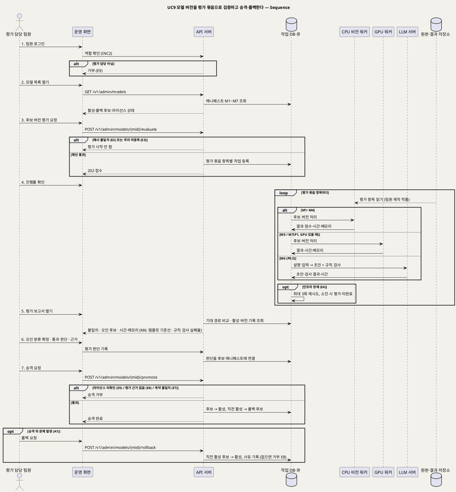

**[「UC9 모델 평가 Sequence」 PlantUML 뷰어로 열기](https://plantuml.sumzip.com/plantuml/svg/eNqVVltPG1cQft9fMaIvtprYGHMpeYgSiIOQ4haJ8ow2eEutrG3iS6qoamXCghzsNobaxcAaGdVcjEA1tsFGBVXip-Rxz-x_6Jy9EK9xqvYFsztz5vLNN9_ZJ4mkGE-mIjIkpNfzqXh4XgzPL4qyLMXfzg-OC4lX4eiSGBcj8FJceLUYj6WiocmYHIvDF8_9z32BiS6PxPdiKPZDOLoI34lyQhKS4aQswdzkOLCTY_ZLB1hDwYqCZQX0D--1ehrY6SWWc6hes30VtEYaD8t6saQ1K4DrV1qjdttm-1VWP9eLKstW4WO6ALPS65QUXZAEQVxIUhkDdqhsi2WvQM-lcTc_AGICAm9EWaDKkuGF8JIYTcIA7rSwtAz6doHVWobP3LTT4-nMNKCiUqGGmR6FkJgUX4oJiY7vbeDWKjybuG3ry2aOZxPO85Mzc8CueJeAuzn8q2p40Vun2xS5ddmneu0vXgS7y6DH7jJ286zZuW1rjbrWvAaspHHvANdyhuusXxB44_DwMTUHj8DnsTABwlhrd7DcEchAZt7rI8CtM71YIUyKZAHX9NeTQ25BlJPgxBWLCsuWBDBOPbSDa-d1dpkGV2DcLUjRUE_qIc_d4E9qbL9MuVpap-5IPxX4FrxvfF4xFAlHvZFYSJITgpHjMYFLDuyoyrIZ_dcSrlf19Q4EfT8HxwD36_pOTnAUo2-rqJzblAF9V2HNFj2Wr7HcQqVCAQBXlvUVtadOv8dytghqt447BWycOcqd-Wb2fr3eHyPh0E9eiWKmxKRkoldsYVYFdplByn9VIoyG3MBKebZeIKbX2OEpsD87eFnD_XMy-t292NpFZFXiHeGfoZjHAqWT7GHpaxdEAPuchZdjs-jIGce-SXQ0yct-O6dJ9OYaGhwiHm1gptRnjMMewCNF__09O7B5Isix2FL_VEcZ2lSKP-s3wvOFuCvKdAEs3xANwGXxEitmh3sb-maGw8Dx42Mepv-Bd_UpjmNM2CgRjIYTN9sImHtx28ZKnhqi36yq1RUiQq3A6WicMGAMjoAXgmOuGd8DMDZyL8O1iRVz7q7MU_-eeapf5s9mHAXXzKBnpDs-33VaQ6XKTlaphFVWOYCPa5uArQwf-pegtVW82jbk8Z2Zkx-xc5puXA24uacEnpfmCRBbShLsHb2g0DoA1wvaeVdguLsQM9yFynJp8NN2kdsphWEflAdA8kIc4GS8mzqRd1thf-SsHPd5M-K58222SNNJ0GwF6CYsPfOMWuOGXwIkntpFHm7b1jrbiHMvriB99v7TjtEpLFWN1TDHxV_0zgJcwVGa56qqF3Ls8G8eGatp0gfu7cCazlb13DGqx-6e1kY9diJ2qbCDkrEWlaJRtrGUpLl5lj02Q16TTDpUxF4H08dszYGJaTEuSot3ThXELVqbrToNu6ewMY91c_5f8VqKxyIxS7sciklztu-GwIibFsYq3myLqljjy-8KjHKb1lSweONQvbF7wmYVaN4dlqD1VTKzdb4LJheIhkfLhj6b1OAWh9h_JpPFU4OhxiKYr9kmdXfaIfkBVldxpQyupz5erQNRK4EFJ8B_BTQek2X-ydTTlLODfi2-O0W1YvPdxfGlz6Nay75rA1-ZV-0T-kOfbf8Ai4qTHQ==)** — 클릭 시 브라우저로 연결됩니다.

기본흐름 1~7단계는 시퀀스의 번호 붙은 주요 메시지 `1.`~`7.`과 1:1로 대응한다. 4단계의 항목별 처리는 `loop` 안에서 서빙군별 `alt`로 나눴고, 모델은 서빙군 lifeline(CPU 비전 워커·GPU 워커·LLM 서버)에 모델 ID를 적어 표현했다. 롤백(A1)은 마지막 `opt` 프래그먼트다. 평가 항목은 GPU 워커·LLM 서버도 같은 저장소에서 읽지만 그림을 줄이려고 CPU 비전 워커 한 줄로만 그렸다.

#### UML 노트

| 항목 | 적용 |
|---|---|
| 시스템 경계 | 모델 관리(매니페스트·평가·승격·롤백)는 같은 시스템의 관리 엔드포인트로 두어 경계 안에 넣었다 [추론]. 모델 M1~M7은 시스템 내부 구성요소라 경계 밖 액터로 그리지 않았다(공통 기준 §6) |
| 액터 | 평가 담당 팀원만 Primary다. 옛 문서의 Secondary actor "애니메이션 엔진"은 내부 구성요소로 바꿔 시퀀스의 서빙군 lifeline으로 옮겼다 |
| «include» | INC2 팀원 로그인·역할 확인은 매번 일어나므로 include로 표현했다 |
| 대체흐름 vs «extend» | 롤백·보류·M6·M7·예비 모델 평가는 같은 목표(버전을 안전하게 운영에 올리기) 안의 경로라 extend로 떼지 않고 대체흐름 A1~A6으로 뒀다 |
| 후행 관계 | UC3과는 데이터(활성 버전) 선후 관계일 뿐 include/extend가 아니다 |
| Sequence | 항목별 처리는 `loop`, 서빙군 분기는 그 안의 `alt`, 인프라 재시도는 `opt`, 평가 시작 거부·승격 거부는 각 단계의 `alt`, 롤백은 마지막 `opt`로 표현했다. 예외흐름 ID(E2~E9)와 대체흐름 ID(A1)를 메시지에 병기했다 |

---

### 7.10 UC10 키워드로 작품 설명 초안을 만들고 승인한다

#### 범위·개요

보호자가 작품 이야기(UC5)를 쓰다가 **"키워드로 설명 초안 받기"**를 고르면 이 UC가 시작된다(UC10 «extend» UC5). 보호자는 키워드를 적거나, 판정 단계에서 종류 판정 모델(M2)이 뽑아 둔 태그 후보(해·집·강아지 등) 가운데 맞는 것을 고른다. 시스템은 LLM 서버(M6, Qwen3-4B 자체 호스팅)로 짧은 설명 초안을 만들고, 규칙 검사를 거친 초안만 **"AI 작성"** 표시와 함께 보여 준다. 보호자가 고치고 승인해야 전시에 붙는다.

설명 생성에 넣는 입력은 다섯 가지뿐이다: 보호자 키워드, 보호자가 고른 태그, 아이의 실제 발언(한마디), 제작 당시 나이, 제작일. **이미지와 아이 이름(별칭)은 넣지 않는다.** 아이 데이터는 외부 LLM API로 보내지 않는다.

LLM 초안이 규칙 검사를 계속 통과하지 못하면 LLM 없이 입력 칸을 채우는 **템플릿 설명**으로 한 단계 낮추고, 그것도 원하지 않으면 보호자가 **직접 입력**한다(낮춤 체인 LLM → 템플릿 → 직접 입력). 승인한 설명은 고정되어 다시 만들지 않는다. AI 설명은 아이의 한마디와 다른 칸에 저장하고 다른 자리에 보여 준다.

| 항목 | 값 |
|---|---|
| 대상 시스템 | 우리 아이 미술관 (P0.5) |
| 상위 프로세스 | 결과 확인(UC4) ↔ 이야기 기록(UC5) ⇢ **설명 초안(UC10, 선택)** → 전시(UC6) |
| 원천 근거 | spec FR-27 · Intent [핵심 활동] 5 · [핵심 이네이블러] 작품 설명 · [핵심 데이터] 작품 설명 · [부정적 영향] 기억의 재작성 · 공통 기준 §2(M2·M6) · §3(LLM 서버) · §4 · §5(낮춤 체인) |
| 핵심 UseCase | 1개 (UC10) + 기반 UC 1개 (UC5) + 공통 1개 (INC1) |
| 주요 액터 | 보호자 · (조건부) 과정 제공 LLM |
| 쓰는 모델 | M6 설명 생성·규칙 검사·템플릿 기준선(LLM 서버) · M2 태그(판정 단계에서 이미 만든 결과를 재사용, 이 UC에서 다시 부르지 않음) |
| 엔드포인트 [추론] | `POST /v1/artworks/{id}/captions` (초안 생성·재생성) · `PUT /v1/artworks/{id}/captions/{cid}` (수정·승인·폐기). 이름·형식은 `/speckit.plan`에서 확정(U8) |

#### UseCase Diagram

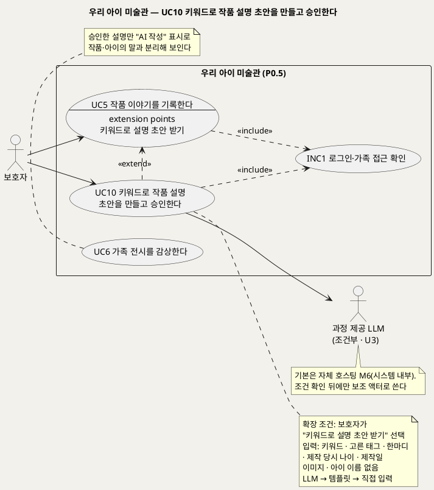

**[「UC10 작품 설명 생성 UseCase Diagram」 PlantUML 뷰어로 열기](https://plantuml.sumzip.com/plantuml/svg/eNqFlEFLG1EQx-_7KYbtRQ8Gg-hBJNiGCoIWL94EWZM1LsZd2d3QllKIupGgOURN0NbdkEBioBQam62JECj4UTzue_sdOvOSaHKwnjbvzbx5__nN_2XRshXTzuylIZPYNDLmZkpJp1Xz82Z0WrJ2NX1fMZU92FISuynTyOjJuJE2THizNLMUff9uJMPaUZLGR01PwbaStlQprW7bYBtgaqkdG5KaqSZszdAlW7PTKvDvLXbzE3jZ4Z4P7FeX56uBn4XHbAnW49FpCA_r_LrALlxWc4FXzsLzPHCnzn7kgPt5Xs5zzwHWxIx60K4CP7nnXjcsu-y0LklKwkaNMmv74VWXV4oyKBasKaaq28NY0O7xahl41Q3af2BlZXVDn-C1VnDrs7ssPHRgfWZSHItjTJJIvaKnULn8kvSJtenILJ75IgFkLDWhWCq2Mks1ZPoOm_B8Xu4F3RZr9IA-NW8ge2pKUj_Zqm4hJtg3NN22pHEMo_0Da13jcXnkNvkVchv6a-hEx1RltOryh3gUsFjQ6WLiQydoZXntFtGdBZ0ehN_KuCsOUuK4nDl4Snb4qStabhX50cHYdXPSV0nqjwempmJEbXyJeohgJBITd8A8LCxoeiKdSaqxmCS6_m9MlBQRATg5DFD1_nx1w1YHVjW2hwSotUoD-raYhyc7YU8YlV-fDe5WwyMPk3klx6qN-efhkMWQPmt0ITwitLRBVJp5VirhCVyiOXF-wE7vkR2wwysy3NM-93pU2PPJgk3h2YEnae_GAX55zL0C5mCH8Hh8DmHODUsFdvNXrHjzAEc4UCYhFSAIfRJbhm0be4RC4AFh1DaOP4v5Rf7bByJxUg8LOVidm0B5tMiRSHo_kxFSJrAN_AHsvM4vi-g6wogh1FoLnZZAd-GT_V9SQP6AZ5cOSFMl-e0yGZw7tzKEZy4ZrOYK2GT6h04fB_eu0O1FfPDA7hx8umHZFyK87ti1i_gL_walf_YifnI=)** — 클릭 시 브라우저로 연결됩니다.

##### 다이어그램 쉽게 읽기 (유저 관점)

- **누가 쓰나** — 보호자가 작품 이야기를 쓰다가, 짧은 작품 설명을 AI에게 초안으로 받아 고치고 승인한다.
- **무슨 순서로** — 이야기 쓰기(UC5) 화면에서 "키워드로 설명 초안 받기"를 누른다 → 키워드를 적거나 태그를 고른다 → 초안을 받는다 → 고치고 승인한다 → 전시(UC6)에 "AI 작성" 표시와 함께 붙는다.
- **«include» = 항상 함께** — 설명을 만들거나 승인할 때마다 "로그인·가족 접근 확인"을 거친다.
- **«extend» = 특정 상황에서만** — 보호자가 설명 초안을 원할 때만 UC5에 끼어든다. 누르지 않으면 UC5만으로 전시가 끝난다(설명은 전시 조건이 아니다).
- **과정 제공 LLM** — 기본은 우리 서버 안의 LLM이라 액터가 아니다. 과정에서 제공하는 LLM 엔드포인트를 쓰기로 조건을 확인한 경우에만 바깥 보조 액터가 된다.
- **Generalization(◁)** — 없다. LLM 초안·템플릿·직접 입력은 같은 설명 기록의 "출처" 값으로 구분한다.

| 기호 | 의미 |
|---|---|
| 사람 모양(actor) | 시스템을 쓰는 사람 또는 바깥 시스템 |
| 타원(usecase) | 액터가 이루려는 목표 |
| 사각형(rectangle) | 시스템 경계 |
| 점선 `<<include>>` | 항상 함께 수행되는 하위 행위 |
| 점선 `<<extend>>` | 확장점 조건이 맞을 때만 기반 UC에 끼어드는 행위(화살표는 확장 UC → 기반 UC) |
| `extension points` 칸 | 기반 UC(UC5)에서 확장이 끼어드는 지점 |
| 노트 | 확장 조건·입력 범위·전시 방식 보충 |

#### Actor

| 구분 | 액터 | 이 UC에서의 역할 | 원천 근거 |
|:--:|---|---|---|
| Primary | 보호자 | 키워드를 적고 태그 후보를 고른다. 초안을 읽고 고치고 승인하거나, 다시 만들거나, 버리고 직접 쓴다 | spec FR-27 · Intent [핵심 활동] 5 · [혜택] 보호자 |
| Secondary(조건부) | 과정 제공 LLM | 과정 제공 LLM 엔드포인트가 있고 데이터 처리 조건이 확인된 경우에만 M6 초안 생성을 대신한다. 조건이 확인되기 전에는 부르지 않는다 | Intent [핵심 파트너] · 공통 기준 §6 · U3 |
| 이해관계자 | 아이 · 성장한 아이 | 한마디의 화자이자 설명의 대상. 기억이 AI 문장으로 바뀌지 않아야 하는 당사자. 시스템을 직접 조작하지 않는다 | Intent [부정적 영향] 기억의 재작성 |

자체 호스팅 LLM(M6)은 시스템 내부 구성요소라 액터로 두지 않는다. 시퀀스에서 `LLM 서버` lifeline으로만 나타난다.

#### 관련 UseCase

| UC ID | 유스케이스명 | 관계 | 원천 근거 |
|:--:|---|---|---|
| UC10 | 키워드로 작품 설명 초안을 만들고 승인한다 | 본 문서 · UC5를 «extend» (확장점: "키워드로 설명 초안 받기", P0.5) | spec FR-27 · Intent [핵심 활동] 5 |
| UC5 | 작품 이야기를 기록한다 | 기반 UC. 한마디·제작 당시 나이·제작일을 입력으로 제공 | spec FR-7 |
| INC1 | 로그인·가족 접근 확인 | UC10이 «include» | 공통 기준 §6 |
| UC6 | 가족 전시를 감상한다 | 후행. 승인한 설명을 "AI 작성" 표시로 분리해 보인다 | spec FR-8 · BR-EXH-05 |
| UC2 | 작품 사진을 접수하고 판정 제안을 확정한다 | 선행. 판정 단계에서 M2 태그 후보가 만들어진다 | spec FR-21 · 공통 기준 §2 중간 결과 재사용 |
| UC8 | 서비스 상태와 모델별 운영 지표를 확인한다 | 관련. 설명 규칙 검사 실패율·설명→템플릿 낮춤률을 본다 | spec FR-26 |

> **쉽게 말하면** — 작품 이야기를 쓰다가 "키워드로 설명 초안 받기"를 누르고, "해, 집, 강아지"처럼 떠오르는 말을 적거나 추천 태그를 고릅니다. AI가 짧은 설명을 써 주면 읽어 보고 고친 뒤 승인합니다. 사진과 아이 이름은 AI에게 보내지 않고, 입력에 없는 사건이나 감정을 지어낸 문장은 걸러집니다. AI가 쓴 설명은 "AI 작성"으로 표시되고 아이가 한 말과 섞이지 않습니다. 마음에 들지 않으면 다시 만들거나 직접 쓸 수 있고, 승인한 설명은 바뀌지 않습니다.

#### 유스케이스 기술

| 속성 | 내용 |
|---|---|
| **ID** | UC10 (spec FR-27, P0.5) |
| **유스케이스명** | 키워드로 작품 설명 초안을 만들고 승인한다 |
| **액터** | 주: 보호자 · 보조(조건부): 과정 제공 LLM(U3 조건 확인 뒤에만) · 내부 구성요소: LLM 서버(M6) |
| **사전조건** | (1) 보호자가 로그인되어 있고 대상 작품이 보호자 가족의 것이다(INC1). (2) 보호자가 대상 작품의 이야기 쓰기(UC5) 화면에 있다. (3) 작품이 접수 완료되어 있고 `삭제 중`이 아니다. (4) 이 작품에 승인된 설명이 아직 없다. (5) P0.5 설명 기능이 켜져 있고 M6의 사용 조건(Qwen3 라이선스, 과정 제공 LLM을 쓰면 그 조건)이 확인되어 있다(BR-MDL-07, U3·U4). 확인 전이면 E4 |
| **사후조건** | (1) 작품 설명 기록 1건이 남는다: 보호자 키워드 · 고른 태그 · 초안 · 출처(LLM/템플릿/직접) · 규칙 검사 결과 · 생성 횟수 · 승인본(Intent [핵심 데이터] 작품 설명, BR-CAP-03). (2) 승인했으면 승인본이 고정되고 재생성이 잠긴다(BR-CAP-04). 작품이 전시 조건(승인 + 필수 이야기)을 갖췄으면 전시에 "AI 작성" 표시와 함께 붙고, 아니면 전시될 때 함께 붙는다. (3) 아이의 한마디는 한 글자도 바뀌지 않는다(BR-STY-03). (4) 설명(M6) 단계 작업에 모델 ID·버전·상태·시도 횟수·처리 시간·낮춤 원인 또는 오류 분류가 남는다. (5) 이미지·아이 이름은 어떤 LLM에도 보내지지 않았고, 운영 로그에는 키워드·초안 문장 없이 분류 코드만 남는다(BR-CAP-01, BR-PRV-01) |
| **기본흐름** | ↓ 별도 기본흐름표 (자체 호스팅 LLM 초안이 첫 규칙 검사를 통과하고, 보호자가 고쳐 승인하는 경우 기준) |
| **대체흐름** | A1. 승인 전 다시 만들기 — 보호자가 초안이 마음에 들지 않아 "다시 만들기"를 누르면 같은 입력(또는 고친 키워드·태그)으로 새 초안을 만든다. 생성 횟수를 늘려 기록하고 이전 미승인 초안은 새 초안으로 대체한다(BR-CAP-04). [추론] 보호자 요청 재생성 횟수의 상한은 `자료 없음 — 확인 필요`(U11). A2. 규칙 검사 실패 후 재생성 통과 — 첫 초안이 입력에 없는 사건·감정·발달 상태 표현을 담으면 보호자에게 보이지 않고 자동으로 다시 만든다. [추론] 자동 재생성 상한 2회 안에서 통과하면 기본흐름 6단계로 돌아간다. 실패 분류(사건/감정/발달)와 생성 횟수를 기록한다(BR-CAP-02, BR-CAP-03). A3. 버리고 직접 입력 — 보호자가 초안(LLM 또는 템플릿)을 "버리고 직접 쓰기"로 폐기하면 빈 설명 칸을 열고, 보호자가 쓴 문장을 출처 "직접"으로 저장한다. 직접 쓴 설명에는 "AI 작성" 표시를 붙이지 않고, 아이의 한마디 칸과도 분리한다(BR-FBK-01 셋째 단계, BR-STY-03). A4. 전시 전 승인 — 작품이 아직 결과 승인(UC4)이나 필수 이야기(UC5)를 갖추지 못했으면 설명 승인본만 고정해 두고, 작품이 전시될 때 함께 붙인다(BR-EXH-01). A5. 태그 후보 없음 — 판정 단계가 늦거나 실패해 M2 태그가 없으면 키워드 칸만 보여 주고 키워드만으로 진행한다. [추론] BR-SUG-05와 같은 취지로 태그가 없어도 설명 기능을 막지 않는다. A6. 과정 제공 LLM 사용 — U3 조건(데이터 보관·학습 재사용 여부 등)이 확인되어 설정된 경우에만 LLM 서버 대신 과정 제공 LLM에 같은 입력을 보낸다. 입력 범위·규칙 검사·표시·승인은 기본흐름과 같다(BR-CAP-05) |
| **예외흐름** | E1. LLM 서버 미준비·시간 초과(인프라) — 낮춤이 아니므로 규칙 검사 재생성 횟수에 넣지 않고 인프라 실패로 기록한다(BR-PRC-03). [추론] 동기 요청이라 보호자를 오래 기다리게 하지 않도록 시간 상한 안에서 짧게 재시도(최대 3회)한 뒤에도 실패하면 "지금은 AI 초안을 만들 수 없어요"라고 알리고 "기본 문장(템플릿)으로 받기 / 나중에 다시 시도 / 직접 쓰기"를 고르게 한다. 템플릿을 바로 대신 내주지 않고 보호자가 고르게 한 것은, 인프라 장애를 모델 낮춤처럼 보이게 하지 않기 위해서다(BR-FBK-04 취지). 이 경우 템플릿 출처 기록은 설명→템플릿 낮춤률에 넣지 않는다. 설명 단계 소진은 인프라 실패로만 세고 결과 미도달로 세지 않는다 [통합 D1]. 시간 상한 값은 `자료 없음 — 확인 필요`(BR-PRC-06, U6). E2. 규칙 검사 반복 실패 — 자동 재생성 2회 [추론] 뒤에도 규칙 검사에 걸리면 LLM 초안을 버리고 템플릿 설명으로 한 단계 낮춘다(BR-CAP-02, BR-FBK-01). "AI 초안이 입력에 없는 내용을 넣어 기본 문장으로 바꿨어요"라고 낮춘 사실을 보여 주고, 낮춤 원인("설명: LLM 초안 → 템플릿, 규칙 검사 반복 실패")을 단계 작업에 기록한다(BR-FBK-03). 걸린 초안 원문은 보호자에게 보이지 않고 저장하지 않으며 실패 분류만 남긴다(BR-CAP-07) [통합 D7]. 보호자는 템플릿을 고쳐 승인하거나 A3으로 직접 쓸 수 있다. E3. 승인된 설명 재생성 요청 — 승인본이 있는 작품에 초안 생성·재생성을 요청하면 거절하고 "승인한 설명은 바뀌지 않아요"라고 안내한다(BR-CAP-04). [추론] 응답은 409 계열. 승인본을 내리거나 바꾸는 절차는 원천에 없어 `자료 없음 — 확인 필요`(U16) [통합 D15]. E4. M6 사용 조건 미확인 — Qwen3 라이선스(U4)나 과정 제공 LLM 조건(U3)이 확인되지 않아 M6가 비활성이면 "키워드로 설명 초안 받기" 대신 템플릿과 직접 입력만 보여 준다. 외부 상용 LLM API로 대신 보내지 않는다(BR-MDL-07, BR-CAP-05, BR-PRV-02). E5. 로그인 만료·다른 가족 작품 — INC1에 따라 다시 로그인하게 하거나 접근을 거절한다(BR-ACC-01, BR-ACC-02). E6. 입력 없음 — 키워드도 고른 태그도 없으면 "초안 만들기"를 누를 수 없게 하고 "키워드를 하나 이상 적거나 골라 주세요"라고 안내한다. [추론] 원천은 최소 입력 조건을 정하지 않았다. 키워드 개수·길이 상한은 `자료 없음 — 확인 필요`. E7. 작품 삭제 중 — 삭제가 시작된 `삭제 중` 작품이면 요청을 받지 않는다(BR-DEL-05) [통합 D4]. 진행 중이던 초안 요청의 결과는 저장하지 않고 설명 기록도 삭제 대상에 넣는다(BR-DEL-01) |
| **포함/확장** | «include» INC1 로그인·가족 접근 확인 · «extend» UC5 작품 이야기를 기록한다 — 확장점 "키워드로 설명 초안 받기"(조건: 보호자가 선택, P0.5 기능 활성) |
| **우선순위** | Medium — P0.5. 설명은 전시 조건이 아니며 보호자의 정리 수고를 덜어 주는 선택 기능이다. 다만 기억 왜곡 위험이 "상" 장벽이라 규칙 검사·승인·표시는 기능과 함께 반드시 들어가야 한다(Intent [핵심 장벽] 기억 왜곡) |
| **사용빈도** | 작품 1건당 0~1회 승인. 초안 생성은 승인 전 재생성을 포함해 여러 번일 수 있다. 실제 사용 비율은 `자료 없음 — 확인 필요`(설명 초안 승인율로 확인할 가설) |
| **업무규칙** | BR-CAP-01, BR-CAP-02, BR-CAP-03, BR-CAP-04, BR-CAP-05, BR-CAP-06, BR-CAP-07 [통합 D7], BR-FBK-01, BR-FBK-03, BR-FBK-04, BR-STY-03, BR-EXH-01, BR-EXH-05, BR-CHD-01, BR-PRC-03, BR-PRC-06, BR-SRV-01, BR-SRV-03, BR-SRV-04, BR-MDL-02, BR-MDL-07, BR-ACC-01, BR-ACC-02, BR-DEL-01, BR-DEL-05 [통합 D4], BR-PRV-01, BR-PRV-02, BR-OPS-02, BR-OPS-04 |
| **특별 요구사항** | 기억 왜곡 금지: 규칙 검사는 초안의 사건·감정·발달 상태 표현이 입력(키워드·태그·한마디·나이·제작일)에 근거하는지 본다. 금지어 목록·사건 판별 방식은 U11. [추론] 규칙 검사는 LLM에게 스스로 판단하게 하지 않고 M6 어댑터의 규칙 코드로 한다. [추론] 초안이 아이의 한마디를 옮겨 적거나 바꿔 쓰지 않는지도 검사 대상에 넣을지 U11과 함께 정한다(BR-STY-03). 스트리밍: 스트리밍은 "쓰는 중" 진행 표시에만 쓰고, 문장은 규칙 검사를 통과한 뒤 한 번에 보여 준다. 규칙 검사 전 문장은 보이지 않고 저장하지 않는다(BR-CAP-07) [통합 D7]. 걸릴 문장이 잠깐이라도 화면에 나오지 않게 하기 위해서다. 템플릿 기준선: LLM 없이 입력 칸을 채우는 문장이다. 예: "{제작 당시 나이}살 때 그린 작품이에요. {키워드·고른 태그}을(를) 그렸어요." [추론 문구]. [추론] 템플릿은 LLM 서버가 멈춰도 쓸 수 있도록 API 서버 쪽 M6 어댑터에서 만든다. 템플릿 설명도 보호자가 쓰지 않은 자동 문장이므로 "AI 작성" 표시를 붙이고 출처를 "템플릿"으로 기록한다. 보호자가 LLM 초안을 고쳐 승인해도 출처는 LLM, "AI 작성" 표시는 유지하고 수정 여부를 따로 기록한다. 보호자가 직접 쓴 설명에는 표시를 붙이지 않는다 [통합 D6]. 최소 수집·보안: 입력은 허용 필드만 서버에서 다시 조립한다(화면이 보낸 여분 필드는 버린다 [추론]). Ollama/vLLM 포트는 내부망에만 둔다(BR-SRV-04). 성능: LLM 서버는 짧은 동기 요청 또는 스트리밍으로 동작하고 시간 상한·동시 처리 상한을 둔다(BR-SRV-01, BR-SRV-03). 값은 `자료 없음 — 확인 필요`(U6). 지표: 설명 규칙 검사 실패율 = 검사에 걸린 초안 / 생성한 LLM 초안, 설명→템플릿 낮춤률 = 규칙 검사 반복 실패로 템플릿이 된 건 / M6 시도, 설명 초안 승인율 = 승인한 설명 / 초안을 받은 작품 [추론 정의]. 라벨에 작품 번호·문장을 넣지 않는다(BR-OPS-04). 지표는 정의와 검증 계획이며 실적이 아니다 |
| **비고** | 원천 추적: spec v2.0 FR-27(키워드 기반 작품 설명 생성·규칙 검사·템플릿 기준선·AI 작성 표시·승인 후 고정) · FR-26(설명 규칙 검사 실패율) · FR-23(낮춤 체인) · Intent [미션] 서빙 지표 "모델별 낮춤률(설명→템플릿)", "설명 규칙 검사 실패율(P0.5)" · [핵심 활동] 3·5 · [핵심 파트너] 과정 제공 LLM 보조 액터 · [핵심 장벽] 기억 왜곡·라이선스 · [가치제안] 경험 원칙 "AI가 쓴 설명은 AI 작성으로 표시하고 아이의 실제 말과 섞지 않는다" · [부정적 영향] 아동 이미지 유출("외부 LLM API로 아이 데이터를 보내지 않는다")·과잉 수집("설명 생성 입력에 이미지와 아이 이름을 넣지 않는다")·기억의 재작성("승인 후에는 다시 생성하지 않는다") · [핵심 이네이블러] 작품 설명 Qwen3-4B + 규칙 검사 + 템플릿 기준선 · [핵심 데이터] 작품 설명 · [혜택] 보호자 "설명 초안 승인율" · 공통 기준 §2(M2 태그 → M6 키워드 후보), §3(LLM 서버), §4(엔드포인트), §5(낮춤 체인·인프라 분리), §6(UC10 «extend» UC5, 과정 제공 LLM 조건부 보조 액터), §10(U3·U4·U6·U8·U11). 추가 요구 R3(모델 기능은 Python 가상환경 + uvicorn)는 M6 어댑터·LLM 서버 배치에 적용. 옛 UC10(모델 API 변환)의 내용은 UC3·UC12로 옮겼고 이 문서와 무관하다 |

#### 기본흐름 (Basic Flow)

| 단계 | 액터 행위 | 시스템 행위 |
|:--:|---|---|
| 1 | 보호자가 이야기 쓰기(UC5) 화면에서 "키워드로 설명 초안 받기"를 누른다 | INC1로 접근을 확인하고, 승인된 설명이 없는지·M6가 준비됐는지 확인한다. 판정 단계에서 M2가 만든 태그 후보를 불러와 키워드 칸, 태그 후보 칩, "사진과 아이 이름은 보내지 않아요" 안내를 보여 준다 |
| 2 | 보호자가 키워드를 적고 태그 후보 가운데 맞는 것을 고른다(예: 해·집·강아지) | 고른 태그만 입력으로 넣는다(BR-CAP-06). AI에 보낼 입력(키워드·고른 태그·아이의 한마디·제작 당시 나이·제작일)을 미리 보여 준다 |
| 3 | 보호자가 "초안 만들기"를 누른다 | `POST /v1/artworks/{id}/captions`를 받아 허용 필드만으로 입력을 다시 조립한다(이미지·별칭 제외, BR-CAP-01). 설명(M6) 단계 작업을 기록한다 |
| 4 | 보호자가 "쓰는 중" 표시를 보며 기다린다 | LLM 서버(M6)에 짧은 동기 요청(또는 스트리밍)으로 초안을 요청하고 받는다 |
| 5 | — | 초안에 입력에 없는 사건·감정·발달 상태 표현이 있는지 규칙 검사를 하고, 통과를 확인한다(BR-CAP-02) |
| 6 | 보호자가 초안을 읽는다 | 초안을 출처(LLM)·규칙 검사 결과·생성 횟수와 함께 "승인 대기"로 저장하고(BR-CAP-03), "AI 작성" 표시를 붙여 아이의 한마디와 다른 칸에 보여 준다(BR-STY-03) |
| 7 | 보호자가 초안 문장을 고친다 | `PUT /v1/artworks/{id}/captions/{cid}`로 수정본을 저장하고 수정 여부를 기록한다 |
| 8 | 보호자가 "승인"을 누른다 | 승인본을 고정하고 재생성을 잠근다(BR-CAP-04). 작품이 전시 조건을 갖췄으면 전시에 설명을 연결한다(BR-EXH-01, BR-EXH-05) |
| 9 | 보호자가 결과를 확인한다 | "설명이 전시에 붙었어요(AI 작성 표시)"(전시 전이면 "전시될 때 함께 보여요")를 보여 준다 |

#### Sequence Diagram

```plantuml
@startuml seq_our_gallery_10
skinparam backgroundColor #F3F1EB
skinparam shadowing false
title UC10 키워드로 작품 설명 초안을 만들고 승인한다 — Sequence

actor "보호자" as Parent
participant "웹 화면" as UI
participant "API 서버" as API
database "작업 DB·큐" as DB
participant "LLM 서버" as LLM
participant "과정 제공 LLM" as CLLM

Parent -> UI : 1. 이야기 쓰기(UC5)에서 "키워드로 설명 초안 받기" 선택
UI -> API : GET /v1/artworks/{id} (INC1 확인)
alt 로그인 만료 · 다른 가족 작품
  API --> UI : 로그인 요구 · 접근 거절 (E5)
else 삭제 중
  API --> UI : 요청 받지 않음 (E7)
else 승인된 설명 있음
  API --> UI : "승인한 설명은 바뀌지 않아요" (E3)
else M6 사용 조건 미확인 (U3 · U4)
  API --> UI : 템플릿 · 직접 입력만 제공, 외부 LLM API 호출 없음 (E4)
end
API -> DB : 판정 단계 M2 태그 후보 조회
DB --> API : 태그 후보 (해 · 집 · 강아지 등)
API --> UI : 키워드 칸 + 태그 후보 + "사진과 이름은 보내지 않아요"
opt 태그 후보 없음 (판정 지연 · 실패)
  UI --> Parent : 키워드 칸만 표시 (A5)
end

Parent -> UI : 2. 키워드 입력 · 태그 후보 선택
UI --> Parent : 보낼 입력 미리보기 (키워드 · 고른 태그 · 한마디 · 나이 · 제작일)

Parent -> UI : 3. "초안 만들기"
alt 키워드 · 고른 태그 모두 없음
  UI --> Parent : 버튼 비활성, 입력 안내 (E6)
end
UI -> API : POST /v1/artworks/{id}/captions
API -> API : 허용 필드만 조립, 이미지 · 별칭 제외 (BR-CAP-01)
API -> DB : 설명(M6) 단계 작업 기록

alt 기본 - 자체 호스팅
  API -> LLM : 4. M6 초안 생성 요청 (짧은 동기 · 스트리밍)
  LLM --> API : 초안
else 과정 제공 LLM 조건 확인 뒤 (U3)
  API -> CLLM : 같은 입력으로 초안 요청 (A6)
  CLLM --> API : 초안
end
alt LLM 서버 미준비 · 시간 초과 (인프라)
  API -> DB : 인프라 실패 기록 (낮춤 아님)
  API --> UI : 템플릿으로 받기 / 나중에 다시 / 직접 쓰기 (E1)
end

API -> API : 5. M6 규칙 검사 (입력에 없는 사건 · 감정 · 발달 상태)
loop 검사 실패 - 자동 재생성 2회까지 (A2)
  API -> LLM : M6 재생성 요청
  LLM --> API : 새 초안
  API -> API : 규칙 검사
end
alt 재생성 뒤에도 실패
  API -> API : M6 템플릿 설명 (LLM 없음)
  API -> DB : 낮춤 기록 "설명: LLM 초안 → 템플릿" · 실패 분류만 (E2)
end

API -> DB : 6. 설명 기록 저장 (출처 · 검사 결과 · 생성 횟수 · 승인 대기)
API --> UI : 초안
UI --> Parent : "AI 작성" 표시 초안, 아이의 한마디와 다른 칸
opt 승인 전 다시 만들기
  Parent -> UI : "다시 만들기"
  UI -> API : POST /v1/artworks/{id}/captions (생성 횟수 증가, A1)
end
opt 버리고 직접 쓰기
  Parent -> UI : "버리고 직접 쓰기"
  UI -> API : PUT /v1/artworks/{id}/captions/{cid} 폐기 · 출처 "직접" 저장 (A3)
end

Parent -> UI : 7. 초안 수정
UI -> API : PUT /v1/artworks/{id}/captions/{cid} (수정)
API -> DB : 수정본 · 수정 여부 저장

Parent -> UI : 8. "승인"
UI -> API : PUT /v1/artworks/{id}/captions/{cid} (승인)
API -> DB : 승인본 고정 · 재생성 잠금
alt 전시 조건 충족 (승인 + 필수 이야기)
  DB --> API : 전시 중 작품에 설명 연결
else 전시 전
  DB --> API : 전시될 때 함께 연결 (A4)
end
API --> UI : 9. 승인 결과
UI --> Parent : "설명이 전시에 붙었어요" (AI 작성 표시)
@enduml
```

**[「UC10 작품 설명 생성 Sequence」 PlantUML 뷰어로 열기](https://plantuml.sumzip.com/plantuml/svg/eNqdV11PG0cUfd9fcbV9WStgYgik5SGKcUiFFFrUlOdoA26K4tjENo2qqJIDS2SBq9iJXWywqVHNRyLSGOwYW6WqlJ-Sx53Z_9B7Z2b9sdCo7ZPZ3Zk79557zpnLzUTSjCdXHkUgEX58L7YSv_fAjETC8R_vBa5qiYdL0WUzbj6C--bCwwfx2Ep0MRSLxOLw2e2x24Hpqb4Vie_NxdiTpegD-M6MJMJacikZCcN8KHAVnNUa38mwV2W2Vwa-m3NepoFbNfZmHXgzzQtpXrGAHeKKmt2oAt_o8ErbKZTZZg0-pvJwN_x4JRxdCGuauZDEw3XWaDrFNt_N6mAmYM6Mh6NJDdNILi0sLZvRJOh8pwNOKc9eN8WS-ZnBz8G5GcygzE4t8RkftUUzad43E2Hcu5vjW-twa-rDmfNMHnFranD_nTuz_fvxcfC73Tjn1QLwatluvKfPYlmI1mkyXRi-gVnBJAT8wCtNXji323Xgr-r4Y8yHxn18K4sngD4IXj9qwOo7uFrHt1VnraJhOAxKpU3Cl9PfwsgPgRFM6kks_jAx8nRp8ScwZr4KBRCXAuLr08xIEjCofdbGR4H_bxn4cAYIO9tvg11P8b0T1S8NROBhN-vePr6dt98f0z5ezdln52Cf1Hk1Dcb0uE8LIxOAr75FIIDXct4ouJefvqU6-GEKeGGDVzK48bq7URCBZXt17yJVMt4oepcwah2vpDBmnqUybtiChUfpGHpMhZ6dwLSO-fZr4Ht1-6QJ7F1b4gLG_BhVM3_N5z3IWS87-Qw7-EtUe_gMC8aU1ll1H8FTzR4CXmqzVoqaLnYTUVuY2dZzWRyGDUcXNRH4BhKL4mayxBa2eWQ3LJgdBWeN0AVnx0KmU4bOdkbDpcPd_g6uMJxCU-aUox-7XqCKsXb26sSnDdbg0gl4pw1XPIGuIJgIy6GFBCZasgNLgNlostXmIJhabDnpTVTVqOrB9XyrLvLarDmZI8JzXqaiNOBJh1B0cmW-WQYjOC5x8spl1N-_R4BPJ3gS6Qmi_zBRxrm7CzvODo7xHQnP6AUlABtVUoAKSuHRjA7TLJ8X-lgtIjSS8WUyi8q570KeY36EUslUOhsqVUjuEyexN0csl1U4XoIW-o2zcQ6sYzmlMrdOhtxa8BhsELJrQqLWbwVzX9-9xAtGFszl5FIsmnCZqHi1lSZROAWLHIdYvVdnB38OCTK8axMFCIGGxTtvRfklFMzUN8Oh4Nzw1YBvgNZSjMbshM-ltnJWhILtVTSBBv3daMMwfsvy06aQywayZd0V3w2hpEm45heilZDytQqW7_qHwQ8PBU1flKiX1BgMsSHaW_-ZaEcheuKRQaQRXHBq1xCUG7CXNXIEXy-dkMzHrpfoTNkAXj4X9qyyU2kFJ2hb6PLDsUtUf-8mIULyWgqbKyVTtusWrSYpGuRveYsR07qJSJDdD0pkClww2OrvvFVDZlhss_jPVqYyl1cJjAhy17BLWboGSIkjXacTdxNyLKCUOUCccdEe-6zMOyWwT1NoI5i1BGdLUJpt5MlzCVvhUcIjiEx1vOiPsaXPUAU-LRKLLbsBVEmCHNhc_DlWnR9FR7Q7wt-N4KjPSxZiSnetbMdFFqyl3WZ0d8svA1V0O9ULiJzAmtgLSyXo3Y-n964KdXUZotFC2N4Wqk6pxulyw6RkhiTUx-cvexH1nqMCa1lsv0g6NaZHB9siQk_43fNVdF5N8d197EyrzE-LohESavu0TkSj0LJIZ_tXni5KMXWEEjIpDOK5ThSAXqPSgzNC7NaJ7jq6XDlEhKR5p1LsmSovpdyhA28BcbGoM3nVcnnYdVFEz-O1uneJrrzzX1ogwjFQMz-o4PAzBEHFdEoIBYp2IsbTfjlclszlKy_kNP-plEaeLtDA5rzIuo4mG6bLmHq3kcGxy-_J6_6uG6WLqDTtP59tyI0eTxfvyLEpJ_GArD6mgUdmdCGRz_3ugKb_nxzETk8OcizEHBBkZSJ9at-t2u20VGzVEsyThs5br2meVSFp9EEmUrfd6Zt0OTBkuftrOTUFCydTo-hWHSWj5lS1rmpdHoFlq8AKONsUjuw_imortq5_FHTh-sLvcl8q8qK03Bm3qaILr26VON7cvzTlmNtVnxKfT7uJB-E_edrfdliwhw==)** — 클릭 시 브라우저로 연결됩니다.

기본흐름 1~9단계는 시퀀스의 번호 붙은 주요 메시지 `1.`~`9.`와 1:1로 대응한다. 규칙 검사와 템플릿은 API 서버 쪽 M6 어댑터가, 초안 생성은 LLM 서버(M6)가 맡는다 [추론]. 과정 제공 LLM은 U3 조건이 확인된 경우에만 쓰는 조건부 lifeline이다.

#### UML 노트

| 항목 | 적용 |
|---|---|
| «extend» 방향 | 확장 UC(UC10)에서 기반 UC(UC5)로 점선 화살표를 그렸다. 기반 UC5에 `extension points` 칸으로 확장점 "키워드로 설명 초안 받기"를 적고, 확장 조건은 노트로 달았다. UC5는 UC10 없이도 완결된다 |
| 액터 연결 | 보호자가 UC10을 직접 조작하므로 UC10에도 주액터 연결을 뒀다. 자체 호스팅 LLM(M6)은 시스템 내부 구성요소라 액터로 그리지 않았고, 과정 제공 LLM만 경계 밖 조건부 보조 액터로 뒀다 |
| 낮춤 체인 표현 | LLM 초안·템플릿·직접 입력을 별도 UC나 Generalization으로 나누지 않았다. 목표(설명을 붙인다)가 같고 출처만 다르므로 대체흐름(A2·A3)과 예외흐름(E1·E2)으로 처리했다 |
| 추상수준 | 키워드·태그·출처·생성 횟수 같은 필드는 UC가 아니라 기본흐름 단계와 시퀀스 메시지로 내렸다 |
| Sequence | 모델은 서빙군 lifeline(`LLM 서버`)으로 표현하고 메시지에 M6를 적었다. 진입 조건(E3·E4·E5·E7)과 인프라 실패(E1)·과정 제공 LLM(A6)은 `alt`, 규칙 검사 재생성은 `loop`, 선택 행위(A1·A3·A5)는 `opt`로 나눴다 |

---

### 7.11 UC11 API활용 메뉴에서 엔드포인트·가이드라인·매뉴얼을 확인한다

#### 범위·개요

우리 아이 미술관은 공개 사전학습 모델 7종(M1~M7)을 API 서버 뒤에서 서빙한다. 팀원이 이 서버와 연동하거나 운영하려면 어떤 엔드포인트가 있고, 어떤 규칙으로 불러야 하며, 서버와 모델 런타임을 어떻게 띄우고 바꾸는지 알아야 한다. 추가 요구 R4에 따라 이 정보를 **'API활용' 메뉴** 하나에 모은다. 메뉴는 **엔드포인트 · 가이드라인 · 매뉴얼** 세 영역으로 이루어지고(BR-API-07), 팀원만 들어올 수 있으며 보호자 화면에는 나타나지 않는다.

엔드포인트 탭은 손으로 쓴 목록이 아니라 API 서버의 `/openapi.json`에서 만들어, 실제 API와 모델 버전이 문서와 어긋나지 않게 한다(BR-API-08). 팀원이 평가 묶음 작품으로 모델 기능 엔드포인트를 직접 불러 보는 **시험 호출**(EXT3)은 선택 기능이며, 실행하면 UC12(모델 기능 엔드포인트를 호출한다)를 그대로 거친다. UC12가 P0.5 범위이므로 시험 호출(EXT3)도 P0.5이며, 모델 기능 엔드포인트가 열린 뒤에만 쓸 수 있다 [통합 D12].

| 항목 | 값 |
|---|---|
| 대상 시스템 | 우리 아이 미술관 API 서버 — 'API활용' 메뉴(운영 화면에서 연다) |
| 상위 프로세스 | 모델 7종 재현·API 서버 구축 → **API 규격·호출 규칙·기동 절차 확인(UC11)** → 연동 구현 · 운영(UC8) · 모델 평가·승격(UC9) · 외부 호출(UC12) |
| 원천 근거 | 추가 요구 R4·R3 · spec v2.0 FR-30 · Intent [핵심 활동] 3 · [핵심 이네이블러] API 서버 연결·외부 사용·기반 · 공통 기준 §3·§4 |
| 핵심 UseCase | 1개 (UC11) + 공통 1개 (INC2) + 확장 1개 (EXT3, 실행 시 UC12 «include») |
| 주요 액터 | 연동 개발 팀원 · 서비스 운영자 |
| 구간 | P0 (시험 호출과 `/v1/models/…` 묶음은 P0.5부터 실제 호출 가능) |

##### 1.1 세 영역이 담는 것

| 영역 | 내용 | 근거 BR |
|---|---|---|
| 엔드포인트 | `/openapi.json`에서 만든 네 묶음: 보호자 앱용(`/v1/children`, `/v1/artworks…`, `/v1/gallery`) · 운영용(`/live`, `/ready` 모델별, `/metrics`) · 관리용(`/v1/admin/models…`) · 외부 모델 기능 P0.5(`/v1/models/{segment\|classify\|pose\|relief\|caption}`). 엔드포인트마다 요청·응답 스키마와 가상 값 예시, 오류 코드와 작업 기록 분류 대응표(아래 1.2), 현재 활성 모델 매니페스트(아래 1.3) | BR-API-08, BR-API-02, BR-MDL-01, BR-OPS-01 |
| 가이드라인 | 서빙 3종 구분과 호출 방식 · 인프라 재시도(최대 3회)와 품질 낮춤의 구분 · 단계별 시간 상한 · 외부 호출의 인증·요청 한도·크기 제한·입력 비보존·가족 데이터 차단 · 로그 금지 항목 · 라이선스 주의 | BR-SRV-01, BR-PRC-02, BR-PRC-03, BR-PRC-06, BR-API-03~06, BR-PRV-01, BR-MDL-07 |
| 매뉴얼 | Python 가상환경 + uvicorn 기동 · 모델 런타임(TorchServe, Ollama/vLLM) 내부망 기동 · 모델 파일 경로 · GPU 유무에 따른 설정 · 모델 교체 시 UC9 절차 · 장애 대응 | BR-API-01, BR-SRV-04, BR-MDL-06, BR-SRV-02, BR-MDL-03 |

엔드포인트 이름·응답 형식·포트·인증 방식은 공통 기준 §4의 [추론]이며 `/speckit.plan`에서 OpenAPI로 확정한다(U8). 메뉴는 확정된 명세를 읽어 보여 줄 뿐 스스로 이름을 정하지 않는다.

##### 1.2 오류 코드와 작업 기록 분류 대응 (엔드포인트 탭)

단계 작업의 응답 분류와 작업 기록 분류를 1:1로 맞춘다(BR-API-02). 품질 미달은 오류가 아니라 낮춤이므로 정상 응답에 낮춤 원인을 싣는다(BR-PRC-02, BR-FBK-03). HTTP 코드 배정은 모두 [추론]이며 U8에서 확정한다. 외부 호출의 형식 오류(`invalid_input`, `422`)는 원천 오류 분류 5종에 없어 미해결 U18로 둔다 [통합 D15].

| 작업 기록 분류 | 결과 원인 분류(BR-FBK-04) | 응답 [추론] | 재시도 |
|---|---|---|---|
| 엔진 다운 | ④ 인프라 실패 | `503` + 분류 코드 | 같은 단계 최대 3회(BR-PRC-03) |
| 시간 초과 | ④ 인프라 실패 | `504` + 분류 코드 | 같은 단계 최대 3회 |
| 저장소 | ④ 인프라 실패 | `503` + 분류 코드 | 같은 단계 최대 3회 |
| DB | ④ 인프라 실패 | `503` + 분류 코드 | 같은 단계 최대 3회 |
| 모델 미준비 | ④ 인프라 실패 | `503` + 분류 코드, `/ready`에 모델별 표시 | 같은 단계 최대 3회 |
| 재시도 소진(결과를 만드는 단계) | ⑤ 결과 미도달 | 작품 상태 `처리하지 못함` | 없음. 보호자는 원본 액자로 걸기를 고를 수 있다. 판정·설명 단계 소진은 ④ 인프라 실패로만 센다 [통합 D1] |
| 품질 미달(낮춤) | ② 모델 낮춤 | `200` + 낮춤 원인(어느 단계에서 어디로) | 재시도하지 않는다(BR-PRC-02) |
| 형식·용량·판독 오류 | 접수 거부(작품 미생성) | `400` · `413` | 없음(BR-INT-01) |
| 인증 실패 · 요청 한도 초과 (P0.5) | 외부 호출 거부 | `401` · `429` | 클라이언트가 한도 뒤 다시 요청 |
| 권한 없음 | 접근 거부 | `403` | 없음(BR-ACC-01, BR-API-06) |

##### 1.3 활성 모델 매니페스트 (엔드포인트 탭)

`GET /v1/admin/models`가 돌려주는 매니페스트를 그대로 보여 준다(BR-MDL-01). 버전·가중치 SHA-256·이미지 다이제스트·설정 해시의 실제 값은 모델 재현 뒤 매니페스트에 기록되며 지금은 `자료 없음 — 확인 필요`다.

| ID | 역할 | 채택 | 서빙군 | 구간 | 메뉴 표시 |
|:--:|---|---|:--:|:--:|---|
| M1 | 배경·작품 분리 | BiRefNet | CPU 비전 | P0 | 활성 버전 · 롤백 후보 · 준비 상태 |
| M2 | 종류 판정·태그 | OpenCLIP | CPU 비전 | P0 | 가중치 라이선스 확인 전에는 "비활성(라이선스 확인 전)"(BR-MDL-07, U4) |
| M3 | 관절·리깅·렌더 | Animated Drawings (내부 TorchServe) / 예비 YOLOv8 자세 모델 | CPU 비전 | P0 | 보관 처리 엔진 표시(BR-MDL-06). 예비 모델은 AGPL이라 소스 공개 결정 전 비활성 |
| M4 | 판정 보조 규칙(모델 아님) | 관절 기하 규칙 | CPU 비전 | P0 | 규칙 설정 해시 |
| M5 | 2.5D 부조 깊이 | Depth Anything V2 Small | GPU (없으면 CPU) | P0 | 실행 장치(GPU/CPU) 표시(BR-SRV-02) |
| M6 | 작품 설명 생성 | Qwen3-4B (Ollama/vLLM) | LLM | P0.5 | P0에서는 "P0.5 예정". 조건 확인 전 비활성(U3, U4) |
| M7 | 3D 조각 | TripoSR(채택 5종 밖, P1 후보) / 대안 TRELLIS | GPU | P1 | GPU 확인 전 "비노출"(U2) |

##### 1.4 매뉴얼 탭 기동 예시 [추론]

아래 명령은 매뉴얼 탭이 보여 줄 기동 절차의 형태를 보이는 [추론] 예시다. 파일 이름·경로·포트·환경 변수 이름은 원천에 없으며 `/speckit.plan`에서 확정한다(U7, U8, U14). 모든 주소는 내부망 주소다(BR-SRV-04).

```bash
# [추론] 예시 — 이름·경로·포트는 확정 전이다 (U7, U8, U14)

# 1) 모델 런타임을 내부망에만 띄운다 (BR-SRV-04, BR-MDL-06)
#    M3: 고정 이미지 + 다이제스트로 TorchServe 실행, 관리 API는 열지 않는다
docker run -d --name m3-torchserve -p <내부망 주소>:<추론 포트>:<추론 포트> <고정 이미지>@sha256:<다이제스트>
#    M6 (P0.5): Ollama 또는 vLLM을 내부망 주소에만 바인딩
OLLAMA_HOST=<내부망 주소>:<포트> ollama serve

# 2) Python 가상환경을 만들고 잠금 파일로 설치한다 (R3, BR-API-01)
python3 -m venv .venv
source .venv/bin/activate
pip install -r requirements.lock

# 3) 모델 파일 경로와 GPU 유무를 설정한다
export MODEL_ROOT=<모델 파일 경로>      # 자료 없음 — 확인 필요 (U14)
export GPU_ENABLED=false               # false면 M5는 CPU 실행, M7은 비노출 (BR-SRV-02, U2)

# 4) 워커와 API 서버를 띄운다
python -m workers.cpu_vision &         # M1·M2·M3·M4 비동기 큐
python -m workers.gpu &                # M5(·M7) 전용 큐, 모델 상주
uvicorn app.main:app --host <내부망 주소> --port <API 포트>

# 5) 생존·준비를 확인한다 (BR-OPS-01)
curl http://<내부망 주소>:<API 포트>/live
curl http://<내부망 주소>:<API 포트>/ready     # 모델별 준비 상태
```

#### UseCase Diagram

```plantuml
@startuml uc_uri_ai_gallery_11
skinparam backgroundColor #F3F1EB
skinparam shadowing false
left to right direction
title 우리 아이 미술관 — UC11 API활용 메뉴에서 엔드포인트·가이드라인·매뉴얼을 확인한다

actor "연동 개발 팀원" as Dev
actor "서비스 운영자" as Ops

rectangle "우리 아이 미술관 — API 서버 · API활용 메뉴" {
  usecase "UC11 API활용 메뉴에서 엔드포인트·\n가이드라인·매뉴얼을 확인한다" as UC11
  usecase "INC2 팀원 로그인·역할 확인" as INC2
  usecase "EXT3 평가 작품으로 시험 호출" as EXT3
  usecase "UC12 모델 기능 엔드포인트를\n호출한다 (P0.5)" as UC12
}

Dev --> UC11
Ops --> UC11
UC11 ..> INC2 : <<include>>
EXT3 ..> UC11 : <<extend>>
EXT3 ..> UC12 : <<include>>

note right of UC11
  영역 3개: 엔드포인트 / 가이드라인 / 매뉴얼
  엔드포인트는 /openapi.json 에서 생성
  활성 모델 매니페스트(M1~M7) 함께 표시
  팀원 전용, 보호자 화면에 없음
end note
note bottom of EXT3
  확장점: 팀원이 "시험 호출" 선택
  평가 묶음 작품만 사용
  P0.5 모델 기능 엔드포인트가 열린 뒤
end note
@enduml
```

**[「UC11 API활용 메뉴 UseCase Diagram」 PlantUML 뷰어로 열기](https://plantuml.sumzip.com/plantuml/svg/eNqVVN9P01AYfb9_xZf5AokMBzEmhCwoQsIDyoMmPpAsZetGpbRL2_kjRjOkMTBQBm52w26ZyfhlRiy6sBp54k_xcff2f_C77QakJkTf2t5zzv3Od046oRuCZuSWZcglEzlNSghSIiPIsqi9TMRiRF-SlKygCcuwICSXMpqaU1KTqqxqcGN6dDo2de8KQl8UUupzSclAWpB1kchi2gBDBU3KLBqQkjQxaUiqQgzJkEVguw7dbwErm6zWBvrNZWuNbjsPv_MleDwZi8HduRmvarPdI6BHJbreZlaRmTYwq0Q_2t5Wi9Vcr-Ced7pOHhXwG62d4bfzDj1ocvgnfDPBq5Y5sGzTjSYhQtLA0SPMcuhWFbqOTR0bvM08-1yMgKDDffHZBca06U-TFZo4aZtVVlg9gDzM6oRwK4KSQRuR63ygBeA630047_xlKAKvCEBOF5OCjkL_ZXpe-Xfb_thc_eptMw8mR3rOgX6xux3XF2HWsVdu9Og-kQOvEqeePBoFb2sd7wdW3_Z21ph9hgrANmzPqoBXcdmp7VM5NORwBOjXQ_reha7r0MJe2BjdO5tXAoVgdhiYuxW9Pdi3MEJeE4IhwdBQPLCEcVy--CuMRuP-0DAG4-OSkpRzKTEeJ_7c_MwH8TPxhSEqqdBRmEYU1RB7FVbT_TXyPljHMIoNGgt7gGEIZYNfLsLh5JDnQgmG1ayoCFkp-lRXFeiHvlpj5gkSeCPMk_7muNTGmvehgt1E-sBs7M3snUHwyofdX7j-bRuD4KQgW9YwsU03gf5o873Wi6hWoke8WHjPO1bbJLgE4C4DqwuqYajL3GsvPt6F-h5rFMd6mrznkVDazGx4qzWODppBW6co3SsIPcCnty2cAwE8z-tL4DfLatN9B-hO83K8CXzCH9Ufa7FYbg==)** — 클릭 시 브라우저로 연결됩니다.

##### 다이어그램 쉽게 읽기 (유저 관점)

- **누가 쓰나** — 모델 API와 연동하는 개발 팀원과 서버를 운영하는 운영자가 쓴다. 보호자는 이 메뉴를 볼 수 없다. 그림을 그리는 모델들은 서버 안의 부품이라 사람 모양(액터)으로 그리지 않았다.
- **무슨 순서로** — 로그인하고 'API활용' 메뉴를 연다 → 엔드포인트 탭에서 API 목록·오류 코드·지금 쓰는 모델 버전을 본다 → 가이드라인 탭에서 부르는 규칙을 본다 → 매뉴얼 탭에서 서버를 켜고 바꾸고 고치는 방법을 본다.
- **«include» = 항상 함께** — 메뉴를 열 때마다 "팀원 로그인·역할 확인"(INC2)을 거친다. 시험 호출을 하면 UC12(모델 기능 호출)를 반드시 거친다.
- **«extend» = 특정 상황에서만** — 팀원이 "시험 호출"을 누를 때만 EXT3이 끼어든다. 이때 쓸 수 있는 그림은 팀원이 직접 만든 평가 묶음 작품뿐이다.
- **Generalization(◁)** — 없다. 개발 팀원과 운영자는 같은 메뉴를 같은 범위로 읽는다 [추론].

| 기호 | 의미 |
|---|---|
| 사람 모양(actor) | 시스템을 쓰는 사람 |
| 타원(usecase) | 액터가 이루려는 목표 |
| 사각형(rectangle) | 시스템 경계 |
| 점선 `<<include>>` | 항상 함께 수행되는 하위 행위 |
| 점선 `<<extend>>` | 확장점 조건일 때만 끼어드는 행위 |
| 노트 | 확장점 조건과 메뉴 구성 설명 |

#### Actor

| 구분 | 액터 | 이 UC에서의 역할 | 원천 근거 |
|:--:|---|---|---|
| Primary | 연동 개발 팀원 | 엔드포인트 규격·오류 코드 대응·가이드라인으로 보호자 앱·평가 도구·외부 연동을 구현하고, 필요하면 시험 호출로 응답을 확인한다 | 추가 요구 R4 · 공통 기준 §6 액터 |
| Primary | 서비스 운영자 | 매뉴얼로 API 서버·워커·모델 런타임을 기동·점검하고, 매니페스트와 모델별 준비 상태로 장애에 대응한다 | 추가 요구 R3·R4 · Intent [핵심 장벽] 서빙 기반 · 공통 기준 §6 액터 |

보조 액터는 없다. 모델 M1~M7과 모델 런타임(TorchServe, Ollama/vLLM)은 시스템 내부 구성요소라 다이어그램 액터로 두지 않고, 시퀀스에서만 서빙군 lifeline(CPU 비전 워커 / GPU 워커 / LLM 서버)으로 나눈다(공통 기준 §6). 평가 담당 팀원은 UC9의 주액터이며, 이 메뉴에서는 모델 교체 절차가 UC9로 이어진다는 안내만 받는다.

#### 관련 UseCase

| UC ID | 유스케이스명 | 관계 | 원천 근거 |
|:--:|---|---|---|
| UC11 | API활용 메뉴에서 엔드포인트·가이드라인·매뉴얼을 확인한다 | 본 문서 | 추가 요구 R4 · spec FR-30 |
| INC2 | 팀원 로그인·역할 확인 | UC11이 «include» | BR-ACC-05 · 공통 기준 §6 |
| EXT3 | 평가 작품으로 시험 호출 | UC11을 «extend» (확장점: 팀원이 "시험 호출" 선택). 실행 시 UC12를 «include» | 추가 요구 R4 [추론] · BR-API-09 |
| UC12 | 모델 기능 엔드포인트를 호출한다 | EXT3이 «include» (P0.5) | spec FR-28 · Intent [핵심 이네이블러] 외부 사용 |
| UC8 | 서비스 상태와 모델별 운영 지표를 확인한다 | 매뉴얼 장애 대응 절이 지표 확인으로 연결(관계선 없음) | spec FR-12~14, FR-26 |
| UC9 | 모델 버전을 평가 묶음으로 검증하고 승격·롤백한다 | 매뉴얼 모델 교체 절이 이 절차로 연결(관계선 없음) | spec FR-24 · BR-MDL-03 |

> **쉽게 말하면** — 팀원이 모델 서버를 쓰고 관리할 때 펼쳐 보는 안내 메뉴입니다. 어떤 주소로 무엇을 보내면 무엇이 돌아오는지, 지금 어떤 모델 버전이 켜져 있는지, 부를 때 지킬 규칙과 서버를 켜고 바꾸고 고치는 방법을 한곳에서 봅니다. 가족에게는 보이지 않고, 가족의 사진이나 이야기도 나오지 않습니다.

#### 유스케이스 기술

| 속성 | 내용 |
|---|---|
| **ID** | UC11 (추가 요구 R4 · spec FR-30) |
| **유스케이스명** | API활용 메뉴에서 엔드포인트·가이드라인·매뉴얼을 확인한다 |
| **액터** | 주: 연동 개발 팀원, 서비스 운영자 · 보조: 없음(모델과 런타임은 내부 구성요소) |
| **사전조건** | (1) 팀원이 팀원 계정으로 로그인했고 역할(서비스 운영자 또는 연동 개발 팀원)이 부여되어 있다(INC2, BR-ACC-05). (2) API 서버가 Python 가상환경에서 uvicorn으로 떠 있고 `/openapi.json`을 내놓는다(BR-API-01). (3) 가이드라인·매뉴얼 문서가 대상 API 버전을 적은 채 API 서버에 함께 배포되어 있다 [추론]. (4) 모델 매니페스트(M1~M7)가 작업 DB에 기록되어 있다(BR-MDL-01) |
| **사후조건** | (1) 팀원이 현재 API 버전의 엔드포인트 네 묶음, 오류 코드와 작업 기록 분류 대응, 활성 모델 매니페스트, 호출 규칙, 기동·교체·장애 대응 절차를 확인했다. (2) 명세·매니페스트·문서 버전이 서로 다르면 그 사실이 경고로 남았다(BR-API-08). (3) 가족의 이미지·별칭·이야기는 조회되지도 기록되지도 않았다(BR-ACC-03). (4) 시험 호출(EXT3)을 했다면 평가 묶음 작품만 쓰였고, 입력은 처리 뒤 보관되지 않았으며 가족 저장소에 아무것도 남지 않았다(BR-API-09, BR-API-05) |
| **기본흐름** | ↓ 별도 기본흐름표 |
| **대체흐름** | A1 시험 호출(EXT3) · A2 P0 구간 표시 · A3 GPU 없는 환경 표시 · A4 매뉴얼에서 상태 확인 · A5 모델 교체 절차 안내 · A6 문서 갱신 — ↓ 별도 대체흐름표 |
| **예외흐름** | E1 권한 없음 · E2 API 서버 명세를 읽지 못함 · E3 명세·매니페스트·문서 버전 불일치 · E4 평가 묶음 밖 입력으로 시험 호출 · E5 시험 호출 대상 모델 미준비·인프라 실패 · E6 라이선스 미확인 모델 호출 시도 — ↓ 별도 예외흐름표 |
| **포함/확장** | «include» INC2 팀원 로그인·역할 확인 · «extend» EXT3 평가 작품으로 시험 호출(확장점: 팀원이 "시험 호출" 선택). EXT3은 실행 시 UC12 모델 기능 엔드포인트를 호출한다를 «include» |
| **우선순위** | Medium — 가족이 쓰는 기능은 아니지만 추가 요구 R4가 API 서버의 필수 구성으로 요구했고(FR-30), 연동 구현·모델 교체·장애 대응의 기준 문서가 된다 |
| **사용빈도** | 연동 구현, API·모델 버전 변경, 장애 대응 때마다. 팀원 수와 정량 빈도는 `자료 없음 — 확인 필요` |
| **업무규칙** | BR-API-07, BR-API-08, BR-API-09, BR-API-01, BR-API-02, BR-API-03, BR-API-04, BR-API-05, BR-API-06, BR-ACC-02, BR-ACC-03, BR-ACC-05, BR-MDL-01, BR-MDL-03, BR-MDL-04, BR-MDL-05, BR-MDL-06, BR-MDL-07, BR-SRV-01, BR-SRV-02, BR-SRV-03, BR-SRV-04, BR-PRC-02, BR-PRC-03, BR-PRC-06, BR-FBK-03, BR-FBK-04, BR-OPS-01, BR-PRV-01 |
| **특별 요구사항** | 정확성: 엔드포인트 탭은 `/openapi.json`에서 만들고 매니페스트와 대조해, 손으로 쓴 문서와 실제 API·모델 버전이 어긋나지 않게 한다(BR-API-08). 보안: 메뉴는 팀원 역할에만 보이고 보호자·비로그인 사용자는 `403`으로 막는다. API 키·토큰 값은 화면에 평문으로 보이지 않는다 [추론]. 모델 런타임 주소는 내부망 주소로만 적는다(BR-SRV-04). 개인정보: 예시 요청·응답에는 가상 값만 쓰고 가족의 이미지·별칭·이야기·객체 키를 쓰지 않는다(BR-ACC-03, BR-PRV-01). 안정성: API 서버가 응답하지 않아도 마지막으로 확인한 명세와 매뉴얼 장애 대응 절은 열린다 [추론]. 사용성: 매뉴얼 명령은 복사해 바로 쓸 수 있는 코드 블록으로 보여 준다 [추론] |
| **비고** | 원천 추적: 추가 요구 R4("API 서버는 엔드포인트·가이드라인·매뉴얼을 담은 'API활용' 메뉴") · R3(Python 가상환경 + uvicorn) · spec v2.0 FR-30 · Intent [핵심 활동] 3(보호자 앱용·외부 모델 기능·운영용 엔드포인트) · [핵심 이네이블러] API 서버 연결(서빙 3종, 어댑터·매니페스트), 외부 사용(TorchServe·Ollama 포트 내부망), 기반 · [핵심 장벽] 서빙 기반·외부 엔드포인트·라이선스 · [부정적 영향] 아동 이미지 유출·외부 엔드포인트 남용 · 공통 기준 §2~§4·§6·§8. 시험 호출(EXT3)·메뉴 위치(API 서버가 제공하고 운영 화면에서 연다)·문서의 API 동봉 배포는 [추론]. 관련 미해결 U2·U3·U4·U6·U7·U8·U12·U14·U17(메뉴 위치·관리 엔드포인트 조회 권한) [통합 D15]. 옛 BR-ENG-04는 BR-MDL-04로 옮겼다 |

#### 기본흐름 (Basic Flow)

| 단계 | 액터 행위 | 시스템 행위 |
|:--:|---|---|
| 1 | 팀원이 로그인한 뒤 운영 화면에서 'API활용' 메뉴를 연다 | INC2로 역할(서비스 운영자·연동 개발 팀원)을 확인하고 엔드포인트·가이드라인·매뉴얼 세 영역을 보여 준다(BR-API-07) |
| 2 | 팀원이 엔드포인트 탭을 고른다 | `/openapi.json`을 읽어 보호자 앱용·운영용·관리용·외부 모델 기능(P0.5) 네 묶음으로 엔드포인트 목록을 만든다(BR-API-08) |
| 3 | 팀원이 엔드포인트 하나를 고른다 | 요청·응답 스키마, 가상 값 예시, 오류 코드와 작업 기록 분류 대응표(§7.11의 1.2)를 보여 준다(BR-API-02) |
| 4 | 팀원이 활성 모델 매니페스트를 연다 | 작업 DB에서 M1~M7 매니페스트를 읽고 서빙군별 준비 상태(`/ready`)를 확인해, 명세·매니페스트·문서 버전을 대조한 뒤 모델별 버전·SHA-256·런타임·활성/롤백 후보·준비 상태를 보여 준다(BR-MDL-01, BR-OPS-01) |
| 5 | 팀원이 가이드라인 탭을 고른다 | 서빙 3종과 호출 방식, 인프라 재시도 3회와 품질 낮춤의 구분, 시간 상한, 외부 호출 조건, 로그 금지 항목, 라이선스 주의를 보여 준다 |
| 6 | 팀원이 매뉴얼 탭을 고른다 | 가상환경·uvicorn 기동, 모델 런타임 내부망 기동, 모델 파일 경로, GPU 유무 설정, 모델 교체(UC9), 장애 대응 절차를 코드 블록과 함께 보여 준다 |

#### 대체흐름 (Alternative Flow)

| ID | 분기 시점 | 흐름 |
|:--:|:--:|---|
| A1 | 3단계 이후 | **시험 호출(EXT3, P0.5)** [통합 D12] — 팀원이 외부 모델 기능 엔드포인트 하나(`segment`·`classify`·`pose`·`relief`·`caption`)에서 "시험 호출"을 누르고 평가 묶음 작품(caption은 평가 묶음의 설명 입력 세트)을 고른다. 메뉴가 팀원용 시험 키로 UC12 흐름을 실행하고, 응답(결과·모델 ID와 버전·처리 시간·낮춤 원인 또는 오류 분류)을 보여 준다. 입력은 처리 뒤 보관하지 않고 결과는 가족 저장소에 쓰지 않는다(BR-API-09, BR-API-05, BR-MDL-04). 시험 키 발급 방식은 [추론]이며 U12에서 정한다 |
| A2 | 2단계 | **P0 구간** — `/v1/models/…` 묶음과 `/v1/artworks/{id}/captions…`는 명세에 있어도 "P0.5 예정"으로 표시하고 시험 호출 버튼을 숨긴다 [추론] |
| A3 | 4단계 | **GPU 없는 환경** — 매니페스트에서 M5의 실행 장치를 "CPU"로, M7을 "비노출(GPU 확인 전, P1)"로 표시한다. 매뉴얼의 GPU 설정 절이 같은 상태를 가리킨다(BR-SRV-02, U2) |
| A4 | 6단계 | **매뉴얼에서 상태 확인** — 운영자가 장애 대응 절에서 `/live`·`/ready` 결과를 바로 보고, 모델별 처리 시간·낮춤률·재시도율·큐 적체는 UC8로 이동해 확인한다(BR-OPS-01) |
| A5 | 6단계 | **모델 교체 안내** — 운영자가 모델 교체 절을 열면 "평가 묶음 전체 재평가 → 통과 시 승격 → 문제 시 직전 활성 후보로 롤백"을 안내하고 UC9로 연결한다. 이 메뉴에서는 승격·롤백을 실행하지 않는다(BR-MDL-03, BR-MDL-05) [추론] |
| A6 | 4단계 이후 | **문서 갱신** — 운영자가 API·모델 버전을 바꾼 뒤 가이드라인·매뉴얼을 고쳐 새 API 버전과 함께 배포한다. 문서에 대상 API 버전을 적어 명세와 대조할 수 있게 한다(BR-API-08) [추론] |

#### 예외흐름 (Exception Flow)

| ID | 발생 조건 | 처리 | 근거 |
|:--:|---|---|---|
| E1 | 보호자·비로그인 사용자·역할 없는 계정이 메뉴 주소로 들어온다 | `403`으로 막고 보호자 화면에는 메뉴를 두지 않는다 | BR-API-07, BR-ACC-02, BR-ACC-05 |
| E2 | API 서버가 응답하지 않아 `/openapi.json`을 읽지 못한다 | "API 서버 연결 불가"와 마지막으로 확인한 명세의 버전·시각을 보여 주고 매뉴얼 장애 대응 절로 안내한다 [추론] | Intent [핵심 장벽] 서빙 기반 |
| E3 | 명세 버전, 활성 매니페스트, 가이드라인·매뉴얼의 대상 버전이 서로 다르다 | "문서 갱신 필요" 경고를 띄우고 어긋난 항목(모델 ID·버전)을 표시한다. 옛 정보를 최신처럼 보이지 않는다 | BR-API-08, BR-MDL-01 |
| E4 | 시험 호출에 평가 묶음 밖 입력(가족 작품·실제 아동 사진·공개 이미지)을 쓰려 한다 | 호출을 거부하고 평가 묶음에서 고르도록 안내한다. 거부 사실은 분류 코드로만 로그에 남긴다 | BR-API-09, BR-MDL-04, BR-PRV-01 · Intent [부정적 영향] 아동 이미지 유출 |
| E5 | 시험 호출 대상 모델이 준비되지 않았거나 호출 중 인프라 실패가 난다 | `/ready`에서 해당 모델이 준비되지 않았으면 버튼을 비활성화한다. 호출 중 실패는 UC12 응답의 오류 분류(엔진 다운·시간 초과·모델 미준비 등)를 그대로 보여 주고 매뉴얼 장애 대응 절로 안내한다 | BR-API-02, BR-PRC-03, BR-OPS-01 |
| E6 | 라이선스가 확인되지 않은 모델(OpenCLIP 가중치·Qwen3·AGPL 예비 모델 등)을 시험 호출하려 한다 | 매니페스트에 "비활성(라이선스 확인 전)"으로 표시하고 호출을 막는다 | BR-MDL-07 · Intent [핵심 장벽] 라이선스 · U4 |

#### Sequence Diagram

```plantuml
@startuml seq_uri_ai_gallery_11
skinparam backgroundColor #F3F1EB
skinparam shadowing false
title UC11 API활용 메뉴에서 엔드포인트·가이드라인·매뉴얼을 확인한다 — Sequence

actor "연동 개발 팀원\n/ 서비스 운영자" as Dev
participant "운영 화면" as UI
participant "API 서버" as API
database "작업 DB·큐" as DB
participant "CPU 비전 워커" as CPU
participant "GPU 워커" as GPU
participant "LLM 서버" as LLM

Dev -> UI : 1. 로그인 후 API활용 메뉴 열기
UI -> API : 메뉴 요청 (INC2 역할 확인)
alt 보호자·비로그인·역할 없음
  API --> UI : 403, 메뉴 비노출 (E1)
else 서비스 운영자·연동 개발 팀원
  API --> UI : 영역 3개
  Dev -> UI : 2. 엔드포인트 탭 선택
  UI -> API : GET /openapi.json
  alt 명세를 읽지 못함
    API --> UI : 마지막 확인 명세·시각 + 장애 대응 안내 (E2)
  else 명세 수신
    API --> UI : 네 묶음 목록 (보호자 앱·운영·관리·모델 기능 P0.5)
  end
  Dev -> UI : 3. 엔드포인트 하나 선택
  UI --> Dev : 스키마·가상 예시·오류 코드↔작업 기록 분류표
  Dev -> UI : 4. 활성 모델 매니페스트 열기
  UI -> API : GET /v1/admin/models · GET /ready
  API -> DB : 매니페스트 M1~M7 조회
  API -> CPU : M1·M2·M3·M4 준비 확인
  API -> GPU : M5·M7 준비 확인 (GPU 없음: M5 CPU, M7 비노출)
  API -> LLM : M6 준비 확인 (P0.5)
  API -> API : 명세·매니페스트·문서 버전 대조
  opt 버전 불일치
    API --> UI : 문서 갱신 필요 경고 (E3)
  end
  API --> UI : 모델별 버전·SHA-256·런타임·준비 상태
  Dev -> UI : 5. 가이드라인 탭 선택
  UI -> API : 가이드라인 요청
  API --> UI : 서빙 3종·재시도/낮춤·시간 상한·외부 호출·로그 금지·라이선스
  Dev -> UI : 6. 매뉴얼 탭 선택
  UI -> API : 매뉴얼 요청
  API --> UI : venv+uvicorn·런타임 내부망·모델 경로·GPU 설정·교체(UC9)·장애 대응
  opt 시험 호출 (EXT3, P0.5)
    Dev -> UI : 평가 묶음 작품 선택 후 시험 호출
    alt 평가 묶음 밖 입력 (E4) 또는 라이선스 미확인 모델 (E6)
      UI --> Dev : 호출 거부
    else 허용
      UI -> API : POST /v1/models/{기능} (UC12 «include»)
      API --> UI : 결과·모델 버전·처리 시간·낮춤 원인 또는 오류 분류 (E5)
    end
  end
end
@enduml
```

**[「UC11 API활용 메뉴 Sequence」 PlantUML 뷰어로 열기](https://plantuml.sumzip.com/plantuml/svg/eNp1VttOG1cUffdXbKUvthLsGANReagSCKFIoUUiSH2ohCb2lLoxY-ILUVS1MjBE5tJiWjs2YFNTmRJSaAfj2kaBF39KHn3O_EPXmRnfBudhLM05a9_W3nuNH0ZjUiQWXwxRVH45H48E56Xg_IIUCsmR1_NeryP6IqgsSRFpkZ5L_hcLkXBcCYyHQ-EIffbE98Q7MdaFiH4vBcKvgsoCfSeForIjFoyFZJob93rp0cyUvpfn-6fETtNso8KzKa7miWfT7Pe8vnPGC3V9s96oNbUEL1RwxgrXOGvU2ElJwN_iTSV9LyOAmTzbKtHHRJpm5ZdxWfHLDofkjyGnOzyrsZ09amp5puVJ307wg9S3iocQjF2pfLNEfL_Ccyv8MHWHpCg9lpcdSD4W9AeXJCUGB8Y1IqXZacWAzE31IlCK4a6sGtd4dQSkmPRcisowP9zl2XV6PNao6StWiLFe-_GZORK5FFXiB9v8Q8lA4bQXNglY1_2k_f7p0-nuNPDqcKAaGvgCGdMoed3EjvLNWh2MkX6g3moByK8065oDaNiIqkbbN_tpXj4n59RX44OAneuZosW9yyGFYsQuK3quDg7Rnyu1HaZRs7A8-4YXth1keB1oZTR033evFUGYrdd5NU_OCa_LIWNc-vVIeLzdULtjgc2ekw8gXHWTMOi2jxjpa-eIVNTXCsB21z458Yw84SVZkZaC7h-iYQX3RrHv17laZ8fXxAs3_CSBgw965h1ubWmwkySu2cmGxZVliRq28k1the4SPzzmoIehisIu8UySrVZAwKALzgwKTAviyRzfKvaJoJaInVXBLZCn7KhAznYr4O4CoQzmsEeVBPvrDO15_479Uif0mW0e08x997ARSwnYiPL1ISqTY6u5Xq4AF1agfLOkr5ZQsbmyaytoQhJ1IoNciR3D7EZ4-_gmbW2EyAD5sqqKW33X3qghN4nhVC_Iyljs_VZS_zUnIiEba1j7tGzZ65ECi0HFsxgOgERq1MzziCwFXrdGBXmPGS3q9Trt_Xn6AfEjTd_f7kDFho7irlGbHsTjwzNEvJTAdFqt7WAnTewwMA96MeQ0VthYBYEQbu8RUO3Zd3XciG0GaMTuotUxC2ZtqTVXtmpwcFYXqgpNEOoixuxIUBZeirXPqkkOZb3K9Rku07ipXWD20H0VKkDN8k3zsogZ9XXmptfKaBe7VK0Ijdrsl48GBodHkM0fmr6W4Ic4s6rCnOhr9tYPu8mm-p_eUTvQFKpbeiCEZI98_M91hD48w1yyHdXDVv_h1ZK1jmYyGTGwe3VWTZDYoipeTTXDvIplxqsIVEEy4NiW-Iib2l-nT6fcgfRPdllWlu_Gl4P-cETp4owgDUiLnRQ6S1y-QXKNmjFWaokXM1i-_1K8XHHOjX_uEqV2yYvVdxSrZ3NWdejjN88gwq2p6q1H39kAvy2Bwd7qvyWtmowPSI8rw1rIY68V097Ccp0VjxFryEUsl2Kbaepmkdi_9bZAGoU5J0bMbGwiYyXdvNDAhAEwRFLPJvEV6zJoUT3z9aypB6YSeH40Ze8nAj_eQWr8HVT8oXhAbnxohevpRLOsNS-v23S35pmXc5BSMqcGt8YU4dOcMiow67NEz1Q31GOxa-6L-BXPQ_zgj9b_AvKOsA==)** — 클릭 시 브라우저로 연결됩니다.

기본흐름 1~6단계는 시퀀스의 번호 붙은 주요 메시지 `1.`~`6.`과 1:1로 대응한다. 시험 호출(EXT3)은 번호 없는 `opt` 프래그먼트로 두었고, 모델 기능 호출 안쪽(인증·한도·서빙군 처리·입력 폐기)은 UC12 시퀀스를 따른다.

#### UML 노트

| 항목 | 적용 |
|---|---|
| 시스템 경계 | API 서버와 그 안의 'API활용' 메뉴를 한 경계로 그렸다. 모델 M1~M7은 내부 구성요소라 경계 밖 액터로 두지 않았다 |
| 액터 | 연동 개발 팀원과 서비스 운영자는 둘 다 Primary actor다. 두 액터 사이에 Generalization을 두지 않았다 [추론] |
| 포함 관계 | UC11 → INC2 «include»(메뉴를 열 때마다 역할 확인). EXT3 → UC12 «include»(시험 호출은 항상 모델 기능 호출을 거친다) |
| 확장 관계 | EXT3 → UC11 «extend». 확장점 조건("시험 호출" 선택, 평가 묶음 작품만, P0.5 이후)을 note로 적었다 |
| Sequence | 권한 분기는 바깥 `alt`, 명세 수신 여부는 안쪽 `alt`, 버전 불일치 경고는 `opt`, 시험 호출은 `opt` 안의 `alt`로 표현했다. 서빙군은 CPU 비전 워커 / GPU 워커 / LLM 서버 lifeline으로 나누고 메시지에 모델 ID를 적었다. 예외흐름 ID(E1~E6)를 메시지에 병기했다 |
| 1:1 대응 | 기본흐름 1~6단계 = 번호 붙은 메시지 `1.`~`6.` |

---

### 7.12 UC12 모델 기능 엔드포인트를 호출한다

#### 범위·개요

우리 아이 미술관은 보호자 앱 뒤에서 쓰는 모델 기능 가운데 다섯 가지를 **외부 클라이언트용 모델 기능 엔드포인트** `POST /v1/models/{segment|classify|pose|relief|caption}` 로 연다(P0.5). 외부 클라이언트는 유치원·알림장 앱 같은 연동 앱을 가정한다. 다만 연동 수요는 **가설**이고, 지금은 시연·포트폴리오용이며 **상품화하지 않는다**(Intent [수익]). 권한·동의·계약 검증 전에는 판매 가능한 제품으로 표시하지 않는다.

이 UC는 외부 클라이언트가 API 키로 인증하고(INC3), 요청 한도·크기 검사를 통과해, 기능별 서빙군(CPU 비전 워커 / GPU 워커 / LLM 서버)에서 결과를 받아 가기까지를 다룬다. 외부 입력은 처리 뒤 보관하지 않고 로그에도 남기지 않는다. 외부 클라이언트는 가족 데이터(`/v1/artworks…`, `/v1/gallery`)에 접근하지 못한다. 보호자 작품의 내부 처리(UC3)와는 같은 모델·어댑터를 쓰지만 작업 기록·저장소·권한이 분리된다 [추론].

| 기능(경로 끝) | 모델 | 서빙군 | 입력 | 출력 | 응답 방식 |
|---|---|---|---|---|---|
| `segment` | M1 배경·작품 분리 | CPU 비전 워커 | 이미지 1장 | 작품 마스크·컷아웃 | 비동기 작업(202 → 조회) [추론] |
| `classify` | M2 제로샷 종류 판정·태그 | CPU 비전 워커 | 이미지 1장 | 종류 제안 문구·태그 후보(점수 비노출) [추론] | 비동기 작업 [추론] |
| `pose` | M3 관절 + M4 기하 규칙 | CPU 비전 워커 | 이미지 1장 | 관절 좌표·기하 규칙 결과(움직임 가능성 제안) | 비동기 작업 |
| `relief` | M1 마스크 + M5 깊이 | GPU 워커(없으면 CPU) | 이미지 1장 | 2.5D 부조 결과(마스크·깊이) | 비동기 작업 |
| `caption` | M6 설명 생성 + 규칙 검사 | LLM 서버 | 키워드·아이의 발언·제작 당시 나이·제작일(이미지·이름 금지) | 설명 초안 + 출처(LLM/템플릿) + "AI 작성" 표시 의무 | 동기 응답 |
| (열지 않음) | M7 3D 조각 | GPU 워커 | — | — | 외부 비공개 [추론] |

| 항목 | 값 |
|---|---|
| 대상 시스템 | 우리 아이 미술관 — 모델 기능 API(Python 가상환경 + uvicorn, 추가 요구 R3) |
| 상위 프로세스 | (연동 앱) 모델 기능 호출 → INC3 인증·한도 → 서빙군 처리 → 결과 수령 → 입력·결과 즉시 폐기 · (팀 내부) UC11 API활용 메뉴 → EXT3 시험 호출 → **UC12** |
| 원천 근거 | Intent [핵심 활동] 3 · [핵심 이네이블러] 외부 사용(엔드포인트) · [핵심 장벽] 외부 엔드포인트·라이선스 · [부정적 영향] 외부 엔드포인트 남용 · [혜택] 외부 개발자(P0.5) · [수익] · spec FR-28 |
| 핵심 UseCase | 1개 (UC12) + 공통 1개 (INC3) · UC11의 EXT3이 이 UC를 «include» |
| 주요 액터 | 외부 클라이언트(연동 앱, P0.5, 가설) · (EXT3 경유) 연동 개발 팀원 |

#### UseCase Diagram

```plantuml
@startuml uc_uri_ai_12
skinparam backgroundColor #F3F1EB
skinparam shadowing false
left to right direction
title 우리 아이 미술관 — UC12 모델 기능 엔드포인트를 호출한다

actor "외부 클라이언트\n(연동 앱, P0.5·가설)" as Client <<시스템>>
actor "연동 개발 팀원" as Dev

rectangle "우리 아이 미술관 — 모델 기능 API (Python·uvicorn)" {
  usecase "UC12 모델 기능 엔드포인트를\n호출한다" as UC12
  usecase "INC3 API 키 인증·\n요청 한도 확인" as INC3
  usecase "UC11 API활용 메뉴에서\n엔드포인트·가이드라인·매뉴얼을 확인한다" as UC11
  usecase "EXT3 평가 작품으로\n시험 호출" as EXT3
}

Client --> UC12
Dev --> UC11
UC12 ..> INC3 : <<include>>
EXT3 ..> UC11 : <<extend>>
EXT3 ..> UC12 : <<include>>

note right of UC12
  segment(M1) · classify(M2) · pose(M3+M4)
    → CPU 비전 워커
  relief(M1+M5) → GPU 워커
  caption(M6) → LLM 서버
  3D(M7)는 외부에 열지 않는다 [추론]
  입력 비보존 · 가족 데이터 접근 불가
end note
note bottom of EXT3
  확장점: 팀원이 "시험 호출" 선택
  평가 묶음 작품만 사용
end note
@enduml
```

**[「UC12 모델 기능 호출 UseCase Diagram」 PlantUML 뷰어로 열기](https://plantuml.sumzip.com/plantuml/svg/eNqNVE1PE1EU3c-vuKmbNgixrWhCSIMWMCTUsJDERAwZptMyocyQmSlKjEnFwUCBFLDlc0rapAUxGAs2bY1d8VNY9t35D943LVpYGHfz3jn365x3Z8gwRd1MzicgKU0ndWVaVKb9AcGYU9QFURfnYUaU5uK6llSjYS2h6XBvNDjqH3naxTBmxaj2RlHjEBMThiwk5JgJpga6Ep81IarosmQqmiqYipmQAQ8r7OQcMGdhvgrsewNXC61qCq5TWZgM-wPAvn5hmw1oNSosXQbcy7LPtpM5x3zDSTdYuQnOfgNrtpOz2XpJEETJpK48eNBgtRQ4H6os36TMuMvpU6oX9yosc0D1Lu7DxIO-_qt6q5JCq-TzgGhAOKHIqgmDg7huY7rkrNih0J-U7chWxWYVG5yNFB5tuUHD8qIg8KlENU4Tef410u1pnkyMgXdiyZzV1Kt6clGRNF2lRt4JAElDlkSDsv2XCFNqtwpuVzyuO8_Y83DQLegsl4AC8SR_VZ9S8TCLl9-AB2YscA5yBLnxnH-nDz-Pdw5sPDwDdpZla1Xc20LLpiy3O2qLmq_SnSs_XbDTEufv0ummzO1m_d3FRl6-CIKTWaM0gMfbzs4q2k1W5JXWbWdvv2O6G8u5wntB6HjX2xtqz0623Bz8gqtiX1_IHQsGyGFFlRLJqEz-usU45o7IMfmtKavRO1DgTpigaqbcedVa7EZvQ47PUxveiN8HV3WQEqJhKLElbyTgnhc0Q_ZGgj2Rhz4iA1x_2oHwxCSwnxYWLMCjDfxVIkSXaZoYZemJ9Ptc1jNi_YElcYHvkDfyqA2Oj0eAjGCXFoHBYW_ksY-ls9DeAjKJnkwVT0nLXJruSXV4hbUsKxZeEx-PV1ihzFtgP6pYrPI-uX_FC2CbFbLRsSqAhe1WvQmstkqQQOoAH7-twYxmmto8F8H1Alx_j8tY2Bro7AlfBM8d69AqOB_znN32mZ3XML_RsZud0tfyOb20v7WG6Iv-TL8BXDwwdg==)** — 클릭 시 브라우저로 연결됩니다.

##### 다이어그램 쉽게 읽기 (유저 관점)

- **누가 쓰나** — 사람이 아니라 다른 앱(외부 클라이언트)이 쓴다. 예를 들어 알림장 앱이 "이 그림에서 작품만 잘라 줘"라고 부탁하는 식이다. 팀 안에서는 연동 개발 팀원이 API활용 메뉴에서 같은 기능을 시험해 볼 수 있다.
- **무슨 순서로** — 앱이 API 키와 함께 요청을 보낸다 → 서비스가 키와 사용량을 확인한다 → 크기·형식을 검사한다 → 알맞은 모델 서버로 보낸다 → 앱이 결과를 받아 간다 → 서비스는 받은 사진과 결과를 바로 지운다.
- **«include» = 항상 함께** — UC12는 매번 INC3(API 키 인증·요청 한도 확인)를 거친다. 키 없이는 어떤 모델 기능도 부를 수 없다. EXT3(시험 호출)도 실행되면 UC12를 그대로 거친다.
- **«extend» = 특정 상황에서만** — 팀원이 API활용 메뉴에서 "시험 호출"을 누를 때만 EXT3이 UC11에 끼어든다.
- **Generalization(◁)** — 없다. 다섯 기능은 같은 계약(인증·한도·크기 제한·입력 비보존)을 따르고 경로 끝의 기능 이름만 다르다.

| 기호 | 의미 |
|---|---|
| 사람 모양(actor) | 시스템을 쓰는 사람 또는 외부 시스템(`<<시스템>>`) |
| 타원(usecase) | 액터가 이루려는 목표 |
| 사각형(rectangle) | 시스템 경계(모델 기능 API) |
| 점선 `<<include>>` | 기반 UC가 항상 포함하는 하위 행위 |
| 점선 `<<extend>>` | 확장점 조건이 맞을 때만 기반 UC에 끼어드는 행위 |
| 노트 | 기능별 서빙군과 접근 제약, 확장점 조건 |

#### Actor

| 구분 | 액터 | 이 UC에서의 역할 | 원천 근거 |
|:--:|---|---|---|
| Primary | 외부 클라이언트(연동 앱) | API 키로 모델 기능 엔드포인트를 불러 결과를 받아 간다. 유치원·알림장 앱은 확장 가설이며 현재 계약·확보된 파트너는 없다 | Intent [핵심 파트너] "유치원·알림장 앱과 인화 업체는 확장 가설" · [혜택] 외부 개발자(P0.5) · [수익] 연동 수익 가설 |
| Primary(간접) | 연동 개발 팀원 | UC11에서 EXT3 시험 호출을 고르면 평가 묶음 작품으로 이 UC를 실행한다 | 공통 기준 §6 EXT3 · 추가 요구 R4 |
| 내부 구성요소 | CPU 비전 워커 · GPU 워커 · LLM 서버 | M1~M6을 서빙한다. 액터가 아니며 시퀀스에서만 lifeline으로 나눈다 | 공통 기준 §3 · Intent [핵심 활동] 6 |

과정 제공 LLM(U3)을 쓰게 되면 `caption` 기능이 외부 시스템 보조 액터를 거치게 된다. [추론] 외부 클라이언트가 보낸 입력을 과정 제공 LLM으로 다시 넘기는 것은 BR-CAP-05·BR-PRV-02의 취지와 맞지 않으므로, 조건 확인 전에는 `caption`을 자체 호스팅 M6로만 서빙하고 과정 제공 LLM은 이 UC의 액터로 두지 않는다.

#### 관련 UseCase

| UC ID | 유스케이스명 | 관계 | 원천 근거 |
|:--:|---|---|---|
| UC12 | 모델 기능 엔드포인트를 호출한다 | 본 문서 | Intent [핵심 활동] 3 · [핵심 이네이블러] 외부 사용 · spec FR-28 |
| INC3 | API 키 인증·요청 한도 확인 | UC12가 «include» | Intent [핵심 장벽] 외부 엔드포인트 · [부정적 영향] 외부 엔드포인트 남용 · BR-API-03·04 |
| UC11 | API활용 메뉴에서 엔드포인트·가이드라인·매뉴얼을 확인한다 | EXT3의 기반 UC. 엔드포인트 탭이 이 UC의 계약을 `/openapi.json`으로 보여 준다 | 추가 요구 R4 · spec FR-30 |
| EXT3 | 평가 작품으로 시험 호출 | UC11을 «extend», 실행 시 UC12를 «include» | 공통 기준 §6 · BR-API-09 |
| UC3 | 작품 처리 진행을 확인한다 | 같은 모델·어댑터를 쓰는 보호자 작품 내부 처리. 작업 기록·저장소는 분리 [추론] | spec FR-4 · FR-25 |
| UC9 | 모델 버전을 평가 묶음으로 검증하고 승격·롤백한다 | 여기서 활성화된 모델 버전만 이 UC에서 응답한다 | spec FR-24 · BR-MDL-03 |

> **쉽게 말하면** — 연동 앱이 API 키를 붙여 "이 그림에서 작품만 잘라 줘" 같은 요청을 보내면, 서비스가 키·사용량·크기를 확인하고 알맞은 모델 서버에 일을 맡깁니다. 앱은 작업 번호로 진행을 묻다가 결과를 받아 가고, 서비스는 그 즉시 사진과 결과를 지웁니다. 판정 결과는 "제안"일 뿐이라는 안내가 함께 갑니다.

#### 유스케이스 기술

| 속성 | 내용 |
|---|---|
| **ID** | UC12 (spec FR-28 · Intent [핵심 활동] 3 · 추가 요구 R3) |
| **유스케이스명** | 모델 기능 엔드포인트를 호출한다 |
| **액터** | 주: 외부 클라이언트(연동 앱, P0.5, 가설) · 간접: 연동 개발 팀원(EXT3 경유) · 보조: 없음(CPU 비전 워커·GPU 워커·LLM 서버는 내부 구성요소) |
| **사전조건** | (1) 외부 클라이언트가 유효한 API 키를 갖고 있다. 키 발급 주체·절차·약관은 `자료 없음 — 확인 필요`(U12). (2) 모델 기능 API가 Python 가상환경 + uvicorn으로 떠 있고(BR-API-01), 모델 런타임(TorchServe·Ollama) 포트는 내부망에만 열려 있다(BR-SRV-04). (3) 호출할 기능의 모델이 매니페스트에서 활성 버전이고 라이선스 조건이 확인되어 있다(BR-MDL-01·07). (4) 기능이 필요로 하는 서빙군이 `/ready`에서 준비 상태다(BR-OPS-01). (5) 요청 한도·요청 크기 상한이 설정되어 있다. 수치는 `자료 없음 — 확인 필요`(U12) |
| **사후조건** | (1) 요청은 결과(성공 또는 품질 미달 분류) 또는 오류 분류(401/403/413/422/429/503/시간 초과) 중 하나로 끝난다. (2) 성공 시 응답에 모델 ID·버전·처리 시간이 담기고, `classify`·`pose` 응답에는 "판정은 제안이며 확정은 호출 측 사용자가 한다"는 안내가 붙는다 [추론 문구]. (3) 결과를 돌려준 뒤 입력·중간·결과·임시 파일이 남아 있지 않다(BR-API-05·BR-PRC-08). (4) 작업 기록에는 기능·모델 버전·결과 분류·처리 시간·키 식별자만 남고, 운영 로그에는 이미지·자유 입력·오류 원문이 없다(BR-PRV-01). (5) 가족 데이터는 조회되지도 변경되지도 않았다(BR-API-06). (6) 요청 한도 사용량이 1건 차감되었다 |
| **기본흐름** | ↓ 별도 기본흐름표 (`segment` 비동기 호출 성공 기준) |
| **대체흐름** | A1. `classify`(M2) — 같은 CPU 비전 경로를 밟는다. 응답은 "사람 그림 / 동물 / 집 / 사물" 종류 제안 문구와 태그 후보이며 점수는 노출하지 않는다 [추론, BR-SUG-02 준용]. 제안임을 안내한다. A2. `pose`(M3 관절 + M4 기하 규칙) — CPU 비전 워커가 관절 좌표와 팔다리 길이·좌우 대칭·몸통 비율 규칙 결과를 돌려준다. 리깅·렌더(움직이는 그림 생성)는 하지 않는다 [추론]. 엔진 사람 점수만으로 "움직일 수 있음"을 제안하지 않는다(BR-SUG-04). A3. `relief`(M1 + M5) — GPU 워커 전용 큐로 보낸다. M1 마스크를 먼저 만들고 M5 깊이로 부조를 만든다(BR-FBK-02). GPU가 없으면 M5를 CPU에서 실행하며 처리 시간이 길어진다(BR-SRV-02, U2). M1 분리가 품질 미달이면 부조를 만들지 않고 `quality_below`로 끝낸다. 오류 코드가 아니다(BR-API-02). 외부 호출에는 액자 낮춤이 의미가 없으므로 낮춤 체인을 적용하지 않는다 [추론]. A4. `caption`(M6) — LLM 서버로 짧은 동기 요청을 보낸다. 입력은 키워드·태그·아이의 발언·제작 당시 나이·제작일만 받는다(BR-CAP-01). 생성 뒤 규칙 검사를 같게 적용해 입력에 없는 사건·감정·발달 상태 표현이 있으면 재생성하고, 상한(2회 [추론], U11)을 넘으면 템플릿 설명을 돌려준다(BR-CAP-02). 응답에 출처(LLM/템플릿)·규칙 검사 결과·생성 횟수와 "AI 작성" 표시 의무를 담는다(BR-CAP-03). 동기 200으로 끝나고 입력·결과를 즉시 버린다. A5. 동기 응답 — [추론] `segment`·`classify`는 처리 시간이 미측정(U6)이라 기본을 비동기(202)로 둔다. 1차 측정 뒤 동기 대기 상한 안에 끝나는 기능은 200 동기 응답으로 바꿀 수 있으며, 이때 4~7단계가 한 응답으로 합쳐진다. 동기·비동기 선택은 U8에서 확정한다. A6. 대기 — 모델별 동시 처리 상한에 닿으면 작업은 `queued`로 기다리고, 6단계 조회에 `queued`/`running`을 돌려준다(BR-PRC-07). A7. 시험 호출(EXT3) — 연동 개발 팀원이 UC11에서 평가 묶음 작품을 골라 호출한다. 흐름은 기본흐름과 같고, 팀원용 시험 키를 쓰며 [추론] 결과는 화면에만 보이고 가족 저장소에 쓰지 않는다(BR-API-09) |
| **예외흐름** | E1. 인증 실패 — API 키가 없거나 무효·폐기된 키면 `401`, 키는 유효하지만 해당 기능 권한이 없거나 가족 데이터 경로(`/v1/artworks…`, `/v1/gallery`)를 부르면 `403`(BR-API-03·06). 한도를 차감하지 않는다 [추론]. E2. 한도 초과 — 키별 요청 한도를 넘으면 `429`와 다시 시도할 수 있는 시각을 돌려준다 [추론]. 수치는 `자료 없음 — 확인 필요`(U12)(BR-API-04). E3. 크기 초과 — 요청 본문이 상한을 넘으면 본문을 끝까지 읽지 않고 `413`(BR-API-04). E4. 형식 오류 — 이미지 판독 불가·지원하지 않는 형식(JPEG·PNG·HEIC 외 [추론, BR-INT-01 준용])·필수 필드 누락이면 `422`. 이 연동 오류 분류는 원천 오류 분류 5종에 없어 미해결 U18로 둔다 [통합 D15]. `caption`에 이미지나 이름 필드가 들어 있으면 처리하지 않고 `422`(BR-CAP-01). E5. 모델 미준비 — 해당 기능 모델이 라이선스 미확인으로 비활성이거나(현재 OpenCLIP 가중치 → `classify`, Qwen3 → `caption`, U4), 서빙군이 준비되지 않았으면 `503`(BR-MDL-07·BR-OPS-01). 작업을 만들지 않는다. 처리 도중 워커가 멈추면 같은 단계를 최대 3회 재시도하고, 소진되면 작업을 `failed` + 인프라 실패로 끝낸다(BR-PRC-03). 품질 미달로 바꾸지 않는다. E6. 시간 초과 — 모델별 시간 상한(BR-PRC-06, M3 외 `자료 없음 — 확인 필요`, U6)을 넘으면 비동기 작업은 `failed` + `timeout`, 동기 `caption`은 `504` [추론]. 입력·임시 파일은 즉시 지운다. E7. 결과 없음·지원하지 않는 기능 — 이미 받아 간 결과나 보관 상한(`자료 없음 — 확인 필요`, U12) [통합 D8]을 넘겨 지운 결과를 다시 조회하면 `404`. 3D(`sculpture` 등 M7)나 목록에 없는 기능을 부르면 `404`. M7은 외부 엔드포인트에 열지 않는다 [통합 D9] |
| **포함/확장** | «include» INC3 API 키 인증·요청 한도 확인 · UC11의 «extend» EXT3(평가 작품으로 시험 호출)이 실행 시 이 UC를 «include» · 이 UC를 확장하는 UC는 없다 |
| **우선순위** | Low — P0.5 구간이고 연동 수요가 가설이며 시연·포트폴리오용이다(Intent [수익]). 보호자 가치 흐름(UC1~UC7)에 영향이 없다. 다만 열게 되면 남용·아동 이미지 유출 위험이 "상" 등급이므로 인증·한도·입력 비보존은 선택이 아니라 필수다(Intent [핵심 장벽]) |
| **사용빈도** | 시연과 EXT3 시험 호출 때만 발생한다. 외부 연동이 없으므로 운영 호출량은 0을 전제로 한다. 정량값은 `자료 없음 — 확인 필요`(요청 한도와 함께 U12에서 정한다) |
| **업무규칙** | BR-API-01, BR-API-02, BR-API-03, BR-API-04, BR-API-05, BR-API-06, BR-API-09, BR-MDL-01, BR-MDL-02, BR-MDL-05, BR-MDL-07, BR-SRV-01, BR-SRV-02, BR-SRV-03, BR-SRV-04, BR-PRC-03, BR-PRC-06, BR-PRC-07, BR-PRC-08, BR-SUG-02, BR-SUG-04, BR-FBK-02, BR-CAP-01, BR-CAP-02, BR-CAP-03, BR-CAP-05, BR-INT-01, BR-OPS-01, BR-OPS-04, BR-PRV-01, BR-PRV-02 |
| **특별 요구사항** | 보안: 모든 기능이 API 키 인증 필수이고, 키는 가족 데이터 경로에 쓸 수 없다. 모델 런타임 포트는 외부에 노출하지 않고 API 서버만 워커를 부른다(BR-SRV-04). 보관 처리된 엔진(M3)을 외부 요청이 간접적으로 부르므로 내부망 격리·고정 이미지·체크섬 운영을 지킨다(BR-MDL-06 전제). 개인정보: 입력·결과는 메모리 또는 워커 임시 영역에만 두고 원본·결과 저장소에 쓰지 않는다. 결과는 1회 수령 또는 보관 상한(`자료 없음 — 확인 필요`, U12) 경과 시 지운다. 처리 중 임시 보관은 BR-API-05의 "보관"이 아니다 [통합 D8]. 로그·지표 라벨에는 키 식별자·기능·분류 코드만 남긴다(BR-PRV-01·BR-OPS-04). 학습 재사용 금지(BR-PRV-02). 자원: 외부 호출은 보호자 작품 처리와 같은 워커를 쓰므로, 외부 요청이 보호자 처리 시간을 밀어내지 않게 동시 처리 몫을 나눈다 [추론, U6]. 계약: 응답 분류는 내부 작업 기록 분류와 1:1(BR-API-02). 모델 버전을 바꿔도 이 계약은 바뀌지 않는다(BR-MDL-05). 상품 표시: API활용 메뉴와 응답 어디에도 판매 가능 제품·요금을 표시하지 않는다(Intent [수익]) |
| **비고** | 원천 추적: Intent-Specify [핵심 활동] 3 "외부 클라이언트용 모델 기능 엔드포인트(P0.5, 인증 필수)" · [핵심 이네이블러] 외부 사용(엔드포인트) `/v1/models/{segment\|classify\|pose\|relief\|caption}`(P0.5, 인증·한도 필수) · [핵심 장벽] "상 — 외부 엔드포인트: 남용·아이 이미지 유출 위험, 인증·요청 한도·입력 비보존 필수", "상 — 라이선스" · [부정적 영향] 외부 엔드포인트 남용 · [핵심 데이터] "외부 모델 엔드포인트 입력은 처리 뒤 보관하지 않는다" · [혜택] 외부 개발자(P0.5) · [수익] 연동 수익 가설("시연·포트폴리오용이며 상품화하지 않는다", "판매 가능 제품으로 표시하지 않는다") · spec v2.0 FR-28 · 추가 요구 R3(가상환경 + uvicorn) · R4(API활용 메뉴, EXT3) · 공통 기준 §2(M1~M7) · §3(서빙 3종) · §4(엔드포인트) · §6(INC3·EXT3) · §8(BR) · §10(U4·U8·U12). 옛 문서 `UC_10_모델API변환.md`의 내부 워커 호출은 UC3으로 옮겼고, 이 문서는 외부 호출만 다룬다. 작업 조회 경로 `GET /v1/models/jobs/{job_id}`·결과 경로·응답 필드 이름·동기/비동기 선택·3D 비공개·점수 비노출은 원천에 없는 설계 판단([추론])이며 `/speckit.plan`의 OpenAPI에서 확정한다(U8). 미해결: U12(키 발급 주체·한도 수치·약관) · U8(엔드포인트 이름·응답 형식·인증 방식) · U4(라이선스 — `classify`·`caption` 활성 여부, AGPL 예비 모델 채택 시 외부 공개가 소스 공개 조건과 직결) · U6(시간 상한·동시 처리 수) · U2(GPU 유무 — `relief` 속도) |

#### 기본흐름 (Basic Flow)

| 단계 | 액터 행위 | 시스템 행위 |
|:--:|---|---|
| 1 | 외부 클라이언트가 API 키를 붙여 `POST /v1/models/segment`에 이미지 1장을 보낸다 | API 서버가 INC3으로 키의 유효성·기능 권한을 확인하고 키별 요청 한도를 확인한다(BR-API-03·04) |
| 2 | — | 요청 크기가 상한 안인지, 이미지 형식·판독이 가능한지 검사한다(BR-API-04, BR-INT-01 준용) |
| 3 | — | 기능 이름을 모델(M1)과 서빙군(CPU 비전 워커)으로 매핑하고, 매니페스트의 활성 버전·라이선스 확인·준비 상태를 확인한다(BR-MDL-01·07, BR-OPS-01) |
| 4 | 외부 클라이언트가 `202`와 작업 ID를 받는다 | 작업 DB·큐에 외부 작업을 등록한다. 기록에는 기능·모델 버전·상태·키 식별자만 두고, 입력 이미지는 워커 임시 영역으로만 넘긴다 [추론](BR-API-05) |
| 5 | — | CPU 비전 워커가 M1으로 작품 마스크·컷아웃을 만들고 처리 시간을 기록한다. 모델별 시간 상한을 적용한다(BR-SRV-01·03, BR-PRC-06) |
| 6 | 외부 클라이언트가 작업 ID로 상태를 조회한다(`GET /v1/models/jobs/{job_id}` [통합 D13]) | `done`과 결과 분류(성공 / 품질 미달)·모델 ID·버전·처리 시간을 돌려준다(BR-API-02) |
| 7 | 외부 클라이언트가 결과를 내려받는다(`GET /v1/models/jobs/{job_id}/result` [추론]) | 결과를 한 번 돌려준 뒤 입력·결과·임시 파일을 즉시 지우고, 작업 기록에는 집계 필드만 남긴다(BR-API-05, BR-PRC-08, BR-PRV-01) |

#### Sequence Diagram

```plantuml
@startuml seq_uri_ai_12
skinparam backgroundColor #F3F1EB
skinparam shadowing false
title UC12 모델 기능 엔드포인트를 호출한다 — Sequence

participant "외부 클라이언트" as Client
participant "API 서버" as API
database "작업 DB·큐" as Queue
participant "CPU 비전 워커" as CPU
participant "GPU 워커" as GPU
participant "LLM 서버" as LLM

Client -> API : 1. POST /v1/models/segment (API 키, 이미지)
API -> API : INC3 키·기능 권한·요청 한도 확인
alt 키 없음·무효 / 권한 없음·가족 데이터 경로
  API --> Client : 401 / 403 (E1)
else 한도 초과
  API --> Client : 429 (E2)
else 인증 통과
  API -> API : 2. 요청 크기·형식 검사
  alt 크기 초과
    API --> Client : 413 (E3)
  else 형식 오류 · caption에 이미지·이름
    API --> Client : 422 (E4)
  else 검사 통과
    API -> API : 3. 기능→모델·서빙군 매핑, 활성·라이선스·준비 확인
    alt 비활성(라이선스 미확인) 또는 서빙군 미준비
      API --> Client : 503 model_unavailable (E5)
    else caption (A4)
      API -> LLM : M6 생성 + 규칙 검사(상한 초과 시 템플릿)
      LLM --> API : 설명 초안 · 출처 · 검사 결과
      API --> Client : 200 설명 · "AI 작성" 표시 의무 (입력 즉시 폐기)
    else 이미지 기능 준비됨
      API -> Queue : 4. 외부 작업 등록(메타만, 입력은 임시 영역)
      API --> Client : 202 작업 ID
      alt segment · classify · pose
        Queue -> CPU : 5. M1 분리 (A1: M2 · A2: M3 관절+M4)
        CPU --> Queue : 결과 · 모델 버전 · 처리 시간
      else relief (A3)
        Queue -> GPU : M1 마스크 + M5 깊이 (GPU 없으면 CPU)
        GPU --> Queue : 부조 결과 또는 quality_below
      end
      Client -> API : 6. GET /v1/models/jobs/{job_id}
      alt 시간 상한 초과 · 재시도 소진
        API --> Client : failed · timeout / 인프라 실패 (E5, E6)
      else 대기·처리 중
        API --> Client : queued / running (A6)
      else 완료
        API --> Client : done · 결과 분류 · 모델 ID·버전 · 제안 안내
        Client -> API : 7. GET /v1/models/jobs/{job_id}/result
        API --> Client : 결과 파일(1회)
        API -> Queue : 입력·결과·임시 파일 삭제, 집계 필드만 유지
      end
    end
  end
end
@enduml
```

**[「UC12 모델 기능 호출 Sequence」 PlantUML 뷰어로 열기](https://plantuml.sumzip.com/plantuml/svg/eNp9Vt9P21YUfvdfccReEhUISYBpfahKKUVIZWPqeI4MMcyrcSC2W1XTpAAGMXAFrMkIzEFBC4RWQQtpSoLGNIk_pY--1__Dzr2286swpAQnPue73_nOOZ_zWNPFtG4sKaBJKwkjLSdEORGNCdpLWV0W0-ISzInzLxfTKUNNjqeUVBq-ehZ_Fp140hGh_SgmU69ldREWREWTBF3WFQlmx6MxIB_OydsmOM0q2T4FepAl72x3t0ILTXe7SU5vwM036ZXt5myyU4LPmSy8kFYMSZ2XBAHBdXleXhZVHfroYZNcZcBdrZPCDS3U6e8MoQ9EDcYVWVL17vCxmSmgpk1qJg_Bj0JS1MU5UZMQ63ifHmzA0ye3DXd1jwd8b0iG1A0xPjML5NqkRRPoHxb9u-QdNjPbHTaJYR33J3vvP38-3ckEPwqCxxgGHjFi8BCigzDz3YsfIPIqGllKJSVFi2jS4hKLCbEId63UD1g0-atJy5mwwL5rJU99Ox5nEbcNX2XnykI9bxv0KEtrF8C03TXBPcyh6oKo6CwYW7FJC9Ztg1Tq7tE5RPys1vdONUNPLoG8reK5rlkFp_YPObEF4KcO4Ol-EQ9heCiK-cNDcQhNRMMCspeCQ2l9y_l4c2dS7BsMj_nhyIyeFcDd_NQRHhQYG4SglNUK1ohdy-foTgEpZehaBcN5Ufxe-8S7zowyivEw3vVIejA0XyKnebhtwLy4rMsplR7stdVGHfHyzLwHMhZDyOEWpEepXUhPKfFBfxU-b_7mrQbC43BcHzqfqkDKJTe334-tsql5ib3xJt0s0m3sLi1lcByDPjJoVjZ-5YWHOqMBuXuBYSD5PbKdhY5jsC6OxUHuKGoEW8nHMGGo4itRVsQ53OfQxEiYZ_BCfalwPofDnTiP2IQjxvQo0PUC8oIH4DRsen3oaxOi66t80HijgO7Y4G7YbtYiZ_8GSAxioCUaNUvkwwZLoLkt1iY0DFrjDfPldmrVQO47yokNDQUYmNI3hs6ABmBe9oG7b7PzaSGPawAherxBiuhSZ79yVrt72KuOklsj0bIzriLZO-8WgHsJmw2cW8-1fMMh7y7JSSFE3mfd9QwpW7jT_ERaYCEmp5JfpQcX4ftLiQVgU0_9IDYFgVuwGVZETZMX3rDr5RS6Mfh_Hi2Gho6FTR6E6SiQK5OcVbCLUWxZjOWMxfAqDk49Q4tbD6Zb3QWeN9BRn6c6y_FdHj2OuSXrUC3PYLEipxqMGdcwLWEpC3hePPwlsUlOjLEqb-EQ40bj8EyPgHO9jdpDiFst-pN9Q97XGZ02xmQPN1SdnlQDiv4KrBiiIutvEnOSknodsFKT_lWvKY8OwuRElyf_lJrTIj_je0JO_tKhvlcmdA82U-G4gre4D25atGy22H7R1wVcMinJcnR5SUoZOhoqe0ZmTdxqxC-51jlbwH6YGA136kmsDHfEQPDS_v2HrDBtkoicNlSVPa1DY91g9NAkf1r3AyRTquRtnacqzo7nm37_p56iZ7VnoGizfcUXWau3h6hH5a__X-VIWtIMRb-fk8_FtSxauAlF3SMr3B3cnglv2fDRxlNQM2_lvFSgaxfIGFeyvO98RJvNmfhTBZcUqF3Ene8ZF-8_e2evx_iGP6H-A4svAos=)** — 클릭 시 브라우저로 연결됩니다.

기본흐름 1~7단계는 시퀀스의 번호 붙은 주요 메시지 `1.`~`7.`과 1:1로 대응한다. `caption`(A4)은 3단계 뒤 동기 분기로, `relief`(A3)는 5단계 자리의 GPU 분기로 그렸다. 인증·크기·형식·모델 미준비 예외(E1~E5)는 작업을 만들기 전에 끝나고, 시간 초과·재시도 소진(E5·E6)은 6단계 조회에서 드러난다. 결과 재조회·3D 요청(E7)은 단순 `404`라 그리지 않았다.

#### UML 노트

| 항목 | 적용 |
|---|---|
| 시스템 경계 | 경계를 "모델 기능 API"로 잡았다. 외부 클라이언트는 경계 밖의 시스템 액터다 |
| 액터 | 외부 클라이언트는 사람이 아닌 Primary actor(`<<시스템>>`)다. 자체 호스팅 모델(M1~M6)은 내부 구성요소라 액터로 두지 않고 시퀀스의 서빙군 lifeline으로만 나눴다 |
| 포함 관계 | UC12 → INC3 «include»(매 호출 필수). EXT3 → UC12 «include»(시험 호출도 같은 계약을 거친다) |
| 확장 관계 | EXT3 → UC11 «extend», 확장점 조건은 노트로 적었다 |
| 추상 수준 | 다섯 기능을 UC 다섯 개로 쪼개지 않았다. 계약(인증·한도·크기·비보존)이 같고 서빙군만 달라, 기능 차이는 대체흐름 A1~A4와 시퀀스 `alt`로 내렸다 |
| Sequence | 인증·한도(E1·E2) → 크기·형식(E3·E4) → 모델 준비(E5)·`caption` 동기 분기(A4) → 서빙군 분기(A3) → 조회 결과(E5·E6·A6) 순으로 `alt`를 중첩했다. 예외흐름 ID를 메시지에 병기했다 |

---

## 8. 업무규칙(Business Rules) 종합

도메인 16개, 84개다. CHD 아이 · INT 접수 · SUG 판정 제안 · PRC 처리 · FBK 낮춤 · APR 승인 · STY 이야기 · CAP 설명 · EXH 전시 · DEL 삭제 · ACC 접근 · OPS 운영 · MDL 모델 · SRV 서빙 · API · PRV 개인정보. 규칙 문장은 재작성 공통 기준 §8의 요지를 따랐다. 80개는 UC 문서에 정의되어 있고, 근거 열은 그 규칙을 처음 정의한 UC 문서의 근거를 옮겼다. 적용 UC는 UC 문서 12건에서 그 ID가 실제로 나오는 문서를 모은 것이다(`BR-ACC-01`처럼 표의 적용 범위 열에만 나오는 경우도 포함). 통합 결정으로 보강한 규칙에는 `[통합 D#]`를 붙였다. 끝의 "통합 시 추가" 4개(BR-APR-06, BR-CAP-07, BR-EXH-07, BR-DEL-05)는 UC 문서에 없고 이 문서와 UC_00 §7.1에만 있다. 옛 `BR-ENG-01~05`는 `BR-MDL-*`로 옮겼다(ENG-01 → MDL-06, ENG-02 → MDL-01, ENG-03 → MDL-03, ENG-04 → MDL-04, ENG-05 → MDL-05).

| BR ID | 규칙 | 적용 UC | 근거 |
|---|---|---|---|
| BR-CHD-01 | 아이는 별칭만 받는다. 실명·생년월일·출생연도 금지 | UC1, UC5, UC10 | spec FR-1 · Intent [핵심 데이터] 아이 · [부정적 영향] 과잉 수집 |
| BR-CHD-02 | 가족 안에서 별칭 중복 금지 | UC1 | spec FR-1 수용기준 2 |
| BR-INT-01 | 형식(JPEG·PNG·HEIC)·용량(20MB 이하 기본값)·판독 검사 | UC2, UC11, UC12 | spec FR-2 · 공통 기준 §8 |
| BR-INT-02 | 원본·작품 기록·작업 기록이 모두 저장돼야 "접수 완료" | UC2, UC5 | spec FR-2 |
| BR-INT-03 | 중복 전송은 1건으로 처리 | UC2 | spec FR-2 |
| BR-INT-04 | 원본 불변. 모든 모델은 원본을 읽기만 한다 | UC2~UC4, UC6 | spec FR-2 · Intent [핵심 데이터] |
| BR-INT-05 | 처리 경로는 판정 제안이 아니라 보호자 확정값으로 정한다 | UC2, UC3 | spec FR-3 · Intent [개요] "보호자가 확정하면" |
| BR-SUG-01 | 판정은 M1 분리 → M2 제로샷 → M3 관절 → M4 기하 규칙을 합쳐 **제안까지만** 한다 | UC2 | spec FR-21 · Intent [핵심 활동] 4 · [핵심 이네이블러] |
| BR-SUG-02 | 제안은 문구로만 보여 주고 점수는 노출하지 않는다 | UC2, UC12 | spec FR-21 · Intent [부정적 영향] 판정의 강요 |
| BR-SUG-03 | 제안과 다른 선택을 막지 않는다. 제안값·확정값·수정 여부를 기록한다 | UC2, UC8 | spec FR-21 · Intent [핵심 활동] 4 · [미션] 판정 수정률 |
| BR-SUG-04 | 엔진 사람 점수 단독으로 움직임을 제안하지 않는다(집 그림 0.946 사례) | UC2, UC9, UC12 | Intent [핵심 장벽] 상 — 판정 정확도 |
| BR-SUG-05 | [추론] 제안이 늦거나 판정 단계가 실패해도 보호자는 직접 확정할 수 있다 | UC2, UC3, UC8, UC10 | 공통 기준 §5 · U10 |
| BR-PRC-01 | 액자로 확정하면 M3·M5를 부르지 않는다 | UC2, UC3 | spec FR-3 · 공통 기준 §8 |
| BR-PRC-02 | 품질 미달은 재시도하지 않고 낮춤 체인으로 한 단계 낮춘다 | UC3, UC4, UC11 | spec FR-23 · Intent [핵심 활동] 5 |
| BR-PRC-03 | 인프라 장애는 낮춤이 아니다. 같은 단계 작업을 첫 시도 포함 최대 3회 시도한다. "처리하지 못함"·결과 미도달은 결과를 만드는 단계(움직임 렌더·깊이·부조·3D)가 소진될 때만 쓴다. 판정 단계가 소진되면 작품을 "확정 대기"로 두고 보호자가 직접 확정하며(BR-SUG-05), 설명 단계(M6)가 소진되면 보호자가 "템플릿으로 받기 / 나중에 다시 / 직접 쓰기"를 고른다. 둘 다 인프라 실패로만 센다. 소진 뒤 원본 액자로 걸면 결정은 `frame`, 원인은 인프라 실패·결과 미도달 그대로이며 보호자 전환으로 세지 않고 첫 결과 승인율 분모에서 뺀다 [통합 D1·D2] | UC1~UC4, UC8~UC12 | Intent [핵심 활동] 5 "인프라 장애는 낮춤이 아니라 제한 재시도다" |
| BR-PRC-04 | 모델 점수는 기록만 하고 승인 근거로 쓰지 않는다 | UC3, UC4, UC9 | Intent [핵심 장벽] 판정 정확도(집 그림 0.946) |
| BR-PRC-05 | 같은 단계 작업의 중복 처리 금지, 워커 중단 시 이어받기 | UC2, UC3, UC7 | spec FR-2 "접수 후 소실 금지" · 공통 기준 §8 |
| BR-PRC-06 | 단계 작업마다 시간 상한(움직임 렌더 10분 기존값, 다른 모델은 `자료 없음 — 확인 필요`) | UC3, UC7, UC9~UC12 | spec FR-15 · Assumptions |
| BR-PRC-07 | 모델별 동시 처리 상한에 닿으면 대기열에 둔다 | UC2, UC3, UC12 | spec FR-15 · FR-25 |
| BR-PRC-08 | 단계가 끝나면 임시 파일을 정리한다 | UC3, UC7, UC12 | spec FR-11 |
| BR-FBK-01 | 낮춤 체인 고정: 움직임→2.5D→액자 · 3D(P1)→2.5D→액자 · LLM 설명→템플릿→직접 입력 | UC3, UC4, UC10 | spec FR-23 · Intent [가치제안] |
| BR-FBK-02 | 2.5D 마스크는 M1 결과가 기본 출처. M1 실패 시 2.5D를 건너뛰고 원본 액자 | UC2~UC4, UC12 | spec FR-22 · Intent [핵심 이네이블러] "2.5D 마스크의 기본 출처" |
| BR-FBK-03 | 낮춤 원인(어느 단계에서 어디로)을 단계 작업에 기록하고 보호자에게 표시한다. 실패를 성공처럼 꾸미지 않는다 | UC2~UC4, UC8, UC10, UC11 | Intent [가치제안] "실패를 성공처럼 꾸미지 않고" |
| BR-FBK-04 | 결과 원인 5분류(보호자 선택·모델 낮춤·보호자 전환·인프라 실패·결과 미도달)를 섞지 않는다 | UC2~UC4, UC7, UC8, UC10, UC11 | spec FR-23 · 공통 기준 §5 |
| BR-APR-01 | 보호자 승인 전 비전시 | UC3~UC6 | 공통 기준 §9 승인 전 비전시 |
| BR-APR-02 | 결과 확인 선택지: 좋아요 / 낮춘 결과로 걸기(해당 시) / 액자로 걸기 / 다시 찍기 | UC2, UC4 | Intent [부정적 영향] "낮춘 결과·원본 액자·재촬영을 고를 수 있다" · spec FR-6 |
| BR-APR-03 | 처음 만든 결과를 보관한다. 다시 찍기는 새 작품으로 접수 | UC2~UC4 | spec FR-6 |
| BR-APR-04 | 결과 확인에서 바꾸면 "보호자 전환"으로 기록 | UC4, UC8 | Intent [핵심 데이터] "보호자 결정" · spec FR-23 |
| BR-APR-05 | 다시 찍은 이전 작품은 삭제 규칙을 따른다 | UC2, UC4, UC5, UC7 | spec FR-6 · FR-10 |
| BR-APR-06 | 결정은 작품당 1회 반영한다(중복 요청은 첫 결정 유지). "낮춘 결과로 걸기"로 2.5D를 새로 만드는 것은 다른 결과 종류를 만드는 것이라 "재생성 금지"에 걸리지 않는다. 처음 결과는 보관한다 | UC4 | 기준 §11 D11 · UC4 A1·E7 (통합 시 추가) |
| BR-STY-01 | 제목·제작일·제작 당시 연령 필수, 아이의 한마디 선택 | UC5 | spec FR-7 · Intent [핵심 데이터] 작품 |
| BR-STY-02 | 제작일 ≤ 오늘, 연령 0~18 정수 | UC5 | spec FR-7 |
| BR-STY-03 | 아이의 한마디는 입력 그대로 저장. 자동 해석 금지. AI 설명과 저장 필드·화면을 분리 | UC5, UC6, UC10 | Intent [핵심 데이터] "아이의 한마디(선택, 입력 그대로)" · [가치제안] 경험 원칙 · [부정적 영향] 기억의 재작성 |
| BR-CAP-01 | (P0.5) 설명 생성 입력은 보호자 키워드·선택 태그·아이의 실제 발언·제작 당시 나이·제작일만. 이미지와 아이 이름 금지 | UC1, UC5, UC10, UC12 | Intent [부정적 영향] 과잉 수집 · spec FR-27 |
| BR-CAP-02 | 생성 뒤 규칙 검사: 입력에 없는 사건·감정·발달 상태 표현이 있으면 재생성, 상한 초과 시 템플릿. [추론] 재생성 상한 2회 | UC9, UC10, UC12 | Intent [핵심 장벽] 기억 왜곡 · [부정적 영향] 기억의 재작성 |
| BR-CAP-03 | "AI 작성" 표시, 출처(LLM/템플릿/직접)·규칙 검사 결과·생성 횟수 기록. LLM 초안과 템플릿 설명은 모두 "AI 작성" 표시, 보호자 직접 입력은 표시 없음. 보호자가 고친 LLM 초안은 출처 LLM을 유지하고 수정 여부를 따로 기록 [통합 D6] | UC6, UC8, UC10, UC12 | Intent [핵심 데이터] 작품 설명 · spec FR-27 |
| BR-CAP-04 | 보호자가 수정·승인해야 전시에 붙는다. 승인 전 재생성은 허용, 승인 후 고정·재생성 금지 | UC5~UC7, UC10 | Intent [핵심 데이터] 작품 설명 "승인 후 고정" · [부정적 영향] 기억의 재작성 |
| BR-CAP-05 | 외부 LLM API로 아이 데이터를 보내지 않는다. 과정 제공 LLM은 조건 확인 뒤에만 쓴다 | UC9, UC10, UC12 | Intent [부정적 영향] 아동 이미지 유출 · U3 |
| BR-CAP-06 | M2 태그는 키워드 후보로만 제안하고, 보호자가 골라야 입력이 된다 | UC10 | Intent [핵심 이네이블러] 종류 판정·태그 · 공통 기준 §2 |
| BR-CAP-07 | (P0.5) 규칙 검사 전 문장과 검사에 걸린 초안은 보이지 않고 저장하지 않는다(실패 분류만 기록). 스트리밍은 진행 표시에만 쓴다 | UC10 | 기준 §11 D7 · Intent [부정적 영향] 기억의 재작성 (통합 시 추가) |
| BR-EXH-01 | 전시 조건 = 승인 + 필수 이야기 | UC4~UC6, UC10 | spec FR-6 · FR-7 |
| BR-EXH-02 | 아이별 → 연령 묶음 → 제작일 순 | UC5, UC6 | spec FR-8 |
| BR-EXH-03 | 재생·시차 효과·(P1) 회전은 보호자가 고를 때만. 무한 피드 금지 | UC4, UC6 | Intent [가치제안] 경험 원칙 |
| BR-EXH-04 | 액자·2.5D도 완성된 작품으로 동등하게 대한다. 점수·비교 금지 | UC4~UC6 | Intent [가치제안] "원본 액자도 완성된 작품으로" · [부정적 영향] "비교·평가 오용" |
| BR-EXH-05 | 작품과 아이의 실제 말을 먼저 보이고, AI 설명은 "AI 작성" 표시와 함께 분리해 보인다 | UC5, UC6, UC10 | Intent [가치제안] 경험 원칙 "작품과 실제 말이 먼저 보인다", "AI 작성으로 표시하고 아이의 실제 말과 섞지 않는다" |
| BR-EXH-06 | (P1) 3D 조각은 "뒷면은 AI가 추정했어요"를 표시하고 원본 사진을 함께 보여 준다. 평면 그림에는 쓰지 않는다 | UC4, UC6 | Intent [부정적 영향] "3D의 추정 면(P1)" · spec FR-29 |
| BR-EXH-07 | 전시 화면에는 낮춤 원인·결과 원인 분류를 표시하지 않는다. 낮춤 표시(BR-FBK-03)는 UC3·UC4에서만 한다 | UC3, UC4, UC6 | 기준 §11 D3 · Intent [가치제안] "원본 액자도 완성된 작품으로" (통합 시 추가) |
| BR-DEL-01 | 새 작업 차단 → 모든 단계 작업 종료 확인 → 원본·마스크·깊이·중간·최종·설명·GLB·임시 파일 삭제 | UC3~UC7, UC10 | spec FR-10 |
| BR-DEL-02 | 작업의 작품 연결·자유 입력을 제거하고 집계 필드만 남긴다 | UC7, UC8 | Intent [핵심 데이터] · spec FR-10 |
| BR-DEL-03 | 삭제 실패는 자동 재시도, "삭제 미완료"로 집계 | UC7, UC8 | spec FR-10 |
| BR-DEL-04 | 백업 사본 정책은 P0 밖(운영 전 결정) | UC7 | spec FR-10 · Intent [부정적 영향] |
| BR-DEL-05 | `삭제 중`은 삭제 절차가 도는 동안의 과도 상태다. 이 상태의 작품에는 확정·결정·이야기·설명 요청을 받지 않고, 이어받기(BR-PRC-05)에서 빼며, 취소된 단계 작업은 "취소"로 분류해 지표에서 뺀다 | UC2~UC5, UC7, UC8, UC10 | 기준 §11 D4 · spec FR-10 (통합 시 추가) |
| BR-ACC-01 | 가족 단위 격리 | UC1~UC7, UC10, UC11 | spec FR-9 |
| BR-ACC-02 | 비로그인 차단 | UC1~UC7, UC10, UC11 | spec FR-9 수용기준 2 |
| BR-ACC-03 | 운영자·팀원은 가족 이미지·이야기에 접근하지 못한다 | UC6~UC9, UC11 | spec FR-9 · Intent [부정적 영향] 아동 이미지 유출 |
| BR-ACC-04 | 삭제는 보호자만 | UC6, UC7 | spec FR-9·FR-10 |
| BR-ACC-05 | 팀원 역할(운영자·평가 담당·연동 개발) 분리 | UC8, UC9, UC11 | 공통 기준 §6 INC2 |
| BR-OPS-01 | 생존(`/live`)과 준비(`/ready`) 분리, 준비는 모델별로 표시 | UC8, UC11, UC12 | Intent [핵심 활동] 3 · [핵심 자원] 외부 사용 · FR-12 |
| BR-OPS-02 | 지표 정의: 첫 결과 승인율(= 좋아요 / 결과가 도달한 작품의 첫 결정) · 판정 수정률(제안 전 직접 확정 건은 분모 제외) · 모델별 낮춤률 · 설명 규칙 검사 실패율(P0.5) · 모델별 처리 시간 p95 · 재시도율 · 큐 적체 · 결과 미도달 수(목표 0). 정의·검증 계획이며 실적 아님 [통합 D14] | UC2, UC4, UC7, UC8, UC10 | Intent [미션] 서빙 지표 · spec FR-26 |
| BR-OPS-03 | 원인별 분리 집계(BR-FBK-04) | UC3, UC4, UC8 | Intent [미션] 서빙 지표 |
| BR-OPS-04 | 지표 라벨에 이미지·작품 번호·식별 정보 금지 | UC5, UC7, UC8, UC10, UC12 | Intent [핵심 데이터] 운영 지표 |
| BR-MDL-01 | 모델 7종은 버전을 고정하고 매니페스트(모델 ID·가중치 SHA-256·런타임·이미지 다이제스트·설정 해시·활성/롤백 후보)를 둔다 (옛 ENG-02) | UC3, UC7~UC9, UC11, UC12 | Intent [핵심 데이터] 모델 매니페스트 · spec FR-24 |
| BR-MDL-02 | 모델마다 어댑터를 둔다. API 서버는 모델을 import하지 않는다 | UC3, UC9, UC10, UC12 | Intent [핵심 이네이블러] API 서버 연결 |
| BR-MDL-03 | 버전을 바꾸면 평가 묶음 전체를 재평가하고 통과해야 승격한다. 모든 항목을 끝내지 못한 평가는 승격 근거가 될 수 없다. 승격하면 직전 활성 버전을 롤백 후보로 자동 지정한다. 롤백은 직전 활성 후보로, 재평가 없이 즉시 하며 새 작업부터 적용한다 (옛 ENG-03) [통합 D5] | UC9, UC11, UC12 | Intent [핵심 데이터] 평가 묶음 · [혜택] 서비스 팀 · spec FR-17·FR-24 |
| BR-MDL-04 | 평가 묶음(사람·비인물·촬영 조건·입체·설명 입력)은 팀원이 직접 만든 작품만 (옛 ENG-04) | UC7, UC9, UC11 | Intent [핵심 활동] 7 · [핵심 데이터] 평가 묶음 · spec FR-17 |
| BR-MDL-05 | 모델을 바꿔도 가족 흐름과 API 계약은 바뀌지 않는다 (옛 ENG-05) | UC3, UC9, UC11, UC12 | spec FR-24 |
| BR-MDL-06 | 보관 처리된 엔진은 내부망 격리·고정 이미지·체크섬으로 운영 (옛 ENG-01) | UC3, UC9, UC11, UC12 | Intent [핵심 장벽] 서빙 기반(치명) |
| BR-MDL-07 | 라이선스 조건이 확인되지 않은 모델은 활성화하지 않는다(OpenCLIP 가중치·Qwen3·TRELLIS 의존성, AGPL 예비 모델은 소스 공개 결정 전 비활성) | UC2, UC3, UC8~UC12 | Intent [핵심 장벽] 상 — 라이선스 · U4 |
| BR-SRV-01 | 서빙 3종 분리: CPU 비전 비동기 큐 · GPU 전용 큐(모델 상주) · LLM 짧은 동기·스트리밍 | UC2, UC3, UC8, UC10~UC12 | spec FR-25 · Intent [핵심 활동] 6 |
| BR-SRV-02 | GPU가 없으면 M5는 CPU로 실행하고 M7(3D)은 비노출. 3D 노출은 노출 설정(기본 꺼짐)으로 켜며 GPU 확인(U2) 뒤 켠다. 저장된 GLB 감상에는 GPU가 필요 없고, 꺼져 있으면 3D 결과는 원본 액자로 보인다 [통합 D10] | UC2~UC4, UC6, UC8, UC9, UC11, UC12 | Intent [핵심 장벽] 상 — 자원 · U2 |
| BR-SRV-03 | 모델별 시간 상한·동시 처리·재시도 횟수 제한 | UC3, UC7, UC8, UC10~UC12 | spec FR-25 · Intent [부정적 영향] 자원 과소비 |
| BR-SRV-04 | TorchServe·Ollama 등 모델 런타임 포트는 내부망에만 | UC3, UC8~UC12 | Intent [핵심 이네이블러] 외부 사용 |
| BR-API-01 | 모델 기능 API는 Python 가상환경 + uvicorn으로 띄운다(R3). 보호자 앱 API는 접수·상태·권한을 맡는다 | UC3, UC11, UC12 | 추가 요구 R3 · spec FR-30 |
| BR-API-02 | 단계 작업 응답 분류와 작업 기록 분류를 1:1로 맞춘다 | UC3, UC9, UC11, UC12 | spec FR-5 · FR-23 · Intent [핵심 데이터] 처리 작업 |
| BR-API-03 | (P0.5) 외부 모델 기능 엔드포인트 `/v1/models/{segment\|classify\|pose\|relief\|caption}`는 API 키 인증 필수 | UC3, UC11, UC12 | Intent [핵심 장벽] 외부 엔드포인트 · [부정적 영향] 외부 엔드포인트 남용 |
| BR-API-04 | (P0.5) 요청 한도·요청 크기 제한 | UC8, UC11, UC12 | Intent [부정적 영향] 외부 엔드포인트 남용 |
| BR-API-05 | (P0.5) 외부 호출 입력·결과는 처리 뒤 보관하지 않고 로그에도 남기지 않는다. 입력·결과는 워커 임시 영역에만 두고 원본·결과 저장소에 쓰지 않는다. 결과를 내려받거나 보관 상한(`자료 없음 — 확인 필요`, U12)이 지나면 지운다. 처리 중 임시 보관은 "보관"이 아니다 [통합 D8] | UC7, UC8, UC11, UC12 | Intent [부정적 영향] 외부 엔드포인트 남용 · FR-28 |
| BR-API-06 | 외부 클라이언트는 가족 데이터(`/v1/artworks…`, `/v1/gallery`)에 접근하지 못한다 | UC6, UC7, UC11, UC12 | Intent [부정적 영향] 외부 엔드포인트 남용 |
| BR-API-07 | 'API활용' 메뉴는 엔드포인트·가이드라인·매뉴얼 3영역, 팀원 전용(보호자 화면에 없음) | UC11 | 추가 요구 R4 · spec FR-30 |
| BR-API-08 | 엔드포인트 탭은 `/openapi.json`에서 생성해 실제 API·모델 버전과 어긋나지 않게 한다 | UC11 | 추가 요구 R4 · 공통 기준 §4 |
| BR-API-09 | 시험 호출에는 평가 묶음 작품만 쓴다 | UC9, UC11, UC12 | Intent [핵심 활동] 7 평가 묶음 · [부정적 영향] 아동 이미지 유출 |
| BR-PRV-01 | 운영 로그에 이미지·객체 키·자유 입력·오류 원문 금지 | 전 UC (UC1~UC12) | spec FR-14 · Intent [부정적 영향] 아동 이미지 유출 |
| BR-PRV-02 | 얼굴 인식·학습 재사용 금지. 가족 기록을 외부 업체·외부 모델 API로 자동 전달하지 않는다 | UC2, UC5, UC10, UC12 | Intent [부정적 영향] · [핵심 파트너] |
| BR-PRV-03 | 보호자 계정만으로 법정대리인 확인이 끝났다고 보지 않는다 | UC1 | Intent [핵심 장벽] 상 — 아동 개인정보 · [부정적 영향] 동의 오판 |

---

## 9. 통합 기록·결론

### 9.1 통합 기록

이전 통합본(2026-09-23 작성, 2026-09-28 R1~R4 반영판, UC1~UC11)을 이 문서로 바꿨다. 이전 통합본은 틀(머리 인용 · 목차 · §1~§9 구성)만 따랐고 본문은 새 UC_00·UC_01~UC_12에서 가져왔다.

| 항목 | 이전 통합본 | 이 문서 |
|---|---|---|
| 서비스 이름 | 옛 이름(개정 기록에만 남김) | 우리 아이 미술관 |
| 원천 | spec v1.0 · Intent-Specify(2026-09-23) | Intent-Specify(2026-09-28, DDBM 수정) · spec v2.0 · 재작성 공통 기준 §1~§11 |
| 모델 | 애니메이션 엔진 1종 + 모델 API 서버 | 공개 사전학습 모델 7종(M1~M7, M4는 규칙), 서빙 3종(CPU 비전 · GPU · LLM). 모델은 액터가 아니라 내부 구성요소 |
| UC2 | 사람·캐릭터 질문에 보호자가 답해 경로 결정 | M1·M2·M3·M4의 판정 제안을 문구로 보이고 보호자가 움직임 / 2.5D / 액자로 확정. 제안값·확정값·수정 여부 기록 |
| UC3·UC4 | 결과 2종(움직임 / 액자) | 결과 4종(움직임 / 2.5D / 액자 / P1 3D), 낮춤 체인과 원인 5분류, "낮춘 결과로 걸기" |
| UC9 | 엔진 버전을 평가 그림으로 검증 | 모델 7종의 매니페스트·평가 묶음 재평가·승격·롤백으로 확장 |
| 옛 UC10 (모델 API 변환) | 주액터가 시스템인 UC | 해체. 워커↔모델 호출과 응답·기록 분류 대응은 UC3(§7.3), 외부 모델 기능 호출은 UC12(§7.12)로 흡수 |
| 새 UC10 | 없음 | 키워드로 작품 설명 초안을 만들고 승인한다(P0.5, UC5를 «extend») |
| 새 UC12 | 없음 | 모델 기능 엔드포인트를 호출한다(P0.5, INC3 포함, UC11 EXT3가 포함) |
| 공통·조건부 | INC1·INC2·EXT1~EXT3 | INC1~INC3 · EXT1~EXT3 · UC10 → UC5 «extend». EXT3는 UC12를 포함해 P0.5 |
| 업무규칙 | 57개(12개 도메인) | 84개(16개 도메인) = UC 문서 80 + 통합 시 추가 4(BR-APR-06, BR-CAP-07, BR-EXH-07, BR-DEL-05) |
| 다이어그램 | 23개 | 25개. UC 문서의 소스와 렌더 링크를 글자 그대로 옮겼다 |
| 미해결 | 23건 | U1~U18(공통 번호) |

**통합 결정 D1~D15** — UC 문서를 쓰는 동안 드러난 충돌·공백을 재작성 공통 기준 §11에서 아래처럼 정했다. 모두 `[추론]`(통합 시 결정)이다. §7에서 UC 문서 문장을 바꾼 곳에는 `[통합 D#]`를 붙였다. UC 문서의 "최대 3회 재시도" 표현은 D1에 따라 "첫 시도 포함 최대 3회 시도"로 읽는다.

| # | 결정 | 영향 UC | 이 문서의 반영 위치 |
|:--:|---|---|---|
| D1 | BR-PRC-03 보강. 재시도는 단계 작업당 첫 시도 포함 최대 3회 시도다. "처리하지 못함·결과 미도달"은 결과를 만드는 단계(움직임 렌더·깊이·부조·3D)에만 쓴다. 판정 단계가 소진되면 "확정 대기"로 두고 보호자가 직접 확정하며 인프라 실패로만 센다. 설명 단계(M6)가 소진되면 보호자가 "템플릿으로 받기 / 나중에 다시 / 직접 쓰기"를 고르고 결과 미도달로 세지 않는다 | UC2, UC3, UC8, UC10 | §2.3 · §2.4 · §7.2 E6 · §7.3 예외 공통 규칙 · §7.8 지표 표 · §7.10 E1 · §7.11 §1.2 · §8 BR-PRC-03 |
| D2 | 재시도 소진 뒤 원본 액자로 걸면 결정은 `frame`, 원인은 인프라 실패·결과 미도달 유지. 보호자 전환으로 세지 않고 첫 결과 승인율 분모에서 뺀다 | UC3, UC4, UC8 | §2.3 · §7.3 예외 공통 규칙 · §7.4 A5 · §7.8 지표 표 |
| D3 | 신규 BR-EXH-07. 전시 화면에는 낮춤 원인·결과 원인 분류를 표시하지 않는다. 낮춤 표시(BR-FBK-03)는 UC3·UC4에서만 | UC3, UC4, UC6 | §7.6 A1 · §8 |
| D4 | 신규 BR-DEL-05. `삭제 중`은 과도 상태다. 확정·결정·이야기·설명 요청을 받지 않고, 이어받기에서 빼며, 취소된 단계 작업은 "취소"로 분류해 지표에서 뺀다 | UC2~UC5, UC7, UC8, UC10 | §2.3 상태 모델 · §7.2 E10 · §7.3 E6·대응표 · §7.4 E4 · §7.5 E4 · §7.7 E6 · §7.8 · §7.10 E7 · §8 |
| D5 | BR-MDL-03 보강. 승격하면 직전 활성 버전을 롤백 후보로 자동 지정한다. 모든 항목을 끝내지 못한 평가는 승격 근거가 될 수 없다. 롤백은 재평가 없이 즉시, 새 작업부터 적용 | UC9 | §7.9 사후조건·A1·E4 · §8 BR-MDL-03 |
| D6 | 설명 출처 표시. LLM 초안과 템플릿 설명은 모두 "AI 작성" 표시, 보호자 직접 입력은 표시 없음. 보호자가 고친 LLM 초안은 출처 LLM 유지·수정 여부 별도 기록 | UC6, UC10 | §7.6 A5 · §7.10 특별 요구사항 · §8 BR-CAP-03 |
| D7 | 신규 BR-CAP-07. 규칙 검사 전 문장과 검사에 걸린 초안은 보이지 않고 저장하지 않는다(실패 분류만 기록). 스트리밍은 진행 표시에만 | UC10 | §7.10 E2·특별 요구사항 · §8 |
| D8 | BR-API-05 범위. 외부 호출 입력·결과는 워커 임시 영역에만 두고 원본·결과 저장소에 쓰지 않는다. 내려받거나 보관 상한(U12)이 지나면 삭제한다. 처리 중 임시 보관은 "보관"이 아니다 | UC12 | §2.4 · §7.12 E7·특별 요구사항 · §8 BR-API-05 |
| D9 | M7(3D)은 외부 엔드포인트에 열지 않는다(404) | UC12 | §2.4 · §7.12 E7 |
| D10 | 3D 노출은 노출 설정으로 켠다(기본 꺼짐). GPU 확인(U2) 뒤 켠다. 저장된 GLB 감상에는 GPU가 필요 없다. 꺼져 있으면 3D 결과는 원본 액자로 보인다 | UC2, UC4, UC6 | §6 · §7.2 A9 · §7.3 A10 · §7.4 §1 표·A8 · §7.6 사전조건·A3·E7 · §8 BR-SRV-02 |
| D11 | 신규 BR-APR-06. 결정은 작품당 1회 반영(중복 요청은 첫 결정 유지). "낮춘 결과로 걸기"로 2.5D를 새로 만드는 것은 재생성 금지에 걸리지 않는다. 처음 결과는 보관 | UC4 | §7.4 A1·E7 · §8 |
| D12 | EXT3(시험 호출)은 UC12(P0.5)를 포함하므로 구간은 P0.5 | UC11 | §2.5 · §7.11 §1·A1 |
| D13 | 엔드포인트 추가([추론], U8): `PATCH /v1/children/{id}`, `GET /v1/artworks`, `GET /v1/models/jobs/{job_id}`·`…/result`. 옛 `/v1/jobs…`는 쓰지 않는다 | UC1, UC3, UC12 | §2.4 엔드포인트 표 · §7.1 A1 · §7.3 기본흐름 1단계 · §7.12 기본흐름 6단계 |
| D14 | 첫 결과 승인율 = 좋아요 / 결과가 도달한 작품의 첫 결정. 판정 수정률 분모에서 제안 전 직접 확정 건은 뺀다 | UC2, UC4, UC8 | §7.2 A3 · §7.4 §1 · §7.8 지표 표 · §8 BR-OPS-02 |
| D15 | 신규 미해결 U16(승인된 설명을 내리거나 교체하는 절차), U17('API활용' 메뉴 위치·관리 엔드포인트 조회 권한), U18(`invalid_input` 등 연동 오류 분류) | UC10, UC11, UC3 | §7.3 대응표 아래 · §7.5 A7 · §7.10 E3 · §7.11 §1.2·비고 · §7.12 E4 · §9.4 |

### 9.2 도출 결과

| 항목 | 결과 |
|---|---|
| 유스케이스 | 12개(UC1~UC12). P0 10개(UC6은 P1 3D 대체흐름 포함), P0.5 2개(UC10, UC12) |
| 공통·조건부 | «include» 3개(INC1 로그인·가족 접근 확인, INC2 팀원 로그인·역할 확인, INC3 API 키 인증·요청 한도 확인) · «extend» 3개(EXT1 실행 중 처리 취소, EXT2 다시 찍어 재접수, EXT3 평가 작품으로 시험 호출) + UC10 → UC5 «extend»(설명 초안 받기) |
| 액터 | 7개 = Primary 5(보호자, 서비스 운영자, 평가 담당 팀원, 연동 개발 팀원, 외부 클라이언트) + Secondary 1(원본·결과 저장소) + 조건부 Secondary 1(과정 제공 LLM). 이해관계자(아이, 성장한 아이)는 액터로 두지 않음. 모델 M1~M7은 내부 구성요소 |
| 모델 | 7종(M1~M7). M4는 규칙이며 모델이 아님. 서빙군 3종(CPU 비전 · GPU · LLM) |
| 흐름 | 기본흐름 79단계(UC별 5~9단계, 시퀀스 번호 메시지와 1:1) · 대체흐름 85개 · 예외흐름 85개 |
| 업무규칙 | 84개(16개 도메인) = UC 문서 80 + 통합 시 추가 4 |
| 다이어그램 | 25개(L1 1 + UseCase 12 + Sequence 12), 전부 렌더 검증 통과 |
| 통합 결정 | D1~D15 반영, §7 본문의 `[통합 D#]` 표시 60곳 |

| UC ID | 유스케이스명 | 본문 | 14속성 | 예외흐름 | 다이어그램 |
|:--:|---|:--:|:--:|:--:|:--:|
| UC1 | 아이를 별칭으로 등록한다 | §7.1 | 14/14 | E1~E5 (5) | UC + Seq |
| UC2 | 작품 사진을 접수하고 판정 제안을 확정한다 | §7.2 | 14/14 | E1~E10 (10) | UC + Seq |
| UC3 | 작품 처리 진행을 확인한다 | §7.3 | 14/14 | E1~E7 (7) | UC + Seq |
| UC4 | 처리 결과를 확인하고 전시 방식을 고른다 | §7.4 | 14/14 | E1~E7 (7) | UC + Seq |
| UC5 | 작품 이야기를 기록한다 | §7.5 | 14/14 | E1~E7 (7) | UC + Seq |
| UC6 | 가족 전시를 감상한다 | §7.6 | 14/14 | E1~E7 (7) | UC + Seq |
| UC7 | 작품 또는 아이를 삭제한다 | §7.7 | 14/14 | E1~E7 (7) | UC + Seq |
| UC8 | 서비스 상태와 모델별 운영 지표를 확인한다 | §7.8 | 14/14 | E1~E6 (6) | UC + Seq |
| UC9 | 모델 버전을 평가 묶음으로 검증하고 승격·롤백한다 | §7.9 | 14/14 | E1~E9 (9) | UC + Seq |
| UC10 | 키워드로 작품 설명 초안을 만들고 승인한다 | §7.10 | 14/14 | E1~E7 (7) | UC + Seq |
| UC11 | API활용 메뉴에서 엔드포인트·가이드라인·매뉴얼을 확인한다 | §7.11 | 14/14 | E1~E6 (6) | UC + Seq |
| UC12 | 모델 기능 엔드포인트를 호출한다 | §7.12 | 14/14 | E1~E7 (7) | UC + Seq |

### 9.3 원천 커버리지

**spec v2.0 기능 요구사항 기준: 30개 중 28개 전환(93%).**

| spec FR | 전환 UC | 비고 |
|---|---|---|
| FR-1 | UC1 | |
| FR-2, FR-3 | UC2 | FR-3은 판정 제안 + 보호자 확정값으로 경로 결정으로 바뀜 |
| FR-4, FR-5 | UC3 | FR-5는 결과 종류 4종 + 낮춤·인프라 실패 분리 |
| FR-6 | UC4 | |
| FR-7 | UC5 | |
| FR-8 | UC6 | |
| FR-9 | INC1(UC1~UC7, UC10) · INC2(UC8, UC9, UC11) · UC6 | 계정 모델은 미결(U1) |
| FR-10 | UC7 | |
| FR-11 | UC3 · UC7 | |
| FR-12, FR-13 | UC8 | FR-13은 Intent [미션] 서빙 지표 전체 |
| FR-14 | UC8 · 전 UC 업무규칙(BR-PRV-01~03) · §6 | 하지 않는 기능은 §6으로 |
| FR-15 | UC2 · UC3 업무규칙 | |
| FR-16, FR-17 | UC9 | 모델 7종 재현·평가 묶음 |
| FR-20 | UC2 · UC3 | M1 분리 |
| FR-21 | UC2 | 판정 제안·보호자 확정·수정 기록 |
| FR-22 | UC3 | M5 2.5D, 마스크 출처 규칙 |
| FR-23 | UC3 · UC4 | 낮춤 체인과 원인 기록·표시 |
| FR-24 | UC9 | 어댑터·매니페스트·승격·롤백 |
| FR-25 | UC3 | 서빙 3종 분리, UC8에서 관찰 |
| FR-26 | UC8 | 모델별 지표 |
| FR-27 | UC10 | P0.5 |
| FR-28 | UC12 | P0.5 |
| FR-29 | UC6 (P1 대체흐름) · UC2 확정값 `sculpture` | P1, GPU 확인 후(U2) |
| FR-30 | UC11 · UC3 · UC12 | R3·R4 |
| **FR-18 사용 관찰 기록** | **미전환** | 사람이 수행하는 검증 활동이라 시스템과 상호작용하는 액터 목표가 아니다. P0 검증 계획(관찰 기록 양식)으로 관리한다. 실제 아동 참여는 동의·수집 조건 확정 뒤에만 한다(Intent [미션]) |
| **FR-19 추적성** | **미전환** | 프로젝트 관리 활동(FR → UC → T → 검증 증거)이다. UC 목록(§3)과 업무규칙(§8)의 "원천 근거"·"근거" 열이 FR → UC 구간을 채운다. UC → T → 증거는 `/speckit.tasks` 이후 이어 간다 |

**Intent [핵심 활동] 기준: 8개 중 5개 전환, 1개 부분 전환, 2개는 UC 대상 아님.**

| # | 핵심 활동 | 전환 위치 | 비고 |
|:--:|---|---|---|
| 1 | 팀 통합 명세를 모델 조합 기준으로 재검토 | 이 문서 묶음 자체 | 산출물이라 UC 대상 아님 |
| 2 | 모델 7종 버전 고정 재현·매니페스트 | UC9 · §2.1 | 모델 경로는 U14 |
| 3 | API 서버(보호자 앱 · 외부 모델 기능 · 운영) | UC1~UC7, UC10 · UC12 · UC8 · §2.4 | 이름·형식은 U8 |
| 4 | 판정은 제안까지 | UC2 · BR-SUG | |
| 5 | 낮춤 체인, 인프라는 제한 재시도 | UC3 · UC4 · UC10 · BR-FBK · BR-PRC-03 | |
| 6 | 서빙 3종 분리 | UC3 · UC8 · BR-SRV | |
| 7 | 평가 묶음·템플릿 기준선 품질 측정 + 사용 관찰 | UC9 · UC10(템플릿 기준선) | 부분 전환. 사용 관찰은 미전환(FR-18과 같음) |
| 8 | Spec-kit 진행과 FR→UC→T→증거 관리 | — | 프로세스 활동이라 UC 대상 아님(FR-19와 같음) |

**추가 요구 기준 (2026-09-28): 4개 중 4개 전환.**

| 추가 요구 | 전환 위치 | 비고 |
|---|---|---|
| R1 모델 정의 | §2.1 · UC9(매니페스트) | 7종의 용도·입력·출력 정의. 모델 경로는 원천에 없어 `자료 없음 — 확인 필요`(U14) |
| R2 모델을 쓰는 기능 | §2.2 · UC2 → UC3 → UC4 · UC10 | 입력 → 모델 처리 → 출력을 단계별로 정의 |
| R3 가상환경(uvicorn) API 서버·웹서비스 연동 | §2.4 · UC3 · UC11 · UC12 · BR-API-01 | 보호자 앱 API 스택 분리는 U7, 엔드포인트 세부는 U8 |
| R4 'API활용' 메뉴 | §2.5 · UC11 · BR-API-07~09 | |

### 9.4 미해결 사항

모든 문서가 같은 번호(U1~U15)로 참조한다. U16~U18은 UC 문서를 쓰며 새로 드러나 통합 때 더했다. 영향은 P0 착수에 미치는 정도다.

| # | 항목 | 관련 UC | 영향 |
|:--:|---|---|---|
| U1 | 가족 접근 계정 모델(보호자 1계정 / 공동 보호자 / 감상 전용) | UC1, UC6, UC7, INC1 | 높음. 액터 추가, 초대·해제 UC 신설, 삭제 권한 규칙이 달라진다 |
| U2 | 팀 서버 GPU 유무 — M5 속도, M7(P1) 가능 여부 | UC3, UC6, UC8, UC9 | 높음. 2.5D 처리 시간과 P1 노출 여부를 가른다 |
| U3 | 과정 제공 LLM 엔드포인트 유무와 조건 — M6 실행 방식 | UC10 | 중간. 조건부 액터 추가 여부와 BR-CAP-05 적용 방식이 정해진다 |
| U4 | 라이선스 확인: OpenCLIP 가중치 · Qwen3 · TRELLIS 의존성 · AGPL 예비 모델 채택 여부 | UC2, UC3, UC9, UC10, UC12 | 높음. BR-MDL-07에 따라 확인 전에는 활성화하지 않는다. OpenCLIP은 P0 판정 제안의 핵심이다 |
| U5 | 모델별 품질 임계값(분리·판정·관절·깊이·설명 규칙 검사)과 승격 기준 — 평가 묶음 1차 측정 뒤 | UC2, UC3, UC9, UC10 | 높음. 낮춤 여부와 승격을 가르는 기준이다 |
| U6 | 모델별 시간 상한·동시 처리 수·처리 시간(M3 외 미측정) | UC3, UC8 | 중간. BR-PRC-06·07, BR-SRV-03의 수치가 비어 있다 |
| U7 | 보호자 앱 API 스택(Intent-Plan 후보 4종) 확정과 모델 서빙 계층(Python) 분리 여부 | UC1~UC12 | 중간. `/speckit.plan`의 첫 결정이다 |
| U8 | 엔드포인트 이름·응답 형식·포트·인증 방식(현재 [추론]) | UC1~UC12 | 중간. OpenAPI로 확정한다 |
| U9 | 움직이는 작품·2.5D 결과의 서비스 파일 형식(GIF/MP4/깊이맵+셰이더 등) | UC3, UC4, UC6 | 중간. 저장·전시 화면 구현이 달라진다 |
| U10 | 판정 제안 문구 확정과 제안 지연 시 화면 | UC2 | 중간. 현재 문구는 [추론] |
| U11 | 설명 규칙 검사의 금지어·사건 판별 방식, 재생성 상한 | UC10 | 중간. 기억 왜곡 방지의 핵심이다. 상한 2회는 [추론] |
| U12 | 외부 클라이언트 API 키 발급 주체·요청 한도 수치·약관 | UC12 | 낮음. P0.5이며 수요가 가설이다 |
| U13 | 법정대리인 동의 절차(상용화 전) | UC1 · 전체 | P0 밖. 다만 실제 아동 참여 관찰의 전제다 |
| U14 | 모델 파일 경로(팀 서버) | UC9, UC11 | 중간. R1이 명시를 요구했다. UC9 재현 때 확정한다 |
| U15 | 백업 사본 보존·삭제 정책 | UC7 | P0 밖. 운영 전 결정 |
| U16 | 승인된 설명을 내리거나 교체하는 절차(승인 후 고정 원칙과의 관계) | UC5, UC10 | 중간. 한마디를 고친 뒤 설명이 어긋날 수 있다 |
| U17 | 'API활용' 메뉴 위치와 연동 개발 팀원·운영자의 관리 엔드포인트(`/v1/admin/models`) 조회 권한 | UC9, UC11 | 낮음 |
| U18 | 연동 오류(`invalid_input` 등)의 분류. Intent 오류 분류 5종(엔진 다운·시간 초과·저장소·DB·모델 미준비)에 없다 | UC3, UC12 | 낮음 |

### 9.5 다음 단계 권고

1. **팀 서버 GPU와 과정 제공 LLM을 먼저 확인한다(U2·U3).** GPU 유무가 M5 실행 위치와 P1 3D 노출을, LLM 조건이 M6 실행 방식과 조건부 액터를 정한다. 두 결과에 따라 서빙군 배치(§2.4)를 확정한다.
2. **라이선스를 확인한다(U4).** OpenCLIP 가중치는 P0 판정 제안에 바로 걸린다. Qwen3 조건, TRELLIS 의존성, AGPL 예비 모델의 소스 공개 여부를 정할 때까지 해당 모델은 비활성으로 둔다(BR-MDL-07).
3. **평가 묶음 1차 측정을 한다(U5·U6·U14).** 팀원이 만든 사람·비인물·촬영 조건·입체 작품과 설명 입력 세트로 모델 7종을 재현·측정하고(UC9), 품질 임계값·승격 기준·모델별 시간 상한·모델 경로를 채운다.
4. **`/speckit.clarify`로 가족 접근 계정 모델(U1)과 판정 제안 문구(U10), 설명 규칙 검사(U11)를 닫는다.** 공동 보호자나 감상 전용이 선택되면 초대·해제 UC를 추가하고 UC1·UC6·UC7의 권한 규칙을 고친다.
5. **`/speckit.plan`에서 보호자 앱 API 스택(U7)과 엔드포인트 OpenAPI(U8), 결과 파일 형식(U9)을 확정한다.** 모델 서빙 계층은 Python(uvicorn)으로 두는 [추론]을 이 단계에서 승인받는다.
6. **FR-18은 검증 계획 문서로, FR-19는 `/speckit.tasks`에서 잇는다.** 작업(T)마다 UC ID와 BR ID를 붙이면 FR → UC → T → 증거 사슬이 닫힌다.
7. **프로세스 설계서(SD_01)는 팀원이 이 통합 명세를 기준으로 작성 중이며, 받은 뒤 정합성을 확인한다.** 특히 통합 결정 D1~D15(§9.1)와 §8 업무규칙 84개가 반영됐는지 대조한다. 다음 산출물은 SD_02 UI/UX 설계서다. 보호자 화면(접수·판정 제안 확정·진행·결과 확인·이야기·설명 초안·전시·삭제)과 팀원 화면(운영·모델 평가·'API활용' 메뉴)의 문구는 U10(판정 제안 문구)과 함께 그 단계에서 정한다.

---

*우리 아이 미술관 P0 · P0.5 · P1 · UseCase 통합 명세 · 2026-09-23 작성 · 2026-09-28 개정(모델 조합 서빙 재검토 · 이름 변경, DDBM Intent-Specify 기준) · 원천: Intent-Specify.md (2026-09-28) · spec.md v2.0 · 추가 요구 R1~R4 · 재작성 공통 기준 §11 D1~D15*
