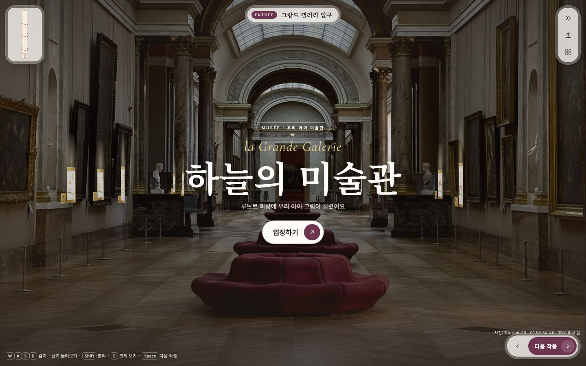
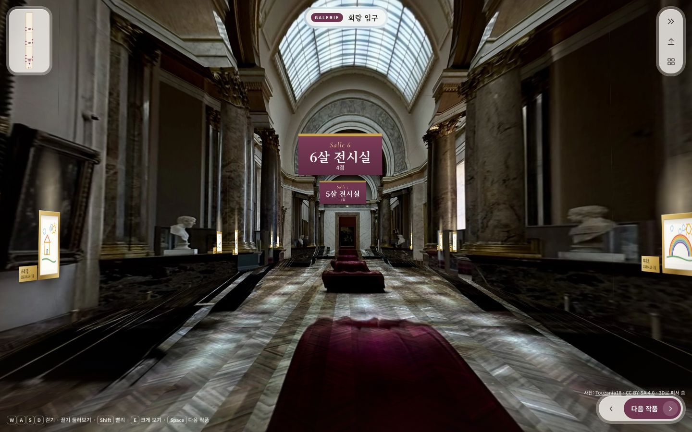
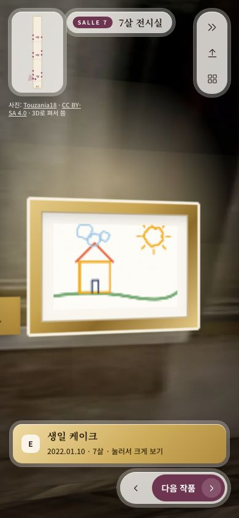

# 걷는 미술관 — 1인칭 루브르 회랑 가이드라인 (2026-09-30)

> 작성: 이제민 세션2 → **신지현(C) 디자인용**. 이제민 지시 세 가지를 한 화면에 모았다.
> ① 정형적인 웹사이트가 아니라 **게임 캐릭터의 1인칭 시점**으로 미술관 공간 속을 걷는다(애니메이션 포함).
> ② 그림으로 흉내 낸 공간 대신 **루브르 실제 사진**(자유 라이선스만)을 쓴다.
> ③ 2D가 아니라 **3D로 루브르 복도에 서 있는 느낌**을 준다.
> 시안: [`docs/C/louvre-walk/`](louvre-walk/) · 근거: [미술관 공간 리서치](미술관_공간리서치_2026-09-30.md) · [1인칭 도구·모델 조사](1인칭_도구·모델_조사_2026-09-30.md)

## 0. 먼저 보기 (1분)

```bash
cd /Users/pioneer1/project2610/docs/C/louvre-walk && python3 -m http.server 8791
# 브라우저: http://127.0.0.1:8791  (file:// 로 열면 faces.json을 못 읽는다)
```

| 입구 | 회랑(입장 뒤) | 작품 앞(390px) |
|---|---|---|
|  |  |  |

**올리면 걸린다(D34 · D35 시안)**: 오른쪽 위 [올리기] → [사진 고르기] 또는 [예시 사진으로 해 보기] → 브라우저가 종이 네 모서리를 찾아 반듯하게 편다(`autocrop.js`, `docs/A/A_자동자르기_방법결정_2026-09-30.md`) → "액자에 담는 중" → 가장 최근 나이 구역 벽 앞으로 걸어가 액자가 날아가 걸리고 조명이 켜진다 → "걸었어요 · 이렇게도 만들어 볼까요? [움직이게] [입체로] [괜찮아요]". 제목은 "제목 없는 그림 N", 날짜는 오늘로 먼저 걸린다. 움직임 줄이기면 연출 없이 바로 걸린다.

조작: **W A S D / 방향키** 걷기 · **끌기** 둘러보기 · **Shift** 빨리 · **E** 크게 보기 · **Space / [다음 작품]** 다음 그림 앞으로 자동 걷기 · **M / 왼쪽 위 안내도** 평면도. 모바일은 왼쪽 아래 조이스틱 + 화면 끌기.

## 1. 어떻게 만들었나 — 사진 한 장을 3D 상자로 편다

- 사진: **「Intérieur de la Grande Galerie du Louvre」** — Touzania18, **CC BY-SA 4.0**, 2887×2887, iPhone 15 (35mm 환산 52mm). https://commons.wikimedia.org/wiki/File:Int%C3%A9rieur_de_la_Grande_Galerie_du_Louvre.jpg
- 기법: **Tour Into the Picture**(한 점 투시 사진 → 바닥·천장·좌우 벽·끝벽 5면). 소실점 (1468, 1896)은 바닥 차단봉 두 줄이 만나는 점, 초점거리 5780px은 EXIF에서 계산, 눈높이 1.5m로 두면 회랑 폭 9.8m · 벽 높이 7.8m가 나온다(실제 그랑드 갤러리와 비슷).
- `ops/museum/tip2faces.py`(이제민 세션 8c가 시안의 `tip.py`를 옮김)가 5면을 **깊이 구간 7개로 잘라 24장(WebP 1.4MB)** 으로 뽑는다. 큰 평면 하나로 두면 가까이 갔을 때 GPU 텍스처 한도(약 4096px)를 넘어 **통째로 안 그려진다**(실측) — 조각은 필수.
- 화면은 **CSS `perspective` + `preserve-3d`만**(3D 엔진 없음). 입구에서는 원근 거리를 사진 화각에 맞춰 **사진과 화면이 똑같이 겹치고**, [입장하기]를 누르면 사진 속으로 3.4초 걸어 들어가며 걷는 화각(데스크톱 52°)으로 바뀐다.
- 앞으로 걷는 동안 보이는 곳은 모두 사진에 찍힌 곳이라 빈틈이 없다. 걷는 범위는 깊이 24~96m로 막았다(그보다 앞은 사진에 없음).
- 바닥은 사진이 깊이 방향으로 아주 적은 픽셀만 담고 있어 흐리다. 그래서 사진 맨 앞의 선명한 헤링본 쪽모이 결(`tex/parquet.webp`)을 반복해 겹쳤다. 색과 빛은 사진 그대로다.

## 2. 공간 규칙 (리서치 R1~R21 중 이 시안에 쓴 것)

| 규칙 | 실제 미술관 근거 | 시안 값 |
|---|---|---|
| 눈높이 · 걸기 | 그림 중심 145~152cm(아이 전시 102~122cm) | 눈 150cm, 액자 중심 145cm — 양쪽 벽 액자 중심을 **한 수평선**에 |
| 나이 = 구역 | 앙필라드 · 우피치 칸 리듬 | 회랑 아치로 나뉜 구역이 곧 **N살 전시실**(입구 쪽이 최근 = 7살, 안쪽으로 갈수록 어릴 때). 구역 머리에 와인색 배너 "Salle 7 · 7살 전시실 · 5점" |
| 관람 거리 | 대각선 × 1.5~2 | 작품 앞 자동 정지: 벽에서 2.7m, 입구 쪽으로 0.55m 비켜 서서 12° 안쪽을 봄 → 회랑 깊이가 화면 가장자리에 남는다 |
| 조명 | 30° 스포트, 종이 50 lux, 작품만 밝게 | 액자 위 따뜻한 빛웅덩이 + 가까이 가면 액자 테가 빛남. **아이 그림에는 필터를 걸지 않는다** |
| 명패 | 작품 오른쪽, 아래 선에 맞춤, 한쪽 통일 | 벽 위 황동 명패(제목 · 날짜 · 나이) + 가까이 가면 화면 아래 황동 알림 "E 눌러 크게 보기"(읽기용 평면 레이어) |
| 길찾기 | 방 번호 · 현재 위치 · 문턱 안내 | 위 가운데 섬 "SALLE 6 · 6살 전시실", 왼쪽 위 미니 평면도(시야 부채꼴), 누르면 큰 안내도 → 작품 점을 누르면 걸어감 |
| 움직임 줄이기 | 시차 · 확대는 어지럼 | `prefers-reduced-motion`이면 걸음 흔들림 · 자동 걷기 애니메이션을 끄고 바로 옮긴다 |

## 3. 화면 틀 — Editorial Luxury (디자인 스킬 `high-end-visual-design` 적용)

- **정형 웹 요소 없음**: 위에 붙은 메뉴 막대 · 버튼 줄을 없앴다. 계기판(HUD)은 네 귀퉁이에 떠 있는 유리 섬뿐이다.
  - 왼쪽 위: 안내도
  - 위 가운데: 지금 위치
  - 오른쪽 위: 극세선 아이콘 3개(건너뛰기 · 올리기 · 한눈에)
  - 오른쪽 아래: [‹ | 다음 작품 ›]
  - 왼쪽 아래: 조이스틱
- **두 겹 테(Doppelrand)**: 모든 HUD는 바깥 유리 껍질(blur 14px, 흰 선 1px) 안에 크림 알맹이가 들어 있다(동심 반지름).
- **글꼴**: 제목은 Noto Serif KR 700, 프랑스어 눈썹 글자는 Cormorant Garamond 이탤릭("la Grande Galerie", "Salle 7"), 본문은 Noto Sans KR.
- **움직임**: 모든 전환은 `cubic-bezier(.32,.72,0,1)`이다. 입장 CTA는 버튼 안에 원형 화살표가 들어 있고(button-in-button), 누르면 0.98로 눌린다. 걸음마다 머리가 위아래 2.2px, 기울기 0.25°로 흔들린다.
- **질감**: 화면 전체에 필름 그레인 7% + 가장자리 어둠(비네트).

## 4. 신지현이 빠르게 손볼 곳 (`louvre-walk/index.html`)

| 바꿀 것 | 위치 |
|---|---|
| 색 · 글꼴 · 이징 토큰 | 맨 위 `:root` (`--plum` 배너 · 버튼, `--gold*` 액자 · 명패, `--glass` HUD) |
| 나이 구역 · 작품 수 · 시작 깊이 | `SECTIONS = [{ age, n, z0 }]` (z0 = 입구에서 m) |
| 액자 크기 · 간격 · 걸기 높이 | `hang()`의 `long = 1.15`(m) · `SPACING` · `HANG = 1.45` |
| 스포트라이트 세기 | `.art .glow` 의 `rgba(255,238,200,.55)` |
| 배너 모양 | `.banner` (와인 바탕 + 금 윗줄) |
| 작품 앞 서는 거리 · 각도 | `artPose()` 의 `D = 2.7`, `yaw: ±78` |
| 걷는 화각 · 속도 · 흔들림 | `walkP()` 26°(반각) · `frame()`의 `1.9`m/s · `render()`의 `2.2`px |
| 입장 연출 길이 | `enter()` 의 `3400`ms |

## 5. 정해야 할 것 (설계서 먼저 — 절대 규정)

지금 SD_02 §17-6(D31)과 **맞지 않는 점**이 셋 있다. 제품에 넣기 전에 설계서(SD_02 §17 · 스타일가이드 · UC_06 · SD_04 §3-3)를 먼저 고쳐야 한다. 아래는 **D33 제안**이다(D32는 이진우 결정 "올리기 사각형 자르기"가 이미 씀).

1. D31 "실제 미술관 사진 · 이름 · 로고 없음" → **자유 라이선스 실사진 허용**(PD · CC0 · CC BY · CC BY-SA만, 사진마다 출처 · 작가 · 라이선스 기록, BY · BY-SA는 화면에 저작자 표시 — 시안 오른쪽 아래). 루브르 이름은 장소 설명으로만 쓰고 로고는 쓰지 않는다.
2. D31 "장면 넘기기(입구 → 회랑 → 갈림길 → 방)" → **자유 1인칭 걷기 + 안내 걷기([다음 작품])**. 갈림길 장면 대신 회랑 구역이 N살 전시실이다.
3. D31 색 틀 v3(연한 동화 색) → 전시 공간은 **사진 색(에스프레소 · 금 · 대리석)**, 계기판 · 모달만 크림 · 자두빛 v3 유지. 벽 색 고르기(D31 ①)는 사진 벽이라 뺄지 결정 필요.

3D 엔진(three.js · TresJS)은 여전히 쓰지 않는다. 엔진으로 옮길지는 조사 문서의 기준으로 판단한다(보이는 면 150개 초과, 실제 iPhone에서 50fps 미만 반복, 진짜 조명 · 깊이 메쉬가 필요할 때).

## 6. 제품(Vue)으로 옮길 때

- `WalkHomeView.vue`를 다음 네 조각으로 나눈다.
  - `walk/PhotoGallery.vue`: 사진 면 · 액자 · 배너
  - `walk/useFirstPerson.ts`: 카메라 · 입력 · 자동 걷기 · 충돌
  - `walk/Hud.vue`: 섬 · 안내도 · 다음 작품 · 명패 알림
  - `walk/Viewer.vue`: 지금 `ArtViewer` 재사용
- 데이터는 `/v1/gallery`의 나이별 묶음 → `SECTIONS`, `GalleryItem` → 액자다(최근 나이가 입구 쪽).
- 사진 자산: 이제민 세션(project2610-8c)이 `web/public/museum/photos/` + `manifest.json` + 검사(`museum-photos.spec.ts`) + nginx 장기 캐시를 준비했다(커밋 ccbb2ca). 다만 그쪽 형식은 **360° 큐브 6면**이다. 이 시안은 **TIP 면 조각**(faces.json)이라 manifest에 `kind: "tip"` + `faces[]`를 더해야 한다 — 8c에 요청해 두었다.
- 예산: 지금 1.4MB(데스크톱 판)다. 모바일용은 `CAP = 200 → 110`px/m로 다시 뽑아 약 600KB를 목표로 한다. 첫 화면은 사진 한 장(입구 = 사진 그대로)만 먼저 받고, 나머지 면은 입장 버튼을 누르는 동안 받는다.

## 7. 알려진 한계 · 다음 할 일

| 한계 | 대책 |
|---|---|
| 가까운 벽은 사진 해상도가 모자라 흐리다(작품 앞에서 배경이 흐려진 것처럼 보임) | 심도 효과로 받아들이거나, 원본 해상도를 넘는 구간(`CAP`)을 가까운 벽에만 올린다 |
| 뒤돌아보면 입구 쪽(깊이 20m 앞)은 사진에 없어 크림 벽으로 막았다 | 아폴론 갤러리(CC0, 7507px — 관람객 얼굴이 있어 흐림 처리 필요)를 반대편 회랑으로 붙이는 안 |
| 모바일 실기기 성능 · iOS Safari 미측정 | 이번에 Chrome DevTools MCP · Playwright MCP를 설치했다(로컬 범위, 다음 세션부터). 실제 iPhone에서 fps · 메모리를 재기 |
| 사진 속 기존 명화 위에 아이 그림을 겹쳐 건다 | 아이 그림이 주인공이 되도록 스포트 · 테 빛으로 구분. 원하면 사진 속 명화 자리를 벽색으로 지우는 전처리 |

---
*사진 텍스처(tex/*.webp)는 원본을 3D 면으로 편 변형물이라 같은 **CC BY-SA 4.0**으로 배포한다. 캡처 속 그림은 이 세션에서 만든 합성 크레용 그림이다(실제 아동 그림 아님).*
