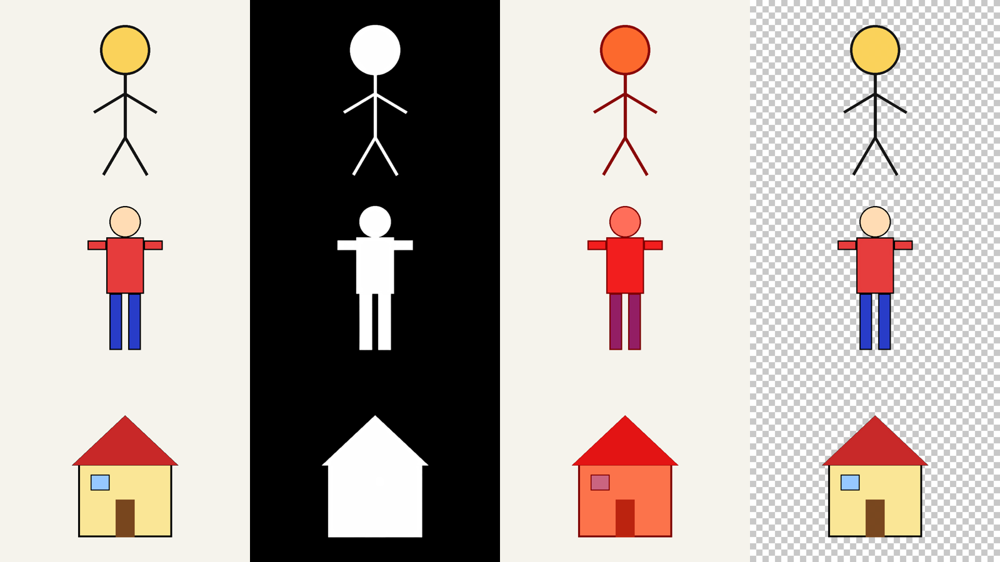
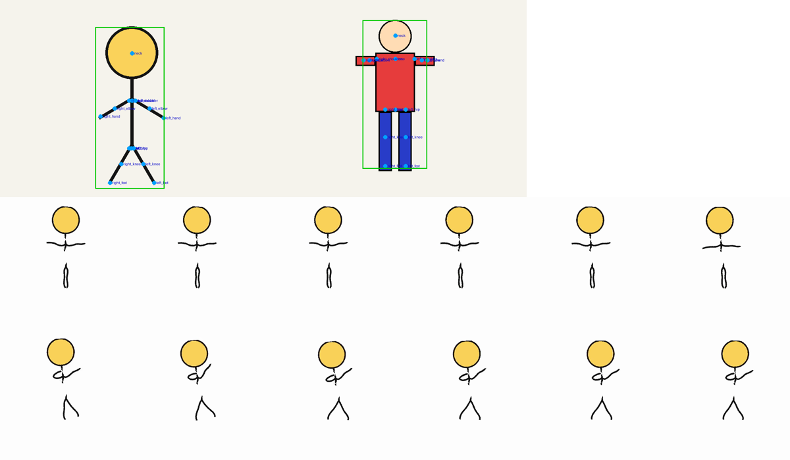
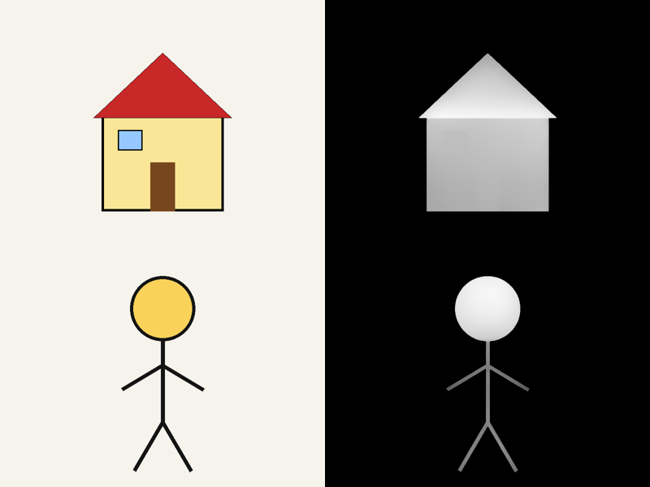

# 합성 그림 보호자 흐름 시험 (2026-09-30)

> 기록: D 이진우 · 2026-09-30 10:10~10:12 KST · 서버 Studio-B(p1 서비스, app-api 127.0.0.1:9521)
> 목적: 서비스 재기동(9/29 17:53~17:56) 뒤 한 번도 돌지 않은 **보호자 흐름 전체 경로**(접수 → 대기열 → 워커 → 모델 → 결과 → 삭제)가 실제로 동작하는지 확인한다.
> 관련: BR-MDL-04 · G20 · G5 · BR-PRV-01·03 · U13 · SD_03 `artwork_outcome`·`stage_job` 보관 규칙 · `docs/A_샘플_평가묶음_적합성검토.md` · `docs/D_평가그림_1차_모으기.md`

## 1. 결론

- **서비스 전체 경로가 끊기지 않고 동작한다.** 합성 그림 3장이 가입 → 결과 생성 → 삭제까지 약 1분에 처리됐다. 작업 10건 모두 한 번에 끝났고 오류는 0건이다.
- M1·M2·M3(관절·렌더)·M4·M5가 서비스 워커에서 실제로 돌았고, **움직임 실패 → 2.5D 자동 낮춤**(`animated_to_relief`)도 확인했다.
- **결과물 육안 확인(§9, 같은 날 추가)**: M1 분리는 세 그림 모두 모양 그대로 정확했고, M5 깊이도 그럴듯했다. **M3 움직임은 재생되지만 그림이 크게 일그러진다**(몸통과 다리가 끊기고 팔다리가 구불거림).
- **이 시험은 모델 품질의 근거가 아니다.** 합성 그림은 실제 그림보다 단순하고(아래 §6), 팀원 제작이 아니라 평가 묶음(G20)에 넣을 수 없다. 점검(G30)·시험 호출(G23)·평가·승격(G22)은 여전히 팀원 그림(T118)이 필요하다.

## 2. 왜 합성 그림인가 — 쓸 수 있는 이미지 조건

`design/샘플/export1`(6장)은 쓰지 않았다. 실제 아이 얼굴이 5장에 크게 찍혀 있고, 2장은 작품에 아이 실명이 적혀 있으며, 6장 모두 팀원이 아니라 실제 아이가 만든 작품이다(A 검토 문서 §0·§3).

| # | 조건 | 근거 | 보호자 흐름 | 평가 묶음(점검·시험 호출·승격) |
|:-:|---|---|:-:|:-:|
| 1 | 실제 아이가 나오지 않는다(얼굴·몸·손) | BR-PRV-01·03, U13 | 필수 | 필수 |
| 2 | 아이 실명이 없다(작품 위 손글씨·스티커 포함) | BR-CHD-01 | 필수 | 필수 |
| 3 | 실제 아이가 만든 작품이 아니다 | BR-MDL-04, spec 가정(P0 팀원 작품만) | 필수 | 필수 |
| 4 | 인터넷 그림·공개 데이터셋·모델 예제 그림이 아니다 | BR-MDL-04 | 필수 | 필수 |
| 5 | JPEG·PNG·HEIC, 20MB 이하, 이미지로 열림 | G5 | 필수 | 필수 |
| 6 | 저장소에 커밋하지 않는다 | D 작업지시 | 필수 | 필수 |
| 7 | **팀원이 직접 만들었고 만든 사람(`maker`)을 적을 수 있다** | G20 | – | 필수 |

→ 코드로 그린 합성 그림은 1~6을 만족하므로 **보호자 흐름에만** 쓸 수 있다.

## 3. 시험 입력 (코드로 생성, 800×600 PNG, 종이색 바탕)

| 이름 | 모양 | 의도 |
|---|---|---|
| `stick_person` | 원 머리 + 가는 선 몸·팔·다리(`serving/tests/test_real_m1.py`의 `drawing()`과 같음) | 사람 그림 |
| `colored_person` | 살색 머리 · 빨간 사각형 몸통·팔 · 파란 다리, 검은 윤곽 | 색칠한 사람 그림 |
| `house` | 노란 벽 · 빨간 지붕 · 문 · 창문 | 비인물(집) |

파일과 시험 스크립트는 세션 scratchpad에만 두었다(저장소 밖).

## 4. 사전 확인 — 서비스 밖에서 어댑터 직접 실행 (DB 쓰기 없음)

같은 가중치로 어댑터를 직접 불렀다. M3는 가동 중인 TorchServe(127.0.0.1:9561)를 호출했다.

| 그림 | M1 분리 | M2 판정 | M3 관절 → M4 | 제안 | 직접 렌더(M3) · 깊이(M5) |
|---|---|---|---|---|---|
| stick_person | ok, 전경 5.7%, 8.4초 | person 0.95 | 검출 1.0 → **불통과** | relief | 움직임 렌더 **ok**(14.7초, MP4 272KB) · 깊이 ok |
| colored_person | ok, 10.1%, 7.2초 | person 1.00 | 검출 0.8 → 통과 | animated | 움직임 렌더 **quality_below `ad_failed`**(2.5초) |
| house | ok, 20.2%, 7.3초 | house 0.00 | 미검출 | relief | 깊이 ok |

- `colored_person` 렌더 실패 원인(관절 그림 확인): 반듯한 사각형 팔이라 어깨·팔꿈치·손목 관절이 팔 끝에 한 줄로 몰렸다. AD 리깅이 이 관절로 움직임을 만들지 못했다 `[추론]`.

## 5. 보호자 흐름 시험 (p1 서비스, 2026-09-30 10:10~10:12 KST)

### 5-1 절차
1. 가입 `POST /v1/auth/signup`(202) → Mailpit에서 확인 메일 토큰 → `POST /v1/auth/email/verify`(204, 세션 발급)
2. 아이 등록 `POST /v1/children` 별칭 `합성시험`(201, child 11)
3. 작품 3건 접수 `POST /v1/artworks`(202 ×3, 작품 7·8·9)
4. 판정 대기(`awaiting_confirm`) → 확정 `POST /v1/artworks/{id}/confirm`(200 ×3)
5. 결과 대기(`awaiting_review`) → 결과 종류·단계 확인
6. 작품 삭제 `DELETE /v1/artworks/{id}`(202 ×3) → 삭제 진행 `done` ×3 → 아이 삭제(202)
- **결정(좋아요·승인·전시)은 하지 않았다** — 첫 결과 승인율 지표를 오염시키지 않으려고.

### 5-2 결과

| 작품 | 제안 | 확정 | 단계 | 최종 결과 | 판정 대기 | 결과 대기 |
|---|---|---|---|---|--:|--:|
| 7 stick_person | relief | **animated**(제안과 다르게) | split → judge → animate_render | **animated**(움직임) | 13.0초 | 22.6초 |
| 8 colored_person | animated | animated | split → judge → animate_render(**낮춤**) → depth_relief | **relief**(`animated_to_relief`) | 6.5초 | 6.5초 |
| 9 house | relief | relief | split → judge → depth_relief | **relief** | 9.8초 | 0.1초 |

### 5-3 작업 기록 (`stage_job` 14~23)

| job | 단계 | origin | 상태 | 낮춤 | 오류 | 모델 버전 | 처리 |
|--:|---|---|---|---|---|--:|--:|
| 14 | split | intake | done | – | – | 5 (M1) | 9초 |
| 15 | judge | intake | done | – | – | 8 (M2) | 2초 |
| 16 | split | intake | done | – | – | 5 | 7초 |
| 17 | judge | intake | done | – | – | 8 | 1초 |
| 18 | split | intake | done | – | – | 5 | 8초 |
| 19 | judge | intake | done | – | – | 8 | 1초 |
| 20 | animate_render | confirm | done | – | – | 6 (M3) | 22초 |
| 21 | animate_render | confirm | done_downgraded | animated_to_relief | – | 6 | 3초 |
| 22 | depth_relief | confirm | done | – | – | 7 (M5) | 1초 |
| 23 | depth_relief | downgrade | done | – | – | 7 | 0초 |

- 재시도 0건(모든 작업 `attempt_count` 1), 인프라 오류 0건.
- 모델 버전은 D27 임시 활성 버전(M1 v5 · M2 v8 · M3 v6 · M5 v7)과 같다.

### 5-4 확인한 것 / 확인하지 못한 것

| 확인함 | 확인하지 못함 |
|---|---|
| 가입·메일 확인(Mailpit)·세션 | 결정(좋아요·낮춘 결과·액자·다시 찍기)·이야기·전시 |
| 아이 등록, 사진 접수(G5 통과), 대기열 점유 | 서비스가 만든 결과 파일 내용 — 스크립트가 응답 필드(`primaryUrl`)를 잘못 읽어 빠졌고, 삭제와 함께 파일이 지워졌다. 대신 §4 직접 실행 결과물을 §9에서 눈으로 확인 |
| M1 · M2+M3+M4 판정 · M3 렌더 · M5 깊이 | 액자(`frame`) 경로, 분리 실패(`split_fail`) 경로 |
| 제안과 다른 확정(판정 수정) | 공동 보호자·가족 교차 접근 |
| 움직임 실패 → 2.5D 자동 낮춤 | 동시 부하, 처리 시간 상한(12MP 사진) |
| 작품·아이 삭제, 파일·원본 제거(남은 파일 0) | |

## 6. 합성 그림의 한계

1. **원하는 경로를 시험하기 어렵다.** 가는 선 사람은 M4 불통과로 움직임 경로에 가지 않고, 색칠한 사람은 움직임 제안까지 가지만 렌더가 실패한다. 성공하는 그림을 찾으려고 그림을 고치면 "모델에 맞춘 그림"이 된다.
2. **실제 조건이 빠져 있다.** 손에 들고 찍기·복잡한 배경·그림자·기울기·크레파스 질감·입체 작품·12MP 원본이 없다. M1이 합성 그림은 7~9초인데 실제 사진은 31~82초였다(A 검토 §6-2) — 분리 시간 상한 60초 위험이 드러나지 않는다.
3. **품질 판단 근거가 아니다.** M2 확신도가 0.95~1.00으로 쉽게 나오고, 평평한 도형의 깊이로는 2.5D 품질을 판단할 수 없다.
4. **규칙상 평가 묶음에 쓸 수 없다**(G20). 점검·시험 호출·평가·승격은 풀리지 않는다.
5. **서비스 지표에 흔적이 남는다**(§7).

## 7. 정리 상태와 지표 주의

| 항목 | 상태 |
|---|---|
| 작품 7·8·9, 원본·결과 파일 | 삭제 완료(`artwork` 0행, 이 시각 이후 `stored_object` 0행) |
| 아이 11 | 삭제 완료 |
| 시험 계정 `d-synth-e2e-09301010@example.com` | **남아 있음**(탈퇴 기능 없음). 아이 삭제를 위해 재설정 메일로 비밀번호를 한 번 바꿨고 로그아웃함 |
| `artwork_outcome` 14~16 | **설계상 영구 보관**(삭제 뒤에도 남음, SD_03) |
| `stage_job` 14~23 · `gate_event` · `deletion_request` 3건 | 영구 보관(작품 번호만 NULL) |

**지표를 볼 때 2026-09-30 10:10~10:12 KST(DB UTC 01:10~01:12) 기록은 합성 시험분으로 제외한다.**
- 판정 수정률: 1건 수정(작품 7, relief → animated)
- 낮춤: 1건(작품 8, `model_downgrade`)
- 첫 결과 승인율: 결정을 하지 않아 영향 없음(`first_decision` NULL, `in_approval_base` NULL)

## 8. 발견과 다음 할 일

| # | 발견 | 다음 | 담당 |
|:-:|---|---|---|
| 1 | **M4 규칙은 통과했는데 M3가 렌더하지 못하는 모양이 있다**(colored_person). 부모에게 "움직일 수 있어요"를 제안했다가 결과가 2.5D로 바뀐다. 낮춤 체인이 받아 주지만 제안의 신뢰가 떨어진다 | 실제 그림에서 얼마나 생기는지 1차 측정에 넣는다(제안 animated 중 렌더 실패 비율) | A(T137) |
| 2 | 가는 선 사람은 M3 검출 1.0이어도 M4가 불통과시킨다 — 움직임 렌더는 되는 그림이다 | M4 기하 규칙 임계값을 1차 측정으로 확인(U5) | A(T137) |
| 3 | 시험 계정이 남는다(보호자 탈퇴 경로 없음) | 운영 정리 방법 필요 여부 확인(U19·U20 관련) | 팀 |
| 4 | 서비스가 만든 결과 파일 내용 확인이 빠짐(§9는 직접 실행 결과물) | 다음 시험 스크립트에서 `result.primaryUrl`·`auxUrl`을 내려받아 형식(MP4 `ftyp`, PNG16) 확인 | D |
| 5 | **M3 움직임이 가는 선 그림을 크게 일그러뜨린다**(§9-2): 몸통과 다리가 떨어지고 다리가 한 줄로 뭉개지며 팔이 구불거린다. 서비스는 이 영상을 결과로 보여 준다(품질 검사 없음) | 실제 그림에서 같은 일이 생기는지 1차 측정에 "움직임 결과를 사람이 보고 판정" 항목을 넣는다. M3 어댑터의 품질 미달 판정(현재 AD 실패·파일 없음만)에 모양 유지 검사가 필요한지 검토 | A(T137·U5) |
| 6 | 색칠한 사람의 팔 관절 6개(어깨·팔꿈치·손목)가 팔 위 한 줄에 몰렸다(§9-2) — 렌더 실패(`ad_failed`)의 원인으로 보인다 | M4 기하 규칙에 "팔 관절이 한 점·한 줄로 몰리면 불통과"를 넣을지 1차 측정 뒤 결정 | A(T137) |
| 7 | 모델 품질·점검·승격은 이 시험으로 확인할 수 없다 | 팀원 그림 1차 12장(T118) — 이진우 몫 7·8·12번 | 팀 전원 |

## 9. 결과물 육안 확인 (2026-09-30 추가)

§4 직접 실행 결과물(서비스와 같은 가중치·같은 어댑터)을 모아 눈으로 봤다. 서비스가 만든 결과 파일은 삭제로 지워져 볼 수 없다. 그림은 합성이라 개인정보가 없어 문서에 함께 둔다.

### 9-1 M1 분리 — ✅ 정확

열: 원본 · 마스크 · 마스크 겹침(빨강) · 컷아웃(투명 바탕)

- 세 그림 모두 **그림 모양 그대로** 잘렸다. 막대 사람의 가는 선(10px)까지 끊김 없이 들어갔고, 배경(종이)은 한 점도 섞이지 않았다.
- 컷아웃의 색은 원본과 같다(원본 픽셀 불변, FR-22).
- 한계: 단색 바탕·굵은 윤곽이라 가장 쉬운 경우다. 실제 사진에서 아이 몸까지 자른 문제(A 검토 §6-2)는 이 그림으로 확인할 수 없다.

### 9-2 M3 관절·움직임 — △ 재생은 되지만 모양이 일그러짐

위: 관절 검출(파란 점, 초록 상자) — 왼쪽 막대 사람, 오른쪽 색칠한 사람 · 아래: 막대 사람 움직임 영상에서 0.25초 간격으로 뽑은 12장

- **관절 — 막대 사람**: 목·어깨·팔꿈치·손·엉덩이·무릎·발이 선 위 맞는 자리에 잡혔다. ✅
- **관절 — 색칠한 사람**: 목·엉덩이·무릎·발은 맞지만, **팔 관절 6개(양쪽 어깨·팔꿈치·손목)가 사각형 팔 위 한 줄에 몰렸다.** 팔을 접을 수 없는 관절이라 렌더가 실패(`ad_failed`)한 원인으로 보인다 `[추론]`. ❌
- **움직임 영상(막대 사람)**: H.264 MP4, 500×500, 24fps, 10.25초. 재생되고 팔다리가 움직인다. 그러나
  - 몸통이 목 아래에서 끊겨 **머리·팔과 다리가 따로 떠 있다**
  - 다리가 한 줄의 구불구불한 선으로 **뭉개지고**, 뒤 장면에서는 다리가 벌어지며 팔이 꼬인다
  - 선이 원본보다 가늘고 흔들린다(텍스처 변형)
  → 서비스는 이 영상을 결과로 보여 준다. 부모가 보면 "그림이 망가졌다"고 느낄 수준이다. **동작은 하지만 품질은 확인되지 않았다.**

### 9-3 M5 깊이 — ✅ 그럴듯함

왼쪽 원본 · 오른쪽 깊이(밝을수록 가까움, 마스크 밖 0)

- 집: 지붕이 가장 가깝고 벽은 위에서 아래로 부드럽게 멀어진다. 창문·문 경계가 희미하게 남는다.
- 막대 사람: 머리가 공처럼 가운데가 볼록하고, 팔다리는 고른 깊이다.
- PNG16, 값 1,584~65,535, 마스크 밖은 0(2.5D 시차 입력 형식과 맞음).
- 한계: 평평한 도형이라 "실제 그림이 2.5D로 보기 좋은가"는 판단할 수 없다.

### 9-4 모델별 정리

| 모델 | 동작 | 합성 그림에서의 결과 모양 | 실제 품질 |
|---|:-:|---|---|
| M1 분리 | ✅ | ✅ 정확 | 미확인(실제 사진은 A 검토에서 문제 확인) |
| M2 판정 | ✅ | ✅ 사람·사람·집 맞힘(쉬운 그림) | 미확인 |
| M3 관절 | ✅ | △ 막대 사람 맞음 · 색칠한 사람 팔 관절 몰림 | 미확인 |
| M3 움직임 | ✅(1/2) | ❌ **재생되지만 크게 일그러짐** | 미확인 — T137에서 사람 판정 필요 |
| M4 규칙 | ✅ | △ 렌더되는 그림은 불통과, 렌더 안 되는 그림은 통과(거꾸로) | 미확인 |
| M5 깊이 | ✅ | ✅ 그럴듯함 | 미확인 |

## 부록 — 같은 날 확인한 모델 가동 상태 (시험 직전)

- pm2 8개 online(재시작 0, 15.9시간). model-api `/internal/ready`: M1·M2·M3·M5 `ready`, M6·M7 `disabled`(P0.5·P1, 라이선스 미확정). TorchServe `Healthy`.
- 실제 가중치 스모크 시험(`serving/tests/test_real_m1·m2·m3·m5.py`, `UAM_REAL_MODELS=1`): 7건 통과 — M1 22.9초(적재 포함) · M2 2.9초 · M3 관절 1.9초 · M3 렌더 24.8초 · M5 0.8초.
- 재기동 직전 로그의 Traceback은 종료 신호(`KeyboardInterrupt`·`CancelledError`)이며 기동 뒤 새 오류 없음. sweeper 재시작 18회는 누적값(이번 기동 뒤 불안정 재시작 0).
