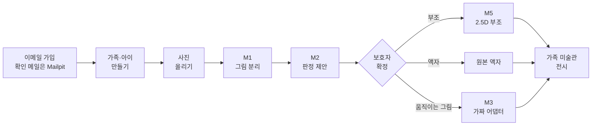
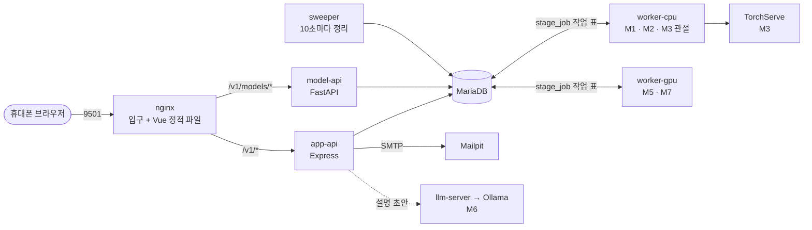
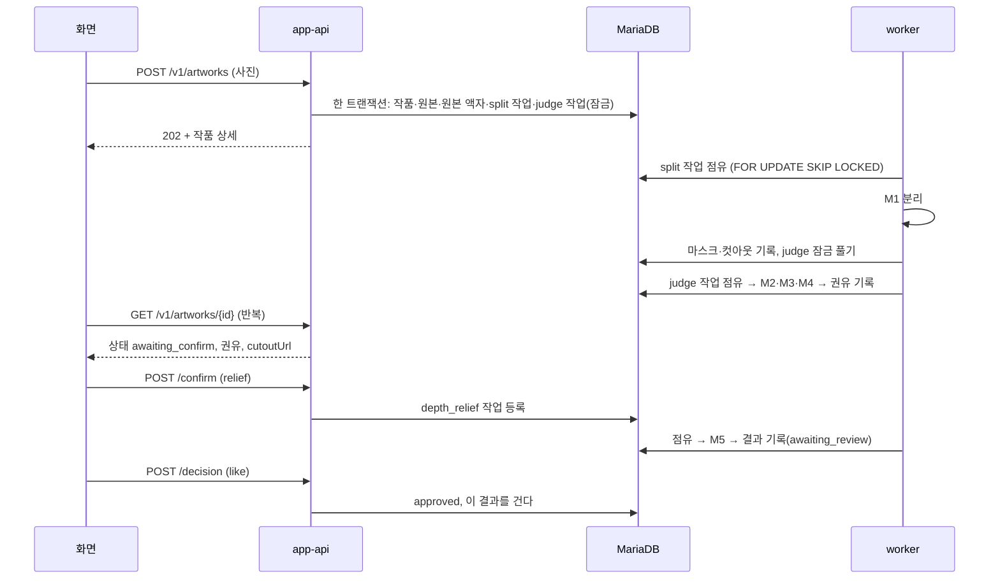
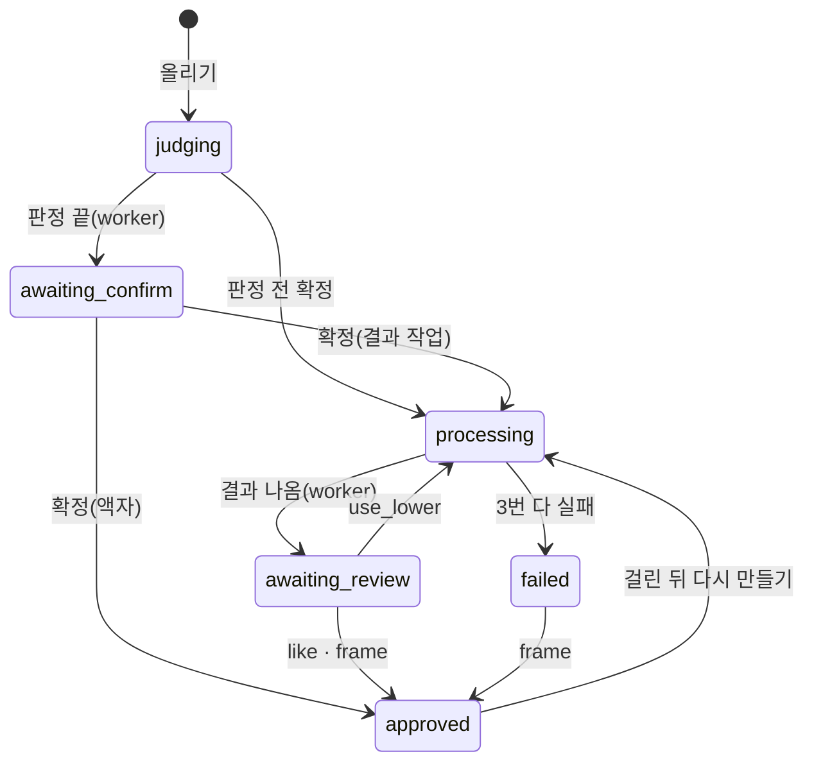

# 우리 아이 미술관 서비스 구조와 코드

이미 만들어진 "우리 아이 미술관" 서비스가 어떻게 생겼고 어떻게 작동하는지 설명합니다. 이번 5일 작업의 목표·역할·이슈는 [README](../../README.md)에, 컨테이너 구성과 날마다 할 일은 [수행 가이드](수행가이드.md)에 있습니다.

서비스는 두 덩어리입니다. **모델 서빙**(app-api · 작업 큐 · worker · AI 모델 · DB)은 지난 팀 작업(2026-09-30 판)을 그대로 쓰고, **화면**은 브라우저 3D 미술관(`web/src/app/world/`)으로 바꿉니다. 이번 개발 몫은 3D 화면이 모델 서빙 API를 쓰게 잇는 것과 전체를 컨테이너로 감싸는 것입니다.

**이 문서로 알 수 있는 것**

| 알고 싶은 것 | 볼 곳 |
|---|---|
| 서비스가 무엇을 만들고 무엇을 약속하나 | [무엇을 하나](#what) · [지키는 원칙](#principles) |
| 사진 한 장이 어디를 거쳐 전시되나 | [한 바퀴](#flow) · [15단계 표](#steps) |
| 어떤 프로그램들이 어떻게 이어지나 | [서비스 구조](#structure) |
| 부분(화면·입구·앱 서버·DB·worker·model-api)마다 무엇이고, 컨테이너로 옮길 때 무엇을 볼까 | [부분별 설명](#parts) |
| 실패하면 어떻게 되나 | [처리 규칙](#rules) |
| 코드를 함수 단위로 따라가기 | [코드 설명](#code) |

**처음 읽는다면:** 무엇을 하나 → 한 바퀴 → 서비스 구조 → 자기 몫의 부분별 설명 → [몫별로 먼저 읽을 곳](#code-9) 순서로 읽고, 코드 설명은 필요할 때 펼칩니다.

**먼저 알아 둘 말**

| 말 | 뜻 |
|---|---|
| app-api | 화면이 부르는 앱 서버(Node·Express). 가입, 사진 받기, 확정·결정을 처리합니다 |
| worker | AI 모델을 실제로 돌리는 Python 프로그램. 앱 서버와 따로 돕니다 |
| 작업 표(`stage_job`) | DB 안의 "할 일 목록". 앱 서버가 적고 worker가 하나씩 가져갑니다 |
| 점유(claim) | worker가 할 일 하나를 "내가 한다"고 잡아 두는 것. 60초마다 끊기고 20초마다 늘립니다 |
| 트랜잭션 | 여러 표를 한꺼번에 바꾸고, 하나라도 실패하면 전부 되돌리는 묶음 |
| 어댑터 | 모델마다 하나씩 있는 연결 코드. worker는 모델 대신 어댑터만 부릅니다 |
| 가짜 모델 | AI 대신 정해진 결과를 바로 돌려주는 어댑터. 가중치 없이 흐름 전체를 시험합니다 |
| 폴링 | 화면이 서버에 "다 됐어요?"를 몇 초마다 묻는 것 |
| 뷰(view) | DB 안에 저장해 둔 조회 규칙. 화면과 지표가 같은 규칙으로 읽게 합니다 |

<a id="what"></a>

## 무엇을 하나

보호자가 아이 그림을 휴대폰으로 찍어 올립니다. 서버가 그림을 종이에서 떼어 내고, 무슨 그림인지 보고, 결과물을 권합니다. 보호자가 고르고 승인하면 가족 미술관에 걸리고, 이웃 가족을 초대해 서로의 미술관을 볼 수 있습니다.

| 결과물 | 언제 | 만드는 모델 |
|---|---|---|
| 움직이는 그림 | 사람 그림이고 관절이 맞을 때 | M3 Animated Drawings(이번 5일은 가짜 어댑터) |
| 2.5D 입체 부조 | 그림을 종이에서 떼어 낼 수 있을 때 | M1 BiRefNet(분리) + M5 Depth Anything V2(깊이) |
| 원본 액자 | 떼어 내기 어렵거나 보호자가 고를 때 | 모델 없음 |

**약속: 접수된 사진(JPG·PNG·HEIC, 20MB 이하)은 바로 원본 액자로 걸립니다.** 모델 결과가 품질 기준에 못 미치면 한 단계씩 낮춘 결과를 돌려주고(움직임 → 부조 → 액자), 낮췄다는 사실을 숨기지 않습니다. 서버 장애는 낮추지 않고 다시 시도한 뒤 단계별로 처리합니다([처리 규칙](#rules)).

모델은 새로 학습하지 않았습니다. 아이 그림 데이터가 없고, 아이 사진을 학습에 쓰는 것 자체가 개인정보 문제이기 때문입니다. 대신 공개 사전학습 모델을 골라 이어 붙였습니다. 고른 기준은 상업 이용 라이선스, 크기와 메모리, 우리 장비에서 실행되는지입니다.

<a id="principles"></a>

## 지키는 원칙

| 원칙 | 내용 |
|---|---|
| 승인 전 비전시 | AI가 만든 결과는 보호자가 승인해야 전시한다. 원본 액자는 접수 직후 전시한다 |
| 원본 불변 | 원본 사진을 덮어쓰지 않는다 |
| 결과는 늘 돌아온다 | 품질이 모자라면 한 단계 낮춘 결과를 돌려주고, 낮춘 사실을 숨기지 않는다 |
| 원인 분리 | 보호자 선택·모델 낮춤·보호자 전환·인프라 실패·결과 미도달을 섞지 않는다 |
| 제안은 제안까지 | 판정은 제안만 하고 보호자가 확정한다. 점수를 보이지 않는다 |
| 최소 수집 | 아이는 별칭만 받는다. 아이 사진은 외부 API로 보내지 않는다 |

<a id="flow"></a>

## 한 바퀴



<a id="steps"></a>

<details>
<summary><b>단계별로 어디서 무엇이 일어나나(15단계)</b></summary>

| # | 어디서 | 무엇이 | 작품 상태 | 코드 |
|---|---|---|---|---|
| 1 | 휴대폰 | 사진 고르기 → 방향·자르기 → 줄여서 전송 | | `web/src/app/upload/` |
| 2 | nginx | 21MB 넘으면 바로 413, 아니면 app-api로 | | `ops/p1/nginx.conf` |
| 3 | app-api | 세션 확인 → 파일 받기 → 이미지 검사(HEIC 포함) | | `api/src/modules/artworks/routes.ts` |
| 4 | app-api | 원본 저장(덮어쓰기 불가) | | `api/src/storage/LocalFsDriver.ts` |
| 5 | app-api | **한 트랜잭션**: 작품 행, 원본 기록, 원본 액자 걸기, 이야기 자동 채우기, 판정 작업 등록 | `judging` | `intakeTx` |
| 6 | 화면 | 미술관에 원본 액자가 이미 보인다. 상세 화면에는 진행 표시 | | `v_job_progress` |
| 7 | worker-cpu | 분리 작업 점유 → M1 마스크·컷아웃 → 판정 작업 열기 | | `serving/workers/stages/split.py` |
| 8 | worker-cpu | M2 종류 → M3 관절 → M4 기하 규칙 → 권유 기록 | `awaiting_confirm` | `serving/workers/stages/judge.py` |
| 9 | 화면 | 권유를 보여 주고 보호자가 고른다 | | `/app/artworks/:id/confirm` |
| 10 | app-api | 고른 종류로 작업 등록 | `processing` | `api/src/modules/artworks/` |
| 11 | 워커 | 움직임 렌더 또는 부조 또는 액자. 실패하면 한 단계 낮춤 | | `serving/workers/stages/results.py`, `chain.py` |
| 12 | 화면 | 결과를 보고 정한다 | `awaiting_review` | `/app/artworks/:id/review` |
| 13 | app-api | 좋아요 / 한 단계 낮추기 / 액자로 두기 / 다시 찍기 | `approved` | `api/src/modules/artworks/decision.ts` |
| 14 | 화면 | 미술관에 걸린 결과. 이웃도 볼 수 있다 | | `/app/museum/:childId`, `v_gallery` |
| 15 | sweeper | 죽은 작업 되살리기, 지우기 요청 처리, 만료 정리 | | `api/src/sweeper/` |

표의 화면 주소(`/app/artworks/...` 등)는 지난 판 평면 화면입니다. 이번에는 같은 API를 3D 미술관이 부릅니다.

작품 상태는 DB가 허용하는 8개뿐입니다: `received` `judging` `awaiting_confirm` `processing` `awaiting_review` `approved` `failed` `deleting`.

</details>

<a id="structure"></a>

## 서비스 구조

아래 그림은 **지금(팀 서버) 구성**입니다. 컨테이너로 옮길 구성은 [수행 가이드의 컨테이너 구성](수행가이드.md#container)에 있습니다.



**구조를 이해하는 세 가지**
1. **앱 서버는 모델을 직접 부르지 않습니다.**
   - 움직이는 그림 생성이 사람 그림 17~43초, 큰 사진 62~431초 걸렸습니다(팀 서버 측정, 2026-09-30, 표본 적음).
   - 그동안 요청 연결을 붙잡지 않도록, 추론은 Python worker가 따로 합니다.
2. **앱 서버와 worker는 DB 표 하나(`stage_job`, 작업 표)로 이어집니다.**
   - 사진을 받는 트랜잭션 안에서 작품 기록과 작업 등록을 한 번에 커밋합니다. 그래서 "작품은 생겼는데 작업이 없는" 상태가 생기지 않습니다.
   - worker는 `SELECT … FOR UPDATE SKIP LOCKED`로 다른 worker가 잡은 행을 건너뛰고 하나를 점유합니다. 점유는 60초이고 20초마다 연장합니다.
   - worker가 죽으면 sweeper가 그 작업을 다시 대기로 돌립니다.
3. **지금 팀 서버는 입구 하나만 밖에 엽니다.** nginx 9501만 열고, 나머지는 127.0.0.1에서만 듣습니다(컨테이너에서는 메일 화면 8025도 엽니다).

<a id="parts"></a>

## 이미 만들어진 것: 부분별로 어떻게 되어 있고 어떻게 작동하나

작업을 시작하기 전에 이 절을 먼저 읽습니다. 지금 코드는 팀 서버(맥) 한 대에서 pm2로 띄우도록 맞춰져 있습니다. 컨테이너로 옮길 때 각 부분에서 무엇을 봐야 하는지도 함께 적었습니다.

<a id="part-web"></a>

### 1. 화면: 3D 미술관 `web/src/app/world/` (Vue 3.5 · three.js 0.170)
- **무엇:** 브라우저에서 도는 3D 미술관입니다. 광장 → 미술관 로비 → 회랑 → 나이별 전시실을 캐릭터로 걸어 다니고, 아이 그림이 두께 있는 입체 작품으로 걸립니다. 작품을 누르면 주제별 애니메이션(행동 7종·소리 11종)이 나옵니다.
- **어떻게 뜨나:**
  - 개발: `cd web && npm ci && npm run dev` → `http://127.0.0.1:9501/app/world`. 개발 서버가 `/v1/*`를 app-api(9521)로 넘깁니다(`web/vite.config.ts`).
  - 배포본: `npm run build:world` → `web/dist-world/`. 미술관 전용 라우터만 들어가고, 한 번 받으면 오프라인에서도 열리는 서비스 워커(`web/public/sw.js`)가 들어 있습니다. 화면 전용 서버 프로세스는 없고 nginx가 이 파일을 내줍니다.
- **어떻게 작동하나(지금):**
  - `engine.ts`가 렌더러·카메라·캐릭터 이동·작품 배치를 묶고, Vue 화면(`WorldView.vue` 등)은 데이터를 넘기고 콜백을 받습니다.
  - 공간은 `museum.ts`(로비·회랑·전시실, 작품 자리), `spatialLayout.ts`, `cathedral.ts`, `outdoor.ts`가 만듭니다.
  - 사진을 올리면 `store.ts`의 `processImage`가 원본·화면용 사본을 만들고, `cutout.ts`의 `removeBackground()`가 **브라우저 규칙**으로 배경을 지웁니다. 조명 펴기 → 종이색 찾기 → 가장자리부터 칠하기 → 잡티 지우기 순서이고, 실패하면 사각형 판으로 대체합니다. 그다음 `buildRelief()`가 윤곽을 따서 두께 있는 입체를 만듭니다.
  - 작품·방·설정·캐릭터는 **브라우저 IndexedDB**(`store.ts`)에 저장합니다. 백업 zip(`backup.ts`)으로 내보낼 수 있습니다.
  - **서버를 전혀 부르지 않습니다.** 로그인도 없고, 기기 안의 가족 프로필로 씁니다.
- **이번에 바꿀 것:**
  - 작품 부분(가입·아이·올리기·상태·확정·결정·목록)이 app-api를 쓰게 잇습니다. 서버 모델이 만든 M1 컷아웃(`cutoutUrl`)으로 입체를 다시 만듭니다. 교체 자리는 미리 나눠 두었습니다(`cutout.ts` 2행).
  - 개인정보 안내(`WorldPrivacy.vue` 20행, "사진을 이 기기 밖으로 보내지 않아요")를 바꿉니다.
  - 자세한 대응표는 [수행 가이드의 3D 화면 ↔ API 연결](수행가이드.md#connect)에 있습니다.
- **같은 폴더의 다른 화면:** `web/`에는 지난 판의 평면 화면(`/app/...`, `/ops/...`)도 들어 있습니다. 운영 화면(`/ops`)은 참고만 하고, 평면 보호자 화면은 쓰지 않습니다.
- **옮길 때:** 빌드 단계(node, `npm run build:world`)와 실행 단계(nginx)를 나눕니다. 실행 이미지에는 `dist-world/`만 들어갑니다.

<a id="part-nginx"></a>

### 2. 입구 nginx `ops/p1/nginx.conf`
- **무엇:** 바깥에서 들어오는 문은 이것 하나입니다(9501).
- **어떻게 작동하나:** 주소에 따라 보냅니다.

  | 주소 | 가는 곳 |
  |---|---|
  | `/` | 화면 정적 파일. 없는 경로는 `index.html`로 보내 화면 라우터가 처리한다 |
  | `/v1/*` `/live` `/ready` | app-api(127.0.0.1:9521) |
  | `/v1/models/*` | model-api(127.0.0.1:9541), 외부 API |
  | `/internal/*` `/model-api/*` | 404로 막음 |

  - 21MB 넘는 업로드는 nginx가 바로 413으로 거절합니다.
  - 접속 기록은 남기지 않습니다(개인정보).
- **옮길 때:** `127.0.0.1:9521` 같은 주소를 compose 서비스 이름(`app-api:9521`)으로 바꿉니다. 정적 파일 경로(`root`)도 이미지 안 경로로 바꿉니다.

<a id="part-api"></a>

### 3. 앱 서버 `api/` (Node 22 · Express 4 · TypeScript)
- **무엇:** 가입·로그인·가족·아이·작품·결정·이웃·파일·운영의 모든 API(경로 69개)입니다.
- **어떻게 뜨나:** `npm run build`로 `dist/`를 만들고 `node dist/src/server.js`로 띄웁니다. 기동 순서는 이렇습니다(`src/server.ts`).
  1. 환경 변수 읽기. `SESSION_SECRET`·`AUTH_HMAC_SECRET`이 없으면 바로 멈춥니다.
  2. DB 연결 풀 만들기
  3. 파일 저장소 준비(`STORAGE_ROOT`)
  4. 라우터 조립
  5. **`127.0.0.1`의 `APP_PORT`(9521)에서만 듣기**. 이 주소는 코드에 고정돼 있습니다.
- **어떻게 작동하나:**
  - **DB:** SQL을 직접 씁니다(mysql2, ORM 없음).
  - **사진 올리기:** 작품 행·원본 기록·원본 액자 걸기·판정 작업 등록을 **한 트랜잭션**으로 커밋합니다(`modules/artworks/routes.ts`의 `intakeTx`). 모델은 부르지 않습니다.
  - **로그인:** 쿠키에는 무작위 세션 ID를, DB(`app_session`)에는 그 해시만 둡니다. 비밀번호는 argon2id로 저장합니다.
  - **오류:** 모두 `application/problem+json` 형식으로 돌려주고, 화면은 그 안의 `code`로 문구를 고릅니다.
  - **파일:** `STORAGE_ROOT` 아래 `family/{작품}/{종류}/{uuid}`로 저장하고, 원본은 덮어쓰지 않습니다.
  - **메일:** `MAIL_SMTP_URL`(Mailpit)으로 보냅니다. `MAIL_ENABLED`를 끄면 이메일 가입도 꺼집니다.
- **옮길 때:**
  - 고정 주소 `127.0.0.1`을 설정 값으로 바꿉니다(`api/src/server.ts` 14행).
  - 입구가 다른 컨테이너가 되면 프록시 신뢰 범위(`api/src/app.ts` 24행)도 바꿔야 합니다. 그대로 두면 요청 한도가 모든 사용자에게 한 IP로 걸립니다.
  - `STORAGE_ROOT`는 볼륨으로 붙입니다.

<a id="part-sweeper"></a>

### 4. 정리 프로세스 `api/src/sweeper/`
- **무엇:** app-api와 같은 코드에서 따로 뜨는 두 번째 Node 프로세스입니다(`node dist/src/sweeper/main.js`).
- **어떻게 작동하나:** 10초마다 차례로 아래를 합니다. 이게 없으면 워커가 죽었을 때 작업이 영원히 "처리 중"으로 남습니다.
  1. 점유 시간이 지난 작업(워커가 죽은 것)을 다시 대기로 돌립니다.
  2. 지우기 요청된 작품의 파일과 행을 실제로 지웁니다.
  3. 만료된 세션·토큰·임시 파일을 정리합니다.
- **옮길 때:** app-api 이미지를 그대로 쓰고 실행 명령만 바꿉니다. 작품 파일 볼륨을 같이 붙입니다.

<a id="part-db"></a>

### 5. DB `db/`, `design/uri_gallery_ddl.sql` (MariaDB 12)
- **무엇:** 표 39개와 뷰 16개입니다. 작품·작업·판정·결과·모델 버전·평가·외부 키·이웃이 모두 여기 있습니다.
- **어떻게 만들어지나:** `api`의 `npm run db:migrate`가 `db/migrations/0001_sd03_baseline.sql`을 순서대로 넣고 `schema_migration`에 체크섬을 기록합니다. 같은 파일은 다시 실행해도 안전합니다.
- **어떻게 작동하나:** 규칙의 상당 부분을 DB가 지킵니다.
  - CHECK 제약: 작품 상태 8개만 허용, 승인됐으면 승인 시각 필수, 라이선스 미확인 모델은 활성 불가 등
  - 뷰: 미술관에 보일 작품(`v_gallery`), 지금 유효한 결과(`v_current_result`), 지표(`v_metrics_*`)를 화면과 지표가 같은 규칙으로 읽습니다.
- **옮길 때:** MariaDB 공식 이미지를 쓰고 자료는 볼륨에 둡니다. 스키마는 한 번 돌고 끝나는 db-migrate 서비스가 넣습니다. 새 DB에는 활성 모델 버전이 없어서, 개발 환경에서는 모델 첫 활성도 함께 해야 처리 작업이 생깁니다(설계 PR #55, 이슈 #18·#33). 접속 정보는 `DB_HOST`·`DB_PORT`·`DB_USER`·`DB_PASSWORD`·`DB_NAME`입니다.

<a id="part-worker"></a>

### 6. 작업 큐 `stage_job` 표 + 워커 `serving/workers/` (Python 3.11)
- **무엇:** 무거운 모델 일을 하는 Python 프로세스입니다. 무리(group)별로 하나씩 뜹니다: `python -m workers.main --group cpu_vision`(M1·M2·M3 관절), `--group gpu`(M5·M7).
- **어떻게 작동하나:** `runner.py`가 아래를 반복합니다.
  1. `stage_job`에서 자기 무리의 대기 작업 하나를 `FOR UPDATE SKIP LOCKED`로 잡습니다. 다른 워커가 잡은 행은 건너뜁니다.
  2. 점유는 60초이고, 20초마다 연장하며 취소 여부를 확인합니다.
  3. 단계별 코드(`stages/split.py`·`judge.py`·`results.py`)가 어댑터(`serving/adapters/`)를 불러 모델을 돌립니다.
  4. 결과를 분류합니다. 정상이면 다음 단계를 엽니다. 품질 미달이면 한 단계 낮춥니다(`chain.py`). 인프라 오류면 최대 3번까지 다시 시도합니다.
  5. 결과 파일을 `STORAGE_ROOT`에 쓰고 커밋합니다.
  - 워커는 모델 적재 상태를 `UAM_RUN_DIR/model_state/{워커}.json`에 씁니다. model-api가 이 파일을 읽어 "모델 준비됨"을 알립니다.
  - `UAM_FAKE_MODELS=1`이면 모든 모델이 가짜 어댑터(`adapters/fake.py`)로 바뀌어, 모델 없이도 같은 흐름이 돕니다. `M3,M7`처럼 적으면 그 모델만 가짜가 됩니다.
- **옮길 때:**
  - `worker-cpu`만 띄웁니다. `GPU_ENABLED=false`로 두면 M5도 CPU 워커가 맡습니다.
  - 작품 파일 볼륨과 상태 폴더(`UAM_RUN_DIR`) 볼륨을 model-api와 함께 붙입니다.
  - 가중치는 읽기 전용 볼륨으로 붙입니다.
  - 잠금 파일은 CPU 종류에 맞춰 고릅니다(`serving/README.md`).

<a id="part-modelapi"></a>

### 7. 모델 API `serving/model_api/` (FastAPI · uvicorn)
- **무엇:** 모델 상태를 알려 주고 외부 이용자에게 모델 기능을 여는 Python 웹 서버입니다(`python -m model_api.main`, 9541).
- **어떻게 작동하나:**
  - **내부:** `/internal/ready`·`/internal/models`로 상태 폴더를 읽어 모델별 준비 상태를 답합니다. 운영 화면은 app-api(`MODEL_API_INTERNAL_URL`)를 거쳐 이 값을 봅니다.
  - **외부:** `/v1/models/*`는 `X-API-Key`를 확인하고 요청을 `external_job`과 `stage_job`으로 넣습니다. 그러면 같은 워커가 처리합니다.
  - 모델을 직접 들고 있지 않습니다. 모델은 워커 안에 있습니다.
- **옮길 때:** `127.0.0.1` 고정 주소를 설정 값으로 바꿉니다(`serving/model_api/main.py` 8행). 워커와 같은 이미지를 쓰고 실행 명령만 바꿉니다.

<a id="part-notrun"></a>

### 8. 이번에 띄우지 않는 것
| 무엇 | 지금 | 이번 5일 |
|---|---|---|
| worker-gpu | 맥 Apple GPU(MPS)로 M5·M7 | 띄우지 않음. 컨테이너는 Apple GPU를 못 쓴다 |
| TorchServe(M3 움직임) | conda·Java·OSMesa, 맥 전용 환경 목록 | 띄우지 않음. `UAM_FAKE_MODELS=M3,M7` |
| llm-server + Ollama(M6 설명) | `CAPTION_ENABLED=false`로 꺼져 있음 | 띄우지 않음 |
| 카카오 로그인 | 키가 있어야 켜짐 | 쓰지 않음. 이메일 가입 + Mailpit |

<a id="part-env"></a>

### 9. 환경 변수(`.env.example`)
지금은 pm2 설정(`ops/p1/ecosystem.config.cjs`)이 `.env`를 읽어 모든 프로세스에 넣습니다. 앱이 스스로 `.env`를 읽지 않습니다. compose에서는 `env_file`이 이 일을 합니다.

| 묶음 | 변수 |
|---|---|
| DB | `DB_HOST` `DB_PORT` `DB_USER` `DB_PASSWORD` `DB_NAME` |
| 앱 | `APP_PORT` `SESSION_SECRET` `AUTH_HMAC_SECRET` `SECURE_COOKIES` `STORAGE_ROOT` `APP_BASE_URL` `FILES_ACCEL` |
| 메일 | `MAIL_ENABLED` `MAIL_SMTP_URL` `MAIL_FROM` |
| 모델 | `MODEL_API_INTERNAL_URL` `GPU_ENABLED` `UAM_FAKE_MODELS` `MODEL_MANIFEST` `TORCHSERVE_URL` |
| 설명 | `CAPTION_ENABLED` `LLM_SERVER_URL` `OLLAMA_URL` `OLLAMA_CHAT_MODEL` |

주소 값(`127.0.0.1:…`)은 컨테이너에서는 서비스 이름으로 바꿉니다. 비밀번호·키는 `.env`가 아니라 `secrets/` 폴더 파일로 넘기고 저장소에 올리지 않습니다(마스터플랜 3-2 "비밀 값").

<a id="measure"></a>

<details>
<summary><b>모델과 팀 서버 실측</b></summary>

| ID | 모델 | 하는 일 | 실행 방식 | 팀 서버 실측(Apple M1 Ultra, 2026-09-28~29) |
|---|---|---|---|---|
| M1 | BiRefNet | 그림을 종이에서 분리 | 워커 안 PyTorch | CPU 9~10초/장, 메모리 8.5GB |
| M2 | OpenCLIP ViT-B-32(제로샷) | 무슨 그림인지 제안 | 워커 안 PyTorch | 0.03초/장 |
| M3 | Meta Animated Drawings | 관절 찾기, 움직임 렌더 | TorchServe(Java·conda·OSMesa) | 관절 7.2~9.1초, 렌더 59~108초 |
| M4 | 규칙 | 팔다리 길이·대칭·몸통 비율 | 순수 Python | |
| M5 | Depth Anything V2 Small | 깊이 → 부조 | 워커 안 PyTorch | 0.16초/장 |
| M6 | Qwen3-4B-Instruct(4bit) | 설명 초안 | Ollama | 0.3~0.5초/건 |
| M7 | TripoSR | 3D 조각(나중 범위) | 워커 안 | |

- 모델 목록과 출처·버전·SHA-256은 `models/manifest.yaml`에 있습니다. 가중치는 저장소에 없고, M1·M2·M5는 Hugging Face 공개 저장소에서 받습니다(합계 약 1.1GB).
- **권유 규칙**(`serving/rules/m4_geometry.py`): 분리 실패 → 액자 / 사람 그림 + 관절 기하 통과 → 움직임 / 분리 성공 → 부조 / 그 밖 → 액자. 판정은 보호자가 확정하는 "제안"입니다. 모델을 처음 재현했을 때 집 그림이 사람 점수 0.946(사람 그림은 0.997)으로 잡혔기 때문입니다.
- **잠금 파일**(`serving/`): `requirements.lock`(가짜 모델만), `requirements-models.lock`(맥·arm64 리눅스), `requirements-models-linux-x86_64.lock`(x86_64 리눅스 CPU 전용).

</details>

<a id="ops"></a>

<details>
<summary><b>운영 기능(모델을 운영하는 화면)</b></summary>

| 기능 | 화면 | 하는 일 |
|---|---|---|
| 상태와 지표 | `/ops/status` | 모델별 준비 상태, 처리 시간, 낮춤률, 원인 분류, 결과 미도달 |
| 모델 평가·승격·롤백 | `/ops/models` | 평가 묶음을 후보 버전으로 돌리고, 기준을 넘으면 활성으로 올리고, 문제가 생기면 되돌린다. 라이선스 확인과 매니페스트가 없으면 활성이 될 수 없다(DB 제약) |
| API 활용 메뉴 | `/ops/api-guide` | 외부 모델 기능(분리·종류·관절·부조·설명)의 키 발급, 가이드, 시험 호출 |

</details>

<a id="rules"></a>

## 처리 규칙

이 서비스의 핵심입니다. 실패를 두 종류로 나눕니다.

| 구분 | 무엇 | 처리 |
|---|---|---|
| 품질 미달 | 모델이 결과를 냈지만 기준 미달 | 재시도 없이 한 단계 낮춤: 움직임 → 부조 → 액자 |
| 인프라 장애 | 시간 초과·엔진 다운·저장소·DB·모델 준비 안 됨 | 같은 단계를 첫 시도 포함 최대 3번. 다 쓰면 단계마다 다름(아래 [작업 큐 표](#code-4)): 분리 → 마스크 없이 판정 계속 · 판정 → 보호자 직접 확정 대기 · 결과 생성 → "결과 미도달" |

- **원본 먼저 전시.** 올리는 순간 원본 액자를 걸고, AI 결과는 보호자가 확인해야 바꿔 겁니다. 결과까지 기다리게 하는 안(빈 화면)과 결과를 자동으로 바꿔 거는 안(원치 않는 결과가 걸림)은 버렸습니다.
- **기반 장애는 낮추지 않습니다.** 모델 탓이 아닌데 결과를 낮추면 "모델이 못한 것"과 "서버가 죽은 것"이 지표에서 섞입니다.
- **원인 5분류.** 보호자 선택·모델 낮춤·보호자 전환·인프라 실패·결과 미도달을 따로 셉니다. 결과를 받지 못한 작품은 "첫 결과 승인율"의 분모에서 뺍니다.
- **확인한 것.** 임시 MariaDB와 가짜 모델로 인프라 장애 5종 × 결과 단계 2개, 10건을 넣었습니다. 모두 3번 시도 뒤 결과 미도달로 처리됐고, 낮춤으로 잘못 센 것은 0건이었습니다(2026-09-28, `docs/기록/B/B_통합시험.md`).

**개인정보.** 아이는 별칭만 받습니다. 아이 사진은 외부 API로 보내지 않습니다. 파일 키는 의미 없는 UUID이고 원본은 덮어쓰지 않습니다. 로그는 허용된 필드만 남깁니다. 세션은 DB에 세션 ID의 해시만 저장합니다.

<a id="code"></a>

## 코드 설명

위의 [부분별 설명](#parts)이 개요라면, 여기서는 `main` 코드가 실제로 어떻게 돌아가는지 함수 단위로 따라갑니다. 작업 큐 규칙의 정본은 [contracts/stage-job.md](../../contracts/stage-job.md)이고, 여기서는 그 규칙이 코드 어디에 있고 왜 그렇게 짰는지를 다룹니다. 줄 번호는 커밋 `e1a9dca` 기준입니다.

읽는 순서: 1(전체 그림) → 2(작품 한 점의 일생)를 먼저 펼쳐 읽고, 나머지는 9의 표에서 자기 몫에 맞는 것만 읽어도 됩니다.

<a id="code-1"></a>

### 1. 전체 그림: 프로세스는 서로 부르지 않고 DB로 이어진다

| 프로세스 | 언어 | 진입점 | 하는 일 |
|---|---|---|---|
| app-api | Node 22 · Express | `api/src/server.ts` | 화면이 부르는 모든 API. 모델은 부르지 않는다 |
| sweeper | Node(app-api와 같은 코드) | `api/src/sweeper/main.ts` | 10초마다 멈춘 작업 되살리기·삭제·정리 |
| worker | Python 3.11 | `serving/workers/main.py` | `stage_job` 표에서 작업을 하나씩 잡아 모델을 돌린다 |
| model-api | Python · FastAPI | `serving/model_api/main.py` | 모델 준비 상태 알림, 외부용 모델 API |
| MariaDB | | `db/migrations/` | 위 넷이 만나는 곳 |

app-api와 worker 사이에는 HTTP 호출이 없습니다. app-api는 `stage_job` 표에 행을 넣고 끝내며, worker는 그 표를 읽어 일하고 결과를 다시 DB에 씁니다. 화면은 app-api에 상태를 다시 물어서(폴링) 결과를 봅니다.



**왜 DB 표를 작업 큐로 쓰나**
- 사진 접수(작품 행)와 작업 등록을 같은 트랜잭션으로 커밋하기 위해서입니다.
- Redis나 RabbitMQ 같은 별도 큐를 쓰면 "DB에는 작품이 생겼는데 큐에 넣기는 실패"하는 이중 쓰기 문제가 생기고, 이를 막는 장치(아웃박스 표 등)가 따로 필요합니다.
- 처리량이 작은 이 서비스에서는 DB 하나가 더 단순합니다. 대신 worker가 2초마다 DB를 조회하는 비용(`limits.yaml`의 `poll.idle_s`)을 받아들였습니다.

<a id="code-2"></a>

<details>
<summary><b>2. 작품 한 점의 일생</b></summary>

#### 2-1. 올리기: `POST /v1/artworks`

[api/src/modules/artworks/routes.ts:35](../../api/src/modules/artworks/routes.ts#L35)

1. `guardianAuth`가 쿠키 세션을 확인하고 `req.guardian`(계정·가족)을 채웁니다(6-2절).
2. `multer`가 파일을 **메모리로** 받습니다. 20MB를 넘으면 413입니다(nginx가 21MB에서 한 번 더 막습니다).
3. `Idempotency-Key` 머리말(UUID)이 없으면 거절합니다. 같은 키로 이미 만든 작품이 있으면 새로 만들지 않고 그 작품을 돌려줍니다. 휴대폰에서 전송이 끊겨 다시 보내도 작품이 두 개 생기지 않습니다.
4. `validateUpload`가 파일 내용을 보고 진짜 이미지인지(HEIC 포함) 확인합니다. 확장자는 믿지 않습니다.
5. `storage.putNew`가 원본을 `STORAGE_ROOT/family/{uuid}/original/{uuid}.{확장자}`에 씁니다. `putNew`는 이미 있는 파일을 덮어쓰지 않습니다.
6. `withTx(… intakeTx …)`로 DB에 한 번에 기록합니다. 실패하면 5에서 쓴 파일을 지웁니다.

**`intakeTx`가 한 트랜잭션에서 하는 일** ([routes.ts:174](../../api/src/modules/artworks/routes.ts#L174))

| 순서 | 표 | 내용 |
|---|---|---|
| 1 | `artwork` | 상태 `judging`(판정 모델이 꺼져 있으면 `awaiting_confirm`) |
| 2 | `stored_object`, `artwork_original` | 원본 파일 기록 |
| 3 | `result`, `artwork.hung_result_id` | `hangOriginalFrame`: 원본 액자 결과를 만들어 **바로 건다** |
| 4 | `story` | `autoStory`: 제목 "제목 없는 그림 N", 그린 날, 나이 자동 채우기 |
| 5 | `stage_job` | `split` 작업(바로 실행 가능) + `judge` 작업(`available_at` = 5년 뒤 = 잠금) |

- **judge를 잠가 두는 이유:** judge는 split이 만든 마스크를 써야 합니다. 두 작업을 한꺼번에 등록하되 judge의 실행 가능 시각을 먼 미래로 두고, split이 끝나면 지금으로 당깁니다(`serving/workers/records.py`의 `open_judge`). 작업 사이의 순서를 별도 상태값 없이 `available_at` 하나로 표현한 것입니다.
- **원본 액자를 먼저 거는 이유:** 모델 결과를 기다리는 동안 미술관이 비어 있지 않게 하려는 것입니다. 걸린 결과(`hung_result_id`)와 처리 상태(`status`)를 따로 두어, 처리 중이어도 전시됩니다. 그 때문에 화면의 `state`는 처리 중에도 `exhibited`로 보일 수 있습니다(2-7).

#### 2-2. 분리: worker의 `split` 단계

[serving/workers/runner.py:149](../../serving/workers/runner.py#L149) `claim()` → `process()` → `commit()`

```sql
SELECT * FROM stage_job
 WHERE serving_group = %s AND status IN ('queued','retry_wait')
   AND available_at <= UTC_TIMESTAMP() AND stage_kind IN (...)
 ORDER BY priority, queued_at LIMIT 1 FOR UPDATE SKIP LOCKED
```

- `FOR UPDATE`로 그 행을 잠그고, `SKIP LOCKED`로 다른 워커가 잠근 행은 기다리지 않고 건너뜁니다. 워커를 여러 개 띄워도 같은 작업을 두 번 잡지 않습니다.
- 잡으면 `status='running'`, `claim_expires_at = 지금+60초`로 바꿉니다. 실행 중에는 별도 스레드(`_heartbeat`, 226행)가 20초마다 만료 시각을 늘리고, 그 사이 작품이 지워졌는지(취소)도 봅니다.
- `stage_kind IN (...)`에는 **지금 모델이 메모리에 올라간 단계만** 넣습니다(`claimable_stages`, 138행). 모델을 불러오는 중이면 작업을 잡지 않고 큐에 둡니다. 적재 시간이 작업 시간 상한에 섞이지 않게 하려는 것입니다.
- 모델 실행은 어댑터(`serving/adapters/m1_birefnet.py`)가 합니다. 결과는 `AdapterResult(outcome, outputs, …)` 하나로 돌아옵니다(7절).
- `commit()`은 결과를 쓰기 직전에 작품이 `deleting`인지 다시 보고, `outcome.apply()`로 기록합니다.

split이 성공하면 `stages/split.py`의 `on_ok`가 마스크·컷아웃 파일을 저장하고 `judgment.split_ok = 1`을 쓴 뒤 judge 잠금을 풉니다. 분리가 품질 미달이어도, 인프라 실패로 3번을 다 써도 judge는 엽니다(마스크 없이 판정은 계속).

#### 2-3. 판정: `judge` 단계

`serving/workers/stages/judge.py`

1. M2(OpenCLIP)가 무슨 그림인지(`kind_candidate`)와 태그를 냅니다.
2. M3가 관절 좌표 파일을 냅니다.
3. M4 규칙(`serving/rules/m4_geometry.py`)이 팔다리 길이·대칭을 보고 `geometry_pass`를 냅니다.
4. `suggest()`가 권유를 정합니다.

```python
if split_ok is False: return "frame"          # 분리 실패 → 액자
if kind_candidate == "person" and geometry_pass: return "animated"
if split_ok: return "relief"                  # 분리 성공 → 부조
return "frame"
```

5. `judgment`에 권유를 `presented`로 쓰고 작품을 `awaiting_confirm`으로 바꿉니다.

권유는 보호자가 확정하는 **제안**일 뿐입니다. 모델 점수(`person_score`)는 기록만 하고 규칙에도 화면에도 쓰지 않습니다. 처음 재현했을 때 집 그림이 사람 점수 0.946으로 나와, 점수로 자동 결정하면 틀린 결과가 걸리기 때문입니다.

#### 2-4. 확정: `POST /v1/artworks/{id}/confirm`

[routes.ts:102](../../api/src/modules/artworks/routes.ts#L102), 실제 처리는 `confirmTx`([routes.ts:238](../../api/src/modules/artworks/routes.ts#L238))

| 고른 것 | 조건 | 결과 |
|---|---|---|
| `frame` | | 작업 없음. 원본 액자를 걸고 바로 `approved` |
| `relief` | 분리 실패가 확정됨 | 위와 같음(액자로) |
| `relief` | 그 밖 | `depth_relief` 작업 등록, 상태 `processing` |
| `animated` | | `animate_render` 작업 등록 |

- 판정이 끝나기 전에 확정해도 됩니다. 이때 결과 작업은 judge처럼 잠가 두고, 판정이 끝나면 `open_confirmed`(worker) 또는 `openConfirmJobs`(sweeper)가 엽니다.
- 같은 값으로 두 번 확정하면 첫 값을 유지하고 200을, 다른 값이면 409를 돌려줍니다. 화면에서 두 번 눌러도 작업이 두 개 생기지 않습니다.
- 작품 행을 `SELECT … FOR UPDATE`로 잠그고 시작하므로, 확정과 삭제가 동시에 와도 하나만 이깁니다.

#### 2-5. 결과 만들기: `depth_relief` · `animate_render` · `frame_compose`

`serving/workers/stages/results.py` → `chain.record_result`([chain.py:64](../../serving/workers/chain.py#L64))

- 결과 파일을 저장하고 `result`에 `INSERT IGNORE`로 넣습니다. 결과 종류마다 처음 만든 것 하나만 남습니다(고유 키 `uq_rs_first`). 재시도가 결과를 덮어쓰지 않습니다.
- `artwork_outcome.result_cause`에 결과가 어떻게 나왔는지 적습니다: 모델이 낮춤(`model_downgrade`), 보호자가 낮춤(`guardian_switch`), 보호자가 처음부터 고름(`guardian_choice`).
- 작품을 `awaiting_review`로 바꿉니다. 아직 걸지는 않습니다.

품질 미달이면 `chain.next_after_quality_below`([chain.py:35](../../serving/workers/chain.py#L35))가 한 단계 낮은 작업을 새로 등록합니다(5절).

#### 2-6. 결정: `POST /v1/artworks/{id}/decision`

[api/src/modules/artworks/decision.ts](../../api/src/modules/artworks/decision.ts)

| 결정 | 하는 일 |
|---|---|
| `like` | `approved`, 이 결과를 건다(`hung_result_id` 교체) |
| `frame` | `approved`, 원본 액자를 건다 |
| `use_lower` | 움직이는 그림 대신 부조로: `depth_relief` 작업(origin `use_lower`) 등록 |
| `retake` | 작품 삭제를 요청하고, 같은 아이로 다시 찍게 한다 |

고를 수 있는 선택지는 `decisionOptions`([decision.ts:29](../../api/src/modules/artworks/decision.ts#L29)) **한 곳**에서 정합니다. 화면은 상세 응답의 선택지를 그대로 버튼으로 그리고, 서버는 결정을 받을 때 같은 함수로 다시 검사합니다. 화면과 서버가 서로 다른 규칙을 갖지 않게 하려는 것입니다.

#### 2-7. 화면이 보는 것: `GET /v1/artworks/{id}`

`api/src/modules/artworks/view.ts`의 `artworkDetail`이 여러 표와 뷰(`v_artwork_display`, `v_job_progress`, `v_current_result`)를 모아 응답 하나로 만듭니다. 3D 화면 연결에 쓸 필드는 이렇습니다.

| 필드 | 뜻 |
|---|---|
| `state` | 화면용 **표시** 상태(뷰 `v_artwork_display`가 정한다). 원본 액자가 걸린 작품은 판정 중·확정 대기에도 `exhibited`로 온다. 그래서 진행·확정·결정은 `state`만으로 판단하지 않는다(마스터플랜 3-5 5번, 설계 PR #55) |
| `cutoutUrl` | M1 컷아웃 파일 주소. 분리 전이거나 실패면 없다 |
| `hungResultKind` | 지금 전시에 걸린 결과 종류 |
| 확정 선택지·결정 선택지 | 그 상태에서 누를 수 있는 버튼 |
| 단계별 진행 | 단계, 상태, 시도 횟수, 낮춤 여부, 모델 적재 중인지 |

</details>

<a id="code-3"></a>

<details>
<summary><b>3. 상태 두 가지</b></summary>

작품 상태(`artwork.status`)와 작업 상태(`stage_job.status`)는 따로 움직입니다. 허용 값은 DB의 CHECK 제약(`design/uri_gallery_ddl.sql` 323행, 408행)이 막습니다.

**작품 상태 8개**



`received`는 허용 값이지만 올리기(`intakeTx`)는 바로 `judging`으로 만듭니다. `deleting`은 어느 상태에서든 지우기 요청으로 갑니다(그림에서 뺐습니다).

**작업 상태 7개:** `queued` → `running` → `done` / `done_downgraded`(품질 미달로 낮춤) / `retry_wait`(인프라 실패, 다시 대기) / `failed`(3번 다 씀) / `cancelled`(작품 삭제).

**누가 상태를 바꾸나**

| 바꾸는 곳 | 작품 상태 | 작업 상태 |
|---|---|---|
| app-api(`artworks/routes.ts`, `decision.ts`) | 올리기·확정·결정 | 작업 등록(`queued`) |
| worker(`outcome.py`, `stages/*.py`) | 판정 끝·결과 나옴·실패 | 점유·완료·재시도·실패 |
| sweeper(`takeover.ts`) | 워커가 죽은 작품 정리 | 점유 만료 → 다시 대기 |

</details>

<a id="code-4"></a>

<details>
<summary><b>4. 작업 큐가 버티는 방법</b></summary>

| 상황 | 처리 | 코드 |
|---|---|---|
| 워커 두 개가 같은 작업을 노림 | `SKIP LOCKED`로 하나만 잡음 | `runner.py:149` |
| 워커가 일하다 죽음 | heartbeat가 끊겨 60초 뒤 점유 만료 → sweeper가 `retry_wait`로 되돌림 | `api/src/sweeper/takeover.ts:26` |
| 일시 장애(시간 초과·DB·저장소 등) | 10초, 60초 뒤 다시. 첫 시도 포함 3번 | `outcome.py:67`, `serving/config/limits.yaml` |
| 3번 다 실패: 분리(`split`) | 마스크 없이(`split_ok` NULL) 판정을 연다. 부조를 확정하면 액자로 간다 | `stages/split.py:29` |
| 3번 다 실패: 판정(`judge`) | 권유 없이(`suggestion_state='exhausted'`) 보호자 직접 확정 대기 | `stages/judge.py:44` |
| 3번 다 실패: 결과 생성 | 작업·작품 `failed`, 원인 "결과 미도달". 단 결정 창의 "낮은 결과 쓰기"(`use_lower`)로 만든 부조는 처음 결과를 둔 채 확인 대기로 돌아간다 | `stages/results.py:23`, [계약 4.3](../../contracts/stage-job.md) |
| 처리 중 작품 삭제 | heartbeat와 결과 쓰기 직전에 확인 → `cancelled` | `runner.py:226`, `292` |
| 모델이 꺼져 있음(활성 버전·라이선스 없음) | 어댑터를 부르지 않고 `model_not_ready` 인프라 실패 | `runner.py` `claim()` |

sweeper가 죽은 워커의 작업을 되돌릴 때도 시도 횟수를 셉니다. 그래서 같은 사진이 워커를 계속 죽이는 경우에도 3번에서 멈춥니다.

</details>

<a id="code-5"></a>

<details>
<summary><b>5. 실패 두 종류를 섞지 않는다</b></summary>

[serving/workers/outcome.py](../../serving/workers/outcome.py)의 `apply()`가 어댑터 결과 하나를 작업 상태 하나로 바꿉니다.

| 어댑터 결과 | 작업 상태 | 다음 |
|---|---|---|
| `ok` | `done` | 다음 단계 |
| `quality_below` | `done_downgraded` | **재시도 없이** 한 단계 낮은 작업 등록 |
| `engine_down` `timeout` `storage` `db` `model_not_ready` | `retry_wait` → 3번째면 `failed` | 같은 단계 재시도 |

낮춤 순서(`chain.py`): 움직이는 그림 → 부조 → 액자. 마스크가 없으면 부조를 건너뛰고 액자로 갑니다. 다음 모델이 꺼져 있어도 액자로 갑니다(액자는 모델이 없어 늘 됩니다).

**인프라 실패를 낮춤으로 처리하지 않는 이유**
- 서버가 죽었는데 결과를 낮추면 지표에서 "모델이 못한 것"과 "서버가 멈춘 것"이 섞입니다. 그러면 모델을 바꿔야 할지 서버를 고쳐야 할지 판단할 수 없습니다.
- 그래서 `downgrade_cause`(낮춘 이유)와 `error_class`(인프라 원인)를 다른 열에 둡니다.

</details>

<a id="code-6"></a>

<details>
<summary><b>6. 앱 서버의 공통 틀</b></summary>

#### 6-1. 요청 하나가 지나는 길

[api/src/app.ts](../../api/src/app.ts)의 미들웨어 순서입니다.

1. 요청 번호(`X-Request-ID`)를 붙이고, 끝날 때 로그 한 줄(경로·상태·걸린 시간)을 남깁니다. 로그에는 허용된 필드만 씁니다.
2. 쿠키 읽기, JSON 본문 읽기(64KB 상한)
3. `paramGuard`: 경로·쿼리 값이 계약(`contracts/openapi.yaml`)에 맞는지
4. 파일 라우터, 모듈 라우터(`api/src/routes.ts`의 `buildRouters`)
5. 오류 처리: 무엇이 던져지든 `Problem` 하나로 바꿔 `application/problem+json`으로 돌려줍니다.

**오류는 `throw new Problem(코드, 이유, 게이트)`로 던집니다**(`api/src/lib/problem.ts`). 라우터는 응답 형식을 신경 쓰지 않고, 화면은 `reason`과 `gate`를 보고 문구를 고릅니다(`web/src/copy/ko.ts`). `G5`·`G8` 같은 게이트 번호는 설계서의 검사 지점 번호이고, 막힌 기록은 `recordGate`가 DB에 남겨 운영 지표로 셉니다.

#### 6-2. 로그인과 가족

`api/src/auth/session.ts`, `guards.ts`

- 로그인하면 32바이트 난수를 만들어 쿠키(`uam_sid`)에 넣고, DB(`app_session`)에는 그 SHA-256만 저장합니다. DB가 새어도 세션을 가로챌 수 없습니다.
- 30분 동안 요청이 없으면 만료되고, 요청할 때마다 늘어납니다.
- **가족 ID를 세션에 넣지 않습니다.** `guardianAuth`가 요청마다 `guardian_account`에서 다시 읽습니다. 가족에서 나가거나 해제되면 다음 요청부터 바로 반영됩니다. 대신 요청마다 쿼리가 하나 더 듭니다.
- 비밀번호를 바꾸면 그 전에 만든 세션은 모두 무효입니다.

#### 6-3. DB 다루기

- ORM 없이 SQL을 직접 씁니다(`mysql2`). 규칙이 SQL 조건과 DB 제약에 많이 있어서, 쿼리를 그대로 보는 편이 읽기 쉽습니다.
- 여러 표를 함께 바꿀 때는 `withTx(db, async (conn) => …)`(`api/src/db/pool.ts`)를 씁니다. 안에서 던지면 롤백됩니다.
- 화면과 지표가 같은 규칙으로 읽도록 뷰를 씁니다: 미술관에 보일 작품 `v_gallery`, 지금 유효한 결과 `v_current_result`, 진행 `v_job_progress`.

</details>

<a id="code-7"></a>

<details>
<summary><b>7. 워커의 공통 틀: 어댑터</b></summary>

[serving/adapters/base.py](../../serving/adapters/base.py), [registry.py](../../serving/adapters/registry.py)

- 워커는 모델을 직접 부르지 않고 어댑터만 부릅니다. 어댑터는 `load()`(가중치 올리기)와 실행 하나를 갖고, 결과를 `AdapterResult` 하나로 돌려줍니다.
- 어댑터는 예외를 밖으로 던지지 않고 `outcome`으로 알립니다. 예상하지 못한 예외는 워커가 `engine_down`으로 분류합니다.
- 단계와 모델의 짝은 `STAGE_MODELS` 표 하나에 있습니다: `split`→M1, `judge`→M2·M3, `depth_relief`→M5, `animate_render`→M3, `frame_compose`→모델 없음.
- `UAM_FAKE_MODELS=1`이면 `build_adapter`가 모든 모델을 `FakeAdapter`로 바꿉니다. `M3,M7`처럼 쓰면 그 모델만 가짜입니다. 가중치 없이도 같은 흐름 전체를 시험할 수 있고, 이번 작업에서 M3·M7은 이 방식으로 둡니다.
- 실제 어댑터는 `importlib`로 필요할 때만 불러옵니다. 가짜 모델만 쓰면 torch가 없어도 워커가 뜹니다(`requirements.lock`).
- 워커는 기동할 때 모델을 미리 올리고, 상태(`not_loaded`·`loading`·`ready`·`failed`·`disabled`)를 `UAM_RUN_DIR/model_state/`에 파일로 씁니다. model-api는 이 파일을 읽어 준비 상태를 답합니다. 두 프로세스가 같은 폴더를 봐야 하므로 컨테이너에서는 볼륨을 같이 붙여야 합니다.

</details>

<a id="code-8"></a>

<details>
<summary><b>8. 3D 화면</b></summary>

`web/src/app/world/`. 지금은 서버를 전혀 부르지 않고 기기 안에서 다 합니다.

| 파일 | 하는 일 |
|---|---|
| `WorldView.vue` | 화면 전체. 데이터를 읽어 엔진에 넘기고, 엔진이 알리는 일(선택·근접·장소)에 따라 창을 연다 |
| `engine.ts` `MuseumEngine` | three.js 렌더러·카메라·캐릭터 이동·작품 배치를 묶은 객체. Vue를 모른다 |
| `museum.ts` | 로비·회랑·나이별 전시실과 작품 자리. `buildRelief`로 입체 작품을 세운다 |
| `store.ts` | IndexedDB 저장: 가족(`Account`), 작품(`Artwork`), 방, 설정 |
| `cutout.ts` | 브라우저 배경 지우기(`removeBackground`)와 입체 만들기(`buildRelief`) |
| `WorldUpload.vue` | 사진 올리기 창 |
| `router/world.ts` | `npm run build:world` 배포본의 라우터. 미술관 하나만 넣는다 |

**Vue와 엔진을 나눈 이유**
- three.js 객체를 Vue의 반응형 상태에 넣으면 매 프레임 변경 추적 비용이 큽니다.
- 그래서 `WorldView.vue`는 엔진을 `shallowRef`로만 들고, 엔진은 `EngineEvents` 콜백(`onSelect`, `onNear` 등)으로만 화면에 알립니다.
- 엔진에 데이터를 넣는 입구는 `engine.setWorld(아이, 작품 목록, 방)` 하나입니다.

**지금 사진이 입체가 되는 길**

1. `WorldUpload.vue` → `store.processImage(f, false)`로 화면용 사본만 만들고 `saveArtworkAndRoom`으로 저장합니다(`cutoutState: 'pending'`).
2. 뒤이어 `store.makeCutout(id)`가 브라우저에서 배경을 지워 `cutout`(투명 PNG)을 채웁니다.
3. 엔진은 작품에 `cutout`이 있으면 `maskFromCutout`으로 투명도에서 윤곽을 읽고([engine.ts:294](../../web/src/app/world/engine.ts#L294)), `museum.ts`가 `buildRelief`로 두께 있는 입체를 만듭니다.

**서버 연결 때 알아 둘 점**

- 엔진은 `Artwork.cutout`이 **어디서 왔는지 모릅니다.** 서버 응답의 `cutoutUrl`에서 받은 PNG를 그 자리에 넣으면, 엔진과 `buildRelief`는 고치지 않아도 서버 M1 결과로 입체가 됩니다. 바꿀 곳은 2번(브라우저 배경 지우기)을 서버 업로드와 상태 폴링으로 바꾸는 부분입니다.
- 기존 평면 화면용 API 클라이언트 `web/src/api/client.ts`가 있습니다. 같은 출처로만 부르고(쿠키 세션, CORS 없음), 오류를 `ApiError`로 바꿔 줍니다. 응답 타입은 `npm run gen:api`로 만든 `types.gen.ts`를 씁니다.
- 개발 서버는 `/v1`을 app-api로 넘깁니다(`web/vite.config.ts`의 `proxy`). 배포본에서는 nginx가 같은 일을 합니다.
- 대응표 전체는 [수행 가이드의 3D 화면 ↔ API 연결](수행가이드.md#connect)에 있습니다.

</details>

<a id="code-9"></a>

### 9. 몫별로 먼저 읽을 곳

| 몫 | 먼저 읽을 절 | 먼저 열 파일 |
|---|---|---|
| 모델 서빙·compose(최호준) | 1, 4, 5, 7 | `serving/workers/runner.py`, `serving/adapters/registry.py`, `serving/config/limits.yaml` |
| 프론트엔드·입구(신지현) | 1, 2-4, 2-6, 8 | `web/src/app/world/WorldView.vue`, `web/vite.config.ts`, `ops/p1/nginx.conf` |
| 앱·데이터·연결 층(이제민) | 2 전체, 3, 6, 8 | `api/src/modules/artworks/routes.ts`, `view.ts`, `web/src/app/world/store.ts` |

<a id="code-10"></a>

<details>
<summary><b>10. 코드로 직접 확인하기</b></summary>

| 무엇 | 명령 | 비고 |
|---|---|---|
| 앱 서버 시험 | `cd api && npm test` | vitest |
| 워커·model-api 시험 | `cd serving && .venv/bin/python -m pytest -q` | 임시 MariaDB를 스스로 띄운다. 가중치 없는 시험은 건너뛴다 |
| 화면 시험 | `cd web && npm test` | vitest(jsdom) |
| 작업 흐름을 DB에서 보기 | `SELECT job_id, stage_kind, status, attempt_count, available_at, downgrade_cause, error_class FROM stage_job WHERE artwork_id = ? ORDER BY job_id;` | 올리기 직후 judge의 `available_at`이 먼 미래인 것을 볼 수 있다 |
| 가짜 모델로 한 바퀴 | 워커를 `UAM_FAKE_MODELS=1`로 띄우고 사진 올리기 | 가중치 없이 2절 흐름 전체 |

규칙을 바꾸고 싶으면 코드보다 [contracts/stage-job.md](../../contracts/stage-job.md)와 설계서(`design/`)를 먼저 고칩니다. 코드 설명은 그 규칙이 코드 어디에 있는지 찾는 안내입니다.

</details>

