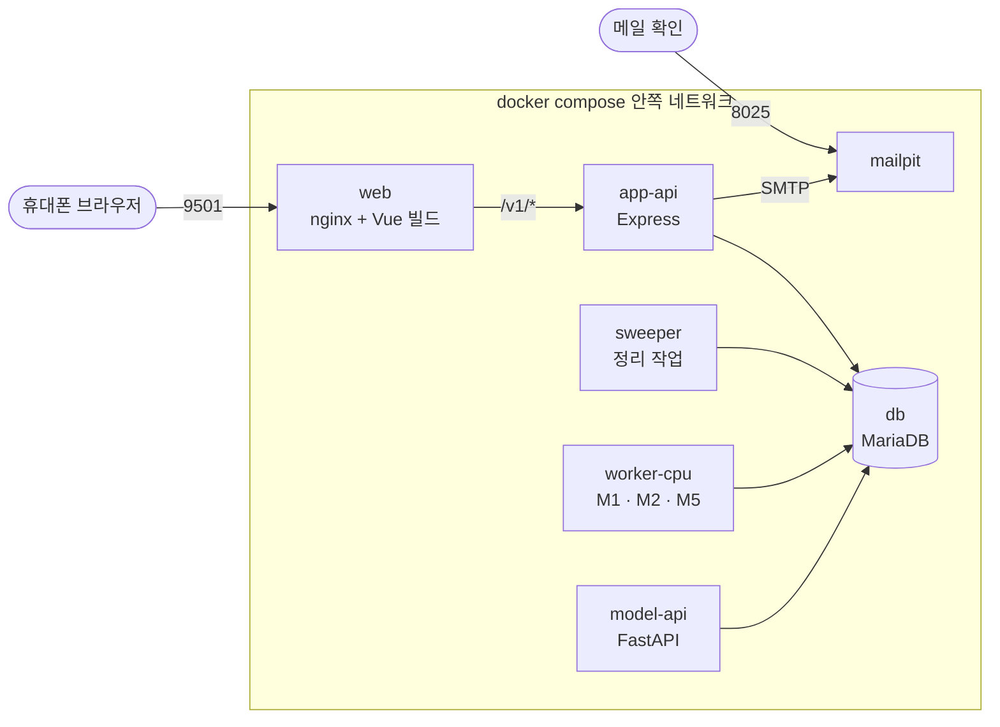

# 우리 아이 미술관 5일 수행 가이드

컨테이너 구성과 3D 화면 연결 몫, 날마다 쓰는 명령과 지킬 것을 모았다. 누가 어떤 이슈를 맡는지는 [이슈 목록](이슈설계_컨테이너협업.md)과 [마일스톤](https://github.com/kids-gallery/uri-gallery/milestones)에, 일정과 범위의 정본은 [마스터플랜](../../design/PLAN_3인디벨롭_컨테이너협업_우리아이미술관.md)에 있다.

<a id="container"></a>

## 컨테이너 구성

설계 PR(이슈 #20)에서 확정할 초안입니다(마스터플랜 3-2).



| 지금(pm2·맥) | compose 서비스 | 바뀌는 점 |
|---|---|---|
| nginx + 정적 파일 | `web` | 빌드 단계 node(`npm run build:world`) → 실행 단계 nginx. 3D 미술관을 내준다 |
| app-api, sweeper | `app-api` `sweeper`(같은 이미지) | 127.0.0.1 고정 주소를 설정 값으로, 서비스 이름으로 부르기 |
| MariaDB | `db` + 볼륨 | 스키마 넣는 방법 정하기 |
| model-api, worker-cpu | `model-api` `worker-cpu`(같은 이미지) | CPU 종류별 잠금 파일을 빌드 인자로 고르기 |
| Mailpit | `mailpit` | 그대로. 메일을 끄면 이메일 가입도 꺼지므로 남긴다 |
| worker-gpu, TorchServe, 설명 서버 | 띄우지 않음 | M3·M7은 가짜 어댑터, 모든 모델은 CPU |
| `.env` → pm2 | `env_file` + `secrets` | 비밀이 아닌 설정은 `.env`, 비밀번호·키는 `secrets/` 폴더 파일로. 둘 다 저장소에 올리지 않는다 |

- 바깥 포트는 9501과 8025 둘입니다.
- 볼륨은 4개입니다: DB 자료, 작품 파일, 작업자 상태 폴더, 모델 가중치(읽기 전용).
- 맥(arm64) 컨테이너는 Apple GPU를 쓸 수 없고, 팀원 둘은 Windows(x86_64)입니다. 그래서 CPU로 도는 구성을 기준으로 합니다.


<a id="connect"></a>

## 이번 개발 몫: 3D 화면 ↔ API 연결

`store.ts`(기기 저장) 옆에 서버를 쓰는 층을 하나 두고, 작품 관련 부분만 서버로 바꿉니다(마스터플랜 3-3).

| 3D 화면 지금(기기) | 바꿀 것(app-api) |
|---|---|
| 가족·아이를 기기 안 계정으로 만든다(`Account`) | 이메일 가입·로그인(`/v1/auth/signup`·`/v1/auth/login`, 확인 메일은 Mailpit), 아이 등록·선택(`/v1/children`) |
| 사진을 기기에서 처리한다(`processImage` → 브라우저 배경 지우기) | `POST /v1/artworks`로 올린다. 서버 규칙대로 원본 액자가 바로 걸린다 |
| 입체를 바로 만든다 | `GET /v1/artworks/{id}`로 상태를 본다. 컷아웃(`cutoutUrl`)이 오면 그 그림으로 입체를 다시 만든다(`buildRelief`는 그대로) |
| (없음) | 권유 확정 `POST /v1/artworks/{id}/confirm`, 결과 결정 `POST /v1/artworks/{id}/decision`: 3D 화면 안의 작은 창 두 개 |
| 작품 목록(`listArtworks`) | `GET /v1/gallery`·`GET /v1/artworks`, 파일은 `/v1/files/{token}` |
| 방 배치·설정·캐릭터·놀이·백업 | 그대로 기기에(이번 범위 밖) |

- 서버에 닿지 않으면 화면에 알리고 다시 시도하게 합니다. 기기 판으로 몰래 바꾸지 않습니다.
- 응답 타입은 OpenAPI에서 생성한 타입(`npm run gen:api` → `web/src/api/types.gen.ts`)을 씁니다.
- 서비스 워커가 `/v1/`을 캐시하지 않는지 확인합니다.


<a id="daily"></a>

## 날짜별 수행 가이드

누가 어떤 이슈를 맡는지는 그날 [마일스톤](https://github.com/kids-gallery/uri-gallery/milestones)과 [이슈 목록 문서](../../docs/공통/이슈설계_컨테이너협업.md) 4절에 있습니다. 여기에는 그날 쓰는 명령과 지킬 것만 둡니다. 날마다 같은 순서로 일합니다. 아침 10분 동안 그날 쓰는 교안 주제를 같이 다시 보고([팀 가이드](../../docs/공통/컨테이너배포_팀가이드.md) 3절), 각자 이슈 → 가지 → PR로 작업한 뒤, 저녁에 "그날 끝 확인"을 함께 봅니다.

<a id="day1"></a>

### 1일차: 바탕 확인과 설계 PR

```bash
docker run hello-world          # Docker가 도는지
docker version                  # Server 판 확인
uname -m                        # x86_64 또는 arm64
free -h                         # 메모리
# 지금 서비스를 손으로 깔아 보며 무엇이 필요한지 적는다(이미지 설계의 출발점)
docker run -it --rm -v "$PWD":/src python:3.11-slim bash
```

**설계 PR이 답할 질문**(마스터플랜 3-4)
1. 서비스를 몇 개로 나누는가. 같은 코드를 쓰는 둘(app-api·sweeper, model-api·worker-cpu)은 이미지 하나를 나눠 쓰는가.
2. 기반 이미지와 판 번호는 무엇인가. 무엇을 `.dockerignore`에 넣는가.
3. CPU 종류(맥 arm64, Windows x86_64)에 따라 잠금 파일을 어떻게 고르는가.
4. 볼륨 4개를 누가 어떻게 붙이는가. 모델 가중치는 어디서 받아 어디에 두는가.
5. 고정 주소(127.0.0.1)를 어떻게 설정 값으로 바꾸고 서비스 이름으로 부르는가. `.env`로 넘길 값은 무엇인가.
6. 서비스마다 "준비됨"을 무엇으로 판단하는가. DB 스키마는 언제 넣는가.

**끝 확인:** 이슈 #15에 셋의 결과가 있고, 설계 PR(#20)이 금요일 저녁까지 올라와 있습니다.

<a id="day2"></a>

### 2일차: 서비스별 이미지

오전에 설계 PR을 리뷰·병합한 뒤 각자 자기 이미지를 만듭니다.

**Dockerfile을 쓸 때 지킬 것**(리뷰어 확인 목록에도 있습니다)
- 기반 이미지는 판 번호를 적습니다(`node:22-slim`처럼 쓰고, `latest`나 판 번호 없이 쓰지 않습니다).
- 의존성 파일(`package*.json`, `requirements*.lock`)을 먼저 복사해 설치하고, 소스는 그 뒤에 복사합니다. 그래야 소스만 바꿨을 때 설치 층을 다시 쓰지 않습니다.
- Dockerfile과 같은 폴더(또는 저장소 맨 위)에 `.dockerignore`를 두고 `node_modules`, `.env`, 모델 가중치, 시험 결과물을 뺍니다.
- 비밀 값은 이미지에 넣지 않습니다. 비밀이 아닌 설정은 실행할 때 `--env-file`로, 비밀번호·키는 compose `secrets`로 넘깁니다.

```bash
docker build -t uam-api ./api
docker image ls                                  # 크기를 PR '확인한 것'에 적는다
docker run --rm --env-file .env -p 9521:9521 uam-api
curl -i http://localhost:9521/live               # 바인딩 주소를 바꾼 뒤에야 바깥에서 닿는다
# 소스 한 줄만 바꾸고 다시 빌드해, 설치 층이 재사용되는지(시간이 줄었는지) 본다
time docker build -t uam-api ./api
```

**끝 확인:** 각자 이미지가 빌드되고 혼자 뜹니다. PR에 이미지 크기와 빌드 시간이 있습니다.

<a id="day3"></a>

### 3일차: compose로 묶기

최호준이 저장소 맨 위 `compose.yaml`에 7개 서비스의 뼈대를 먼저 병합하고(#32), DB·워커·sweeper 설정을 그 위에 쌓습니다. 같은 날 화면 창과 서버 연결 층도 이어 붙입니다.

| 넣을 것 | 내용 |
|---|---|
| 서비스 | `web` `app-api` `sweeper` `db` `mailpit` `model-api` `worker-cpu` |
| 바깥 포트 | `web` 9501, `mailpit` 8025만 연다. 나머지는 서비스 이름으로 부른다 |
| 볼륨 | DB 자료, 작품 파일(app-api·sweeper·model-api·worker-cpu), 작업자 상태 폴더(model-api·worker-cpu), 모델 가중치(읽기 전용) |
| 설정 | `env_file: .env`(비밀이 아닌 값), `secrets:`(비밀번호·키, `secrets/` 폴더 파일). 주소 값은 서비스 이름으로(`DB_HOST=db`, `MAIL_SMTP_URL=smtp://mailpit:1025`, `MODEL_API_INTERNAL_URL=http://model-api:9541`) |
| 기동 순서 | `db`에 healthcheck, app-api·model-api·worker-cpu는 `depends_on: db: condition: service_healthy` |
| 재시작 | 모든 서비스 `restart: unless-stopped` |
| 가짜 모델 | `UAM_FAKE_MODELS=1`, `GPU_ENABLED=false`, `CAPTION_ENABLED=false` |

```bash
docker compose config            # 문법과 합쳐진 설정 확인
docker compose up -d --build
docker compose ps                # 모두 running·healthy인지
docker compose logs -f app-api   # 막히면 서비스별 로그
# 브라우저: http://localhost:9501 에서 가입 → 메일은 http://localhost:8025 에서 확인 링크를 누른다
docker compose down              # 볼륨은 남는다. 다시 up 해서 작품이 남는지 본다
```

**끝 확인:** 저녁에 셋이 같은 `compose.yaml`을 받아 각자 PC에서 띄우고, 가짜 모델로 3D 미술관에서 가입 → 사진 → 확정 → 입체 전시 한 바퀴가 됩니다.

<a id="day4"></a>

### 4일차: 실제 모델과 다듬기

```bash
docker stats                     # 모델 컨테이너 메모리
docker compose exec worker-cpu ls /models    # 가중치가 보이는지(경로는 설계 PR에서 정한 값)
```

**끝 확인:** 맥에서 실제 모델로 3D 미술관 한 바퀴가 됩니다. 남길 수치 세 가지(이미지 크기, 기동부터 준비까지 시간, 모델별 한 장 처리 시간·메모리)가 표에 있습니다.

<a id="day5"></a>

### 5일차: 발표

오전에 리허설을 2번 합니다. 발표는 이제민이 하고 순서는 이렇습니다(10~15분, 마스터플랜 6절). 장별 구성은 `제출/발표자료/발표_구성과_제작지시.md`에 있습니다.
1. 지난 모델 서빙 프로젝트: 한 서버에 손으로 맞춘 프로세스 8개
2. 도커 컨테이너를 입힌 과정: 서비스 7개, 바깥 포트 2개, 이미지 3개, 막힌 곳 3개, 3D 화면 연결
3. 결과물: 시연(`docker compose up -d` → 가입 → 사진 → 결과 → 전시), 잰 수치, 한계와 다음


<a id="done"></a>

## 끝나는 조건(마스터플랜 8절)

- 설계 PR이 구현 PR보다 먼저 병합돼 있다.
- 깨끗한 PC에서 `docker compose up -d` 뒤 가짜 모델로 한 바퀴가 된다.
- 맥에서 실제 모델 3개로 한 바퀴가 된다.
- `docker compose down` 뒤 다시 `up` 해도 가족 작품이 남는다.
- 저장소에 `.env`·비밀 값·모델 가중치가 0건이다.
- 발표를 마쳤고, 수치와 각자 작업 기록이 있다.


<a id="stuck"></a>

## 막히면

30분 안에 팀 채널에 묻습니다. 물을 때는 명령, 결과(오류 문구), 이미 해 본 것을 함께 붙입니다. 자주 걸릴 곳은 이렇습니다.

| 증상 | 먼저 볼 곳 |
|---|---|
| 셸 스크립트가 `^M`·`bad interpreter`로 깨진다 | Windows 폴더에 받아 줄바꿈이 CRLF가 됨. WSL 안에서 다시 받거나 `.gitattributes`(#17) |
| 다른 컨테이너에서 app-api·model-api에 연결이 안 된다 | 바인딩 주소가 아직 `127.0.0.1`로 고정돼 있음(2일차 코드 수정) |
| 가입 화면에 이메일 가입이 없다 | `MAIL_ENABLED`가 꺼져 있음. Mailpit을 띄우고 켠다 |
| api가 뜨자마자 죽는다 | `SESSION_SECRET`·`AUTH_HMAC_SECRET` 없음, 또는 DB가 준비되기 전에 뜸(`depends_on` 조건) |
| 모델 설치가 맥과 Windows에서 다르게 된다 | CPU 종류별 잠금 파일(`serving/README.md`) |
| 워커가 메모리 부족으로 죽는다 | M1 추론 중 8.5GB. 가짜 모델로 돌리거나 Docker 메모리를 늘린다 |
| 로그인했는데 다시 로그인 화면이 뜬다 | 로컬 `http://`에서는 `SECURE_COOKIES=false`가 필요할 수 있음(`.env.example` 13행) |
| 3D 화면이 서버 대신 예전처럼 기기에서만 처리한다 | 연결 층이 아직 `store.ts`의 기기 처리를 부름(위 "3D 화면 ↔ API 연결" 표) |
| 작업이 계속 "처리 중"이다 | sweeper가 떠 있는지, 워커 로그(`docker compose logs worker-cpu`) |


<a id="notdo"></a>

## 하지 않을 것

CI 옮기기와 이미지 자동 빌드, 레지스트리, 태그별 되돌리기, 모니터링, 장애 리허설, 백업 스크립트, 보안 점검표, GPU, 움직이는 그림(M3)·3D 조각(M7)·설명(M6)의 실제 실행, 카카오 로그인, 서비스 기능 바꾸기. 시간이 남아도 다시 넣지 않고 발표 준비에 씁니다.
