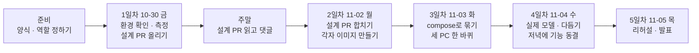

# 우리 아이 미술관 5일 작업의 이슈 목록과 순서

마스터플랜(`design/PLAN_3인디벨롭_컨테이너협업_우리아이미술관.md`)의 3·5·7·8절을 GitHub 이슈 단위로 나눈 목록이다. 일정과 범위의 정본은 마스터플랜이고, 이 문서는 그것을 이슈로 옮기는 방법만 다룬다. 계획이 바뀌면 마스터플랜을 먼저 고치고 이 문서를 맞춘다.

이슈는 31개다. 각 이슈에는 역할(A·B·C)을 적었다. 역할을 누가 맡는지는 2절에 있다(2026-10-30 배정).

## 0. 읽는 법

- 처음이면 2절(역할)과 3절(날짜별 흐름)만 먼저 읽는다. 4절은 자기 이슈를 올리거나 시작할 때 그 이슈만 찾아 읽으면 된다.
- 4절의 이슈마다 맨 위에 **한 줄 설명**이 있다. 그 줄만 읽어도 무슨 일인지 알 수 있게 썼다.
- 낯선 말은 아래 표에서 찾는다.

| 말 | 뜻 |
|---|---|
| 이슈 | GitHub에 올리는 "할 일 카드". 무엇을, 왜, 언제 끝났다고 볼지 적는다 |
| 가지(branch) | 원본(`main`)을 건드리지 않고 따로 작업하는 사본 줄기 |
| PR(Pull Request) | "내 가지의 변경을 `main`에 합쳐 주세요"라는 요청. 다른 사람이 보고 승인하면 합친다 |
| 리뷰봇 | PR을 올리면 규칙(이슈 연결, 크기, 비밀 값 등)을 자동으로 검사하는 프로그램 |
| 컨테이너 | 프로그램과 그 프로그램이 필요한 것을 한 상자에 담아, 어느 PC에서든 똑같이 돌게 한 것 |
| 이미지 | 컨테이너를 찍어 내는 틀. `Dockerfile`이라는 설명서로 만든다 |
| compose(`compose.yaml`) | 여러 컨테이너를 한 번에 띄우는 설정 파일. `docker compose up -d` 한 줄로 서비스 전체가 뜬다 |
| 볼륨 | 컨테이너를 지워도 남는 저장 공간. DB와 작품 파일을 여기에 둔다 |
| nginx(입구) | 브라우저 요청을 받아 화면 파일을 주거나 서버로 넘겨 주는 문지기 |
| app-api | 가입·로그인·작품 올리기를 처리하는 서버 |
| model-api, worker-cpu | AI 모델을 돌리는 서버와, 쌓인 작업을 하나씩 처리하는 일꾼 |
| 가짜 모델 | 진짜 AI 대신 정해진 결과를 바로 돌려주는 대역. 메모리가 작은 PC에서도 전체 흐름을 시험할 수 있다 |
| M1·M2·M5 | 이번에 쓰는 AI 모델. M1은 그림만 오려 내기, M2는 어떤 결과가 어울릴지 판정, M5는 입체감(깊이) 만들기 |
| 바인딩 주소 | 서버가 "누구의 연결을 받을지" 정하는 주소. `127.0.0.1`이면 자기 자신만, `0.0.0.0`이면 다른 컨테이너도 받는다 |
| 설계 PR | 코드를 짜기 전에 "이렇게 만들자"를 문서로 정해 합치는 PR |
| 선행 | 이 이슈를 시작하기 전에 먼저 끝나야 하는 이슈 |

## 1. 나눈 기준

| 기준 | 내용 | 근거 |
|---|---|---|
| PR 하나로 끝나는 크기 | 이슈 하나는 PR 하나로 닫는다. 바뀐 줄 600줄을 넘을 것 같은 일은 나눴다 | 마스터플랜 4-1 리뷰봇 "크기" 규칙 |
| 5절 표의 칸에서 출발 | 날짜와 역할 칸 하나를 이슈 하나 이상으로 옮겼다. 표에 없는 일은 만들지 않았다 | 마스터플랜 5절, 10절 |
| 고칠 코드는 따로 | 3-4의 코드 수정(바인딩 주소, 프록시, 빌드 인자)은 이미지 만들기와 나눴다. 설계서를 먼저 고치고 시험을 돌려야 해서 리뷰를 따로 받는 편이 빠르다 | 마스터플랜 3-4, 절대 규정 |
| 설계 PR이 먼저 | 2일차 이후의 모든 구현 이슈는 I-08(설계 PR) 병합을 선행으로 둔다 | 마스터플랜 8절 첫 줄 |
| `compose.yaml`은 뼈대 먼저 | 여러 역할이 같은 파일을 고치므로 I-18(뼈대)을 먼저 병합하고 나머지를 그 위에 쌓는다 | 같은 파일 동시 수정 충돌 |
| 끝나는 조건은 남이 확인 | 끝나는 조건은 PR 병합, 명령과 종료 코드, 수치, 캡처처럼 다른 사람이 확인할 수 있게 썼다 | 마스터플랜 8절, 부록 A |
| 3D 화면 연결은 나눠서 | 3-3을 로그인(I-16), 연결 층(I-17), 확정·결정 창(I-21), 입체 다시 만들기(I-22), 서버 미연결(I-26), 문구·캐시(I-27)로 나눴다. 하나로 두면 2~3일 걸리는 PR이 된다 | 마스터플랜 3-3 |

## 2. 역할

마스터플랜 4절의 역할표를 따른다.

| 역할 | 담당(PC) | 맡는 폴더 | 하는 일 |
|---|---|---|---|
| A 모델 서빙과 묶기 | 최호준(Windows) | `serving/`, `models/`, `compose.yaml` | serving 이미지(model-api·worker-cpu), 실제 모델(M1·M2·M5), compose로 묶기 |
| B 입구와 3D 화면 | 신지현, 팀장(Windows) | `web/`(화면·빌드), 입구 nginx, `.gitattributes` | web 이미지와 nginx, 3D 화면의 로그인·확정·결정 창, 깨끗한 PC에서 처음부터 띄우기 |
| C 앱·데이터·연결 | 이제민(맥) | `api/`, `db/`, `contracts/`, `web/src/app/world/`의 서버 연결 층 | api 이미지, db·mailpit·볼륨·`.env.example`, 3D 화면의 서버 연결 층, 설계 PR 작성, 병합 |
| 공통 | 셋 | | 셋이 함께 하거나 결과를 각자 남기는 일 |

리뷰어는 돌아가며 맡는다. 최호준(A)의 PR은 신지현이, 신지현(B)의 PR은 이제민이, 이제민(C)의 PR은 최호준이 본다. 병합은 이제민이 하고, 이제민의 PR은 최호준이 승인한 뒤 병합한다.

**PC가 다를 때 알아 둘 것.** 맥은 이제민 한 대이고 나머지는 Windows(WSL)다. 실제 AI 모델은 메모리를 많이 쓴다(M1 약 8.5GB). WSL은 따로 정하지 않으면 PC 메모리의 절반만 쓰므로, 역할 A는 1일차(I-04)에 이 한도부터 확인한다. 모자라면 Windows에서는 가짜 모델로 만들고, 실제 모델 실측은 4일차에 맥에서 이제민과 함께 한다(I-24).

## 3. 전체 흐름

이슈 사이의 앞뒤 관계는 4절 각 이슈의 "선행" 줄에 있다. 크게 보면 다음 세 줄기가 3일차에 만난다.

- 역할 A(최호준): 모델 측정(I-04) → 모델 서버 이미지(I-09~I-11) → compose 뼈대(I-18) → 실제 모델(I-20, I-24)
- 역할 B(신지현): 줄바꿈 설정·빌드(I-05) → 입구 이미지(I-14, I-15) → 로그인 창(I-16) → 확정·결정 창(I-21)
- 역할 C(이제민): 스키마·대응표(I-06, I-07) → 앱 서버 이미지(I-12, I-13) → 연결 층(I-17) → db·볼륨(I-19), 입체 다시 만들기(I-22)

날마다 넘어가는 조건은 마스터플랜 5절 "그날 끝 확인" 칸과 같다.

| 날 | 넘어가는 조건 |
|---|---|
| 준비 | 이슈 양식과 역할 배정이 `main`에 있다 |
| 1일차 | 금요일 저녁까지 설계 PR이 올라와 있다. 2일차 이후 이슈가 모두 올라와 있다 |
| 2일차 | 오전에 설계 PR이 병합됐다. 각자 이미지가 혼자 뜬다. 개발 서버에서 3D 화면이 API로 사진을 올린다 |
| 3일차 | 가짜 모델로 세 PC 모두 가입 → 사진 → 확정 → 3D 전시 한 바퀴가 된다 |
| 4일차 | 맥에서 실제 모델로 한 바퀴, 7절 수치표, 저녁에 기능 동결 |
| 5일차 | 발표를 마쳤다 |

## 4. 이슈 목록

각 이슈는 이슈 양식 "작업"의 칸(이루려는 것 · 근거 · 해야 할 일 · 끝나는 조건 · 선행·리뷰) 순서로 적었다. 올릴 때 그대로 옮기고, 선행 칸의 `I-번호`는 실제 GitHub 번호로 바꾼다(5절).

### 준비(1일차 시작 전)

#### I-01 [준비] 이슈 양식·날짜·역할 배정을 main에 넣기
> 이슈 양식과 날짜를 원본(`main`)에 넣어서, 이슈를 올릴 때 양식이 뜨게 한다.

- 역할: C(이제민이 PR, 신지현 또는 최호준이 승인)
- 이루려는 것: 이슈 만들기 화면에 양식이 나오고, 날짜와 역할 배정이 `main`의 계획서에 있다
- 근거: GitHub는 기본 가지의 양식만 보여 준다. 마스터플랜 부록 A, 4절 역할표, 5절 날짜
- 해야 할 일
  - [ ] `main`에서 새 가지 `docs/<이 이슈 번호>-team-setup`을 딴다. `prep/team-start`는 가지 이름과 커밋 메시지가 리뷰봇 규칙에 맞지 않고, 다른 계획의 README가 섞여 있어 그대로 합치지 않는다
  - [ ] 옮길 것: `.github/ISSUE_TEMPLATE/`, `.github/CODEOWNERS`, 마스터플랜(날짜·4절·부록 A), 이 문서, 팀 가이드 담당 칸. 커밋 메시지 끝에 `(#이 이슈 번호)`
  - [ ] `.github/` 변경이라 리뷰봇 "자체 수정" 규칙에 걸리면 작성자가 아닌 사람이 `리뷰봇-예외` 라벨과 본문 `예외 이유:`를 단다(4-1)
- 끝나는 조건: PR이 병합됐고, 새 이슈 화면에서 "작업"·"문제" 양식이 보인다
- 선행: 없음

#### I-02 [준비] 역할 배정 확인
> 정한 역할(A 최호준, B 신지현, C 이제민)이 계획서와 폴더 주인 설정에 맞게 들어갔는지 셋이 확인한다.

- 역할: 공통
- 이루려는 것: 세 사람이 자기 역할, 리뷰어, 발표 부분을 알고 동의한다
- 근거: 마스터플랜 4절 역할표, 5절 사람별 칸, 6절 발표 담당, `.github/CODEOWNERS`
- 해야 할 일
  - [ ] 4절·5절·6절의 자기 칸을 읽고 다르면 댓글로 남긴다
  - [ ] 이 문서의 이슈를 올리며 담당자를 지정한다
- 끝나는 조건: 세 사람이 댓글로 동의했다. 고칠 것은 I-01 PR에 반영됐다
- 선행: 없음

### 1일차 10-30(금): 바탕과 설계 합의

#### I-03 [1일차·10-30 금] 각자 환경 확인: Docker·저장소·push
> 모두의 PC에서 Docker가 돌고, 저장소를 받고 올릴 수 있는지 확인한다.

- 역할: 공통
- 이루려는 것: 세 사람 모두 같은 출발선에 선다
- 근거: 마스터플랜 5절 1일차 "함께"
- 해야 할 일
  - [ ] `docker run hello-world`
  - [ ] Windows는 WSL 안에서 clone한다(`.gitattributes` 전에는 Windows 폴더에서 셸 스크립트가 CRLF가 된다)
  - [ ] 시험 가지를 push했다가 지운다: `chore/<이슈번호>-hello`
  - [ ] 3D 화면을 개발 서버로 띄워 써 본다: `cd web && npm ci && npm run dev` → `http://127.0.0.1:9501/app/world`. 지금 판은 서버 없이 PC 안에서만 돌아서 이것만으로 미술관을 걸어 다니고 사진을 걸 수 있다
  - [ ] README와 마스터플랜 1·3·4절을 읽는다
- 끝나는 조건: 세 사람이 댓글로 `docker version`의 Server 판, PC 메모리, WSL에 잡힌 메모리(`free -h`, Windows만), `uname -m`, push 성공 여부를 남겼다
- 선행: I-02

#### I-04 [1일차·10-30 금] 모델 M1·M2·M5를 리눅스 컨테이너 CPU로 재기
> AI 모델 세 개를 컨테이너 안에서 돌려 보고, 한 장에 몇 초·메모리 얼마가 드는지 잰다.

- 역할: A
- 이루려는 것: 실제 모델을 어느 PC에서 돌릴 수 있는지 숫자로 판단한다
- 근거: 마스터플랜 5절 1일차, 3-5 질문 3, 7절 수치
- 해야 할 일
  - [ ] WSL 메모리 한도를 확인한다(`free -h`). M1에 약 8.5GB가 드니 모자라면 `%UserProfile%\.wslconfig`의 `memory`를 늘리고 `wsl --shutdown` 뒤 다시 잰다
  - [ ] 가중치를 받는다(저장소에 없다, `models/manifest.yaml`의 Hugging Face 출처)
  - [ ] `python:3.11` 컨테이너에서 CPU 전용 잠금으로 설치한다(`serving/requirements-models*.lock`)
  - [ ] 한 장당 시간과 최대 메모리를 잰다(`docker stats`)
- 끝나는 조건: 모델별 시간·메모리 표가 이 이슈에 있고, Windows에서 실제 모델을 돌릴 수 있는지(아니면 가짜 모델로 만들고 맥에서 실측할지)가 적혀 있다
- 선행: I-03

#### I-05 [1일차·10-30 금] .gitattributes(줄바꿈 LF)와 3D 화면 빌드 확인
> Windows에서 받아도 파일이 깨지지 않게 설정하고, 3D 화면이 제대로 만들어지는지 본다.

- 역할: B
- 이루려는 것: Windows에서 받아도 셸 스크립트가 컨테이너에서 깨지지 않고, 3D 화면 배포본이 만들어진다
- 근거: 마스터플랜 3-4, 5절 1일차
- 해야 할 일
  - [ ] 저장소 맨 위에 `.gitattributes`(텍스트 파일 LF 고정)
  - [ ] WSL에서 `cd web && npm ci && npm run build:world`(결과 `web/dist-world/`)
  - [ ] `npm run dev` → `http://127.0.0.1:9501/app/world`로 3D 화면을 써 본다
- 끝나는 조건: `.gitattributes` PR이 병합됐고, PR "확인한 것"에 빌드 명령·종료 코드·배포본 크기가 있다
- 선행: I-03

#### I-06 [1일차·10-30 금] MariaDB 컨테이너에 스키마 넣기와 설정 값 목록
> 데이터베이스 컨테이너를 띄워 표들이 잘 만들어지는지 보고, 필요한 설정 이름을 정리한다.

- 역할: C
- 이루려는 것: db 서비스를 넣기 전에 스키마가 들어가는지 확인하고, 컨테이너에 넘길 설정 값을 안다
- 근거: 마스터플랜 3-2 db 행, 3-5 질문 6, 5절 1일차
- 해야 할 일
  - [ ] MariaDB 공식 이미지(12.0 계열)를 띄우고 `npm run db:migrate`(api)
  - [ ] `.env.example` 기준으로 컨테이너에 넘길 값 목록을 정리한다(값은 적지 않는다). 특히 `APP_BASE_URL`(메일 링크), `MAIL_SMTP_URL`
  - [ ] `.env.example`에 없지만 코드가 읽는 값도 넣는다: `MODEL_ROOT`(가중치 폴더), `UAM_RUN_DIR`(작업자 상태 폴더, model-api와 worker가 함께 씀), `MODEL_API_PORT`(기본 9541), `CONTRACTS_DIR`, `LOG_LEVEL`
  - [ ] 로컬 http에서는 `SECURE_COOKIES=false`가 필요하다(기본 true, `api/src/config.ts`)
- 끝나는 조건: 스키마가 들어간 것을 보여 주는 명령과 결과(표 개수), 설정 값 목록이 이 이슈에 있다
- 선행: I-03

#### I-07 [1일차·10-30 금] 3D 화면 ↔ API 대응표 확정
> 3D 화면의 버튼 하나하나가 서버의 어느 주소를 부를지 표로 정한다.

- 역할: C(B가 화면 쪽 질문을 댓글로 보탠다)
- 이루려는 것: 3D 화면이 부를 경로와 응답 칸이 정해진다
- 근거: 마스터플랜 3-3 표, 3-5 질문 5, `contracts/openapi.yaml`
- 해야 할 일
  - [ ] 3-3 표의 각 줄에 실제 경로와 응답 칸을 붙인다(`/v1/auth/*`, `/v1/children`, `/v1/artworks`, `/v1/gallery`, `/v1/files/{token}`)
  - [ ] `cutoutUrl`이 언제 채워지는지 확인한다
  - [ ] 상태를 묻는 간격, 로그인 창 위치, 확정·결정 창 위치 초안
- 끝나는 조건: 확정한 대응표가 이 이슈에 있고 I-08에 반영됐다
- 선행: I-03

#### I-08 [1일차·10-30 금] 설계 PR: compose 구성과 3D 화면 연결 확정(3-5 질문 6개)
> 지금까지 확인한 것으로 "이렇게 만들자"를 문서로 정해 셋이 합의한다. 이게 합쳐져야 구현을 시작한다.

- 역할: 공통(C 이제민이 PR을 쓰고 A·B가 자기 부분의 답을 보탠다)
- 이루려는 것: 구현 전에 compose 구성(3-2)과 3D 화면 연결(3-3)을 셋이 합의한다
- 근거: 마스터플랜 3-5, 8절 "설계 PR이 구현 PR보다 먼저 병합"
- 해야 할 일
  - [ ] 3-5 질문 6개(서비스 나누기, 이미지, CPU 종류와 메모리, 데이터, 연결, 기동)에 답한다
  - [ ] I-04·I-06·I-07 결과로 3-2·3-3 표를 확정하고 `design/`을 고친다
  - [ ] Dockerfile 전에 알아 둘 것을 3-2에 적는다: 실행 중에 읽는 파일이 이미지에 있어야 한다. app-api는 `contracts/`(`api/src/config.ts`), model-api는 `contracts/model-api.openapi.yaml`, 워커와 model-api는 `models/manifest.yaml`을 읽는다. 그래서 빌드 맥락을 저장소 맨 위로 잡거나 파일을 복사하고 `CONTRACTS_DIR`·`MODEL_MANIFEST`로 경로를 넘긴다
  - [ ] 주말이 끼므로 금요일 저녁까지 PR을 올린다
- 끝나는 조건: 11-02(월) 오전에 리뷰봇 통과와 사람 승인 1회로 병합됐다
- 선행: I-04, I-05, I-06, I-07

### 2일차 11-02(월): 각자 이미지 만들기

월요일 오전 I-08 병합 뒤 시작한다.

#### I-09 [2일차·11-02 월] model-api 바인딩 주소를 설정 값으로
> 모델 서버가 다른 컨테이너의 연결도 받을 수 있게 주소를 설정으로 바꾼다.

- 역할: A
- 이루려는 것: 다른 컨테이너가 model-api를 부를 수 있다
- 근거: 마스터플랜 3-4. `serving/model_api/main.py` 8행에 `host="127.0.0.1"`이 고정돼 있다
- 해야 할 일
  - [ ] 설계서 먼저 고치기(SD_04의 model-api 설정 절)
  - [ ] 주소를 환경 변수로 받는다. 기본값은 127.0.0.1을 유지한다
- 끝나는 조건: PR이 병합됐고, "확인한 것"에 `pytest` 결과와 0.0.0.0으로 띄운 확인이 있다
- 선행: I-08

#### I-10 [2일차·11-02 월] serving 이미지(가짜 모델 먼저)
> 모델 서버를 컨테이너 이미지로 만든다. 처음에는 가벼운 가짜 모델로.

- 역할: A
- 이루려는 것: model-api와 worker-cpu가 쓸 이미지가 혼자 뜬다
- 근거: 마스터플랜 3-2 model-api·worker-cpu 행, 팀 가이드 "가볍게 시작한다"
- 해야 할 일
  - [ ] `python:3.11` 기반, 기본 잠금(`serving/requirements.lock`)만 설치, `.dockerignore`
  - [ ] `contracts/model-api.openapi.yaml`과 `models/manifest.yaml`이 이미지 안에 있게 한다(I-08 3-2)
  - [ ] model-api와 worker-cpu는 같은 이미지에 실행 명령만 다르게
- 끝나는 조건: `UAM_FAKE_MODELS=1`로 `docker run` 하면 `/internal/ready`가 응답한다. 이미지 크기와 빌드 시간을 PR에 적었다
- 선행: I-09

#### I-11 [2일차·11-02 월] 모델 묶음 잠금을 CPU 종류별 빌드 인자로 고르기
> 맥과 Windows처럼 CPU 종류가 달라도 같은 설명서(Dockerfile)로 이미지를 만들 수 있게 한다.

- 역할: A
- 이루려는 것: 맥(arm64)과 Windows(x86_64)가 같은 Dockerfile을 쓴다
- 근거: 마스터플랜 3-4, 3-5 질문 3. 잠금 파일 `requirements-models.lock`, `requirements-models-linux-x86_64.lock`
- 해야 할 일
  - [ ] 설계서 먼저 고치기
  - [ ] 빌드 인자로 모델 묶음 설치 여부와 잠금 파일을 고른다
- 끝나는 조건: arm64와 x86_64에서 각각 빌드한 명령·종료 코드가 PR에 있다
- 선행: I-10

#### I-12 [2일차·11-02 월] app-api 바인딩 주소와 프록시 신뢰 범위를 설정 값으로
> 앱 서버가 다른 컨테이너의 연결을 받을 수 있게 주소와 프록시 설정을 바꾼다.

- 역할: C
- 이루려는 것: 다른 컨테이너가 app-api를 부를 수 있고, 요청 한도가 사용자마다 걸린다
- 근거: 마스터플랜 3-4. `api/src/server.ts` 14행 `'127.0.0.1'`, `api/src/app.ts` 24행 `trust proxy 'loopback'`
- 해야 할 일
  - [ ] 설계서 먼저 고치기
  - [ ] 두 값을 환경 변수로 받는다. 기본값은 지금 값을 유지한다
- 끝나는 조건: PR이 병합됐고, "확인한 것"에 `npm test` 결과가 있다
- 선행: I-08

#### I-13 [2일차·11-02 월] api 이미지(app-api·sweeper)
> 앱 서버를 컨테이너 이미지로 만든다.

- 역할: C
- 이루려는 것: app-api와 sweeper가 쓸 이미지가 혼자 뜬다
- 근거: 마스터플랜 3-2 app-api·sweeper 행
- 해야 할 일
  - [ ] `node:22` 기반, 의존성 먼저 소스 나중, `.dockerignore`
  - [ ] `contracts/`가 이미지 안에 있게 한다. 없으면 app-api가 뜨자마자 멈춘다(I-08 3-2)
  - [ ] app-api와 sweeper는 같은 이미지에 실행 명령만 다르게
  - [ ] `.env.example`에 컨테이너용 값(서비스 이름 주소)을 정리한다
- 끝나는 조건: `docker run` 하면 `/live`가 응답한다. 이미지 크기를 PR에 적었다
- 선행: I-12

#### I-14 [2일차·11-02 월] web 이미지(빌드 단계 node → 실행 단계 nginx)
> 3D 화면 파일을 내보내는 입구(nginx) 이미지를 만든다.

- 역할: B
- 이루려는 것: 3D 화면 배포본을 내보내는 입구 이미지가 혼자 뜬다
- 근거: 마스터플랜 3-2 web 행
- 해야 할 일
  - [ ] 빌드 단계 `node:22`에서 `npm run build:world`, 실행 단계 nginx에 `dist-world` 복사
  - [ ] `.dockerignore`
- 끝나는 조건: `docker run -p 9501:...` 뒤 `/`가 응답한다. 이미지 크기를 PR에 적었다
- 선행: I-05, I-08

#### I-15 [2일차·11-02 월] nginx 경로 설정
> 입구가 화면 요청과 서버 요청을 알맞은 곳으로 나눠 보내게 설정한다.

- 역할: B
- 이루려는 것: 화면과 API가 같은 출처로 묶인다(CORS 없이 쿠키 세션 그대로)
- 근거: 마스터플랜 3-2 nginx 줄
- 해야 할 일
  - [ ] `/`는 정적 파일, 없는 경로는 `index.html`
  - [ ] `/v1/*`·`/live`·`/ready`는 `app-api`, `/v1/models/*`는 `model-api`로 서비스 이름을 써서 넘긴다
- 끝나는 조건: `nginx -t` 통과. 실제 연결은 I-23에서 확인한다
- 선행: I-14

#### I-16 [2일차·11-02 월] 3D 화면 로그인·가입·아이 고르기 창
> 3D 미술관 안에 가입·로그인·아이 고르기 창을 만든다.

- 역할: B
- 이루려는 것: 3D 미술관 안에서 가입·로그인하고 아이를 고른다
- 근거: 마스터플랜 3-3 첫 줄, I-08에서 정한 창 위치
- 해야 할 일
  - [ ] 로그인·가입 창(`/v1/auth/signup`·`/v1/auth/login`, 확인 메일은 Mailpit)
  - [ ] 아이 등록·고르기(`/v1/children`)
- 끝나는 조건: 개발 서버(`npm run dev`, app-api 연결)에서 가입 → 메일 확인 → 로그인 → 아이 고르기가 끝난다. 캡처가 PR에 있다
- 선행: I-08

#### I-17 [2일차·11-02 월] 3D 화면 서버 연결 층(올리기·상태·목록·파일)
> 3D 화면이 사진을 휴대폰·PC 안이 아니라 서버에 올리고, 서버에서 목록을 받아 오게 한다.

- 역할: C
- 이루려는 것: 3D 화면의 작품 부분이 기기 저장 대신 app-api를 쓴다
- 근거: 마스터플랜 3-3 표 2~5줄
- 해야 할 일
  - [ ] `store.ts` 옆에 서버 연결 층: 올리기(`POST /v1/artworks`), 상태(`GET /v1/artworks/{id}`), 목록(`/v1/gallery`), 파일(`/v1/files/{token}`)
  - [ ] 응답 타입은 `npm run gen:api`로 만든 `web/src/api/types.gen.ts`
  - [ ] 서버에 닿지 않을 때 기기 저장으로 몰래 바꾸지 않는다
- 끝나는 조건: 개발 서버에서 올린 사진이 원본 액자로 걸리고 새로 고침 뒤에도 서버 목록에서 보인다. 시험 명령·종료 코드가 PR에 있다
- 선행: I-08

### 3일차 11-03(화): compose로 묶기

#### I-18 [3일차·11-03 화] compose.yaml 뼈대에 서비스 7개 묶기(가짜 모델)
> compose 파일 하나로 서비스 7개가 한 번에 뜨게 뼈대를 만든다.

- 역할: A
- 이루려는 것: `docker compose up -d` 한 명령으로 7개 서비스가 뜬다
- 근거: 마스터플랜 3-2 표와 기동 순서, 3-5 질문 3
- 해야 할 일
  - [ ] web·app-api·sweeper·db·mailpit·model-api·worker-cpu, 바깥 포트는 9501·8025만
  - [ ] 전부 가짜 모델(`UAM_FAKE_MODELS=1`) 기본, 메모리 한도
  - [ ] db·볼륨 세부는 I-19가 이어서 채운다
- 끝나는 조건: `docker compose ps`에서 7개가 모두 뜬 결과가 PR에 있다
- 선행: I-10, I-13, I-15

#### I-19 [3일차·11-03 화] db·mailpit·볼륨·기동 순서
> 데이터베이스·메일 시험함·저장 공간·켜지는 순서를 compose에 채운다.

- 역할: C
- 이루려는 것: 빈 PC에서 `up` 한 번에 스키마까지 들어가고 메일 확인이 된다
- 근거: 마스터플랜 3-2 db·mailpit 행, 볼륨 4개, 기동 순서, 3-5 질문 4·6
- 해야 할 일
  - [ ] db 상태 확인, 스키마 넣는 시점(`npm run db:migrate`)
  - [ ] mailpit과 메일 링크 주소(`APP_BASE_URL`)
  - [ ] 볼륨 4개(DB, 작품 파일, 작업자 상태 폴더, 가중치), `depends_on`의 `service_healthy`, `restart: unless-stopped`
- 끝나는 조건: 볼륨을 지운 뒤 `up` 하면 스키마가 들어가고 가입 메일이 Mailpit(8025)에 온다
- 선행: I-18

#### I-20 [3일차·11-03 화] 가중치 볼륨과 실제 모델 켜기
> 가짜 모델 대신 진짜 AI 모델을 켠다.

- 역할: A
- 이루려는 것: 메모리가 넉넉한 PC에서 실제 M1·M2·M5로 돈다
- 근거: 마스터플랜 3-1(M3·M7 가짜, M6 끔), 3-5 질문 4
- 해야 할 일
  - [ ] 가중치를 읽기 전용 볼륨으로 붙인다(`models/manifest.yaml`)
  - [ ] `UAM_FAKE_MODELS=M3,M7`, `GPU_ENABLED=false`로 켜는 방법을 README 또는 `.env.example`에 적는다
- 끝나는 조건: `/internal/ready`에서 M1·M2·M5가 준비됨으로 나온다
- 선행: I-11, I-18

#### I-21 [3일차·11-03 화] 권유 확정·결과 결정 창
> 3D 화면 안에 "이 결과로 할까요?" 확정 창과 결과 결정 창을 만든다.

- 역할: B
- 이루려는 것: 서버가 준 권유를 확정하고 결과를 정한다
- 근거: 마스터플랜 3-1 "작은 창 두 개", 3-3 표 4줄
- 해야 할 일
  - [ ] 확정 창(`POST /v1/artworks/{id}/confirm`), 결정 창(`POST /v1/artworks/{id}/decision`)
- 끝나는 조건: 개발 서버에서 사진 → 확정 → 결정이 3D 화면 안에서 끝난다. 캡처가 PR에 있다
- 선행: I-16, I-17

#### I-22 [3일차·11-03 화] 컷아웃이 오면 입체 다시 만들기
> 서버가 그림을 오려 내면, 3D 화면이 그 그림으로 입체 작품을 다시 만든다.

- 역할: C
- 이루려는 것: 원본 액자가 서버 컷아웃 입체로 바뀐다
- 근거: 마스터플랜 3-1 둘째 줄, 3-3 표 3줄
- 해야 할 일
  - [ ] 상태를 묻다가 `cutoutUrl`이 오면 `buildRelief`로 입체를 다시 만든다
  - [ ] 묻는 간격은 I-08에서 정한 대로, 숨긴 탭에서는 멈춘다
- 끝나는 조건: 가짜 모델 compose에서 올린 사진이 원본 액자 → 컷아웃 입체로 바뀐다. 캡처가 PR에 있다
- 선행: I-17

#### I-23 [3일차·11-03 화] 세 PC에서 같은 compose로 한 바퀴
> 세 사람 PC에서 똑같이 띄워 가입부터 전시까지 한 바퀴 돌려 본다.

- 역할: 공통
- 이루려는 것: 세 PC 모두 같은 커밋으로 한 바퀴가 된다
- 근거: 마스터플랜 5절 3일차 "그날 끝 확인"
- 해야 할 일
  - [ ] 같은 커밋을 받아 `docker compose up -d`
  - [ ] 가입 → 사진 → 확정 → 3D 전시
  - [ ] 같은 와이파이에서 한 PC(실제 모델이 켜진 맥이면 좋다)에 다른 두 사람이 `http://<그 PC의 IP>:9501`로 접속해 본다. http이므로 그 PC의 `.env`에 `SECURE_COOKIES=false`, 방화벽에서 9501을 연다
- 끝나는 조건: 세 사람이 댓글로 PC, 커밋, 걸린 시간, 문제(있으면 "문제" 이슈 번호)를 남겼다
- 선행: I-19, I-21, I-22

### 4일차 11-04(수): 실측과 다듬기, 저녁에 기능 동결

#### I-24 [4일차·11-04 수] 맥에서 실제 모델로 한 바퀴와 수치표
> 진짜 모델로 한 바퀴 돌리고, 발표에 쓸 시간·메모리 숫자를 잰다.

- 역할: A(맥에서 이제민과 함께)
- 이루려는 것: 실제 모델로 끝까지 돌고 발표에 쓸 수치가 있다
- 근거: 마스터플랜 7절 수치, 8절 "맥에서 실제 모델로 한 바퀴"
- 해야 할 일
  - [ ] 서비스별 이미지 크기(`docker image ls`)
  - [ ] `up`부터 전부 준비됨까지 시간
  - [ ] M1·M2·M5 한 장 처리 시간과 메모리(`docker stats`)
- 끝나는 조건: 7절 수치표가 이 이슈와 마스터플랜 7절에 있다
- 선행: I-20, I-23

#### I-25 [4일차·11-04 수] 깨끗한 PC에서 처음부터 띄우기와 README 실행 방법
> 아무것도 없는 PC에서 README만 보고 띄워 보고, 막히는 곳을 README에 고친다.

- 역할: B
- 이루려는 것: 처음 받은 사람이 README만 보고 띄운다
- 근거: 마스터플랜 8절 "깨끗한 PC", "저장소에 비밀 값·가중치 0건"
- 해야 할 일
  - [ ] 새로 clone → README대로만 실행. 막힌 곳마다 README를 고친다
  - [ ] 저장소에 `.env`·비밀 값·가중치가 없는지 점검한다
- 끝나는 조건: README만 보고 한 바퀴 성공. 점검 명령과 결과가 PR에 있다
- 선행: I-23

#### I-26 [4일차·11-04 수] 서버에 닿지 않을 때 알림과 다시 시도
> 서버가 꺼져 있으면 화면이 그 사실을 알려 주고 다시 시도할 수 있게 한다.

- 역할: B
- 이루려는 것: 서버가 멈춰도 화면이 무엇이 안 됐고 무엇을 할 수 있는지 알린다
- 근거: 마스터플랜 3-3 "서버에 닿지 않으면 알리고 다시 시도. 기기 판으로 몰래 바꾸지 않는다"
- 해야 할 일
  - [ ] 연결 실패 알림과 다시 시도 버튼
- 끝나는 조건: app-api를 멈추면 알림이 뜨고, 다시 켠 뒤 다시 시도하면 성공한다. 캡처가 PR에 있다
- 선행: I-21

#### I-27 [4일차·11-04 수] 개인정보 안내 문구와 서비스 워커 캐시
> 개인정보 안내 문구를 실제 처리 방식에 맞게 바꾸고, 서버 응답이 옛날 것으로 남지 않게 한다.

- 역할: C
- 이루려는 것: 안내가 실제 처리 방식과 맞고, API 응답이 캐시되지 않는다
- 근거: 마스터플랜 3-3 마지막 두 줄. `WorldPrivacy.vue` 20행이 "이 기기 밖으로 보내지 않아요"라고 적혀 있다. 서비스 워커는 `web/public/sw.js`(등록은 `web/src/main.ts`)
- 해야 할 일
  - [ ] 문구: 사진은 우리 서버로 보내 처리하고, 원본은 덮어쓰지 않으며, 아이 사진은 외부 API로 보내지 않는다
  - [ ] 서비스 워커를 고친다. 지금 `web/public/sw.js`는 같은 출처의 GET 응답을 전부 캐시에 저장한다. 서버를 쓰게 되면 가족 사진(`/v1/files/*`)과 작품 목록이 로그아웃 뒤에도 기기에 남고, 오프라인일 때 오래된 상태를 받아 "처리 중"이 풀리지 않을 수 있다. `/v1/`·`/live`·`/ready`는 서비스 워커가 건드리지 않게 하고 시험으로 확인한다
- 끝나는 조건: 바뀐 문구 캡처와 캐시 확인 방법·결과가 PR에 있다
- 선행: I-17

#### I-28 [4일차·11-04 수] down 뒤 up에도 작품이 남는지
> 서비스를 껐다 켜도 올린 작품이 그대로 남는지 확인한다.

- 역할: C
- 이루려는 것: 컨테이너를 내렸다 올려도 가족 작품이 남는다
- 근거: 마스터플랜 8절
- 해야 할 일
  - [ ] 작품을 올린 뒤 `docker compose down` → `up -d`
- 끝나는 조건: 같은 작품이 미술관에 다시 보이는 캡처와 명령이 이 이슈에 있다
- 선행: I-19

#### I-29 [4일차·11-04 수] 기능 동결과 예비 시연 영상
> 더는 기능을 바꾸지 않기로 정하고, 혹시 모를 장애에 대비해 시연 영상을 찍어 둔다.

- 역할: 공통
- 이루려는 것: 발표 당일 장애가 나도 시연할 수 있다
- 근거: 마스터플랜 5절 4일차 "저녁에 기능 동결, 예비 시연 영상"
- 해야 할 일
  - [ ] 동결 커밋을 정한다. 이후에는 발표를 막는 버그만 고친다
  - [ ] 그 커밋으로 한 바퀴를 녹화한다
- 끝나는 조건: 동결 커밋 해시와 영상 위치가 이 이슈에 있다
- 선행: I-24, I-25, I-26, I-27, I-28

### 5일차 11-05(목): 마무리와 발표

#### I-30 [5일차·11-05 목] 발표 자료와 리허설
> 발표 자료를 만들고 두 번 연습한다.

- 역할: 공통
- 이루려는 것: 10분 발표를 마친다
- 근거: 마스터플랜 6절 구성, 5절 5일차 "오전 리허설 2회"
- 해야 할 일
  - [ ] 6절 순서(문제, 설계, 구현, 시연, 한계와 다음)로 자료
  - [ ] 리허설 2회, 시연이 막히면 I-29 영상으로 바꾸는 시점을 정한다
- 끝나는 조건: 발표 자료 위치와 리허설 2회 기록(걸린 시간)이 이 이슈에 있다
- 선행: I-29

#### I-31 [5일차·11-05 목] 각자 작업 기록과 이슈 정리
> 각자 무엇을 했고 왜 그렇게 골랐는지 기록하고, 이슈를 정리한다.

- 역할: 공통
- 이루려는 것: 각자 맡은 일을 설명할 수 있는 기록이 남는다
- 근거: 마스터플랜 7절 "각자 남길 것", 8절 마지막 줄
- 해야 할 일
  - [ ] 각자 맡은 PR 목록, 고른 것과 버린 것 하나씩(이유 포함), 막힌 것과 푼 방법
  - [ ] 끝난 이슈는 닫고, 못 끝낸 이슈는 남은 것을 댓글로 적는다
- 끝나는 조건: 세 사람의 작업 기록이 저장소에 있다
- 선행: I-30

## 5. 올리는 순서와 번호

- GitHub는 이슈와 PR에 번호를 같이 매기고, 지운 번호를 다시 쓰지 않는다. 그래서 `I-번호`와 GitHub 번호는 맞지 않는다.
- I-01부터 차례로 올리고, 아래 대응표에 GitHub 번호를 적는다. 그다음 각 이슈 본문의 `선행: I-번호`를 `#번호`로 바꾼다.
- 가지·커밋·PR에는 GitHub 이슈 번호를 쓴다(`feat/<번호>-설명`, `feat: 설명 (#번호)`, `Closes #번호`).
- 작업 중 생긴 버그나 막힘은 "문제" 양식으로 그때 올린다. 이 목록에 없는 기능 이슈는 만들지 않는다.

| I-번호 | GitHub 번호 | I-번호 | GitHub 번호 | I-번호 | GitHub 번호 |
|---|---|---|---|---|---|
| I-01 | | I-12 | | I-23 | |
| I-02 | | I-13 | | I-24 | |
| I-03 | | I-14 | | I-25 | |
| I-04 | | I-15 | | I-26 | |
| I-05 | | I-16 | | I-27 | |
| I-06 | | I-17 | | I-28 | |
| I-07 | | I-18 | | I-29 | |
| I-08 | | I-19 | | I-30 | |
| I-09 | | I-20 | | I-31 | |
| I-10 | | I-21 | | | |
| I-11 | | I-22 | | | |

## 6. 만들지 않는 이슈

마스터플랜 9·10절에 따라 아래는 이슈로 만들지 않는다.

- 외부 배포(정적 호스팅, 서버 임대). 9절 "나중에 할 것"
- CI 옮기기, 이미지 자동 빌드, 레지스트리, 모니터링, GPU 이미지
- M3·M6·M7을 실제로 컨테이너에 넣기, 카카오 로그인
- 3D 화면 새 기능, 지난 판 평면 화면 고치기, 모델 서빙 규칙·DB·API 계약 바꾸기(3D 연결에 꼭 필요한 것은 설계서를 먼저 고친 뒤 해당 이슈 안에서)
