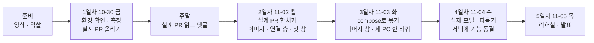

# 우리 아이 미술관 5일 작업의 이슈 목록과 순서

마스터플랜(`design/PLAN_3인디벨롭_컨테이너협업_우리아이미술관.md`)의 3·5·7·8절을 GitHub 이슈 단위로 나눈 목록이다. 일정과 범위의 정본은 마스터플랜이고, 이 문서는 그것을 이슈로 옮기는 방법만 다룬다. 계획이 바뀌면 마스터플랜을 먼저 고치고 이 문서를 맞춘다.

사람별·날짜별 개수는 `이슈올리기.py`를 돌리면 표로 나온다. 4절의 이슈 목록은 `docs/_claude/이슈올리기.py`가 그대로 읽어 GitHub 이슈 본문을 만든다. 그래서 4절은 정해진 칸(담당·종류·선행·근거·대상 경로·이루려는 것·해야 할 일·끝나는 조건)을 지켜 고친다.

## 0. 읽는 법

- 처음이면 2절(역할)과 3절(날짜별 흐름)만 먼저 읽는다. 4절은 자기 이슈를 올리거나 시작할 때 그 이슈만 찾아 읽으면 된다.
- 4절의 이슈마다 맨 위에 **한 줄 설명**이 있다. 그 줄만 읽어도 무슨 일인지 알 수 있게 썼다.
- 낯선 말은 아래 표에서 찾는다.

| 말 | 뜻 |
|---|---|
| 이슈 | GitHub에 올리는 "할 일 카드". 무엇을, 왜, 언제 끝났다고 볼지 적는다 |
| 가지(branch) | 원본(`main`)을 건드리지 않고 따로 작업하는 사본 줄기 |
| PR(Pull Request) | "내 가지의 변경을 `main`에 합쳐 주세요"라는 요청. 다른 사람이 보고 승인하면 합친다 |
| 리뷰어 | PR을 보고 승인(Approve)하거나 고칠 점을 남기는 팀원. 누가 누구를 보는지는 2절에 있다 |
| 컨테이너 | 프로그램과 그 프로그램이 필요한 것을 한 상자에 담아, 어느 PC에서든 똑같이 돌게 한 것 |
| 이미지 | 컨테이너를 찍어 내는 틀. `Dockerfile`이라는 설명서로 만든다 |
| compose(`compose.yaml`) | 여러 컨테이너를 한 번에 띄우는 설정 파일. `docker compose up -d` 한 줄로 서비스 전체가 뜬다 |
| 볼륨 | 컨테이너를 지워도 남는 저장 공간. DB와 작품 파일을 여기에 둔다 |
| nginx(입구) | 브라우저 요청을 받아 화면 파일을 주거나 서버로 넘겨 주는 문지기 |
| app-api | 가입·로그인·작품 올리기를 처리하는 서버 |
| sweeper | app-api 옆에서 오래된 작업을 이어받거나 지울 파일을 정리하는 프로그램 |
| model-api, worker-cpu | AI 모델을 돌리는 서버와, 쌓인 작업을 하나씩 처리하는 일꾼 |
| 가짜 모델 | 진짜 AI 대신 정해진 결과를 바로 돌려주는 대역. 메모리가 작은 PC에서도 전체 흐름을 시험할 수 있다 |
| M1·M2·M5 | 이번에 쓰는 AI 모델. M1은 그림만 오려 내기, M2는 어떤 결과가 어울릴지 판정, M5는 입체감(깊이) 만들기 |
| 바인딩 주소 | 서버가 "누구의 연결을 받을지" 정하는 주소. `127.0.0.1`이면 자기 자신만, `0.0.0.0`이면 다른 컨테이너도 받는다 |
| 설계 PR | 코드를 짜기 전에 "이렇게 만들자"를 문서로 정해 합치는 PR |
| 선행 | 이 이슈를 시작하기 전에 먼저 끝나야 하는 이슈 |
| 폴링 | 화면이 서버에 "다 됐어요?"를 몇 초마다 묻는 것 |

## 1. 나눈 기준

| 기준 | 내용 | 근거 |
|---|---|---|
| PR 하나로 끝나는 크기 | 이슈 하나는 PR 하나로 닫는다. 바뀐 줄 600줄을 넘을 것 같은 일은 나눴다 | 마스터플랜 4-1 리뷰어 확인 목록 "크기" |
| 5절 표의 칸에서 출발 | 날짜와 역할 칸 하나를 이슈 하나 이상으로 옮겼다. 표에 없는 일은 만들지 않았다 | 마스터플랜 5절, 10절 |
| 설계 PR이 먼저 | 2일차 이후의 모든 구현 이슈는 I-07(설계 PR) 병합 뒤에 시작한다 | 마스터플랜 8절 첫 줄 |
| 화면 창은 나란히 | 화면 창(가입·로그인·아이·확정·결정)은 서버 연결 층(I-15) 하나만 선행으로 둔다. 창끼리 줄지어 기다리지 않게 했다 | 3일 안에 끝내려면 동시에 만들어야 한다 |
| compose는 가짜 모델로 먼저 | compose 뼈대(I-19)는 이미지 세 개만 있으면 시작한다. 실제 모델(I-29)은 그 뒤에 붙인다 | 마스터플랜 3-1, 팀 가이드 "가볍게 시작한다" |
| 기존 코드 수정은 확인 뒤 | DB 초기화(I-20), 워커 준비 상태(I-21), sweeper(I-22)의 코드 수정은 설계 PR에서 "컨테이너에서 실제로 문제가 난다"고 확인한 것만 한다 | 마스터플랜 10절 "서비스 기능 바꾸지 않기" |
| 끝나는 조건은 남이 확인 | PR 병합, 명령과 종료 코드, 수치, 캡처처럼 다른 사람이 확인할 수 있게 썼다 | 마스터플랜 8절, 부록 A |
| 일은 고르게 | 세 사람이 같은 수를 맡고, 같은 날 한 사람에게 이슈가 다섯 개를 넘지 않게 했다 | `이슈올리기.py` 개수 표 |

## 2. 역할

마스터플랜 4절의 역할표를 따른다.

| 역할 | 담당(PC) | 맡는 일 |
|---|---|---|
| A 모델 서빙과 묶기 | 최호준(Windows) | 모델 서버 이미지, compose로 묶기, DB·메일·sweeper 서비스 설정, 실제 모델 |
| B 프론트엔드 | 신지현, 팀장(Windows) | 3D 미술관 화면의 디자인과 인터페이스 전반(흐름, 창, 문구, 상태·오류 표시), 줄바꿈 설정, 입구 이미지와 nginx, 처음부터 띄워 보기 |
| C 앱·데이터·연결 | 이제민(맥) | 이슈 양식, 스키마와 대응표, 설계 PR, 앱 서버 이미지, 3D 화면의 서버 연결 층, 병합 |
| 공통 | 셋 | 환경 확인, 세 PC 한 바퀴, 동결, 발표, 작업 기록 |

각자 맡은 이슈 번호는 3절 줄기와 4절 각 이슈의 "담당" 칸에 있다.

리뷰어는 마스터플랜 4절 역할표의 리뷰어 칸을 따르고, `이슈올리기.py`도 그 표에서 담당자 아이디와 리뷰어를 읽는다. 최호준(A)의 PR은 신지현이, 신지현(B)의 PR은 이제민이, 이제민(C)의 PR은 최호준이 본다. 병합은 이제민이 하고, 이제민의 PR은 최호준이 승인한 뒤 병합한다.

**PC가 다를 때 알아 둘 것.**
- 맥은 이제민 한 대이고 나머지는 Windows(WSL)다. 실제 AI 모델은 메모리를 많이 쓴다(M1 약 8.5GB). WSL은 따로 정하지 않으면 PC 메모리의 절반만 쓰므로, 최호준은 1일차(I-03)에 이 한도부터 확인한다. 모자라면 Windows에서는 가짜 모델로 만들고, 실제 모델 실측은 4일차에 맥에서 이제민과 함께 한다(I-30).
- 2일차에는 아직 compose가 없다. 화면 창을 시험하려면 MariaDB와 Mailpit은 `docker run`으로 띄우고(I-05에서 쓴 명령), app-api는 `cd api && npm run dev`, 화면은 `cd web && npm run dev`로 띄운다. 개발 서버가 `/v1/*`를 app-api로 넘겨 준다.

## 3. 전체 흐름



세 줄기가 3일차 저녁(I-28)에 만난다.

- 최호준(A): 모델 측정(I-03) → 모델 서버 이미지(I-10, I-11)와 메일·설정 값(I-12) → compose 뼈대(I-19) → DB·워커·sweeper(I-20~I-22) → 실제 모델(I-29, I-30)
- 신지현(B): 줄바꿈·빌드(I-04) → 입구 이미지와 nginx(I-13, I-14) → 가입·로그인 창(I-16, I-17) → 아이·확정·결정 창(I-23, I-25, I-26) → 문구와 처음부터 띄우기(I-31, I-32)
- 이제민(C): 스키마·대응표(I-05, I-06) → 설계 PR(I-07) → 앱 서버(I-08, I-09) → 연결 층(I-15, 월요일 오전 가장 먼저) → 업로드·폴링·전시(I-18, I-24, I-27)

날마다 넘어가는 조건은 마스터플랜 5절 "그날 끝 확인" 칸과 같다.

| 날 | 넘어가는 조건 |
|---|---|
| 준비 | 이슈 양식과 역할 배정이 `main`에 있다 |
| 1일차 | 금요일 저녁까지 설계 PR이 올라와 있다. 2일차 이후 이슈가 모두 올라와 있다 |
| 2일차 | 오전에 설계 PR이 병합됐다. 각자 이미지가 혼자 뜬다. 개발 서버에서 3D 화면이 API로 사진을 올린다 |
| 3일차 | 가짜 모델로 세 PC 모두 가입 → 사진 → 확정 → 3D 전시 한 바퀴가 된다 |
| 4일차 | 맥에서 실제 모델로 한 바퀴, 7절 수치표, 저녁에 기능 동결 |
| 5일차 | 발표를 마쳤다 |

## 4. 이슈 목록

이슈마다 칸 순서가 같다. `이슈올리기.py`가 이 칸을 읽어 팀 저장소의 "작업" 양식(한 줄 설명 · 이루려는 것 · 근거 · 대상 경로 · 해야 할 일 · 끝나는 조건 · 순서와 담당) 순서로 본문을 만든다. 제목은 `[날짜 · 담당] 제목`으로 만들어지고(예: `[2일차·11-02 월 · 신지현] 3D 화면 회원가입과 이메일 확인`), 담당은 리뷰어(2절)와 GitHub 담당자 지정에도 쓰인다. 선행 칸의 `I-번호`는 올릴 때 실제 GitHub 번호로 바뀐다.

### 준비

#### I-01 [준비] 이슈 양식·날짜·역할 배정을 main에 넣기
> 이슈 양식과 날짜, 역할 배정을 원본(`main`)에 넣어서 이슈를 올릴 때 양식이 뜨게 한다.
- 담당: 이제민
- 종류: docs
- 선행: 없음
- 근거: 마스터플랜 부록 A, 4절 역할표, 5절 날짜. GitHub는 기본 가지의 양식만 보여 준다
- 대상 경로: `.github/ISSUE_TEMPLATE/`, `.github/CODEOWNERS`, `design/PLAN_3인디벨롭_컨테이너협업_우리아이미술관.md`, `docs/공통/`
- 이루려는 것: 이슈 만들기 화면에 양식이 나오고, 날짜와 역할 배정이 `main`의 계획서에 있다
- 해야 할 일
  - [ ] `main`에서 새 가지 `docs/<이 이슈 번호>-team-setup`을 딴다. `prep/team-start`는 가지 이름·커밋 메시지가 팀 규칙(마스터플랜 4-1)에 맞지 않고 다른 계획의 README가 섞여 있어 그대로 합치지 않는다
  - [ ] 옮길 것: 이슈 양식, `CODEOWNERS`, 마스터플랜(날짜·4절·6절·부록 A), 이 문서와 `이슈올리기.py`, 팀 가이드 담당 칸
  - [ ] 이슈를 분류한다: 날짜별 마일스톤, 라벨(`영역: …`, `종류: …`), 타입(Feature·Bug·Task), 프로젝트 보드(5절 "분류")
- 끝나는 조건: PR이 병합됐고, 새 이슈 화면에서 "작업"·"문제" 양식이 보인다

### 1일차 10-30(금): 바탕과 설계 합의

#### I-02 [1일차·10-30 금] 각자 환경 확인과 3D 화면 써 보기
> 모두의 PC에서 Docker가 돌고 저장소를 받고 올릴 수 있는지, 3D 미술관이 뜨는지 확인한다.
- 담당: 공통
- 종류: chore
- 선행: 없음
- 근거: 마스터플랜 5절 1일차 "함께", 4절 역할표
- 대상 경로: 없음(확인만)
- 이루려는 것: 세 사람이 같은 출발선에 서고 자기 역할을 안다
- 해야 할 일
  - [ ] `docker run hello-world`
  - [ ] Windows는 WSL 안에서 clone한다(`.gitattributes` 전에는 Windows 폴더에서 셸 스크립트가 CRLF가 된다)
  - [ ] 시험 가지를 push했다가 지운다: `chore/<이 이슈 번호>-hello`
  - [ ] `cd web && npm ci && npm run dev` → `http://127.0.0.1:9501/app/world`. 지금 판은 서버 없이 PC 안에서만 돌아서 이것만으로 미술관을 걸어 다니고 사진을 걸 수 있다
  - [ ] 마스터플랜 4·5·6절의 자기 칸을 읽고 다르면 댓글로 남긴다
- 끝나는 조건: 세 사람이 댓글로 `docker version`의 Server 판, PC 메모리, WSL에 잡힌 메모리(`free -h`, Windows만), `uname -m`, push 성공 여부를 남겼다

#### I-03 [1일차·10-30 금] 모델 M1·M2·M5를 리눅스 컨테이너 CPU로 재기
> AI 모델 세 개를 컨테이너 안에서 돌려 보고, 한 장에 몇 초·메모리 얼마가 드는지 잰다.
- 담당: 최호준
- 종류: test
- 선행: I-02
- 근거: 마스터플랜 5절 1일차, 3-5 질문 3, 7절 수치, 4절 "실제 모델과 PC"
- 대상 경로: 없음(측정 결과는 이 이슈에)
- 이루려는 것: Windows에서 실제 모델을 돌릴 수 있는지 숫자로 판단한다
- 해야 할 일
  - [ ] WSL 메모리 한도를 확인한다(`free -h`). 모자라면 `%UserProfile%\.wslconfig`의 `memory`를 늘리고 `wsl --shutdown` 뒤 다시 잰다
  - [ ] 가중치를 받는다(저장소에 없다, `models/manifest.yaml`의 Hugging Face 출처). M1 444MB, M2 605MB, M5 99MB
  - [ ] `python:3.11` 컨테이너에서 CPU 전용 잠금(`serving/requirements-models-linux-x86_64.lock`)으로 설치하고 한 장씩 돌린다
  - [ ] 한 장당 시간과 최대 메모리를 잰다(`docker stats`)
- 끝나는 조건: 모델별 시간·메모리 표와 "Windows에서 실제 모델 가능/불가(맥에서 실측)" 판단이 이 이슈에 있다

#### I-04 [1일차·10-30 금] .gitattributes(줄바꿈 LF)와 3D 화면 빌드 확인
> Windows에서 받아도 파일이 깨지지 않게 설정하고, 3D 화면이 제대로 만들어지는지 본다.
- 담당: 신지현
- 종류: chore
- 선행: I-02
- 근거: 마스터플랜 3-4, 5절 1일차
- 대상 경로: `.gitattributes`
- 이루려는 것: 셸 스크립트·Dockerfile·YAML이 컨테이너에서 깨지지 않고, 3D 화면 배포본이 만들어진다
- 해야 할 일
  - [ ] 셸 스크립트·Dockerfile·YAML 같은 텍스트 파일을 LF로 고정하고, 이미지·폰트 같은 바이너리는 변환에서 뺀다
  - [ ] WSL에서 `cd web && npm ci && npm run build:world`(결과 `web/dist-world/`)
- 끝나는 조건: PR이 병합됐고, "확인한 것"에 `git check-attr` 결과, 빌드 명령·종료 코드·배포본 크기가 있다

#### I-05 [1일차·10-30 금] MariaDB 컨테이너에 스키마 넣기와 설정 값 목록
> 데이터베이스 컨테이너를 띄워 표들이 잘 만들어지는지 보고, 필요한 설정 이름을 정리한다.
- 담당: 이제민
- 종류: test
- 선행: I-02
- 근거: 마스터플랜 3-2 db 행, 3-5 질문 6, 5절 1일차
- 대상 경로: 없음(결과는 이 이슈에)
- 이루려는 것: db 서비스를 넣기 전에 스키마가 들어가는지 확인하고, 컨테이너에 넘길 설정 값을 안다
- 해야 할 일
  - [ ] MariaDB 공식 이미지(12.0 계열)를 `docker run`으로 띄우고 `cd api && npm run db:migrate`. 이 명령은 2일차 화면 시험 환경에도 쓴다
  - [ ] `.env.example` 기준으로 컨테이너에 넘길 값 목록을 정리한다(값은 적지 않는다). 특히 `APP_BASE_URL`(메일 링크), `MAIL_SMTP_URL`
  - [ ] `.env.example`에 없지만 코드가 읽는 값도 넣는다: `MODEL_ROOT`, `UAM_RUN_DIR`(model-api와 worker가 함께 씀), `MODEL_API_PORT`(기본 9541), `CONTRACTS_DIR`, `LOG_LEVEL`
  - [ ] 로컬 http에서는 `SECURE_COOKIES=false`가 필요하다(기본 true, `api/src/config.ts`)
- 끝나는 조건: 스키마가 들어간 것을 보여 주는 명령과 결과(표 개수), 설정 값 목록이 이 이슈에 있다

#### I-06 [1일차·10-30 금] 3D 화면 ↔ API 대응표 확정
> 3D 화면의 버튼 하나하나가 서버의 어느 주소를 부를지 표로 정한다.
- 담당: 이제민
- 종류: docs
- 선행: I-02
- 근거: 마스터플랜 3-3 표, 3-5 질문 5, `contracts/openapi.yaml`
- 대상 경로: 없음(결과는 이 이슈와 I-07에)
- 이루려는 것: 3D 화면이 부를 경로와 응답 칸, 화면 흐름이 정해진다
- 해야 할 일
  - [ ] 3-3 표의 각 줄에 실제 경로와 응답 칸을 붙인다(`/v1/auth/*`, `/v1/me`, `/v1/children`, `/v1/artworks`, `/v1/gallery`, `/v1/files/{token}`)
  - [ ] `cutoutUrl`이 언제 채워지는지, 확정 선택지(`choices`)와 결정 종류(like·use_lower·frame·retake)를 확인한다
  - [ ] 신지현과 함께 로그인 창 위치, 확정·결정 창 위치, 폴링 간격(3→6→10초) 초안을 정한다
- 끝나는 조건: 확정한 대응표가 이 이슈에 있고 I-07에 반영됐다

#### I-07 [1일차·10-30 금] 설계 PR: compose 구성과 3D 화면 연결 확정(3-5 질문 6개)
> 지금까지 확인한 것으로 "이렇게 만들자"를 문서로 정해 셋이 합의한다. 이게 합쳐져야 구현을 시작한다.
- 담당: 이제민
- 종류: docs
- 선행: I-03, I-04, I-05, I-06
- 근거: 마스터플랜 3-5, 8절 "설계 PR이 구현 PR보다 먼저 병합"
- 대상 경로: `design/`, `contracts/openapi.yaml`(바꿀 때만)
- 이루려는 것: 구현 전에 compose 구성(3-2)과 3D 화면 연결(3-3)을 셋이 합의한다
- 해야 할 일
  - [ ] 3-5 질문 6개(서비스 나누기, 이미지, CPU 종류와 메모리, 데이터, 연결, 기동)에 답한다. 최호준·신지현은 자기 부분의 답을 댓글로 보탠다
  - [ ] I-03·I-05·I-06 결과로 3-2·3-3 표를 확정하고 `design/`을 고친다
  - [ ] 실행 중에 읽는 파일이 이미지에 있어야 한다는 점을 3-2에 적는다: app-api는 `contracts/`, model-api는 `contracts/model-api.openapi.yaml`, 워커와 model-api는 `models/manifest.yaml`을 읽는다. 빌드 맥락을 저장소 맨 위로 잡거나 `CONTRACTS_DIR`·`MODEL_MANIFEST`로 경로를 넘긴다
  - [ ] 3-2 "비밀 값"(compose `secrets:` + `secrets/` 폴더, 실제 값은 `.gitignore`)대로 어떤 값을 파일로 넘길지 정한다
  - [ ] 기존 코드를 고쳐야 하는지 판정한다: 빌드된 마이그레이션 경로(I-20), 워커 상태 판정(I-21), sweeper 종료 처리(I-22). 컨테이너에서 실제로 문제가 나는 것만 그 이슈에 남긴다
  - [ ] 주말이 끼므로 금요일 저녁까지 PR을 올린다
- 끝나는 조건: 11-02(월) 오전에 사람 승인 1회로 병합됐다

### 2일차 11-02(월): 각자 이미지 만들기

월요일 오전 I-07 병합 뒤 시작한다. 이제민은 I-15(서버 연결 층)를 가장 먼저 올린다. 신지현의 화면 창이 이것을 쓴다.

#### I-08 [2일차·11-02 월] 앱 API 바인딩 주소와 프록시 신뢰 범위 설정화
> 앱 서버가 다른 컨테이너의 연결을 받을 수 있게 주소와 프록시 설정을 바꾼다.
- 담당: 이제민
- 종류: feat
- 선행: I-07
- 근거: 마스터플랜 3-4. `api/src/server.ts` 14행에 `'127.0.0.1'`, `api/src/app.ts` 24행에 `trust proxy 'loopback'`이 고정돼 있다
- 대상 경로: `api/src/config.ts`, `api/src/server.ts`, `api/src/app.ts`
- 이루려는 것: 다른 컨테이너가 app-api를 부를 수 있고, 요청 한도가 사용자마다 걸린다
- 해야 할 일
  - [ ] 설계서 먼저 고치기(SD_04 해당 절)
  - [ ] 주소(`APP_HOST`)와 프록시 신뢰 범위를 환경 변수로 받는다. 기본값은 지금 값을 유지한다
  - [ ] 요청 한도가 nginx 주소가 아니라 실제 사용자 주소로 걸리는지 본다
  - [ ] 비밀 값을 파일에서도 읽게 한다(`DB_PASSWORD_FILE`·`SESSION_SECRET_FILE`·`AUTH_HMAC_SECRET_FILE`, 없으면 지금처럼 환경 변수, 마스터플랜 3-4)
- 끝나는 조건: PR이 병합됐고, "확인한 것"에 기본값·설정값 시험(`npm test`) 결과가 있다

#### I-09 [2일차·11-02 월] 앱 API 컨테이너 이미지와 시작 명령
> 앱 서버를 컨테이너 이미지로 만든다. sweeper도 같은 이미지를 쓴다.
- 담당: 이제민
- 종류: feat
- 선행: I-07
- 근거: 마스터플랜 3-2 app-api·sweeper 행
- 대상 경로: `api/Dockerfile`, `.dockerignore`
- 이루려는 것: app-api가 쓸 이미지가 혼자 뜬다
- 해야 할 일
  - [ ] `node:22` 다단계 이미지(의존성 먼저, 소스 나중, 빌드 단계에서 `npm run build`)
  - [ ] 운영 의존성과 빌드 결과만 담는다. 명령은 `node`로 부른다: app-api `node dist/src/server.js`, sweeper `node dist/src/sweeper/main.js`, db-migrate `node dist/scripts/migrate.js`. 지금 `package.json` `start`(`dist/server.js`)는 틀렸으니 고친다(마스터플랜 3-5 2번)
  - [ ] 이미지 안 경로를 3-5 2번 표대로 둔다: `/app/api/dist`, `/app/db/migrations`(`MIGRATIONS_DIR`), `/app/contracts`(`CONTRACTS_DIR`), `/app/models/manifest.yaml`(`MODEL_MANIFEST`). `contracts/`가 없으면 app-api가 뜨자마자 멈춘다
- 끝나는 조건: `docker run` 뒤 `/live`가 응답하고, 같은 이미지로 `node dist/scripts/migrate.js`가 실행된다(임시 DB). 이미지 크기와 빌드 시간이 PR에 있다

#### I-10 [2일차·11-02 월] 모델 서빙 이미지와 model-api 주소 설정(가짜 모델 먼저)
> 모델 서버를 컨테이너 이미지로 만든다. 처음에는 가벼운 가짜 모델로.
- 담당: 최호준
- 종류: feat
- 선행: I-07
- 근거: 마스터플랜 3-2 model-api·worker-cpu 행, 3-4. `serving/model_api/main.py` 8행에 `host="127.0.0.1"`이 고정돼 있다
- 대상 경로: `serving/Dockerfile`, `serving/model_api/main.py`, `.dockerignore`
- 이루려는 것: model-api와 worker-cpu가 쓸 이미지가 혼자 뜨고, 다른 컨테이너가 model-api를 부를 수 있다
- 해야 할 일
  - [ ] 설계서 먼저 고치기
  - [ ] `MODEL_API_HOST`로 주소를 받는다. 기본값은 127.0.0.1을 유지한다
  - [ ] `python:3.11` 기반, 기본 잠금(`serving/requirements.lock`)만 설치. model-api와 worker-cpu는 같은 이미지에 실행 명령만 다르게
  - [ ] `contracts/model-api.openapi.yaml`과 `models/manifest.yaml`이 이미지 안에 있게 한다(`/app/models/manifest.yaml`, 가중치 마운트 `/models/hf`와 겹치지 않게). 볼륨 읽기·쓰기는 마스터플랜 3-5 4번 표대로(model-api도 작품 파일 `ext/`와 상태 폴더 `warmup/`에 씀)
  - [ ] serving이 비밀 값을 파일에서도 읽게 한다(`DB_PASSWORD_FILE`, 없으면 지금처럼 환경 변수, `serving/common/config.py`, 마스터플랜 3-4)
- 끝나는 조건: `UAM_FAKE_MODELS=1`로 `docker run` 하면 `/internal/ready`가 응답한다. 이미지 크기와 `pytest` 결과가 PR에 있다

#### I-11 [2일차·11-02 월] CPU 종류별 실제 모델 의존성 고르기
> 맥과 Windows처럼 CPU 종류가 달라도 같은 Dockerfile로 이미지를 만들 수 있게 한다.
- 담당: 최호준
- 종류: feat
- 선행: I-10
- 근거: 마스터플랜 3-4, 3-5 질문 3. 잠금 파일 `requirements-models.lock`, `requirements-models-linux-x86_64.lock`
- 대상 경로: `serving/Dockerfile`, `serving/requirements-models*.lock`
- 이루려는 것: arm64(맥)와 amd64(Windows)가 같은 Dockerfile에서 맞는 모델 묶음을 깐다
- 해야 할 일
  - [ ] 설계서 먼저 고치기
  - [ ] 빌드 인자로 모델 묶음 설치 여부와 잠금 파일을 고른다. amd64는 CPU 전용 PyTorch
  - [ ] 지원하지 않는 CPU 종류면 이유를 적고 빌드를 멈춘다
- 끝나는 조건: amd64 빌드 명령·종료 코드와 `torch` CPU 정보가 PR에 있다. arm64는 I-30에서 맥으로 확인한다

#### I-12 [2일차·11-02 월] Mailpit과 컨테이너용 환경 변수
> 가입 확인 메일이 메일 시험함(Mailpit)으로 가게 하고, 컨테이너가 읽을 설정 값 예시를 정리한다.
- 담당: 최호준
- 종류: chore
- 선행: I-07
- 근거: 마스터플랜 3-2 mailpit 행("메일을 끄면 이메일 가입도 꺼진다"), I-05 설정 값 목록
- 대상 경로: `.env.example`
- 이루려는 것: compose가 쓸 설정 값(`.env`)과 비밀 값(`secrets/`)이 나뉘어 정리되고, 실제 값 없이도 무엇을 채워야 하는지 알 수 있다
- 해야 할 일
  - [ ] I-05 목록을 바탕으로 `.env.example`에 컨테이너용 값을 정리한다(서비스 이름 주소, `MAIL_SMTP_URL=smtp://mailpit:1025`, `APP_BASE_URL`, http 개발용 `SECURE_COOKIES=false` 안내)
  - [ ] 비밀이 아닌 값만 `.env.example`에 둔다. 비밀번호·키는 `secrets/` 폴더에 빈 예시(`secrets/*.example`)와 만드는 방법(`openssl rand -hex 32`)을 두고, 실제 값 파일은 `.gitignore`에 넣는다(마스터플랜 3-2 "비밀 값")
- 끝나는 조건: PR이 병합됐고, `docker run`으로 띄운 Mailpit(8025)에 개발 서버 가입 메일이 도착한 캡처가 있다

#### I-13 [2일차·11-02 월] 3D 미술관 웹 다단계 이미지
> 3D 화면 파일을 내보내는 입구(nginx) 이미지를 만든다.
- 담당: 신지현
- 종류: feat
- 선행: I-04, I-07
- 근거: 마스터플랜 3-2 web 행
- 대상 경로: `web/Dockerfile`, `web/.dockerignore`
- 이루려는 것: 3D 화면 배포본을 내보내는 입구 이미지가 혼자 뜬다
- 해야 할 일
  - [ ] 빌드 단계 `node:22`에서 `npm run build:world`, 실행 단계 nginx에 `dist-world`와 라이선스 파일 복사
- 끝나는 조건: `docker run` 뒤 `/`가 응답한다. 이미지 크기가 PR에 있다

#### I-14 [2일차·11-02 월] nginx 정적 화면과 API 라우팅
> 입구가 화면 요청과 서버 요청을 알맞은 곳으로 나눠 보내게 설정한다.
- 담당: 신지현
- 종류: feat
- 선행: I-13
- 근거: 마스터플랜 3-2 nginx 줄
- 대상 경로: `ops/docker/nginx.conf`
- 이루려는 것: 화면과 API가 같은 출처로 묶인다(CORS 없이 쿠키 세션 그대로)
- 해야 할 일
  - [ ] `/`는 정적 파일, 없는 경로는 `index.html`
  - [ ] `/v1/*`·`/live`·`/ready`는 `app-api`, `/v1/models/*`는 `model-api`로 서비스 이름을 써서 넘긴다
  - [ ] 업로드 한도 21MB(사진 20MB + 여유), `/internal/*` 차단, 개인 파일(`/v1/files/*`) 캐시 금지
- 끝나는 조건: `nginx -t` 통과가 PR에 있다. 실제 연결은 I-28에서 확인한다

#### I-15 [2일차·11-02 월] 3D 미술관 서버 연결 층
> 3D 화면이 서버와 이야기하는 통로를 만든다. 화면 창들이 모두 이것을 쓴다.
- 담당: 이제민
- 종류: feat
- 선행: I-07
- 근거: 마스터플랜 3-3 표와 "서버에 닿지 않으면 알리고 다시 시도"
- 대상 경로: `web/src/app/world/server/`
- 이루려는 것: 화면 창들이 쓸 서버 호출 함수와 오류 전달 방식이 정해진다
- 해야 할 일
  - [ ] OpenAPI 생성 타입(`npm run gen:api` → `web/src/api/types.gen.ts`)과 기존 API 클라이언트를 다시 쓴다
  - [ ] 인증·작품·파일 오류와 네트워크 실패를 화면에 전달하는 방식을 정한다
  - [ ] 서버에 닿지 않을 때 기기 저장으로 몰래 바꾸지 않는다
  - [ ] 월요일 오전에 가장 먼저 PR을 올린다
- 끝나는 조건: PR이 병합됐고, "확인한 것"에 요청 경로·쿠키·응답 타입 시험과 네트워크 실패·인증 실패 시험 결과가 있다

#### I-16 [2일차·11-02 월] 3D 화면 회원가입과 이메일 확인
> 3D 미술관 안에서 가입하고, 확인 메일의 링크로 가입을 마친다.
- 담당: 신지현
- 종류: feat
- 선행: I-15
- 근거: 마스터플랜 3-3 첫 줄, I-06 창 위치
- 대상 경로: `web/src/app/world/`, `web/src/router/world.ts`
- 이루려는 것: 보호자가 3D 화면 안에서 가입을 끝낸다
- 해야 할 일
  - [ ] 이메일·비밀번호 입력과 가입 요청(`/v1/auth/signup`)
  - [ ] 확인 메일 링크를 3D 화면 단독 빌드에서 처리하고, 다시 보내기를 둔다
  - [ ] 잘못된·만료된 링크면 무엇이 안 됐고 무엇을 하면 되는지 보인다
- 끝나는 조건: 개발 서버에서 가입 → Mailpit 메일 → 확인까지 끝나는 캡처가 PR에 있다

#### I-17 [2일차·11-02 월] 3D 화면 로그인·로그아웃과 세션 복원
> 로그인하고, 새로 고침해도 로그인이 유지되고, 로그아웃하면 가족 작품이 화면에서 사라진다.
- 담당: 신지현
- 종류: feat
- 선행: I-15
- 근거: 마스터플랜 3-3 첫 줄
- 대상 경로: `web/src/app/world/`
- 이루려는 것: 로그인 상태가 화면과 서버에서 같다
- 해야 할 일
  - [ ] 로그인(`/v1/auth/login`)과 `/v1/me`로 세션 복원
  - [ ] 로그아웃하면 가족 작품과 선택 상태를 화면에서 지운다
  - [ ] 로그인이 만료되면 다시 로그인하라고 알린다
- 끝나는 조건: 새로 고침 뒤 세션 유지, 로그아웃 뒤 이전 작품이 안 보이는 것, 만료 안내 캡처가 PR에 있다

#### I-18 [2일차·11-02 월] 3D 화면 작품 사진 업로드
> 3D 화면이 사진을 PC 안이 아니라 서버에 올리고, 원본 액자가 바로 걸린다.
- 담당: 이제민
- 종류: feat
- 선행: I-15
- 근거: 마스터플랜 3-3 표 2줄, 3-1 "원본 액자가 먼저 걸린다"
- 대상 경로: `web/src/app/world/server/`, `web/src/app/world/store.ts`
- 이루려는 것: 올린 사진이 서버에 한 번만 저장되고 원본 액자로 걸린다
- 해야 할 일
  - [ ] `POST /v1/artworks`에 사진·아이·`Idempotency-Key`를 보낸다. 실패 뒤 다시 보낼 때 같은 키를 써서 작품이 두 번 생기지 않게 한다
  - [ ] 20MB 한도와 받는 사진 형식을 올리기 전에 안내한다
- 끝나는 조건: 정상·용량 초과·깨진 사진 세 경우와 "재시도해도 작품 1건" 시험 결과가 PR에 있다

### 3일차 11-03(화): compose로 묶기

`compose.yaml`은 최호준이 I-19로 뼈대를 먼저 병합하고, I-20~I-22를 그 위에 쌓는다.

#### I-19 [3일차·11-03 화] compose.yaml 뼈대에 서비스 7개 묶기(가짜 모델)
> compose 파일 하나로 서비스 7개가 한 번에 뜨게 뼈대를 만든다.
- 담당: 최호준
- 종류: feat
- 선행: I-09, I-10, I-14
- 근거: 마스터플랜 3-2 표와 기동 순서, 3-5 질문 3·4
- 대상 경로: `compose.yaml`
- 이루려는 것: `docker compose up -d` 한 명령으로 7개 서비스가 뜬다
- 해야 할 일
  - [ ] web·app-api·sweeper·db·mailpit·model-api·worker-cpu. 바깥 포트는 9501(입구)과 8025(메일 화면)만
  - [ ] 볼륨과 읽기·쓰기는 3-5 4번 표대로. 기동 순서와 상태 검사는 3-5 6번 표대로(app-api·sweeper·model-api·worker 모두 db-migrate `service_completed_successfully`를 기다림)
  - [ ] 상시 서비스는 `restart: unless-stopped`, db-migrate는 `restart: "no"`, 모두 `init: true`
  - [ ] `secrets:`로 `secrets/` 폴더의 비밀 값 파일을 db(`MARIADB_PASSWORD_FILE`)와 app-api·sweeper(`*_FILE`)에 넣는다
  - [ ] 전부 가짜 모델(`UAM_FAKE_MODELS=1`)이 기본, 메모리 한도
- 끝나는 조건: `docker compose config` 통과와 `docker compose ps`에서 7개가 모두 뜬 결과가 PR에 있다

#### I-20 [3일차·11-03 화] DB 초기화와 다시 돌려도 안전한 마이그레이션
> 빈 PC에서 처음 띄우면 표가 만들어지고, 다시 띄워도 자료가 그대로 남게 한다.
- 담당: 최호준
- 종류: feat
- 선행: I-19
- 근거: 마스터플랜 3-2 db 행, 3-5 질문 6, I-07 판정
- 대상 경로: `compose.yaml`, `api/scripts/migrate.ts`(I-07에서 고치기로 한 경우만)
- 이루려는 것: DB가 준비된 뒤 스키마가 한 번 들어가고, 재기동 때 중복되지 않는다
- 해야 할 일
  - [ ] DB 상태 확인이 통과한 뒤 `node dist/scripts/migrate.js`를 한 번 돌리는 db-migrate 서비스를 둔다(`restart: "no"`)
  - [ ] 마이그레이션 폴더를 설정 값(`MIGRATIONS_DIR`)으로 받게 고친다(I-07 판정: 빌드된 `dist/scripts/migrate.js`에서는 경로가 어긋남). 기본값은 지금 경로
  - [ ] 개발 환경 모델 첫 활성: `DEV_ACTIVATE_MODELS=1`일 때만 스키마 다음에 M1·M2·M3·M5를 `active`·`license_confirmed`로 만든다(SD_04 9-4, 마스터플랜 3-5 1번). 이제민이 지원한다
- 끝나는 조건: 볼륨을 지운 뒤 `up` → 표 개수와 활성 모델(M1·M2·M3·M5) 확인, 사진을 올리면 `stage_job`이 생김, 다시 `up` → 자료 유지 결과가 PR에 있다

#### I-21 [3일차·11-03 화] 가짜 모델 워커와 준비 상태 검사
> 가짜 모델로 사진 한 장이 끝까지 처리되고, 일꾼이 멈추면 "준비 안 됨"으로 보이게 한다.
- 담당: 최호준
- 종류: feat
- 선행: I-19
- 근거: 마스터플랜 3-1, 3-2 worker-cpu 행, I-07 판정
- 대상 경로: `compose.yaml`, `serving/workers/`(I-07에서 고치기로 한 경우만)
- 이루려는 것: worker-cpu와 model-api가 상태 폴더를 함께 쓰고, 멈춘 워커를 준비됨으로 보지 않는다
- 해야 할 일
  - [ ] `UAM_RUN_DIR`을 두 서비스가 같은 볼륨으로 쓴다
  - [ ] 코드는 고치지 않는다(I-07 판정: 상태 파일이 60초 넘게 멈추면 이미 멈춤으로 봄)
  - [ ] 상태 검사: model-api는 `/internal/ready` HTTP 응답, worker는 상태 파일이 60초 안에 갱신됐는지. `groups.cpu`는 워커 생존 뜻이라 model-api 상태 검사로 쓰지 않는다(마스터플랜 3-5 6번)
  - [ ] 지금 불러오기: `POST /internal/models/M1/warmup`이 202로 응답하고, 워커가 요청을 처리해 `UAM_RUN_DIR/warmup/M1` 파일이 사라지는지 본다(마스터플랜 3-5 4번)
- 끝나는 조건: 가짜 모델로 업로드 1건이 끝까지 처리되고, 워커를 멈춘 뒤 `/internal/ready`가 준비 안 됨으로 바뀌며, 지금 불러오기 요청 파일이 처리되어 사라지는 결과가 PR에 있다

#### I-22 [3일차·11-03 화] sweeper 컨테이너 실행과 종료 처리
> 앱 서버 이미지로 정리 프로그램(sweeper)을 띄우고, 껐다 켤 때 깔끔하게 멈추게 한다.
- 담당: 최호준
- 종류: feat
- 선행: I-09, I-19
- 근거: 마스터플랜 3-2 sweeper 행, I-07 판정
- 대상 경로: `compose.yaml`, `api/src/sweeper/main.ts`(I-07에서 고치기로 한 경우만)
- 이루려는 것: sweeper가 작품 파일 볼륨을 함께 쓰고, `docker compose down` 때 정상 종료한다
- 해야 할 일
  - [ ] app-api 이미지에 실행 명령만 바꿔 sweeper를 띄운다
  - [ ] 코드는 고치지 않고 compose에 `init: true`를 준다(I-07 판정: 겹쳐 돌지 않고, 도중에 꺼져도 다음 sweeper가 이어받음)
- 끝나는 조건: 기존 sweeper 시험 결과와, `docker compose stop sweeper`에 걸린 시간·종료 코드가 PR에 있다. 빠른 종료와 정상 정리는 다르므로 작업 중단 뒤 이어받기는 #41에서 확인한다. 정리가 안 되는 문제가 보이면 종료 처리 코드를 더한다

#### I-23 [3일차·11-03 화] 3D 화면 아이 별칭 등록과 선택
> 아이를 별칭으로 등록하고 골라서, 아이마다 작품이 따로 보이게 한다.
- 담당: 신지현
- 종류: feat
- 선행: I-17
- 근거: 마스터플랜 3-3 첫 줄
- 대상 경로: `web/src/app/world/`
- 이루려는 것: 아이를 고르면 그 아이 작품만 보인다
- 해야 할 일
  - [ ] 아이 목록·등록(`/v1/children`)
  - [ ] 아이 ID로 선택하고 작품을 나눈다. 별칭 말고 다른 개인정보는 받지 않는다
- 끝나는 조건: 아이 0명·1명·여러 명일 때 동작과 "바꾸면 다른 아이 작품이 안 보임" 캡처가 PR에 있다

#### I-24 [3일차·11-03 화] 작품 처리 상태 폴링과 실패 재시도
> 사진을 올린 뒤 "다 됐어요?"를 몇 초마다 묻고, 통신이 끊기면 알리고 다시 시도하게 한다.
- 담당: 이제민
- 종류: feat
- 선행: I-18
- 근거: 마스터플랜 3-3 표 3줄, 기술 컨텍스트 "폴링 3→6→10초, 숨김 탭 정지"
- 대상 경로: `web/src/app/world/server/`
- 이루려는 것: 처리 중일 때만 묻고, 서버가 멈춰도 화면이 상황을 알린다
- 해야 할 일
  - [ ] 진행 중일 때만 3→6→10초 간격으로 묻는다. 숨긴 탭과 화면을 벗어나면 멈춘다. 진행 중 판단은 `state`가 아니라 상세 `stages`의 대기·실행 중 단계(목록은 `currentStage`)로 한다. 원본 액자가 걸린 작품은 판정 중에도 `state`가 `exhibited`로 오기 때문이다(마스터플랜 3-5 5번)
  - [ ] 통신 실패를 알리고 다시 시도 버튼을 둔다. 늦게 도착한 옛 응답은 버린다
- 끝나는 조건: 가짜 타이머 시험, app-api를 멈췄다 켠 뒤 다시 시도로 이어지는 캡처가 PR에 있다

#### I-25 [3일차·11-03 화] 3D 화면 모델 권유 확정 창
> 서버가 권한 결과 중 하나를 보호자가 고르는 "이 결과로 할까요?" 창을 만든다.
- 담당: 신지현
- 종류: feat
- 선행: I-15
- 근거: 마스터플랜 3-1 "작은 창 두 개", 3-3 표 4줄
- 대상 경로: `web/src/app/world/`
- 이루려는 것: 서버가 허락한 선택지만 고를 수 있고 두 번 눌러도 한 번만 처리된다
- 해야 할 일
  - [ ] 창을 여는 조건은 `state`가 `awaiting_review`·`failed`가 아니고, `confirmedKind`가 null이며 `choices`가 비어 있지 않을 때다. `frame`은 결정 창에도 있으므로 결정 창이 먼저다(마스터플랜 3-5 5번 순서 표)
  - [ ] `POST /v1/artworks/{id}/confirm`. 서버 `choices`에 있는 것만 누를 수 있고, 못 고르는 것은 `unavailableChoices`의 이유를 보인다
  - [ ] 자동으로 고르지 않는다. 두 번 누름을 막고, 충돌(409)이면 새 상태를 다시 읽는다
- 끝나는 조건: 액자·입체 선택 확인, 충돌 처리, 액자만 고를 수 있는 확정 단계에서 확정 창만 열리는 캡처가 PR에 있다

#### I-26 [3일차·11-03 화] 3D 화면 결과 결정 창
> 만들어진 결과를 보고 "좋아요 · 낮춰서 쓰기 · 액자로 · 다시 찍기" 중에서 정하는 창을 만든다.
- 담당: 신지현
- 종류: feat
- 선행: I-15
- 근거: 마스터플랜 3-3 표 4줄
- 대상 경로: `web/src/app/world/`
- 이루려는 것: 보호자가 실제 결과를 보고 정한다
- 해야 할 일
  - [ ] 창을 여는 조건은 `state`가 `awaiting_review` 또는 `failed`일 때다. 버튼은 `choices`대로 보인다(마스터플랜 3-5 5번 순서 표)
  - [ ] `POST /v1/artworks/{id}/decision`(like·use_lower·frame·retake). 실제 결과 미리 보기와 낮춤 안내
  - [ ] 다시 찍기를 고르면 아이 선택을 유지한다. 두 번 제출을 막고 오류 뒤 다시 할 수 있게 한다
- 끝나는 조건: 결정 네 가지 흐름과 `frame`이 있는 결정 단계에서 결정 창만 열리는 캡처가 PR에 있다

#### I-27 [3일차·11-03 화] 서버 전시 목록과 컷아웃 입체
> 서버의 전시 목록으로 작품을 걸고, 서버가 그림을 오려 내면 그 그림으로 입체를 다시 만든다.
- 담당: 이제민
- 종류: feat
- 선행: I-24
- 근거: 마스터플랜 3-1 둘째 줄, 3-3 표 3·5줄
- 대상 경로: `web/src/app/world/server/`, `web/src/app/world/cutout.ts`
- 이루려는 것: 원본 액자가 서버 컷아웃 입체로 바뀌고, 승인 전 결과는 전시되지 않는다
- 해야 할 일
  - [ ] `GET /v1/gallery`로 작품을 배치하고 파일은 `/v1/files/{token}`으로 받는다. 파일 주소가 만료되면 다시 받는다
  - [ ] `cutoutUrl`이 오면 `buildRelief`로 입체를 다시 만든다(`buildRelief`는 그대로 쓴다)
  - [ ] 승인 전 결과와 지금 전시 중인 결과를 구분한다
- 끝나는 조건: 원본 액자 즉시 전시 → 승인 뒤 컷아웃 입체 교체 → 미승인 결과 비전시 캡처가 PR에 있다

#### I-28 [3일차·11-03 화] 세 PC에서 같은 compose로 한 바퀴
> 세 사람 PC에서 똑같이 띄워 가입부터 전시까지 한 바퀴 돌려 본다.
- 담당: 공통
- 종류: test
- 선행: I-12, I-16, I-20, I-21, I-22, I-23, I-25, I-26, I-27
- 근거: 마스터플랜 5절 3일차 "그날 끝 확인", 8절
- 대상 경로: 없음(결과는 이 이슈에)
- 이루려는 것: 세 PC 모두 같은 커밋으로 한 바퀴가 된다
- 해야 할 일
  - [ ] 같은 커밋을 받아 `docker compose up -d`
  - [ ] 가입 → 메일 확인 → 아이 → 사진 → 확정 → 결정 → 3D 전시를 아래 체크리스트로 확인한다. 막히면 "문제" 양식으로 이슈를 올린다
  - [ ] 작업 도중 `docker compose stop worker-cpu` → `start` 하면 그 작업이 이어받아져 끝나는지 본다(점유 60초 뒤 sweeper가 이어받음, 마스터플랜 3-5 6번)
  - [ ] 같은 와이파이에서 한 PC에 다른 두 사람이 `http://<그 PC의 IP>:9501`로 접속해 본다. 그 PC의 `.env`에 `SECURE_COOKIES=false`, 방화벽에서 9501을 연다
- 끝나는 조건: 세 사람이 댓글로 PC, 커밋, 체크리스트 결과, 걸린 시간, 문제 이슈 번호를 남겼고, 작업 중 종료 뒤 이어받기 결과가 있다

### 4일차 11-04(수): 실측과 다듬기, 저녁에 기능 동결

#### I-29 [4일차·11-04 수] 실제 M1·M2·M5 가중치와 CPU 실행
> 가짜 모델 대신 진짜 AI 모델을 켠다.
- 담당: 최호준
- 종류: feat
- 선행: I-11, I-21
- 근거: 마스터플랜 3-1(M3·M7 가짜, M6 끔, GPU 끔), 3-5 질문 4
- 대상 경로: `compose.yaml`, `models/`
- 이루려는 것: 메모리가 넉넉한 PC에서 실제 M1·M2·M5로 돈다
- 해야 할 일
  - [ ] 고정된 매니페스트 리비전으로 받은 가중치를 호스트 `models/hf` → `/models/hf` 읽기 전용으로 붙인다(`MODEL_ROOT=/models`). 쓰기 캐시는 worker-cpu 전용 볼륨의 `HF_HOME`, 그리고 `HF_HUB_OFFLINE=1`(마스터플랜 3-5 4번). model-api에는 가중치·캐시를 붙이지 않는다
  - [ ] `UAM_FAKE_MODELS=M3,M7`, `GPU_ENABLED=false`로 켜는 방법을 README 또는 `.env.example`에 적는다
  - [ ] 가중치가 없을 때 무엇을 받아야 하는지 알리는지 본다
- 끝나는 조건: 네트워크를 끈 상태에서 `/internal/ready`의 `models[].load.state`가 M1·M2·M5 모두 `ready`인 결과가 PR에 있다

#### I-30 [4일차·11-04 수] 맥에서 실제 모델 한 바퀴와 arm64·amd64 수치표
> 진짜 모델로 한 바퀴 돌리고, 발표에 쓸 시간·메모리·이미지 크기를 잰다.
- 담당: 최호준
- 종류: test
- 선행: I-28, I-29
- 근거: 마스터플랜 7절 수치, 8절 "맥에서 실제 모델로 한 바퀴", 4절 "실제 모델과 PC"
- 대상 경로: `design/PLAN_3인디벨롭_컨테이너협업_우리아이미술관.md` 7절
- 이루려는 것: 실제 모델로 끝까지 돌고, 발표에 쓸 수치가 있다
- 해야 할 일
  - [ ] 맥(이제민 PC)에서 이제민과 함께 arm64로 처음부터 빌드하고 실제 모델로 한 바퀴
  - [ ] 서비스별 이미지 크기(`docker image ls`), `up`부터 전부 준비됨까지 시간, 모델별 한 장 처리 시간과 최대 메모리(`docker stats`). worker는 M1·M2·M5를 한 프로세스에 함께 올리므로 그 합계 최대치로 worker 메모리 한도를 정한다(마스터플랜 3-5 3번)
  - [ ] Windows(amd64)에서 잰 값이 있으면 같은 표에 넣는다. 재지 못한 칸은 "재지 않음"으로 둔다
- 끝나는 조건: 마스터플랜 7절 수치표를 채운 PR이 병합됐다

#### I-31 [4일차·11-04 수] 개인정보 안내 문구와 서비스 워커 캐시
> 개인정보 안내 문구를 실제 처리 방식에 맞게 바꾸고, 서버 응답과 가족 사진이 브라우저에 남지 않게 한다.
- 담당: 신지현
- 종류: fix
- 선행: I-15
- 근거: 마스터플랜 3-3 마지막 두 줄. `WorldPrivacy.vue` 20행이 "이 기기 밖으로 보내지 않아요"라고 적혀 있고, `web/public/sw.js`는 같은 출처의 GET 응답을 전부 캐시에 저장한다
- 대상 경로: `web/src/app/world/WorldPrivacy.vue`, `web/public/sw.js`
- 이루려는 것: 안내가 실제와 맞고, 로그아웃 뒤나 오프라인에서 가족 사진·작품 목록이 다시 보이지 않는다
- 해야 할 일
  - [ ] 문구: 사진은 우리 서버로 보내 처리하고, 원본은 덮어쓰지 않으며, 아이 사진은 외부 AI API로 보내지 않는다
  - [ ] `/v1/`·`/live`·`/ready`는 서비스 워커가 저장하지도 응답하지도 않게 하고, 이미 저장된 개인 자료를 지운다
- 끝나는 조건: 바뀐 문구 캡처와 "오프라인에서 인증·파일 응답을 다시 쓰지 않음" 확인 방법·결과가 PR에 있다

#### I-32 [4일차·11-04 수] 깨끗한 PC에서 처음부터 띄우기와 README 실행 방법
> 아무것도 없는 PC에서 README만 보고 띄워 보고, 막히는 곳을 README에 고친다.
- 담당: 신지현
- 종류: docs
- 선행: I-28
- 근거: 마스터플랜 8절 "깨끗한 PC", "`down` 뒤 `up`에도 작품이 남는다", "비밀 값·가중치 0건"
- 대상 경로: `README.md`
- 이루려는 것: 처음 받은 사람이 README만 보고 띄우고, 껐다 켜도 작품이 남는다
- 해야 할 일
  - [ ] 새로 clone → README대로만 실행. 막힌 곳마다 README를 고친다(시작·확인·종료 방법)
  - [ ] 작품을 올린 뒤 `docker compose down` → `up -d` 해서 같은 작품이 보이는지 본다
  - [ ] 저장소에 `.env`·`secrets/`의 실제 값 파일·가중치가 없는지 점검한다(`git ls-files secrets .env`)
- 끝나는 조건: README만 보고 한 바퀴 성공, `down`·`up` 뒤 작품 유지 캡처, 점검 명령과 결과가 PR에 있다

#### I-33 [4일차·11-04 수] 기능 동결과 예비 시연 영상
> 더는 기능을 바꾸지 않기로 정하고, 혹시 모를 장애에 대비해 시연 영상을 찍어 둔다.
- 담당: 공통
- 종류: chore
- 선행: I-30, I-31, I-32
- 근거: 마스터플랜 5절 4일차 "저녁에 기능 동결, 예비 시연 영상"
- 대상 경로: 없음(결과는 이 이슈에)
- 이루려는 것: 발표 당일 장애가 나도 시연할 수 있다
- 해야 할 일
  - [ ] 동결 커밋을 정한다. 이후에는 발표를 막는 버그만 고친다
  - [ ] 그 커밋으로 한 바퀴를 녹화한다
- 끝나는 조건: 동결 커밋 해시와 영상 위치가 이 이슈에 있다

### 5일차 11-05(목): 마무리와 발표

#### I-34 [5일차·11-05 목] 발표 자료와 리허설
> 발표 자료를 만들고 두 번 연습한다.
- 담당: 공통
- 종류: docs
- 선행: I-33
- 근거: 마스터플랜 6절 구성, 5절 5일차 "오전 리허설 2회"
- 대상 경로: 없음(자료 위치는 이 이슈에)
- 이루려는 것: 10분 발표를 마친다
- 해야 할 일
  - [ ] 6절 순서(문제, 설계, 구현, 시연, 한계와 다음)와 담당대로 자료를 만든다
  - [ ] 리허설 2회. 시연이 막히면 I-33 영상으로 바꾸는 시점을 정한다
- 끝나는 조건: 발표 자료 위치와 리허설 2회 기록(걸린 시간)이 이 이슈에 있다

#### I-35 [5일차·11-05 목] 각자 작업 기록과 이슈 정리
> 각자 무엇을 했고 왜 그렇게 골랐는지 기록하고, 이슈를 정리한다.
- 담당: 공통
- 종류: docs
- 선행: I-34
- 근거: 마스터플랜 7절 "각자 남길 것", 8절 마지막 줄
- 대상 경로: `docs/`
- 이루려는 것: 각자 맡은 일을 설명할 수 있는 기록이 남는다
- 해야 할 일
  - [ ] 각자 맡은 PR 목록, 고른 것과 버린 것 하나씩(이유 포함), 막힌 것과 푼 방법
  - [ ] 끝난 이슈는 닫고, 못 끝낸 이슈는 남은 것을 댓글로 적는다
- 끝나는 조건: 세 사람의 작업 기록이 저장소에 있다

## 5. 올리는 방법

- `이슈올리기.py`로 먼저 점검하고 미리 본 뒤 올린다. 저장소 맨 위에서 실행한다.

```bash
python3 docs/_claude/이슈올리기.py                 # 점검: 칸 빠짐, 선행 번호, 날짜 순서, 사람별 개수
python3 docs/_claude/이슈올리기.py --show I-07     # 이슈 하나의 제목·본문 미리 보기
python3 docs/_claude/이슈올리기.py --out 미리보기   # 35개 본문을 파일로 저장해 훑어보기
python3 docs/_claude/이슈올리기.py --apply --repo kids-gallery/uri-gallery   # 실제로 올리기(gh 로그인 필요)
```

- 2026-10-30 팀 저장소(`kids-gallery/uri-gallery`)에 #14~#48로 올렸다. I-01이 #14이고 차례대로 하나씩 늘어난다(I-번호 + 13).
- **날짜별로 보기(마일스톤).** 이슈마다 그날의 마일스톤이 붙어 있다. https://github.com/kids-gallery/uri-gallery/milestones 에서 날짜마다 진행률(닫힌 수/전체)이 보이고, 하나를 누르면 그날 이슈만 나온다. 다 한 이슈는 닫히면서 목록에서 빠지므로 남은 일만 보인다. 작업 중 올린 "문제" 이슈는 오른쪽 "Milestone"에서 그날 마일스톤을 고른다.
- GitHub 이슈 목록은 최신순이 기본이고 저장소에서 바꿀 수 없다. 첫 이슈부터 차례로 보려면 아래 링크를 즐겨찾기에 둔다.
  - 전체, 오래된 순: https://github.com/kids-gallery/uri-gallery/issues?q=is%3Aissue%20is%3Aopen%20sort%3Acreated-asc
  - 내 이슈만, 오래된 순: https://github.com/kids-gallery/uri-gallery/issues?q=is%3Aissue%20is%3Aopen%20assignee%3A%40me%20sort%3Acreated-asc
  - 목록 화면에서 직접 바꾸려면 오른쪽 위 정렬(Sort)에서 "Oldest"(오래된 순)를 고른다.
- `--apply`는 I-01부터 차례로 올리고 담당자를 지정한 뒤, 본문의 `선행: I-번호`를 실제 `#번호`로 바꾼다. 이미 올린 이슈도 제목·본문·마일스톤을 문서대로 다시 맞추므로(마일스톤이 없으면 만든다), 배정이나 내용을 고친 뒤 다시 실행하면 된다. 본문 맨 위의 숨은 표시(`issue-id`)로 이미 올린 이슈를 알아보므로, 중간에 멈춰도 다시 실행하면 빠진 것만 올린다.
- GitHub는 이슈와 PR에 번호를 같이 매기고 지운 번호를 다시 쓰지 않는다. 그래서 `I-번호`와 GitHub 번호는 맞지 않는다. 가지·커밋·PR에는 GitHub 이슈 번호를 쓴다(`feat/<번호>-설명`, `feat: 설명 (#번호)`, `Closes #번호`).
- **분류.** 이슈마다 아래 셋이 붙는다. 모두 이 문서의 칸에서 만들어지므로 GitHub에서 따로 고치지 않는다.
  - 라벨 `영역: …`: 담당자의 역할(마스터플랜 4절 역할표 "역할" 칸, 예: `영역: A 모델 서빙`). 셋이 함께 맡으면 `영역: 공통`
  - 라벨 `종류: …`: "종류" 칸. 커밋 종류와 같다(feat 기능 · fix 고침 · docs 문서 · chore 설정·환경 · test 측정·검증)
  - 타입: feat는 Feature, fix는 Bug, 나머지는 Task
  - 프로젝트: 팀 보드 "Our Child's Museum Project"(https://github.com/orgs/kids-gallery/projects/2)에 저장소 이슈가 자동으로 들어간다. 상태(Backlog · In progress · In review · Done)는 각자 옮기고, 닫힌 이슈는 Done으로 간다. 보드 오른쪽 위 보기 설정에서 Group by를 Milestone·Assignees·Labels로 바꾸면 날짜·사람·영역별로 묶어 볼 수 있다. 자동으로 안 들어간 이슈는 `--project "Our Child's Museum Project"`로 넣는다
  - 이슈 목록에서 라벨을 누르면 그 영역·종류만 걸러 볼 수 있다(예: `label:"영역: B 프론트엔드"`)
- **PR 흐름.** PR을 양식대로 올린다 → 리뷰어(2절)가 마스터플랜 4-1 확인 목록을 보고 승인한다 → 이제민이 병합한다. 리뷰봇은 꺼 두었다(4-1).
- **다 한 이슈 닫기.** 코드·문서를 바꾸는 이슈는 PR 본문에 `Closes #번호`를 적으면 `main`에 병합될 때 저절로 닫힌다(일부만 끝낸 PR은 `Refs #번호`). 대상 경로가 "없음"인 확인 이슈는 끝나는 조건(명령·수치·캡처)을 댓글로 남기고 "Close with comment"로 닫는다. 하지 않기로 한 이슈는 "Close as not planned"로 닫고 이유를 적는다. 닫힌 이슈는 목록의 "Closed" 탭에 남고 "Reopen issue"로 다시 열 수 있다.
- 작업 중 생긴 버그나 막힘은 "문제" 양식으로 그때 올린다. 이 목록에 없는 기능 이슈는 만들지 않는다.

## 6. 만들지 않는 이슈

마스터플랜 9·10절에 따라 아래는 이슈로 만들지 않는다.

- 외부 배포(정적 호스팅, 서버 임대). 9절 "나중에 할 것"
- CI 옮기기, 이미지 자동 빌드, 레지스트리, 모니터링, GPU 이미지
- M3·M6·M7을 실제로 컨테이너에 넣기, 카카오 로그인
- 3D 화면 새 기능, 지난 판 평면 화면 고치기, 모델 서빙 규칙·DB·API 계약 바꾸기(3D 연결에 꼭 필요한 것은 설계서를 먼저 고친 뒤 해당 이슈 안에서)
- 자동 E2E 새로 짜기. 기존 E2E는 33건이 원래 실패하는 상태라, 이번에는 I-28 체크리스트로 직접 확인한다
