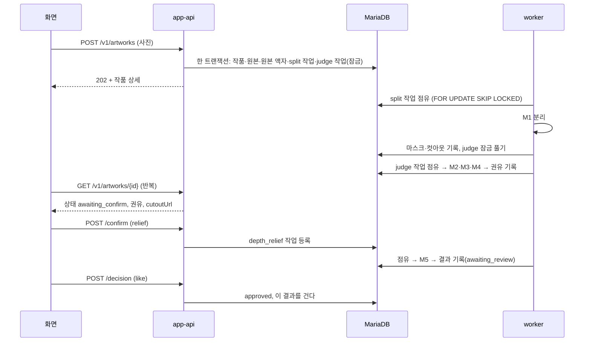
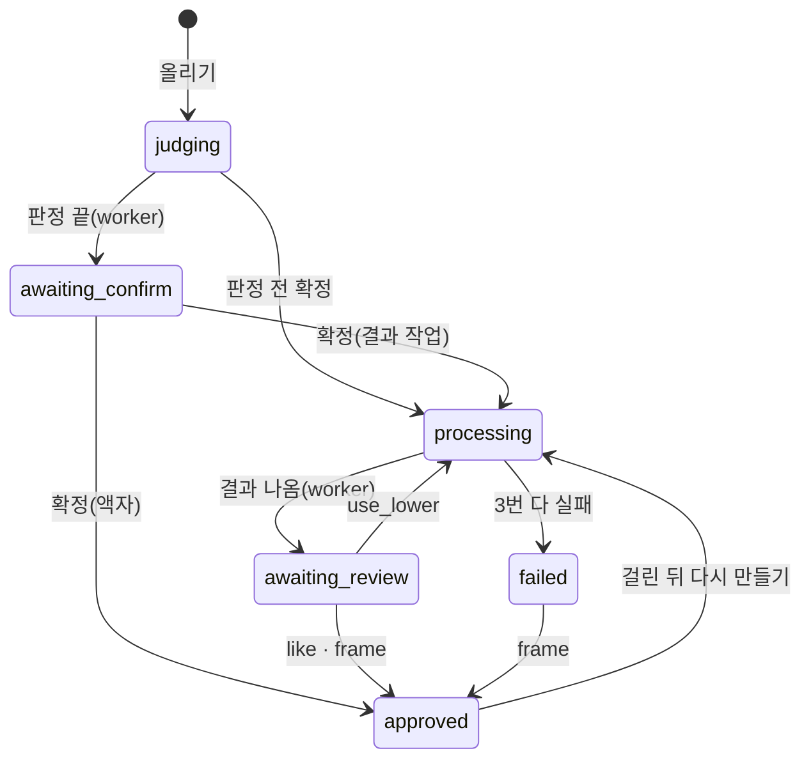

# 우리 아이 미술관 코드 설명

이 문서는 `main` 코드가 실제로 어떻게 돌아가는지 함수 단위로 따라가며 설명합니다. 부분별 개요(무엇이 어디 있고 어떻게 띄우나)는 [README 1부](../../README.md#1부-배경지식-이미-만들어진-서비스)에, 작업 큐 규칙의 정본은 [contracts/stage-job.md](../../contracts/stage-job.md)에 있습니다. 여기서는 그 규칙이 코드 어디에 있고, 왜 그렇게 짰는지를 다룹니다. 줄 번호는 커밋 `e1a9dca` 기준입니다.

읽는 순서: 1절(전체 그림) → 2절(작품 한 점의 일생)을 먼저 읽고, 나머지는 자기 몫에 맞는 절만 읽어도 됩니다(8절 표).

---

## 1. 전체 그림: 프로세스는 서로 부르지 않고 DB로 이어진다

| 프로세스 | 언어 | 진입점 | 하는 일 |
|---|---|---|---|
| app-api | Node 22 · Express | `api/src/server.ts` | 화면이 부르는 모든 API. 모델은 부르지 않는다 |
| sweeper | Node(app-api와 같은 코드) | `api/src/sweeper/main.ts` | 10초마다 멈춘 작업 되살리기·삭제·정리 |
| worker | Python 3.11 | `serving/workers/main.py` | `stage_job` 표에서 작업을 하나씩 잡아 모델을 돌린다 |
| model-api | Python · FastAPI | `serving/model_api/main.py` | 모델 준비 상태 알림, 외부용 모델 API |
| MariaDB | | `db/migrations/` | 위 넷이 만나는 곳 |

app-api와 worker 사이에는 HTTP 호출이 없습니다. app-api는 `stage_job` 표에 행을 넣고 끝내며, worker는 그 표를 읽어 일하고 결과를 다시 DB에 씁니다. 화면은 app-api에 상태를 다시 물어서(폴링) 결과를 봅니다.



**왜 DB 표를 작업 큐로 쓰나.** 사진 접수(작품 행)와 작업 등록을 같은 트랜잭션으로 커밋하기 위해서입니다. Redis나 RabbitMQ 같은 별도 큐를 쓰면 "DB에는 작품이 생겼는데 큐에 넣기는 실패"하는 이중 쓰기 문제가 생기고, 이를 막는 장치(아웃박스 표 등)가 따로 필요합니다. 처리량이 작은 이 서비스에서는 DB 하나가 더 단순합니다. 대신 워커가 2초마다 DB를 조회하는 비용(`limits.yaml`의 `poll.idle_s`)을 받아들였습니다.

---

## 2. 작품 한 점의 일생

### 2-1. 올리기: `POST /v1/artworks`

[api/src/modules/artworks/routes.ts:35](../../api/src/modules/artworks/routes.ts#L35)

1. `guardianAuth`가 쿠키 세션을 확인하고 `req.guardian`(계정·가족)을 채웁니다(6-2절).
2. `multer`가 파일을 **메모리로** 받습니다. 20MB를 넘으면 413입니다(nginx가 21MB에서 한 번 더 막습니다).
3. `Idempotency-Key` 머리말(UUID)이 없으면 거절합니다. 같은 키로 이미 만든 작품이 있으면 새로 만들지 않고 그 작품을 돌려줍니다. 휴대폰에서 전송이 끊겨 다시 보내도 작품이 두 개 생기지 않습니다.
4. `validateUpload`가 파일 내용을 보고 진짜 이미지인지(HEIC 포함) 확인합니다. 확장자는 믿지 않습니다.
5. `storage.putNew`가 원본을 `STORAGE_ROOT/family/{uuid}/original/{uuid}.{확장자}`에 씁니다. `putNew`는 이미 있는 파일을 덮어쓰지 않습니다.
6. `withTx(… intakeTx …)`로 DB에 한 번에 기록합니다. 실패하면 5에서 쓴 파일을 지웁니다.

**`intakeTx`가 한 트랜잭션에서 하는 일** ([routes.ts:174](../../api/src/modules/artworks/routes.ts#L174))

| 순서 | 표 | 내용 |
|---|---|---|
| 1 | `artwork` | 상태 `judging`(판정 모델이 꺼져 있으면 `awaiting_confirm`) |
| 2 | `stored_object`, `artwork_original` | 원본 파일 기록 |
| 3 | `result`, `artwork.hung_result_id` | `hangOriginalFrame`: 원본 액자 결과를 만들어 **바로 건다** |
| 4 | `story` | `autoStory`: 제목 "제목 없는 그림 N", 그린 날, 나이 자동 채우기 |
| 5 | `stage_job` | `split` 작업(바로 실행 가능) + `judge` 작업(`available_at` = 5년 뒤 = 잠금) |

judge를 잠가 두는 이유: judge는 split이 만든 마스크를 써야 합니다. 두 작업을 한꺼번에 등록하되 judge의 실행 가능 시각을 먼 미래로 두고, split이 끝나면 그 시각을 지금으로 당깁니다(`serving/workers/records.py`의 `open_judge`). 작업 사이의 순서를 별도 상태값 없이 `available_at` 하나로 표현한 것입니다.

원본 액자를 먼저 거는 이유: 모델 결과를 기다리는 동안 미술관이 비어 있지 않게 하려는 것입니다. 걸린 결과(`hung_result_id`)와 처리 상태(`status`)를 따로 두어, 처리 중이어도 전시는 됩니다.

### 2-2. 분리: worker의 `split` 단계

[serving/workers/runner.py:149](../../serving/workers/runner.py#L149) `claim()` → `process()` → `commit()`

```sql
SELECT * FROM stage_job
 WHERE serving_group = %s AND status IN ('queued','retry_wait')
   AND available_at <= UTC_TIMESTAMP() AND stage_kind IN (...)
 ORDER BY priority, queued_at LIMIT 1 FOR UPDATE SKIP LOCKED
```

- `FOR UPDATE`로 그 행을 잠그고, `SKIP LOCKED`로 다른 워커가 잠근 행은 기다리지 않고 건너뜁니다. 워커를 여러 개 띄워도 같은 작업을 두 번 잡지 않습니다.
- 잡으면 `status='running'`, `claim_expires_at = 지금+60초`로 바꿉니다. 실행 중에는 별도 스레드(`_heartbeat`, 226행)가 20초마다 만료 시각을 늘리고, 그 사이 작품이 지워졌는지(취소)도 봅니다.
- `stage_kind IN (...)`에는 **지금 모델이 메모리에 올라간 단계만** 넣습니다(`claimable_stages`, 138행). 모델을 불러오는 중이면 작업을 잡지 않고 큐에 둡니다. 적재 시간이 작업 시간 상한에 섞이지 않게 하려는 것입니다.
- 모델 실행은 어댑터(`serving/adapters/m1_birefnet.py`)가 합니다. 결과는 `AdapterResult(outcome, outputs, …)` 하나로 돌아옵니다(7절).
- `commit()`은 결과를 쓰기 직전에 작품이 `deleting`인지 다시 보고, `outcome.apply()`로 기록합니다.

split이 성공하면 `stages/split.py`의 `on_ok`가 마스크·컷아웃 파일을 저장하고 `judgment.split_ok = 1`을 쓴 뒤 judge 잠금을 풉니다. 분리가 품질 미달이어도, 인프라 실패로 3번을 다 써도 judge는 엽니다(마스크 없이 판정은 계속).

### 2-3. 판정: `judge` 단계

`serving/workers/stages/judge.py`

1. M2(OpenCLIP)가 무슨 그림인지(`kind_candidate`)와 태그를 냅니다.
2. M3가 관절 좌표 파일을 냅니다.
3. M4 규칙(`serving/rules/m4_geometry.py`)이 팔다리 길이·대칭을 보고 `geometry_pass`를 냅니다.
4. `suggest()`가 권유를 정합니다.

```python
if split_ok is False: return "frame"          # 분리 실패 → 액자
if kind_candidate == "person" and geometry_pass: return "animated"
if split_ok: return "relief"                  # 분리 성공 → 부조
return "frame"
```

5. `judgment`에 권유를 `presented`로 쓰고 작품을 `awaiting_confirm`으로 바꿉니다.

권유는 보호자가 확정하는 **제안**일 뿐입니다. 모델 점수(`person_score`)는 기록만 하고 규칙에도 화면에도 쓰지 않습니다. 처음 재현했을 때 집 그림이 사람 점수 0.946으로 나와, 점수로 자동 결정하면 틀린 결과가 걸리기 때문입니다.

### 2-4. 확정: `POST /v1/artworks/{id}/confirm`

[routes.ts:102](../../api/src/modules/artworks/routes.ts#L102), 실제 처리는 `confirmTx`([routes.ts:238](../../api/src/modules/artworks/routes.ts#L238))

| 고른 것 | 조건 | 결과 |
|---|---|---|
| `frame` | | 작업 없음. 원본 액자를 걸고 바로 `approved` |
| `relief` | 분리 실패가 확정됨 | 위와 같음(액자로) |
| `relief` | 그 밖 | `depth_relief` 작업 등록, 상태 `processing` |
| `animated` | | `animate_render` 작업 등록 |

- 판정이 끝나기 전에 확정해도 됩니다. 이때 결과 작업은 judge처럼 잠가 두고, 판정이 끝나면 `open_confirmed`(worker) 또는 `openConfirmJobs`(sweeper)가 엽니다.
- 같은 값으로 두 번 확정하면 첫 값을 유지하고 200을, 다른 값이면 409를 돌려줍니다. 화면에서 두 번 눌러도 작업이 두 개 생기지 않습니다.
- 작품 행을 `SELECT … FOR UPDATE`로 잠그고 시작하므로, 확정과 삭제가 동시에 와도 하나만 이깁니다.

### 2-5. 결과 만들기: `depth_relief` · `animate_render` · `frame_compose`

`serving/workers/stages/results.py` → `chain.record_result`([chain.py:64](../../serving/workers/chain.py#L64))

- 결과 파일을 저장하고 `result`에 `INSERT IGNORE`로 넣습니다. 결과 종류마다 처음 만든 것 하나만 남습니다(고유 키 `uq_rs_first`). 재시도가 결과를 덮어쓰지 않습니다.
- `artwork_outcome.result_cause`에 결과가 어떻게 나왔는지 적습니다: 모델이 낮춤(`model_downgrade`), 보호자가 낮춤(`guardian_switch`), 보호자가 처음부터 고름(`guardian_choice`).
- 작품을 `awaiting_review`로 바꿉니다. 아직 걸지는 않습니다.

품질 미달이면 `chain.next_after_quality_below`([chain.py:35](../../serving/workers/chain.py#L35))가 한 단계 낮은 작업을 새로 등록합니다(5절).

### 2-6. 결정: `POST /v1/artworks/{id}/decision`

[api/src/modules/artworks/decision.ts](../../api/src/modules/artworks/decision.ts)

| 결정 | 하는 일 |
|---|---|
| `like` | `approved`, 이 결과를 건다(`hung_result_id` 교체) |
| `frame` | `approved`, 원본 액자를 건다 |
| `use_lower` | 움직이는 그림 대신 부조로: `depth_relief` 작업(origin `use_lower`) 등록 |
| `retake` | 작품 삭제를 요청하고, 같은 아이로 다시 찍게 한다 |

고를 수 있는 선택지는 `decisionOptions`([decision.ts:29](../../api/src/modules/artworks/decision.ts#L29)) **한 곳**에서 정합니다. 화면은 상세 응답의 선택지를 그대로 버튼으로 그리고, 서버는 결정을 받을 때 같은 함수로 다시 검사합니다. 화면과 서버가 서로 다른 규칙을 갖지 않게 하려는 것입니다.

### 2-7. 화면이 보는 것: `GET /v1/artworks/{id}`

`api/src/modules/artworks/view.ts`의 `artworkDetail`이 여러 표와 뷰(`v_artwork_display`, `v_job_progress`, `v_current_result`)를 모아 응답 하나로 만듭니다. 3D 화면 연결에 쓸 필드는 이렇습니다.

| 필드 | 뜻 |
|---|---|
| `state` | 화면용 상태(뷰 `v_artwork_display`가 정한다) |
| `cutoutUrl` | M1 컷아웃 파일 주소. 분리 전이거나 실패면 없다 |
| `hungResultKind` | 지금 전시에 걸린 결과 종류 |
| 확정 선택지·결정 선택지 | 그 상태에서 누를 수 있는 버튼 |
| 단계별 진행 | 단계, 상태, 시도 횟수, 낮춤 여부, 모델 적재 중인지 |

---

## 3. 상태 두 가지

작품 상태(`artwork.status`)와 작업 상태(`stage_job.status`)는 따로 움직입니다. 허용 값은 DB의 CHECK 제약(`design/uri_gallery_ddl.sql` 323행, 408행)이 막습니다.

**작품 상태 8개**



`received`는 허용 값이지만 올리기(`intakeTx`)는 바로 `judging`으로 만듭니다. `deleting`은 어느 상태에서든 지우기 요청으로 갑니다(그림에서 뺐습니다).

**작업 상태 7개:** `queued` → `running` → `done` / `done_downgraded`(품질 미달로 낮춤) / `retry_wait`(인프라 실패, 다시 대기) / `failed`(3번 다 씀) / `cancelled`(작품 삭제).

**누가 상태를 바꾸나**

| 바꾸는 곳 | 작품 상태 | 작업 상태 |
|---|---|---|
| app-api(`artworks/routes.ts`, `decision.ts`) | 올리기·확정·결정 | 작업 등록(`queued`) |
| worker(`outcome.py`, `stages/*.py`) | 판정 끝·결과 나옴·실패 | 점유·완료·재시도·실패 |
| sweeper(`takeover.ts`) | 워커가 죽은 작품 정리 | 점유 만료 → 다시 대기 |

---

## 4. 작업 큐가 버티는 방법

| 상황 | 처리 | 코드 |
|---|---|---|
| 워커 두 개가 같은 작업을 노림 | `SKIP LOCKED`로 하나만 잡음 | `runner.py:149` |
| 워커가 일하다 죽음 | heartbeat가 끊겨 60초 뒤 점유 만료 → sweeper가 `retry_wait`로 되돌림 | `api/src/sweeper/takeover.ts:26` |
| 일시 장애(시간 초과·DB·저장소 등) | 10초, 60초 뒤 다시. 첫 시도 포함 3번 | `outcome.py:67`, `serving/config/limits.yaml` |
| 3번 다 실패 | 작업 `failed`, 작품 `failed`, 원인 "결과 미도달" | `outcome.py`, 각 단계의 `on_exhausted` |
| 처리 중 작품 삭제 | heartbeat와 결과 쓰기 직전에 확인 → `cancelled` | `runner.py:226`, `292` |
| 모델이 꺼져 있음(활성 버전·라이선스 없음) | 어댑터를 부르지 않고 `model_not_ready` 인프라 실패 | `runner.py` `claim()` |

sweeper가 죽은 워커의 작업을 되돌릴 때도 시도 횟수를 셉니다. 그래서 같은 사진이 워커를 계속 죽이는 경우에도 3번에서 멈춥니다.

---

## 5. 실패 두 종류를 섞지 않는다

[serving/workers/outcome.py](../../serving/workers/outcome.py)의 `apply()`가 어댑터 결과 하나를 작업 상태 하나로 바꿉니다.

| 어댑터 결과 | 작업 상태 | 다음 |
|---|---|---|
| `ok` | `done` | 다음 단계 |
| `quality_below` | `done_downgraded` | **재시도 없이** 한 단계 낮은 작업 등록 |
| `engine_down` `timeout` `storage` `db` `model_not_ready` | `retry_wait` → 3번째면 `failed` | 같은 단계 재시도 |

낮춤 순서(`chain.py`): 움직이는 그림 → 부조 → 액자. 마스크가 없으면 부조를 건너뛰고 액자로 갑니다. 다음 모델이 꺼져 있어도 액자로 갑니다(액자는 모델이 없어 늘 됩니다).

인프라 실패를 낮춤으로 처리하지 않는 이유: 서버가 죽었는데 결과를 낮추면 지표에서 "모델이 못한 것"과 "서버가 멈춘 것"이 섞입니다. 그러면 모델을 바꿔야 할지 서버를 고쳐야 할지 판단할 수 없습니다. 그래서 `downgrade_cause`(낮춘 이유)와 `error_class`(인프라 원인)를 다른 열에 둡니다.

---

## 6. 앱 서버의 공통 틀

### 6-1. 요청 하나가 지나는 길

[api/src/app.ts](../../api/src/app.ts)의 미들웨어 순서입니다.

1. 요청 번호(`X-Request-ID`)를 붙이고, 끝날 때 로그 한 줄(경로·상태·걸린 시간)을 남깁니다. 로그에는 허용된 필드만 씁니다.
2. 쿠키 읽기, JSON 본문 읽기(64KB 상한)
3. `paramGuard`: 경로·쿼리 값이 계약(`contracts/openapi.yaml`)에 맞는지
4. 파일 라우터, 모듈 라우터(`api/src/routes.ts`의 `buildRouters`)
5. 오류 처리: 무엇이 던져지든 `Problem` 하나로 바꿔 `application/problem+json`으로 돌려줍니다.

**오류는 `throw new Problem(코드, 이유, 게이트)`로 던집니다**(`api/src/lib/problem.ts`). 라우터는 응답 형식을 신경 쓰지 않고, 화면은 `reason`과 `gate`를 보고 문구를 고릅니다(`web/src/copy/ko.ts`). `G5`·`G8` 같은 게이트 번호는 설계서의 검사 지점 번호이고, 막힌 기록은 `recordGate`가 DB에 남겨 운영 지표로 셉니다.

### 6-2. 로그인과 가족

`api/src/auth/session.ts`, `guards.ts`

- 로그인하면 32바이트 난수를 만들어 쿠키(`uam_sid`)에 넣고, DB(`app_session`)에는 그 SHA-256만 저장합니다. DB가 새어도 세션을 가로챌 수 없습니다.
- 30분 동안 요청이 없으면 만료되고, 요청할 때마다 늘어납니다.
- **가족 ID를 세션에 넣지 않습니다.** `guardianAuth`가 요청마다 `guardian_account`에서 다시 읽습니다. 가족에서 나가거나 해제되면 다음 요청부터 바로 반영됩니다. 대신 요청마다 쿼리가 하나 더 듭니다.
- 비밀번호를 바꾸면 그 전에 만든 세션은 모두 무효입니다.

### 6-3. DB 다루기

- ORM 없이 SQL을 직접 씁니다(`mysql2`). 규칙이 SQL 조건과 DB 제약에 많이 있어서, 쿼리를 그대로 보는 편이 읽기 쉽습니다.
- 여러 표를 함께 바꿀 때는 `withTx(db, async (conn) => …)`(`api/src/db/pool.ts`)를 씁니다. 안에서 던지면 롤백됩니다.
- 화면과 지표가 같은 규칙으로 읽도록 뷰를 씁니다: 미술관에 보일 작품 `v_gallery`, 지금 유효한 결과 `v_current_result`, 진행 `v_job_progress`.

---

## 7. 워커의 공통 틀: 어댑터

[serving/adapters/base.py](../../serving/adapters/base.py), [registry.py](../../serving/adapters/registry.py)

- 워커는 모델을 직접 부르지 않고 어댑터만 부릅니다. 어댑터는 `load()`(가중치 올리기)와 실행 하나를 갖고, 결과를 `AdapterResult` 하나로 돌려줍니다.
- 어댑터는 예외를 밖으로 던지지 않고 `outcome`으로 알립니다. 예상하지 못한 예외는 워커가 `engine_down`으로 분류합니다.
- 단계와 모델의 짝은 `STAGE_MODELS` 표 하나에 있습니다: `split`→M1, `judge`→M2·M3, `depth_relief`→M5, `animate_render`→M3, `frame_compose`→모델 없음.
- `UAM_FAKE_MODELS=1`이면 `build_adapter`가 모든 모델을 `FakeAdapter`로 바꿉니다. `M3,M7`처럼 쓰면 그 모델만 가짜입니다. 가중치 없이도 같은 흐름 전체를 시험할 수 있고, 이번 작업에서 M3·M7은 이 방식으로 둡니다.
- 실제 어댑터는 `importlib`로 필요할 때만 불러옵니다. 가짜 모델만 쓰면 torch가 없어도 워커가 뜹니다(`requirements.lock`).
- 워커는 기동할 때 모델을 미리 올리고, 상태(`not_loaded`·`loading`·`ready`·`failed`·`disabled`)를 `UAM_RUN_DIR/model_state/`에 파일로 씁니다. model-api는 이 파일을 읽어 준비 상태를 답합니다. 두 프로세스가 같은 폴더를 봐야 하므로 컨테이너에서는 볼륨을 같이 붙여야 합니다.

---

## 8. 3D 화면

`web/src/app/world/`. 지금은 서버를 전혀 부르지 않고 기기 안에서 다 합니다.

| 파일 | 하는 일 |
|---|---|
| `WorldView.vue` | 화면 전체. 데이터를 읽어 엔진에 넘기고, 엔진이 알리는 일(선택·근접·장소)에 따라 창을 연다 |
| `engine.ts` `MuseumEngine` | three.js 렌더러·카메라·캐릭터 이동·작품 배치를 묶은 객체. Vue를 모른다 |
| `museum.ts` | 로비·회랑·나이별 전시실과 작품 자리. `buildRelief`로 입체 작품을 세운다 |
| `store.ts` | IndexedDB 저장: 가족(`Account`), 작품(`Artwork`), 방, 설정 |
| `cutout.ts` | 브라우저 배경 지우기(`removeBackground`)와 입체 만들기(`buildRelief`) |
| `WorldUpload.vue` | 사진 올리기 창 |
| `router/world.ts` | `npm run build:world` 배포본의 라우터. 미술관 하나만 넣는다 |

**Vue와 엔진을 나눈 이유:** three.js 객체를 Vue의 반응형 상태에 넣으면 매 프레임 변경 추적 비용이 큽니다. 그래서 `WorldView.vue`는 엔진을 `shallowRef`로만 들고, 엔진은 `EngineEvents` 콜백(`onSelect`, `onNear` 등)으로만 화면에 알립니다. 엔진에 데이터를 넣는 입구는 `engine.setWorld(아이, 작품 목록, 방)` 하나입니다.

**지금 사진이 입체가 되는 길**

1. `WorldUpload.vue` → `store.processImage(f, false)`로 화면용 사본만 만들고 `saveArtworkAndRoom`으로 저장합니다(`cutoutState: 'pending'`).
2. 뒤이어 `store.makeCutout(id)`가 브라우저에서 배경을 지워 `cutout`(투명 PNG)을 채웁니다.
3. 엔진은 작품에 `cutout`이 있으면 `maskFromCutout`으로 투명도에서 윤곽을 읽고([engine.ts:294](../../web/src/app/world/engine.ts#L294)), `museum.ts`가 `buildRelief`로 두께 있는 입체를 만듭니다.

**서버 연결 때 알아 둘 점**

- 엔진은 `Artwork.cutout`이 **어디서 왔는지 모릅니다.** 서버 응답의 `cutoutUrl`에서 받은 PNG를 그 자리에 넣으면, 엔진과 `buildRelief`는 고치지 않아도 서버 M1 결과로 입체가 됩니다. 바꿀 곳은 2번(브라우저 배경 지우기)을 서버 업로드와 상태 폴링으로 바꾸는 부분입니다.
- 기존 평면 화면용 API 클라이언트 `web/src/api/client.ts`가 있습니다. 같은 출처로만 부르고(쿠키 세션, CORS 없음), 오류를 `ApiError`로 바꿔 줍니다. 응답 타입은 `npm run gen:api`로 만든 `types.gen.ts`를 씁니다.
- 개발 서버는 `/v1`을 app-api로 넘깁니다(`web/vite.config.ts`의 `proxy`). 배포본에서는 nginx가 같은 일을 합니다.
- 대응표 전체는 [README 2부](../../README.md#이번-개발-몫-3d-화면--api-연결)에 있습니다.

---

## 9. 몫별로 먼저 읽을 곳

| 몫 | 먼저 읽을 절 | 먼저 열 파일 |
|---|---|---|
| 모델 서빙·compose(이제민) | 1, 4, 5, 7 | `serving/workers/runner.py`, `serving/adapters/registry.py`, `serving/config/limits.yaml` |
| 입구·3D 화면 창(최호준) | 1, 2-4, 2-6, 8 | `web/src/app/world/WorldView.vue`, `web/vite.config.ts`, `ops/p1/nginx.conf` |
| 앱·데이터·연결 층(신지현) | 2 전체, 3, 6, 8 | `api/src/modules/artworks/routes.ts`, `view.ts`, `web/src/app/world/store.ts` |

---

## 10. 코드로 직접 확인하기

| 무엇 | 명령 | 비고 |
|---|---|---|
| 앱 서버 시험 | `cd api && npm test` | vitest |
| 워커·model-api 시험 | `cd serving && .venv/bin/python -m pytest -q` | 임시 MariaDB를 스스로 띄운다. 가중치 없는 시험은 건너뛴다 |
| 화면 시험 | `cd web && npm test` | vitest(jsdom) |
| 작업 흐름을 DB에서 보기 | `SELECT job_id, stage_kind, status, attempt_count, available_at, downgrade_cause, error_class FROM stage_job WHERE artwork_id = ? ORDER BY job_id;` | 올리기 직후 judge의 `available_at`이 먼 미래인 것을 볼 수 있다 |
| 가짜 모델로 한 바퀴 | 워커를 `UAM_FAKE_MODELS=1`로 띄우고 사진 올리기 | 가중치 없이 2절 흐름 전체 |

규칙을 바꾸고 싶으면 코드보다 [contracts/stage-job.md](../../contracts/stage-job.md)와 설계서(`design/`)를 먼저 고칩니다. 이 문서는 그 규칙이 코드 어디에 있는지 찾는 안내입니다.
