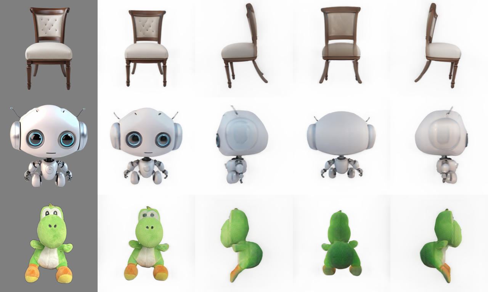

# D M7 TripoSR 서비스 적용 전 시험 기록

> 기록: D 이진우 · 2026-09-29 · Studio-B.local(Apple M1 Ultra, 128GB, macOS 26.3.1, CUDA 없음) · 원본 폴더 `/Users/pioneer1/project2610`
> 목적: P1 3D 조각(M7, FR-29) 후보 TripoSR이 **이 팀 서버에서 돌아가는지** 서비스에 붙이기 전에 확인한다. 특히 `docs/기록/A/A_팀서버_자원확인.md`가 열어 둔 질문 — "TripoSR의 MPS(Apple GPU) 동작은 자료 없음, P1 착수 게이트에서 확인" — 에 답한다.
> 참조: `models/m3/TripoSR/README.md`(HF 모델 카드) · 공식 저장소 `VAST-AI-Research/TripoSR` · `docs/기록/A/A_모델_라이선스_확정.md` M7 행 · REF §2 · D10 · BR-SRV-02 · BR-EXH-06
> 범위: **시험만** 했다. 서빙 코드(`serving/`)·매니페스트·설정은 바꾸지 않았다. 어댑터(T131)는 A 담당이다.

## 1. 결론

| 질문 | 답 |
|---|---|
| 가중치가 공식 배포본과 같은가 | ✅ `model.ckpt`·`config.yaml` 모두 HF 리비전 `5b521936`의 해시와 같다 |
| 이 서버에서 3D(GLB)가 나오는가 | ✅ 예제 4장 모두 GLB 생성·다시 읽기 성공(MPS·CPU 둘 다) |
| Apple GPU(MPS)에서 되는가 | ✅ **조건부로 된다.** 보완 2개가 필요하다: ① `PYTORCH_ENABLE_MPS_FALLBACK=1` ② 메시 추출 입력을 CPU로 넘기기. 보완 없이 그대로 돌리면 4장 모두 실패한다 |
| 속도 | MPS 한 장당 **약 6초**(추론 0.5초 + 메시 5초), CPU 약 13~17초. 시간 상한 `sculpture.timeout_s: 600` 안에 여유 있게 든다 |
| 메모리 | 프로세스 최대 RSS 3.8GB(MPS)·5.4GB(CPU). MPS는 통합 메모리를 포함한 최대 사용량이 약 8.3GB |
| 결과 품질 | 예제 4장 모두 네 방향에서 형태가 유지된다. **뒷면은 AI가 추정해서 채운다**(BR-EXH-06 안내 문구가 필요한 이유) |

**판정**: U2의 M7 부분("M7 가능 여부")은 **"MPS에서 가능, 보완 2개 전제"**로 닫을 수 있다. 단 팀원이 만든 입체 작품 사진으로는 아직 재지 않았다(§7).

## 2. 대상과 위치

| 무엇 | 경로 | 크기 | git |
|---|---|---:|---|
| 가중치·설정·모델 카드 | `models/m3/TripoSR/`(`model.ckpt`·`config.yaml`·`README.md`·`gitattributes`) | 1.6GB | 제외(`models/m3/`) |
| 공식 코드 | `models/m3/TripoSR-src/` — 커밋 `107cefdc244c39106fa830359024f6a2f1c78871`(2026-06-04) | 71MB | 제외 |
| 전용 파이썬 환경 | `models/m3/TripoSR-venv/`(Python 3.11.7) | 1.2GB | 제외 |
| 설치 결과 고정 | `models/m3/TripoSR-requirements-freeze.txt` | — | 제외 |
| 보조 모델 캐시 | `models/m3/TripoSR-cache/`(u2net 배경 제거 177MB · DINO 설정 12KB) | 177MB | 제외 |
| 시험 스크립트 | `models/m3/TripoSR-test_m7.py` | — | 제외 |
| 시점 렌더 결과 | `docs/기록/D/D_M7_TripoSR_시점렌더.png` | 480KB | 이 문서와 함께 |

- 공유 서버라 기존 `serving/.venv`와 Homebrew에는 아무것도 설치하지 않았다. 보조 모델 캐시도 사용자 공용 캐시(`~/.cache`) 대신 위 폴더로 받았다(`HF_HOME`·`U2NET_HOME`).
- 가중치가 M3 폴더(`models/m3/`) 아래에 있다. 서비스에 붙일 때는 매니페스트 경로 규칙(U14, `MODEL_ROOT/<모델>/`)에 맞춰 `models/m7/`로 옮기는 것을 권한다.

## 3. 가중치 검증

| 파일 | 크기 | 실측 | HF `stabilityai/TripoSR` 리비전 `5b521936b01fbe1890f6f9baed0254ab6351c04a` | 일치 |
|---|---:|---|---|:--:|
| `model.ckpt` | 1,677,246,742B | SHA-256 `429e2c6b22a0923967459de24d67f05962b235f79cde6b032aa7ed2ffcd970ee` | LFS sha256 같은 값 | ✅ |
| `config.yaml` | 987B | git blob `fa3e59a701f02679bd1dca02fbaf97306174d291` | blobId 같은 값 | ✅ |

- 라이선스: 모델 카드 `license: mit`. `docs/기록/A/A_모델_라이선스_확정.md`의 M7 행(MIT, 리비전 `5b521936…`, 1,677MB)과 같다.
- 모델 카드 참고 사항: 학습 데이터는 Objaverse 렌더(CC-BY 부분 집합), 한 장 입력 → 3D 재구성(feed-forward). HF 다운로드에는 이름·이메일 등 입력 동의(gated)가 걸려 있다.
- `config.yaml`은 이미지 인코더로 `facebook/dino-vitb16`을 가리킨다. 첫 적재 때 **그 설정 파일(12KB)만** HF에서 받는다(가중치는 `model.ckpt` 안에 있다). 오프라인 서비스에서는 이 설정을 미리 받아 둬야 한다.

## 4. 환경 구성

| 항목 | 값 |
|---|---|
| Python | 3.11.7(Homebrew `python3.11`로 venv 생성) |
| 주요 패키지 | torch 2.4.1 · torchvision 0.19.1(서빙 `.venv`와 같은 torch) · transformers 4.35.0 · trimesh 4.0.5 · omegaconf 2.3.0 · einops 0.7.0 · Pillow 10.1.0 · rembg 2.0.69 · onnxruntime 1.30.0 · **numpy 1.26.4** · torchmcubes(git `879926d0ef58e6ce0ac2630fdecb5e53af7ed3ff`, 소스 빌드) |
| 설치하지 않은 것 | `xatlas`(텍스처 굽기용, 빌드 실패) · `moderngl` · `gradio`(데모용). 기본 3D 생성에는 필요 없다 |

설치하면서 만난 문제와 조치:

| # | 문제 | 조치 | 서비스 적용 시 |
|:--:|---|---|---|
| 1 | `xatlas==0.0.9` 휠 빌드 실패 | 빼고 설치(텍스처 굽기 `--bake-texture`만 못 씀) | 정점 색 GLB로 충분한지 T133(회전 보기)에서 확인 |
| 2 | `torchmcubes` 빌드에 `scikit-build-core`가 없음 | `scikit-build-core`·`pybind11`·`ninja` 설치 뒤 `--no-build-isolation`으로 빌드 | 잠금 파일에 빌드 의존까지 적는다 |
| 3 | `trimesh 4.0.5`가 numpy 2에서 `ndarray.ptp` 없음 오류(GLB 내보내기 실패) | `numpy<2`(1.26.4)로 고정 | numpy 1.x 고정. `opencv-python-headless 5`(rembg 의존)는 numpy≥2를 요구한다고 경고하지만 시험 범위에서는 동작했다 — 서비스에서는 M1(BiRefNet) 컷아웃을 쓰면 rembg가 필요 없다 |

## 5. 시험

### 5-1 입력

공식 저장소 `examples/`의 그림만 썼다(가족 작품·팀원 작품 아님, BR-MDL-04).

| 입력 | 성격 | 고른 이유 |
|---|---|---|
| `chair.png` | 렌더 이미지, 가구 | 가는 다리 같은 얇은 구조 |
| `hamburger.png` | 렌더 이미지, 음식 | 층이 있는 둥근 물체 |
| `robot.png` | 렌더 이미지, 캐릭터 | 만들기 작품과 비슷한 캐릭터형 |
| `captured.jpeg` | **실제 촬영 사진**(인형) | 보호자가 찍어 올리는 사진과 가장 비슷한 조건 |

전처리는 README·`run.py`와 같다: rembg 배경 제거 → 전경 85%로 맞춤 → 회색(0.5) 배경 합성. 메시 해상도 256(기본값), 시점 렌더 4방향.

### 5-2 절차

```bash
cd models/m3
export TSR_SRC=$PWD/TripoSR-src TSR_MODEL=$PWD/TripoSR HF_HOME=$PWD/TripoSR-cache/hf U2NET_HOME=$PWD/TripoSR-cache/u2net
E=TripoSR-src/examples
# ① MPS 그대로 → ② MPS + 연산 대체 → ③ ②에 메시 추출 CPU 넘김 → ④ numpy 1.x 고정 뒤 ③ → ⑤ CPU
PYTORCH_ENABLE_MPS_FALLBACK=1 TripoSR-venv/bin/python TripoSR-test_m7.py --device mps --out <출력> \
  --images $E/chair.png $E/hamburger.png $E/robot.png $E/captured.jpeg
TripoSR-venv/bin/python TripoSR-test_m7.py --device cpu --out <출력> --images …
```

시험 스크립트는 한 장마다 전처리 → 추론(`model(image)`) → 메시 추출(`extract_mesh`, 정점 색 포함) → GLB 내보내기 → GLB 다시 읽기 → 4방향 렌더를 하고, 단계별 시간과 최대 RSS를 `report.json`에 남긴다. 공식 코드(`TripoSR-src`)는 고치지 않았다. 메시 추출의 CPU 넘김은 시험 스크립트 안에서 `tsr.models.isosurface.marching_cubes`를 감싸서 했다.

### 5-3 MPS 호환성 — 단계별로 막힌 곳

| 시도 | 결과 | 원인 |
|---|---|---|
| ① MPS 그대로 | ❌ 4장 모두 실패 | `aten::upsample_bicubic2d.out`이 MPS에 없다(DINO 위치 임베딩 보간). **M5 Depth Anything에서 만난 문제와 같다** |
| ② `PYTORCH_ENABLE_MPS_FALLBACK=1` | 추론 ✅(0.4~1.9초) · 메시 ❌ `vol must be a CPU tensor` | `torchmcubes`가 CPU로만 빌드된다. 공식 코드는 CUDA 미빌드 경우(`AttributeError`)만 CPU로 돌리고 MPS 경우(`RuntimeError`)는 처리하지 않는다 |
| ③ ② + 메시 추출 입력을 CPU로 | 추론 ✅ · 메시 ✅(약 5초) · GLB ❌ | `trimesh 4.0.5` × numpy 2(`ptp` 없음) — 장치와 무관한 환경 문제 |
| ④ ③ + numpy 1.26.4 | ✅ **4장 모두 성공** | — |

### 5-4 결과 — MPS(④)

적재 3.38초. 최대 RSS 3.8GB, 통합 메모리 포함 최대 사용량 8.3GB(`/usr/bin/time -l` peak memory footprint). 전체 70.5초(4장, 시점 렌더 포함).

| 입력 | 전처리 | 추론 | 메시 추출 | 정점 | 면 | GLB 크기 | GLB 확인 | 4방향 렌더 |
|---|---:|---:|---:|---:|---:|---:|---|---:|
| chair | 0.05초 | 0.78초 | 5.13초 | 42,143 | 84,160 | 1.69MB | `glTF` 머리·다시 읽기 면 수 같음·정점 색 있음 | 11.7초 |
| hamburger | 0.04초 | 0.45초 | 4.74초 | 55,722 | 111,172 | 2.23MB | 같음 | 9.2초 |
| robot | 0.05초 | 0.45초 | 4.99초 | 78,138 | 156,032 | 3.12MB | 같음 | 9.2초 |
| captured(사진) | 1.64초 | 0.50초 | 4.84초 | 42,975 | 85,824 | 1.72MB | 같음 | 10.1초 |

- 첫 장 추론(0.78초)은 워밍업이 들어간 값이다. 이후 약 0.45초.
- 4장 모두 `watertight=false`(닫힌 입체가 아님). 화면 회전 보기에는 문제없지만 3D 프린트 같은 용도에는 맞지 않는다.
- 사진 입력의 전처리 1.6초는 rembg 배경 제거 시간이다.

### 5-5 결과 — CPU(⑤, 비교)

적재 3.13초. 최대 RSS 5.4GB. 전체 157.6초. CPU를 여러 코어 쓴다(user 1,024초).

| 입력 | 추론 | 메시 추출 | 정점 | 면 | GLB 크기 | 4방향 렌더 |
|---|---:|---:|---:|---:|---:|---:|
| chair | 2.07초 | 14.82초 | 42,165 | 84,160 | 1.69MB | 22.3초 |
| hamburger | 1.83초 | 12.08초 | 55,713 | 111,172 | 2.23MB | 22.2초 |
| robot | 1.82초 | 11.18초 | 78,141 | 156,032 | 3.12MB | 22.2초 |
| captured | 1.86초 | 11.24초 | 42,976 | 85,824 | 1.72MB | 25.6초 |

면 수는 MPS와 같고 정점 수는 몇 개 차이(부동소수점 차이)다. MPS가 추론 약 4배, 메시 약 2.5배, 렌더 약 2배 빠르다.

### 5-6 눈으로 확인



맨 왼쪽은 전처리한 입력이고, 오른쪽 4장은 만든 3D를 앞·옆·뒤·옆에서 본 것이다(MPS 결과).

- 의자: 다리 4개와 등받이가 모든 방향에서 이어진다.
- 로봇: 머리·귀·몸통 비율이 유지된다. 뒷머리는 매끈하게 추정됐다.
- 실제 사진 인형: 앞모습은 사진과 가깝다. 뒷면·옆면의 모양과 색은 **보이지 않는 부분을 추정한 것**이다.

## 6. 서비스에 붙일 때 필요한 것 (T131·T132 입력)

| # | 항목 | 내용 | 근거 |
|:--:|---|---|---|
| 1 | MPS 연산 대체 | 워커에 `PYTORCH_ENABLE_MPS_FALLBACK=1`. 서빙은 이미 M5 때문에 `serving/adapters/__init__.py`에서 켠다 | §5-3 ① |
| 2 | 메시 추출 CPU 넘김 | 어댑터에서 `marching_cubes` 입력을 `.cpu()`로 넘긴다. 공식 코드는 고치지 않는다 | §5-3 ② |
| 3 | numpy 1.x 고정 | 잠금 파일에 `numpy<2`(1.26.4). `trimesh 4.0.5` 호환 | §5-3 ③ |
| 4 | 배경 제거 | rembg 대신 M1(BiRefNet) 컷아웃을 입력으로 쓰면 u2net·rembg·opencv 의존을 뺄 수 있다(SD_01 0.7 "M1 마스크 재사용") | §4 #3 |
| 5 | DINO 설정 사전 준비 | `facebook/dino-vitb16` 설정을 모델 폴더에 두고 오프라인 적재 | §3 |
| 6 | 매니페스트 | `source: stabilityai/TripoSR`, `revision: 5b521936…`, `weights_sha256: 429e2c6b…`, 코드 커밋 `107cefd`, `exec_device: gpu`(MPS), `image_digest`는 SD_04 §9-2 정의(잠금 파일 + runtime 문자열) | BR-MDL-01, SD_04 §9-2 |
| 7 | 서빙군·자원 | GPU 워커(worker-gpu, MPS). 동시 처리 1. 한 건 약 6초 + 적재 3초, 메모리 약 4~8GB | BR-SRV-01·02, limits.yaml `sculpture` |
| 8 | 결과 형식 | GLB(정점 색). `xatlas` 없이 텍스처 굽기는 못 한다 | R-07 |
| 9 | 화면 안내 | 뒷면은 추정이므로 "뒷면은 AI가 추정했어요"와 원본을 함께 보인다 | BR-EXH-06, T133 |
| 10 | 적용 범위 | **만들기(입체) 작품에만.** 평면 그림에는 쓰지 않는다(보이지 않는 뒷면을 지어내므로 재창작 금지 원칙) | REF §2 |
| 11 | 노출 | 노출 설정(G17, 기본 꺼짐)이 켜진 뒤에만. 켜는 주체는 아직 정해지지 않았다(SD_01 §17 #3, T132) | D10 |

## 7. 한계와 남은 일

| 항목 | 내용 | 담당 |
|---|---|---|
| 입력 | 공식 예제 4장뿐. **팀원이 만든 입체 작품 사진**(평가 묶음 "입체 작품" 항목, T118)으로 품질·시간을 다시 재야 한다 | A(T118·T137) |
| 품질 기준 | 3D 결과의 품질 미달 판정(→ 2.5D로 낮춤) 기준이 없다(`thresholds.yaml`에 `sculpture` 항목 없음) | A(U5) |
| 라이선스 확정 | `docs/기록/A/A_모델_라이선스_확정.md` §4의 M7 팀 확정 칸이 비어 있다 | 팀 |
| 어댑터·단계 | `serving/adapters/m7_triposr.py`(T131), `sculpture` 단계·낮춤(T132 serving 쪽) | A |
| 노출 설정 경로 | 노출 설정 변경 API(T132 B 몫)와 켜는 주체 결정 | D |
| 환경 정리 | 시험용 폴더(`TripoSR-src`·`TripoSR-venv`·`TripoSR-cache`, 약 1.4GB)는 git 밖에 있다. T131에서 정식 환경을 만들면 지워도 된다 | A·D |
